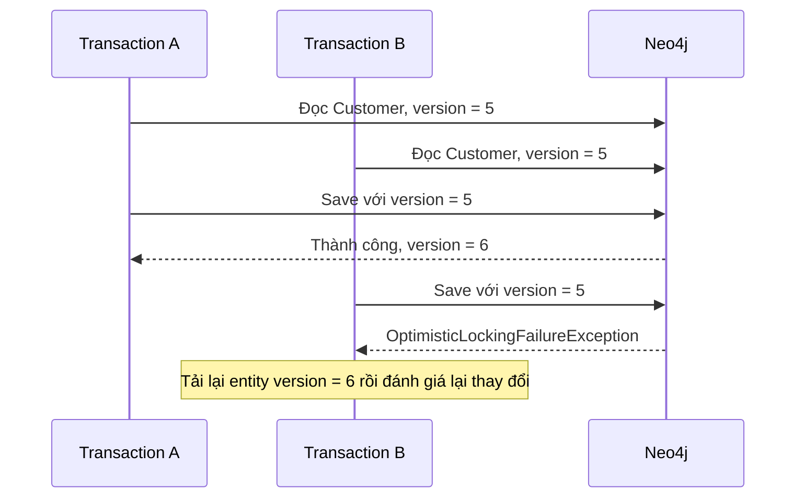

# Vai trò của ID và version khi phân biệt tạo mới với cập nhật

Khi gọi `save(entity)`, Spring Data Neo4j (SDN) cần biết entity đang đại diện cho một node chưa tồn tại hay một node đã được lưu. `@Id` cung cấp định danh để SDN tìm đúng node; `@Version` bổ sung trạng thái phiên bản để phân biệt entity mới với entity đã tồn tại và phát hiện cập nhật dựa trên dữ liệu cũ.

Trong module `SPRING_DATA_NEO4J`, hiểu đúng hai trường này giúp tránh tạo node trùng khi dùng business ID, đồng thời bảo vệ các lần cập nhật đồng thời. ID trả lời “đây là entity nào?”, còn version trả lời “entity này đang ở revision nào?”. Version cũng là cơ chế optimistic locking, không phải trường ghi lịch sử thay đổi như `@CreatedDate` hay `@LastModifiedDate`.

## 1. ID và version giải quyết hai câu hỏi khác nhau

Một entity Neo4j cần có định danh để Spring Data Neo4j liên kết object Java với node trong graph. Annotation `@Id` đánh dấu thuộc tính định danh. Tùy cách thiết kế, giá trị ID có thể được Neo4j tạo, do ứng dụng tạo hoặc là business key của domain.

`@Version` là annotation của Spring Data, dùng để kiểm soát phiên bản entity khi ghi. SDN tự quản lý giá trị này: khi tạo entity, version bắt đầu ở trạng thái mới; mỗi lần cập nhật thành công, version được tăng lên. Khi một object cũ được lưu sau khi node đã thay đổi ở transaction khác, SDN phát hiện version không còn khớp và từ chối ghi đè.

| Thuộc tính | Câu hỏi được trả lời | Vai trò |
|---|---|---|
| `@Id` | Entity nào trong graph? | Định danh node hoặc relationship entity |
| `@Version` | Entity đang ở phiên bản nào? | Nhận diện trạng thái mới/đã lưu và kiểm tra optimistic locking |
| `@CreatedDate` | Entity được tạo lúc nào? | Metadata auditing |
| `@LastModifiedDate` | Entity được sửa gần nhất lúc nào? | Metadata auditing |

Không nên dùng timestamp auditing thay cho version. Hai lần cập nhật có thể xảy ra trong cùng một đơn vị thời gian hoặc có độ chính xác timestamp không đủ để phát hiện xung đột. `@Version` là bộ đếm revision do SDN quản lý cho mục tiêu kiểm tra ghi.

## 2. SDN xác định entity mới như thế nào?

Quy tắc phụ thuộc vào loại ID và việc entity có khai báo `@Version` hay không.

### ID được sinh tự động

Với cách phổ biến dùng `@Id @GeneratedValue` trên trường `Long`, ID chưa có giá trị khi ứng dụng tạo object mới. Giá trị `null` cho SDN biết entity chưa được lưu; khi save thành công, SDN gán ID được Neo4j tạo.

```java
import org.springframework.data.neo4j.core.schema.GeneratedValue;
import org.springframework.data.neo4j.core.schema.Id;
import org.springframework.data.neo4j.core.schema.Node;

@Node("Person")
public class Person {

    @Id
    @GeneratedValue
    private Long id;

    private String name;

    protected Person() {
    }

    public Person(String name) {
        this.name = name;
    }

    public Long getId() {
        return id;
    }

    public String getName() {
        return name;
    }

    public void rename(String name) {
        this.name = name;
    }
}
```

Khi `id == null`, entity được xem là mới. Sau khi `save()` hoàn tất, entity trả về có ID. Những lần tải entity bằng repository sẽ nhận ID đã tồn tại và SDN dùng nó để nhận diện node tương ứng.

Ví dụ sử dụng:

```java
Person created = personRepository.save(new Person("An"));

Long generatedId = created.getId();
```

Nên dùng wrapper `Long` thay vì primitive `long` cho ID được sinh tự động. `null` biểu diễn rõ trạng thái chưa có ID; primitive luôn có giá trị mặc định `0`, khiến trạng thái mới khó biểu diễn rõ ràng.

### ID được sinh từ ứng dụng

SDN cũng hỗ trợ ID surrogate được tạo phía ứng dụng bằng `IdGenerator`, ví dụ `UUIDStringGenerator`:

```java
import org.springframework.data.neo4j.core.schema.GeneratedValue;
import org.springframework.data.neo4j.core.schema.Id;
import org.springframework.data.neo4j.core.schema.Node;
import org.springframework.data.neo4j.core.schema.UUIDStringGenerator;

@Node("Document")
public class Document {

    @Id
    @GeneratedValue(UUIDStringGenerator.class)
    private String id;

    private String title;
}
```

ID dạng UUID vẫn là ID được tạo theo chiến lược `@GeneratedValue`; nó khác với business key do nghiệp vụ cung cấp. Việc tạo ID ở phía ứng dụng không có nghĩa ứng dụng phải tự quyết định entity mới hay cũ. SDN quản lý quy trình sinh ID và persistence theo metadata đã khai báo.

### Business ID được gán trước khi save

Một business key là giá trị có sẵn trong domain object, ví dụ mã khách hàng, mã sản phẩm hoặc mã đơn hàng. Entity có thể khai báo:

```java
import org.springframework.data.neo4j.core.schema.Id;
import org.springframework.data.neo4j.core.schema.Node;

@Node("Customer")
public class Customer {

    @Id
    private String customerNumber;

    private String name;
}
```

Khác với generated ID, `customerNumber` đã có giá trị ngay khi object được tạo. Chỉ nhìn vào ID, SDN không thể biết object này mới được tạo trong bộ nhớ hay được tải từ graph trước đó. Theo quy tắc của SDN, entity dùng business ID mà không có `@Version` luôn được xem là entity mới.

Đây là điểm rất dễ gây lỗi: gọi `save()` với một object có business ID đã tồn tại nhưng không có version có thể khiến SDN xử lý object theo đường tạo mới. `@Id` không tự động biến thao tác save thành một câu `MERGE` theo business key.

Business key cần ổn định và duy nhất. Nên bảo vệ tính duy nhất ở database bằng constraint:

```cypher
CREATE CONSTRAINT customer_number_unique IF NOT EXISTS
FOR (c:Customer)
REQUIRE c.customerNumber IS UNIQUE;
```

Constraint ngăn hai node cùng có một mã khách hàng. Nó không thay thế cơ chế nhận diện trạng thái entity của SDN; khi dùng business ID, cần thêm version để SDN phân biệt tạo mới và cập nhật.

## 3. @Version giúp phân biệt tạo mới và cập nhật với business ID

Khi entity có thuộc tính `@Version`, SDN dùng version để nhận diện trạng thái entity. Một trường `Long` có giá trị `null` biểu thị entity mới; sau lần lưu đầu tiên, version được khởi tạo trong graph ở giá trị ban đầu `0`. Khi cập nhật thành công, SDN tăng version tự động.

```java
import org.springframework.data.annotation.Version;
import org.springframework.data.neo4j.core.schema.Id;
import org.springframework.data.neo4j.core.schema.Node;

@Node("Customer")
public class Customer {

    @Id
    private String customerNumber;

    private String name;

    @Version
    private Long version;

    protected Customer() {
    }

    public Customer(String customerNumber, String name) {
        this.customerNumber = customerNumber;
        this.name = name;
    }

    public String getCustomerNumber() {
        return customerNumber;
    }

    public String getName() {
        return name;
    }

    public Long getVersion() {
        return version;
    }

    public void changeName(String name) {
        this.name = name;
    }
}
```

Các trạng thái chính:

| Trạng thái object Java | Ý nghĩa với SDN |
|---|---|
| `customerNumber != null`, `version == null` | Entity mới, chưa được lưu |
| `customerNumber != null`, `version == 0` | Entity đã được lưu lần đầu |
| `customerNumber != null`, `version == 1` hoặc lớn hơn | Entity đã có các lần cập nhật thành công |

Với business ID, trường version là thành phần cần thiết để SDN xác định object đã được persistence hay chưa. Không khởi tạo `version = 0` trong constructor cho object mới; làm như vậy sẽ khiến object trông như một entity đã có version thay vì một entity mới. Hãy để giá trị ban đầu là `null` và để SDN quản lý nó.

## 4. Luồng tạo mới với business ID

Khi tạo khách hàng mới, ứng dụng cung cấp business ID nhưng không tự gán version:

```java
Customer customer = new Customer("CUS-1001", "An Nguyen");

Customer saved = customerRepository.save(customer);
```

Trước khi save:

```text
customerNumber = "CUS-1001"
version        = null
```

SDN nhận diện entity mới dựa trên version, tạo node `Customer` và khởi tạo version. Entity trả về sau save có trạng thái tương tự:

```text
customerNumber = "CUS-1001"
version        = 0
```

Hãy dùng entity được trả về từ `save()`, đặc biệt khi entity bất biến hoặc framework trả về một instance đã được cập nhật ID/version. Không tự tăng version trong code ứng dụng.

## 5. Luồng cập nhật entity đã tồn tại

Khi cập nhật, hãy tải entity từ repository trước để nhận cả ID lẫn version hiện tại:

```java
import org.springframework.data.neo4j.repository.Neo4jRepository;

public interface CustomerRepository
        extends Neo4jRepository<Customer, String> {
}
```

`CustomerNotFoundException` trong service bên dưới là exception nghiệp vụ do ứng dụng định nghĩa.

```java
import org.springframework.stereotype.Service;
import org.springframework.transaction.annotation.Transactional;

@Service
public class CustomerService {

    private final CustomerRepository customers;

    public CustomerService(CustomerRepository customers) {
        this.customers = customers;
    }

    @Transactional
    public Customer rename(String customerNumber, String newName) {
        Customer customer = customers.findById(customerNumber)
            .orElseThrow(() -> new CustomerNotFoundException(customerNumber));

        customer.changeName(newName);
        return customers.save(customer);
    }
}
```

Nếu node có `version = 3`, object được tải sẽ mang version `3`. Khi save, SDN kiểm tra revision hiện tại của node vẫn là `3`. Nếu điều kiện đúng, thay đổi được ghi và version tăng lên `4`.

Không nên tạo một object mới chỉ với business ID rồi dùng nó để cập nhật:

```java
// Không phải cách cập nhật an toàn cho entity có business ID và @Version.
Customer detached = new Customer("CUS-1001", "An Nguyen Updated");
customerRepository.save(detached);
```

Object `detached` có `version == null`, nên SDN xem nó là entity mới. Quy trình cập nhật đúng là tải entity hiện tại, thay đổi các thuộc tính nghiệp vụ rồi lưu object đang mang version hợp lệ.

## 6. @Version còn bảo vệ optimistic locking

Ngoài việc nhận diện entity mới, version còn ngăn một transaction ghi đè thay đổi của transaction khác. Giả sử hai request cùng tải khách hàng ở version `5`:

1. Transaction A tải `Customer` với `version = 5`.
2. Transaction B cũng tải cùng node với `version = 5`.
3. A cập nhật tên và save thành công; version tăng lên `6`.
4. B cố lưu object cũ vẫn mang version `5`.
5. SDN phát hiện version trong database không còn khớp và ném `OptimisticLockingFailureException`.



Đây là optimistic locking: các transaction không khóa entity ngay từ đầu để ngăn mọi truy cập đồng thời. Thay vào đó, SDN kiểm tra version tại thời điểm ghi và từ chối cập nhật dựa trên snapshot đã lỗi thời.

Khi gặp `OptimisticLockingFailureException`, hãy tải lại entity với version mới và đánh giá lại nghiệp vụ trước khi thử lại. Không chỉ lặp lại `save()` với object cũ vì version của object vẫn lỗi thời. Nếu nghiệp vụ không thể tự động áp dụng lại thay đổi, hãy trả lỗi xung đột để người gọi quyết định.

## 7. ID và version được dùng trong các thao tác nào?

`@Id` và `@Version` phối hợp trong quy trình persistence, nhưng chúng không thay thế nhau:

| Thao tác | Vai trò của ID | Vai trò của version |
|---|---|---|
| Tạo entity dùng generated ID | ID chưa có giá trị; SDN tạo ID khi lưu | Nếu khai báo, version biểu thị trạng thái mới |
| Tạo entity dùng business ID | ID đã có sẵn để định danh domain | `null` giúp SDN nhận diện entity mới |
| Đọc entity bằng `findById` | Chọn node cần đọc | Version hiện tại được hydrate vào object |
| Cập nhật entity đã tải | Xác định node cần ghi | Kiểm tra revision còn khớp và tăng sau khi ghi |
| Hai transaction cùng cập nhật | Cả hai cùng tham chiếu một ID | Phát hiện object nào đang dùng version cũ |

Version là một phần của metadata persistence. Không dùng nó làm business ID, không gửi cho người dùng như định danh tài nguyên và không dùng nó thay cho audit history đầy đủ.

## 8. Những lưu ý khi chọn kiểu ID

Spring Data Neo4j hỗ trợ một số chiến lược định danh:

| Chiến lược | Khai báo | Đặc điểm |
|---|---|---|
| Internal Neo4j ID | `@Id @GeneratedValue Long id` | Neo4j cấp ID nội bộ; `null` trước khi lưu |
| Element ID | `@Id @GeneratedValue String id` | SDN dùng `elementId` của Neo4j 5 trở lên |
| UUID surrogate key | `@Id @GeneratedValue(UUIDStringGenerator.class) String id` | UUID được sinh phía ứng dụng |
| Business key | `@Id String customerNumber` | Ứng dụng cung cấp trước khi save; cần `@Version` để phân biệt mới/cũ |

Internal ID thuận tiện cho persistence nội bộ, nhưng không nên coi nó là định danh nghiệp vụ bền vững hoặc dùng làm public identifier lâu dài. Neo4j có thể tái sử dụng internal ID sau khi node bị xóa. Với ID cần ổn định giữa các hệ thống hoặc qua vòng đời database, cân nhắc UUID hoặc business key ổn định.

Với generated ID, `Long` dùng Neo4j internal ID và `String` mặc định dùng `elementId` của Neo4j 5 trở lên; các giá trị này không phải property thông thường trên node. Ngược lại, business key như `customerNumber` là property domain được lưu trên node và có thể được bảo vệ bằng uniqueness constraint.

Business key cần đáp ứng các điều kiện:

- Duy nhất trong phạm vi label/domain entity.
- Ổn định theo thời gian; tránh chọn giá trị có thể đổi như tên hiển thị.
- Có uniqueness constraint phù hợp trong Neo4j.
- Entity khai báo `@Version` để SDN nhận diện new-vs-existing và kiểm tra optimistic locking.

## 9. Version không phải trường auditing

Tên chương là Auditing, nhưng cần tách rõ version với các trường thời gian/người thực hiện:

| Annotation | Thông tin lưu | Ai quản lý? |
|---|---|---|
| `@Version` | Số revision hiện tại | SDN quản lý để nhận diện state và optimistic locking |
| `@CreatedDate` | Thời điểm tạo entity | Spring Data auditing |
| `@CreatedBy` | Người tạo entity | Spring Data auditing và `AuditorAware` |
| `@LastModifiedDate` | Thời điểm cập nhật gần nhất | Spring Data auditing |
| `@LastModifiedBy` | Người cập nhật gần nhất | Spring Data auditing và `AuditorAware` |

Version không cho biết ai sửa, sửa lúc nào hoặc nội dung trước/sau thay đổi là gì. Nếu cần lịch sử nghiệp vụ, hãy thiết kế audit event hoặc history node riêng. Không suy ra số lần sửa chính xác từ `@LastModifiedDate`; cũng không tự tăng version để ghi nhận một hành động nghiệp vụ.

## 10. Những lỗi thường gặp

| Biểu hiện | Nguyên nhân | Cách xử lý |
|---|---|---|
| Save business ID tạo node mới thay vì cập nhật | ID đã có giá trị nên SDN không thể biết entity mới hay cũ nếu thiếu version | Thêm `@Version Long` cho entity dùng business ID |
| Duplicate business ID bị từ chối | Database có uniqueness constraint và một node cùng ID đã tồn tại | Tải entity hiện tại để cập nhật; chỉ tạo mới khi ID chưa tồn tại |
| Entity mới bị xem là đã tồn tại | Version bị khởi tạo thủ công thành `0` | Để version của object mới là `null` |
| Entity cập nhật bị xem là mới | Tạo object detached chỉ có business ID, version vẫn `null` | Tải entity từ repository để lấy version hiện tại |
| `OptimisticLockingFailureException` | Object đang lưu có version cũ hơn database | Reload, đánh giá lại thay đổi rồi mới retry |
| Version không tăng như mong đợi | Code tự gán version hoặc dùng custom Cypher không duy trì version | Để SDN quản lý khi dùng repository/template; tự kiểm tra version nếu viết Cypher riêng |
| Dùng `long` cho version | Primitive không biểu diễn trạng thái `null` của entity mới | Dùng `Long` theo API optimistic locking của SDN |
| Dùng internal ID làm public ID lâu dài | Internal ID thuộc vòng đời database và có thể được tái sử dụng | Dùng UUID hoặc business key ổn định |
| Nghĩ `@Version` lưu lịch sử thay đổi | Nhầm optimistic locking với auditing/history | Dùng `@CreatedDate`, `@LastModifiedDate` hoặc audit event riêng |
| Retry liên tục với cùng object cũ | Không tải lại version mới sau xung đột | Reload entity và đánh giá lại logic trước khi thử lại |

Khi debug, hãy kiểm tra lần lượt: entity đang dùng generated ID hay business ID; giá trị ID trước khi save là gì; entity có `@Version` hay không; version hiện tại có `null` hay đã được hydrate; và thao tác ghi có đi qua repository/template hay là Cypher tự viết. Các thông tin này thường xác định được vì sao SDN chọn đường tạo mới, cập nhật hoặc báo xung đột.

## 11. Tự kiểm tra

1. `@Id` và `@Version` trả lời hai câu hỏi khác nhau nào?
2. Vì sao `Long` ID được sinh tự động nên để `null` trước lần save đầu tiên?
3. Khi dùng business ID đã có sẵn, SDN xử lý entity ra sao nếu không có `@Version`?
4. Vì sao business ID cần uniqueness constraint và `@Version` có vai trò gì khác constraint?
5. Giá trị version của một entity mới nên được khởi tạo thế nào?
6. SDN xử lý version ra sao sau lần tạo đầu tiên và sau mỗi lần cập nhật thành công?
7. Điều gì xảy ra khi hai transaction cùng tải entity ở version `5` rồi lần lượt save?
8. Vì sao không nên retry với object đã gây `OptimisticLockingFailureException`?
9. `@Version` khác `@LastModifiedDate` như thế nào?
10. Nếu dùng custom Cypher để cập nhật entity có version, ứng dụng cần tự bảo đảm điều gì?

`@Id` định danh entity, còn `@Version` giúp SDN nhận diện trạng thái mới/đã lưu và bảo vệ cập nhật khỏi snapshot lỗi thời. Generated ID thường dùng `null` để biểu thị entity mới; business ID đã có giá trị cần `@Version` để SDN phân biệt tạo mới với cập nhật. Hãy để SDN quản lý version, tải entity trước khi cập nhật và xử lý optimistic locking failure bằng cách đọc lại dữ liệu rồi đánh giá lại nghiệp vụ.

## Tài liệu tham khảo

- [Spring Data Neo4j 8.2 — Handling and provisioning of unique IDs](https://docs.spring.io/spring-data/neo4j/reference/8.2/object-mapping/mapping-ids.html)
- [Spring Data Neo4j 8.2 — Metadata-based mapping and optimistic locking](https://docs.spring.io/spring-data/neo4j/reference/8.2/object-mapping/metadata-based-mapping.html)
- [Spring Data Commons — Entity State Detection Strategies](https://docs.spring.io/spring-data/commons/reference/is-new-state-detection.html)
- [Spring Data Neo4j 8.2 — Core repository concepts](https://docs.spring.io/spring-data/neo4j/reference/8.2/repositories/core-concepts.html)
