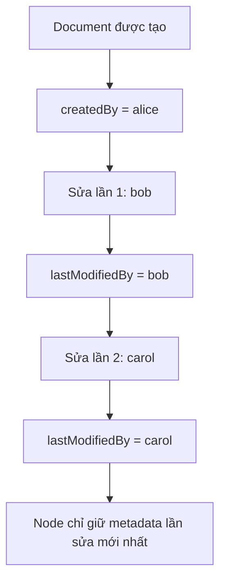
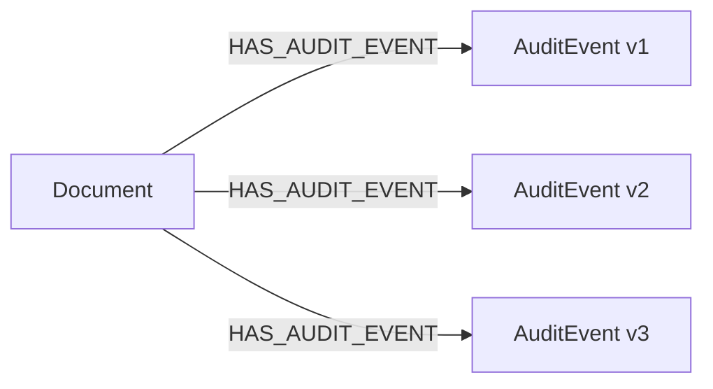

# Phân biệt thông tin lần sửa gần nhất với lịch sử thay đổi đầy đủ

Spring Data Neo4j (SDN) hỗ trợ auditing để ghi nhận ai tạo entity, ai sửa entity và thời điểm những thao tác đó diễn ra. Các trường `@CreatedBy`, `@CreatedDate`, `@LastModifiedBy` và `@LastModifiedDate` rất hữu ích cho màn hình quản trị, truy vết trách nhiệm gần nhất và kiểm tra thời điểm cập nhật.

Tuy nhiên, auditing metadata trên entity chỉ mô tả trạng thái tạo/sửa hiện tại. Khi entity được cập nhật nhiều lần, `@LastModifiedBy` và `@LastModifiedDate` được cập nhật theo lần sửa mới; các giá trị lần sửa trước không được tự động lưu thành danh sách. Nếu nghiệp vụ cần biết toàn bộ nội dung đã thay đổi, giá trị trước/sau, người thực hiện từng lần và thời điểm của từng lần, ứng dụng phải thiết kế một cơ chế lịch sử riêng như audit-event append-only hoặc revision snapshot. Với nhu cầu thu thập thay đổi ở cấp database để đồng bộ hệ thống, có thể cân nhắc Neo4j Change Data Capture (CDC) nếu edition và cấu hình hỗ trợ.

## 1. Auditing metadata lưu điều gì?

Spring Data Auditing cung cấp bốn annotation thường dùng:

| Annotation | Ý nghĩa | Dữ liệu được giữ trên entity |
| --- | --- | --- |
| `@CreatedBy` | Principal tạo entity | Người tạo |
| `@CreatedDate` | Thời điểm tạo entity | Thời điểm tạo |
| `@LastModifiedBy` | Principal sửa entity gần nhất | Người sửa gần nhất |
| `@LastModifiedDate` | Thời điểm sửa entity gần nhất | Thời điểm sửa gần nhất |

Ví dụ, một tài liệu được tạo bởi `alice`, sau đó được `bob` và `carol` sửa:

| Lần thao tác | Người thực hiện | Thời điểm |
| --- | --- | --- |
| Tạo | alice | 09:00 |
| Sửa 1 | bob | 10:15 |
| Sửa 2 | carol | 14:30 |

Sau lần sửa cuối, metadata trên node có thể là:

```text
createdBy       = "alice"
createdAt       = 09:00
lastModifiedBy  = "carol"
lastModifiedAt  = 14:30
```

Node không còn cho biết `bob` đã sửa lúc 10:15, field nào đã thay đổi hay giá trị trước khi sửa là gì. Auditing giữ thông tin lần tạo và lần sửa gần nhất; nó không tự tạo một record mới cho mỗi lần save.

## 2. Cấu hình auditing trong Spring Data Neo4j

Khai báo auditing metadata trên entity và bật hạ tầng auditing:

```java
import java.time.Instant;

import org.springframework.data.annotation.CreatedBy;
import org.springframework.data.annotation.CreatedDate;
import org.springframework.data.annotation.Id;
import org.springframework.data.annotation.LastModifiedBy;
import org.springframework.data.annotation.LastModifiedDate;
import org.springframework.data.annotation.Version;
import org.springframework.data.neo4j.core.schema.Node;

@Node("Document")
public class Document {

    @Id
    private String documentId;

    @Version
    private Long version;

    private String title;

    private String body;

    @CreatedBy
    private String createdBy;

    @CreatedDate
    private Instant createdAt;

    @LastModifiedBy
    private String lastModifiedBy;

    @LastModifiedDate
    private Instant lastModifiedAt;

    public String getDocumentId() { return documentId; }
    public Long getVersion() { return version; }
    public String getTitle() { return title; }
    public String getBody() { return body; }
    public String getCreatedBy() { return createdBy; }
    public Instant getCreatedAt() { return createdAt; }
    public String getLastModifiedBy() { return lastModifiedBy; }
    public Instant getLastModifiedAt() { return lastModifiedAt; }

    public void rename(String newTitle) {
        this.title = newTitle;
    }
}
```

Vì `documentId` là business ID do ứng dụng gán, entity dùng thêm `@Version` kiểu `Long` để SDN phân biệt object mới (version `null`) với entity đã được persist. Tạo uniqueness constraint cho business ID:

```cypher
CREATE CONSTRAINT document_id_unique IF NOT EXISTS
FOR (d:Document)
REQUIRE d.documentId IS UNIQUE
```

Repository dùng để đọc và lưu entity:

```java
import org.springframework.data.neo4j.repository.Neo4jRepository;

public interface DocumentRepository extends Neo4jRepository<Document, String> {
}
```

```java
import java.util.Optional;

import org.springframework.context.annotation.Bean;
import org.springframework.context.annotation.Configuration;
import org.springframework.data.domain.AuditorAware;
import org.springframework.data.neo4j.config.EnableNeo4jAuditing;

@Configuration
@EnableNeo4jAuditing(auditorAwareRef = "auditorProvider")
public class Neo4jAuditingConfiguration {

    @Bean
    AuditorAware<String> auditorProvider() {
        return () -> Optional.of("document-service");
    }
}
```

Trong ứng dụng thực tế, `AuditorAware` nên lấy principal từ Spring Security hoặc ngữ cảnh request đáng tin cậy. Chuỗi cố định `document-service` trong ví dụ chỉ là giá trị minh họa. Nếu chỉ cần ngày tạo/sửa mà không cần người thực hiện, không bắt buộc phải khai báo `AuditorAware`.

Auditing cần được bật rõ ràng bằng `@EnableNeo4jAuditing`. Các annotation chỉ đánh dấu field; chính auditing infrastructure mới điền giá trị trong lifecycle persistence của SDN. Nếu ứng dụng cập nhật entity bằng Cypher tùy chỉnh qua `Neo4jClient` hoặc Driver, không nên mặc định auditing callback sẽ tự chạy cho câu lệnh đó.

## 3. `@LastModified*` không phải lịch sử thay đổi

Giả sử một entity được cập nhật năm lần. Auditing không tạo năm phiên bản metadata trên node. Nó ghi đè thông tin lần sửa gần nhất:



Auditing metadata phù hợp để trả lời:

- Ai tạo tài liệu này?
- Tài liệu được tạo khi nào?
- Ai là người sửa gần nhất?
- Lần sửa gần nhất diễn ra lúc nào?

Nó không đủ để trả lời:

- Ai đã sửa tài liệu ở từng lần trước?
- Trước và sau mỗi lần sửa, field có giá trị gì?
- Có bao nhiêu lần sửa trong một khoảng thời gian?
- Một field đã trải qua những giá trị nào?
- Ai đã xóa một relationship hoặc một node?

Nếu cần các câu trả lời ở nhóm thứ hai, phải lưu các thay đổi thành dữ liệu lịch sử riêng hoặc dùng một cơ chế change capture phù hợp.

## 4. Phân biệt auditing, `@Version` và lịch sử đầy đủ

Ba khái niệm này có mục đích khác nhau:

| Cơ chế | Trả lời câu hỏi | Có lưu từng lần thay đổi không? |
| --- | --- | --- |
| Auditing metadata | Ai tạo, ai sửa gần nhất, lúc nào? | Không |
| `@Version` | Entity có bị cập nhật kể từ lúc tôi đọc không? | Không; version chỉ là số phiên bản phục vụ optimistic locking |
| Audit-event log | Mỗi thao tác đã xảy ra, do ai thực hiện và thay đổi gì? | Có, nếu ứng dụng ghi một event cho mỗi thao tác cần theo dõi |
| Revision snapshot | Entity có trạng thái đầy đủ như thế nào sau mỗi lần lưu? | Có, nếu ứng dụng lưu snapshot cho từng revision |
| Neo4j CDC | Những thay đổi database nào đã được commit? | Có change stream trong phạm vi CDC và retention của transaction log |

Không dùng `@Version` như một audit log. Version `5` cho biết entity đã qua một số lần cập nhật được quản lý bởi persistence path có hỗ trợ version, nhưng không cho biết ai sửa, field nào đổi hoặc nội dung các version trước.

## 5. Lưu lịch sử bằng audit-event node append-only

Một cách trực tiếp trong graph là tạo node lịch sử riêng cho mỗi thao tác:



Mỗi `AuditEvent` ghi lại một hành động đã xảy ra. Ví dụ:

```text
(:Document {
  documentId: "DOC-001",
  title: "Thiết kế hệ thống",
  lastModifiedBy: "carol",
  lastModifiedAt: ...,
  version: 3
})
  -[:HAS_AUDIT_EVENT]->
(:DocumentAuditEvent {
  eventId: "...",
  eventType: "TITLE_CHANGED",
  actorId: "bob",
  occurredAt: ...,
  entityVersion: 2,
  beforeTitle: "Thiết kế ban đầu",
  afterTitle: "Thiết kế hệ thống"
})
```

Node chính vẫn giữ trạng thái hiện tại và metadata auditing. Mỗi lần thay đổi tạo thêm một node `DocumentAuditEvent` mới; các event cũ không bị ghi đè.

### Thiết kế các thuộc tính của audit event

Một event thường nên có:

| Thuộc tính | Mục đích |
| --- | --- |
| `eventId` | ID duy nhất của event, hỗ trợ idempotency |
| `eventType` | Loại hành động, ví dụ `DOCUMENT_CREATED`, `TITLE_CHANGED`, `DOCUMENT_ARCHIVED` |
| `entityId` hoặc relationship tới entity | Xác định đối tượng bị thay đổi |
| `actorId` | Người dùng hoặc service account thực hiện |
| `occurredAt` | Thời điểm nghiệp vụ xảy ra |
| `entityVersion` | Phiên bản entity sau thao tác, nếu có versioning |
| `before...` / `after...` | Giá trị trước và sau của field được theo dõi |
| `changedFields` | Danh sách field thay đổi |
| `correlationId` | Liên kết event với request hoặc workflow |
| `schemaVersion` | Phiên bản cấu trúc event để hỗ trợ thay đổi schema |

Trong Neo4j, property của node không thể là một map lồng tùy ý. Với dữ liệu trước/sau phức tạp, hãy dùng property phẳng có tên rõ ràng, các node con, hoặc serialize payload thành JSON string nếu chấp nhận đánh đổi khả năng truy vấn theo field. Không đặt Java `Map` trực tiếp làm property node.

Tạo uniqueness constraint cho event ID:

```cypher
CREATE CONSTRAINT document_audit_event_id IF NOT EXISTS
FOR (e:DocumentAuditEvent)
REQUIRE e.eventId IS UNIQUE
```

Nếu business ID của document chưa có constraint, cần tạo uniqueness constraint riêng cho `Document.documentId`.

## 6. Ghi entity và audit event trong cùng transaction

Nếu lịch sử là yêu cầu nghiệp vụ bắt buộc, cập nhật entity và thêm audit event trong cùng một Neo4j transaction. Khi một trong hai thao tác thất bại, cả hai phải rollback. Ví dụ service đổi tiêu đề:

```java
import java.util.Objects;

import org.springframework.data.neo4j.core.Neo4jClient;
import org.springframework.stereotype.Service;
import org.springframework.transaction.annotation.Transactional;

@Service
public class DocumentService {

    private final DocumentRepository documentRepository;
    private final Neo4jClient neo4jClient;

    public DocumentService(
        DocumentRepository documentRepository,
        Neo4jClient neo4jClient
    ) {
        this.documentRepository = documentRepository;
        this.neo4jClient = neo4jClient;
    }

    @Transactional
    public Document rename(
        String documentId,
        String newTitle,
        String actorId,
        String eventId
    ) {
        Document current = documentRepository.findById(documentId)
            .orElseThrow(() -> new IllegalArgumentException("Document not found"));

        String oldTitle = current.getTitle();
        if (Objects.equals(oldTitle, newTitle)) {
            return current;
        }

        current.rename(newTitle);
        Document saved = documentRepository.save(current);

        neo4jClient.query("""
                MATCH (d:Document {documentId: $documentId})
                CREATE (d)-[:HAS_AUDIT_EVENT]->(e:DocumentAuditEvent {
                    eventId: $eventId,
                    eventType: 'TITLE_CHANGED',
                    actorId: $actorId,
                    occurredAt: datetime(),
                    entityVersion: $entityVersion,
                    beforeTitle: $beforeTitle,
                    afterTitle: $afterTitle,
                    changedFields: ['title']
                })
                RETURN e.eventId AS eventId
                """)
            .bind(documentId).to("documentId")
            .bind(eventId).to("eventId")
            .bind(actorId).to("actorId")
            .bind(saved.getVersion()).to("entityVersion")
            .bind(oldTitle).to("beforeTitle")
            .bind(saved.getTitle()).to("afterTitle")
            .fetch()
            .one()
            .orElseThrow(() -> new IllegalStateException("Audit event was not created"));

        return saved;
    }
}
```

Điểm quan trọng trong ví dụ:

1. Service đọc entity hiện tại và giữ lại giá trị trước khi sửa.
2. `save(current)` cập nhật entity; nếu entity dùng `@Version`, SDN kiểm tra optimistic locking và trả về version mới.
3. `Neo4jClient` tạo node event và relationship nối với document.
4. `@Transactional` bao cả repository và client, nên chúng phải dùng cùng `Driver` và transaction manager Neo4j.
5. Nếu tạo event thất bại, exception thoát khỏi method khiến cả cập nhật document và event rollback.

`actorId` trong ví dụ phải lấy từ security context hoặc service identity đã xác thực ở server. Không nhận actor tùy ý từ request body, vì client có thể giả mạo người thực hiện. Trong hệ thống thực tế có thể dùng chung một `AuditorAware` hoặc một abstraction lấy current actor cho cả auditing metadata và audit event.

`eventId` nên được tạo ở ranh giới command và giữ nguyên khi retry cùng một command. Constraint duy nhất giúp từ chối event trùng ID; nếu cần hỗ trợ client gửi lại request sau khi response bị mất, service nên kiểm tra idempotency key đã được xử lý và trả lại kết quả đã ghi thay vì áp dụng thay đổi lần nữa.

Query custom ở đây tạo event node; nó không tự gọi auditing callback cho entity. `documentRepository.save(...)` là thao tác SDN quản lý metadata auditing, còn custom query chỉ tạo lịch sử. Hãy giữ cả hai trong cùng transaction.

## 7. Đọc lịch sử của một entity

Lấy các event theo thứ tự version:

```cypher
MATCH (d:Document {documentId: $documentId})
      -[:HAS_AUDIT_EVENT]->(e:DocumentAuditEvent)
RETURN e.eventId AS eventId,
       e.eventType AS eventType,
       e.actorId AS actorId,
       e.occurredAt AS occurredAt,
       e.entityVersion AS entityVersion,
       e.beforeTitle AS beforeTitle,
       e.afterTitle AS afterTitle,
       e.changedFields AS changedFields
ORDER BY e.entityVersion ASC
```

Nếu mỗi lần cập nhật entity tạo đúng một event và version được tăng tuần tự, `entityVersion` là thứ tự tốt để trình bày lịch sử của entity. Timestamp có thể trùng nhau hoặc có độ phân giải khác nhau, nên không nên dựa riêng vào timestamp để phân biệt các thay đổi rất gần nhau.

Có thể lấy lần sửa gần nhất từ entity hiện tại bằng auditing metadata, còn lịch sử chi tiết lấy từ các event node. Hai truy vấn phục vụ hai nhu cầu khác nhau.

## 8. Audit event dạng delta hay revision snapshot?

Có hai cách phổ biến để lưu lịch sử ở cấp ứng dụng:

| Chiến lược | Nội dung mỗi record | Ưu điểm | Đánh đổi |
| --- | --- | --- | --- |
| Delta/event log | Hành động và các field thay đổi, gồm giá trị trước/sau | Nhẹ, dễ trả lời ai thay đổi field nào | Muốn dựng lại toàn bộ entity phải áp dụng các event theo đúng thứ tự |
| Revision snapshot | Bản chụp đầy đủ trạng thái entity sau mỗi lần lưu | Dễ xem trạng thái tại revision cụ thể | Tốn dung lượng và có thể lặp nhiều dữ liệu |

### Delta event

Ví dụ một event chỉ lưu field thay đổi:

```text
eventType: "DOCUMENT_RENAMED"
entityVersion: 4
beforeTitle: "Bản nháp"
afterTitle: "Bản phát hành"
changedFields: ["title"]
```

Delta phù hợp khi giao diện cần timeline hoặc danh sách thay đổi. Khi có nhiều field và kiểu dữ liệu, nên xác định schema event rõ ràng thay vì lưu một map tự do không kiểm soát.

### Revision snapshot

Ví dụ mỗi revision lưu đầy đủ trạng thái cần khôi phục:

```text
(:Document)-[:HAS_REVISION]->(:DocumentRevision {
  revision: 4,
  capturedAt: ...,
  actorId: "carol",
  title: "Bản phát hành",
  body: "Nội dung đầy đủ...",
  status: "PUBLISHED"
})
```

Snapshot phù hợp khi cần xem hoặc khôi phục trạng thái cũ nhanh. Có thể lưu snapshot ở mỗi lần thay đổi hoặc theo chu kỳ, kết hợp snapshot gần nhất với delta sau snapshot. Hãy xác định rõ những field nào cần snapshot; tránh lưu token, mật khẩu, dữ liệu nhạy cảm hoặc payload không cần thiết.

## 9. Event sourcing có giống audit log không?

Audit log và event sourcing có thể dùng các event tương tự, nhưng mục tiêu khác nhau:

- **Audit log** ghi lại hành động để truy vết, kiểm toán hoặc điều tra. Entity hiện tại thường vẫn là dữ liệu phục vụ đọc/ghi chính.
- **Event sourcing** xem chuỗi domain event là nguồn sự thật; trạng thái hiện tại được dựng bằng cách áp dụng các event theo thứ tự.

Không nên gọi một bảng audit đơn giản là event sourcing nếu ứng dụng vẫn cập nhật entity hiện tại độc lập và event không đủ để tái tạo trạng thái. Event sourcing đòi hỏi event schema ổn định, quy tắc versioning, replay, idempotency, xử lý event sai thứ tự và chiến lược snapshot.

Nếu yêu cầu chỉ là xem ai đã sửa gì, audit-event node append-only thường đơn giản hơn event sourcing đầy đủ.

## 10. Neo4j CDC: thu thập thay đổi ở cấp database

Neo4j Change Data Capture (CDC) là khả năng của database để ghi nhận thay đổi node và relationship từ transaction log, sau đó cho phép client truy vấn hoặc tiêu thụ change event. CDC phù hợp khi cần đồng bộ Neo4j sang hệ thống khác, xây dựng pipeline dữ liệu hoặc xử lý thay đổi đã commit mà không phải thêm một audit node cho từng entity.

Theo tài liệu Neo4j hiện hành, CDC có trên Neo4j Enterprise Edition và các dịch vụ Aura tier được hỗ trợ như AuraDB Business Critical và Virtual Dedicated Cloud. CDC được giới thiệu từ Neo4j 5.13; không mặc định có trên mọi edition hoặc mọi Aura tier.

Hai chế độ capture chính:

| Chế độ | Dữ liệu thay đổi |
| --- | --- |
| `DIFF` | Các property/label được thêm, cập nhật hoặc xóa |
| `FULL` | Trạng thái đầy đủ trước và sau của entity thay đổi |

CDC mặc định ở trạng thái `OFF`. Với self-managed Enterprise, database có thể được tạo hoặc cấu hình với `txLogEnrichment`:

```cypher
CREATE DATABASE audit_source IF NOT EXISTS
OPTIONS {txLogEnrichment: "FULL"}
```

Hoặc đổi chế độ cho database hiện có:

```cypher
ALTER DATABASE audit_source SET OPTION txLogEnrichment "DIFF"
```

Thao tác bật CDC cần quyền quản trị database phù hợp. Thay đổi giữa `DIFF` và `FULL` làm thay đổi cấu trúc event; consumer phải hỗ trợ format tương ứng.

### Đọc change event bằng CDC procedure

Khi CDC đã được bật, có thể lấy change identifier hiện tại:

```cypher
CALL db.cdc.current()
```

Sau khi có một transaction tạo hoặc sửa node, truy vấn thay đổi sau identifier trước đó:

```cypher
CALL db.cdc.query($previousChangeId)
YIELD id, txId, seq, metadata, event
RETURN id, txId, seq, metadata, event
```

`metadata` chứa thông tin transaction như thời điểm bắt đầu/commit và thông tin user/connection tùy môi trường. `event` mô tả node hoặc relationship bị thay đổi, bao gồm operation và state trước/sau theo capture mode.

### CDC không tự động trở thành audit history lâu dài

CDC lưu thông tin trong transaction log. Khả năng đọc lại thay đổi phụ thuộc retention của transaction log; khi log cũ bị prune, consumer không thể tiếp tục truy vấn các change event đã mất. Vì vậy:

- Consumer cần checkpoint change identifier và xử lý lại an toàn khi restart.
- Cần theo dõi lag và cấu hình retention phù hợp downtime tolerance.
- CDC có overhead ghi transaction log và cần dự trù disk.
- Thay đổi đi qua đường ghi trực tiếp như một số lệnh import/load có thể không đi qua transaction layer và không được CDC capture.
- CDC là change stream ở cấp database, không tự biết ý nghĩa nghiệp vụ như “duyệt hợp đồng” hoặc “đổi chủ sở hữu”.
- `seq` hỗ trợ phân biệt các thay đổi trong cùng transaction, nhưng thứ tự event trả về không nhất thiết phản ánh đúng thứ tự các thao tác được áp dụng bên trong transaction.

Nếu yêu cầu kiểm toán phải giữ lịch sử trong nhiều năm, hãy persist CDC event vào kho lưu trữ lâu dài hoặc thiết kế audit log nghiệp vụ. Không dựa vào transaction log retention như chính sách lưu trữ audit vĩnh viễn.

## 11. So sánh các lựa chọn

| Tiêu chí | Auditing metadata | Audit-event node | Revision snapshot | Neo4j CDC |
| --- | --- | --- | --- | --- |
| Ai tạo / ai sửa gần nhất | Có | Có thể lưu | Có thể lưu | Có metadata transaction tùy cấu hình |
| Lịch sử từng lần sửa | Không | Có | Có | Có trong phạm vi retention |
| Giá trị trước/sau | Không | Có nếu thiết kế event | Có toàn trạng thái snapshot | Có theo DIFF/FULL |
| Ý nghĩa nghiệp vụ | Metadata cơ bản | Có thể mô tả domain action | Lưu trạng thái theo revision | Thay đổi ở cấp database |
| Cùng transaction với entity update | Auditing callback chạy trong persistence | Có thể ghi cùng transaction | Có thể ghi cùng transaction | Được capture từ transaction log |
| Yêu cầu edition/tier đặc biệt | Không | Không | Không | Có; kiểm tra edition/tier và phiên bản |
| Lưu trữ lâu dài | Chỉ trạng thái hiện tại | Do ứng dụng quản lý | Do ứng dụng quản lý | Phụ thuộc transaction-log retention nếu chưa export |

Gợi ý chọn:

- Chỉ cần hiển thị người sửa cuối và thời điểm sửa: dùng auditing metadata.
- Cần timeline ai thay đổi field nào: dùng audit-event node append-only.
- Cần xem hoặc khôi phục trạng thái đầy đủ tại từng revision: dùng revision snapshot.
- Cần đồng bộ thay đổi database tới nhiều hệ thống: cân nhắc CDC và consumer riêng.
- Cần tái tạo trạng thái từ chuỗi domain event: thiết kế event sourcing có chủ đích.

## 12. Application event, callback và outbox

Entity callback và application event không tự thay thế audit history:

- `BeforeBindCallback` chạy trước khi entity được bind; phù hợp chuẩn hóa hoặc bổ sung metadata, nhưng không tự giữ lại giá trị cũ nếu ứng dụng không đọc và lưu chúng.
- Application event có thể thông báo rằng một hành động đã xảy ra. Listener chạy bất đồng bộ hoặc sau commit không mặc nhiên cùng transaction với entity update.
- Nếu ghi audit event trong Neo4j là yêu cầu bắt buộc, tạo event node trong cùng transaction với entity update.
- Nếu cần phát event ra Kafka, webhook hoặc hệ thống ngoài, dùng outbox pattern hoặc cơ chế giao nhận đáng tin cậy. Gửi trực tiếp message trước commit có thể tạo thông báo cho một thay đổi sau đó bị rollback.

Một thiết kế outbox thường ghi `OutboxEvent` trong cùng transaction với entity, sau đó worker đọc và publish; consumer phải idempotent vì message có thể được gửi lại.

## 13. Những lưu ý về bảo mật và chất lượng lịch sử

**Audit log nên append-only.** Hạn chế quyền sửa/xóa event sau khi ghi. Nếu cần sửa sai lịch sử, tạo một event hiệu chỉnh mới và giữ lại dấu vết trước đó.

**Ghi actor từ nguồn đáng tin cậy.** Lấy actor từ security context hoặc service identity đã xác thực. Không tin actorId do client tự gửi.

**Chỉ lưu dữ liệu cần thiết.** Tránh sao chép mật khẩu, token, dữ liệu cá nhân nhạy cảm hoặc nội dung lớn vào before/after payload. Có thể lưu tên field và giá trị đã được mask.

**Đặt chính sách retention.** Xác định thời gian giữ event, quy trình archive, xóa theo yêu cầu pháp lý và cách xử lý backup. Append-only không có nghĩa là giữ mọi dữ liệu vô thời hạn bất kể chính sách.

**Bảo đảm idempotency.** Nếu request có thể retry, dùng event ID ổn định cho một command hoặc một idempotency key để tránh tạo hai audit event cho cùng một thao tác nghiệp vụ.

**Giữ thứ tự.** Dùng entity version hoặc sequence do ứng dụng quản lý để sắp xếp event cho một entity. Không giả định timestamp có thể phân biệt mọi thay đổi xảy ra gần như đồng thời.

**Không dùng audit log thay cho optimistic locking.** Audit log cho biết thay đổi đã xảy ra; `@Version` giúp phát hiện stale update. Hệ thống có thể cần cả hai.

## 14. Kiểm thử auditing và lịch sử

Một integration test nên xác minh cả metadata hiện tại và lịch sử:

1. Tạo document dưới actor `alice`; xác minh `createdBy` và `createdAt` được điền.
2. Đổi tiêu đề dưới actor `bob`; xác minh `lastModifiedBy` và `lastModifiedAt` phản ánh lần sửa mới.
3. Đổi tiêu đề lần nữa dưới actor `carol`; xác minh metadata hiện tại chuyển sang `carol`.
4. Truy vấn `DocumentAuditEvent`; xác minh có đủ hai event, actor đúng và giá trị before/after đúng.
5. Gây lỗi khi tạo audit event; xác minh document update cũng rollback.
6. Gửi lại cùng command/idempotency key; xác minh không sinh event trùng.
7. Kiểm tra người dùng không có quyền đọc audit history không thể truy cập node event.

Ví dụ kỳ vọng sau hai lần sửa:

| Nguồn đọc | Kết quả |
| --- | --- |
| Node `Document` | `createdBy = alice`, `lastModifiedBy = carol` |
| Event 1 | `actorId = bob`, title từ `Bản nháp` sang `Thiết kế` |
| Event 2 | `actorId = carol`, title từ `Thiết kế` sang `Bản phát hành` |

Test cần chạy với Neo4j thật hoặc Testcontainers để xác minh transaction rollback và mapping. Mock callback đơn lẻ không chứng minh audit node đã commit cùng entity.

## 15. Lỗi thường gặp

| Biểu hiện | Nguyên nhân | Cách xử lý |
| --- | --- | --- |
| Chỉ thấy người sửa cuối | Dùng `@LastModifiedBy` như thể nó là lịch sử | Thêm audit-event log hoặc revision snapshot |
| Không có giá trị trước khi sửa | Chỉ lưu entity sau khi thay đổi | Đọc giá trị cũ trước khi mutate hoặc dùng snapshot/CDC |
| Entity update thành công nhưng thiếu event | Ghi event ngoài transaction hoặc swallow exception | Ghi cùng transaction và để lỗi rollback |
| Event bị tạo trùng khi retry | Không có idempotency key/event ID ổn định | Dùng event ID duy nhất và constraint |
| Custom Cypher không cập nhật auditing field | Bỏ qua SDN auditing callback | Cập nhật metadata tường minh hoặc dùng SDN persistence path |
| Không thể xem thay đổi cũ qua CDC | Transaction log đã bị prune hoặc CDC chưa bật | Kiểm tra mode, retention và checkpoint; persist event dài hạn |
| Không biết ai thực hiện thay đổi | `AuditorAware` không lấy được principal | Cấu hình auditor từ security context/service identity |
| Audit event chứa dữ liệu nhạy cảm | Lưu toàn bộ payload không lọc | Mask/redact và giới hạn field được ghi |

## 16. Checklist chọn chiến lược

1. Xác định chỉ cần metadata lần tạo/sửa gần nhất hay cần lịch sử từng lần.
2. Dùng `@Created*` và `@LastModified*` cho metadata hiện tại.
3. Dùng `@Version` riêng cho optimistic locking; không coi version là lịch sử.
4. Nếu cần audit nghiệp vụ, thiết kế event schema và node append-only.
5. Ghi entity và audit event trong cùng Neo4j transaction.
6. Lưu actor, thời điểm, event type, entity version, correlation ID và before/after cần thiết.
7. Tạo uniqueness constraint cho event ID và business ID phù hợp.
8. Nếu cần snapshot, xác định đầy đủ field và chính sách retention.
9. Chỉ chọn CDC khi edition/tier hỗ trợ; cấu hình mode, retention và consumer checkpoint.
10. Kiểm thử rollback, retry, idempotency, quyền truy cập và dữ liệu nhạy cảm.

## Kết luận

Spring Data Auditing trả lời ai tạo entity và ai sửa entity gần nhất; nó không lưu lại toàn bộ các lần sửa. `@Version` hỗ trợ optimistic locking chứ không phải audit trail. Khi cần lịch sử nghiệp vụ, hãy ghi các `AuditEvent` append-only hoặc revision snapshot và commit chúng cùng entity trong một transaction Neo4j. Khi cần capture thay đổi ở cấp database để tích hợp hệ thống, Neo4j CDC là lựa chọn riêng nhưng phụ thuộc edition/tier, cấu hình và retention của transaction log. Chọn đúng cơ chế theo câu hỏi mà ứng dụng cần trả lời, đồng thời bảo vệ actor, dữ liệu nhạy cảm, thứ tự và tính bất biến của lịch sử.

## Tài liệu tham khảo

- [Spring Data Neo4j 8.1 — Auditing](https://docs.spring.io/spring-data/neo4j/reference/auditing.html)
- [Spring Data Commons — Auditing](https://docs.spring.io/spring-data/commons/reference/auditing.html)
- [Neo4j Change Data Capture — Introduction and supported editions](https://neo4j.com/docs/cdc/current/)
- [Neo4j CDC — Enable CDC and configure DIFF/FULL modes](https://neo4j.com/docs/cdc/current/get-started/self-managed/)
- [Neo4j CDC — Query change events](https://neo4j.com/docs/cdc/current/procedures/)
- [Neo4j CDC — Change event output schema](https://neo4j.com/docs/cdc/current/procedures/output-schema/)
