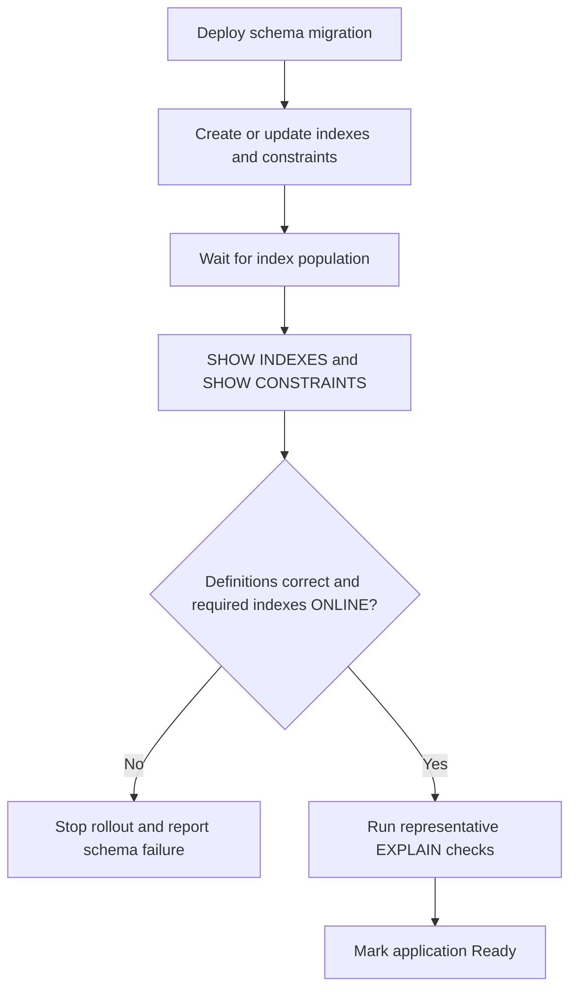

# Kiểm tra trạng thái index và constraint trước khi phục vụ ứng dụng

Một ứng dụng Spring Data Neo4j có thể khởi động thành công trong khi index vẫn đang được tạo, constraint chưa tồn tại hoặc schema thực tế khác với schema mà phiên bản ứng dụng mong đợi. Khi traffic bắt đầu, truy vấn có thể chậm do index chưa `ONLINE`, thao tác ghi có thể thất bại vì dữ liệu trùng, hoặc ứng dụng có thể dựa vào một uniqueness constraint chưa được triển khai.

Trước khi đưa ứng dụng vào trạng thái sẵn sàng, cần kiểm tra schema trực tiếp trên Neo4j: index đã `ONLINE` chưa, có index `FAILED` hay còn `POPULATING` không, constraint cần thiết đã tồn tại với đúng label/property chưa và index có đúng loại, đúng định nghĩa không. `SHOW INDEXES`, `SHOW CONSTRAINTS` và `db.awaitIndexes()` là các công cụ quan trọng cho bước xác minh này.

## 1. Vì sao cần kiểm tra schema trước khi nhận traffic?

Index và constraint ảnh hưởng đến cả hiệu năng lẫn tính đúng đắn của dữ liệu:

- **Index** giúp Neo4j tìm node hoặc relationship theo label/type và property mà không phải quét toàn bộ tập dữ liệu phù hợp.
- **Uniqueness constraint** ngăn nhiều node hoặc relationship cùng có một giá trị property trong phạm vi được ràng buộc.
- **Existence/type constraint** có thể bảo đảm property bắt buộc tồn tại hoặc có kiểu phù hợp, tùy loại constraint và edition/version Neo4j.
- **Constraint-backed index** là index được Neo4j quản lý để thực thi constraint; không nên xem nó như một index độc lập có thể tùy ý xóa.

Khi tạo index mới, Neo4j thường cần thời gian population để đọc dữ liệu hiện có và xây dựng cấu trúc index. Trong giai đoạn đó, index có thể ở trạng thái `POPULATING`; khi sẵn sàng sử dụng, trạng thái chuyển thành `ONLINE`. Nếu population thất bại, index có thể ở trạng thái `FAILED` cùng thông tin lỗi.

Ứng dụng không nên coi việc lệnh `CREATE INDEX` hoặc `CREATE CONSTRAINT` trả về thành công là bằng chứng rằng mọi index đã sẵn sàng phục vụ truy vấn. Cần kiểm tra trạng thái sau khi migration hoàn tất.

## 2. Xem toàn bộ index bằng SHOW INDEXES

Neo4j cung cấp lệnh quản trị `SHOW INDEXES` để xem index hiện có trong database đang chọn:

```cypher
SHOW INDEXES;
```

Kết quả có các thông tin như tên, loại index, loại entity, label hoặc relationship type, danh sách property, trạng thái population, phần trăm hoàn thành và thông tin lỗi.

Để hiển thị các cột quan trọng cho kiểm tra readiness:

```cypher
SHOW INDEXES
YIELD name, type, entityType, labelsOrTypes, properties,
      state, populationPercent, owningConstraint, failureMessage
RETURN name, type, entityType, labelsOrTypes, properties,
       state, populationPercent, owningConstraint, failureMessage
ORDER BY name;
```

Các trường cần chú ý:

| Trường | Ý nghĩa |
|---|---|
| `name` | Tên index trong database |
| `type` | Loại index, ví dụ `RANGE`, `TEXT`, `POINT`, `FULLTEXT`, `LOOKUP` hoặc `VECTOR` |
| `entityType` | Index áp dụng cho `NODE` hay `RELATIONSHIP` |
| `labelsOrTypes` | Label của node hoặc relationship type được index |
| `properties` | Các property nằm trong index, theo đúng thứ tự khai báo với composite index |
| `state` | Trạng thái population như `POPULATING`, `ONLINE` hoặc `FAILED` |
| `populationPercent` | Tiến độ population khi index đang được xây dựng |
| `owningConstraint` | Constraint sở hữu index, nếu đây là index hỗ trợ constraint |
| `failureMessage` | Thông tin lỗi nếu index không được tạo thành công |

Tên và một số cột có thể khác theo phiên bản Neo4j. Hãy kiểm tra output của `SHOW INDEXES` trên phiên bản server đang triển khai khi viết script quản trị.

### Lọc các index chưa sẵn sàng

```cypher
SHOW INDEXES
YIELD name, type, state, populationPercent, failureMessage
WHERE state <> 'ONLINE'
RETURN name, type, state, populationPercent, failureMessage
ORDER BY name;
```

Kết quả cần được phân loại:

- `POPULATING`: index đang được xây dựng; chờ hoàn tất rồi kiểm tra lại.
- `FAILED`: population thất bại; đọc `failureMessage`, xác định nguyên nhân và xử lý trước khi phục vụ traffic phụ thuộc index.
- `ONLINE`: index đã sẵn sàng cho truy vấn.

Một database có thể có index `ONLINE` và một index khác `POPULATING`. Không nên chỉ kiểm tra xem có ít nhất một index online; cần đối chiếu từng index bắt buộc với schema mong đợi.

## 3. Chờ index population hoàn tất

Neo4j có procedure `db.awaitIndexes()` để chờ các index đang population chuyển sang trạng thái sẵn sàng, có thể truyền timeout tính bằng giây:

```cypher
CALL db.awaitIndexes(300);
```

Lệnh trên chờ tối đa 300 giây. Sau khi procedure kết thúc, vẫn cần chạy `SHOW INDEXES` để xác nhận các index mong đợi thực sự `ONLINE` và không có index `FAILED`.

Có thể chờ một index cụ thể bằng procedure `db.awaitIndex()`:

```cypher
CALL db.awaitIndex('person_email_index', 300);
```

Chờ index hữu ích trong migration hoặc bước chuẩn bị deployment. Không gọi `db.awaitIndexes()` trong mỗi request nghiệp vụ; đó là thao tác quản trị có thể chờ lâu. Nếu timeout, deployment phải báo chưa sẵn sàng và ghi lại index còn chưa hoàn tất.

## 4. Kiểm tra constraint bằng SHOW CONSTRAINTS

Index tăng tốc truy vấn; constraint bảo vệ invariant dữ liệu. Dùng `SHOW CONSTRAINTS` để kiểm tra các ràng buộc đang tồn tại:

```cypher
SHOW CONSTRAINTS;
```

Để tập trung vào các trường quan trọng:

```cypher
SHOW CONSTRAINTS
YIELD name, type, entityType, labelsOrTypes, properties, ownedIndex
RETURN name, type, entityType, labelsOrTypes, properties, ownedIndex
ORDER BY name;
```

Hãy xác nhận cả tên lẫn định nghĩa:

- `type`: loại constraint, ví dụ `UNIQUENESS`, `NODE_KEY` hoặc các constraint về existence/type tùy edition và phiên bản.
- `entityType`: `NODE` hay `RELATIONSHIP`.
- `labelsOrTypes`: label hoặc relationship type được ràng buộc.
- `properties`: property hoặc tập property thuộc constraint.
- `ownedIndex`: index backing do constraint quản lý, nếu có.

Một uniqueness constraint trên `Person.email` khác với index thường trên `Person.email`: index giúp tìm kiếm, còn constraint ngăn các node Person có cùng email. Nếu ứng dụng dựa vào email là định danh duy nhất, chỉ có index thường là chưa đủ.

### Kiểm tra uniqueness constraint trước khi tạo

Trước khi thêm uniqueness constraint, kiểm tra dữ liệu hiện có có giá trị trùng hay không:

```cypher
MATCH (p:Person)
WHERE p.email IS NOT NULL
WITH p.email AS email, count(*) AS occurrences
WHERE occurrences > 1
RETURN email, occurrences
ORDER BY occurrences DESC;
```

Nếu truy vấn trả kết quả, cần làm sạch hoặc hợp nhất dữ liệu trùng trước khi tạo constraint. Neo4j không thể tạo uniqueness constraint thành công nếu dữ liệu hiện có vi phạm điều kiện.

Lưu ý: uniqueness constraint không bắt buộc mọi node đều phải có property. Node thiếu `email` không vi phạm uniqueness. Nếu nghiệp vụ yêu cầu property luôn tồn tại, cần thêm existence constraint phù hợp với edition/version hỗ trợ hoặc kiểm tra bằng validation ở tầng ứng dụng.

## 5. Phân biệt index độc lập và index do constraint sở hữu

Neo4j có thể tự tạo backing index để thực thi uniqueness/key constraint. Trường `owningConstraint` trong `SHOW INDEXES` cho biết index được constraint sở hữu. Tương ứng, `SHOW CONSTRAINTS` có thể hiển thị `ownedIndex`.

Ví dụ tạo uniqueness constraint:

```cypher
CREATE CONSTRAINT person_email_unique IF NOT EXISTS
FOR (p:Person)
REQUIRE p.email IS UNIQUE;
```

Neo4j tạo và quản lý index cần thiết cho constraint. Không xóa backing index trực tiếp bằng `DROP INDEX`; nếu cần thay đổi constraint, hãy xử lý constraint sở hữu nó bằng `DROP CONSTRAINT` rồi tạo lại định nghĩa phù hợp sau khi kiểm tra dữ liệu.

Index độc lập có thể tạo riêng để tăng tốc truy vấn:

```cypher
CREATE RANGE INDEX person_name_index IF NOT EXISTS
FOR (p:Person)
ON (p.name);
```

Khi kiểm tra, hãy phân biệt hai trường hợp để tránh xóa nhầm index phục vụ invariant dữ liệu.

## 6. Đối chiếu định nghĩa thực tế với schema mong đợi

Chỉ kiểm tra tên index hoặc constraint là chưa đủ. Một index tên `person_email_index` có thể tồn tại nhưng lại áp dụng cho property khác, label khác hoặc loại index không phù hợp.

Ví dụ schema mong đợi:

| Thành phần | Định nghĩa mong đợi |
|---|---|
| `person_email_unique` | Uniqueness constraint trên node `Person`, property `email` |
| `person_name_index` | Range index trên node `Person`, property `name` |
| `order_created_at_index` | Range index trên node `Order`, property `createdAt` |

Khi deployment chạy, đối chiếu các cột `type`, `entityType`, `labelsOrTypes` và `properties` của output với danh sách định nghĩa đã version hóa trong migration. Nếu cùng tên nhưng khác định nghĩa, phải coi là schema drift và dừng rollout để điều tra.

`IF NOT EXISTS` làm cho lệnh tạo schema có thể chạy lặp mà không báo lỗi khi cấu trúc tương ứng đã tồn tại. Nó không phải công cụ migration để sửa một index/constraint cũ có định nghĩa sai. Không đổi nội dung migration đã chạy; hãy tạo migration mới để thay đổi schema có kiểm soát.

## 7. Kiểm tra index được dùng trong query plan

Index `ONLINE` không đồng nghĩa mọi truy vấn đều sử dụng nó. Query phải có pattern và predicate phù hợp với index.

Ví dụ truy vấn tìm người theo email:

```cypher
EXPLAIN
MATCH (p:Person {email: $email})
RETURN p;
```

Trong plan, tìm operator phù hợp như `NodeUniqueIndexSeek` nếu có uniqueness constraint hoặc `NodeIndexSeek` nếu dùng range index. Tên operator thực tế phụ thuộc loại index, phiên bản Neo4j và cách viết truy vấn.

`EXPLAIN` lập kế hoạch mà không thực thi truy vấn. `PROFILE` thực thi truy vấn và cung cấp số liệu thực tế như rows, db hits và thời gian/operator:

```cypher
PROFILE
MATCH (p:Person)
WHERE p.email = $email
RETURN p;
```

Chỉ dùng `PROFILE` trong môi trường kiểm thử hoặc khi hiểu rõ tác động của truy vấn; với query ghi, `PROFILE` vẫn thực thi thay đổi. Đừng chạy `PROFILE` tùy tiện trên lệnh ghi production.

## 8. Kiểm tra readiness trước khi mở traffic

Một quy trình deployment có thể chia thành các bước:



Quy trình gợi ý:

1. Chạy migration schema bằng một bước deployment có quyền phù hợp.
2. Chờ các index cần thiết hoàn tất population.
3. Kiểm tra index và constraint tồn tại đúng định nghĩa.
4. Xác nhận không có index bắt buộc ở trạng thái `POPULATING` hoặc `FAILED`.
5. Chạy kiểm tra query plan đại diện nếu hiệu năng truy vấn là điều kiện phát hành.
6. Chỉ sau khi tất cả điều kiện đạt, mới đánh dấu ứng dụng sẵn sàng nhận traffic.

Trong hệ thống nhiều replica, tránh để tất cả instance đồng thời chạy migration DDL khi khởi động. Dùng một migration job hoặc cơ chế điều phối duy nhất; các instance ứng dụng chỉ kiểm tra schema và readiness. Điều này giảm cạnh tranh DDL và giúp rollout có kết quả nhất quán.

Readiness probe nên phản ánh khả năng phục vụ traffic, còn liveness probe chỉ kiểm tra process có còn hoạt động hay không. Schema chưa sẵn sàng thường nên làm readiness fail, không nhất thiết làm process bị restart liên tục.

## 9. Triển khai migration schema có kiểm soát

Trong môi trường phát triển, có thể tạo index và constraint bằng Cypher thủ công. Với production, nên lưu DDL thành migration có version, review cùng code và áp dụng theo thứ tự.

Ví dụ một migration:

```cypher
// V004__person_schema.cypher
CREATE CONSTRAINT person_email_unique IF NOT EXISTS
FOR (p:Person)
REQUIRE p.email IS UNIQUE;

CREATE RANGE INDEX person_name_index IF NOT EXISTS
FOR (p:Person)
ON (p.name);
```

Migration cần được kiểm tra trên dữ liệu gần với production vì việc tạo uniqueness constraint có thể thất bại khi dữ liệu cũ bị trùng. Với index lớn, population có thể mất thời gian và tiêu thụ tài nguyên. Lên lịch migration phù hợp, theo dõi tiến độ và không mở traffic phụ thuộc index trước khi xác minh `ONLINE`.

Không dựa hoàn toàn vào việc SDN hoặc ứng dụng tự tạo schema lúc khởi động để quản lý production. Annotation mapping mô tả cách Java ánh xạ graph; migration có version là nơi kiểm soát thay đổi schema, rollback strategy và lịch sử triển khai.

## 10. Quyền truy cập khi kiểm tra schema

Các lệnh `SHOW INDEXES`, `SHOW CONSTRAINTS`, tạo/xóa schema và một số procedure quản trị cần quyền tương ứng. Tài khoản runtime thường chỉ cần quyền đọc/ghi dữ liệu nghiệp vụ; không nên cấp quyền quản trị schema cho mọi instance chỉ để chúng tự kiểm tra hoặc sửa schema.

Có thể tách vai trò:

- **Migration identity:** có quyền tạo, thay đổi và xóa index/constraint trong deployment.
- **Application identity:** có quyền truy cập dữ liệu nghiệp vụ và đọc thông tin schema cần thiết nếu policy cho phép.
- **Operations identity:** dùng để điều tra trạng thái index, failure message và query plan.

Nếu ứng dụng không có quyền chạy `SHOW` hoặc procedure quản trị, hãy thực hiện bước kiểm tra trong migration/operations job thay vì bỏ qua kiểm tra hoặc cấp quyền quá rộng cho runtime.

## 11. Những lỗi thường gặp

| Lỗi | Hệ quả | Cách xử lý |
|---|---|---|
| Chỉ thấy `CREATE INDEX` thành công rồi mở traffic | Index có thể vẫn đang `POPULATING` | Chờ và xác nhận `ONLINE` bằng `SHOW INDEXES` |
| Không kiểm tra index `FAILED` | Truy vấn có thể không có index mong đợi | Đọc `failureMessage`, sửa nguyên nhân và chạy migration lại |
| Chỉ kiểm tra tên index | Có thể dùng nhầm label, property hoặc index type | Đối chiếu toàn bộ định nghĩa |
| Nhầm index thường với uniqueness constraint | Dữ liệu trùng vẫn có thể được ghi | Kiểm tra `SHOW CONSTRAINTS` và tạo constraint cần thiết |
| Xóa backing index của constraint | Constraint có thể bị ảnh hưởng hoặc thao tác bị từ chối | Thay đổi constraint sở hữu index |
| Dùng `IF NOT EXISTS` để mong sửa định nghĩa cũ | Schema drift vẫn còn | Tạo migration mới để drop/recreate có kiểm soát |
| Tạo uniqueness constraint khi dữ liệu còn trùng | Migration thất bại | Chạy truy vấn tìm duplicate và làm sạch trước |
| Cho mọi replica chạy DDL khi startup | Tăng cạnh tranh và khó kiểm soát rollout | Dùng một migration job duy nhất |
| Dùng `PROFILE` trên query ghi production | Query thực sự thực thi và có thể thay đổi dữ liệu | Dùng `EXPLAIN` hoặc test trong môi trường riêng |
| Coi readiness và liveness là một | Schema chưa sẵn sàng có thể làm process restart liên tục | Dùng readiness để chặn traffic, liveness để kiểm tra process |

## 12. Bài tập thực hành

Giả sử ứng dụng có node `Person` với `email`, `name` và node `Order` với `createdAt`.

1. Tạo uniqueness constraint `person_email_unique` trên `Person.email`.
2. Tạo range index `person_name_index` trên `Person.name`.
3. Chạy `SHOW INDEXES` và ghi lại `type`, `labelsOrTypes`, `properties`, `state`, `populationPercent`.
4. Chạy `CALL db.awaitIndexes(300)` rồi kiểm tra lại các index cần thiết đã `ONLINE` chưa.
5. Chạy `SHOW CONSTRAINTS` và xác nhận constraint email đúng label/property.
6. Tạo dữ liệu email trùng trong môi trường thử nghiệm, chạy truy vấn phát hiện duplicate và quan sát việc tạo constraint thất bại nếu dữ liệu chưa được làm sạch.
7. Dùng `EXPLAIN` cho truy vấn tìm Person theo email và kiểm tra operator seek.
8. Cố ý thay đổi định nghĩa index trong môi trường thử nghiệm để mô phỏng schema drift; xác định vì sao `IF NOT EXISTS` không tự sửa định nghĩa cũ.
9. Thiết kế readiness gate: ứng dụng chỉ nhận traffic khi constraint bắt buộc tồn tại và index bắt buộc đã `ONLINE`.

Sau bài tập, hãy giải thích được khác biệt giữa index và constraint, trạng thái population, backing index, schema drift và lý do cần tách migration khỏi startup của từng application replica.

## Kết luận

Trước khi phục vụ traffic, hãy kiểm tra index và constraint trực tiếp trên Neo4j thay vì chỉ dựa vào việc lệnh tạo schema đã chạy. `SHOW INDEXES` cho biết định nghĩa và trạng thái population; `db.awaitIndexes()` giúp chờ index hoàn tất; `SHOW CONSTRAINTS` xác nhận invariant dữ liệu. Đối chiếu tên, loại, label/type và property với schema mong đợi, kiểm tra query plan đại diện và chỉ mở readiness khi các thành phần bắt buộc đã sẵn sàng. Quản lý DDL bằng migration có version và chạy migration một lần giúp deployment an toàn, có thể kiểm tra và truy vết.

## Tài liệu tham khảo

- [Neo4j Cypher Manual – SHOW INDEXES](https://neo4j.com/docs/cypher-manual/current/indexes/search-performance-indexes/list-indexes/)
- [Neo4j Cypher Manual – SHOW CONSTRAINTS](https://neo4j.com/docs/cypher-manual/current/constraints/managing-constraints/)
- [Neo4j Operations Manual – Indexes](https://neo4j.com/docs/operations-manual/current/performance/index-configuration/)
- [Neo4j Cypher Manual – EXPLAIN and PROFILE](https://neo4j.com/docs/cypher-manual/current/planning-and-tuning/execution-plans/)
