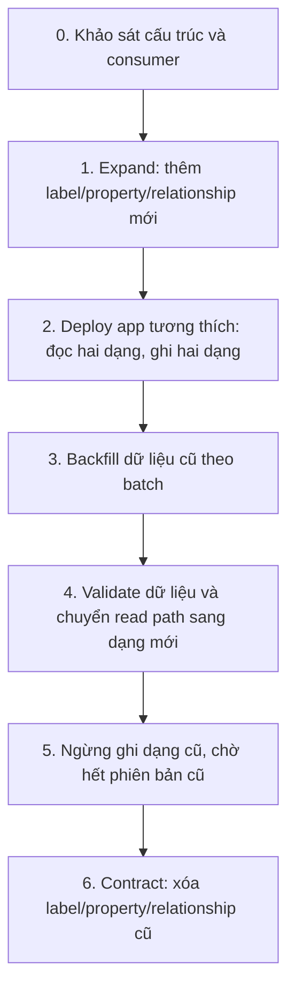

# Đổi label, property hoặc relationship type theo giai đoạn

Đổi tên label, property hoặc relationship type trong Neo4j là thay đổi cấu trúc dữ liệu mà nhiều phiên bản ứng dụng có thể cùng sử dụng. Nếu đổi mapping trong code rồi xóa cấu trúc cũ ngay, phiên bản ứng dụng đang chạy hoặc tác vụ nền chưa được nâng cấp có thể không đọc được graph. Cách an toàn là triển khai migration theo giai đoạn: mở rộng cấu trúc mới, đồng bộ dữ liệu, chuyển ứng dụng sang cấu trúc mới, xác minh rồi mới loại bỏ cấu trúc cũ.

Trong module `SPRING_DATA_NEO4J`, mapping được khai báo qua `@Node`, `@Property` và `@Relationship`. Những annotation này mô tả cách SDN đọc/ghi graph; chúng không tự đổi dữ liệu đã tồn tại trong database. Vì vậy, migration cần phối hợp Cypher, phiên bản ứng dụng, repository/query và kế hoạch rollback.

## 1. Vì sao phải migration theo giai đoạn?

Giả sử hệ thống đang có:

- Label `LegacyPerson`, muốn đổi thành `Person`.
- Property `name`, muốn đổi thành `fullName`.
- Relationship type `FRIEND_OF`, muốn đổi thành `KNOWS`.

Đây là ba thay đổi khác nhau về mặt graph:

| Thành phần | Cấu trúc cũ | Cấu trúc mới | Cách chuyển đổi |
|---|---|---|---|
| Label | `:LegacyPerson` | `:Person` | Thêm label mới, sau đó gỡ label cũ |
| Property | `name` | `fullName` | Sao chép giá trị sang property mới, sau đó xóa property cũ |
| Relationship type | `:FRIEND_OF` | `:KNOWS` | Tạo relationship mới với cùng endpoints/properties, sau đó xóa relationship cũ |

Neo4j không cung cấp một thao tác rename tổng quát cho property hoặc relationship type. Đổi mapping annotation trong Java cũng không tự di chuyển dữ liệu. Cần thực hiện migration trên graph và giữ khả năng tương thích trong thời gian các instance ứng dụng được triển khai dần.

Một migration trực tiếp có thể gây lỗi như sau:

1. Ứng dụng cũ vẫn truy vấn `:LegacyPerson`.
2. Migration xóa label `LegacyPerson` trước khi mọi instance được nâng cấp.
3. Request đi vào instance cũ không còn tìm thấy node.

Với property và relationship type, hậu quả tương tự: code cũ đọc `name` hoặc `FRIEND_OF`, trong khi migration đã xóa chúng. Hãy dùng chiến lược *expand–migrate–contract* để tránh khoảng thời gian graph và code không tương thích.

## 2. Chiến lược expand–migrate–contract

Một quy trình điển hình gồm sáu giai đoạn:



| Giai đoạn | Mục tiêu | Điều kiện để đi tiếp |
|---|---|---|
| Khảo sát | Tìm mọi reader, writer, query, index, constraint và job dùng cấu trúc cũ | Có danh sách consumer và tiêu chí kiểm chứng |
| Expand | Cho phép graph chứa đồng thời cấu trúc cũ và mới | Code cũ vẫn hoạt động |
| Compatibility release | Đọc được cả hai dạng và dual-write trong giai đoạn chuyển tiếp | Tất cả writer đang hoạt động đã được nâng cấp |
| Backfill | Chuyển dữ liệu đã tồn tại | Có thể chạy lại mà không tạo sai lệch hoặc duplicate |
| Cutover | Đọc và ghi theo cấu trúc mới | Kiểm tra dữ liệu đạt yêu cầu, không còn writer cũ |
| Contract | Xóa cấu trúc cũ và dọn migration metadata | Có thời gian quan sát/rollback phù hợp và đã xác nhận không còn consumer cũ |

Không nên bắt đầu contract chỉ vì một lần backfill báo thành công. Hãy kiểm tra cả ứng dụng, worker nền, báo cáo, script vận hành, tích hợp ngoài và tác vụ ETL có thể vẫn dùng cấu trúc cũ.

## 3. Chuẩn bị mapping trong Spring Data Neo4j

SDN dùng annotation để ánh xạ domain type sang graph. Ví dụ trước migration:

```java
import java.util.List;

import org.springframework.data.neo4j.core.schema.Id;
import org.springframework.data.neo4j.core.schema.Node;
import org.springframework.data.neo4j.core.schema.Relationship;

@Node("LegacyPerson")
public class Person {

    @Id
    private String id;

    private String name;

    @Relationship(type = "FRIEND_OF")
    private List<Person> friends;
}
```

Sau khi chuyển sang cấu trúc mới, mapping đích có thể là:

```java
import java.util.List;

import org.springframework.data.neo4j.core.schema.Id;
import org.springframework.data.neo4j.core.schema.Node;
import org.springframework.data.neo4j.core.schema.Property;
import org.springframework.data.neo4j.core.schema.Relationship;

@Node("Person")
public class Person {

    @Id
    private String id;

    @Property("fullName")
    private String name;

    @Relationship(type = "KNOWS")
    private List<Person> friends;
}
```

`@Property("fullName")` ánh xạ field Java `name` vào property graph `fullName`; nó không sao chép `name` cũ sang `fullName`. Tương tự, `@Node("Person")` và `@Relationship(type = "KNOWS")` mô tả mapping mới, không tự thêm label mới hoặc chuyển các relationship cũ.

Trong giai đoạn tương thích, một field mapping đơn lẻ không tự động dual-read/dual-write hai tên property hoặc hai relationship type. Hãy dùng custom Cypher, DTO/read model hoặc lớp chuyển tiếp trong service để hỗ trợ cả hai cấu trúc. Khi migration hoàn tất, chuyển entity mapping sang annotation đích và loại bỏ code tương thích.

## 4. Giai đoạn expand cho label

Label có thể được thêm vào node mà không cần xóa label cũ. Ví dụ thêm `Person` cho mọi node đang có `LegacyPerson`:

```cypher
MATCH (p:LegacyPerson)
WHERE NOT p:Person
SET p:Person;
```

Đây là thao tác idempotent: chạy lại không thêm một label trùng vì label là tập hợp trên node. Với graph lớn, thực hiện theo batch:

```cypher
MATCH (p:LegacyPerson)
WHERE NOT p:Person
CALL {
    WITH p
    SET p:Person
} IN TRANSACTIONS OF 1000 ROWS;
```

`CALL { ... } IN TRANSACTIONS` chia công việc thành các transaction nhỏ để giảm lượng dữ liệu và lock trong mỗi transaction. Query dạng này phải được chạy ngoài một explicit transaction bao quanh; không bọc nó trong một phương thức `@Transactional` đang dùng cùng transaction. Có thể chạy qua một session/command autocommit hoặc chia batch ở tầng ứng dụng.

Trong thời gian chuyển tiếp, node có cả hai label:

```cypher
(:LegacyPerson:Person {id: 'P-100', name: 'An'})
```

Ứng dụng cũ vẫn có thể tìm `LegacyPerson`; ứng dụng mới có thể tìm `Person`. Với instance mới tạo node trong giai đoạn tương thích, cần bảo đảm node cũng có label cũ nếu consumer cũ vẫn cần đọc nó. Có thể dual-write label bằng một lệnh Cypher sau khi tạo node:

```cypher
MATCH (p:Person {id: $id})
SET p:LegacyPerson;
```

Chỉ ngừng thêm label cũ sau khi mọi instance và consumer cũ đã được nâng cấp. Trước khi chuyển mapping chính thức sang `@Node("Person")`, hãy xác minh các node hiện có đã mang label mới.

### Đọc tương thích trong giai đoạn chuyển tiếp

Nếu có node mới và node cũ chưa backfill, một query có thể đọc cả hai label:

```cypher
MATCH (p)
WHERE p:LegacyPerson OR p:Person
RETURN p;
```

Khi cả hai label cùng có trên một node, điều kiện `OR` vẫn chỉ trả một row cho node đó trong pattern này. Tuy nhiên, tránh viết hai nhánh `MATCH` rồi `UNION ALL` mà không loại trùng, vì một node mang cả hai label có thể xuất hiện hai lần.

## 5. Giai đoạn expand và backfill cho property

Đổi property `name` thành `fullName` cần giữ giá trị cũ trong khi ứng dụng mới bắt đầu dùng tên mới.

### Sao chép dữ liệu cũ

Với graph nhỏ, có thể backfill trực tiếp:

```cypher
MATCH (p:Person)
WHERE p.name IS NOT NULL
  AND p.fullName IS NULL
SET p.fullName = p.name;
```

Điều kiện `p.fullName IS NULL` giúp migration có thể chạy lại mà không ghi đè giá trị mới đã được ứng dụng dual-write. Nếu hai property có quy tắc chuẩn hóa khác nhau, hãy chuyển đổi giá trị theo quy tắc domain đã thống nhất thay vì sao chép mù quáng.

Với graph lớn, backfill theo batch:

```cypher
MATCH (p:Person)
WHERE p.name IS NOT NULL
  AND p.fullName IS NULL
CALL {
    WITH p
    SET p.fullName = p.name
} IN TRANSACTIONS OF 1000 ROWS;
```

### Dual-write trong application release

Trong compatibility release, mọi writer cần ghi đồng thời cả property cũ và mới. Ví dụ một lệnh Cypher cập nhật hồ sơ:

```cypher
MATCH (p:Person {id: $id})
SET p.name = $name,
    p.fullName = $name;
```

Reader có thể ưu tiên giá trị mới và fallback về cũ:

```cypher
MATCH (p:Person {id: $id})
RETURN coalesce(p.fullName, p.name) AS displayName;
```

`coalesce()` trả về giá trị đầu tiên khác `null`. Đây là cách đọc tương thích trong giai đoạn backfill; sau khi xác minh tất cả node có `fullName`, chuyển read path sang property mới.

### Mapping cuối cùng trong entity

Khi tất cả writer đã ghi property mới và dữ liệu cũ đã được chuyển, entity có thể dùng:

```java
@Property("fullName")
private String name;
```

Field Java vẫn là `name`, nhưng SDN đọc/ghi property `fullName`. Nếu API Java cũng cần đổi tên thành `fullName`, có thể đổi tên field và accessor riêng trong cùng release; migration graph vẫn là một việc độc lập.

## 6. Giai đoạn expand và backfill cho relationship type

Khác với label và property, relationship type không thể đổi trực tiếp trên một relationship hiện hữu. Cần tạo relationship mới cùng chiều, cùng endpoints và sao chép các property cần giữ.

Giả sử graph có:

```cypher
(a:Person)-[r:FRIEND_OF {since: date('2020-01-01')}]->(b:Person)
```

và muốn chuyển thành:

```cypher
(a:Person)-[r:KNOWS {since: date('2020-01-01')}]->(b:Person)
```

### Bảo toàn các relationship song song

Nếu giữa hai node có thể tồn tại nhiều relationship cùng type, không dùng `MERGE (a)-[:KNOWS]->(b)` đơn thuần để nhận diện relationship cũ. Cách đó có thể gộp các cạnh vốn là các sự kiện riêng biệt. Mỗi relationship cần một khóa ổn định để migration nhận diện đúng cạnh tương ứng.

Ưu tiên dùng business key đã có trên relationship. Nếu chưa có, trong lúc relationship cũ còn tồn tại có thể gán một khóa migration tạm từ `elementId(r)`:

```cypher
MATCH ()-[r:FRIEND_OF]->()
WHERE r._migrationKey IS NULL
SET r._migrationKey = elementId(r);
```

Khóa này chỉ dùng để nối cặp relationship trong quá trình migration, không phải business ID hoặc định danh lâu dài. Giữ relationship cũ cho đến khi bản sao mới đã được xác minh.

### Tạo relationship mới theo batch

```cypher
MATCH (a:Person)-[old:FRIEND_OF]->(b:Person)
CALL {
    WITH a, old, b
    MERGE (a)-[new:KNOWS {_migrationKey: old._migrationKey}]->(b)
    SET new = properties(old)
} IN TRANSACTIONS OF 1000 ROWS;
```

`MERGE` sử dụng endpoints, type mới và `_migrationKey` để tìm hoặc tạo đúng bản sao. `SET new = properties(old)` sao chép property từ relationship cũ sang relationship mới. Vì relationship cũ vẫn còn, migration có thể chạy lại; cùng một migration key sẽ tìm lại bản sao đã tạo thay vì tạo thêm một cạnh.

Nếu relationship có business key riêng, dùng key đó thay cho `_migrationKey`. Nếu nghiệp vụ cho phép nhiều relationship giống hệt nhau giữa cùng endpoints và không có key, hãy bổ sung định danh migration trước khi copy; chỉ so sánh cặp endpoints là không đủ để bảo toàn số lượng cạnh.

### Dual-write và dual-read relationship

Trong thời gian compatibility release, writer cần tạo cả `FRIEND_OF` và `KNOWS`, với cùng endpoints, key và property nghiệp vụ. Reader có thể chấp nhận cả hai type:

```cypher
MATCH (a:Person)-[r:FRIEND_OF|KNOWS]->(b:Person)
WHERE a.id = $personId
RETURN a, r, b;
```

Không dùng `UNION ALL` giữa hai truy vấn nếu chưa loại trùng; cùng một quan hệ logic có thể xuất hiện ở cả hai type trong giai đoạn dual-write. Nếu dùng SDN entity mapping với `@Relationship(type = "KNOWS")`, mapping đó chỉ mô tả type mới. Để đọc cả hai type trong thời gian chuyển tiếp, dùng custom Cypher/read model hoặc một mapping tương thích được thiết kế rõ ràng.

## 7. Chuyển ứng dụng sang cấu trúc mới

Khi backfill đã hoàn tất và mọi writer đã được nâng cấp, chuyển read path sang cấu trúc mới. Với ví dụ hiện tại:

- Label: query và mapping mới dùng `Person`.
- Property: đọc `fullName`, ghi `fullName`.
- Relationship: đọc và ghi `KNOWS`.

Trước khi contract, triển khai một release ngừng ghi label/property/relationship cũ nhưng chưa xóa dữ liệu cũ. Giữ khoảng quan sát để phát hiện query hoặc consumer nào vẫn đọc cấu trúc cũ.

Không nên đồng thời đổi tất cả mapping và xóa dữ liệu cũ trong cùng một release lớn nếu hệ thống có nhiều instance hoặc nhiều consumer. Tách cutover khỏi contract giúp có thời gian rollback ứng dụng trong khi dữ liệu cũ vẫn còn.

### Index và constraint cho cấu trúc mới

Nếu query mới lọc theo label/property mới, tạo index hoặc constraint cần thiết trước khi chuyển traffic:

```cypher
CREATE RANGE INDEX person_full_name_idx IF NOT EXISTS
FOR (p:Person)
ON (p.fullName);
```

Nếu `id` là business key, tạo uniqueness constraint trên label mới sau khi đã kiểm tra dữ liệu không có duplicate:

```cypher
CREATE CONSTRAINT person_id_unique IF NOT EXISTS
FOR (p:Person)
REQUIRE p.id IS UNIQUE;
```

Index/constraint mới cần ở trạng thái sẵn sàng trước cutover. Kiểm tra bằng `SHOW INDEXES` và `SHOW CONSTRAINTS`; dùng `PROFILE` với query đại diện để xác nhận query planner sử dụng index phù hợp.

## 8. Kiểm tra dữ liệu trước khi contract

Không chỉ kiểm tra rằng câu migration chạy không lỗi. Hãy xác minh dữ liệu theo từng loại thay đổi.

### Kiểm tra label mới đã phủ hết node cũ

```cypher
MATCH (p:LegacyPerson)
WHERE NOT p:Person
RETURN count(p) AS missingNewLabel;
```

Kết quả cần là `0` trước khi gỡ label cũ. Nếu có node mới chỉ mang `Person`, điều đó không ảnh hưởng truy vấn này vì nó chỉ kiểm tra các node còn label cũ.

### Kiểm tra property đã được backfill và đồng nhất

```cypher
MATCH (p:Person)
WHERE p.name IS NOT NULL
  AND p.fullName IS NULL
RETURN count(p) AS missingFullName;
```

Kiểm tra giá trị khác nhau:

```cypher
MATCH (p:Person)
WHERE p.name IS NOT NULL
  AND p.fullName IS NOT NULL
  AND p.name <> p.fullName
RETURN count(p) AS mismatchedNames;
```

Nếu migration có chuẩn hóa dữ liệu, hãy so sánh theo cùng quy tắc chuẩn hóa thay vì đòi hỏi hai chuỗi thô giống nhau.

### Kiểm tra relationship đã được copy

```cypher
MATCH ()-[old:FRIEND_OF]->()
WHERE NOT EXISTS {
    MATCH ()-[new:KNOWS {_migrationKey: old._migrationKey}]->()
}
RETURN count(old) AS missingNewRelationships;
```

Kết quả cần là `0`. Có thể đối chiếu thêm tổng số relationship theo type:

```cypher
MATCH ()-[r:FRIEND_OF]->()
RETURN count(r) AS oldCount;

MATCH ()-[r:KNOWS]->()
RETURN count(r) AS newCount;
```

Hai tổng số bằng nhau là tín hiệu hữu ích nhưng không đủ để chứng minh các cạnh tương ứng đúng endpoints và property. Kiểm tra bằng migration key, direction, source/target và các property nghiệp vụ quan trọng.

## 9. Giai đoạn contract: loại bỏ cấu trúc cũ

Chỉ contract sau khi:

- Tất cả application instance và background worker đã dùng cấu trúc mới.
- Không còn reader/writer hoặc integration phụ thuộc cấu trúc cũ.
- Backfill và validation đều đạt tiêu chí.
- Index/constraint mới đã sẵn sàng.
- Hết thời gian quan sát và rollback theo kế hoạch vận hành.

### Xóa property cũ

```cypher
MATCH (p:Person)
WHERE p.name IS NOT NULL
REMOVE p.name;
```

### Gỡ label cũ

```cypher
MATCH (p:LegacyPerson)
REMOVE p:LegacyPerson;
```

### Xóa relationship type cũ

```cypher
MATCH ()-[r:FRIEND_OF]->()
DELETE r;
```

Với graph lớn, chạy các thao tác contract theo batch bằng `CALL { ... } IN TRANSACTIONS OF 1000 ROWS`, giống giai đoạn backfill. Không xóa relationship cũ trước khi đã xác nhận relationship mới có đủ endpoints và property.

Sau khi xóa các cấu trúc cũ, có thể xóa `_migrationKey` tạm trên relationship mới nếu ứng dụng không cần nó:

```cypher
MATCH ()-[r:KNOWS]->()
WHERE r._migrationKey IS NOT NULL
REMOVE r._migrationKey;
```

Giữ lại migration metadata nếu nó phục vụ audit hoặc đối chiếu; nếu xóa, hãy ghi lại kết quả kiểm chứng trước khi dọn.

## 10. Batch migration, checkpoint và khả năng chạy lại

Migration trên graph lớn cần có khả năng tiếp tục sau timeout hoặc lỗi giữa chừng. Một batch nên có các đặc điểm:

1. Xử lý số node/relationship giới hạn.
2. Chỉ chọn dữ liệu chưa chuyển đổi.
3. Ghi nhận số phần tử đã xử lý và số lỗi.
4. Có thể chạy lại mà không tạo duplicate hoặc ghi đè dữ liệu mới.
5. Có truy vấn kiểm tra sau mỗi batch hoặc mỗi giai đoạn.

Ví dụ property backfill có điều kiện `fullName IS NULL`, do đó có thể chạy lại. Ví dụ relationship copy dùng `_migrationKey` trong `MERGE`, do đó lần chạy sau tìm lại relationship đã tạo. Với migration phức tạp hơn, có thể lưu checkpoint theo ID hoặc một node metadata migration, nhưng phải bảo đảm cập nhật checkpoint và batch dữ liệu theo quy tắc nhất quán.

`IN TRANSACTIONS` chỉ dùng cho implicit transaction. Nếu gọi migration qua một service đang có `@Transactional`, hãy bỏ transaction bao ngoài cho query này hoặc tự chia batch thành nhiều lần gọi, mỗi lần là một transaction độc lập. Không tạo một transaction khổng lồ cho toàn bộ graph chỉ để đơn giản hóa code.

## 11. Rollback và tương thích ngược

Trước contract, rollback thường là chuyển ứng dụng về phiên bản trước vì cả dữ liệu cũ và mới vẫn còn. Tuy nhiên, nếu phiên bản mới đã ghi giá trị khác nhau vào hai property hoặc hai relationship type, chỉ đổi lại application binary không đảm bảo dữ liệu cũ phản ánh đúng thay đổi mới.

Vì vậy, trong compatibility window:

- Dual-write cần giữ hai dạng đồng bộ.
- Nếu có xử lý bất đồng bộ, cần retry và kiểm tra trạng thái đồng bộ.
- Không cho phép hai phiên bản ghi hai giá trị khác nhau mà không có quy tắc giải quyết xung đột.
- Giữ dữ liệu cũ cho đến khi hết thời gian rollback.
- Ghi lại checkpoint, số lượng và kết quả validation để có thể tiếp tục hoặc đảo ngược có kiểm soát.

Sau contract, rollback có thể cần migration ngược để tái tạo property, label hoặc relationship cũ từ cấu trúc mới. Đừng giả định `git revert` sẽ khôi phục dữ liệu graph đã bị xóa.

## 12. Các lỗi thường gặp

| Biểu hiện | Nguyên nhân | Cách xử lý |
|---|---|---|
| Instance cũ không tìm thấy node sau deploy | Label cũ bị xóa quá sớm | Giữ label cũ trong compatibility window |
| Property mới bị null | Chỉ đổi `@Property`, chưa backfill dữ liệu | Sao chép property bằng Cypher theo batch |
| Giá trị mới bị ghi đè bằng dữ liệu cũ | Backfill không kiểm tra property đích hoặc writer cũ còn hoạt động | Dual-write trước backfill và chỉ backfill khi property mới chưa có |
| Relationship bị nhân đôi | Migration dùng `CREATE` mà không có migration key | Dùng business key hoặc key tạm để `MERGE` idempotent |
| Mất relationship song song | Chỉ MERGE theo endpoints và type | Dùng khóa riêng cho từng relationship để bảo toàn multiplicity |
| Relationship mới thiếu property | Chỉ copy endpoints, không copy `properties(old)` | Sao chép và kiểm tra các property nghiệp vụ |
| Query SDN không đọc relationship mới | `@Relationship(type = ...)` vẫn dùng type cũ | Cập nhật mapping và query tương thích theo giai đoạn |
| Batch migration chạy lỗi trong `@Transactional` | `IN TRANSACTIONS` không được lồng trong explicit transaction | Chạy ở implicit transaction hoặc chia batch qua ứng dụng |
| Index chưa được dùng sau cutover | Index chưa ONLINE hoặc query không khớp index | Kiểm tra `SHOW INDEXES`, `PROFILE` và predicate |
| Không thể rollback ứng dụng sau contract | Cấu trúc cũ đã bị xóa | Chỉ contract sau thời gian quan sát; chuẩn bị migration ngược nếu cần |

## 13. Tự kiểm tra

1. Vì sao đổi `@Node`, `@Property` hoặc `@Relationship` không tự migration graph đã tồn tại?
2. Ba giai đoạn expand, migrate và contract khác nhau như thế nào?
3. Vì sao nên dual-write trước hoặc trong lúc backfill dữ liệu cũ?
4. Làm thế nào để thêm label mới mà instance cũ vẫn đọc được node?
5. Vì sao điều kiện `newProperty IS NULL` giúp property backfill chạy lại an toàn?
6. Relationship type khác property ở điểm nào khiến migration phải tạo cạnh mới?
7. Vì sao cần migration key để copy các relationship song song?
8. `CALL { ... } IN TRANSACTIONS` có thể chạy bên trong một explicit `@Transactional` hay không?
9. Cần kiểm tra những gì trước khi xóa label, property hoặc relationship type cũ?
10. Vì sao rollback sau contract có thể cần migration dữ liệu ngược?

Hãy xem việc đổi label, property hoặc relationship type là một thay đổi hợp đồng dữ liệu giữa graph và mọi consumer. Mở rộng graph trước, triển khai code đọc/ghi tương thích, backfill theo batch có thể chạy lại, xác minh dữ liệu và index, chuyển hẳn sang mapping mới rồi mới xóa cấu trúc cũ. Cách làm này giúp Spring Data Neo4j và Neo4j graph cùng chuyển đổi có kiểm soát trong khi hệ thống vẫn phục vụ request.

## Tài liệu tham khảo

- [Neo4j Cypher Manual — SET labels and properties](https://neo4j.com/docs/cypher-manual/current/clauses/set/)
- [Neo4j Cypher Manual — REMOVE labels and properties](https://neo4j.com/docs/cypher-manual/current/clauses/remove/)
- [Neo4j Cypher Manual — CREATE and MERGE relationships](https://neo4j.com/docs/cypher-manual/current/clauses/merge/)
- [Neo4j Cypher Manual — CALL subqueries in transactions](https://neo4j.com/docs/cypher-manual/current/subqueries/subqueries-in-transactions/)
- [Spring Data Neo4j — Object mapping and relationship metadata](https://docs.spring.io/spring-data/neo4j/reference/object-mapping/metadata-based-mapping.html)
