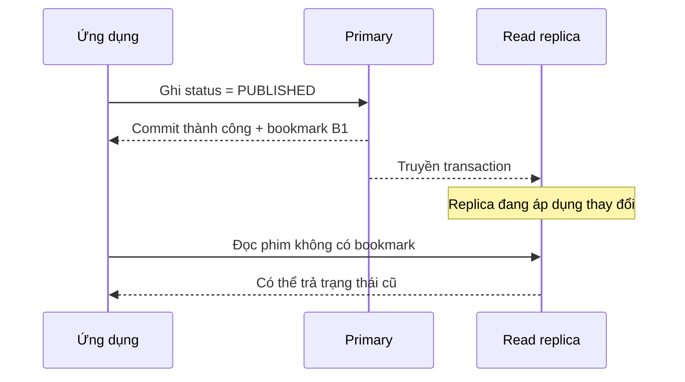
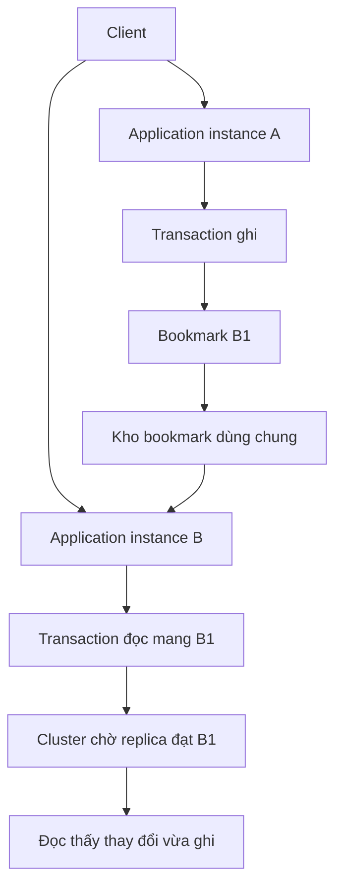

# Causal consistency và bài toán đọc thấy dữ liệu vừa ghi

Trong ứng dụng dùng Spring Data Neo4j (SDN), một thao tác ghi có thể được xử lý ở primary của Neo4j cluster, còn truy vấn đọc tiếp theo có thể được định tuyến đến một secondary/read replica. Nếu replica chưa áp dụng xong transaction vừa commit, một truy vấn đọc độc lập có thể chưa nhìn thấy thay đổi đó.

Đây là bài toán **read-your-writes**: sau khi người dùng cập nhật dữ liệu thành công, lần đọc tiếp theo của chính luồng nghiệp vụ đó cần thấy thay đổi vừa ghi. Neo4j giải quyết quan hệ nhân quả giữa các transaction bằng **bookmark**. Bookmark là token đại diện cho một trạng thái đã commit của database; khi transaction sau mang bookmark này, cluster chỉ thực thi nó sau khi trạng thái được bookmark bảo đảm đã được áp dụng.

SDN tự quản lý bookmark cho các transaction tuần tự trong cùng thread hoặc cùng reactive stream. Vì vậy, phần lớn ứng dụng không cần tự lấy hay truyền bookmark. Việc quản lý tường minh chỉ cần thiết khi một luồng nhân quả đi qua nhiều session độc lập, nhiều tiến trình hoặc nhiều instance ứng dụng.

## 1. Bài toán đọc thấy dữ liệu vừa ghi

Giả sử người dùng đổi trạng thái một phim từ DRAFT sang PUBLISHED. Ứng dụng ghi thay đổi thành công rồi chuyển sang màn hình chi tiết, màn hình này thực hiện một transaction đọc mới.

Trong cluster có primary và các read replica:

1. Transaction ghi được thực thi và commit trên primary.
2. Thay đổi được truyền đến các secondary.
3. Request đọc tiếp theo có thể được định tuyến đến một secondary.
4. Nếu secondary chưa áp dụng transaction ghi, dữ liệu mà request đọc thấy có thể chưa phản ánh thay đổi đó.

Đây là khoảng trễ replication. Việc transaction ghi đã commit trên primary không có nghĩa mọi replica đã cập nhật cùng một thời điểm.



Vấn đề không phải transaction ghi thất bại. Vấn đề là lần đọc sau chưa có ràng buộc nhân quả với transaction ghi trước đó.

Trong một ứng dụng đơn giản hoặc một truy vấn đọc chạy ngay trên cùng transaction, hiện tượng này có thể không xuất hiện. Nó dễ lộ ra khi ứng dụng tách thao tác ghi và đọc thành hai transaction, định tuyến đọc đến replica, hoặc chuyển request sang một instance ứng dụng khác.

## 2. Causal consistency là gì?

**Causal consistency** (nhất quán nhân quả) bảo đảm các thao tác có quan hệ nhân quả được quan sát theo đúng thứ tự. Nếu thao tác B phụ thuộc vào kết quả của thao tác A, một lần đọc thực hiện B không được chạy trên trạng thái database cũ hơn A.

Ví dụ:

- A: tạo node Movie với ID movie-42.
- B: tạo relationship TAGGED_WITH từ phim đó đến một Genre.
- C: đọc phim và danh sách thể loại để trả response.

Nếu B cần node do A tạo, B phải chạy sau trạng thái đã bao gồm A. Nếu C cần thấy cả A và B, C phải chạy sau trạng thái đã bao gồm cả hai.

Một database có causal consistency sẽ giữ thứ tự nhân quả đó giữa các thành viên cluster. Điều này mạnh hơn eventual consistency, vốn chỉ hứa các bản sao cuối cùng sẽ hội tụ mà không nhất thiết bảo đảm một lần đọc cụ thể nhìn thấy các thay đổi trước đó.

### Causal consistency không có nghĩa gì?

- Không có nghĩa mọi replica cập nhật đồng thời ngay khi transaction commit.
- Không có nghĩa mọi truy vấn độc lập đều phải chờ mọi transaction khác trong cluster.
- Không tự động biến toàn bộ thao tác concurrent thành một thứ tự toàn cục duy nhất.
- Không thay thế ACID transaction, uniqueness constraint hoặc validation nghiệp vụ.
- Không bảo đảm dữ liệu mới nhất của tất cả người dùng nếu luồng đọc không mang quan hệ nhân quả tương ứng.

Mục tiêu là bảo đảm thứ tự giữa các thao tác có liên quan. Các thao tác không phụ thuộc nhau vẫn có thể chạy song song.

## 3. Bookmark đại diện cho trạng thái database

Sau khi transaction commit, Neo4j cluster có thể trả về một **bookmark**. Có thể hiểu bookmark như một mốc trạng thái:

```text
Transaction A commit
        |
        v
   Bookmark B1
        |
        v
Transaction B bắt đầu với B1
        |
        v
Cluster bảo đảm trạng thái B1 đã được áp dụng
        |
        v
Transaction B đọc được thay đổi của A
```

Bookmark là token opaque do database và driver quản lý. Ứng dụng không nên phân tích nội dung, tự tạo, sửa hoặc so sánh bookmark bằng cách đoán ý nghĩa bên trong. Hãy giữ nguyên token và truyền nó qua API được driver cung cấp.

Khi transaction mới bắt đầu với bookmark, server được chọn phải chờ đến khi trạng thái database đạt ít nhất mốc được bookmark đại diện. Nếu server chưa theo kịp, transaction có thể phải đợi; nếu không thể đạt mốc trong thời gian cho phép, thao tác có thể timeout hoặc thất bại.

Bookmark không chứa bản sao dữ liệu và cũng không phải ID của một node. Nó chỉ mô tả trạng thái transaction mà lần đọc sau cần tôn trọng.

## 4. Đọc thấy thay đổi trong cùng transaction

Trong cùng một transaction, ứng dụng có thể đọc lại những gì chính transaction đó vừa ghi. Đây là read-your-writes bên trong transaction, không cần truyền bookmark thủ công:

```java
@Transactional
public Movie publishAndRead(String movieId) {
    Movie movie = movieRepository.findById(movieId)
            .orElseThrow();

    movie.setStatus("PUBLISHED");
    movieRepository.save(movie);

    return movieRepository.findById(movieId)
            .orElseThrow();
}
```

Hai thao tác repository tham gia cùng transaction Spring. Lần đọc thứ hai nhìn thấy thay đổi chưa cần đợi replication sang một server khác.

Trong thực tế, không nên tách một nghiệp vụ thành nhiều transaction nếu các bước cần tính nguyên tử. Hãy giữ các thao tác cần commit hoặc rollback cùng nhau trong một @Transactional service method.

Bookmark trở nên quan trọng khi thao tác tiếp theo chạy trong **transaction khác**. Ví dụ, request ghi đã hoàn tất, sau đó request đọc mở transaction mới.

## 5. Causal chaining trong một Neo4j Driver session

Neo4j Java Driver tự quản lý bookmark giữa các transaction trong cùng một session. Các transaction trong session được nối nhân quả theo thứ tự:

```java
try (var session = driver.session(
        SessionConfig.builder()
                .withDatabase("neo4j")
                .build())) {

    session.executeWriteWithoutResult(tx -> {
        tx.run("""
                CREATE (:Movie {
                    id: $id,
                    title: $title
                })
                """,
                Map.of("id", "movie-42", "title", "Graph Journey"))
                .consume();
    });

    session.executeRead(tx -> {
        var result = tx.run("""
                MATCH (m:Movie {id: $id})
                RETURN m.title AS title
                """,
                Map.of("id", "movie-42"));

        return result.single().get("title").asString();
    });
}
```

Transaction đọc chạy sau transaction ghi trong cùng session, vì vậy driver truyền bookmark nội bộ. Ứng dụng không cần gọi lastBookmarks() rồi truyền lại cho transaction kế tiếp trong cùng session.

Các lời gọi executeWrite/executeRead là transaction riêng nhưng vẫn được session nối nhân quả. Khi đóng session, bookmark cuối cùng có thể được lấy bằng Session.lastBookmarks() để chuyển sang session khác.

## 6. Khi nhiều session chạy độc lập

Một session khác không tự biết bookmark mà session trước đã nhận. Nếu session A ghi dữ liệu, session B mở độc lập để đọc, cần truyền bookmark từ A sang B khi yêu cầu read-your-writes.

Ví dụ:

```java
Set<Bookmark> bookmarks;

try (var writer = driver.session(
        SessionConfig.builder()
                .withDatabase("neo4j")
                .build())) {

    writer.executeWriteWithoutResult(tx -> {
        tx.run("""
                MERGE (:Movie {
                    id: $id,
                    title: $title
                })
                """,
                Map.of("id", "movie-42", "title", "Graph Journey"))
                .consume();
    });

    bookmarks = writer.lastBookmarks();
}

try (var reader = driver.session(
        SessionConfig.builder()
                .withDatabase("neo4j")
                .withBookmarks(bookmarks)
                .build())) {

    String title = reader.executeRead(tx ->
            tx.run("""
                    MATCH (m:Movie {id: $id})
                    RETURN m.title AS title
                    """,
                    Map.of("id", "movie-42"))
                    .single()
                    .get("title")
                    .asString());
}
```

Session đọc bắt đầu với bookmark do session ghi cung cấp. Cluster bảo đảm transaction đọc không chạy trước trạng thái mà bookmark đại diện.

API cụ thể có thể thay đổi theo phiên bản Neo4j Java Driver, nhưng ý tưởng không đổi:

1. Ghi và commit transaction.
2. Lấy bookmark cuối của session ghi.
3. Khởi tạo session đọc với bookmark đó.
4. Để driver và cluster xử lý việc chờ replica theo kịp.

Không truyền bookmark trước khi transaction ghi commit thành công. Nếu transaction rollback, không có trạng thái commit mới để lần đọc sau dựa vào.

## 7. Kết hợp bookmark từ nhiều luồng ghi song song

Giả sử ứng dụng tạo hai node độc lập trong hai session:

- Session A tạo Person Alice.
- Session B tạo Person Bob.
- Session C tạo relationship KNOWS giữa Alice và Bob.

Session C phụ thuộc vào cả hai transaction A và B. Chỉ truyền bookmark của A là chưa đủ, vì B có thể chưa được áp dụng trên server xử lý C.

Có thể kết hợp bookmark từ hai session:

```java
Set<Bookmark> causalDependencies = new HashSet<>();

try (var sessionA = driver.session()) {
    sessionA.executeWriteWithoutResult(tx -> {
        tx.run("CREATE (:Person {name: $name})",
                Map.of("name", "Alice"))
                .consume();
    });
    causalDependencies.addAll(sessionA.lastBookmarks());
}

try (var sessionB = driver.session()) {
    sessionB.executeWriteWithoutResult(tx -> {
        tx.run("CREATE (:Person {name: $name})",
                Map.of("name", "Bob"))
                .consume();
    });
    causalDependencies.addAll(sessionB.lastBookmarks());
}

try (var sessionC = driver.session(
        SessionConfig.builder()
                .withBookmarks(causalDependencies)
                .build())) {
    sessionC.executeWriteWithoutResult(tx -> {
        tx.run("""
                MATCH (a:Person {name: $a})
                MATCH (b:Person {name: $b})
                MERGE (a)-[:KNOWS]->(b)
                """,
                Map.of("a", "Alice", "b", "Bob"))
                .consume();
    });
}
```

Bookmark manager/driver sẽ kết hợp các mốc trạng thái để bảo đảm transaction C chạy sau tất cả dependency đã truyền. Ứng dụng không cần tự giải mã bookmark để tìm mốc nào mới hơn.

Nếu các transaction A và B thực chất phụ thuộc nhau, hãy nối chúng tuần tự trong cùng session hoặc truyền bookmark của A sang B trước. Việc gom bookmark phù hợp khi nhiều nhánh độc lập cùng là dependency của một bước sau.

## 8. SDN tự quản lý bookmark trong các luồng thông thường

Trong Spring Data Neo4j, bookmark management đã được tích hợp với transaction manager:

- Các lời gọi repository/template tham gia cùng một Spring transaction nhìn thấy thay đổi của nhau.
- Các transaction SDN tuần tự trong cùng thread được nối nhân quả.
- Các transaction SDN nối tiếp trong cùng reactive stream cũng được nối nhân quả.
- Neo4jClient và ReactiveNeo4jClient tích hợp với transaction management của SDN.

Vì vậy, nếu một service ghi dữ liệu rồi một bước tiếp theo trong cùng thread hoặc reactive stream đọc lại dữ liệu đó, thông thường không cần tự cấu hình bookmark:

```java
@Service
public class MovieService {

    private final MovieRepository movieRepository;

    public MovieService(MovieRepository movieRepository) {
        this.movieRepository = movieRepository;
    }

    @Transactional
    public Movie publish(String id) {
        Movie movie = movieRepository.findById(id)
                .orElseThrow();

        movie.setStatus("PUBLISHED");
        return movieRepository.save(movie);
    }

    @Transactional(readOnly = true)
    public Optional<Movie> findPublished(String id) {
        return movieRepository.findById(id)
                .filter(movie -> "PUBLISHED".equals(movie.getStatus()));
    }
}
```

Khi hai transaction này được thực hiện tuần tự trong cùng ứng dụng/thread theo transaction manager SDN, bookmark nội bộ duy trì quan hệ nhân quả. Nếu bước đọc chạy trên instance khác, một tiến trình khác hoặc một luồng không có bookmark chung, cần cơ chế truyền bookmark riêng.

Không nên thêm cấu hình bookmark tùy chỉnh chỉ vì ứng dụng chạy trên cluster. Cấu hình mặc định của SDN đã xử lý các transaction thông thường.

## 9. Bookmark khi ứng dụng có nhiều instance

Trong môi trường nhiều instance, một request có thể ghi trên instance A nhưng request đọc tiếp theo lại được load balancer chuyển sang instance B:



Bookmark manager mặc định của SDN quản lý trạng thái trong phạm vi transaction manager của ứng dụng đang chạy. Nó không tự chia sẻ bookmark với một JVM khác hoặc một service khác.

Nếu yêu cầu nghiệp vụ cần read-your-writes xuyên instance, ứng dụng cần:

1. Thu nhận bookmark sau khi transaction commit.
2. Lưu bookmark vào một nơi có thể truy cập từ instance tiếp theo.
3. Liên kết bookmark với luồng nhân quả phù hợp, chẳng hạn user session, request chain hoặc workflow ID.
4. Cung cấp bookmark đó làm seed cho transaction manager ở instance xử lý lần đọc tiếp theo.
5. Dọn trạng thái bookmark theo thời hạn và vòng đời nghiệp vụ.

Không nhất thiết phải chia sẻ bookmark cho mọi người dùng. Nếu chỉ người vừa cập nhật cần thấy kết quả của chính họ, nên giới hạn bookmark theo causal flow đó. Dùng một bookmark toàn cục cho mọi request có thể buộc các truy vấn không liên quan chờ nhau và làm giảm khả năng song song.

## 10. Thu nhận bookmark từ SDN bằng Neo4jBookmarksUpdatedEvent

SDN phát Neo4jBookmarksUpdatedEvent sau khi transaction manager commit thành công và nhận được bookmark mới từ cluster. Event cung cấp tập bookmark qua getBookmarks().

Có thể lắng nghe event:

```java
import java.util.Set;

import org.neo4j.driver.Bookmark;
import org.springframework.context.ApplicationListener;
import org.springframework.stereotype.Component;
import org.springframework.data.neo4j.core.transaction.Neo4jBookmarksUpdatedEvent;

@Component
public class BookmarkCapture
        implements ApplicationListener<Neo4jBookmarksUpdatedEvent> {

    private final BookmarkStore bookmarkStore;

    public BookmarkCapture(BookmarkStore bookmarkStore) {
        this.bookmarkStore = bookmarkStore;
    }

    @Override
    public void onApplicationEvent(Neo4jBookmarksUpdatedEvent event) {
        Set<Bookmark> bookmarks = event.getBookmarks();
        bookmarkStore.capture(bookmarks);
    }
}
```

BookmarkStore trong ví dụ là thành phần do ứng dụng xây dựng. Nó chịu trách nhiệm lưu token vào kho phù hợp và áp dụng chính sách liên kết với causal flow.

Event chỉ cung cấp bookmark của transaction đã commit; nó không tự biết user session, HTTP request hay workflow nào cần giữ bookmark. Nếu cần lưu bookmark theo người dùng hoặc request, ứng dụng phải thiết kế cơ chế correlation riêng. Không lấy một biến toàn cục rồi giả định nó luôn thuộc về request vừa phát sinh event.

Tập bookmark trả về là dữ liệu không nên sửa. Lưu bản sao hoặc chuyển tiếp nguyên trạng theo API của Driver.

## 11. Seed bookmark cho transaction manager SDN

Khi ứng dụng cần đưa bookmark từ bên ngoài vào transaction manager, SDN cung cấp Neo4jBookmarkManager.create(Supplier<Set<Bookmark>>) để khởi tạo manager có seed bookmark.

Neo4jBookmarkManager có từ SDN 6.0 và API được đánh dấu stable từ 6.1.1. Neo4jBookmarksUpdatedEvent cũng được đánh dấu stable từ 6.1.1. Nếu dự án dùng SDN cũ hơn, hãy kiểm tra API của release train đang chạy trước khi áp dụng ví dụ.

Ví dụ cấu hình imperative:

```java
@Configuration
public class BookmarkSeedingConfiguration {

    @Bean
    PlatformTransactionManager transactionManager(
            Driver driver,
            DatabaseSelectionProvider databaseSelectionProvider,
            BookmarkStore bookmarkStore) {

        Supplier<Set<Bookmark>> seedBookmarks =
                bookmarkStore::getBookmarksForCurrentFlow;

        Neo4jBookmarkManager bookmarkManager =
                Neo4jBookmarkManager.create(seedBookmarks);

        return new Neo4jTransactionManager(
                driver,
                databaseSelectionProvider,
                bookmarkManager);
    }
}
```

BookmarkStore và getBookmarksForCurrentFlow() là API minh họa của ứng dụng, không phải class có sẵn trong SDN. Supplier cần trả về các bookmark đã được lưu cho causal flow đang xử lý. Nó phải an toàn khi được gọi đồng thời và không được thay đổi tập dữ liệu ngay trong lúc một lần gọi đang đọc.

Việc khai báo transaction manager tùy chỉnh thay thế cấu hình mặc định tương ứng. Chỉ làm điều này khi có yêu cầu thực tế về seed hoặc capture bookmark; nếu không, hãy giữ cấu hình SDN mặc định.

Với ứng dụng reactive, SDN cung cấp Neo4jBookmarkManager.createReactive(...) và ReactiveNeo4jTransactionManager. Cách lấy seed phải tương thích với Reactor Context hoặc cơ chế truyền context của ứng dụng. Không dùng ThreadLocal để lưu bookmark theo request trong reactive pipeline vì pipeline có thể đổi thread.

## 12. Read-only transaction và định tuyến đọc đến secondary

Neo4j cluster có primary và secondary/read replica. Primary xử lý cả đọc và ghi; secondary phục vụ đọc và không nhận thao tác ghi. Đánh dấu transaction đọc là read-only giúp driver/cluster định tuyến thao tác phù hợp để tận dụng read replica.

Với SDN:

- Các phương thức cơ bản như findById, findAllById, findAll và một số phương thức kiểm tra tồn tại được đánh dấu read-only mặc định.
- Repository có thể được đánh dấu @Transactional(readOnly = true) ở cấp interface.
- Custom query nên được đánh dấu read-only nếu thực sự chỉ đọc.

Ví dụ:

```java
@Transactional(readOnly = true)
public interface MovieRepository
        extends Neo4jRepository<Movie, String> {

    @Query("""
        MATCH (m:Movie)
        WHERE m.status = $status
        RETURN m
        ORDER BY m.title
        """)
    List<Movie> findByStatus(String status);
}
```

Không đánh dấu một custom query là read-only nếu nó chứa CREATE, MERGE, SET, DELETE hoặc gọi procedure có side effect. SDN và Driver không phân tích mọi Cypher/procedure để tự xác định chắc chắn query chỉ đọc hay ghi.

Bookmark và read-only transaction giải quyết hai việc bổ sung nhau:

- Read-only transaction giúp chọn đường xử lý đọc phù hợp trong cluster.
- Bookmark buộc lần đọc phải chờ trạng thái nhân quả trước đó đã được áp dụng.

Một truy vấn đọc có thể được gửi đến secondary nhưng vẫn phải chờ secondary bắt kịp bookmark trước khi chạy.

## 13. Bookmark và reactive stream

Với SDN reactive, transaction manager dùng bookmark nội bộ tương tự imperative. Nếu các thao tác được nối trong cùng reactive stream, SDN duy trì quan hệ nhân quả:

```java
@Service
public class ReactiveMovieWriter {

    private final ReactiveMovieRepository movieRepository;

    public ReactiveMovieWriter(
            ReactiveMovieRepository movieRepository) {
        this.movieRepository = movieRepository;
    }

    @Transactional
    public Mono<Movie> publish(String id) {
        return movieRepository.findById(id)
                .switchIfEmpty(Mono.error(
                        new IllegalArgumentException("Movie not found")))
                .flatMap(movie -> {
                    movie.setStatus("PUBLISHED");
                    return movieRepository.save(movie);
                });
    }
}

@Service
public class ReactiveMovieReader {

    private final ReactiveMovieRepository movieRepository;

    public ReactiveMovieReader(
            ReactiveMovieRepository movieRepository) {
        this.movieRepository = movieRepository;
    }

    @Transactional(readOnly = true)
    public Mono<Movie> find(String id) {
        return movieRepository.findById(id);
    }
}
```

Một workflow gọi hai service qua Spring proxy có thể nối hai transaction độc lập trong cùng reactive stream:

```java
public Mono<Movie> publishAndRead(String id) {
    return movieWriter.publish(id)
            .then(movieReader.find(id));
}
```

Khi publisher ghi hoàn tất, transaction đầu commit và bookmark được cập nhật. Publisher đọc tiếp theo mở transaction mới trong cùng stream và SDN dùng bookmark nội bộ để giữ quan hệ nhân quả. Các bước được nối bằng publisher và không tách subscription. Không gọi subscribe() thủ công ở giữa service rồi mong transaction manager tiếp tục truyền bookmark sang publisher khác.

Nếu một reactive workflow được chia thành nhiều request hoặc nhiều instance, bookmark vẫn cần được truyền qua cơ chế lưu trữ/context phù hợp. Reactive không tự chia sẻ trạng thái nhân quả qua process boundary.

## 14. Chi phí và giới hạn khi dùng bookmark

Bookmark giúp bảo đảm lần đọc chờ đúng trạng thái, nhưng có chi phí:

- Replica có thể phải đợi replication trước khi thực thi query.
- Request có thể tăng latency khi cluster đang có độ trễ.
- Bookmark không cần thiết cho các thao tác độc lập, không yêu cầu read-your-writes.
- Truyền một bookmark toàn cục có thể làm các luồng không liên quan phụ thuộc vào nhau.
- Seed bookmark sai database hoặc sai causal flow có thể làm truy vấn chờ không cần thiết hoặc thất bại.

Nếu một nghiệp vụ có nhiều thao tác liên tiếp, hãy ưu tiên gom chúng vào cùng transaction hoặc cùng session khi phù hợp. Dùng bookmark giữa các session khi thật sự cần nối nhân quả qua ranh giới session.

Không tắt bookmark management để cải thiện hiệu năng nếu ứng dụng không chấp nhận stale read hoặc nguy cơ ghi đè dữ liệu cũ. SDN cung cấp Neo4jBookmarkManager.noop(), nhưng đây là lựa chọn có chủ đích: các bookmark bị loại bỏ và cluster có thể trả dữ liệu cũ cho một lần đọc độc lập.

## 15. Xử lý timeout và lỗi khi chờ causal state

Nếu secondary chưa đạt bookmark trong thời gian chờ, transaction có thể timeout. Khi gặp tình huống này:

1. Xác định transaction đọc có thực sự cần thấy kết quả ghi trước không.
2. Kiểm tra bookmark có thuộc đúng database và đúng causal flow không.
3. Kiểm tra replication lag và tình trạng cluster.
4. Kiểm tra timeout cấu hình cho transaction/session.
5. Cân nhắc đọc lại trên primary nếu nghiệp vụ cho phép và hệ thống có chiến lược routing phù hợp.

Không loại bỏ bookmark rồi retry vô điều kiện. Làm vậy có thể biến lỗi chờ replica thành stale read mà ứng dụng không nhận biết.

Nếu thao tác ghi chưa commit thành công, không có bookmark commit hợp lệ để lần đọc sau dựa vào. Trước khi retry, cần phân biệt lỗi commit, lỗi kết nối sau commit và timeout khi đọc.

## 16. Những lỗi thường gặp

| Lỗi | Hậu quả | Cách xử lý |
|---|---|---|
| Cho rằng mọi replica cập nhật ngay sau commit | Đọc độc lập có thể thấy dữ liệu cũ | Dùng causal chain/bookmark cho read-your-writes |
| Tự quản lý bookmark trong các luồng SDN thông thường | Tăng cấu hình và độ phức tạp không cần thiết | Dùng bookmark management mặc định của SDN |
| Mở session đọc mới nhưng không truyền bookmark | Mất quan hệ nhân quả với session ghi | Truyền lastBookmarks() qua withBookmarks() |
| Chỉ truyền bookmark của một nhánh trong khi bước sau phụ thuộc nhiều nhánh | Bước sau có thể chạy trước một dependency | Kết hợp bookmark của tất cả nhánh cần thiết |
| Chia sẻ bookmark qua nhiều instance mà không có kho chung | Instance khác không biết trạng thái đã ghi | Capture và seed qua cơ chế lưu trữ chung |
| Dùng một bookmark global cho mọi request | Tăng thời gian chờ của các luồng độc lập | Scope bookmark theo causal flow khi có thể |
| Phân tích hoặc chỉnh nội dung bookmark | Làm mất tính opaque và có thể tạo token không hợp lệ | Truyền token nguyên trạng |
| Dùng bookmark của database khác | Không bảo đảm causal state của database mục tiêu | Gắn bookmark với đúng database |
| Đánh dấu custom query ghi là read-only | Có thể định tuyến thao tác ghi đến secondary và thất bại | Chỉ dùng read-only cho query thực sự chỉ đọc |
| Gọi subscribe() tách luồng reactive | Mất quan hệ với transaction/reactive context đang quản lý | Trả và nối publisher trong cùng stream |
| Tắt bookmark management chỉ để giảm latency | Có thể xuất hiện stale read hoặc ghi đè dữ liệu cũ | Đánh giá yêu cầu nhất quán trước khi thay đổi |

## 17. Checklist thiết kế read-your-writes

1. Lần đọc có cần thấy một transaction ghi cụ thể vừa commit không?
2. Ghi và đọc có thể nằm trong cùng transaction không?
3. Nếu tách transaction, chúng có chạy tuần tự trong cùng thread, reactive stream hoặc Driver session không?
4. Nếu dùng nhiều session, bookmark từ session ghi đã được truyền sang session đọc chưa?
5. Nếu dùng nhiều nhánh ghi song song, đã kết hợp tất cả bookmark dependency chưa?
6. Nếu ứng dụng có nhiều instance, bookmark có được chia sẻ qua kho phù hợp không?
7. Bookmark có được scope theo user/session/workflow và đúng database không?
8. Custom query chỉ đọc có được đánh dấu read-only để tận dụng secondary không?
9. Timeout và replication lag có được theo dõi không?
10. Ứng dụng có kiểm thử trường hợp đọc ngay sau ghi qua hai session hoặc hai instance không?

## 18. Tự kiểm tra

1. Read-your-writes là bài toán gì khi ứng dụng dùng Neo4j cluster?
2. Causal consistency khác eventual consistency ở điểm nào?
3. Bookmark đại diện cho thông tin gì và vì sao ứng dụng không nên giải mã nó?
4. Vì sao transaction đọc trên secondary có thể phải chờ sau một transaction ghi?
5. Khi nào Neo4j Java Driver tự nối bookmark mà không cần code bổ sung?
6. Cách truyền bookmark giữa hai session độc lập là gì?
7. Vì sao cần kết hợp bookmark khi transaction sau phụ thuộc nhiều transaction chạy song song?
8. SDN tự quản lý bookmark trong những trường hợp thông thường nào?
9. Khi nào một ứng dụng nhiều instance cần capture và seed bookmark?
10. Neo4jBookmarksUpdatedEvent cung cấp dữ liệu gì?
11. Vì sao read-only transaction hữu ích cho cluster có read replica?
12. Những rủi ro nào xuất hiện khi tắt bookmark management?

Khi hiểu causal consistency và cách bookmark nối các transaction, người học có thể thiết kế luồng ghi/đọc nhất quán trong Neo4j cluster, tận dụng read replica mà vẫn bảo đảm người dùng nhìn thấy thay đổi vừa commit, đồng thời chỉ triển khai quản lý bookmark tường minh ở những ranh giới session hoặc instance thực sự cần thiết.

## Tài liệu tham khảo

- [Neo4j Java Driver Manual — Coordinate parallel transactions and bookmarks](https://neo4j.com/docs/java-manual/current/bookmarks/)
- [Neo4j Operations Manual — Clustering glossary and causal consistency](https://neo4j.com/docs/operations-manual/current/clustering/glossary/)
- [Spring Data Neo4j — FAQ: Using a Neo4j cluster and bookmark management](https://docs.spring.io/spring-data/neo4j/reference/faq.html)
- [Spring Data Neo4j API — Neo4jBookmarkManager](https://docs.spring.io/spring-data/neo4j/docs/current/api/org/springframework/data/neo4j/core/transaction/Neo4jBookmarkManager.html)
- [Spring Data Neo4j API — Neo4jBookmarksUpdatedEvent](https://docs.spring.io/spring-data/neo4j/docs/6.3.15/api/org/springframework/data/neo4j/core/transaction/Neo4jBookmarksUpdatedEvent.html)
- [Spring Data Neo4j API — Neo4jTransactionManager](https://docs.spring.io/spring-data/data-neo4j/docs/current/api/org/springframework/data/neo4j/core/transaction/Neo4jTransactionManager.html)
