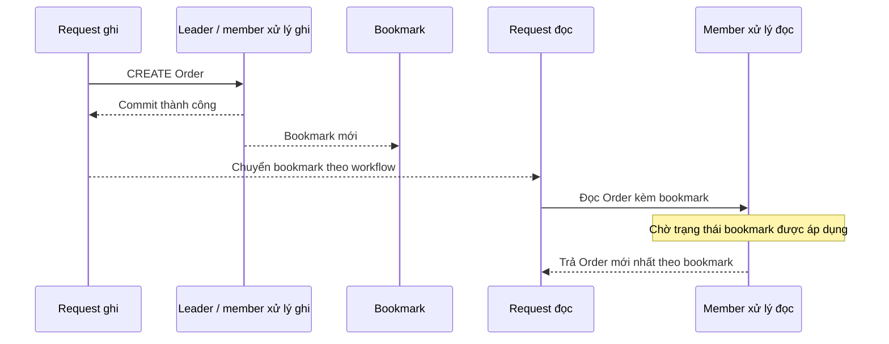

# `Neo4jBookmarksUpdatedEvent` và việc thu nhận bookmark

Trong cụm Neo4j, một transaction có thể ghi dữ liệu trên một thành viên rồi commit thành công, trong khi một transaction khác được gửi tới thành viên khác của cluster. Nếu transaction thứ hai cần đọc ngay dữ liệu vừa ghi, ứng dụng phải bảo đảm thay đổi trước đó đã được truyền tới nơi thực hiện lần đọc. Neo4j dùng **bookmark** để biểu diễn trạng thái database mà một transaction đã đạt tới và dùng bookmark đó để điều phối causal consistency giữa các transaction độc lập.

Spring Data Neo4j (SDN) tự quản lý bookmark cho các transaction thông thường. Khi transaction manager commit thành công và nhận bookmark mới từ cluster, SDN có thể phát `Neo4jBookmarksUpdatedEvent`. Ứng dụng lắng nghe event này để thu nhận bookmark mới nhất, lưu lại theo workflow hoặc cung cấp bookmark ban đầu cho một `Neo4jBookmarkManager` tùy chỉnh. Đây là extension point dành cho trường hợp cần quan sát hoặc chuyển bookmark ra ngoài cơ chế mặc định; phần lớn ứng dụng không cần tự cấu hình bookmark manager.

## 1. Bookmark là gì?

Bookmark là một token đại diện cho trạng thái database sau một transaction. Khi transaction tiếp theo dùng bookmark đó, Neo4j bảo đảm nó không được thực thi trước khi trạng thái mà bookmark đại diện đã được thiết lập trên server xử lý query.

Ví dụ một ứng dụng tạo đơn hàng rồi chuyển sang một request khác để đọc chi tiết:



Bookmark hữu ích khi các thao tác liên quan chạy trong **những transaction hoặc session khác nhau**. Trong cùng một session, Neo4j Java Driver tự truyền bookmark giữa các transaction của session đó. SDN cũng có bookmark management tích hợp cho các transaction do nó quản lý.

Bookmark không phải ID của node, không phải transaction ID để ứng dụng phân tích, cũng không phải token xác thực. Hãy xem nó như một giá trị opaque do driver/database cấp và truyền lại nguyên vẹn.

## 2. Causal consistency và trường hợp cần bookmark

Causal consistency bảo đảm một thao tác đọc sau có thể quan sát các thay đổi của thao tác ghi trước khi chúng đã được nối bằng quan hệ nhân quả. Nó quan trọng trong các tình huống read-your-own-writes:

- Người dùng vừa lưu hồ sơ rồi chuyển sang trang chi tiết.
- Một service tạo node `Order`, service khác đọc order ngay sau đó.
- Hai nhánh xử lý độc lập tạo hai node, nhánh thứ ba tạo relationship nối chúng.
- Một ứng dụng ghi vào Neo4j rồi gửi bookmark cho một worker hoặc service khác để worker đọc dữ liệu vừa ghi.

Ví dụ, hai transaction độc lập cùng tạo hai node:

```cypher
CREATE (:Person {personId: $personA, name: $nameA})
```

```cypher
CREATE (:Person {personId: $personB, name: $nameB})
```

Một transaction thứ ba muốn tạo quan hệ giữa hai người cần bảo đảm cả hai node đã được nhìn thấy. Nếu hai lần ghi chạy ở hai session khác nhau, hãy kết hợp bookmark của cả hai session và dùng tập bookmark đó khi mở session thứ ba.

Không cần truyền bookmark thủ công trong mọi truy vấn. Dùng cùng một session hoặc để SDN quản lý transaction mặc định thường đơn giản hơn và tránh chi phí chờ replication không cần thiết.

## 3. Bookmark management mặc định trong SDN

Từ Spring Data Neo4j 6, SDN tự sử dụng bookmark cho các transaction mà nó quản lý. Bạn không cần thêm `@EnableBookmarkManagement` hoặc `@UseBookmark` như cơ chế cũ của SDN 5.x.

Điều đó có nghĩa:

- Repository và `Neo4jTemplate` sử dụng transaction manager SDN sẽ được quản lý bookmark tự động.
- Các transaction tiếp theo do cùng bookmark manager quản lý sẽ nhận bookmark đã được cập nhật sau commit.
- `Neo4jClient` tích hợp với transaction của Spring khi dùng cùng `Driver` và transaction context.
- Nếu ứng dụng không có yêu cầu đặc biệt, hãy để cấu hình mặc định quản lý bookmark.

`Neo4jBookmarkManager.noop()` có thể tắt bookmark management, nhưng trong cluster nó làm tăng nguy cơ stale read. Chỉ dùng khi ứng dụng chấp nhận đọc dữ liệu chưa được đồng bộ và đã hiểu hệ quả.

## 4. `Neo4jBookmarksUpdatedEvent` được phát khi nào?

`Neo4jBookmarksUpdatedEvent` nằm trong package:

```java
org.springframework.data.neo4j.core.transaction.Neo4jBookmarksUpdatedEvent
```

Đây là một Spring `ApplicationEvent`. SDN phát event sau khi Neo4j transaction manager **đã commit vật lý một transaction thành công** và nhận được tập bookmark mới từ cluster.

Event có phương thức chính:

```java
Set<Bookmark> getBookmarks()
```

`getBookmarks()` trả về tập bookmark gắn với event. Tập này là unmodifiable; không thêm hoặc xóa phần tử trực tiếp. Nếu cần giữ lại, hãy tạo bản sao bằng `Set.copyOf(...)`.

Event không phải domain event như `OrderCreatedEvent` hoặc `DocumentUpdatedEvent`. Nó thông báo về bookmark của transaction đã commit, không mô tả nghiệp vụ nào đã xảy ra hay entity nào được sửa.

Các điểm cần nhớ:

- Transaction rollback không tạo bookmark mới cho thay đổi chưa commit.
- Event chỉ xuất hiện khi transaction manager nhận bookmark mới sau commit thành công.
- Không giả định event có đầy đủ actor, request ID hoặc tenant ID của nghiệp vụ.
- Nếu cần tương quan bookmark với một workflow, ứng dụng phải tự quản lý correlation và phạm vi lưu trữ.

## 5. Lắng nghe event bằng `ApplicationListener`

Có thể đăng ký một Spring bean triển khai `ApplicationListener<Neo4jBookmarksUpdatedEvent>`:

```java
import java.util.Set;
import java.util.concurrent.atomic.AtomicReference;

import org.neo4j.driver.Bookmark;
import org.springframework.context.ApplicationListener;
import org.springframework.stereotype.Component;
import org.springframework.data.neo4j.core.transaction.Neo4jBookmarksUpdatedEvent;

@Component
public class BookmarkCapture
        implements ApplicationListener<Neo4jBookmarksUpdatedEvent> {

    private final AtomicReference<Set<Bookmark>> latest =
        new AtomicReference<>(Set.of());

    @Override
    public void onApplicationEvent(Neo4jBookmarksUpdatedEvent event) {
        latest.set(Set.copyOf(event.getBookmarks()));
    }

    public Set<Bookmark> getLatestBookmarks() {
        return latest.get();
    }
}
```

Trong ví dụ, `AtomicReference` cho phép thread khác đọc một snapshot bất biến của bookmark mà không quan sát một collection đang bị sửa dở. `Set.copyOf` cũng tách dữ liệu ứng dụng lưu khỏi view không thể sửa của event.

Có thể dùng `@EventListener` nếu thích phương thức listener thay cho interface:

```java
import java.util.Set;

import org.neo4j.driver.Bookmark;
import org.springframework.context.event.EventListener;
import org.springframework.stereotype.Component;
import org.springframework.data.neo4j.core.transaction.Neo4jBookmarksUpdatedEvent;

@Component
public class BookmarkEventListener {

    @EventListener
    public void onBookmarksUpdated(Neo4jBookmarksUpdatedEvent event) {
        Set<Bookmark> bookmarks = Set.copyOf(event.getBookmarks());
        // Chuyển snapshot tới nơi lưu trữ phù hợp với workflow.
    }
}
```

Chọn một trong hai cách để xử lý event. Không đăng ký cùng một logic hai lần nếu không muốn nó chạy lặp.

Event này đã được phát sau khi transaction manager commit vật lý, nên listener thông thường không cần bọc thêm `@TransactionalEventListener(phase = AFTER_COMMIT)`. Spring application event mặc định được xử lý đồng bộ; nếu tự đánh dấu listener bằng `@Async`, bookmark có thể được ghi vào kho ứng dụng muộn hơn request kế tiếp. Chỉ dùng xử lý bất đồng bộ khi workflow có cơ chế chờ hoặc đồng bộ phù hợp.

### Lưu ý về thread safety và nhiều transaction đồng thời

`AtomicReference` trong ví dụ là thread-safe, nhưng chính sách **thay thế bằng event đến sau** chỉ phù hợp khi ứng dụng cần bookmark mới nhất của một chuỗi công việc tuyến tính. Nếu nhiều nhánh ghi độc lập chạy song song và nhánh đọc cần nhìn thấy kết quả của tất cả nhánh, không thể tùy tiện giữ event đến cuối cùng rồi bỏ các bookmark còn lại.

Khi cần kết hợp nhiều nhánh, hãy thu thập bookmark của từng nhánh và hợp nhất các tập bookmark liên quan trước khi mở transaction tiếp theo. Neo4j Driver chấp nhận nhiều bookmark cùng lúc và dùng chúng để chờ các trạng thái tương ứng. Chính sách lưu/loại bỏ bookmark phải gắn với vòng đời workflow; không tích lũy vô hạn mọi bookmark trong một biến toàn cục.

Nếu ứng dụng có nhiều database hoặc tenant, hãy phân vùng bookmark theo database/tenant và không truyền bookmark sang database khác. Event không cung cấp sẵn một khóa nghiệp vụ để ứng dụng tự suy ra mọi ranh giới này.

## 6. Dùng event để seed `Neo4jBookmarkManager`

Một trường hợp sử dụng chính thức của event là thu nhận bookmark mới nhất rồi dùng chúng làm bookmark ban đầu cho transaction manager tùy chỉnh. `Neo4jBookmarkManager.create(Supplier<Set<Bookmark>>)` nhận supplier cung cấp các bookmark cần seed khi transaction manager bắt đầu công việc.

Ví dụ cấu hình imperative:

```java
import org.neo4j.driver.Driver;
import org.springframework.context.annotation.Bean;
import org.springframework.context.annotation.Configuration;
import org.springframework.data.neo4j.core.DatabaseSelectionProvider;
import org.springframework.data.neo4j.core.transaction.Neo4jBookmarkManager;
import org.springframework.data.neo4j.core.transaction.Neo4jTransactionManager;
import org.springframework.transaction.PlatformTransactionManager;

@Configuration(proxyBeanMethods = false)
public class BookmarkSeedingConfiguration {

    @Bean
    Neo4jBookmarkManager neo4jBookmarkManager(BookmarkCapture capture) {
        return Neo4jBookmarkManager.create(capture::getLatestBookmarks);
    }

    @Bean
    PlatformTransactionManager transactionManager(
        Driver driver,
        DatabaseSelectionProvider databaseSelectionProvider,
        Neo4jBookmarkManager bookmarkManager
    ) {
        return new Neo4jTransactionManager(
            driver,
            databaseSelectionProvider,
            bookmarkManager
        );
    }
}
```

Luồng hoạt động:

1. Transaction manager sử dụng `Neo4jBookmarkManager` tùy chỉnh.
2. Sau khi transaction commit, bookmark manager cập nhật bookmark và phát `Neo4jBookmarksUpdatedEvent`.
3. `BookmarkCapture` nhận event và lưu snapshot bookmark.
4. Khi transaction mới bắt đầu, supplier `capture::getLatestBookmarks` cung cấp bookmark seed cho bookmark manager.
5. Neo4j bảo đảm transaction mới không chạy trước trạng thái mà bookmark yêu cầu.

Đây là cấu hình nâng cao. Khi thay thế transaction manager mặc định trong Spring Boot, cần bảo đảm repository, `Neo4jClient` và transaction manager dùng cùng `Driver`, database selection provider và bookmark manager tương ứng. Không tạo manager mới tách rời khỏi cấu hình SDN đang sử dụng.

Nếu ứng dụng không cần seed bookmark từ bên ngoài, hãy giữ bookmark manager mặc định của SDN. Chỉ cấu hình bean tùy chỉnh khi đã xác định rõ nguồn bookmark ban đầu và vòng đời cập nhật chúng.

## 7. Chuyển bookmark giữa các session bằng Neo4j Java Driver

Khi dùng Driver trực tiếp, session tự quản lý causal chaining giữa các transaction bên trong cùng session. Nếu cần chuyển kết quả sang một session khác, lấy bookmark bằng `Session.lastBookmarks()`:

```java
import java.util.Set;

import org.neo4j.driver.Bookmark;
import org.neo4j.driver.Driver;
import org.neo4j.driver.Session;
import org.neo4j.driver.SessionConfig;

public class BookmarkAwareReader {

    private final Driver driver;

    public BookmarkAwareReader(Driver driver) {
        this.driver = driver;
    }

    public Set<Bookmark> createPerson(String personId, String name) {
        try (Session session = driver.session()) {
            session.executeWrite(tx -> {
                tx.run("""
                    CREATE (:Person {personId: $personId, name: $name})
                    """, java.util.Map.of(
                        "personId", personId,
                        "name", name
                    )).consume();
                return null;
            });

            return session.lastBookmarks();
        }
    }

    public String readPersonName(String personId, Set<Bookmark> bookmarks) {
        SessionConfig config = SessionConfig.builder()
            .withBookmarks(bookmarks)
            .build();

        try (Session session = driver.session(config)) {
            return session.executeRead(tx -> tx.run("""
                    MATCH (p:Person {personId: $personId})
                    RETURN p.name AS name
                    """, java.util.Map.of("personId", personId))
                .single()
                .get("name")
                .asString());
        }
    }
}
```

Session thứ hai được khởi tạo bằng `withBookmarks(bookmarks)`. Transaction đầu tiên trong session đó sẽ đợi database đạt trạng thái được biểu diễn bởi bookmark trước khi chạy query.

Nếu hai session ghi độc lập và session thứ ba cần thấy cả hai kết quả, hãy kết hợp bookmark từ cả hai session:

```java
Set<Bookmark> combined = new java.util.HashSet<>();
combined.addAll(sessionA.lastBookmarks());
combined.addAll(sessionB.lastBookmarks());

SessionConfig config = SessionConfig.builder()
    .withBookmarks(combined)
    .build();
```

Không cần tự phân tích nội dung bookmark. Driver và cluster sẽ xử lý tập bookmark để đảm bảo causal consistency.

## 8. Lưu bookmark dưới dạng chuỗi

Nếu workflow cần đi qua nhiều request HTTP hoặc được tiếp tục sau khi ứng dụng khởi động lại, có thể lưu bookmark value thành chuỗi:

```java
Set<String> serialized = bookmarks.stream()
    .map(Bookmark::value)
    .collect(java.util.stream.Collectors.toUnmodifiableSet());
```

Khi cần khôi phục:

```java
Set<Bookmark> restored = serialized.stream()
    .map(Bookmark::from)
    .collect(java.util.stream.Collectors.toUnmodifiableSet());
```

`Bookmark.value()` lấy biểu diễn chuỗi; `Bookmark.from(value)` dựng lại bookmark. Hãy coi chuỗi này là opaque và chỉ lưu/truyền lại nguyên vẹn. Không tự chỉnh sửa, nối chuỗi hoặc giả định nó chứa thông tin người dùng có thể đọc.

Bookmark có thể được lưu trong session state, cache hoặc một kho workflow phù hợp. Nếu lưu lâu dài, cần quản lý thời hạn, database/tenant sở hữu bookmark và chính sách xóa khi workflow kết thúc. Không dùng bookmark như một token bảo mật hoặc thay thế authorization.

## 9. Khi nào nên thu nhận bookmark từ event?

| Tình huống | Có cần listener `Neo4jBookmarksUpdatedEvent` không? | Hướng xử lý |
| --- | --- | --- |
| Repository save rồi repository read trong ứng dụng SDN thông thường | Không | Để SDN tự quản lý bookmark |
| Nhiều transaction trong cùng một Driver session | Không | Driver tự nối bookmark trong session |
| Cần quan sát bookmark mới nhất do SDN nhận sau commit | Có thể | Lắng nghe event và lưu snapshot phù hợp |
| Cần seed bookmark từ workflow bên ngoài vào transaction manager SDN | Có | Dùng `Neo4jBookmarkManager.create(bookmarkSupplier)` và transaction manager tùy chỉnh |
| Hai service độc lập cần chuyển trạng thái causal qua request | Có thể | Lưu bookmark theo workflow và truyền cho session/manager tiếp theo |
| Cần đọc kết quả của nhiều nhánh ghi song song | Có thể | Thu thập và kết hợp bookmark của tất cả nhánh liên quan |

Đừng thêm listener chỉ vì ứng dụng chạy trên Neo4j cluster. Cơ chế mặc định đã quản lý bookmark cho các transaction SDN. Listener chỉ cần khi ứng dụng có yêu cầu thu nhận hoặc chuyển bookmark vượt ra ngoài luồng mặc định.

## 10. Chi phí và các giới hạn cần hiểu

Bookmark giúp đảm bảo causal consistency nhưng có thể làm tăng latency. Transaction đọc có thể phải chờ trạng thái được truyền tới thành viên cluster xử lý nó. Vì vậy:

- Ưu tiên gom các thao tác liên quan vào cùng transaction hoặc cùng session.
- Chỉ truyền bookmark khi có quan hệ nhân quả thực sự giữa các transaction độc lập.
- Không dùng bookmark toàn cục cho mọi người dùng nếu các workflow không liên quan.
- Không chia sẻ bookmark giữa database hoặc tenant khác nhau.
- Không giữ bookmark vô hạn trong bộ nhớ hoặc database ứng dụng.
- Nếu một workflow có nhiều nhánh song song, quản lý tập bookmark theo vòng đời của workflow thay vì dùng một biến latest toàn cục.

Bookmark không tạo ra một snapshot bất biến cho mọi truy vấn tương lai. Nó chỉ yêu cầu transaction tiếp theo chờ trạng thái đã được bookmark đại diện; các transaction mới hơn vẫn có thể tiếp tục thay đổi graph sau đó.

## 11. Lỗi thường gặp

| Biểu hiện | Nguyên nhân | Cách xử lý |
| --- | --- | --- |
| Listener không nhận event sau rollback | Event chỉ được phát sau commit vật lý thành công | Kiểm tra transaction có thực sự commit hay không |
| Không thể sửa tập bookmark lấy từ event | `getBookmarks()` trả tập không thể sửa | Tạo bản sao bằng `Set.copyOf(...)` |
| Session mới vẫn đọc thiếu dữ liệu vừa ghi | Không truyền bookmark vào session mới hoặc dùng sai database | Dùng `withBookmarks(...)` và đúng database |
| Chỉ thấy kết quả của một nhánh song song | Listener ghi đè bookmark của event trước bằng event đến sau | Thu thập và hợp nhất bookmark của các nhánh cần quan sát |
| Ứng dụng chờ lâu khi đọc | Bookmark buộc member chờ replication đạt trạng thái yêu cầu | Chỉ dùng bookmark khi cần causal consistency; gom query vào cùng session |
| Transaction manager không dùng bookmark seed | Tạo bookmark manager tùy chỉnh nhưng không gắn vào `Neo4jTransactionManager` | Truyền manager qua constructor hoặc builder đúng cấu hình |
| Đọc sai database/tenant | Dùng bookmark của database khác | Phân vùng bookmark theo database và tenant |
| Bookmark mất sau khi restart | Chỉ giữ trong biến bộ nhớ | Lưu chuỗi bookmark theo workflow nếu cần tiếp tục qua restart |
| Dùng `@UseBookmark` như tài liệu cũ | Nhầm API SDN 5 với SDN hiện tại | SDN 6+ tự quản lý bookmark; chỉ dùng event/manager tùy chỉnh khi có nhu cầu |

## 12. Checklist triển khai

1. Xác định có thật sự cần causal consistency giữa các transaction độc lập hay không.
2. Ưu tiên bookmark management mặc định của SDN.
3. Chỉ lắng nghe `Neo4jBookmarksUpdatedEvent` nếu cần quan sát hoặc chuyển bookmark ra ngoài.
4. Lấy bookmark bằng `event.getBookmarks()` và sao chép nếu cần lưu.
5. Dùng cấu trúc thread-safe và chính sách riêng cho các transaction chạy song song.
6. Khi seed bookmark, dùng `Neo4jBookmarkManager.create(Supplier<Set<Bookmark>>)`.
7. Gắn cùng bookmark manager vào `Neo4jTransactionManager` đang được SDN sử dụng.
8. Với Driver thuần, lấy bookmark bằng `Session.lastBookmarks()` và truyền bằng `SessionConfig.withBookmarks(...)`.
9. Phân vùng bookmark theo database, tenant và workflow; không dùng bookmark như token bảo mật.
10. Đo latency và giới hạn thời gian lưu bookmark theo nhu cầu nghiệp vụ.

## Kết luận

`Neo4jBookmarksUpdatedEvent` là Spring application event được SDN phát sau khi transaction Neo4j commit vật lý thành công và nhận bookmark mới. `getBookmarks()` trả tập bookmark bất biến để ứng dụng thu nhận. Từ SDN 6, bookmark management đã tự động được thực hiện cho transaction thông thường; không cần bật lại cơ chế cũ. Khi cần chuyển bookmark giữa workflow hoặc seed transaction manager tùy chỉnh, hãy lưu chúng theo cách thread-safe, cung cấp qua `Neo4jBookmarkManager.create(...)` hoặc truyền cho session tiếp theo bằng `withBookmarks(...)`. Chú ý các nhánh song song, database/tenant và chi phí latency để causal consistency đúng phạm vi nghiệp vụ.

## Tài liệu tham khảo

- [Spring Data Neo4j 8.1.2 FAQ — Retrieve latest bookmarks and seed the transaction manager](https://docs.spring.io/spring-data/neo4j/reference/faq.html)
- [Spring Data Neo4j 8.2.0 API — `Neo4jBookmarksUpdatedEvent`](https://docs.spring.io/spring-data/neo4j/reference/api/java/org/springframework/data/neo4j/core/transaction/Neo4jBookmarksUpdatedEvent.html)
- [Spring Data Neo4j 8.1.2 API — `Neo4jTransactionManager`](https://docs.spring.io/spring-data/neo4j/reference/api/java/org/springframework/data/neo4j/core/transaction/Neo4jTransactionManager.html)
- [Spring Data Neo4j 8.1.1 API — `Neo4jBookmarkManager`](https://docs.spring.io/spring-data/neo4j/reference/api/java/org/springframework/data/neo4j/core/transaction/Neo4jBookmarkManager.html)
- [Neo4j Java Driver Manual — Coordinate parallel transactions with bookmarks](https://neo4j.com/docs/java-manual/current/bookmarks/)
- [Neo4j Java Driver API — `Bookmark`](https://neo4j.com/docs/api/java-driver/current/org.neo4j.driver/org/neo4j/driver/Bookmark.html)
- [Neo4j Java Driver API — `SessionConfig.Builder.withBookmarks`](https://neo4j.com/docs/api/java-driver/current/org.neo4j.driver/org/neo4j/driver/SessionConfig.Builder.html)
