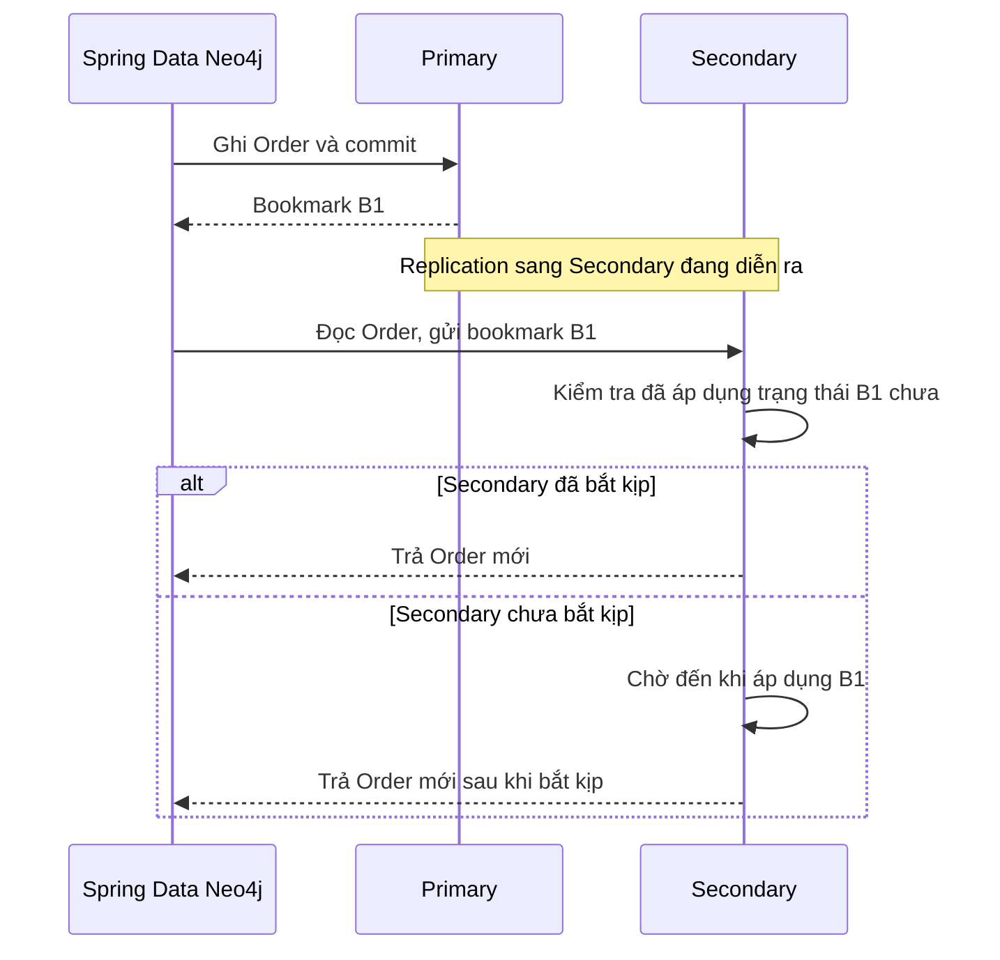

# Ảnh hưởng khi bỏ quản lý bookmark và các trường hợp đọc dữ liệu cũ

Bookmark là dấu mốc trạng thái của database mà Neo4j trả về sau một transaction. Khi client gửi bookmark ở transaction tiếp theo, cluster bảo đảm transaction đọc chỉ chạy sau khi trạng thái được bookmark đã có trên server xử lý truy vấn. Cơ chế này tạo *causal consistency* và giúp ứng dụng đọc được dữ liệu do chính thao tác trước đó vừa ghi.

Spring Data Neo4j (SDN) tự quản lý bookmark cho các transaction; ứng dụng thông thường không cần cấu hình thêm. Nếu thay bookmark manager mặc định bằng `Neo4jBookmarkManager.noop()`, SDN bỏ các bookmark nhận được và không cung cấp bookmark cho transaction tiếp theo. Trên một cluster có primary và secondary, thao tác đọc được định tuyến đến secondary chưa nhận bản ghi mới có thể trả về dữ liệu cũ. Vì vậy, chỉ tắt quản lý bookmark khi nghiệp vụ chấp nhận eventual consistency và không dùng kết quả đọc đó để ghi đè dữ liệu mới hơn.

## 1. Cluster, replication và causal consistency

Trong Neo4j cluster, database có thể được phục vụ bởi các primary và secondary. Primary xử lý các thao tác ghi; các thay đổi được sao chép sang secondary để mở rộng khả năng đọc và tăng tính sẵn sàng. Việc sao chép không nhất thiết hoàn tất đồng thời với lúc transaction ghi commit.

Giả sử ứng dụng vừa tạo một đơn hàng:

1. Transaction ghi tạo node `Order` trên primary và commit thành công.
2. Client nhận bookmark đại diện cho trạng thái database sau transaction đó.
3. Ứng dụng gửi truy vấn đọc chi tiết đơn hàng đến một secondary.
4. Nếu secondary chưa áp dụng transaction tạo đơn hàng, nó chưa thể trả lời đúng theo trạng thái vừa ghi.

Bookmark cho phép client yêu cầu cluster chỉ thực thi transaction tiếp theo sau khi trạng thái được đánh dấu đã được áp dụng. Nếu server được chọn chưa bắt kịp, nó có thể chờ replication hoặc transaction có thể timeout theo cấu hình. Ứng dụng đổi lại tính nhất quán theo quan hệ nhân quả bằng thời gian chờ có thể tăng lên.



*Causal consistency* có nghĩa các thao tác có quan hệ nhân quả được quan sát theo đúng thứ tự. Nó không có nghĩa mọi client độc lập luôn nhìn thấy mọi ghi mới nhất trên toàn cluster nếu client không truyền bookmark liên quan.

## 2. Bookmark là gì và không phải là gì?

Bookmark là một token do Neo4j Driver nhận từ server sau transaction. Client dùng token đó để chỉ ra trạng thái tối thiểu mà transaction tiếp theo cần quan sát.

| Bookmark | Ý nghĩa |
|---|---|
| Đại diện cho trạng thái database | Cho biết transaction tiếp theo cần chạy sau một trạng thái đã commit |
| Có thể được truyền giữa transaction/session | Tạo chuỗi đọc-sau-ghi qua các lần thực thi khác nhau |
| Có thể có nhiều token | Client có thể mang theo nhiều bookmark từ các nhánh công việc liên quan |
| Được cập nhật sau commit | Driver/manager thay bookmark cũ bằng bookmark mới theo chuỗi nhân quả |

Bookmark không phải:

- Bản sao dữ liệu hoặc snapshot của node/relationship.
- Khóa ghi hay cơ chế ngăn transaction khác cập nhật cùng node.
- Cơ chế optimistic locking thay thế `@Version`.
- Bằng chứng rằng một nghiệp vụ đã thành công ở tầng ứng dụng nếu transaction đã rollback hoặc request xử lý lỗi.
- Cam kết rằng mọi client không liên quan đều tự động nhìn thấy cùng một trạng thái.

Bookmark chỉ mang thông tin đồng bộ hóa. Dữ liệu vẫn được lưu trong Neo4j; token không chứa nội dung đơn hàng, người dùng hay property của graph.

## 3. SDN tự quản lý bookmark như thế nào?

Với Spring Data Neo4j hiện đại, bookmark management đã được tích hợp vào transaction infrastructure. SDN sử dụng bookmark cho các transaction mà không yêu cầu bật annotation riêng. Những transaction tuần tự trong cùng thread hoặc cùng reactive stream có thể đọc các thay đổi của transaction trước đó theo đúng thứ tự.

Ví dụ service thực hiện ghi rồi đọc trong cùng luồng nghiệp vụ:

```java
import org.springframework.stereotype.Service;
import org.springframework.transaction.annotation.Transactional;

@Service
public class OrderService {

    private final OrderRepository orders;

    public OrderService(OrderRepository orders) {
        this.orders = orders;
    }

    @Transactional
    public Order createAndLoad(CreateOrderCommand command) {
        Order saved = orders.save(Order.from(command));
        return orders.findById(saved.getId())
            .orElseThrow(() -> new OrderNotFoundException(saved.getId()));
    }
}
```

Trong ví dụ, hai thao tác repository nằm trong cùng transaction. Transaction nhìn thấy các thay đổi do chính nó thực hiện mà không cần bookmark để đồng bộ giữa hai transaction độc lập. Sau khi transaction commit, SDN/driver quản lý bookmark cho các transaction tiếp theo theo cơ chế mặc định.

Nếu một service thực hiện hai transaction riêng biệt tuần tự trong cùng thread hoặc cùng reactive stream, bookmark manager của SDN giúp transaction sau tiếp nối trạng thái transaction trước. Đây là lý do thông thường không cần tự lấy bookmark hoặc tự truyền token giữa các method trong một ứng dụng SDN.

### Bookmark trong cùng session và giữa nhiều session

Neo4j Java Driver cũng quản lý bookmark trong phạm vi một session. Các transaction tuần tự trong cùng session được nối causal chain tự động. Khi dùng nhiều session độc lập, cần một bookmark manager chung hoặc truyền bookmark từ session trước sang session sau nếu các công việc có quan hệ nhân quả.

| Phạm vi | Cách bảo đảm thứ tự |
|---|---|
| Nhiều query trong cùng transaction | Transaction tự nhìn thấy thay đổi của chính nó |
| Nhiều transaction tuần tự trong cùng Driver session | Driver tự truyền bookmark trong session |
| Các transaction SDN tuần tự trong cùng luồng được quản lý | SDN quản lý bookmark mặc định |
| Các session/ứng dụng độc lập có quan hệ nhân quả | Truyền hoặc seed bookmark rõ ràng nếu cần read-after-write |
| Các công việc hoàn toàn độc lập | Không cần nối bookmark chỉ để tạo một thứ tự không có ý nghĩa nghiệp vụ |

Không nên đồng nhất “cùng một JVM” với “mọi ứng dụng trong hệ thống”. Bookmark manager mặc định của một application context không tự chia sẻ trạng thái cho instance Spring khác, process khác hoặc dịch vụ khác. Nếu một request ghi ở instance A và request đọc tiếp theo chạy ở instance B, instance B chỉ có bảo đảm causal consistency nếu nó nhận được bookmark cần thiết hoặc có một cơ chế chia sẻ bookmark phù hợp.

## 4. Điều gì xảy ra khi bỏ quản lý bookmark?

SDN cung cấp `Neo4jBookmarkManager.noop()` để tạo một bookmark manager không lưu bookmark. Manager này bỏ các bookmark mới và không cung cấp bookmark cho transaction tiếp theo.

Có thể đăng ký bean sau:

```java
import org.springframework.context.annotation.Bean;
import org.springframework.context.annotation.Configuration;
import org.springframework.data.neo4j.core.transaction.Neo4jBookmarkManager;

@Configuration(proxyBeanMethods = false)
public class BookmarksDisabledConfiguration {

    @Bean
    Neo4jBookmarkManager neo4jBookmarkManager() {
        return Neo4jBookmarkManager.noop();
    }
}
```

Khi bean này được SDN sử dụng, các transaction không còn được nối với bookmark trước đó qua manager. Những hậu quả cần hiểu rõ:

1. Transaction ghi vẫn được gửi đến primary và commit theo cơ chế transaction bình thường.
2. Replication trong cluster vẫn diễn ra; việc dùng `noop()` không tắt replication.
3. Transaction đọc sau đó không mang bookmark của transaction ghi trước để yêu cầu server bắt kịp.
4. Nếu truy vấn đọc được định tuyến đến secondary đang trễ, nó có thể trả dữ liệu cũ hoặc chưa thấy node/relationship vừa tạo.
5. Khi replication hoàn tất, những truy vấn sau có thể nhìn thấy dữ liệu mới; tuy nhiên, không có bảo đảm read-after-write tại thời điểm ứng dụng cần.

Tắt bookmark không làm mất transaction đã commit và cũng không tự rollback dữ liệu. Rủi ro chính là ứng dụng có thể đọc trạng thái cũ rồi đưa ra quyết định dựa trên trạng thái đó. Trong một single-instance database không có secondary đang replicate, việc bỏ bookmark thường không tạo khác biệt đáng kể về stale read; điều này không phải lý do để mặc định tắt bookmark khi sau này có thể chuyển sang cluster.

## 5. Những tình huống có thể đọc dữ liệu cũ

### Tình huống 1: Ghi ở primary, đọc ngay ở secondary

Ứng dụng tạo khách hàng trên primary. Transaction tiếp theo được định tuyến đến secondary trước khi secondary nhận thay đổi. Nếu không có bookmark, truy vấn có thể không tìm thấy khách hàng vừa tạo.

```cypher
// Transaction ghi
CREATE (:Customer {customerNumber: $number, name: $name});

// Transaction đọc chạy sau đó nhưng không có bookmark
MATCH (c:Customer {customerNumber: $number})
RETURN c;
```

Kết quả đọc có thể rỗng trong một khoảng thời gian dù transaction ghi đã commit thành công.

### Tình huống 2: Đọc lại trạng thái cũ sau khi cập nhật property

Ứng dụng cập nhật `status` từ `PENDING` sang `PAID`. Một truy vấn đọc ngay sau đó được xử lý bởi secondary chưa áp dụng transaction mới và vẫn trả `PENDING`.

```cypher
// Ghi
MATCH (o:Order {id: $id})
SET o.status = 'PAID';

// Đọc ở transaction khác
MATCH (o:Order {id: $id})
RETURN o.status;
```

Nếu logic tiếp theo dựa vào `PENDING`, ứng dụng có thể hiển thị sai trạng thái hoặc thực hiện một bước xử lý không còn phù hợp.

### Tình huống 3: Relationship mới chưa xuất hiện

Một thao tác ghi tạo relationship `PLACED_BY` giữa `Order` và `Customer`. Truy vấn tiếp theo đọc graph qua secondary trễ có thể thấy node đơn hàng nhưng chưa thấy relationship mới, hoặc chưa thấy cả node tùy thứ tự replication.

```cypher
MATCH (o:Order {id: $orderId})-[:PLACED_BY]->(c:Customer)
RETURN o, c;
```

Điều này có thể làm projection hoặc màn hình chi tiết tạm thời thiếu dữ liệu liên kết.

### Tình huống 4: Request ghi và đọc đi qua hai application instance

Load balancer gửi lệnh ghi tới instance A. Sau khi nhận phản hồi, client gửi request đọc và load balancer chuyển request tới instance B. Bookmark manager trong instance B không tự biết bookmark vừa nhận ở A nếu hai instance không chia sẻ bookmark. Nếu B đọc từ secondary chưa bắt kịp, kết quả có thể cũ.

### Tình huống 5: Tích hợp với service hoặc driver bên ngoài

Một service khác, một batch job hoặc một ứng dụng dùng Neo4j Java Driver trực tiếp ghi graph. SDN không tự biết transaction của client bên ngoài nếu không có bookmark được chia sẻ. Tương tự, service bên ngoài không tự biết bookmark mà SDN vừa nhận. Cần truyền bookmark qua ranh giới tích hợp khi use case yêu cầu đọc sau ghi có quan hệ nhân quả.

### Tình huống 6: Các transaction độc lập chạy song song

Hai transaction chạy song song không tự có thứ tự nhân quả. Nếu transaction B phải nhìn thấy kết quả của A, B cần nhận bookmark từ A sau khi A commit. Chỉ vì B bắt đầu sau khi request A được gửi đi không có nghĩa A đã commit hoặc bookmark đã sẵn sàng.

## 6. Tác động đến nghiệp vụ khi đọc dữ liệu cũ

Stale read không chỉ là vấn đề giao diện. Nếu ứng dụng dùng dữ liệu cũ để quyết định ghi tiếp, hệ thống có thể tạo ra hành vi nghiệp vụ không mong muốn.

| Nghiệp vụ | Dữ liệu cũ có thể gây ra | Biện pháp phù hợp |
|---|---|---|
| Đăng ký tài khoản | Không thấy node vừa tạo, hiển thị “chưa tồn tại” | Dùng bookmark cho luồng tạo rồi đọc; constraint vẫn bảo vệ tính duy nhất |
| Đơn hàng | Đọc trạng thái cũ sau khi thanh toán | Giữ causal chain cho thao tác thanh toán và truy vấn xác nhận |
| Kho hàng | Đọc số lượng tồn trước lần trừ vừa commit | Dùng bookmark khi bước tiếp theo phụ thuộc lần ghi; dùng atomic update/locking cho cạnh tranh ghi |
| Hồ sơ người dùng | Hiển thị tên hoặc thông tin cũ sau khi cập nhật | Dùng bookmark cho read-after-write cần nhất quán |
| Graph traversal | Chưa thấy relationship mới tạo | Truyền bookmark trước khi đọc các đường đi phụ thuộc relationship đó |
| Báo cáo phân tích | Số liệu trễ hơn trạng thái mới nhất | Có thể chấp nhận eventual consistency nếu báo cáo không điều khiển ghi nghiệp vụ |

Bookmark không thay thế các cơ chế bảo vệ cập nhật đồng thời. Nếu hai transaction cùng sửa một entity, bookmark không ngăn lost update; hãy dùng atomic Cypher, write lock hoặc optimistic locking với `@Version` tùy nghiệp vụ. Bookmark bảo đảm thứ tự quan sát theo nhân quả, không biến mọi thao tác thành một transaction tuần tự toàn cục.

## 7. Khi nào có thể chấp nhận bỏ bookmark?

Tắt bookmark chỉ hợp lý khi ứng dụng chấp nhận khả năng đọc trễ và dữ liệu đọc không được dùng để ghi đè một trạng thái mới hơn.

Các trường hợp có thể cân nhắc:

- Dashboard hoặc báo cáo phân tích có thể trễ một khoảng thời gian.
- Tác vụ đọc độc lập, không phụ thuộc vào một transaction ghi vừa hoàn tất.
- Workload chỉ chạy trên một Neo4j instance và không có replication lag giữa các thành viên.
- Benchmark hoặc thử nghiệm cần đo riêng chi phí chờ causal consistency, trong môi trường không ảnh hưởng dữ liệu nghiệp vụ.

Không nên tắt bookmark cho:

- Luồng tạo rồi đọc lại cùng một entity.
- Thanh toán, xác nhận đơn hàng hoặc chuyển trạng thái cần read-after-write.
- Tác vụ ghi dựa trên số dư, tồn kho hoặc trạng thái vừa được cập nhật.
- Workflow nhiều service cần truyền kết quả của bước trước sang bước sau.
- Các ứng dụng có read replica và yêu cầu kết quả mới nhất ngay sau commit.

Nếu mục tiêu chỉ là giảm latency, hãy đo thời gian chờ do bookmark trước. Có thể gom các thao tác liên quan vào một transaction hoặc một session, thay vì nối các transaction độc lập không cần thiết. Tránh bỏ bookmark trên toàn ứng dụng chỉ để tối ưu một endpoint báo cáo.

## 8. Giữ read-after-write khi có nhiều transaction hoặc service

### Ưu tiên gom các thao tác liên quan vào một transaction

Nếu một use case có thể thực hiện trong cùng một transaction SDN, hãy dùng `@Transactional` ở service. Điều này vừa giảm số lần mở transaction, vừa bảo đảm các truy vấn trong transaction nhìn thấy thay đổi của chính transaction đó.

```java
@Transactional
public OrderDetails createOrderAndReadDetails(CreateOrderCommand command) {
    Order order = orderRepository.save(Order.from(command));
    Customer customer = customerRepository.findById(command.customerId())
        .orElseThrow(() -> new CustomerNotFoundException(command.customerId()));

    return new OrderDetails(order, customer);
}
```

Không cần bookmark để đọc một thay đổi chưa commit trong cùng transaction. Bookmark hữu ích khi trạng thái đã commit cần được nhìn thấy trong transaction khác.

### Giữ các transaction tuần tự trong cùng luồng

Với SDN imperative, các transaction tuần tự trong cùng thread được quản lý theo bookmark chain. Với SDN reactive, hãy compose thao tác trong cùng reactive stream. Tránh tự tạo một subscription độc lập hoặc một luồng xử lý khác nếu bước sau phụ thuộc vào dữ liệu bước trước.

### Chia sẻ bookmark qua ranh giới service

Nếu service A commit và service B cần đọc ngay kết quả đó, A có thể lấy bookmark từ `Neo4jBookmarksUpdatedEvent`. Event được phát sau khi transaction manager commit vật lý thành công và nhận bookmark mới từ cluster.

```java
import java.util.Set;

import org.neo4j.driver.Bookmark;
import org.springframework.context.ApplicationListener;
import org.springframework.stereotype.Component;
import org.springframework.data.neo4j.core.transaction.Neo4jBookmarksUpdatedEvent;

@Component
public class BookmarkCapture
        implements ApplicationListener<Neo4jBookmarksUpdatedEvent> {

    private final BookmarkStore bookmarkStore;

    public BookmarkCapture(BookmarkStore bookmarkStore) {
        this.bookmarkStore = bookmarkStore;
    }

    @Override
    public void onApplicationEvent(Neo4jBookmarksUpdatedEvent event) {
        Set<Bookmark> bookmarks = event.getBookmarks();
        bookmarkStore.saveLatest(bookmarks);
    }
}
```

`BookmarkStore` là thành phần do ứng dụng định nghĩa. Nó cần lưu bookmark theo đúng phạm vi workflow, tenant hoặc thông điệp cần tiếp nối, với thao tác thread-safe và không trộn bookmark của các database khác nhau. Không nên chỉ lưu một biến global rồi truyền cho mọi người dùng nếu các luồng nghiệp vụ không có quan hệ nhân quả.

Khi nhiều transaction commit đồng thời, store phải cập nhật tập bookmark theo cách thread-safe và không để một event cũ ghi đè trạng thái causal mới hơn. Với reactive flow, không dựa vào `ThreadLocal` để xác định workflow; hãy dùng context hoặc khóa workflow được truyền tường minh. Supplier đưa bookmark vào manager cũng cần thread-safe vì SDN có thể gọi nó từ nhiều luồng.

### Seed bookmark cho transaction manager

SDN cung cấp `Neo4jBookmarkManager.create(Supplier<Set<Bookmark>>)` để khởi tạo manager với bookmark đã được lưu từ trước. Ví dụ sau minh họa cách đưa bookmark của workflow vào transaction manager tùy chỉnh:

```java
import java.util.Set;

import org.neo4j.driver.Bookmark;
import org.neo4j.driver.Driver;
import org.springframework.context.annotation.Bean;
import org.springframework.context.annotation.Configuration;
import org.springframework.data.neo4j.core.DatabaseSelectionProvider;
import org.springframework.data.neo4j.core.transaction.Neo4jBookmarkManager;
import org.springframework.data.neo4j.core.transaction.Neo4jTransactionManager;
import org.springframework.transaction.PlatformTransactionManager;

@Configuration
public class BookmarkSeedConfiguration {

    @Bean
    PlatformTransactionManager transactionManager(
        Driver driver,
        DatabaseSelectionProvider databaseSelectionProvider,
        BookmarkStore bookmarkStore
    ) {
        Neo4jBookmarkManager bookmarkManager =
            Neo4jBookmarkManager.create(bookmarkStore::loadForCurrentWorkflow);

        return new Neo4jTransactionManager(
            driver,
            databaseSelectionProvider,
            bookmarkManager
        );
    }
}
```

Đây là cấu hình nâng cao. `BookmarkStore.loadForCurrentWorkflow()` cần trả về một tập bookmark an toàn cho workflow hiện tại; cách xác định workflow phải phù hợp với mô hình đồng thời của ứng dụng. Khi tự cấu hình cả `Neo4jClient` và transaction manager, hãy dùng cùng một `Neo4jBookmarkManager` instance cho hai thành phần. Với reactive stack, dùng reactive transaction manager và reactive bookmark manager tương ứng.

Trong phần lớn ứng dụng SDN, không cần capture hoặc seed bookmark thủ công. Chỉ thêm cơ chế này khi có ranh giới process/service thực sự cần duy trì causal chain.

## 9. Routing đọc và transaction read-only

Bookmark và routing giải quyết hai vấn đề khác nhau:

- Routing chọn server phù hợp để chạy query, ví dụ primary cho ghi và secondary cho đọc.
- Bookmark yêu cầu server được chọn phải bắt kịp trạng thái của transaction trước khi query được thực thi.

SDN và Neo4j Java Driver không phân tích Cypher để tự xác định một custom query chỉ đọc hay có ghi. Vì vậy, các query custom thường được giả định là có thể ghi trừ khi ứng dụng đánh dấu read-only. Các phương thức đọc dựng sẵn như `findById`, `findAllById`, `findAll` và các phương thức existential định sẵn được đánh dấu read-only theo mặc định.

Có thể đánh dấu repository hoặc method chỉ đọc:

```java
import java.util.Optional;

import org.springframework.data.neo4j.repository.Neo4jRepository;
import org.springframework.data.neo4j.repository.query.Query;
import org.springframework.data.repository.query.Param;
import org.springframework.transaction.annotation.Transactional;

@Transactional(readOnly = true)
public interface CustomerRepository
        extends Neo4jRepository<Customer, String> {

    @Query("MATCH (c:Customer {customerNumber: $number}) RETURN c")
    Optional<Customer> findCustomer(@Param("number") String number);
}
```

`readOnly = true` giúp hạ tầng chọn access mode đọc và cho phép cluster phân phối truy vấn đến secondary. Nhưng nếu secondary chưa áp dụng transaction trước và không có bookmark phù hợp, query vẫn có thể trả dữ liệu cũ. Vì vậy, read-only routing và causal consistency nên được xem là hai thiết lập phối hợp với nhau.

## 10. Bookmark có chi phí gì?

Bookmark làm tăng tính nhất quán theo nhân quả, nhưng có thể làm tăng độ trễ. Nếu secondary được chọn đang trễ so với bookmark, query phải đợi secondary bắt kịp hoặc thất bại khi timeout. Các chuỗi transaction phụ thuộc lẫn nhau cũng có thể làm giảm khả năng chạy song song.

Một số cách giảm chi phí mà vẫn giữ đúng ngữ nghĩa:

1. Gom các thao tác nghiệp vụ có quan hệ nhân quả vào một transaction ngắn.
2. Giữ các thao tác tuần tự trong cùng session hoặc reactive stream khi phù hợp.
3. Chỉ truyền bookmark giữa các công việc thực sự phụ thuộc vào nhau.
4. Không dùng bookmark của một workflow để buộc các truy vấn báo cáo độc lập chờ theo.
5. Đo latency và timeout ở cluster trước khi quyết định thay đổi bookmark manager.

Không nên tự loại bỏ bookmark chỉ vì một số truy vấn đọc chậm. Hãy kiểm tra server đang được route tới, replication lag, thời gian chờ bookmark và query plan để tìm đúng nguyên nhân.

## 11. Các lỗi thường gặp

| Biểu hiện | Nguyên nhân | Cách xử lý |
|---|---|---|
| Vừa tạo node nhưng truy vấn đọc không tìm thấy | Read query đến secondary chưa nhận transaction ghi | Giữ bookmark management hoặc truyền bookmark từ transaction ghi |
| Vừa đổi property nhưng màn hình vẫn hiện giá trị cũ | Query đọc chạy trước khi secondary bắt kịp | Duy trì causal chain cho luồng read-after-write |
| Một instance đọc thấy dữ liệu, instance khác chưa thấy | Bookmark manager mặc định không tự chia sẻ giữa các process | Capture và seed bookmark qua cơ chế chia sẻ có phạm vi workflow |
| `noop()` làm stale read xuất hiện thường xuyên hơn | Manager bỏ mọi bookmark và không cung cấp bookmark mới | Chỉ dùng khi nghiệp vụ chấp nhận eventual consistency |
| Query đọc custom bị gửi đến primary | Method chưa được đánh dấu read-only | Dùng `@Transactional(readOnly = true)` nếu query thực sự chỉ đọc |
| Query read-only vẫn trả dữ liệu cũ | Định tuyến đến secondary nhưng không có bookmark cần thiết | Kết hợp read-only routing với bookmark phù hợp |
| Query phải chờ lâu trước khi trả kết quả | Secondary chưa bắt kịp bookmark | Kiểm tra replication lag, timeout và chuỗi bookmark phụ thuộc |
| Tất cả request đều bị chờ theo một bookmark không liên quan | Ứng dụng chia sẻ bookmark quá rộng | Chỉ seed bookmark theo workflow hoặc causal chain cần thiết |
| Retry query đọc nhưng vẫn thấy trạng thái cũ | Retry không mang bookmark mới hoặc request chạy ở instance khác | Truyền bookmark đúng qua các lần retry và ranh giới service |
| Đã có bookmark nhưng vẫn ghi đè dữ liệu đồng thời | Nhầm bookmark với optimistic locking | Dùng `@Version`, atomic Cypher hoặc locking cho xung đột ghi |

## 12. Tự kiểm tra

1. Bookmark đại diện cho điều gì trong Neo4j cluster?
2. Vì sao một transaction đọc trên secondary có thể không thấy dữ liệu vừa được primary commit?
3. SDN có tự quản lý bookmark hay cần cấu hình riêng trong ứng dụng thông thường?
4. `Neo4jBookmarkManager.noop()` làm gì với bookmark nhận được và bookmark cần cung cấp?
5. Vì sao bỏ bookmark không làm mất transaction đã commit nhưng vẫn có thể gây stale read?
6. Những tình huống nào khiến hai application instance không tự chia sẻ causal chain?
7. Khác biệt giữa routing `readOnly = true` và bookmark management là gì?
8. Khi nào nên capture bookmark qua `Neo4jBookmarksUpdatedEvent` và seed lại transaction manager?
9. Vì sao bookmark không thay thế `@Version` hoặc atomic Cypher khi nhiều transaction cùng ghi?
10. Những workload nào có thể chấp nhận bỏ bookmark management?

SDN mặc định quản lý bookmark để duy trì causal consistency giữa các transaction có quan hệ nhân quả. Khi thay bằng `Neo4jBookmarkManager.noop()`, ứng dụng không còn yêu cầu secondary bắt kịp transaction trước; trên cluster, điều đó có thể làm query đọc trả node, property hoặc relationship cũ. Hãy giữ bookmark cho workflow cần read-after-write, chỉ chia sẻ bookmark qua ranh giới service khi có quan hệ nhân quả, và chỉ cân nhắc tắt quản lý bookmark cho workload thực sự chấp nhận eventual consistency.

## Tài liệu tham khảo

- [Spring Data Neo4j — FAQ: Using a Neo4j cluster and disabling bookmark management](https://docs.spring.io/spring-data/neo4j/reference/faq.html)
- [Spring Data Neo4j — `Neo4jBookmarkManager` API](https://docs.spring.io/spring-data/neo4j/reference/api/java/org/springframework/data/neo4j/core/transaction/Neo4jBookmarkManager.html)
- [Spring Data Neo4j — `Neo4jBookmarksUpdatedEvent` API](https://docs.spring.io/spring-data/neo4j/reference/api/java/org/springframework/data/neo4j/core/transaction/Neo4jBookmarksUpdatedEvent.html)
- [Neo4j Java Driver Manual — Coordinate parallel transactions with bookmarks](https://neo4j.com/docs/java-manual/current/bookmarks/)
- [Neo4j Operations Manual — Clustering architecture and causal consistency](https://neo4j.com/docs/operations-manual/current/clustering/introduction/)
- [Neo4j Operations Manual — Routing and cluster members](https://neo4j.com/docs/operations-manual/current/clustering/setup/routing/)
