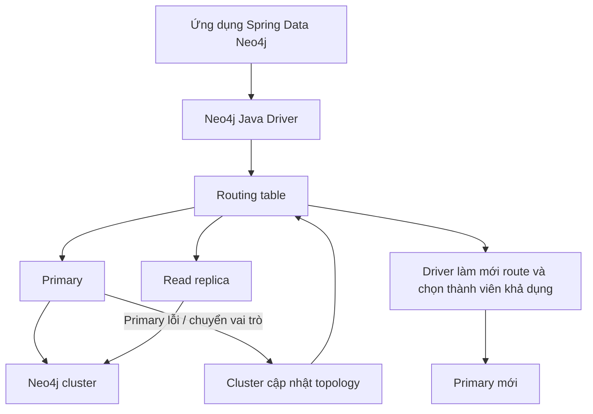
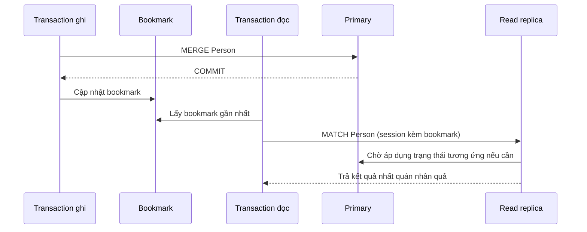

# Failover, lỗi tạm thời và retry theo phạm vi được hỗ trợ

Trong Neo4j cluster, một máy chủ có thể tạm thời mất kết nối, vai trò primary có thể thay đổi và routing table của driver có thể cần được làm mới. Neo4j Java Driver hỗ trợ routing và retry, nhưng phạm vi retry phụ thuộc cách chạy query. Managed transaction qua `Session.executeRead()` hoặc `Session.executeWrite()` có thể chạy lại toàn bộ transaction callback khi gặp lỗi được xem là tạm thời. Transaction do Spring Data Neo4j (SDN) quản lý qua `@Transactional` là transaction native được Spring mở và điều khiển; nó không tự động có cơ chế chạy lại toàn bộ method như managed transaction callback của Driver.

Bài học thuộc module **SPRING_DATA_NEO4J**, tập trung xây dựng tầng dữ liệu đồ thị qua node entity, relationship, repository và Cypher. Ta dùng `Person`, `Movie` và `ACTED_IN` để hiểu routing/failover, phân loại lỗi, giới hạn retry của Driver và SDN, thiết kế thao tác idempotent, quản lý bookmark và kiểm thử khi cluster chuyển primary.

## 1. Failover trong Neo4j cluster là gì?

Neo4j cluster có nhiều thành viên với vai trò khác nhau. Trong kiến trúc causal clustering, primary xử lý ghi và có thể phục vụ đọc; secondary/read replica phục vụ đọc. Khi một primary gặp sự cố, cluster bầu hoặc chuyển sang primary khác theo cơ chế của Neo4j. Client cần cập nhật thông tin routing và gửi transaction tiếp theo tới thành viên phù hợp.

Failover không có nghĩa mọi request đang chạy đều hoàn tất mà không lỗi. Một query đang truyền dữ liệu hoặc một transaction đang mở có thể mất kết nối giữa chừng. Driver có thể khám phá lại cluster và retry trong những phạm vi được hỗ trợ; nếu lỗi kéo dài hoặc không đủ điều kiện retry, ứng dụng vẫn nhận exception.



Driver xử lý kết nối và routing; ứng dụng quyết định transaction nào có thể được chạy lại an toàn. Đây là hai lớp phối hợp với nhau, nhưng không phải mọi lỗi mạng đều được giải quyết tự động.

## 2. Dùng routing URI cho cluster

Driver phân biệt hai nhóm URI quan trọng:

| URI | Hành vi |
|---|---|
| `neo4j://` | Routing driver; lấy routing table và định tuyến read/write tới thành viên phù hợp |
| `neo4j+s://` | Routing driver với TLS và chứng chỉ do CA tin cậy ký; thường dùng với Aura |
| `neo4j+ssc://` | Routing driver với TLS chấp nhận chứng chỉ tự ký |
| `bolt://` | Kết nối trực tiếp tới một host; không dùng routing table của cluster |
| `bolt+s://`, `bolt+ssc://` | Kết nối trực tiếp có TLS, không dùng routing table của cluster |

Với ứng dụng cần cluster routing, cấu hình Spring Boot có thể dùng seed URI:

```properties
spring.neo4j.uri=neo4j://neo4j-router.example.com:7687
spring.neo4j.authentication.username=app_user
spring.neo4j.authentication.password=${NEO4J_PASSWORD}
```

Với Aura, URI thường có dạng `neo4j+s://<instance-id>.databases.neo4j.io`. URI thực tế, chứng chỉ và cổng phải theo cấu hình do quản trị viên hoặc nhà cung cấp database cấp.

`neo4j://` là điểm vào để driver khám phá cluster. Sau khi nhận routing table, driver có thể kết nối tới các địa chỉ được cluster quảng bá. Những địa chỉ đó phải phân giải DNS và truy cập được từ môi trường chạy ứng dụng. Nếu primary đổi vai trò nhưng các địa chỉ quảng bá không thể truy cập, failover vẫn có thể thất bại.

Không dùng `bolt://` tới một node bất kỳ rồi mong driver tự tìm primary mới. Với URI direct, driver tiếp tục nhắm vào host được chỉ định. `bolt://` phù hợp khi chủ động muốn kết nối một instance cụ thể; cluster-aware application thường cần routing URI.

## 3. Driver khám phá và làm mới routing table

Khi tạo `Driver`, ứng dụng cung cấp một địa chỉ seed. Driver lấy routing table từ cluster, lưu thông tin router/reader/writer và định tuyến session dựa trên access mode. Routing table được làm mới định kỳ hoặc khi thông tin hiện tại không còn sử dụng được.

- Read transaction có thể được gửi tới reader phù hợp.
- Write transaction được gửi tới primary.
- Khi một địa chỉ không còn khả dụng, driver có thể thử thành viên khác sau khi cập nhật thông tin routing.
- Khi toàn bộ router đã biết đều lỗi, driver phải quay lại seed URI để khám phá lại; seed và DNS cần có độ sẵn sàng phù hợp.

Nếu cluster cung cấp nhiều seed qua DNS với nhiều bản ghi A/AAAA, driver có thể dùng các địa chỉ đó khi khởi tạo. Khi các địa chỉ thành viên không được DNS quảng bá hoặc cần ánh xạ đặc biệt, có thể cấu hình `ServerAddressResolver` cho địa chỉ khởi tạo. Resolver phía client không thể sửa các địa chỉ thành viên mà cluster quảng bá trong routing table; quản trị viên vẫn phải cấu hình advertised address chính xác.

Driver nên được tạo một lần và dùng chung trong application context. `Driver` thread-safe và quản lý connection pool; không tạo một Driver mới cho mỗi request hoặc mỗi lần retry. Session không phải đối tượng dùng chung đồng thời giữa các luồng.

## 4. Read-only transaction giúp cluster phân tải

Trong cluster, phân biệt thao tác đọc và ghi có ảnh hưởng trực tiếp tới routing. SDN không phân tích Cypher để tự kết luận mọi query chỉ đọc hay có ghi; mặc định an toàn là coi thao tác là write. Hãy đánh dấu các luồng đọc bằng `@Transactional(readOnly = true)`:

```java
@Service
public class PersonQueryService {

    private final PersonRepository personRepository;

    public PersonQueryService(PersonRepository personRepository) {
        this.personRepository = personRepository;
    }

    @Transactional(readOnly = true)
    public List<Person> findPeople() {
        return personRepository.findAll();
    }
}
```

Các phương thức đọc CRUD dựng sẵn như `findById`, `findAll`, `findAllById` và một số phương thức tồn tại được SDN đánh dấu read-only mặc định. Query method tự khai báo hoặc `@Query` cần được đánh dấu tường minh nếu chỉ đọc:

```java
@Transactional(readOnly = true)
@Query("""
    MATCH (p:Person)-[:ACTED_IN]->(m:Movie)
    WHERE m.title = $title
    RETURN DISTINCT p
    """)
List<Person> findActors(String title);
```

Với method ghi, dùng transaction thông thường:

```java
@Transactional
public Person rename(String personId, String newName) {
    Person person = personRepository.findByPersonId(personId)
        .orElseThrow();
    person.setName(newName);
    return personRepository.save(person);
}
```

Đánh dấu read-only đúng giúp driver định tuyến đọc tới read replica khi cluster hỗ trợ. `readOnly` không phải cơ chế phân quyền; quyền ghi vẫn do tài khoản Neo4j và authorization quyết định.

## 5. Phân loại lỗi trước khi quyết định retry

Không phải mọi exception đều là lỗi tạm thời. Hãy phân biệt nhóm có thể tự hồi phục với lỗi do code, dữ liệu hoặc cấu hình:

| Lỗi/nhóm lỗi | Ý nghĩa thường gặp | Hướng xử lý |
|---|---|---|
| `ServiceUnavailableException` | Driver không thể giao tiếp với cluster | Kiểm tra mạng/topology; retry trong giới hạn nếu transaction có thể chạy lại |
| `SessionExpiredException` | Session không còn đáp ứng điều kiện đã cấp, ví dụ kết nối hoặc route hết hiệu lực | Bỏ session cũ; tạo transaction/session mới |
| `TransientException` | Server báo lỗi tạm thời, có thể thử lại sau | Có thể retry nếu thao tác an toàn và còn ngân sách thời gian |
| `DiscoveryException` | Gặp lỗi khi lấy routing table từ một server | Có thể phục hồi khi cluster đang thay đổi; xem nguyên nhân và log topology |
| `FatalDiscoveryException` | Không thể lấy routing table hợp lệ, ví dụ database không tồn tại hoặc topology không thể khám phá | Sửa cấu hình/database/advertised address; retry liên tục không giải quyết nguyên nhân cố định |
| `AuthenticationException` | Sai thông tin xác thực | Sửa credentials hoặc auth provider; không retry mù quáng |
| `AuthorizationExpiredException` | Thông tin xác thực/ủy quyền đã hết hạn | Làm mới token qua auth provider; lỗi thiếu quyền cố định cần sửa authorization, không retry |
| `ClientException` | Query hoặc thao tác client không hợp lệ, ví dụ cú pháp Cypher hoặc tham số | Sửa code/query; không retry |
| Constraint violation | Dữ liệu vi phạm uniqueness/existence hoặc quy tắc schema | Sửa dữ liệu hoặc xử lý xung đột nghiệp vụ; không retry cùng input |

Neo4j Java Driver cung cấp `Neo4jException.code()` để nhận diện mã lỗi ổn định hơn nội dung message. Không viết logic retry dựa trên chuỗi thông báo lỗi vì message có thể thay đổi theo phiên bản hoặc ngôn ngữ.

`RetryableException` là marker interface cho lỗi mà một lần thử tiếp theo có thể thành công. SDN cũng cung cấp `RetryExceptionPredicate` để xác định các throwable có thể retry an toàn, dùng được với các thư viện như Resilience4j. Predicate này không có nghĩa mọi lỗi kết nối đều chắc chắn sẽ hồi phục; vẫn cần giới hạn số lần thử và thời gian chờ.

## 6. Ba phạm vi retry khác nhau của Java Driver

Đây là phần quan trọng nhất khi kết hợp Spring với Neo4j. Các kiểu chạy query không có cùng bảo đảm retry:

| Cách chạy | Retry tích hợp | Phạm vi |
|---|---|---|
| Managed transaction `Session.executeRead()` / `executeWrite()` | Có | Driver có thể chạy lại toàn bộ transaction callback khi gặp lỗi được phân loại transient |
| Explicit transaction `Session.beginTransaction()` | Không có managed callback retry | Ứng dụng điều khiển transaction; exception retryable chỉ cho biết thao tác có thể thành công nếu thử lại, không tự chạy lại toàn bộ đơn vị công việc |
| Auto-commit `Session.run()` / `SimpleQueryRunner.run()` | Giới hạn theo phiên bản | Từ Java Driver 6.1, chỉ retry một lần cho một số lỗi server đánh dấu idempotent, ví dụ admission-control errors |

Managed transaction phù hợp với một đơn vị công việc gồm nhiều câu Cypher cần commit/rollback cùng nhau và muốn Driver quản lý retry. Khi callback được chạy lại, các câu query của lần thử cũ thuộc transaction đã rollback; callback mới chạy trong transaction mới.

Auto-commit retry là cơ chế hẹp. Nó không tương đương với retry toàn bộ transaction callback, và không phải cơ chế retry tổng quát cho mọi `ServiceUnavailableException` hoặc mọi lỗi mạng. Không dựa vào nó để bảo đảm một quy trình nhiều bước được chạy lại nguyên tử.

## 7. Managed transaction tự retry toàn callback

Ví dụ dùng Java Driver trực tiếp:

```java
import java.util.Map;

import org.neo4j.driver.Driver;
import org.neo4j.driver.SessionConfig;

public final class DriverManagedWriteExample {

    private final Driver driver;

    public DriverManagedWriteExample(Driver driver) {
        this.driver = driver;
    }

    public String ensurePerson(String personId, String name) {
        try (var session = driver.session(
                SessionConfig.builder().withDatabase("neo4j").build())) {
            return session.executeWrite(tx -> {
                var result = tx.run("""
                    MERGE (p:Person {personId: $personId})
                    ON CREATE SET p.name = $name
                    RETURN p.personId AS personId
                    """, Map.of(
                        "personId", personId,
                        "name", name
                    ));

                return result.single().get("personId").asString();
            });
        }
    }
}
```

Tạo `Driver` một lần ở cấu hình ứng dụng và inject vào lớp dùng nó. Nếu cần đặt retry budget riêng cho Driver, cấu hình `Config` khi tạo bean:

```java
import java.util.concurrent.TimeUnit;

import org.neo4j.driver.AuthTokens;
import org.neo4j.driver.Config;
import org.neo4j.driver.Driver;
import org.neo4j.driver.GraphDatabase;

Config config = Config.builder()
    .withMaxTransactionRetryTime(30, TimeUnit.SECONDS)
    .build();

Driver driver = GraphDatabase.driver(uri, AuthTokens.basic(username, password), config);
```

Trong ứng dụng Spring Boot dùng SDN, hãy cấu hình Driver bean mà SDN đang sử dụng; không tạo thêm Driver thứ hai chỉ để chạy ví dụ managed transaction. Đoạn code managed transaction vẫn là luồng Driver độc lập và không được đặt bên trong một method đang dùng `@Transactional` của SDN.

`executeWrite()` là managed transaction. Driver có thể gọi callback nhiều lần trong giới hạn retry time khi lỗi được xem là transient. `withMaxTransactionRetryTime` đặt ngân sách retry tối đa; Java Driver hiện hành mặc định 30 giây. Nếu hết ngân sách mà lỗi vẫn còn, exception được trả về caller.

Ví dụ này minh họa Driver API độc lập. Trong một service SDN đang dùng `@Transactional`, không mở thêm `Driver`/`Session` riêng như ví dụ này để ghi cùng nghiệp vụ, vì transaction đó sẽ không tham gia transaction Spring hiện tại.

## 8. Vì sao transaction callback phải idempotent?

Vì managed transaction callback có thể được gọi nhiều lần, code bên trong phải cho cùng kết quả nghiệp vụ khi được thực hiện lại với cùng input. Một số nguyên tắc:

- Không thay đổi biến global hoặc state dùng chung trong callback.
- Không gửi email, gọi API thanh toán, publish message hoặc ghi file trực tiếp từ callback.
- Tạo ID của command/request ở bên ngoài callback rồi truyền vào như input ổn định.
- Dùng business key cùng uniqueness constraint và `MERGE` để tránh tạo node trùng.
- Tránh phép cộng dồn không có idempotency key nếu callback có thể chạy lại.

Ví dụ `MERGE` theo business key:

```cypher
MERGE (p:Person {personId: $personId})
ON CREATE SET p.name = $name
RETURN p.personId AS personId;
```

Nếu `Person.personId` có uniqueness constraint và `personId` không đổi giữa các lần thử, query tìm lại cùng một node. Nếu dùng `CREATE` không có khóa nhận diện, callback được chạy lại có thể tạo nhiều node trùng về mặt nghiệp vụ.

Với một command cần ghi nhận đúng một lần, dùng idempotency key:

```cypher
MATCH (p:Person {personId: $personId})
MERGE (c:Command {commandId: $commandId})
ON CREATE SET c.createdAt = datetime(),
              c.commandType = $commandType
MERGE (c)-[:AFFECTS]->(p)
RETURN c.commandId AS commandId;
```

`commandId` phải được tạo một lần ở ngoài transaction callback và giữ nguyên cho mọi lần thử. Cần uniqueness constraint trên `Command.commandId` để database bảo vệ khóa này khi có nhiều request đồng thời.

Đặc biệt, nếu kết nối đứt ngay quanh thời điểm commit, client có thể không biết server đã commit hay chưa. Không tự suy luận rằng timeout đồng nghĩa transaction rollback. Gửi lại cùng `commandId` và đọc trạng thái command giúp xác định kết quả mà không tạo một nghiệp vụ mới ngoài ý muốn.

## 9. Không đặt side effect bên ngoài database trong callback

Đoạn code sau nguy hiểm:

```java
session.executeWrite(tx -> {
    tx.run("MERGE (p:Person {personId: $id})", Map.of("id", personId));
    emailClient.sendWelcomeEmail(personId); // Không nên đặt ở đây.
    return personId;
});
```

Nếu transaction callback được gọi lại, email có thể gửi nhiều lần dù graph chỉ commit một lần. Cũng không nên gọi một dịch vụ thanh toán bên ngoài trong callback rồi giả định transaction Neo4j có thể rollback giao dịch thanh toán.

Một cách thiết kế phổ biến là transactional outbox:

1. Trong cùng transaction Neo4j, ghi thay đổi domain và một node/event outbox có `eventId` ổn định.
2. Sau khi transaction commit, một worker đọc event chưa gửi.
3. Worker gửi event tới hệ thống ngoài bằng idempotency key.
4. Worker đánh dấu event đã xử lý hoặc lưu trạng thái giao nhận.

Outbox không tự làm cho hệ thống ngoài có exactly-once delivery; consumer vẫn cần idempotency để xử lý message có thể được giao lại.

## 10. Retry trong Spring Data Neo4j với @Transactional

SDN tích hợp Java Driver qua `Neo4jClient` và `Neo4jTransactionManager`. Transaction manager đồng bộ một cặp native Neo4j session/transaction với transaction Spring. Khi method service dùng `@Transactional`, Spring mở transaction native và điều khiển commit/rollback.

Đây là explicit transaction do Spring quản lý. Nó không tương đương với `Session.executeWrite(callback)` của Driver, vì Spring transaction manager không nhận callback nghiệp vụ để Driver tự chạy lại toàn bộ method. Vì vậy, `@Transactional` tự nó không có nghĩa là service method sẽ tự retry khi cluster failover.

Ví dụ service SDN:

```java
@Service
public class PersonWriter {

    private final PersonRepository personRepository;

    public PersonWriter(PersonRepository personRepository) {
        this.personRepository = personRepository;
    }

    @Transactional
    public Person renameOnce(String personId, String newName) {
        Person person = personRepository.findByPersonId(personId)
            .orElseThrow();

        person.setName(newName);
        return personRepository.save(person);
    }
}
```

Nếu transaction gặp lỗi kết nối, Spring sẽ rollback hoặc kết thúc transaction theo trạng thái driver. Không nên bắt lỗi rồi chạy lại `save()` bên trong cùng transaction/session đã lỗi. Nếu nghiệp vụ cho phép retry, hãy bắt đầu một transaction mới cho toàn bộ use case.

## 11. Đặt application retry bên ngoài transaction boundary

Với imperative SDN, có thể dùng một retry facade không có `@Transactional`, gọi một bean khác có method `@Transactional`. Mỗi lần gọi method qua Spring proxy sẽ mở một transaction mới.

Ví dụ với Resilience4j:

Đoạn code này cần dependency `resilience4j-retry`; SDN cung cấp `RetryExceptionPredicate`, nhưng không tự thêm Resilience4j vào ứng dụng.

```java
import java.time.Duration;

import io.github.resilience4j.retry.Retry;
import io.github.resilience4j.retry.RetryConfig;
import org.springframework.data.neo4j.core.support.RetryExceptionPredicate;
import org.springframework.stereotype.Service;

@Service
public class RetryingPersonFacade {

    private final PersonWriter personWriter;
    private final Retry retry;

    public RetryingPersonFacade(PersonWriter personWriter) {
        this.personWriter = personWriter;

        RetryConfig config = RetryConfig.custom()
            .maxAttempts(3)
            .waitDuration(Duration.ofMillis(200))
            .retryOnException(new RetryExceptionPredicate())
            .build();

        this.retry = Retry.of("neo4j-person-write", config);
    }

    public Person rename(String personId, String newName) {
        return Retry.decorateSupplier(
            retry,
            () -> personWriter.renameOnce(personId, newName)
        ).get();
    }
}
```

`RetryExceptionPredicate` của SDN xác định throwable có thể retry an toàn. Facade này không mở transaction; mỗi lần thử gọi `PersonWriter.renameOnce()` qua bean proxy để Spring mở một transaction mới. Chỉ retry những lỗi mà predicate cho phép và giới hạn số lần thử.

Với Resilience4j, `maxAttempts(3)` tính cả lần gọi đầu tiên, tức tối đa ba lần gọi method.

Không đặt `@Transactional` lên `RetryingPersonFacade.rename()`. Nếu facade đã mở transaction ngoài, các lần gọi bên trong có thể tham gia cùng transaction đó thay vì nhận transaction mới cho mỗi lần thử. Cũng cần bảo đảm method `renameOnce()` được gọi qua bean Spring khác, không phải self-invocation trong cùng class.

## 12. Retry với reactive service

Trong reactive SDN, `@Transactional` quản lý transaction theo Reactor context. Để retry toàn bộ use case bằng transaction mới, đặt `retryWhen` ở lớp gọi bên ngoài transactional service:

```java
import java.time.Duration;

import org.springframework.data.neo4j.core.support.RetryExceptionPredicate;
import org.springframework.stereotype.Service;
import org.springframework.transaction.annotation.Transactional;
import reactor.core.publisher.Mono;
import reactor.util.retry.Retry;

@Service
public class ReactivePersonWriter {

    private final ReactivePersonRepository repository;

    public ReactivePersonWriter(ReactivePersonRepository repository) {
        this.repository = repository;
    }

    @Transactional
    public Mono<Person> renameOnce(String personId, String newName) {
        return repository.findByPersonId(personId)
            .switchIfEmpty(Mono.error(
                new IllegalArgumentException("Person not found")
            ))
            .flatMap(person -> {
                person.setName(newName);
                return repository.save(person);
            });
    }
}

@Service
public class ReactiveRetryingPersonFacade {

    private final ReactivePersonWriter writer;

    public ReactiveRetryingPersonFacade(ReactivePersonWriter writer) {
        this.writer = writer;
    }

    public Mono<Person> rename(String personId, String newName) {
        return writer.renameOnce(personId, newName)
            .retryWhen(
                Retry.backoff(2, Duration.ofMillis(200))
                    .filter(new RetryExceptionPredicate())
            );
    }
}
```

Facade reactive không có `@Transactional`; mỗi subscription thử lại đăng ký lại publisher transactional từ bean `ReactivePersonWriter`, để transaction boundary được tạo lại. Không đặt `retryWhen` bên trong method transactional sau khi đã mở transaction nếu mục tiêu là chạy lại toàn bộ nghiệp vụ trong transaction mới.

Với Reactor `Retry.backoff(2, ...)`, giá trị `2` là số lần retry sau subscription đầu tiên, tức tối đa ba subscription. Hãy chú ý sự khác biệt cách đếm này khi chuyển cấu hình giữa Resilience4j và Reactor.

Không gọi `.subscribe()` hoặc `.block()` trong service. Publisher được trả về caller để Spring và Reactor quản lý subscription, cancellation và transaction context. Nếu dùng một reactive transaction callback trực tiếp từ Driver (`ReactiveSession.executeWrite`), Driver có cơ chế retry callback riêng; không trộn cơ chế đó với `ReactiveNeo4jTransactionManager` của SDN trong cùng một đơn vị công việc.

## 13. Giới hạn auto-commit retry từ Driver

Từ Java Driver 6.1, các lệnh auto-commit chạy qua `Session.run()` có thể được retry một lần nếu server trả lỗi được đánh dấu idempotent. Tại thời điểm tài liệu Driver 6.3, nhóm này bao gồm admission-control errors: lỗi server xác nhận thao tác chưa làm thay đổi database và có thể thử lại an toàn.

Mặc định auto-commit retry được bật; có thể tắt ở driver config:

```java
Config config = Config.builder()
    .withAutoCommitRetriesDisabled(true)
    .build();
```

Hoặc cấu hình theo session bằng `withAutoCommitRetriesMode(...)`. Đây là retry một lần cho một nhóm lỗi hẹp, không phải retry nhiều lần cho mọi lỗi transient. Nếu dùng SDN `Neo4jClient` ngoài Spring transaction, query chạy theo auto-commit semantics; hành vi retry giới hạn này phụ thuộc phiên bản Java Driver và cấu hình session/driver.

Không dựa vào auto-commit retry để bảo đảm một quy trình nhiều câu Cypher được thực hiện nguyên tử. Khi nhiều thao tác phải thành công cùng nhau, dùng transaction boundary phù hợp.

## 14. Bookmark giúp đọc nhất quán sau ghi

Bookmark là token biểu diễn trạng thái đã được commit của database. Khi transaction tiếp theo dùng bookmark, Neo4j bảo đảm nó không chạy trước khi trạng thái được bookmark đại diện đã được thiết lập trên thành viên xử lý truy vấn.

Bookmark giải quyết causal consistency giữa các transaction; nó không phải retry token, không kích hoạt failover và không tự sửa một transaction bị lỗi.

Ví dụ luồng ghi rồi đọc trong cluster:



Trong cùng session, Driver tự nối bookmark giữa các transaction. Với nhiều session hoặc transaction chạy độc lập, cần dùng chung bookmark manager hoặc truyền bookmark phù hợp nếu yêu cầu transaction sau nhìn thấy thay đổi của transaction trước. Việc chờ bookmark có thể tăng độ trễ, vì vậy chỉ cần dùng khi nghiệp vụ yêu cầu causal consistency giữa các transaction độc lập.

## 15. Bookmark management trong Spring Data Neo4j

SDN tự quản lý bookmark cho các transaction imperative và reactive. Trong cùng thread hoặc cùng reactive stream chạy tuần tự, transaction sau có thể đọc dữ liệu mà transaction trước vừa ghi mà không cần cấu hình bổ sung.

Không nên thay bookmark manager mặc định bằng `Neo4jBookmarkManager.noop()` trong cluster nếu ứng dụng cần đọc nhất quán sau ghi. No-op manager bỏ bookmark, có nguy cơ stale read trên read replica.

Nếu cần lấy bookmark mới nhất hoặc seed transaction manager từ một nguồn ngoài, SDN cung cấp `Neo4jBookmarksUpdatedEvent` và `Neo4jBookmarkManager`. Đây là nhu cầu nâng cao; ứng dụng thông thường nên giữ cấu hình mặc định.

Ví dụ lắng nghe bookmark được cập nhật sau khi transaction commit:

```java
import org.springframework.context.ApplicationListener;
import org.springframework.data.neo4j.core.transaction.Neo4jBookmarksUpdatedEvent;
import org.springframework.stereotype.Component;

@Component
public class BookmarkCapture
        implements ApplicationListener<Neo4jBookmarksUpdatedEvent> {

    @Override
    public void onApplicationEvent(Neo4jBookmarksUpdatedEvent event) {
        var latestBookmarks = event.getBookmarks();
        // Lưu hoặc chuyển bookmark theo nhu cầu tích hợp của ứng dụng.
    }
}
```

Nếu tự lưu bookmark để chuyển giữa service hoặc tiến trình, phải quản lý thread-safety, database tương ứng và vòng đời bookmark. Không chia sẻ bookmark của database này cho database khác.

## 16. Backoff, retry budget và tránh retry storm

Retry có thể làm hệ thống phục hồi tốt hơn, nhưng retry quá nhiều trong lúc cluster đang quá tải sẽ làm tình trạng xấu hơn. Một chính sách hợp lý cần có:

- **Số lần thử tối đa:** giới hạn số lần chạy lại ở application layer.
- **Backoff:** tăng thời gian chờ giữa các lần thử để giảm tải tức thời.
- **Jitter:** thêm độ ngẫu nhiên để nhiều instance không retry cùng một nhịp.
- **Retry budget:** tổng thời gian retry phải nằm trong timeout của request hoặc job.
- **Một lớp retry chính:** tránh lồng retry của Driver, Resilience4j, HTTP client và message consumer mà không tính tổng số lần thử.
- **Observability:** log mã lỗi, attempt, thời gian chờ, database và trạng thái routing khi có thể.

Driver managed transaction có `maxTransactionRetryTime` riêng, mặc định 30 giây trong Java Driver hiện hành. Nếu ứng dụng thêm retry facade, cần tính tổng ngân sách sao cho không vượt timeout request và không khiến người dùng phải chờ quá lâu.

Không retry các lỗi cú pháp, authentication, authorization, constraint violation hoặc validation. Những lỗi đó cần sửa query, credentials, quyền hoặc dữ liệu đầu vào.

## 17. Kiểm tra failover và retry trong môi trường thử nghiệm

Unit test với một Neo4j instance đơn không đủ chứng minh failover của cluster. Nên có integration test hoặc môi trường staging có topology tương tự production:

1. Kết nối bằng routing URI `neo4j://` hoặc URI TLS tương ứng.
2. Xác nhận Driver khám phá được router, reader và writer.
3. Ghi một `Person` với business key ổn định.
4. Đọc lại trong cùng transaction/session để kiểm tra dữ liệu.
5. Chạy nhiều request đọc/ghi khi mô phỏng primary failover hoặc một member tạm thời không khả dụng.
6. Xác nhận lỗi transient được retry trong phạm vi được hỗ trợ; lỗi cố định vẫn được trả về.
7. Kiểm tra không có node/relationship trùng khi callback được chạy lại.
8. Chạy một transaction độc lập sau ghi và xác nhận bookmark giữ causal consistency.
9. Kiểm tra log để phân biệt retry của Driver, retry của application và request cuối cùng thất bại.

Không dùng việc `driver.verifyConnectivity()` thành công tại thời điểm startup làm bằng chứng rằng cluster sẽ luôn sẵn sàng. Health check chỉ phản ánh trạng thái tại thời điểm kiểm tra.

## 18. Lỗi thường gặp

| Lỗi | Nguyên nhân | Cách xử lý |
|---|---|---|
| Dùng `bolt://` nhưng kỳ vọng driver tự failover | URI kết nối trực tiếp tới một host | Dùng routing URI `neo4j://` hoặc URI TLS tương ứng |
| Địa chỉ advertised của cluster không truy cập được | Driver nhận routing table nhưng không kết nối được các member | Sửa DNS/firewall và advertised address phía cluster |
| Nghĩ `@Transactional` tự retry toàn service | SDN transaction manager dùng explicit native transaction | Đặt retry facade bên ngoài transactional bean để mỗi lần thử mở transaction mới |
| Retry một query trong transaction đã hết hạn | Session/transaction cũ không còn dùng được | Rollback/kết thúc transaction và thử lại toàn bộ unit of work trong transaction mới |
| Callback managed transaction gửi email hoặc gọi API | Driver có thể gọi callback nhiều lần | Dùng outbox và idempotency key |
| Dùng `CREATE` trong callback có thể chạy lại | Mỗi lần thử có thể tạo node mới | Dùng business key, uniqueness constraint và `MERGE` |
| Retry tất cả `Neo4jException` | Lỗi cú pháp, quyền và constraint không tự hồi phục | Dùng mã lỗi hoặc `RetryExceptionPredicate` để lọc lỗi an toàn |
| Retry vô hạn hoặc không backoff | Tạo retry storm và giữ request quá lâu | Giới hạn attempt/time, backoff và jitter |
| Retry lồng nhiều tầng | Số lần thử thực tế tăng theo cấp số nhân | Chọn một lớp retry chính và tính tổng ngân sách |
| Dùng `Neo4jBookmarkManager.noop()` trong cluster | Transaction sau có thể đọc stale data | Giữ bookmark manager mặc định khi cần causal consistency |
| Chạy song song nhiều transaction nhưng mong tự thấy kết quả của nhau | Bookmark mặc định không tự nối các session độc lập | Chia sẻ bookmark manager hoặc truyền bookmark |
| Ghi query đọc nhưng không đánh dấu read-only | Driver mặc định routing write | Dùng `@Transactional(readOnly = true)` cho query chỉ đọc |

## 19. Checklist triển khai

- Dùng routing URI phù hợp với cluster; không dùng direct Bolt URI nếu cần routing.
- Bảo đảm seed, DNS và advertised addresses có thể truy cập từ ứng dụng.
- Dùng một `Driver` thread-safe dùng chung toàn ứng dụng.
- Đánh dấu query đọc bằng `@Transactional(readOnly = true)` để hỗ trợ read routing.
- Phân biệt managed transaction, explicit transaction và auto-commit.
- Không giả định SDN `@Transactional` tự chạy lại toàn bộ method.
- Dùng `RetryExceptionPredicate` hoặc mã lỗi Driver để lọc lỗi retry an toàn.
- Đặt application retry bên ngoài transaction boundary để mỗi lần thử có transaction mới.
- Thiết kế callback/command idempotent với business key và uniqueness constraint.
- Đưa side effect ngoài database ra khỏi transaction callback; cân nhắc outbox.
- Giới hạn attempt, backoff, jitter và tổng retry budget.
- Giữ bookmark manager mặc định nếu cần causal consistency trong cluster.
- Chỉ dùng bookmark thủ công khi phải nối các session/transaction độc lập.
- Kiểm thử failover trên cluster hoặc staging có topology tương tự production.
- Theo dõi error code, attempt count, thời gian retry và trạng thái member.

## 20. Bài tập thực hành

1. Cấu hình `spring.neo4j.uri` bằng `neo4j://` và giải thích khác biệt với `bolt://`.
2. Dùng `Session.executeWrite()` để upsert `Person` theo `personId`; xác định phần callback nào có thể được chạy lại.
3. Thay `CREATE` bằng `MERGE` và thêm uniqueness constraint để bảo đảm idempotency.
4. Cấu hình `withMaxTransactionRetryTime` và quan sát hành vi khi cluster tạm thời không khả dụng.
5. Phân biệt `ServiceUnavailableException`, `SessionExpiredException`, `TransientException` và `ClientException`.
6. Thử một lệnh auto-commit với Driver 6.1+ và kiểm tra giới hạn one-shot retry cho lỗi idempotent.
7. Viết service SDN `@Transactional` và chứng minh method không tự retry toàn bộ khi lỗi transient.
8. Tạo retry facade bên ngoài transactional bean; xác nhận mỗi attempt dùng transaction mới.
9. Với reactive SDN, đặt `retryWhen` ở facade bên ngoài service `@Transactional` và xác nhận publisher được subscribe lại với transaction mới.
10. Tạo command có `commandId` ổn định; cố ý mô phỏng callback chạy lại và xác nhận chỉ có một node command.
11. Chuyển side effect email sang outbox và viết consumer idempotent.
12. Ghi dữ liệu ở transaction A rồi đọc ở transaction B trên session khác; thử có và không có bookmark.
13. Mô phỏng primary failover trên cluster thử nghiệm và quan sát routing table/exception/retry.
14. Đánh giá retry budget khi kết hợp Driver retry với application retry để tránh vượt timeout request.

Khi hoàn thành, bạn cần phân biệt routing/failover của Driver với retry transaction, biết phạm vi retry tích hợp của managed transaction và auto-commit, và hiểu rằng SDN `@Transactional` cần một retry boundary bên ngoài nếu muốn chạy lại toàn bộ use case. Bookmark giúp bảo đảm đọc nhân quả giữa các transaction; idempotency giúp việc chạy lại không tạo tác dụng phụ trùng lặp.

## Tài liệu tham khảo

- [Spring Data Neo4j — Neo4jClient và transaction integration](https://docs.spring.io/spring-data/neo4j/reference/appendix/neo4j-client.html)
- [Spring Data Neo4j — FAQ: Using a Neo4j cluster instance](https://docs.spring.io/spring-data/neo4j/reference/faq.html)
- [Spring Data Neo4j — Neo4jTransactionManager API 8.1.x](https://docs.spring.io/spring-data/neo4j/reference/api/java/org/springframework/data/neo4j/core/transaction/Neo4jTransactionManager.html)
- [Spring Data Neo4j — RetryExceptionPredicate API](https://docs.spring.io/spring-data/neo4j/reference/api/java/org/springframework/data/neo4j/core/support/RetryExceptionPredicate.html)
- [Neo4j Java Driver Manual — Run your own transactions](https://neo4j.com/docs/java-manual/current/transactions/)
- [Neo4j Java Driver Manual — Advanced connection information](https://neo4j.com/docs/java-manual/current/connect-advanced/)
- [Neo4j Java Driver Manual — Coordinate parallel transactions and bookmarks](https://neo4j.com/docs/java-manual/current/bookmarks/)
- [Neo4j Java Driver API — Config.ConfigBuilder](https://neo4j.com/docs/api/java-driver/current/org.neo4j.driver/org/neo4j/driver/Config.ConfigBuilder.html)
- [Neo4j Java Driver API — Exception package](https://neo4j.com/docs/api/java-driver/current/org.neo4j.driver/org/neo4j/driver/exceptions/package-summary.html)
- [Resilience4j — Retry](https://resilience4j.readme.io/docs/retry)
