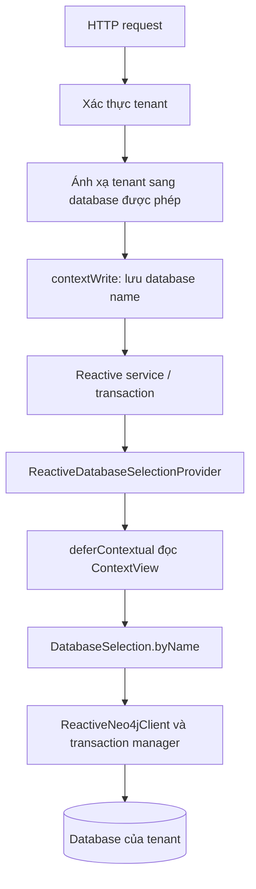

# ReactiveDatabaseSelectionProvider và dữ liệu từ Reactor Context

Một ứng dụng Spring Data Neo4j reactive có thể phục vụ nhiều tenant, mỗi tenant dùng một database Neo4j riêng. Thay vì tạo một `ReactiveNeo4jClient` cho từng request, ứng dụng có thể cung cấp `ReactiveDatabaseSelectionProvider` để chọn database tại thời điểm reactive operation được subscribe. Khi tenant được lưu trong Reactor `Context`, provider đọc giá trị đó bằng `Mono.deferContextual()` và trả về `DatabaseSelection` tương ứng.

Cách làm này cho phép database selection đi cùng reactive pipeline, không phụ thuộc request đang chạy trên thread nào. Để bảo đảm cách ly tenant, cần xác thực tenant trước khi ghi vào context, ánh xạ tenant sang database từ danh sách được phép, dùng cùng provider cho client và transaction manager, đồng thời giữ nguyên database trong toàn bộ một transaction.

## 1. Database selection trong Spring Data Neo4j reactive

`ReactiveDatabaseSelectionProvider` là functional interface trong package `org.springframework.data.neo4j.core`. Phương thức `getDatabaseSelection()` trả về `Mono<DatabaseSelection>`:

```java
public interface ReactiveDatabaseSelectionProvider {
    Mono<DatabaseSelection> getDatabaseSelection();
}
```

Provider cho biết truy vấn reactive tiếp theo cần chạy trên database nào. `DatabaseSelection.byName("tenant_a")` chọn một database theo tên; `DatabaseSelection.undecided()` biểu thị để server sử dụng database mặc định.

SDN cũng cung cấp hai provider dựng sẵn:

```java
ReactiveDatabaseSelectionProvider fixedTenant =
        ReactiveDatabaseSelectionProvider
                .createStaticDatabaseSelectionProvider("tenant_a");

ReactiveDatabaseSelectionProvider defaultDatabase =
        ReactiveDatabaseSelectionProvider.getDefaultSelectionProvider();
```

Provider tĩnh phù hợp khi toàn bộ ứng dụng luôn dùng một database. Provider đọc Reactor Context phù hợp khi database thay đổi theo tenant hoặc theo request.

Một `Mono<DatabaseSelection>` rỗng có nghĩa là dùng database mặc định. Trong ứng dụng multi-tenant, cần quyết định rõ trường hợp thiếu tenant: có thể từ chối request để fail closed, hoặc chủ động dùng database mặc định nếu đó là chính sách đã thiết kế. Không nên vô tình rơi về database mặc định khi context bị thiếu.

## 2. Vì sao dùng Reactor Context thay vì ThreadLocal?

Reactive pipeline có thể chuyển qua nhiều thread do `publishOn`, `subscribeOn` hoặc scheduler. Một giá trị lưu trong `ThreadLocal` chỉ gắn với thread hiện tại, nên không phải nơi đáng tin cậy để giữ tenant cho toàn bộ reactive flow.

Reactor `Context` gắn với subscriber và được truyền ngược theo subscription. Các operator như `Mono.deferContextual()` có thể đọc dữ liệu từ `ContextView`, còn `contextWrite()` thêm hoặc thay đổi dữ liệu cho phần upstream của pipeline.



Context là dữ liệu theo subscription, không phải biến toàn cục. Hai request đồng thời có thể mang hai database name khác nhau mà không ghi đè dữ liệu của nhau, miễn là mỗi request được gắn context đúng cách.

## 3. Định nghĩa key dùng trong Reactor Context

Nên gom key vào một class để các thành phần dùng cùng một định danh:

```java
public final class TenantDatabaseContext {

    public static final String DATABASE_NAME =
            TenantDatabaseContext.class.getName() + ".databaseName";

    private TenantDatabaseContext() {
    }
}
```

Không dùng các key chung chung như `"tenant"` hoặc `"database"` rải rác trong nhiều module. Một key có namespace giúp tránh đụng tên với context data của thư viện khác.

## 4. Tạo ReactiveDatabaseSelectionProvider đọc Context

`Mono.deferContextual()` trì hoãn việc đọc context đến lúc publisher được subscribe. Đây là điểm quan trọng: bean provider được tạo một lần khi ứng dụng khởi động, nhưng database name phải được lấy riêng cho từng subscription.

Ví dụ provider bắt buộc phải có database name:

```java
import org.springframework.context.annotation.Bean;
import org.springframework.context.annotation.Configuration;
import org.springframework.data.neo4j.core.DatabaseSelection;
import org.springframework.data.neo4j.core.ReactiveDatabaseSelectionProvider;
import reactor.core.publisher.Mono;

@Configuration(proxyBeanMethods = false)
public class TenantDatabaseConfiguration {

    @Bean
    ReactiveDatabaseSelectionProvider reactiveDatabaseSelectionProvider() {
        return () -> Mono.deferContextual(context ->
                context.<String>getOrEmpty(TenantDatabaseContext.DATABASE_NAME)
                        .map(DatabaseSelection::byName)
                        .map(Mono::just)
                        .orElseGet(() -> Mono.error(
                                new IllegalStateException(
                                        "Tenant database is missing from Reactor Context")))
        );
    }
}
```

Provider thực hiện các bước:

1. Đợi subscription để nhận `ContextView`.
2. Đọc database name từ key đã quy ước.
3. Chuyển tên thành `DatabaseSelection`.
4. Phát lỗi nếu không có giá trị, tránh truy vấn vô tình chạy vào database mặc định.

Nếu chính sách của ứng dụng cho phép dùng database mặc định khi không có tenant, có thể trả `Mono.empty()` khi không tìm thấy key:

```java
return () -> Mono.deferContextual(context ->
        Mono.justOrEmpty(context.<String>getOrEmpty(
                        TenantDatabaseContext.DATABASE_NAME))
                .map(DatabaseSelection::byName)
);
```

Theo hợp đồng của `ReactiveDatabaseSelectionProvider`, `Mono.empty()` biểu thị database mặc định. Chỉ dùng cách này khi fallback đã được xác định rõ và không làm suy yếu tenant isolation.

## 5. Đưa tenant database vào Context ở biên request

Không để repository tự suy đoán tenant từ dữ liệu entity. Hãy xác thực người dùng và phân giải tenant ở tầng biên ứng dụng, sau đó gắn database name vào publisher trước khi nó được subscribe.

Ví dụ resolver dùng allowlist:

```java
import java.util.Map;
import org.springframework.stereotype.Component;

@Component
public class TenantDatabaseResolver {

    private final Map<String, String> databases = Map.of(
            "tenant-a", "tenant_a",
            "tenant-b", "tenant_b"
    );

    public String databaseFor(String authenticatedTenantId) {
        String databaseName = databases.get(authenticatedTenantId);
        if (databaseName == null) {
            throw new IllegalArgumentException("Unknown tenant");
        }
        return databaseName;
    }
}
```

Trong production, allowlist thường được nạp từ cấu hình hoặc tenant registry đã được bảo vệ. Không lấy database name trực tiếp từ query parameter, header tùy ý hoặc body request. Tenant ID phải gắn với principal đã xác thực và người dùng phải được phép truy cập tenant đó.

Một facade có thể thêm context vào reactive service:

```java
import org.springframework.stereotype.Component;
import reactor.core.publisher.Mono;

@Component
public class TenantCustomerFacade {

    private final TenantDatabaseResolver databaseResolver;
    private final CustomerService customerService;

    public TenantCustomerFacade(TenantDatabaseResolver databaseResolver,
                                CustomerService customerService) {
        this.databaseResolver = databaseResolver;
        this.customerService = customerService;
    }

    public Mono<Customer> findCustomer(
            String authenticatedTenantId,
            String customerId) {

        String databaseName = databaseResolver.databaseFor(authenticatedTenantId);

        return customerService.findById(customerId)
                .contextWrite(context -> context.put(
                        TenantDatabaseContext.DATABASE_NAME,
                        databaseName));
    }
}
```

`contextWrite()` được đặt ở cuối publisher mà facade trả về. Khi subscription diễn ra, context được truyền ngược lên các operator upstream, bao gồm transaction interceptor và provider đang cần chọn database.

## 6. Kết hợp với Reactive Repository và @Transactional

Service có thể dùng reactive repository như bình thường. Không cần truyền database name vào từng method repository:

```java
import org.springframework.stereotype.Service;
import org.springframework.transaction.annotation.Transactional;
import reactor.core.publisher.Mono;

@Service
public class CustomerService {

    private final ReactiveCustomerRepository customers;

    public CustomerService(ReactiveCustomerRepository customers) {
        this.customers = customers;
    }

    @Transactional(transactionManager = "reactiveTransactionManager")
    public Mono<Customer> findById(String customerId) {
        return customers.findById(customerId);
    }
}
```

`ReactiveDatabaseSelectionProvider` được transaction infrastructure gọi khi cần xác định database. Giá trị context của subscription quyết định transaction mới sẽ nhắm đến database nào. Các repository operation tham gia transaction đó tiếp tục dùng cùng database.

Với thao tác ghi nhiều bước, tất cả publisher cần được ghép trong cùng pipeline trả về từ method transactional:

```java
@Transactional(transactionManager = "reactiveTransactionManager")
public Mono<Customer> createCustomer(Customer customer, AuditEvent event) {
    return customers.save(customer)
            .flatMap(saved -> auditEvents.save(event)
                    .thenReturn(saved));
}
```

Không tự gọi `subscribe()` hoặc `block()` bên trong service. Những thao tác đó có thể tạo subscription độc lập hoặc phá vỡ luồng reactive đang mang tenant context. Hãy trả publisher cho tầng gọi để context và transaction được duy trì xuyên suốt.

## 7. Cấu hình cùng provider cho client và transaction manager

`ReactiveNeo4jClient` và `ReactiveNeo4jTransactionManager` cần dùng cùng database selection provider. Điều này giúp việc chọn database nhất quán và cho phép SDN kiểm tra database của operation có khớp transaction đang hoạt động hay không.

Với Spring Boot, khai báo provider bean để auto-configuration có thể sử dụng. Reactive transaction manager cần được khai báo nếu ứng dụng dùng reactive transaction management:

```java
import org.neo4j.driver.Driver;
import org.springframework.context.annotation.Bean;
import org.springframework.context.annotation.Configuration;
import org.springframework.data.neo4j.core.ReactiveDatabaseSelectionProvider;
import org.springframework.data.neo4j.core.transaction.ReactiveNeo4jTransactionManager;

@Configuration(proxyBeanMethods = false)
public class ReactiveTransactionConfiguration {

    @Bean
    ReactiveNeo4jTransactionManager reactiveTransactionManager(
            Driver driver,
            ReactiveDatabaseSelectionProvider databaseSelectionProvider) {
        return new ReactiveNeo4jTransactionManager(
                driver,
                databaseSelectionProvider);
    }
}
```

Nếu tự tạo `ReactiveNeo4jClient`, truyền chính bean provider đó vào builder/factory:

```java
@Bean
ReactiveNeo4jClient reactiveNeo4jClient(
        Driver driver,
        ReactiveDatabaseSelectionProvider databaseSelectionProvider) {
    return ReactiveNeo4jClient.create(driver, databaseSelectionProvider);
}
```

Không tạo một provider khác cho client và transaction manager nếu hai provider có thể trả database khác nhau. Khi cấu hình thủ công, cũng cần dùng cùng `Driver` instance cho client và transaction manager. Nếu dùng Spring Boot auto-configuration, chỉ tùy chỉnh những bean thực sự cần thiết và tránh tạo bean trùng với bean Boot đã cung cấp.

## 8. Lấy tenant từ Spring Security trong WebFlux

Trong ứng dụng WebFlux, Spring Security lưu reactive security context trong Reactor Context. Dùng `ReactiveSecurityContextHolder` để đọc authentication; không dùng `SecurityContextHolder` kiểu imperative dựa trên `ThreadLocal` trong reactive flow.

Ví dụ minh họa tầng điều phối:

```java
import org.springframework.security.core.context.SecurityContext;
import org.springframework.security.core.context.ReactiveSecurityContextHolder;
import org.springframework.stereotype.Component;
import reactor.core.publisher.Mono;

@Component
public class SecuredCustomerFacade {

    private final TenantDatabaseResolver databaseResolver;
    private final CustomerService customerService;

    public SecuredCustomerFacade(TenantDatabaseResolver databaseResolver,
                                 CustomerService customerService) {
        this.databaseResolver = databaseResolver;
        this.customerService = customerService;
    }

    public Mono<Customer> findCustomer(String customerId) {
        return ReactiveSecurityContextHolder.getContext()
                .map(SecurityContext::getAuthentication)
                .map(authentication -> tenantIdFrom(authentication))
                .map(databaseResolver::databaseFor)
                .flatMap(databaseName -> customerService.findById(customerId)
                        .contextWrite(context -> context.put(
                                TenantDatabaseContext.DATABASE_NAME,
                                databaseName)));
    }

    private String tenantIdFrom(
            org.springframework.security.core.Authentication authentication) {
        // Đọc tenant claim đã được xác thực từ principal/token.
        return authentication.getName();
    }
}
```

Trong hệ thống thực tế, `tenantIdFrom` cần đọc claim hoặc thuộc tính principal đã được xác thực và kiểm tra quyền truy cập tenant. Không mặc định username luôn là tenant ID nếu domain của ứng dụng không quy định như vậy.

## 9. Vị trí của contextWrite ảnh hưởng đến khả năng đọc context

Reactor Context được truyền từ subscriber về upstream. Vì vậy, `contextWrite` thường đặt ở phía ngoài publisher mà provider cần đọc:

```java
Mono<Customer> result = customerService.findById(customerId)
        .contextWrite(context -> context.put(
                TenantDatabaseContext.DATABASE_NAME,
                "tenant_a"));
```

Không đặt `contextWrite` bên trong một nhánh inner publisher rồi mong các nhánh khác nhìn thấy giá trị đó. Context của inner sequence được giới hạn trong phạm vi sequence đó.

Ví dụ dễ gây nhầm:

```java
Mono<Customer> result = Mono.just(customerId)
        .flatMap(id -> customerService.findById(id)
                .contextWrite(context -> context.put(
                        TenantDatabaseContext.DATABASE_NAME,
                        "tenant_a")))
        .flatMap(customer -> anotherService.process(customer));
```

Context được ghi trong inner publisher của `flatMap` đầu tiên không tự động trở thành context của toàn bộ pipeline hoặc nhánh `flatMap` tiếp theo. Nếu mọi thao tác trong request cần cùng tenant, hãy gắn context ở biên ngoài cùng của pipeline.

## 10. Database selection được xác định theo transaction boundary

Provider có thể được hỏi khi một operation hoặc transaction mới cần database selection. Với transaction đang hoạt động, database đã được chọn cho transaction đó. Không thể đổi database giữa chừng chỉ bằng cách ghi giá trị context khác.

Ví dụ không nên làm:

```java
@Transactional(transactionManager = "reactiveTransactionManager")
public Mono<Void> updateAcrossTenants(String id) {
    return tenantARepository.update(id)
            .then(Mono.defer(() -> tenantBRepository.update(id)
                    .contextWrite(context -> context.put(
                            TenantDatabaseContext.DATABASE_NAME, "tenant_b"))))
            .contextWrite(context -> context.put(
                    TenantDatabaseContext.DATABASE_NAME, "tenant_a"));
}
```

Một transaction Neo4j gắn với một database. Thay context ở một đoạn inner pipeline không tạo transaction mới một cách tự động. Nếu cần thao tác ở hai database, hãy thiết kế hai transaction riêng và xác định cách xử lý lỗi giữa hai bước; không giả định chúng được commit nguyên tử như một transaction duy nhất.

Với một use case tenant-scoped thông thường, hãy chọn tenant một lần ở biên request và giữ giá trị đó xuyên suốt toàn bộ reactive pipeline. Không trộn entity được tải từ database tenant A với repository operation ghi sang database tenant B. Các entity có thể có cùng ID ở hai database nhưng đại diện cho dữ liệu hoàn toàn khác nhau.

## 11. Provision database và schema cho từng tenant

`ReactiveDatabaseSelectionProvider` chỉ chọn database đã tồn tại; nó không tạo database mới. Cần provision database và cấp quyền truy cập trước khi tenant được đưa vào phục vụ.

Mỗi database có tập dữ liệu, index và constraint riêng. Khi tạo tenant database mới, quy trình onboarding cần:

1. Xác thực tenant và kiểm tra tenant ID chưa được cấp database khác.
2. Tạo database bằng quy trình quản trị hoặc migration được cấp quyền.
3. Áp dụng index, constraint và schema migration cần thiết vào database mới.
4. Kiểm tra database có thể truy cập bằng credentials của ứng dụng.
5. Ghi ánh xạ tenant ID → database name vào registry đáng tin cậy.
6. Chỉ sau đó mới cho phép request chọn database đó.

Không cho application runtime tùy ý tạo database dựa trên request. Tách quyền quản trị database khỏi quyền đọc/ghi dữ liệu thông thường giúp giảm rủi ro và dễ kiểm soát vòng đời tenant.

## 12. Kiểm thử provider và tenant isolation

Trước tiên, kiểm tra provider đọc đúng database từ Reactor Context:

```java
import org.junit.jupiter.api.Test;
import org.springframework.data.neo4j.core.DatabaseSelection;
import org.springframework.data.neo4j.core.ReactiveDatabaseSelectionProvider;
import reactor.core.publisher.Mono;
import reactor.test.StepVerifier;

class TenantDatabaseSelectionTest {

    private final ReactiveDatabaseSelectionProvider provider = () ->
            Mono.deferContextual(context ->
                    context.<String>getOrEmpty(TenantDatabaseContext.DATABASE_NAME)
                            .map(DatabaseSelection::byName)
                            .map(Mono::just)
                            .orElseGet(() -> Mono.error(
                                    new IllegalStateException("Missing tenant database")))
            );

    @Test
    void selectsDatabaseFromSubscriberContext() {
        StepVerifier.create(provider.getDatabaseSelection()
                        .contextWrite(context -> context.put(
                                TenantDatabaseContext.DATABASE_NAME,
                                "tenant_a")))
                .expectNext(DatabaseSelection.byName("tenant_a"))
                .verifyComplete();
    }

    @Test
    void failsWhenTenantDatabaseIsMissing() {
        StepVerifier.create(provider.getDatabaseSelection())
                .expectError(IllegalStateException.class)
                .verify();
    }
}
```

Test trên xác nhận logic provider độc lập với Neo4j server. Trong file test đầy đủ, cần import `reactor.core.publisher.Mono` và `TenantDatabaseContext` theo package dự án.

Integration test nên dùng Neo4j có ít nhất hai database được provision sẵn:

- Ghi một node có cùng business ID vào database `tenant_a` và `tenant_b`, nhưng dùng giá trị khác nhau.
- Gọi service với context `tenant_a`, xác nhận chỉ đọc được dữ liệu tenant A.
- Gọi lại với context `tenant_b`, xác nhận chỉ đọc được dữ liệu tenant B.
- Chạy hai request đồng thời với hai context khác nhau để xác nhận không có rò rỉ tenant giữa subscriber.
- Mở transaction rồi thử gọi operation với database khác; xác nhận SDN từ chối việc dùng database không khớp transaction.
- Gửi request thiếu tenant context và xác nhận fail closed nếu đó là chính sách đã chọn.

## 13. Những lỗi thường gặp

| Lỗi | Hệ quả | Cách xử lý |
|---|---|---|
| Dùng `SecurityContextHolder` hoặc `ThreadLocal` trong WebFlux | Tenant có thể mất khi pipeline đổi thread | Dùng Reactor Context hoặc `ReactiveSecurityContextHolder` |
| Đọc context ngay lúc tạo bean provider | Chưa có subscription context nên không có tenant | Dùng `Mono.deferContextual()` |
| Quên `contextWrite()` ở biên request | Provider không tìm thấy database name | Gắn context trước khi reactive pipeline được subscribe |
| Đặt context chỉ trong một inner publisher | Các nhánh khác không nhìn thấy tenant đó | Gắn context ở pipeline ngoài cùng |
| Trả `Mono.empty()` khi thiếu tenant mà không chủ ý | Request có thể chạy vào database mặc định | Fail closed hoặc xác định rõ fallback policy |
| Lấy database name trực tiếp từ request | Người dùng có thể chọn database ngoài phạm vi được cấp | Xác thực tenant và ánh xạ qua allowlist |
| Dùng provider khác nhau cho client và transaction manager | Database selection có thể không nhất quán | Dùng cùng một bean provider instance |
| Tạo transaction manager với Driver khác client | Các operation có thể không tham gia cùng transaction | Dùng cùng Driver instance |
| Đổi database trong một transaction | Operation không khớp database transaction | Chọn tenant trước transaction và giữ cố định |
| Nghĩ SDN tự tạo database tenant | Operation thất bại vì database chưa tồn tại | Provision database và schema trước onboarding |
| Dùng entity từ tenant này cho tenant khác | Có thể đọc/ghi nhầm dữ liệu có cùng ID | Giữ tenant context xuyên suốt use case và không trộn entity giữa database |
| Nghĩ nhiều database dùng chung index/constraint | Một tenant có thể thiếu schema cần thiết | Chạy migration trên từng database |

## 14. Bài tập thực hành

Xây dựng ứng dụng WebFlux có hai tenant `tenant-a` và `tenant-b`:

1. Tạo hai database Neo4j `tenant_a` và `tenant_b` bằng công cụ quản trị.
2. Áp dụng cùng schema `Customer` vào cả hai database.
3. Tạo uniqueness constraint cho `Customer.customerId` trên từng database.
4. Khai báo `ReactiveDatabaseSelectionProvider` dùng `Mono.deferContextual()`.
5. Viết `TenantDatabaseResolver` ánh xạ tenant đã xác thực sang database name qua allowlist.
6. Gắn database name vào pipeline bằng `contextWrite()`.
7. Tạo service dùng `ReactiveCustomerRepository` và `@Transactional` với reactive transaction manager.
8. Ghi `customerId = C-01` với tên khác nhau trong hai database.
9. Gửi request đồng thời cho hai tenant và xác nhận kết quả không bị trộn.
10. Thử bỏ tenant context và xác nhận provider từ chối request.
11. Thử đổi database trong cùng transaction và quan sát hành vi kiểm tra của SDN.
12. Viết integration test cho tenant isolation và kiểm tra schema sau khi tạo tenant database mới.

Sau bài tập, hãy giải thích được vai trò của `ReactiveDatabaseSelectionProvider`, `DatabaseSelection`, `Mono.deferContextual()`, `contextWrite()` và vì sao tenant phải được chọn trước transaction boundary.

## Kết luận

`ReactiveDatabaseSelectionProvider` cho phép SDN chọn database theo từng reactive subscription. Dùng `Mono.deferContextual()` để đọc database name từ Reactor Context và `contextWrite()` để gắn giá trị đã được xác thực ở biên request. Cấu hình cùng provider cho reactive client và transaction manager, giữ một database cố định trong mỗi transaction, đồng thời provision schema cho từng database tenant. Không dùng `ThreadLocal` hoặc database name tùy ý từ request; hãy fail closed khi thiếu tenant và kiểm thử nhiều subscription đồng thời để bảo đảm dữ liệu không bị trộn giữa các tenant.

## Tài liệu tham khảo

- [Spring Data Neo4j – ReactiveDatabaseSelectionProvider API](https://docs.spring.io/spring-data/neo4j/reference/api/java/org/springframework/data/neo4j/core/ReactiveDatabaseSelectionProvider.html)
- [Spring Data Neo4j – DatabaseSelection API](https://docs.spring.io/spring-data/neo4j/reference/api/java/org/springframework/data/neo4j/core/DatabaseSelection.html)
- [Spring Data Neo4j – ReactiveNeo4jClient API](https://docs.spring.io/spring-data/neo4j/reference/api/java/org/springframework/data/neo4j/core/ReactiveNeo4jClient.html)
- [Spring Boot – Working with Neo4j](https://docs.spring.io/spring-boot/reference/data/nosql.html#data.nosql.neo4j)
- [Project Reactor – Adding a Context to a Reactive Sequence](https://projectreactor.io/docs/core/release/reference/advancedFeatures/context.html)
