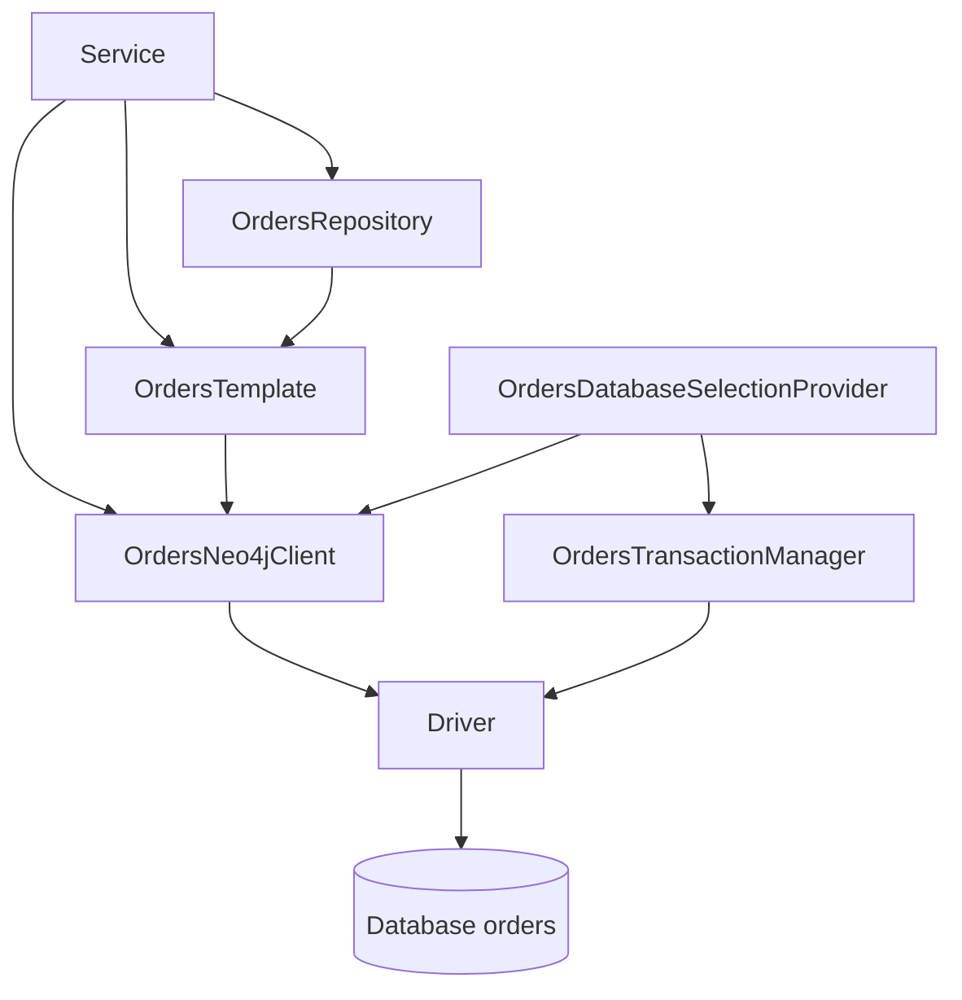

# Giữ đúng database khi phối hợp repository, template và client

## Mục tiêu bài học

Một ứng dụng Spring Data Neo4j (SDN) có thể làm việc với nhiều database trên cùng một Neo4j server hoặc với nhiều Neo4j server khác nhau. Ví dụ, dữ liệu đơn hàng nằm trong database `orders`, dữ liệu kiểm toán nằm trong `audit`, còn dữ liệu phân tích được lưu ở một cụm Neo4j riêng.

Trong SDN, repository, `Neo4jTemplate` và `Neo4jClient` đều có thể truy cập Neo4j, nhưng mỗi thành phần cần được gắn với đúng `Driver`, database selection và transaction manager. Nếu cấu hình không đồng bộ, một service có thể đọc entity từ database này rồi ghi entity hoặc chạy Cypher sang database khác.

Bài học này trình bày cách tổ chức các thành phần theo từng database, cách chọn database cố định hoặc theo tenant, cách ánh xạ repository bằng `@EnableNeo4jRepositories`, cách phối hợp template và client trong cùng transaction, và cách kiểm thử để phát hiện truy cập nhầm database.

## 1. Phân biệt nhiều database và nhiều Neo4j server

Trước khi cấu hình, hãy xác định ứng dụng đang kết nối đến nhiều database trên cùng server hay nhiều server độc lập.

| Mô hình | Driver | Cách chọn database |
|---|---|---|
| Nhiều database trên cùng Neo4j server/cluster | Thường dùng chung một `Driver` | Chọn database khi tạo session thông qua `DatabaseSelectionProvider` |
| Nhiều Neo4j server/cluster | Mỗi server có một `Driver` tương ứng | Chọn đúng Driver; mỗi Driver vẫn có thể chọn database riêng |
| Một database dùng chung cho toàn ứng dụng | Một `Driver` | Dùng database mặc định hoặc cấu hình tĩnh |

`Driver` đại diện cho kết nối đến server/cluster và quản lý connection pool. Database cụ thể được chọn khi mở session. Vì vậy, nếu `orders` và `audit` nằm trên cùng một cluster, không cần tạo hai Driver chỉ vì có hai database. Có thể dùng một Driver và tạo hai nhóm client/template/transaction manager với lựa chọn database riêng.

Nếu hai database nằm trên hai server khác nhau, hãy tạo hai Driver riêng và gắn từng nhóm thành phần với đúng Driver. Không tạo Driver mới cho mỗi request hoặc mỗi thao tác repository.

SDN không tự tạo database. Database phải được tạo trước bằng công cụ quản trị, script hoặc migration phù hợp. Tài khoản kết nối cũng cần quyền truy cập vào database đích.

Khả năng tạo và vận hành nhiều database đồng thời phụ thuộc edition, license và cấu hình Neo4j server. Hãy xác nhận môi trường đích hỗ trợ số database mà ứng dụng cần.

## 2. Ba thành phần cần giữ cùng một database

Một nhóm truy cập database trong ứng dụng thường có ba thành phần chính:

- **Repository:** cung cấp các phương thức truy vấn theo tên, custom Cypher và thao tác CRUD.
- **Neo4jTemplate:** thực hiện các thao tác mapping domain object, tìm kiếm và lưu graph. Repository SDN sử dụng template để thực thi.
- **Neo4jClient:** chạy Cypher trực tiếp và hỗ trợ parameter binding; client cũng tích hợp với transaction management của Spring.

Ngoài ba thành phần trên, cần một **transaction manager** quản lý transaction của đúng database.

Có thể mô hình hóa một nhóm như sau:



Trong nhóm này, repository được tạo từ `OrdersTemplate`; template sử dụng `OrdersNeo4jClient`; client và transaction manager dùng cùng Driver và cùng database selection provider. Nhờ vậy, query qua repository, template hoặc client có thể tham gia cùng transaction Neo4j.

Khi thêm database `audit`, tạo một nhóm tương ứng với tên bean riêng. Không để repository của `audit` vô tình dùng template mặc định của `orders`, hoặc để client của `audit` tham gia transaction của `orders`.

## 3. Chọn database tĩnh bằng spring.data.neo4j.database

Nếu toàn bộ ứng dụng chỉ làm việc với một database khác database mặc định, có thể cấu hình trong Spring Boot:

```yaml
spring:
  data:
    neo4j:
      database: orders
```

Với cấu hình này, các repository SDN và `Neo4jTemplate` được auto-configure sẽ sử dụng database `orders`. Cấu hình cũng áp dụng cho các thành phần imperative và reactive tương ứng.

Đây là cách đơn giản khi ứng dụng chỉ có một database đích. Thuộc tính này không tạo ra hai nhóm repository riêng cho `orders` và `audit`; nó đặt database dùng chung cho hạ tầng SDN được auto-configure.

Nếu cần cố định một số repository vào `orders` và một số repository khác vào `audit`, hãy cấu hình các client, template và transaction manager có tên riêng. Nếu cần chọn database theo tenant của từng request, dùng database selection provider động.

## 4. DatabaseSelectionProvider là gì?

`DatabaseSelectionProvider` là SPI imperative của SDN, cho biết database nào cần được dùng trước khi repository hoặc template tương tác với Neo4j.

Có hai cách tạo provider thường dùng:

```java
import org.springframework.data.neo4j.core.DatabaseSelectionProvider;

// Chọn database cố định.
DatabaseSelectionProvider ordersProvider =
        DatabaseSelectionProvider.createStaticDatabaseSelectionProvider("orders");

// Để Neo4j chọn database mặc định.
DatabaseSelectionProvider defaultProvider =
        DatabaseSelectionProvider.getDefaultSelectionProvider();
```

Nếu muốn tự quyết định, triển khai provider trả về `DatabaseSelection`:

```java
import org.springframework.data.neo4j.core.DatabaseSelection;
import org.springframework.data.neo4j.core.DatabaseSelectionProvider;

public class OrdersDatabaseSelectionProvider
        implements DatabaseSelectionProvider {

    @Override
    public DatabaseSelection getDatabaseSelection() {
        return DatabaseSelection.byName("orders");
    }
}
```

`DatabaseSelection.byName("orders")` chọn database có tên `orders`. `DatabaseSelection.undecided()` biểu thị không chỉ định tên database và để server chọn database mặc định.

Provider được hỏi trước các tương tác của repository/template. Vì vậy, nếu provider trả về database khác nhau theo từng request, ứng dụng phải quản lý context lựa chọn một cách nhất quán. Đặc biệt, database cần được xác định khi transaction bắt đầu và không thay đổi giữa các thao tác trong transaction đó.

## 5. Tạo nhóm client, transaction manager và template cho database orders

Giả sử ứng dụng dùng một Driver được Spring Boot cấu hình sẵn và có hai database `orders`, `audit` trên cùng cluster. Ta tạo nhóm bean riêng cho `orders`.

### Khai báo provider, client, transaction manager và template

Đặt các bean sau trong cùng một class cấu hình. Ví dụ dùng một Driver do Spring Boot cung cấp và một database cố định tên `orders`:

```java
import org.neo4j.driver.Driver;
import org.springframework.beans.factory.BeanFactory;
import org.springframework.beans.factory.annotation.Qualifier;
import org.springframework.context.annotation.Bean;
import org.springframework.context.annotation.Configuration;
import org.springframework.data.mapping.callback.EntityCallbacks;
import org.springframework.data.neo4j.core.DatabaseSelectionProvider;
import org.springframework.data.neo4j.core.Neo4jClient;
import org.springframework.data.neo4j.core.Neo4jMappingContext;
import org.springframework.data.neo4j.core.Neo4jTemplate;
import org.springframework.data.neo4j.core.transaction.Neo4jTransactionManager;

@Configuration(proxyBeanMethods = false)
public class OrdersNeo4jConfiguration {

    @Bean("ordersDatabaseSelectionProvider")
    DatabaseSelectionProvider ordersDatabaseSelectionProvider() {
        return DatabaseSelectionProvider
                .createStaticDatabaseSelectionProvider("orders");
    }

    @Bean("ordersNeo4jClient")
    Neo4jClient ordersNeo4jClient(
            Driver driver,
            @Qualifier("ordersDatabaseSelectionProvider")
            DatabaseSelectionProvider provider) {
        return Neo4jClient.with(driver)
                .withDatabaseSelectionProvider(provider)
                .build();
    }

    @Bean("ordersTransactionManager")
    Neo4jTransactionManager ordersTransactionManager(
            Driver driver,
            @Qualifier("ordersDatabaseSelectionProvider")
            DatabaseSelectionProvider provider) {
        return Neo4jTransactionManager.with(driver)
                .withDatabaseSelectionProvider(provider)
                .build();
    }

    @Bean("ordersTemplate")
    Neo4jTemplate ordersTemplate(
            @Qualifier("ordersNeo4jClient") Neo4jClient client,
            Neo4jMappingContext mappingContext,
            @Qualifier("ordersTransactionManager")
            Neo4jTransactionManager transactionManager,
            BeanFactory beanFactory) {
        return new Neo4jTemplate(
                client,
                mappingContext,
                EntityCallbacks.create(beanFactory),
                transactionManager);
    }
}
```

Client được tạo từ Driver dùng chung và provider cố định `orders`. Template dùng client và transaction manager của cùng nhóm. `EntityCallbacks.create(beanFactory)` nạp các callback bean của Spring Data để template giữ được lifecycle callback của entity khi lưu.

**Điểm bắt buộc:** `Neo4jClient` và `Neo4jTransactionManager` phải dùng cùng một instance của `DatabaseSelectionProvider`. SDN kiểm tra database được chọn bởi client có khớp database của transaction đang quản lý hay không. Nếu hai provider có thể trả về các database khác nhau, một query có thể bị từ chối khi tham gia transaction.

Nếu ứng dụng không cần tự tạo template, cấu hình mặc định của SDN có thể tạo template cho một database. Khi tự tạo nhiều template, hãy truyền đúng client, mapping context và transaction manager cho từng template.

## 6. Gắn repository vào đúng template và transaction manager

Dùng `@EnableNeo4jRepositories` để chỉ định package repository, template và transaction manager mà package đó sử dụng:

```java
import org.springframework.context.annotation.Configuration;
import org.springframework.data.neo4j.repository.config.EnableNeo4jRepositories;

@Configuration
@EnableNeo4jRepositories(
        basePackages = "com.example.orders.repository",
        neo4jTemplateRef = "ordersTemplate",
        transactionManagerRef = "ordersTransactionManager")
public class OrdersRepositoryConfiguration {
}
```

Hai thuộc tính quan trọng:

| Thuộc tính | Ý nghĩa |
|---|---|
| `neo4jTemplateRef` | Tên bean `Neo4jTemplate` được repository sử dụng |
| `transactionManagerRef` | Tên bean `Neo4jTransactionManager` được repository sử dụng |

Nếu không chỉ định, SDN dùng các bean mặc định `neo4jTemplate` và `transactionManager`. Khi có nhiều database, hãy khai báo tường minh để tránh repository gắn nhầm bean mặc định.

Nên đặt repository của mỗi database trong package riêng, chẳng hạn:

```text
com.example.orders.repository
com.example.audit.repository
```

Mỗi package có một cấu hình `@EnableNeo4jRepositories` riêng. Cách tổ chức này giúp reviewer nhận biết ngay repository nào thuộc database nào.

## 7. Tạo nhóm tương ứng cho database audit

Database `audit` cần provider riêng, nhưng nếu nó nằm trên cùng cluster thì có thể dùng chung Driver. Đặt các bean sau trong một class cấu hình riêng, ví dụ `AuditNeo4jConfiguration`:

```java
import org.neo4j.driver.Driver;
import org.springframework.beans.factory.BeanFactory;
import org.springframework.beans.factory.annotation.Qualifier;
import org.springframework.context.annotation.Bean;
import org.springframework.context.annotation.Configuration;
import org.springframework.data.mapping.callback.EntityCallbacks;
import org.springframework.data.neo4j.core.DatabaseSelectionProvider;
import org.springframework.data.neo4j.core.Neo4jClient;
import org.springframework.data.neo4j.core.Neo4jMappingContext;
import org.springframework.data.neo4j.core.Neo4jTemplate;
import org.springframework.data.neo4j.core.transaction.Neo4jTransactionManager;

@Configuration(proxyBeanMethods = false)
public class AuditNeo4jConfiguration {

    @Bean("auditDatabaseSelectionProvider")
    DatabaseSelectionProvider auditDatabaseSelectionProvider() {
        return DatabaseSelectionProvider
                .createStaticDatabaseSelectionProvider("audit");
    }

    @Bean("auditNeo4jClient")
    Neo4jClient auditNeo4jClient(
            Driver driver,
            @Qualifier("auditDatabaseSelectionProvider")
            DatabaseSelectionProvider provider) {

        return Neo4jClient.with(driver)
                .withDatabaseSelectionProvider(provider)
                .build();
    }

    @Bean("auditTransactionManager")
    Neo4jTransactionManager auditTransactionManager(
            Driver driver,
            @Qualifier("auditDatabaseSelectionProvider")
            DatabaseSelectionProvider provider) {

        return Neo4jTransactionManager.with(driver)
                .withDatabaseSelectionProvider(provider)
                .build();
    }

    @Bean("auditTemplate")
    Neo4jTemplate auditTemplate(
            @Qualifier("auditNeo4jClient") Neo4jClient client,
            Neo4jMappingContext mappingContext,
            @Qualifier("auditTransactionManager")
            Neo4jTransactionManager transactionManager,
            BeanFactory beanFactory) {

        return new Neo4jTemplate(
                client,
                mappingContext,
                EntityCallbacks.create(beanFactory),
                transactionManager);
    }
}
```

Cấu hình repository cho `audit`:

```java
@Configuration
@EnableNeo4jRepositories(
        basePackages = "com.example.audit.repository",
        neo4jTemplateRef = "auditTemplate",
        transactionManagerRef = "auditTransactionManager")
public class AuditRepositoryConfiguration {
}
```

Sau khi cấu hình, quan hệ bean có thể tóm tắt:

| Thành phần | Database orders | Database audit |
|---|---|---|
| Driver | `driver` | `driver` |
| Selection provider | `ordersDatabaseSelectionProvider` | `auditDatabaseSelectionProvider` |
| Client | `ordersNeo4jClient` | `auditNeo4jClient` |
| Transaction manager | `ordersTransactionManager` | `auditTransactionManager` |
| Template | `ordersTemplate` | `auditTemplate` |
| Repository package | `com.example.orders.repository` | `com.example.audit.repository` |

Khi có nhiều bean cùng kiểu, dùng `@Qualifier` tại mọi điểm injection cần chọn bean cụ thể. Nếu vẫn giữ cấu hình auto-configuration mặc định của Spring Boot, hãy xác định rõ nhóm nào là nhóm mặc định; có thể đánh dấu bean mặc định bằng `@Primary` hoặc tùy biến cấu hình để tránh injection mơ hồ.

## 8. Gọi repository, template và client trong cùng transaction

Giả sử service cần cập nhật đơn hàng qua repository rồi chạy thêm một câu Cypher trực tiếp để ghi metadata. Hai thao tác phải dùng cùng nhóm `orders`.

```java
import org.springframework.beans.factory.annotation.Qualifier;
import org.springframework.data.neo4j.core.Neo4jClient;
import org.springframework.stereotype.Service;
import org.springframework.transaction.annotation.Transactional;

@Service
public class OrderService {

    private final OrderRepository orderRepository;
    private final Neo4jClient ordersClient;

    public OrderService(
            OrderRepository orderRepository,
            @Qualifier("ordersNeo4jClient") Neo4jClient ordersClient) {
        this.orderRepository = orderRepository;
        this.ordersClient = ordersClient;
    }

    @Transactional(transactionManager = "ordersTransactionManager")
    public void confirmOrder(String orderNumber) {
        Order order = orderRepository.findByOrderNumber(orderNumber)
                .orElseThrow();

        order.setStatus("CONFIRMED");
        orderRepository.save(order);

        ordersClient.query("""
                MATCH (o:Order {orderNumber: $orderNumber})
                SET o.confirmedByService = true
                """)
                .bind(orderNumber).to("orderNumber")
                .run();
    }
}
```

Service chỉ định `ordersTransactionManager`. Repository được gắn với `ordersTemplate` và `ordersTransactionManager`; client được tạo từ cùng Driver và provider. Do đó, query qua repository và query qua client có thể tham gia cùng transaction.

Nếu inject một `Neo4jClient` khác đang chọn database `audit` rồi gọi nó bên trong transaction `orders`, SDN sẽ phát hiện database không khớp. Thiết kế đúng là dùng client `ordersNeo4jClient` cho các thao tác trong transaction `orders`, và client `auditNeo4jClient` trong transaction `audit`.

Không mở session trực tiếp bằng Driver rồi giả định session đó tự tham gia transaction Spring. Nếu cần query thô nhưng vẫn muốn tham gia transaction Spring, dùng `Neo4jClient` được cấu hình cùng Driver và provider với transaction manager.

## 9. Khi nào cần nhiều Driver?

Nếu `orders` nằm trên cluster A còn `audit` nằm trên cluster B, mỗi cluster cần một Driver riêng. Khi đó, nhóm bean phải giữ đúng cặp Driver và provider:

```java
@Bean("ordersNeo4jClient")
Neo4jClient ordersNeo4jClient(
        @Qualifier("ordersDriver") Driver driver,
        @Qualifier("ordersDatabaseSelectionProvider")
        DatabaseSelectionProvider provider) {
    return Neo4jClient.with(driver)
            .withDatabaseSelectionProvider(provider)
            .build();
}

@Bean("auditNeo4jClient")
Neo4jClient auditNeo4jClient(
        @Qualifier("auditDriver") Driver driver,
        @Qualifier("auditDatabaseSelectionProvider")
        DatabaseSelectionProvider provider) {
    return Neo4jClient.with(driver)
            .withDatabaseSelectionProvider(provider)
            .build();
}
```

Transaction manager tương ứng cũng phải dùng đúng Driver:

```java
@Bean("ordersTransactionManager")
Neo4jTransactionManager ordersTransactionManager(
        @Qualifier("ordersDriver") Driver driver,
        @Qualifier("ordersDatabaseSelectionProvider")
        DatabaseSelectionProvider provider) {
    return Neo4jTransactionManager.with(driver)
            .withDatabaseSelectionProvider(provider)
            .build();
}
```

Lặp lại cùng nguyên tắc cho `auditTransactionManager`. Không dùng `ordersDriver` với `auditDatabaseSelectionProvider` nếu database `audit` chỉ tồn tại trên cluster khác.

Một Driver nên được quản lý vòng đời bởi Spring và được tái sử dụng. Driver quản lý pool kết nối và được thiết kế để dùng chung giữa các thread. Không tạo Driver mới cho mỗi request, repository hoặc query.

## 10. Chọn database động theo tenant

Một số hệ thống dùng cùng mô hình entity cho nhiều tenant, mỗi tenant có một database riêng. Khi đó có thể dùng một `DatabaseSelectionProvider` động thay vì tạo một repository package cho từng tenant.

Ví dụ minh họa dùng một thành phần `TenantContext` do ứng dụng quản lý:

```java
@Bean
DatabaseSelectionProvider tenantDatabaseSelectionProvider(
        TenantDatabaseRegistry registry) {

    return () -> {
        String tenantId = TenantContext.requireCurrentTenant();
        String databaseName = registry.databaseFor(tenantId);

        return DatabaseSelection.byName(databaseName);
    };
}
```

`TenantDatabaseRegistry` là thành phần ứng dụng ánh xạ tenant ID đã được xác thực sang tên database hợp lệ. Không dùng trực tiếp chuỗi do client gửi trong header hoặc request làm database name. Nếu tenant không tồn tại hoặc không được cấp quyền, provider phải từ chối request thay vì âm thầm chuyển sang database mặc định.

Cùng một provider động này phải được dùng bởi `Neo4jClient` và `Neo4jTransactionManager`. Repository và template dùng nhóm client/manager đó sẽ tự động chọn database theo tenant context.

### Giữ tenant ổn định trong một transaction

Database selection có thể được hỏi ở các điểm tương tác khác nhau. Nếu tenant context thay đổi giữa chừng, ứng dụng có nguy cơ đọc entity từ database A rồi thực hiện thao tác tiếp theo ở database B.

Vì vậy:

1. Xác thực tenant trước khi bắt đầu service transaction.
2. Gắn tenant vào request/security context có vòng đời rõ ràng.
3. Không thay đổi tenant context trong khi transaction đang chạy.
4. Chỉ chuyển tenant ở ranh giới nghiệp vụ mới, sau khi transaction cũ đã hoàn tất.
5. Không truyền một entity đã đọc từ database A sang template của database B để lưu.

Spring Data Neo4j cảnh báo rõ rằng thay đổi database giữa các lần gọi có thể dẫn đến thiếu dữ liệu, thừa dữ liệu hoặc lưu entity vào sai database. Đây là lỗi nghiêm trọng trong hệ thống multi-tenant.

## 11. Database selection trong ứng dụng reactive

Ứng dụng WebFlux hoặc reactive repository dùng SPI riêng là `ReactiveDatabaseSelectionProvider`. Interface này trả về `Mono<DatabaseSelection>`, không phải `DatabaseSelectionProvider` imperative.

Ví dụ lấy tenant từ reactive security context:

```java
import org.springframework.data.neo4j.core.DatabaseSelection;
import org.springframework.data.neo4j.core.ReactiveDatabaseSelectionProvider;
import org.springframework.security.core.context.ReactiveSecurityContextHolder;
import reactor.core.publisher.Mono;

@Bean
ReactiveDatabaseSelectionProvider reactiveTenantDatabaseSelectionProvider(
        TenantDatabaseRegistry registry) {

    return () -> ReactiveSecurityContextHolder.getContext()
            .map(context -> context.getAuthentication())
            .filter(authentication -> authentication.isAuthenticated())
            .map(authentication -> (TenantPrincipal) authentication.getPrincipal())
            .map(principal ->
                    DatabaseSelection.byName(
                            registry.databaseFor(principal.tenantId())))
            .switchIfEmpty(Mono.error(
                    new IllegalStateException("Tenant context is required")));
}
```

Trong reactive stack, không đọc tenant bằng `SecurityContextHolder` dựa trên thread-local. Dùng `ReactiveSecurityContextHolder` hoặc context propagation phù hợp để giữ tenant trong Reactor Context.

Các thành phần còn lại dùng phiên bản reactive:

| Imperative | Reactive |
|---|---|
| `DatabaseSelectionProvider` | `ReactiveDatabaseSelectionProvider` |
| `Neo4jClient` | `ReactiveNeo4jClient` |
| `Neo4jTemplate` | `ReactiveNeo4jTemplate` |
| `Neo4jTransactionManager` | `ReactiveNeo4jTransactionManager` |
| `@EnableNeo4jRepositories` | `@EnableReactiveNeo4jRepositories` |

`@EnableReactiveNeo4jRepositories` cũng có `neo4jTemplateRef` và `transactionManagerRef`, lần lượt trỏ đến `ReactiveNeo4jTemplate` và `ReactiveNeo4jTransactionManager`. Khi cấu hình nhiều database, áp dụng cùng nguyên tắc đặt tên và ghép cặp như imperative.

## 12. Phân biệt transaction theo database

Mỗi `Neo4jTransactionManager` được cấu hình cho một Driver và database selection. Nếu có hai database độc lập, hãy xem chúng là hai transaction boundary riêng.

Khi hai nhóm dùng chung một Driver, không lồng một transaction `audit` bên trong transaction `orders` (hoặc ngược lại) trong cùng execution context. SDN đồng bộ transaction native theo Driver và kiểm tra database selection của client trong transaction đang hoạt động. Hãy để transaction thứ nhất kết thúc trước khi bắt đầu transaction ở database kia; với luồng nghiệp vụ cần ghi nhiều database, ưu tiên outbox hoặc một coordinator không giữ transaction ngoài bao trùm cả hai bước.

Ví dụ:

```java
@Transactional(transactionManager = "ordersTransactionManager")
public void updateOrder() {
    // Các thao tác thuộc database orders.
}
```

```java
@Transactional(transactionManager = "auditTransactionManager")
public void writeAuditRecord() {
    // Các thao tác thuộc database audit.
}
```

Không giả định một annotation `@Transactional` có thể commit hoặc rollback nguyên tử trên nhiều database Neo4j. Transaction manager của `orders` không tự enlist transaction của `audit` vào cùng một transaction phân tán.

Nếu một nghiệp vụ cần ghi cả hai database, hãy thiết kế điều phối rõ ràng:

- Ghi dữ liệu chính và outbox event trong cùng transaction ở database nguồn.
- Một worker đọc outbox rồi ghi sang database đích bằng transaction riêng.
- Dùng event ID ổn định để chống xử lý lặp.
- Lưu trạng thái xử lý và retry lỗi tạm thời có giới hạn.
- Nếu bước sau thất bại, dùng retry hoặc hành động bù theo quy tắc nghiệp vụ.

Cách này giúp hệ thống phục hồi được khi một database commit thành công còn database kia tạm thời không khả dụng.

Nếu chỉ cần thực hiện hai thao tác độc lập tuần tự, coordinator có thể gọi service ghi `orders` để transaction của nó hoàn tất, sau đó gọi service ghi `audit` để mở transaction riêng. Không đặt `@Transactional` bao ngoài coordinator với một trong hai transaction manager khi hai nhóm cùng dùng một Driver.

## 13. Entity và ID phải được hiểu trong phạm vi database

Hai database có thể chứa entity cùng loại và cùng giá trị ID. Ví dụ, database `orders` và `audit` đều có node với ID nội bộ bằng `42`. Hai node đó là hai thực thể độc lập vì ID chỉ có ý nghĩa trong database tương ứng.

Không nên:

- Lấy entity từ `ordersTemplate` rồi lưu bằng `auditTemplate`.
- Dùng ID của entity trong database A để tìm entity trong database B mà không có khóa nghiệp vụ phù hợp.
- Giữ entity lâu dài rồi thay đổi tenant/database context trước khi lưu.
- Giả định cùng một mapping class đồng nghĩa cùng một bản ghi giữa các database.

Có thể dùng chung `Neo4jMappingContext` nếu các database dùng cùng mô hình entity và conversion. Nếu mỗi database có tập entity, mapping hoặc conversion khác nhau, có thể khai báo mapping context riêng và chỉ định `neo4jMappingContextRef` cho từng repository group.

Một entity đã được load từ database nào nên được xử lý trong cùng database đó. Nếu cần chuyển dữ liệu giữa database, hãy chuyển DTO hoặc dữ liệu nghiệp vụ có khóa định danh rõ ràng, rồi tạo/cập nhật entity đích qua đúng template.

## 14. Quản lý database và quyền truy cập

SDN chỉ chọn database khi thực hiện truy vấn; nó không tự tạo database hoặc tự cấp quyền cho tài khoản.

Trước khi triển khai, xác nhận:

1. Database đích đã được tạo và ở trạng thái online.
2. Tài khoản Driver có quyền truy cập database đó.
3. Các uniqueness constraint, index và schema cần thiết đã được triển khai.
4. Tên database trong provider khớp với tên thật trên server.
5. Mỗi nhóm repository được gắn đúng template và transaction manager.
6. Các truy vấn quản trị hoặc migration chạy bằng tài khoản có quyền phù hợp.

Có thể kiểm tra database trên Neo4j bằng lệnh quản trị:

```cypher
SHOW DATABASES;
```

Việc tạo database và quản lý vòng đời database thường thuộc migration hoặc quy trình vận hành. Không để request người dùng tự tạo database tùy ý.

Với multi-tenant, registry tenant-to-database cần có allowlist. Cũng cần giới hạn quyền của tài khoản Neo4j để một tenant không thể truy cập database không được cấp phép chỉ bằng cách thay đổi tenant ID trong request.

## 15. Kiểm thử để phát hiện truy cập nhầm database

Kiểm thử đơn vị chỉ xác nhận service gọi đúng repository hoặc client được inject. Nó không chứng minh bean đó đang trỏ đến đúng database thật. Cần có integration test với các database riêng biệt.

### Kiểm thử repository và template

1. Chuẩn bị hai database `orders` và `audit`.
2. Tạo một marker hoặc dữ liệu kiểm thử khác nhau trong từng database.
3. Gọi `OrderRepository` và xác nhận chỉ đọc dữ liệu `orders`.
4. Gọi `AuditRepository` và xác nhận chỉ đọc dữ liệu `audit`.
5. Lưu entity qua từng repository rồi kiểm tra lại đúng database.
6. Xác nhận cùng một ID ở hai database không làm lẫn dữ liệu.

### Kiểm thử Neo4jClient trong transaction

1. Bắt đầu service method với `ordersTransactionManager`.
2. Đọc hoặc ghi một entity qua `OrderRepository`.
3. Chạy Cypher qua `ordersNeo4jClient`.
4. Cố ý phát sinh lỗi để transaction rollback.
5. Đọc lại dữ liệu và xác nhận cả hai thao tác đều rollback.

Nếu dùng client có provider chọn `audit` trong transaction `orders`, kiểm thử cần xác nhận hệ thống phát hiện database không khớp thay vì ghi nhầm.

### Kiểm thử tenant routing

- Tenant A chỉ đọc/ghi database A.
- Tenant B chỉ đọc/ghi database B.
- Tenant không có trong registry bị từ chối.
- Request không có tenant không được tự động chuyển sang database mặc định nếu nghiệp vụ yêu cầu tenant.
- Tenant context không thay đổi trong transaction.
- Với WebFlux, kiểm tra tenant vẫn được giữ khi luồng reactive chuyển scheduler hoặc chạy qua operator bất đồng bộ.

### Kiểm thử transaction giữa nhiều database

Nếu một use case ghi cả `orders` và `audit`, hãy mô phỏng trường hợp database nguồn commit thành công nhưng database đích lỗi. Xác nhận outbox hoặc cơ chế điều phối có thể chạy lại mà không tạo bản ghi audit trùng.

## 16. Lỗi thường gặp

| Lỗi | Nguyên nhân | Cách xử lý |
|---|---|---|
| Repository luôn đọc database mặc định | Chưa chỉ định database hoặc provider | Cấu hình `spring.data.neo4j.database` hoặc provider |
| Hai repository dùng nhầm cùng database | Cùng trỏ đến template mặc định | Tạo template riêng và dùng `neo4jTemplateRef` |
| Repository ghi vào đúng DB nhưng service transaction sai | Không chỉ định transaction manager ở service | Dùng `@Transactional(transactionManager = "...")` |
| Neo4jClient không tham gia transaction repository | Client dùng Driver hoặc provider khác | Dùng cùng Driver và cùng provider với transaction manager |
| Lỗi database mismatch trong transaction | Client và transaction manager chọn DB khác nhau | Đồng bộ provider instance và tenant context |
| Entity đọc từ DB A bị lưu vào DB B | Trộn entity giữa hai database | Giữ entity trong đúng database; chuyển DTO nếu cần |
| Tạo một Driver cho mỗi database trên cùng server | Nhầm database với server connection | Dùng chung Driver, tạo client/provider riêng |
| Dùng một Driver cho hai server | Driver trỏ đến một endpoint/cluster | Tạo Driver riêng cho từng server |
| Tenant không hợp lệ rơi về database mặc định | Provider dùng `undecided()` như fallback tùy tiện | Fail closed khi thiếu hoặc không hợp lệ tenant |
| Tenant đổi giữa transaction | Database provider trả kết quả khác nhau theo context | Cố định tenant từ đầu đến cuối transaction |
| Dùng SecurityContextHolder trong reactive flow | Context không gắn với thread hiện tại | Dùng `ReactiveSecurityContextHolder` |
| Một `@Transactional` được kỳ vọng commit hai DB nguyên tử | Mỗi DB có transaction manager riêng | Dùng outbox, saga hoặc cơ chế bù |
| SDN không tìm thấy database | Database chưa được tạo hoặc tài khoản thiếu quyền | Tạo database và cấp quyền trước khi chạy |
| Nhiều bean cùng kiểu gây lỗi injection | Không chỉ định bean cụ thể | Dùng `@Qualifier` và cấu hình bean mặc định rõ ràng |

## 17. Quy trình cấu hình an toàn

Khi thêm database mới vào ứng dụng SDN, thực hiện theo thứ tự:

1. Xác định database nằm trên server/cluster hiện tại hay server khác.
2. Nếu cùng server, tái sử dụng Driver; nếu khác server, tạo Driver riêng.
3. Xác nhận database đã tồn tại và tài khoản có quyền truy cập.
4. Tạo `DatabaseSelectionProvider` cố định hoặc động.
5. Tạo `Neo4jClient` dùng đúng Driver và provider.
6. Tạo `Neo4jTransactionManager` dùng cùng Driver và cùng provider instance.
7. Tạo `Neo4jTemplate` từ client, mapping context và transaction manager tương ứng.
8. Gắn repository package bằng `neo4jTemplateRef` và `transactionManagerRef`.
9. Dùng `@Qualifier` khi inject client, template hoặc Driver có nhiều bean cùng kiểu.
10. Chỉ định transaction manager ở service boundary.
11. Kiểm thử repository, template và client đều truy cập đúng database.
12. Nếu ghi nhiều database, thiết kế outbox hoặc quy trình điều phối riêng.

## 18. Tự kiểm tra

1. Driver của Neo4j đại diện cho server hay database?
2. Khi nhiều database nằm trên cùng cluster, vì sao thường chỉ cần một Driver?
3. `DatabaseSelectionProvider` có nhiệm vụ gì?
4. `spring.data.neo4j.database` ảnh hưởng đến những repository và template nào?
5. Vì sao một ứng dụng có nhiều database cần nhiều nhóm client/template/transaction manager?
6. `neo4jTemplateRef` và `transactionManagerRef` được dùng để làm gì?
7. Vì sao Neo4jClient và Neo4jTransactionManager phải dùng cùng provider instance?
8. Làm thế nào để một query qua Neo4jClient tham gia transaction của repository?
9. Vì sao không nên thay đổi tenant/database context giữa transaction?
10. Reactive application cần dùng SPI nào để chọn database?
11. Vì sao một transaction manager không tự tạo transaction phân tán trên nhiều database?
12. Làm thế nào kiểm thử để phát hiện entity bị đọc từ database này nhưng ghi sang database khác?

Hãy cấu hình hai database `orders` và `audit` trên cùng một Neo4j server. Dùng chung một Driver, tạo hai provider, hai client, hai transaction manager và hai template. Gắn hai package repository vào đúng template và transaction manager bằng `@EnableNeo4jRepositories`. Viết một service cập nhật đơn hàng bằng repository và chạy thêm Cypher bằng client trong cùng transaction. Sau đó thử inject nhầm client `audit` vào transaction `orders` để quan sát database mismatch. Cuối cùng kiểm thử tenant routing và mô phỏng use case cần ghi sang cả hai database để xác định cách xử lý khi một phía thất bại.

## Tài liệu tham khảo

- [Spring Data Neo4j — FAQ: Multiple databases](https://docs.spring.io/spring-data/neo4j/reference/faq.html)
- [Spring Data Neo4j — DatabaseSelectionProvider API](https://docs.spring.io/spring-data/neo4j/reference/api/java/org/springframework/data/neo4j/core/DatabaseSelectionProvider.html)
- [Spring Data Neo4j — DatabaseSelection API](https://docs.spring.io/spring-data/neo4j/reference/api/java/org/springframework/data/neo4j/core/DatabaseSelection.html)
- [Spring Data Neo4j — Neo4jClient API](https://docs.spring.io/spring-data/neo4j/reference/api/java/org/springframework/data/neo4j/core/Neo4jClient.html)
- [Spring Data Neo4j — Neo4jClient.Builder API](https://docs.spring.io/spring-data/neo4j/reference/api/java/org/springframework/data/neo4j/core/Neo4jClient.Builder.html)
- [Spring Data Neo4j — Neo4jTransactionManager API](https://docs.spring.io/spring-data/neo4j/reference/api/java/org/springframework/data/neo4j/core/transaction/Neo4jTransactionManager.html)
- [Spring Data Neo4j — EnableNeo4jRepositories API](https://docs.spring.io/spring-data/neo4j/reference/api/java/org/springframework/data/neo4j/repository/config/EnableNeo4jRepositories.html)
- [Spring Data Neo4j — ReactiveDatabaseSelectionProvider API](https://docs.spring.io/spring-data/neo4j/reference/api/java/org/springframework/data/neo4j/core/ReactiveDatabaseSelectionProvider.html)
- [Spring Data Neo4j — EnableReactiveNeo4jRepositories API](https://docs.spring.io/spring-data/neo4j/reference/api/java/org/springframework/data/neo4j/repository/config/EnableReactiveNeo4jRepositories.html)
