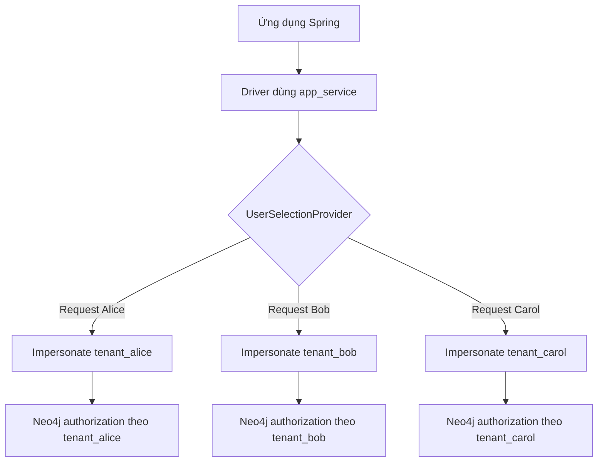
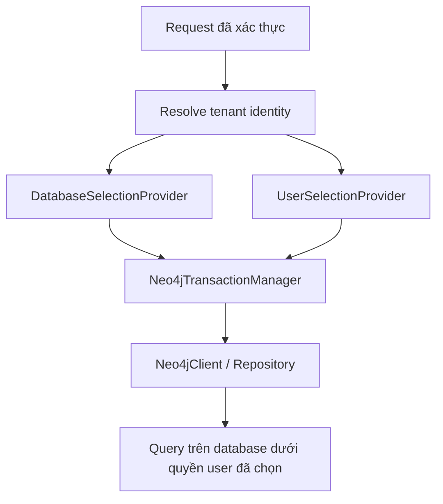

# Impersonation, `UserSelectionProvider` và giới hạn theo môi trường

Trong ứng dụng nhiều tenant, mỗi tenant có thể có một tài khoản Neo4j riêng với quyền đọc/ghi khác nhau. Nếu tạo một `Driver` vật lý cho từng tài khoản, ứng dụng phải quản lý nhiều connection pool và nhiều cấu hình kết nối. Neo4j hỗ trợ **user impersonation**: ứng dụng xác thực bằng một tài khoản kỹ thuật, sau đó yêu cầu Neo4j thực thi một session dưới quyền của người dùng khác. Spring Data Neo4j (SDN) tích hợp cơ chế này qua `UserSelection`, `UserSelectionProvider` và các transaction manager/client tương ứng.

`UserSelectionProvider` quyết định user Neo4j nào sẽ được impersonate cho một transaction. Provider có thể lấy danh tính từ Spring Security, ánh xạ tenant hoặc dùng một user cố định. Để hoạt động đúng, provider phải được cấu hình nhất quán với `Neo4jClient` và `Neo4jTransactionManager`; với reactive application, dùng `ReactiveUserSelectionProvider`, `ReactiveNeo4jClient` và `ReactiveNeo4jTransactionManager`.

## 1. Impersonation giải quyết vấn đề gì?

Giả sử ứng dụng quản lý dữ liệu cho ba tenant: `tenant_alice`, `tenant_bob` và `tenant_carol`. Một tài khoản kỹ thuật `app_service` mở kết nối tới Neo4j. Khi request của Alice đến, ứng dụng yêu cầu Neo4j chạy query với quyền của `tenant_alice`; request của Bob dùng `tenant_bob`.



Các query vẫn đi qua cùng `Driver` và connection pool vật lý. Neo4j áp dụng quyền của user được impersonate cho session/query đó. Tài khoản kỹ thuật không cần biết mật khẩu của từng tenant, nhưng nó phải có quyền impersonate các user mục tiêu.

Impersonation không phải là đăng nhập bằng mật khẩu của user đích. Tài khoản kỹ thuật vẫn là principal đã xác thực; Neo4j áp dụng vai trò và quyền của user được chọn trong ngữ cảnh thực thi. Đây là cách giảm số Driver cần quản lý trong một số kiến trúc multi-tenant.

## 2. Phân biệt `UserSelectionProvider` và `DatabaseSelectionProvider`

Hai provider giải quyết hai câu hỏi khác nhau:

| Provider | Câu hỏi | Kiểu lựa chọn |
| --- | --- | --- |
| `DatabaseSelectionProvider` | Query chạy trên database nào? | `DatabaseSelection` |
| `UserSelectionProvider` | Query chạy dưới quyền Neo4j user nào? | `UserSelection` |
| `ReactiveDatabaseSelectionProvider` | Database nào trong reactive flow? | `Mono<DatabaseSelection>` |
| `ReactiveUserSelectionProvider` | User nào trong reactive flow? | `Mono<UserSelection>` |

Ví dụ chọn database `tenant_graph` và impersonate user `tenant_alice` là hai quyết định độc lập. User có thể có quyền trên một database nhưng không có quyền trên database khác. `UserSelectionProvider` không tự tạo database, không tự cấp quyền và không thay thế database selection.

Nếu session không chỉ định database tường minh, Neo4j Driver có thể khám phá home database của user được impersonate khi session được sử dụng lần đầu. Khi ứng dụng biết rõ database đích, nên cấu hình database selection rõ ràng để tránh phụ thuộc vào home database của từng user.

## 3. Các API của SDN

Các API impersonation được đưa vào SDN từ phiên bản 6.2:

- `UserSelection` là value object mô tả user sẽ được sử dụng.
- `UserSelection.connectedUser()` yêu cầu dùng user sở hữu kết nối vật lý.
- `UserSelection.impersonate("username")` yêu cầu impersonate user có tên tương ứng.
- `UserSelectionProvider` là functional interface imperative; `getUserSelection()` trả về `UserSelection`.
- `ReactiveUserSelectionProvider` là phiên bản reactive; `getUserSelection()` trả về `Mono<UserSelection>`.

Ví dụ provider cố định:

```java
import org.springframework.context.annotation.Bean;
import org.springframework.context.annotation.Configuration;
import org.springframework.data.neo4j.core.UserSelection;
import org.springframework.data.neo4j.core.UserSelectionProvider;

@Configuration(proxyBeanMethods = false)
public class Neo4jUserSelectionConfiguration {

    @Bean
    UserSelectionProvider userSelectionProvider() {
        return () -> UserSelection.impersonate("tenant_alice");
    }
}
```

Provider này luôn chọn `tenant_alice`, phù hợp cho một ứng dụng service-to-service cố định. Với ứng dụng nhiều tenant, cần lựa chọn động dựa trên danh tính đã xác thực.

Nếu không cần impersonation, có thể trả về `UserSelection.connectedUser()` hoặc dùng `UserSelectionProvider.getDefaultSelectionProvider()` để giữ user đã xác thực trên Driver.

## 4. Chọn user động từ Spring Security trong ứng dụng imperative

Trong ứng dụng MVC/imperative, Spring Security thường lưu `Authentication` trong `SecurityContextHolder`. Provider có thể đọc principal hiện tại và ánh xạ sang username Neo4j:

```java
import org.springframework.context.annotation.Bean;
import org.springframework.context.annotation.Configuration;
import org.springframework.security.access.AccessDeniedException;
import org.springframework.security.authentication.AnonymousAuthenticationToken;
import org.springframework.security.core.Authentication;
import org.springframework.security.core.context.SecurityContextHolder;
import org.springframework.data.neo4j.core.UserSelection;
import org.springframework.data.neo4j.core.UserSelectionProvider;

@Configuration(proxyBeanMethods = false)
public class Neo4jImpersonationConfiguration {

    @Bean
    UserSelectionProvider userSelectionProvider() {
        return () -> {
            Authentication authentication = SecurityContextHolder.getContext()
                .getAuthentication();

            if (authentication == null
                    || !authentication.isAuthenticated()
                    || authentication instanceof AnonymousAuthenticationToken) {
                throw new AccessDeniedException("An authenticated user is required");
            }

            String neo4jUsername = resolveNeo4jUsername(authentication);
            return UserSelection.impersonate(neo4jUsername);
        };
    }

    private static String resolveNeo4jUsername(Authentication authentication) {
        // Map authenticated application identity to an allowlisted Neo4j user.
        // Do not accept an arbitrary username from a request parameter or header.
        return "tenant_" + authentication.getName();
    }
}
```

`resolveNeo4jUsername(...)` chỉ là ví dụ ánh xạ. Hệ thống thực tế nên tra cứu mapping đã được kiểm soát giữa principal ứng dụng và user Neo4j. Nếu không có ánh xạ hợp lệ, hãy từ chối request thay vì tự động dùng một user có quyền rộng.

Không lấy tên user impersonate trực tiếp từ query parameter, cookie tùy ý hoặc header do client tự đặt. Nếu client có thể gửi `X-Tenant-User: admin`, nó có thể cố impersonate một tài khoản ngoài tenant của mình. Danh tính cần đến từ token/session đã xác thực và một chính sách server-side xác định tenant mà principal được phép truy cập.

## 5. Cấu hình SDN không dùng Spring Boot

Với cấu hình Spring thuần, đăng ký bean `UserSelectionProvider` trong cùng application context với hạ tầng SDN imperative:

```java
import org.springframework.context.annotation.Bean;
import org.springframework.context.annotation.Configuration;
import org.springframework.data.neo4j.core.UserSelection;
import org.springframework.data.neo4j.core.UserSelectionProvider;

@Configuration(proxyBeanMethods = false)
public class Neo4jUserSelectionConfig {

    @Bean
    UserSelectionProvider userSelectionProvider() {
        return () -> UserSelection.impersonate("tenant_alice");
    }
}
```

Các bean `Driver`, `Neo4jClient` và transaction manager vẫn được cấu hình theo cách SDN thuần hiện có; provider bổ sung lựa chọn user vào context. Trong ứng dụng thật, lấy credential của tài khoản kỹ thuật từ secret manager hoặc biến môi trường được bảo vệ; không commit password vào source code.

Với reactive config không dùng Boot, cung cấp `ReactiveUserSelectionProvider` trong context cùng `AbstractReactiveNeo4jConfig` và `@EnableReactiveNeo4jRepositories`. Ví dụ provider cố định:

```java
import org.springframework.context.annotation.Bean;
import org.springframework.context.annotation.Configuration;
import org.springframework.data.neo4j.core.ReactiveUserSelectionProvider;
import org.springframework.data.neo4j.core.UserSelection;
import reactor.core.publisher.Mono;

@Configuration(proxyBeanMethods = false)
public class ReactiveNeo4jUserSelectionConfig {

    @Bean
    ReactiveUserSelectionProvider reactiveUserSelectionProvider() {
        return () -> Mono.just(UserSelection.impersonate("tenant_alice"));
    }
}
```

Không dùng provider imperative cho reactive repositories.

## 6. Cấu hình Spring Boot imperative

Spring Boot có thể quản lý nhiều phiên bản SDN khác nhau. Theo hướng dẫn SDN, trong cấu hình Boot cần chủ động cấu hình `Neo4jClient` và `Neo4jTransactionManager` để cả hai cùng nhận `UserSelectionProvider`. Chỉ khai báo provider bean mà không gắn nó vào client/transaction manager có thể khiến một phần truy vấn vẫn chạy dưới user kết nối vật lý.

```java
import org.neo4j.driver.Driver;
import org.springframework.context.annotation.Bean;
import org.springframework.context.annotation.Configuration;
import org.springframework.data.neo4j.core.DatabaseSelectionProvider;
import org.springframework.data.neo4j.core.Neo4jClient;
import org.springframework.data.neo4j.core.UserSelectionProvider;
import org.springframework.data.neo4j.core.transaction.Neo4jTransactionManager;
import org.springframework.transaction.PlatformTransactionManager;

@Configuration(proxyBeanMethods = false)
public class Neo4jImpersonationBootConfiguration {

    @Bean
    Neo4jClient neo4jClient(
        Driver driver,
        DatabaseSelectionProvider databaseSelectionProvider,
        UserSelectionProvider userSelectionProvider
    ) {
        return Neo4jClient.with(driver)
            .withDatabaseSelectionProvider(databaseSelectionProvider)
            .withUserSelectionProvider(userSelectionProvider)
            .build();
    }

    @Bean
    PlatformTransactionManager transactionManager(
        Driver driver,
        DatabaseSelectionProvider databaseSelectionProvider,
        UserSelectionProvider userSelectionProvider
    ) {
        return Neo4jTransactionManager.with(driver)
            .withDatabaseSelectionProvider(databaseSelectionProvider)
            .withUserSelectionProvider(userSelectionProvider)
            .build();
    }
}
```

Hai bean dùng cùng `Driver`, cùng `DatabaseSelectionProvider` và cùng instance `UserSelectionProvider`. Nếu ứng dụng không có database selection động, có thể dùng provider mặc định hoặc cấu hình database cố định phù hợp với kiến trúc. Khi thay thế bean mặc định của Boot, cần kiểm tra `Neo4jTemplate`, repositories và transaction annotation thực sự được nối với client/manager tùy chỉnh này.

## 7. Reactive impersonation

Trong ứng dụng WebFlux, không đọc `SecurityContextHolder` theo kiểu imperative vì reactive request có thể đổi thread. Hãy lấy security context qua `ReactiveSecurityContextHolder` và trả `Mono<UserSelection>`:

```java
import org.springframework.context.annotation.Bean;
import org.springframework.context.annotation.Configuration;
import org.springframework.security.access.AccessDeniedException;
import org.springframework.security.authentication.AnonymousAuthenticationToken;
import org.springframework.security.core.context.ReactiveSecurityContextHolder;
import org.springframework.data.neo4j.core.UserSelection;
import org.springframework.data.neo4j.core.ReactiveUserSelectionProvider;
import reactor.core.publisher.Mono;

@Configuration(proxyBeanMethods = false)
public class ReactiveNeo4jUserSelectionConfiguration {

    @Bean
    ReactiveUserSelectionProvider reactiveUserSelectionProvider() {
        return () -> ReactiveSecurityContextHolder.getContext()
            .map(context -> context.getAuthentication())
            .filter(authentication -> authentication.isAuthenticated())
            .filter(authentication -> !(authentication instanceof AnonymousAuthenticationToken))
            .map(authentication -> UserSelection.impersonate(
                resolveNeo4jUsername(authentication.getName())
            ))
            .switchIfEmpty(Mono.error(
                new AccessDeniedException("An authenticated user is required")
            ));
    }

    private static String resolveNeo4jUsername(String applicationUsername) {
        return "tenant_" + applicationUsername;
    }
}
```

Provider reactive không block để chờ security context. Nếu cần gọi một dịch vụ ánh xạ tenant bất đồng bộ, hãy compose nó thành `Mono<UserSelection>` trong provider thay vì gọi `.block()`.

### Cấu hình Spring Boot reactive

Tương tự imperative, hãy gắn cùng provider vào `ReactiveNeo4jClient` và `ReactiveNeo4jTransactionManager`:

```java
import org.neo4j.driver.Driver;
import org.springframework.context.annotation.Bean;
import org.springframework.context.annotation.Configuration;
import org.springframework.data.neo4j.core.ReactiveDatabaseSelectionProvider;
import org.springframework.data.neo4j.core.ReactiveNeo4jClient;
import org.springframework.data.neo4j.core.ReactiveUserSelectionProvider;
import org.springframework.data.neo4j.core.transaction.ReactiveNeo4jTransactionManager;
import org.springframework.transaction.ReactiveTransactionManager;

@Configuration(proxyBeanMethods = false)
public class ReactiveNeo4jImpersonationBootConfiguration {

    @Bean
    ReactiveNeo4jClient reactiveNeo4jClient(
        Driver driver,
        ReactiveDatabaseSelectionProvider databaseSelectionProvider,
        ReactiveUserSelectionProvider userSelectionProvider
    ) {
        return ReactiveNeo4jClient.with(driver)
            .withDatabaseSelectionProvider(databaseSelectionProvider)
            .withUserSelectionProvider(userSelectionProvider)
            .build();
    }

    @Bean
    ReactiveTransactionManager reactiveTransactionManager(
        Driver driver,
        ReactiveDatabaseSelectionProvider databaseSelectionProvider,
        ReactiveUserSelectionProvider userSelectionProvider
    ) {
        return ReactiveNeo4jTransactionManager.with(driver)
            .withDatabaseSelectionProvider(databaseSelectionProvider)
            .withUserSelectionProvider(userSelectionProvider)
            .build();
    }
}
```

Đây là cấu hình cho ứng dụng reactive. Không ghép `UserSelectionProvider` imperative với `ReactiveNeo4jClient` hoặc `ReactiveNeo4jTransactionManager`.

## 8. Bảo đảm user selection nhất quán trong một transaction

SDN yêu cầu cùng một `UserSelectionProvider` instance được dùng cho `Neo4jClient` và `Neo4jTransactionManager`. Trong lúc transaction được quản lý, SDN kiểm tra user selection của lời gọi client có khớp với user mà transaction đang sử dụng hay không.

Ví dụ, transaction bắt đầu khi security context chọn `tenant_alice`. Nếu trong cùng transaction, code thay đổi security context sang `tenant_bob` rồi gọi `Neo4jClient`, user selection không còn khớp. Lời gọi có thể bị từ chối vì một transaction Neo4j không thể đổi impersonated user giữa chừng.

Vì vậy:

- Chọn user một lần theo identity của request/use case trước khi bắt đầu transaction.
- Giữ security context và tenant context ổn định trong toàn bộ transaction.
- Không thay đổi tenant ở giữa một service method `@Transactional`.
- Nếu cần thao tác cho hai tenant, chạy hai transaction độc lập với hai context rõ ràng.
- Trong reactive flow, giữ tenant/user context trong Reactor Context và không tách một subscription mới ngoài pipeline.

## 9. Cấp quyền `IMPERSONATE` trong Neo4j

Impersonation cần quyền DBMS `IMPERSONATE` cho tài khoản kỹ thuật. Quản trị viên có thể cấp quyền cho một danh sách user cụ thể thay vì cho phép impersonate mọi user:

```cypher
CREATE ROLE appImpersonator;

GRANT IMPERSONATE (tenant_alice, tenant_bob)
ON DBMS TO appImpersonator;

GRANT ROLE appImpersonator TO app_service;
```

Trong ví dụ, `app_service` chỉ được impersonate `tenant_alice` và `tenant_bob`. Không nên cấp `IMPERSONATE (*)` nếu ứng dụng chỉ cần một tập user giới hạn.

Khi impersonate thành công, các thao tác dữ liệu được kiểm tra theo roles/privileges của user mục tiêu. Hãy cấp quyền database/graph cho các tenant user theo nguyên tắc least privilege. Quyền impersonate không tự cấp quyền đọc hoặc ghi graph cho user mục tiêu.

Một số lệnh quản trị DBMS có giới hạn khi chạy dưới impersonated user. Impersonation không phải cách để biến một tài khoản ứng dụng thành administrator; các thao tác quản trị cần principal và quyền quản trị phù hợp.

## 10. Dùng Neo4j Java Driver trực tiếp

Nếu không dùng SDN provider, Neo4j Java Driver cho phép cấu hình impersonation trên `SessionConfig`:

```java
import org.neo4j.driver.Driver;
import org.neo4j.driver.Session;
import org.neo4j.driver.SessionConfig;

public String findDocumentTitle(Driver driver, String documentId) {
    SessionConfig config = SessionConfig.builder()
        .withDatabase("tenant_graph")
        .withImpersonatedUser("tenant_alice")
        .build();

    try (Session session = driver.session(config)) {
        return session.executeRead(tx -> tx.run("""
                MATCH (d:Document {documentId: $documentId})
                RETURN d.title AS title
                """, java.util.Map.of("documentId", documentId))
            .single()
            .get("title")
            .asString());
    }
}
```

Driver dùng credential của tài khoản kỹ thuật khi tạo session, sau đó impersonate user chỉ định. Tài khoản kỹ thuật phải có quyền impersonate user đó. Cách này hữu ích cho code Driver thuần; trong ứng dụng SDN, ưu tiên provider để repository, client và transaction manager cùng tuân thủ một chính sách user selection.

## 11. Giới hạn theo phiên bản và môi trường

Impersonation phụ thuộc cả phiên bản server, driver và edition/deployment:

| Thành phần | Điều kiện |
| --- | --- |
| Spring Data Neo4j | `UserSelection` và provider có từ SDN 6.2 |
| Neo4j server tự quản lý | Neo4j Enterprise 4.4 trở lên |
| Neo4j Java Driver | 4.4.0 trở lên; chọn bản tương thích với SDN/Spring Boot BOM, không hạ driver mới về 4.4 một cách máy móc |
| Cluster | Tất cả server phải hỗ trợ Neo4j 4.4+ và giao tiếp qua Bolt 4.4+ |
| Aura | Tài liệu hiện hành liệt kê AuraDB Business Critical và Virtual Dedicated Cloud |
| Neo4j Community / Aura Free / Aura Professional | Không có impersonation/RBAC DBMS privilege cần thiết cho tính năng này |

Nếu môi trường là Neo4j Community, local developer instance hoặc Aura tier không hỗ trợ, `UserSelection.impersonate(...)` sẽ không hoạt động như mong đợi. Hãy kiểm tra edition/tier trước khi thiết kế kiến trúc phụ thuộc vào impersonation.

Nếu không thể dùng impersonation:

- Dùng một Driver riêng với credential của từng user/tenant nếu số lượng nhỏ và vòng đời kết nối được quản lý tốt.
- Dùng session-level auth token của Neo4j Driver khi tự quản lý session; `UserSelectionProvider` của SDN không thay thế cơ chế cấp auth token.
- Dùng một database dùng chung và thiết kế tenant isolation ở tầng ứng dụng nếu đó là lựa chọn được chấp thuận, nhưng phải kiểm soát mọi truy vấn và quyền truy cập cẩn thận.
- Cân nhắc nâng lên edition/tier hỗ trợ RBAC khi cần cách ly dữ liệu ở cấp database.

## 12. Giới hạn khi kết hợp database selection và impersonation

Trong hệ thống multi-database, một transaction cần có cả hai lựa chọn nhất quán:



Ví dụ:

- `DatabaseSelectionProvider` trả `DatabaseSelection.byName("tenant_a_db")`.
- `UserSelectionProvider` trả `UserSelection.impersonate("tenant_a_user")`.

Hai provider nên dựa trên cùng một tenant context đã được xác thực. Nếu database được chọn của tenant A nhưng user là tenant B, Neo4j sẽ áp dụng quyền của B trên database A; có thể nhận lỗi access denied hoặc tạo rủi ro truy cập sai tenant nếu quyền được cấp quá rộng.

Không suy ra tên database bằng cách nối chuỗi từ request chưa xác thực. Hãy ánh xạ tenant ID sang database và Neo4j username bằng dữ liệu server-side được kiểm soát. SDN không tự tạo database cho từng tenant; database và user phải được provisioning trước.

## 13. Kiểm thử impersonation

Integration test nên xác minh quyền thật của user mục tiêu, không chỉ xác minh provider trả đúng string:

1. Tạo hai user Neo4j với roles khác nhau, ví dụ `tenant_reader` chỉ có quyền đọc và `tenant_writer` có quyền ghi.
2. Cấp cho `app_service` quyền `IMPERSONATE (tenant_reader, tenant_writer)`.
3. Gọi repository hoặc client với provider trả `UserSelection.impersonate("tenant_reader")`; xác minh query đọc thành công và query ghi bị từ chối.
4. Chuyển context sang `tenant_writer` trong một transaction mới; xác minh thao tác ghi được phép.
5. Kiểm tra transaction đang mở không thể đổi user selection giữa chừng.
6. Kiểm tra database selection và user selection luôn thuộc cùng tenant.
7. Kiểm tra anonymous/unauthenticated request bị từ chối.

Test trên Neo4j Community không thể chứng minh impersonation vì server edition không hỗ trợ feature. Dùng Neo4j Enterprise test environment hoặc môi trường Aura tier phù hợp cho integration test.

## 14. Các lỗi thường gặp

| Biểu hiện | Nguyên nhân | Cách xử lý |
| --- | --- | --- |
| Lỗi impersonation privilege | Tài khoản kỹ thuật thiếu `IMPERSONATE` trên DBMS | Cấp quyền cho đúng user hoặc danh sách user cần thiết |
| Feature không được hỗ trợ | Server là Community hoặc phiên bản thấp hơn 4.4 | Dùng Enterprise 4.4+ hoặc phương án xác thực khác |
| Provider có nhưng query vẫn dùng technical user | Chưa gắn provider vào cả client và transaction manager | Cấu hình cùng provider instance ở hai nơi |
| Transaction báo user selection không khớp | Provider trả user khác trong cùng transaction | Giữ tenant/security context ổn định suốt transaction |
| Repository và Neo4jClient có quyền khác nhau | Hai thành phần dùng provider hoặc manager khác nhau | Chia sẻ cùng provider và Driver |
| Reactive request impersonate sai user | Đọc `SecurityContextHolder` trong reactive flow | Dùng `ReactiveSecurityContextHolder` và `ReactiveUserSelectionProvider` |
| User impersonated không truy cập được database | User mục tiêu thiếu quyền trên database được chọn | Cấp quyền database phù hợp hoặc chọn đúng database |
| Health check thất bại dù query nghiệp vụ chạy | Health indicator dùng technical account và default database | Cấu hình health check phù hợp với quyền/database hoặc custom health contributor |
| User có quyền quá rộng | Cấp `IMPERSONATE (*)` hoặc ánh xạ principal tùy tiện | Allowlist user, least privilege và mapping server-side |

## 15. Checklist triển khai

1. Xác nhận server edition/tier hỗ trợ impersonation.
2. Dùng SDN 6.2+ và Neo4j Java Driver 4.4+ tương thích với server.
3. Tạo tài khoản kỹ thuật có quyền xác thực và chỉ quyền `IMPERSONATE` cần thiết.
4. Cấp quyền database/graph riêng cho từng user mục tiêu.
5. Tạo `UserSelectionProvider` hoặc `ReactiveUserSelectionProvider` theo mô hình ứng dụng.
6. Lấy danh tính từ security context đã xác thực, không từ request input tùy ý.
7. Dùng cùng provider instance trong Neo4jClient và transaction manager.
8. Kết hợp `DatabaseSelectionProvider` nếu cần chọn database động.
9. Giữ user/database selection ổn định trong toàn bộ transaction.
10. Integration test quyền đọc/ghi và trường hợp user/database không khớp.

## Kết luận

`UserSelectionProvider` cho phép SDN chọn user Neo4j cần impersonate cho mỗi transaction; `UserSelectionProvider` imperative trả `UserSelection`, còn `ReactiveUserSelectionProvider` trả `Mono<UserSelection>`. Provider cần được cấu hình nhất quán với Neo4jClient và transaction manager để mọi thao tác trong cùng transaction chạy dưới một security context. `DatabaseSelectionProvider` vẫn là cơ chế riêng để chọn database. Impersonation yêu cầu Neo4j Enterprise 4.4+ và Driver 4.4+, cùng quyền DBMS `IMPERSONATE` cho tài khoản kỹ thuật; trên Aura, cần tier được hỗ trợ. Hãy ánh xạ user từ danh tính đã xác thực, giới hạn privilege theo allowlist và kiểm thử quyền thực tế trước khi triển khai multi-tenant.

## Tài liệu tham khảo

- [Spring Data Neo4j 8.1.2 FAQ — User impersonation](https://docs.spring.io/spring-data/neo4j/reference/faq.html)
- [Spring Data Neo4j 8.1.2 API — `UserSelectionProvider`](https://docs.spring.io/spring-data/neo4j/reference/api/java/org/springframework/data/neo4j/core/UserSelectionProvider.html)
- [Spring Data Neo4j 8.1.2 API — `ReactiveUserSelectionProvider`](https://docs.spring.io/spring-data/neo4j/docs/8.1.x/api/org/springframework/data/neo4j/core/ReactiveUserSelectionProvider.html)
- [Spring Data Neo4j 8.1.2 API — `UserSelection`](https://docs.spring.io/spring-data/neo4j/docs/8.1.x/api/org/springframework/data/neo4j/core/UserSelection.html)
- [Spring Data Neo4j 8.1.2 API — `Neo4jTransactionManager.Builder`](https://docs.spring.io/spring-data/neo4j/reference/api/java/org/springframework/data/neo4j/core/transaction/Neo4jTransactionManager.Builder.html)
- [Spring Data Neo4j 8.2.0 API — `ReactiveNeo4jClient.Builder`](https://docs.spring.io/spring-data/neo4j/reference/api/java/org/springframework/data/neo4j/core/ReactiveNeo4jClient.Builder.html)
- [Neo4j Java Driver 6.x API — `SessionConfig.Builder.withImpersonatedUser`](https://neo4j.com/docs/api/java-driver/current/org.neo4j.driver/org/neo4j/driver/SessionConfig.Builder.html)
- [Neo4j Operations Manual — DBMS `IMPERSONATE` privileges](https://neo4j.com/docs/operations-manual/current/authentication-authorization/dbms-administration/dbms-impersonate-privileges/)
