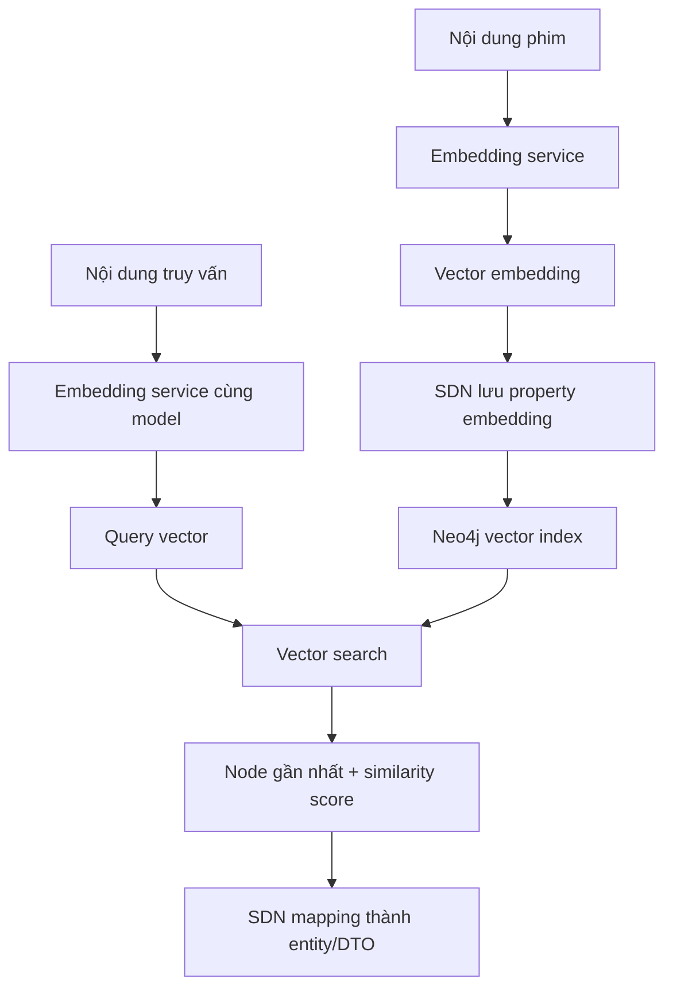

# Vector search theo phiên bản Neo4j và tách biệt với khả năng mapping SDN

Vector search (tìm kiếm vector) giúp tìm các node hoặc relationship có embedding gần với một vector truy vấn trong không gian nhiều chiều. Ứng dụng thường dùng kỹ thuật này để tìm nội dung có ý nghĩa tương tự, gợi ý sản phẩm, tìm tài liệu liên quan hoặc kết hợp tìm kiếm ngữ nghĩa với tìm kiếm từ khóa.

Trong Spring Data Neo4j (SDN), cần phân biệt ba trách nhiệm:

1. **Tạo embedding**: gọi mô hình embedding hoặc thuật toán khác để biến nội dung thành dãy số. Đây là trách nhiệm của ứng dụng hoặc dịch vụ AI.
2. **Lưu và mapping vector**: ghi vector vào property của node/relationship. SDN có thể ánh xạ kiểu vector được hỗ trợ sang Neo4j.
3. **Tìm kiếm vector**: tạo vector index và truy vấn các láng giềng gần nhất bằng Cypher hoặc repository vector search của SDN.

SDN không tự sinh embedding chỉ vì entity có field vector, và việc mapping một property vector không tự tạo vector index. Database phải có index tương thích trước khi truy vấn tìm kiếm.

## 1. Embedding và vector search giải quyết vấn đề gì?

Giả sử ứng dụng lưu nội dung mô tả phim. Tìm theo từ khóa có thể tìm được phim chứa chính xác từ “không gian”, nhưng bỏ lỡ phim diễn tả cùng chủ đề bằng các cụm từ khác. Một mô hình embedding có thể biến mô tả thành vector sao cho những nội dung gần nghĩa nằm gần nhau trong không gian vector.

Ví dụ minh họa:

```text
Mô tả phim A  ──> [0.12, -0.31, 0.88, ...]
Mô tả phim B  ──> [0.10, -0.29, 0.84, ...]
Mô tả phim C  ──> [-0.71, 0.22, 0.03, ...]

Vector truy vấn ──> [0.11, -0.30, 0.86, ...]

Khoảng cách giữa vector truy vấn và A/B nhỏ hơn so với C.
```

Vector index giúp Neo4j tìm nhanh một tập ứng viên gần nhất thay vì tính khoảng cách với mọi vector trong graph. Đây thường là **approximate nearest neighbor (ANN)**: kết quả gần với top K chính xác nhưng không được bảo đảm luôn là K vector gần nhất tuyệt đối.

Vector search không hiểu nội dung văn bản theo cách con người hiểu. Chất lượng kết quả phụ thuộc vào mô hình tạo embedding, cách chuẩn hóa dữ liệu, ngôn ngữ, miền nghiệp vụ và việc dùng cùng một mô hình cho vector lưu trữ lẫn vector truy vấn.

## 2. Ba lớp cần tách biệt trong ứng dụng SDN

| Lớp | Trách nhiệm | Công cụ hoặc thành phần |
|---|---|---|
| Sinh embedding | Chuyển text/image/dữ liệu graph thành vector | Embedding model, dịch vụ AI hoặc thuật toán GDS |
| Mapping và lưu trữ | Chuyển Java value thành property Neo4j | SDN entity mapping, converter, Neo4j Driver |
| Tìm kiếm | Lập chỉ mục vector và truy xuất láng giềng gần nhất | Neo4j vector index, Cypher, SDN repository hoặc Neo4jClient |

Ví dụ luồng xử lý:



Điểm quan trọng: vector index thuộc schema và query engine của Neo4j. SDN có thể ánh xạ entity hoặc cung cấp API repository tiện lợi để gọi vector index, nhưng không thay thế bước tạo index trong database.

## 3. Lịch sử hỗ trợ vector index theo phiên bản Neo4j

Vector search phát triển qua nhiều bản Neo4j. Không nên sao chép một câu truy vấn từ tài liệu phiên bản mới rồi mặc định server 5.x cũ có thể chạy:

| Phiên bản Neo4j | Thay đổi chính | Cách làm việc phù hợp |
|---|---|---|
| 5.13 | Vector index đạt GA cho node; dữ liệu là LIST số | Vector index và procedure queryNodes |
| 5.15 | Có cú pháp Cypher CREATE VECTOR INDEX; trước đó việc tạo index dùng procedure legacy | Dùng CREATE VECTOR INDEX nếu server hỗ trợ |
| 5.18 | Bổ sung vector index cho relationship và procedure queryRelationships | Có thể tìm node hoặc relationship |
| 5.23 | Có thể bỏ một số cấu hình index bắt buộc trước đây; vẫn nên khai báo dimension và similarity rõ ràng | Giữ cấu hình index tường minh để kiểm tra dữ liệu |
| 2025.10 | Bổ sung giá trị native VECTOR trong Cypher 25 | Có thể lưu LIST hoặc VECTOR tùy edition và storage format |
| 2026.01 | Bổ sung SEARCH clause cho vector index; hỗ trợ nhiều label/type và property phụ để lọc trong index | Ưu tiên SEARCH trên Cypher 25 |
| 2026.04 | Procedure queryNodes/queryRelationships bị deprecated | Chuyển truy vấn mới sang SEARCH |
| 2026.06 | Bổ sung predicate IN trong WHERE filter của SEARCH | Có thể lọc theo danh sách giá trị trong index |
| 2026.07 | Bổ sung High Fidelity Quantized (HFQ) vector search | Có thêm lựa chọn tối ưu dung lượng/độ chính xác theo provider |

Vector index đạt GA từ Neo4j 5.13, nhưng cú pháp Cypher CREATE VECTOR INDEX cho node xuất hiện từ 5.15; trước đó node index được tạo bằng procedure legacy. Relationship vector index và procedure queryRelationships xuất hiện từ 5.18. Đây là các mốc khác nhau. Nếu đang nâng cấp từ bản 5.13 hoặc 5.14, hãy kiểm tra đúng API tạo index của server thay vì chỉ dựa vào mốc GA.

### VECTOR native và LIST khác nhau thế nào?

- Trên các phiên bản hỗ trợ trước Neo4j 2025.10, embedding thường được lưu thành property dạng LIST số nguyên hoặc số thực.
- Từ Neo4j 2025.10, Cypher 25 có thêm kiểu giá trị VECTOR chuyên biệt, được kiểm tra dimension và similarity theo index.
- Vector index dùng được trong Community Edition và Enterprise Edition. Community Edition có thể lập chỉ mục các property dạng LIST số; lưu property native VECTOR yêu cầu block format, hiện có trên Enterprise Edition và Aura.

Nếu ứng dụng cần chạy trên nhiều edition hoặc nhiều phiên bản server, LIST là dạng tương thích rộng hơn. Không dùng kiểu VECTOR native trước khi xác nhận edition, storage format và phiên bản Cypher của môi trường đích.

## 4. Chọn dimension và similarity function

Mỗi embedding model tạo vector với số chiều xác định, chẳng hạn 384, 768, 1536 hoặc 3072. Dimension trong index phải khớp với vector lưu và vector truy vấn.

Tạo vector index cho phim:

```cypher
CREATE VECTOR INDEX movie_embedding_idx IF NOT EXISTS
FOR (m:Movie) ON m.embedding
OPTIONS {
    indexConfig: {
        `vector.dimensions`: 1536,
        `vector.similarity_function`: 'cosine'
    }
};
```

Ví dụ dùng 1536 chiều chỉ đúng nếu embedding model thực sự trả về vector 1536 chiều. Không chọn dimension theo ví dụ trên mạng hoặc theo số phần tử của một vector mẫu ngẫu nhiên.

Hai similarity function chính:

| Hàm | Đặc điểm | Khi nào cân nhắc |
|---|---|---|
| Cosine | So sánh góc giữa hai vector, ít phụ thuộc độ lớn vector | Thường dùng cho text embedding khi mô hình khuyến nghị cosine |
| Euclidean | So sánh khoảng cách hình học giữa hai vector | Khi mô hình hoặc bài toán được thiết kế theo khoảng cách Euclidean |

Không mặc định cosine luôn đúng cho mọi mô hình. Hãy xem tài liệu của embedding model để chọn metric tương ứng. Với vector đã L2-normalize, cosine và Euclidean có thể cho cùng thứ tự xếp hạng.

Index nên khai báo dimension và similarity function rõ ràng. Điều này giúp phát hiện sớm vector sai chiều hoặc không phù hợp metric thay vì để dữ liệu nhiều loại dimension cùng tồn tại trong một index.

## 5. Lưu embedding vào entity bằng Spring Data Neo4j

Spring Data cung cấp kiểu vector dùng chung là org.springframework.data.domain.Vector. SDN hiện hỗ trợ mapping kiểu này thành property vector của Neo4j thông qua cơ chế ghi vector chuyên dụng.

Ví dụ entity:

```java
import org.springframework.data.annotation.Id;
import org.springframework.data.domain.Vector;
import org.springframework.data.neo4j.core.schema.Node;

@Node("Movie")
public class Movie {

    @Id
    private String id;

    private String title;

    private String plot;

    private Vector embedding;

    public String getId() {
        return id;
    }

    public String getTitle() {
        return title;
    }

    public String getPlot() {
        return plot;
    }

    public void setEmbedding(Vector embedding) {
        this.embedding = embedding;
    }
}
```

Tạo giá trị vector:

```java
Vector embedding = Vector.of(
        0.12d,
        -0.31d,
        0.88d
);

movie.setEmbedding(embedding);
movieRepository.save(movie);
```

Ví dụ chỉ có ba phần tử để minh họa API. Nếu index được cấu hình 1536 chiều, vector thực tế phải có đúng 1536 phần tử.

Một số điểm cần nhớ về mapping:

- Vector là kiểu dữ liệu biểu diễn một mảng số có độ dài cố định; không nên xem nó như một danh sách thuộc tính nghiệp vụ để sửa từng phần tử tùy ý.
- SDN hỗ trợ mapping kiểu Vector sang property vector của node. Tài liệu mapping hiện hành giới hạn một property kiểu Vector trong một entity definition.
- Neo4j lưu các giá trị số dưới dạng Cypher FLOAT 64-bit khi SDN ghi vector theo cơ chế hiện tại.
- Entity không bắt buộc phải có property kiểu Vector mới có thể dùng repository @VectorSearch; repository search có thể hoạt động trực tiếp trên index.

Nếu cần lưu nhiều embedding cho cùng một node, chẳng hạn embedding tiêu đề và embedding nội dung, hãy thiết kế cấu trúc dữ liệu rõ ràng như node con hoặc relationship riêng, mỗi vector index trỏ đến đúng property. Không khai báo nhiều field Vector trong cùng một entity rồi kỳ vọng SDN mapping hỗ trợ tất cả.

## 6. Tạo và kiểm tra vector index

Tạo index là thao tác quản lý schema Neo4j, thường được đặt trong migration Cypher:

```cypher
CREATE VECTOR INDEX movie_embedding_idx IF NOT EXISTS
FOR (m:Movie) ON m.embedding
OPTIONS {
    indexConfig: {
        `vector.dimensions`: 1536,
        `vector.similarity_function`: 'cosine'
    }
};
```

Index được population ở background. Ngay sau khi chạy lệnh tạo, index có thể chưa dùng được. Kiểm tra trạng thái:

```cypher
SHOW VECTOR INDEXES
YIELD name, state, populationPercent, entityType,
      labelsOrTypes, properties, indexProvider
RETURN name, state, populationPercent, entityType,
       labelsOrTypes, properties, indexProvider
ORDER BY name;
```

Chỉ truy vấn sau khi index ở trạng thái ONLINE. Nếu index đang POPULATING, chờ quá trình tạo hoàn tất. Nếu FAILED, xem failure message và sửa dữ liệu hoặc cấu hình trước khi tiếp tục.

Neo4j chỉ cho một vector index trên cùng schema vector property. Không tạo hai index khác similarity function trên cùng label/property rồi kỳ vọng planner chọn giữa chúng. Nếu cần đổi metric hoặc model, cần kế hoạch migration và tái lập chỉ mục phù hợp.

## 7. Tạo vector index cho relationship

Từ Neo4j 5.18, vector index có thể lập chỉ mục property trên relationship. Trường hợp này hữu ích khi embedding mô tả chính mối quan hệ hoặc một sự kiện liên kết, ví dụ nội dung của một lượt đánh giá, một tương tác hoặc một quan hệ được trích xuất.

Ví dụ:

```cypher
CREATE VECTOR INDEX review_embedding_idx IF NOT EXISTS
FOR ()-[r:REVIEWS]-() ON (r.embedding)
OPTIONS {
    indexConfig: {
        `vector.dimensions`: 768,
        `vector.similarity_function`: 'cosine'
    }
};
```

Relationship vector index có thể được truy vấn bằng procedure db.index.vector.queryRelationships() trên các phiên bản hỗ trợ procedure, hoặc bằng SEARCH clause từ Neo4j 2026.01. Trong SEARCH, biến được tìm kiếm phải là relationship variable nằm trong pattern của MATCH tương ứng.

Không chọn relationship index chỉ vì graph có nhiều relationship. Chỉ dùng khi embedding thực sự mô tả relationship và truy vấn cần tìm các quan hệ tương tự.

## 8. Truy vấn vector index trên Neo4j 5.x bằng procedure

Trên Neo4j 5.x trước khi SEARCH clause được hỗ trợ, có thể truy vấn node vector index bằng procedure:

```cypher
CALL db.index.vector.queryNodes(
    'movie_embedding_idx',
    $topK,
    $queryEmbedding
)
YIELD node, score
RETURN node.id AS id,
       node.title AS title,
       score
ORDER BY score DESC;
```

Các tham số:

- movie_embedding_idx: tên vector index đã tạo.
- $topK: số láng giềng gần nhất muốn nhận.
- $queryEmbedding: vector truy vấn có cùng dimension với index.
- score: điểm similarity do vector index trả về.

Ví dụ tìm relationship:

```cypher
CALL db.index.vector.queryRelationships(
    'review_embedding_idx',
    $topK,
    $queryEmbedding
)
YIELD relationship, score
RETURN relationship, score
ORDER BY score DESC;
```

Các procedure này hữu ích khi cần tương thích Neo4j 5.x. Từ Neo4j 2026.04, chúng được đánh dấu deprecated; code mới trên phiên bản hỗ trợ nên chuyển sang SEARCH clause.

## 9. Truy vấn vector index bằng SEARCH từ Neo4j 2026.01

Từ Neo4j 2026.01, Cypher 25 bổ sung SEARCH subclause trong MATCH hoặc OPTIONAL MATCH. Đây là cách ưu tiên để truy vấn vector index ở các phiên bản mới:

```cypher
CYPHER 25
MATCH (m:Movie)
SEARCH m IN (
    VECTOR INDEX movie_embedding_idx
    FOR $queryEmbedding
    LIMIT $topK
) SCORE AS similarity
RETURN m.id AS id,
       m.title AS title,
       similarity
ORDER BY similarity DESC;
```

SEARCH có các thành phần:

| Thành phần | Ý nghĩa |
|---|---|
| m | Biến node hoặc relationship nằm trong pattern MATCH |
| VECTOR INDEX movie_embedding_idx | Tên index đã tạo |
| FOR $queryEmbedding | Vector dùng để tìm láng giềng |
| LIMIT $topK | Số ứng viên ANN muốn lấy |
| SCORE AS similarity | Yêu cầu trả thêm điểm similarity |

SEARCH chỉ là subclause của MATCH hoặc OPTIONAL MATCH, không phải một câu lệnh độc lập. Biến được tìm phải được khai báo trong pattern cùng MATCH đó.

Ví dụ trên yêu cầu Cypher 25. Nếu server hỗ trợ Neo4j 2026.01 nhưng database hoặc query đang dùng Cypher 5, SEARCH có thể không hợp lệ. Hãy xác nhận phiên bản ngôn ngữ truy vấn và cấu hình tương ứng.

### Tìm vector gần một node nguồn

Có thể lấy embedding từ một node nguồn ở MATCH trước rồi dùng làm vector truy vấn cho MATCH tìm kiếm:

```cypher
CYPHER 25
MATCH (source:Movie {id: $sourceId})
MATCH (candidate:Movie)
SEARCH candidate IN (
    VECTOR INDEX movie_embedding_idx
    FOR source.embedding
    LIMIT $topK
) SCORE AS similarity
RETURN candidate.title AS title,
       similarity
ORDER BY similarity DESC;
```

Không tham chiếu property của chính biến candidate bên trong biểu thức FOR của SEARCH candidate. Vector truy vấn phải đến từ tham số hoặc một biến nguồn khác, không phải biến đang được vector index tìm kiếm.

## 10. Lọc metadata ngay trong vector index

Một truy vấn có thể cần vừa tìm nội dung gần nghĩa, vừa giới hạn theo thể loại, trạng thái hoặc năm phát hành. Từ Neo4j 2026.01, vector index hỗ trợ thêm các property phụ để dùng trong bộ lọc của SEARCH.

Khi tạo index, khai báo property vector và các property lọc riêng:

```cypher
CREATE VECTOR INDEX movie_embedding_filtered_idx IF NOT EXISTS
FOR (m:Movie) ON m.embedding
WITH [m.genre, m.releaseYear, m.status]
OPTIONS {
    indexConfig: {
        `vector.dimensions`: 1536,
        `vector.similarity_function`: 'cosine'
    }
};
```

WITH chỉ thêm metadata phục vụ filter. Index vẫn chỉ có một vector property là embedding; không phải composite vector index chứa nhiều embedding.

Truy vấn có filter trong SEARCH:

```cypher
CYPHER 25
MATCH (m:Movie)
SEARCH m IN (
    VECTOR INDEX movie_embedding_filtered_idx
    FOR $queryEmbedding
    WHERE m.genre = $genre
      AND m.releaseYear >= $fromYear
      AND m.status = 'PUBLISHED'
    LIMIT $topK
) SCORE AS similarity
RETURN m.title AS title,
       m.genre AS genre,
       similarity
ORDER BY similarity DESC;
```

Đây là in-index filtering: điều kiện lọc được áp dụng trong quá trình tìm vector, giúp index tiếp tục tìm cho đến khi có đủ số kết quả thỏa điều kiện nếu dữ liệu đáp ứng.

Nếu dùng WHERE ở ngoài SEARCH:

```cypher
CYPHER 25
MATCH (m:Movie)
SEARCH m IN (
    VECTOR INDEX movie_embedding_idx
    FOR $queryEmbedding
    LIMIT $topK
)
WHERE m.genre = $genre
RETURN m.title AS title;
```

WHERE ngoài SEARCH là post-filtering. Neo4j lấy top K trước rồi mới loại kết quả không thỏa điều kiện; kết quả cuối cùng có thể ít hơn K. Nếu cần lọc theo thuộc tính ngay trong index, cần index được tạo với property phụ và cú pháp SEARCH WHERE tương ứng.

Predicate IN trong filter SEARCH chỉ được hỗ trợ từ Neo4j 2026.06. Với các phiên bản 2026.01 đến 2026.05, dùng các predicate property được hỗ trợ như equality hoặc range kết hợp AND; không giả định IN đã dùng được.

## 11. Tìm kiếm bằng repository annotation của SDN 8+

SDN cung cấp annotation @VectorSearch ở repository level từ SDN 8.0.0. Annotation yêu cầu tên index và số node gần nhất cần lấy:

```java
import java.util.List;

import org.springframework.data.domain.Vector;
import org.springframework.data.neo4j.repository.Neo4jRepository;
import org.springframework.data.neo4j.repository.query.VectorSearch;

public interface MovieVectorRepository
        extends Neo4jRepository<Movie, String> {

    @VectorSearch(
            indexName = "movie_embedding_idx",
            numberOfNodes = 10)
    List<Movie> findBy(Vector searchVector);
}
```

Gọi repository:

```java
Vector queryVector = Vector.of(
        0.12d,
        -0.31d,
        0.88d
);

List<Movie> similarMovies =
        movieVectorRepository.findBy(queryVector);
```

Ví dụ vector chỉ có ba chiều để minh họa; trong ứng dụng thật nó phải khớp dimension của index.

Một số đặc điểm quan trọng của @VectorSearch:

- Vector index phải tồn tại trong Neo4j trước khi method được gọi.
- Không bắt buộc entity phải có field kiểu Vector để thực hiện repository search, vì thao tác tìm kiếm dựa trên index.
- Tham số tìm kiếm dùng kiểu org.springframework.data.domain.Vector.
- numberOfNodes là số láng giềng gần nhất được yêu cầu.
- Repository có thể kết hợp vector search với finder dựa trên property.

Ví dụ kết hợp tìm kiếm vector và điều kiện property:

```java
public interface MovieVectorRepository
        extends Neo4jRepository<Movie, String> {

    @VectorSearch(
            indexName = "movie_embedding_idx",
            numberOfNodes = 20)
    List<Movie> findByGenre(
            String genre,
            Vector searchVector);
}
```

Lưu ý về thứ tự: theo tài liệu SDN, vector search được thực hiện trước, sau đó property search mới lọc kết quả. Nếu top 20 vector gần nhất không có phim thuộc genre yêu cầu, kết quả có thể rỗng dù trong toàn bộ graph vẫn có phim thuộc genre đó. Khi cần lọc metadata ngay trong index, hãy dùng Cypher SEARCH với filter nếu Neo4j version và index schema hỗ trợ.

@VectorSearch là abstraction ở repository layer. Nó không tự tạo index, không tự sinh embedding và không đồng nghĩa với việc SDN entity mapper tự hiểu semantic similarity.

### Phạm vi phiên bản Spring Data Neo4j

Annotation @VectorSearch được giới thiệu từ SDN 8.0.0. Tài liệu SDN hiện hành có hướng dẫn cho nhánh 8.x; các nhánh SDN 7.x trở về trước không có annotation này. Nếu dự án đang dùng SDN cũ, vẫn có thể gọi vector procedure hoặc Cypher SEARCH qua Neo4jClient/@Query khi phiên bản Neo4j hỗ trợ, nhưng phải tự quản lý câu truy vấn và mapping kết quả.

API repository và cú pháp server là hai lớp version độc lập. Việc SDN có @VectorSearch không làm Neo4j 5.x hiểu SEARCH; ngược lại, Neo4j mới có SEARCH không có nghĩa một phiên bản SDN cũ tự sinh cú pháp đó. Khi cần chọn rõ SEARCH, in-index filtering hoặc score projection, Neo4jClient với Cypher tường minh giúp kiểm soát query theo khả năng server.

## 12. Khi cần score hoặc filter nâng cao, dùng Neo4jClient

Repository annotation tiện cho truy vấn top K cơ bản và mapping kết quả thành entity. Nếu cần trả similarity score, dùng SEARCH clause cụ thể, áp dụng in-index filter, hoặc trả DTO riêng, có thể dùng Neo4jClient.

Ví dụ DTO:

```java
public record MovieHit(
        String id,
        String title,
        double similarity) {
}
```

Truy vấn imperative bằng Neo4jClient:

```java
public List<MovieHit> findSimilar(
        List<Double> queryEmbedding,
        int topK) {

    return neo4jClient.query("""
            CYPHER 25
            MATCH (m:Movie)
            SEARCH m IN (
                VECTOR INDEX movie_embedding_idx
                FOR $queryEmbedding
                LIMIT $topK
            ) SCORE AS similarity
            RETURN m.id AS id,
                   m.title AS title,
                   similarity
            ORDER BY similarity DESC
            """)
            .bind(queryEmbedding).to("queryEmbedding")
            .bind(topK).to("topK")
            .fetchAs(MovieHit.class)
            .mappedBy((typeSystem, record) -> new MovieHit(
                    record.get("id").asString(),
                    record.get("title").asString(),
                    record.get("similarity").asDouble()))
            .all();
}
```

Ở đây, Neo4jClient chỉ nhận query vector đã được tạo ở bước trước. Client bind parameter an toàn, chạy Cypher và ánh xạ record thành DTO. Nó không gọi embedding model thay ứng dụng.

Nếu dùng reactive application, chọn ReactiveNeo4jClient và trả publisher từ method; không gọi blocking client hoặc block() trong reactive pipeline.

Neo4jClient tích hợp với Spring transaction management của SDN khi dùng cùng Driver và transaction manager. Vì vậy, custom vector query có thể tham gia transaction Spring như các query Cypher khác.

## 13. Mapping vector khác với mapping kết quả tìm kiếm

Hai chiều mapping cần được hiểu riêng:

**Chiều ghi**: SDN chuyển một giá trị Vector trong entity thành property vector trên node. Index Neo4j sau đó lập chỉ mục property theo schema đã tạo.

**Chiều đọc**: query vector search trả về node hoặc relationship phù hợp. Nếu query trả entity/node theo mapping mà SDN hỗ trợ, SDN chuyển kết quả thành entity; nếu query trả id, title, score, ứng dụng có thể ánh xạ thành DTO.

Không phải mọi query vector đều cần đưa embedding về Java. Với nhiều use case, chỉ cần trả title, id, metadata và score; tải toàn bộ vector có thể tăng lượng dữ liệu truyền không cần thiết.

Ví dụ entity có thể giữ vector để cập nhật hoặc kiểm tra:

```java
@Node("Movie")
public class Movie {

    @Id
    private String id;

    private String title;

    private Vector embedding;
}
```

Ví dụ DTO kết quả chỉ chứa dữ liệu hiển thị:

```java
public record MovieSearchResult(
        String id,
        String title,
        double similarity) {
}
```

Chọn kiểu kết quả theo use case. Không bắt buộc mọi truy vấn tìm kiếm phải tải field embedding.

## 14. Sinh, cập nhật và quản lý vòng đời embedding

Vector index chỉ có ích khi embedding được sinh và duy trì nhất quán. Một quy trình cơ bản:

1. Chọn embedding model và ghi lại model/version.
2. Chuẩn hóa nội dung đầu vào theo cách nhất quán.
3. Sinh embedding từ dịch vụ hoặc thư viện chuyên dụng.
4. Kiểm tra số chiều, giá trị null, NaN hoặc vô cực.
5. Ghi embedding vào entity và lưu bằng SDN.
6. Để Neo4j index cập nhật, sau đó kiểm tra trạng thái index và truy vấn.
7. Khi nội dung thay đổi, tạo embedding mới và cập nhật property.

Ví dụ service:

```java
public Movie updateEmbedding(Movie movie) {
    String text = movie.getTitle() + " " + movie.getPlot();

    Vector embedding = embeddingService.embed(text);

    if (embedding.size() != 1536) {
        throw new IllegalArgumentException(
                "Unexpected embedding dimension");
    }

    movie.setEmbedding(embedding);
    return movieRepository.save(movie);
}
```

EmbeddingService trong ví dụ là thành phần ứng dụng gọi mô hình embedding. SDN không cung cấp model AI mặc định và cũng không tự suy ra vector từ title hoặc plot.

### Không trộn nhiều embedding model trong cùng index

Hai mô hình có thể cùng trả 1536 chiều nhưng không gian ngữ nghĩa vẫn khác nhau. Không trộn embedding từ nhiều model/version vào một index rồi so sánh cosine như thể chúng cùng hệ tọa độ.

Nên lưu metadata như:

- embeddingModel: tên model.
- embeddingVersion: phiên bản model hoặc cấu hình.
- embeddingContentHash: hash của nội dung đã embed.
- embeddingUpdatedAt: thời điểm cập nhật.

Khi đổi model, có thể tạo property/index phiên bản mới, chạy backfill, kiểm tra chất lượng rồi chuyển query sang index mới. Không ghi đè đồng loạt trước khi xác nhận pipeline mới hoạt động.

### Lưu ý transaction và khả năng nhìn thấy trong index

Neo4j vector index có giới hạn: thay đổi vector được thực hiện trong cùng transaction chưa được nhìn thấy ngay trong kết quả vector index của chính transaction đó. Vì vậy, không nên ghi embedding rồi kỳ vọng truy vấn vector index ngay trong cùng transaction sẽ trả về node vừa ghi.

Hãy commit thao tác ghi, sau đó thực hiện truy vấn vector ở transaction phù hợp. Nếu index mới tạo còn đang POPULATING, đợi ONLINE trước khi chạy tìm kiếm.

## 15. Độ chính xác, score và giới hạn ANN

Vector index thường sử dụng cấu trúc ANN như HNSW để tìm nhanh trong tập vector lớn. Điều này đánh đổi một phần độ chính xác lấy tốc độ:

- Kết quả top K là gần đúng, không bảo đảm trùng với phép tính exhaustive trên toàn bộ vector.
- Với K rất lớn so với số vector trong index, truy vấn có thể trả ít hơn số yêu cầu.
- Filter có thể làm số kết quả giảm, nhất là khi filter được áp dụng sau bước vector search.
- Thay đổi vector trong cùng transaction chưa được index phản ánh ngay.

Similarity score nên được diễn giải trong phạm vi một kết quả tìm kiếm và cùng cấu hình index. Không coi score là xác suất đúng hoặc một thước đo chất lượng phổ quát giữa nhiều model.

Với vector index hiện hành, score được trả trong khoảng 0.0 đến 1.0; giá trị gần 1.0 biểu thị vector gần nhau hơn theo similarity function đã cấu hình. Không dùng một ngưỡng score cố định cho mọi embedding model nếu chưa hiệu chỉnh bằng dữ liệu đánh giá của ứng dụng.

Khi kết hợp vector search với full-text search:

- Full-text score đo mức độ khớp từ khóa.
- Vector score đo độ gần trong không gian embedding.
- Hai score không nhất thiết cùng thang đo hoặc cùng ý nghĩa.

Không cộng trực tiếp hai score thô nếu chưa có chiến lược chuẩn hóa/ranking. Có thể xếp hạng từng nguồn riêng rồi kết hợp bằng một thuật toán fusion phù hợp.

## 16. Theo dõi và tối ưu vector index

Kiểm tra index:

```cypher
SHOW VECTOR INDEXES
YIELD name, state, populationPercent, lastRead, readCount,
      indexProvider, options
RETURN name, state, populationPercent, lastRead, readCount,
       indexProvider, options
ORDER BY name;
```

Các thông tin quan trọng:

- state: index đã ONLINE hay còn POPULATING.
- populationPercent: tiến độ population.
- indexProvider: provider đang phục vụ index.
- lastRead và readCount: tín hiệu sử dụng index.
- options: dimension, similarity function và các tham số cấu hình.

Neo4j hỗ trợ các cấu hình HNSW như vector.hnsw.m và vector.hnsw.ef_construction. Tăng tham số có thể cải thiện chất lượng láng giềng nhưng cũng làm tăng chi phí population, cập nhật hoặc dung lượng. Chỉ điều chỉnh sau khi đo trên dữ liệu đại diện.

Quantization có thể giảm chi phí lưu trữ và tăng tốc nhưng có thể ảnh hưởng độ chính xác. Các provider mới bổ sung các tùy chọn quantization, bao gồm HFQ từ Neo4j 2026.07. Không copy cấu hình quantization mới sang server cũ; kiểm tra capability của index provider và version trước.

Đánh giá hệ thống bằng cả:

- Recall@K hoặc chất lượng kết quả trên tập truy vấn chuẩn.
- Latency p50/p95/p99.
- Số kết quả thực nhận so với K yêu cầu.
- Thời gian tạo index và cập nhật embedding.
- Dung lượng index và tác động lên chi phí ghi.

Không tối ưu chỉ theo latency nếu kết quả gần nhất không còn đáp ứng yêu cầu nghiệp vụ.

## 17. Kiểm thử vector search trong ứng dụng SDN

Nên có integration test với Neo4j phiên bản tương ứng môi trường triển khai. Test cần xác minh cả schema, mapping và truy vấn:

1. Tạo vector index đúng dimension và similarity function.
2. Lưu một số node có embedding được kiểm soát.
3. Chờ index ở trạng thái ONLINE.
4. Tạo query vector và gọi repository hoặc Neo4jClient.
5. Xác minh node gần nhất được trả về.
6. Xác minh score nằm trong phạm vi hợp lệ theo provider và thứ tự kết quả.
7. Xác minh filter metadata hoạt động theo đúng phiên bản.
8. Kiểm tra lỗi khi dimension không khớp.
9. Kiểm tra behavior sau khi cập nhật embedding.

Ví dụ kiểm thử logic repository với dữ liệu fixture:

```java
@Test
void findsTheNearestMovie() {
    Vector query = Vector.of(0.10d, 0.20d, 0.30d);

    List<Movie> result = movieVectorRepository.findBy(query);

    assertThat(result)
            .extracting(Movie::getId)
            .contains("movie-nearby");
}
```

Ví dụ này giả định fixture và vector index đã được tạo với dimension ba để test. Trong production, dimension có thể lớn hơn nhiều.

Đừng chỉ mock repository rồi kết luận vector index hoạt động. Mapping Vector, query procedure/SEARCH, dimension validation và trạng thái index đều cần integration test trên server Neo4j thật.

## 18. Những lỗi thường gặp

| Lỗi | Hậu quả | Cách xử lý |
|---|---|---|
| Nghĩ SDN tự sinh embedding | Property vector không được tạo hoặc cập nhật | Gọi embedding service ở tầng ứng dụng |
| Nghĩ khai báo field Vector tự tạo vector index | Query không tìm thấy index | Tạo index bằng migration Cypher |
| Dùng vector có dimension khác index | Query hoặc ghi dữ liệu thất bại | Đồng bộ dimension model, property và index |
| Dùng embedding của các model khác nhau chung index | Similarity score không còn ý nghĩa | Version hóa model và tách index khi đổi không gian vector |
| Dùng SEARCH trên Neo4j 5.x | Syntax error vì SEARCH chưa được hỗ trợ | Dùng procedure vector phù hợp phiên bản |
| Dùng procedure queryNodes trên Neo4j mới mà không xem deprecation | Dùng API cũ, khó nâng cấp | Chuyển sang SEARCH từ Neo4j 2026.01 |
| Dùng IN trong SEARCH filter trước Neo4j 2026.06 | Query không hợp lệ | Dùng predicate được hỗ trợ hoặc nâng cấp |
| Nghĩ WHERE ngoài SEARCH là in-index filter | Kết quả top K có thể ít hơn K sau lọc | Dùng SEARCH WHERE và khai báo WITH metadata khi có hỗ trợ |
| Ghi embedding rồi tìm ngay trong cùng transaction | Vector index chưa thấy thay đổi đó | Commit rồi truy vấn ở transaction tiếp theo |
| Query khi index còn POPULATING | Không thể dùng index | Chờ state ONLINE |
| So sánh score giữa full-text và vector trực tiếp | Ranking sai lệch | Chuẩn hóa hoặc hợp nhất ranking riêng |
| Coi ANN là top K chính xác tuyệt đối | Bỏ qua trade-off recall/latency | Đo Recall@K và chọn tham số phù hợp |
| Khai báo nhiều field Vector trong một entity | Không phù hợp giới hạn mapping SDN hiện hành | Tách cấu trúc dữ liệu hoặc quản lý property riêng |
| Nghĩ @VectorSearch trả score và filter y hệt SEARCH | Thiếu quyền kiểm soát kết quả nâng cao | Dùng Neo4jClient với SEARCH khi cần score/filter chi tiết |

## 19. Checklist triển khai

1. Embedding được sinh bởi model nào và model version có được lưu lại không?
2. Dimension của embedding model có khớp với vector index không?
3. Chọn cosine hay euclidean theo khuyến nghị của model?
4. Phiên bản Neo4j có hỗ trợ cú pháp tạo index và query đang dùng không?
5. Index đã được tạo và ở trạng thái ONLINE chưa?
6. Dữ liệu được lưu dưới dạng LIST hay native VECTOR, và edition/storage format có hỗ trợ không?
7. Use case có phù hợp với @VectorSearch của SDN 8+ hay cần SEARCH tùy chỉnh qua Neo4jClient?
8. Có cần score, in-index filtering hoặc lọc metadata theo phiên bản Neo4j mới không?
9. Filter property đã được khai báo trong WITH khi cần in-index filtering chưa?
10. Query vector và vector lưu trữ có cùng model, dimension và preprocessing không?
11. Test có bao phủ dimension mismatch, index population và cập nhật vector không?
12. Đã đo Recall@K, latency và chi phí lưu trữ trên dữ liệu đại diện chưa?

## 20. Tự kiểm tra

1. Embedding là gì và vector search khác tìm kiếm từ khóa như thế nào?
2. Vì sao việc sinh embedding, mapping vector và truy vấn vector index là ba trách nhiệm khác nhau?
3. Neo4j 5.13, 5.15 và 5.18 lần lượt bổ sung các mốc hỗ trợ nào?
4. Từ Neo4j 2025.10 có thêm kiểu dữ liệu gì và điều kiện edition/storage nào cần lưu ý?
5. SEARCH clause xuất hiện từ phiên bản Neo4j nào và yêu cầu Cypher version nào?
6. Vì sao procedure queryNodes/queryRelationships cần được thay thế trên các bản Neo4j mới?
7. SDN @VectorSearch có từ phiên bản nào và có bắt buộc entity phải chứa Vector property không?
8. org.springframework.data.domain.Vector được dùng để làm gì trong entity mapping và repository method?
9. Khi nào nên dùng @VectorSearch và khi nào nên dùng Neo4jClient với SEARCH?
10. Khác biệt giữa filter bên trong SEARCH và WHERE sau SEARCH là gì?
11. Vì sao vector index chưa phản ánh thay đổi embedding trong cùng transaction?
12. Vì sao không nên trộn embedding của hai model khác nhau dù dimension giống nhau?

Khi nắm rõ lịch sử hỗ trợ theo phiên bản Neo4j và ranh giới giữa sinh embedding, lưu vector, mapping entity và tìm kiếm, người học có thể chọn đúng API cho từng môi trường, thiết kế vector index phù hợp và tích hợp vector search vào ứng dụng Spring Data Neo4j mà không nhầm khả năng mapping với khả năng tìm kiếm ngữ nghĩa.

## Tài liệu tham khảo

- [Neo4j Cypher Manual — Vector indexes](https://neo4j.com/docs/cypher-manual/current/indexes/search-indexes/vector-indexes/)
- [Neo4j Cypher Manual — SEARCH clause](https://neo4j.com/docs/cypher-manual/current/clauses/search/)
- [Neo4j Cypher Manual — Vector functions](https://neo4j.com/docs/cypher-manual/current/functions/vector/)
- [Spring Data Neo4j — Neo4j Vector Search](https://docs.spring.io/spring-data/neo4j/reference/repositories/vector-search.html)
- [Spring Data Neo4j — Conversions and Vector type](https://docs.spring.io/spring-data/neo4j/reference/appendix/conversions.html)
- [Spring Data Neo4j API — VectorSearch](https://docs.spring.io/spring-data/neo4j/reference/api/java/org/springframework/data/neo4j/repository/query/VectorSearch.html)
- [Spring Data Commons API — Vector](https://docs.spring.io/spring-data/commons/docs/current/api/org/springframework/data/domain/Vector.html)
