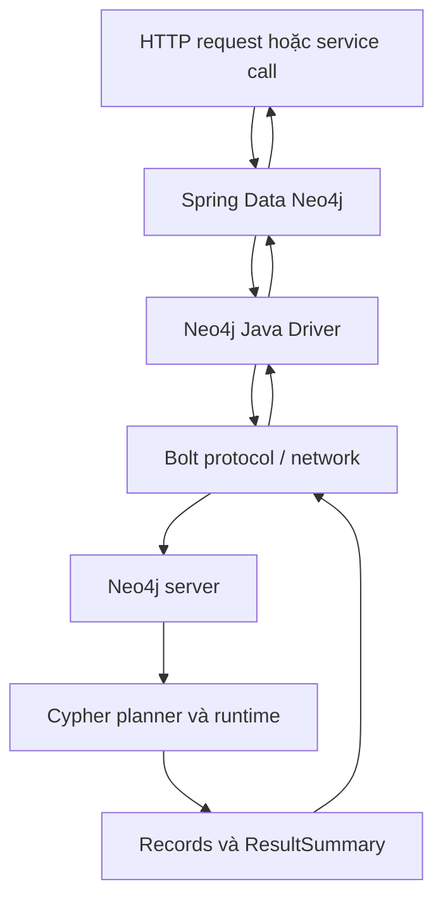

# Đo thời gian truy vấn, số record, dung lượng và số lượt giao tiếp

Đánh giá hiệu năng truy cập Neo4j cần nhiều số đo cùng lúc. Thời gian phía client cho biết người dùng phải chờ bao lâu; `ResultSummary` cho biết thời gian server đưa kết quả ra và tiêu thụ kết quả; số record cho biết lượng dữ liệu ứng dụng thực sự đọc; dung lượng payload cho biết dữ liệu phải ánh xạ hoặc gửi tiếp; còn số lượt giao tiếp giúp phát hiện việc chia một use case thành quá nhiều query hoặc fetch nhiều batch. Không có một chỉ số đơn lẻ đại diện cho toàn bộ chi phí.

Bài học thuộc module **SPRING_DATA_NEO4J**, tập trung xây dựng tầng dữ liệu đồ thị qua node entity, relationship, repository và Cypher. Ta dùng `Person`, `Movie` và `ACTED_IN` để đo thời gian bằng Java Driver, đọc `ResultSummary`, đếm record khi consume cursor, ước lượng payload, phân tích `PROFILE` và query log, rồi giảm số query round trip bằng cách thiết kế truy vấn phù hợp.

## 1. Bốn lớp cần đo

Một lần truy cập database thường đi qua nhiều lớp:



| Lớp | Cần đo | Chỉ số gợi ý |
|---|---|---|
| Ứng dụng | Tổng thời gian use case, thời gian chờ record đầu tiên, thời gian mapping/serialization | Client elapsed time, p50/p95/p99 |
| Driver | Thời gian server báo kết quả sẵn sàng, thời gian server tiêu thụ hết result, số record đã đọc | `resultAvailableAfter`, `resultConsumedAfter`, record count |
| Neo4j server | Planning, CPU, lock wait, memory, page cache, DB hits | Query log, `PROFILE`, query counters |
| Network/protocol | Dung lượng truyền, số lần fetch/round trip, số query trong một use case | Network telemetry, driver/protocol tracing, query count |

Không cộng các chỉ số này một cách máy móc. Ví dụ, client elapsed time bao gồm nhiều phần có thể chồng lấp; `resultConsumedAfter` là thời gian server kết thúc việc cung cấp result, không phải thời gian HTTP response hoàn tất.

## 2. Phân biệt các mốc thời gian

Khi đo một query, cần phân biệt ít nhất bốn mốc:

- **Client elapsed:** thời gian từ lúc ứng dụng bắt đầu thao tác đến khi đã đọc xong kết quả và hoàn tất công việc liên quan.
- **Time to first record:** thời gian từ lúc gọi query đến lúc ứng dụng nhận record đầu tiên.
- **`resultAvailableAfter`:** thời gian server cần để làm kết quả sẵn sàng cho client tiêu thụ.
- **`resultConsumedAfter`:** thời gian server cần để tiêu thụ hết kết quả query.

`ResultSummary` cung cấp hai mốc server `resultAvailableAfter(...)` và `resultConsumedAfter(...)`. Chúng chỉ có sau khi result đã được consume hết. Đây là số đo server trả về, không phải phép đo end-to-end từ ứng dụng.

Ví dụ minh họa:

| Chỉ số | Giá trị ví dụ | Cách đọc |
|---|---:|---|
| Client elapsed | 85 ms | Ứng dụng hoàn tất thao tác sau 85 ms |
| Time to first record | 31 ms | Record đầu tiên tới ứng dụng sau 31 ms |
| `resultAvailableAfter` | 18 ms | Server chuẩn bị kết quả trong 18 ms |
| `resultConsumedAfter` | 49 ms | Server hoàn tất cung cấp result sau 49 ms |

Các giá trị trên chỉ để minh họa cách phân biệt; không phải công thức để suy ra network latency bằng phép trừ. Phần chênh lệch có thể gồm thời gian lấy connection, lập transaction, truyền dữ liệu, chờ buffer, xử lý record, mapping và commit.

## 3. Đo client elapsed bằng System.nanoTime()

Để đo thời gian đã trôi qua, dùng `System.nanoTime()` thay vì `System.currentTimeMillis()`. `nanoTime()` phù hợp cho duration vì không phụ thuộc đồng hồ hệ thống bị chỉnh giờ.

```java
long startedAt = System.nanoTime();

List<PersonView> people = personRepository.findByBornBetween(1960, 1980)
    .stream()
    .map(PersonView::from)
    .toList();

long elapsedNanos = System.nanoTime() - startedAt;
long elapsedMillis = elapsedNanos / 1_000_000;

log.info("Loaded {} people in {} ms", people.size(), elapsedMillis);
```

Đoạn code này đo cả repository call, mapping và tạo list. Nếu cần tách riêng thời gian query và thời gian xử lý sau query, hãy đặt mốc đo quanh từng đoạn. Với reactive method, dùng `doOnSubscribe`, `doOnNext`, `doFinally` hoặc instrumentation phù hợp; không gọi `.block()` chỉ để lấy thời gian.

Không dùng `currentTimeMillis()` để trừ hai mốc ngắn vì đồng hồ hệ thống có thể thay đổi do NTP hoặc thao tác chỉnh giờ. Đổi `nanoTime()` sang milliseconds chỉ ở bước ghi metric.

## 4. Đọc ResultSummary của Neo4j Java Driver

`ResultSummary` cung cấp thông tin về query đã chạy, database/server, loại query, counters, notifications, query plan/profile và hai mốc thời gian server. Ví dụ với Driver API:

```java
import java.util.Map;
import java.util.concurrent.TimeUnit;

import org.neo4j.driver.Driver;
import org.neo4j.driver.SessionConfig;
import org.neo4j.driver.summary.ResultSummary;

public void inspectQuery(Driver driver, String title) {
    try (var session = driver.session(
            SessionConfig.builder().withDatabase("neo4j").build())) {

        ResultSummary summary = session.executeRead(tx -> {
            var result = tx.run("""
                MATCH (m:Movie)
                WHERE m.title CONTAINS $title
                RETURN m.movieId AS movieId, m.title AS title
                ORDER BY m.title
                """, Map.of("title", title));

            while (result.hasNext()) {
                var record = result.next();
                // Xử lý record; không giữ toàn bộ result nếu không cần.
                log.debug("Movie {}", record.get("movieId").asString());
            }

            return result.consume();
        });

        log.info("Query available after {} ms, consumed after {} ms",
            summary.resultAvailableAfter(TimeUnit.MILLISECONDS),
            summary.resultConsumedAfter(TimeUnit.MILLISECONDS));

        log.info("Query type {}, database {}, server {}",
            summary.queryType(),
            summary.database().name(),
            summary.server().address());
    }
}
```

`result.consume()` hoàn tất việc đọc cursor và trả summary. Nếu gọi summary khi vẫn còn record chưa đọc, Driver sẽ consume phần còn lại; các record đó không còn sẵn để ứng dụng duyệt tiếp. Vì vậy, hãy đọc và xử lý record trước, rồi mới lấy summary.

`ResultSummary` chỉ có sau khi toàn bộ result được consume. Nếu query trả rất nhiều record, hãy cân nhắc xử lý streaming thay vì dùng `list()` để tránh giữ toàn bộ kết quả trong heap.

## 5. Đếm số record ứng dụng thực sự nhận

Số record không nhất thiết bằng số node trong graph. Một `MATCH` qua relationship có thể tạo nhiều hàng cho cùng một node. Đếm record bằng cách tăng counter khi duyệt cursor:

```java
long recordCount = 0;

while (result.hasNext()) {
    var record = result.next();
    recordCount++;
    process(record);
}

ResultSummary summary = result.consume();
```

Nếu chỉ cần tổng số node duy nhất, hãy viết query `count(DISTINCT p)` phù hợp. Nếu muốn biết số hàng mà ứng dụng đã nhận, hãy đếm cursor. Hai phép đo trả lời hai câu hỏi khác nhau.

Ví dụ một người có thể tham gia nhiều phim:

```cypher
MATCH (p:Person)-[:ACTED_IN]->(m:Movie)
RETURN p, m;
```

Query này có thể trả nhiều record cho cùng một `Person`. Nếu mục tiêu là danh sách người duy nhất:

```cypher
MATCH (p:Person)-[:ACTED_IN]->(:Movie)
RETURN DISTINCT p;
```

Số record nhỏ hơn thường giúp giảm mapping và payload, nhưng không bảo đảm query nhanh hơn nếu phần traversal phía server vẫn phải duyệt nhiều relationship. Dùng `PROFILE` để xem lượng công việc thực tế.

## 6. Đếm record mà không materialize toàn bộ result

`Result.list()` hoặc `list(mapFunction)` tiện lợi nhưng thu thập tất cả record còn lại vào bộ nhớ. Với kết quả lớn, dùng cursor:

```java
long count = 0;

while (result.hasNext()) {
    var record = result.next();
    count++;
    process(record);
}
```

Nếu chỉ cần số lượng và không cần đọc từng hàng, viết query aggregate:

```cypher
MATCH (p:Person)-[:ACTED_IN]->(:Movie)
RETURN count(DISTINCT p) AS peopleCount;
```

Aggregate query trả một record chứa kết quả đếm, giảm dữ liệu truyền về client. Tuy nhiên, server vẫn phải thực hiện phần traversal/aggregation cần thiết; hãy đo `PROFILE` để đánh giá chi phí đó.

## 7. Đo số byte payload ở tầng ứng dụng

Neo4j Java Driver không cung cấp trong `ResultSummary` một trường cho biết chính xác số byte Bolt đã truyền cho result. Nếu muốn ước lượng kích thước dữ liệu ứng dụng nhận hoặc gửi tiếp, hãy đo sau khi ánh xạ sang DTO và serialize theo format mà ứng dụng dùng.

```java
import com.fasterxml.jackson.core.JsonProcessingException;
import com.fasterxml.jackson.databind.ObjectMapper;

long payloadBytes = 0;
long recordCount = 0;

while (result.hasNext()) {
    var record = result.next();
    PersonView view = new PersonView(
        record.get("personId").asString(),
        record.get("name").asString()
    );

    try {
        byte[] json = objectMapper.writeValueAsBytes(view);
        payloadBytes += json.length;
    } catch (JsonProcessingException ex) {
        throw new IllegalStateException("Cannot serialize PersonView", ex);
    }
    recordCount++;

    process(view);
}
```

`PersonView` là DTO có hai property `personId` và `name`; `objectMapper` là `ObjectMapper` được inject. `process(view)` đại diện cho bước xử lý DTO tiếp theo của ứng dụng. Nếu đo payload HTTP, nên đo body cuối cùng sau khi framework serialize cả collection/envelope.

Đây là tổng byte JSON của từng DTO riêng lẻ. Nó không bao gồm dấu ngoặc mảng, dấu phẩy, envelope của API, header HTTP, compression hoặc framing của Bolt/TLS. Để đo chính xác HTTP response body, hãy instrument tại tầng web sau khi serialize response. Để đo bytes trên mạng, cần network telemetry hoặc công cụ đo ở tầng socket/protocol.

Không dùng `record.toString().getBytes(UTF_8).length` như số byte wire. Chuỗi debug có thể khác serialization thật, không bao gồm framing và có thể thay đổi theo phiên bản Driver.

## 8. Phân biệt allocatedBytes với bytes truyền qua mạng

Neo4j query log có thể ghi một trường dung lượng như `allocatedBytes` hoặc trường byte trong log text. Đây là lượng heap memory được query cấp phát trong thời gian thực thi, không phải kích thước result truyền qua Bolt.

Các chỉ số cần phân biệt:

| Chỉ số | Đo điều gì? | Nguồn |
|---|---|---|
| DTO JSON bytes | Dung lượng dữ liệu sau mapping/serialization ở ứng dụng | `ObjectMapper.writeValueAsBytes()` |
| HTTP response bytes | Dung lượng response body thực tế | Web server/filter/metrics |
| Bolt wire bytes | Byte giao tiếp giữa Driver và Neo4j | Network/protocol instrumentation |
| `allocatedBytes` | Heap memory query cấp phát trong quá trình chạy | Neo4j query log |
| `Memory (Bytes)` trong PROFILE | Peak memory của operator; tổng query có thông tin riêng ở footer | Query profile |

Không lấy `allocatedBytes` để kết luận query gửi 10 KB hay 10 MB qua mạng. Một query có thể cấp phát nhiều heap nhưng trả ít record; một query khác có thể trả payload lớn nhưng cấp phát server-side tương đối thấp.

## 9. Đo thời gian query và record trong cùng một lần chạy

Ví dụ sau kết hợp client timing, số record, payload JSON và `ResultSummary`. Phần ánh xạ và serialization được đo trong lúc consume result:

```java
import java.util.Map;
import java.util.concurrent.TimeUnit;

import com.fasterxml.jackson.core.JsonProcessingException;
import com.fasterxml.jackson.databind.ObjectMapper;
import org.neo4j.driver.Driver;
import org.neo4j.driver.SessionConfig;
import org.neo4j.driver.summary.ResultSummary;

public QueryMeasurement measurePeople(
        Driver driver,
        ObjectMapper objectMapper,
        String fragment) {

    long requestStarted = System.nanoTime();
    QueryMeasurement queryMeasurement;

    try (var session = driver.session(
            SessionConfig.builder().withDatabase("neo4j").build())) {

        queryMeasurement = session.executeRead(tx -> {
            long queryStarted = System.nanoTime();
            long firstRecordAt = 0;
            long records = 0;
            long jsonBytes = 0;

            var result = tx.run("""
                MATCH (p:Person)
                WHERE p.name CONTAINS $fragment
                RETURN p.personId AS personId, p.name AS name
                ORDER BY p.name, p.personId
                """, Map.of("fragment", fragment));

            while (result.hasNext()) {
                var record = result.next();
                if (records == 0) {
                    firstRecordAt = System.nanoTime();
                }

                var view = new PersonView(
                    record.get("personId").asString(),
                    record.get("name").asString()
                );

                try {
                    jsonBytes += objectMapper.writeValueAsBytes(view).length;
                } catch (JsonProcessingException ex) {
                    throw new IllegalStateException("Cannot serialize PersonView", ex);
                }

                records++;
            }

            ResultSummary summary = result.consume();
            Long firstRecordMillis = firstRecordAt == 0
                ? null
                : TimeUnit.NANOSECONDS.toMillis(firstRecordAt - queryStarted);

            return new QueryMeasurement(
                records,
                jsonBytes,
                firstRecordMillis,
                summary.resultAvailableAfter(TimeUnit.MILLISECONDS),
                summary.resultConsumedAfter(TimeUnit.MILLISECONDS),
                0
            );
        });
    }

    long clientElapsedMillis = TimeUnit.NANOSECONDS.toMillis(
        System.nanoTime() - requestStarted
    );

    return queryMeasurement.withClientElapsedMillis(clientElapsedMillis);
}
```

`QueryMeasurement` là DTO do ứng dụng định nghĩa, có thể là Java record:

```java
public record QueryMeasurement(
        long recordCount,
        long jsonPayloadBytes,
        Long clientTimeToFirstRecordMillis,
        long serverResultAvailableAfterMillis,
        long serverResultConsumedAfterMillis,
        long clientElapsedMillis) {

    public QueryMeasurement withClientElapsedMillis(long elapsed) {
        return new QueryMeasurement(
            recordCount,
            jsonPayloadBytes,
            clientTimeToFirstRecordMillis,
            serverResultAvailableAfterMillis,
            serverResultConsumedAfterMillis,
            elapsed
        );
    }
}
```

Ví dụ này đo một query chạy trong managed read transaction. `clientElapsedMillis` bao gồm lấy session, mở/hoàn tất transaction và đóng session. `clientTimeToFirstRecordMillis` bắt đầu đo bên trong callback ngay trước `tx.run()`. Khi callback bị Driver retry, phép đo trong callback phản ánh lần thực thi callback cuối cùng thành công; client elapsed bên ngoài phản ánh tổng thời gian người gọi đã chờ, bao gồm cả các lần retry.

Với ứng dụng dùng SDN repository hoặc `Neo4jClient`, có thể áp dụng cùng cách đo ở tầng service bằng timer quanh publisher/call và đếm record sau khi nhận kết quả. Không mở thêm `Driver` riêng chỉ để đo một query vốn đang chạy trong transaction do SDN quản lý.

## 10. Đo ở Spring Data Neo4j

Ở tầng SDN, có thể đo thời gian toàn bộ repository/service call:

```java
import java.util.concurrent.TimeUnit;

long started = System.nanoTime();

List<Person> people = personRepository.findByNameContaining(fragment);

long elapsedMillis = TimeUnit.NANOSECONDS.toMillis(
    System.nanoTime() - started
);

log.info("findByNameContaining returned {} rows in {} ms",
    people.size(), elapsedMillis);
```

Nếu dùng `Neo4jClient` imperative và cần summary cho query tùy chỉnh, có thể dùng `run()` sau khi bind tham số:

```java
import java.util.concurrent.TimeUnit;

ResultSummary summary = neo4jClient.query("""
        MATCH (p:Person)
        WHERE p.name CONTAINS $fragment
        RETURN p.personId AS personId
        """)
    .bind(fragment).to("fragment")
    .run();

log.info("Server consumed query in {} ms",
    summary.resultConsumedAfter(TimeUnit.MILLISECONDS));
```

Khi dùng `run()`, ứng dụng không lấy các hàng kết quả; client chỉ nhận summary. Nếu cần đếm số hàng được trả về, dùng fetch operation và đếm trong lúc đọc. Nếu query chỉ cần một aggregate count, hãy để Cypher trả `count(...)` thay vì tải từng node về ứng dụng.

## 11. Reactive: đo tới khi publisher hoàn tất

Với reactive repository hoặc `ReactiveNeo4jClient`, publisher là lazy. Nếu chỉ tạo `Flux`/`Mono` mà chưa subscribe, query chưa được thực thi. Đo thời gian phải bao phủ subscription và completion:

```java
import java.util.concurrent.atomic.AtomicLong;

import io.micrometer.core.instrument.MeterRegistry;
import io.micrometer.core.instrument.Timer;
import reactor.core.publisher.Flux;

public Flux<PersonView> findPeople(String fragment) {
    return Flux.defer(() -> {
        Timer.Sample sample = Timer.start(meterRegistry);
        AtomicLong recordCount = new AtomicLong();

        return reactiveNeo4jClient.query("""
                MATCH (p:Person)
                WHERE p.name CONTAINS $fragment
                RETURN p.personId AS personId, p.name AS name
                ORDER BY p.name, p.personId
                """)
            .bind(fragment).to("fragment")
            .fetchAs(PersonView.class)
            .mappedBy((typeSystem, record) -> new PersonView(
                record.get("personId").asString(),
                record.get("name").asString()
            ))
            .all()
            .doOnNext(person -> recordCount.incrementAndGet())
            .doFinally(signal -> {
                sample.stop(Timer.builder("neo4j.query.duration")
                    .tag("query", "people.search")
                    .tag("signal", signal.name())
                    .register(meterRegistry));
                meterRegistry.counter("neo4j.query.records", "query", "people.search")
                    .increment(recordCount.get());
            });
    });
}
```

`reactiveNeo4jClient` và `meterRegistry` là các bean được inject vào service. `Flux.defer(...)` tạo timer và counter riêng cho mỗi subscription; `doFinally` ghi nhận cả completion, error lẫn cancellation. Giữ tag có cardinality thấp, ví dụ tên use case cố định; không đưa `personId`, query parameter hoặc tên người dùng vào metric tag.

Không gọi `.block()` để đo reactive publisher. Không gọi `.subscribe()` bên trong service vì như vậy caller không còn kiểm soát thời điểm thực thi, lỗi và cancellation.

## 12. Đọc PROFILE để biết server đã làm bao nhiêu việc

`ResultSummary` có thể chứa query plan hoặc profiled plan. Trong Cypher, `EXPLAIN` lập kế hoạch mà không thực thi query; `PROFILE` thực thi query và thu thập số đo thực tế.

```cypher
PROFILE
MATCH (p:Person {personId: $personId})-[:ACTED_IN]->(m:Movie)
RETURN m.title AS title
ORDER BY title;
```

Các chỉ số cần chú ý:

| Chỉ số | Ý nghĩa | Cách dùng |
|---|---|---|
| Rows | Số hàng operator thực tế tạo ra | Phát hiện fan-out hoặc nhiều hàng trung gian |
| DB Hits | Số thao tác truy cập dữ liệu cấp thấp như đọc entity/property/index entry | So sánh lượng công việc storage giữa hai query |
| Memory (Bytes) | Peak memory theo operator | Phát hiện aggregation/sort/path xử lý nhiều dữ liệu |
| Page Cache Hits/Misses | Số lần tìm thấy/không thấy page trong cache | Phân biệt workload warm cache và cold cache |
| Operator | Cách planner truy cập graph | Tìm `NodeByLabelScan`, `NodeIndexSeek`, expand, sort, aggregation |

`DB Hits` không phải số record và cũng không phải số network round trips. Một record có thể cần nhiều DB hits; một query có thể thực hiện nhiều operator nhưng chỉ trả một record.

`Memory (Bytes)` trong profile là peak theo operator, không phải cộng tất cả các operator để suy ra tổng heap. Query profile có thể cung cấp tổng allocated memory ở phần footer. Page cache stats có thể phụ thuộc edition và môi trường.

`PROFILE` thực sự chạy query. Với query ghi hoặc query có chi phí cao, hãy chạy trên database thử nghiệm hoặc dữ liệu có thể phục hồi; không thêm `PROFILE` tùy tiện vào lệnh `DELETE`/`SET` trên production.

## 13. Đọc ResultSummary counters và notifications

Với query ghi, `summary.counters()` cho biết số node/relationship/property được tạo, xóa hoặc cập nhật. Các counter giúp xác nhận query làm đúng lượng thay đổi dự kiến:

```java
var counters = summary.counters();

log.info("Created nodes={}, relationships={}, properties={}",
    counters.nodesCreated(),
    counters.relationshipsCreated(),
    counters.propertiesSet());
```

Với query đọc, counters thường không có thay đổi graph. `summary.gqlStatusObjects()` có thể chứa thông báo hoặc cảnh báo từ server, ví dụ query có cấu trúc chưa tối ưu hoặc dùng cú pháp đã deprecated. Hãy ghi nhận notifications trong môi trường phát triển/quan sát để phát hiện vấn đề sớm.

Không dùng `nodesCreated()` làm số record trả về. Nó là số node được tạo bởi query, không liên quan trực tiếp đến số hàng trong result.

## 14. Đo số query trong một use case

Một use case service có thể gọi nhiều repository method:

```java
Person person = personRepository.findByPersonId(personId).orElseThrow();
List<Movie> movies = movieRepository.findByActorsPersonId(personId);
List<Review> reviews = reviewRepository.findByPersonId(personId);
```

Đây là ba lần gọi repository và có thể tạo ba query database. Nếu mỗi query có độ trễ mạng cố định, tổng thời gian có thể cao dù từng query đều nhanh.

Đếm số query ở tầng ứng dụng bằng instrumentation quanh repository/client calls hoặc qua query log. Gắn metadata như `app`, `useCase` hoặc correlation ID vào transaction/query nếu phiên bản và API cho phép, để đối chiếu log server với trace ứng dụng.

Nếu ba loại dữ liệu có thể lấy trong một Cypher query mà không làm bùng nổ số hàng, có thể gom lại:

```cypher
MATCH (p:Person {personId: $personId})
OPTIONAL MATCH (p)-[:ACTED_IN]->(m:Movie)
WITH p, collect(DISTINCT m) AS movies
OPTIONAL MATCH (p)-[:WROTE]->(r:Review)
RETURN p,
       movies,
       collect(DISTINCT r) AS reviews;
```

Query này giảm số lần gọi database nhưng có thể làm result phức tạp hơn. Hãy kiểm tra mapping và profile; gom query không phải lúc nào cũng nhanh hơn nếu các nhánh relationship nhân dòng hoặc tạo collection lớn.

## 15. Round trip không bằng số record hoặc số query

Một round trip là một lượt trao đổi yêu cầu/phản hồi giữa client và server ở tầng giao thức. Một query logic có thể cần nhiều thông điệp Bolt trong suốt vòng đời:

- Mở transaction hoặc chạy auto-commit query.
- Gửi `RUN` và yêu cầu dữ liệu bằng `PULL`.
- Nhận nhiều batch record.
- Consume result và hoàn tất/commit transaction.

Driver đọc result theo kiểu streaming và buffer record. Client chỉ yêu cầu thêm dữ liệu khi buffer gần cạn; một lượt lấy dữ liệu từ server có thể chứa nhiều record. Vì vậy:

- 100 record không có nghĩa là 100 round trips.
- 3 query không nhất thiết có đúng 3 round trips.
- Một query trả nhiều batch có thể cần nhiều lần trao đổi dữ liệu hơn query nhỏ.
- Một packet mạng không tương đương một Bolt round trip; TCP/TLS có thể gộp hoặc chia packet.

`ResultSummary` không cung cấp một counter công khai cho tổng số Bolt round trips của từng query. Muốn đo chính xác cần instrumentation ở tầng protocol/network hoặc công cụ tracing phù hợp. Ở cấp ứng dụng, hãy đo số query logical, số record, thời gian first-record/consume và bytes payload để tìm xu hướng trước khi cần đo giao thức chi tiết.

## 16. Ước lượng round trips và giảm chatty access

Trong đa số ứng dụng, mục tiêu thực tế là giảm số lần gọi database không cần thiết thay vì đếm từng gói TCP. Một số dấu hiệu chatty access:

- Lặp `findById()` trong vòng lặp cho từng node.
- N+1 query khi đọc danh sách entity rồi lần lượt tải relationship cho từng entity.
- Gọi count query riêng dù giao diện không cần tổng số.
- Mỗi thao tác nhỏ mở một transaction hoặc session riêng.
- Chạy nhiều query tuần tự có thể gộp thành một pattern Cypher.

Ví dụ N+1:

```java
List<Person> people = personRepository.findAll();

for (Person person : people) {
    List<Movie> movies = movieRepository
        .findByActorsPersonId(person.getPersonId());
    // Xử lý movies.
}
```

Nếu có 100 người, đoạn code có thể tạo một query lấy danh sách và thêm 100 query lấy phim. Một query traversal có thể lấy cùng dữ liệu:

```cypher
MATCH (p:Person)
OPTIONAL MATCH (p)-[:ACTED_IN]->(m:Movie)
RETURN p.personId AS personId,
       p.name AS name,
       collect(DISTINCT m) AS movies
ORDER BY name, personId;
```

Kết quả gom nhóm có thể lớn; hãy cân nhắc phân trang `Person` trước khi collect relationship để giới hạn payload. Đôi khi hai query có mục đích rõ ràng tốt hơn một query phức tạp và tạo collection rất lớn.

## 17. Query log phía Neo4j

Neo4j Enterprise có query log giúp quan sát các query chạy lâu. Có thể chọn `INFO` để chỉ ghi query vượt ngưỡng:

```properties
db.logs.query.enabled=INFO
db.logs.query.threshold=100ms
```

`INFO` ghi query sau khi hoàn tất nếu thời gian vượt threshold. `VERBOSE` ghi sự kiện start/end cho mọi query và có thể tạo nhiều log; hãy cân nhắc dung lượng log và chi phí quan sát trước khi bật trong production.

Query log có thể chứa các trường hữu ích như elapsed time, planning, CPU, waiting, allocated bytes, page hits và page faults. Một số trường chi tiết phụ thuộc phiên bản Neo4j và định dạng log. Query log cũng có thể cung cấp connection ID, transaction ID, database, client address, driver version và query text.

Không bật parameter logging bừa bãi trong production. Parameter có thể chứa email, access token, dữ liệu cá nhân hoặc thông tin nghiệp vụ nhạy cảm. Hãy tắt parameter logging nếu không cần và bật cơ chế obfuscation phù hợp cho query literals/errors theo chính sách bảo mật của phiên bản Neo4j.

## 18. Phân tích planning, CPU và waiting

Query log tách các phần thời gian giúp xác định nguyên nhân:

| Trường | Diễn giải | Hướng kiểm tra |
|---|---|---|
| Elapsed | Thời gian server dành cho query theo định nghĩa log | So với client elapsed và các phần thời gian con |
| Planning | Thời gian tạo query plan | Query shape thay đổi liên tục, plan cache, statistics |
| CPU | Thời gian thực thi trên CPU | Traversal rộng, aggregation, sort hoặc biểu thức tốn CPU |
| Waiting | Thời gian chờ lock hoặc tài nguyên khác | Transaction dài, contention, query ghi đồng thời |
| Allocated bytes | Heap memory query đã cấp phát | Collection lớn, sort, aggregation, materialization |
| Page hits/faults | Tương tác page cache và storage | Cache warm/cold, working set, memory sizing |

Đừng giả định `elapsed = planning + CPU` trong mọi trường hợp. Server còn có thể chờ lấy execution thread, chờ lock hoặc bị ảnh hưởng bởi việc client tiêu thụ result chậm. Một số giá trị CPU có thể cộng dồn qua nhiều worker trong runtime song song.

Nếu `waiting` cao, tối ưu Cypher có thể không giải quyết gốc rễ; cần xem transaction nào đang giữ lock. Nếu planning cao với query lặp lại, kiểm tra query shape và parameterization để tận dụng plan cache.

## 19. Benchmark công bằng

Khi so sánh hai cách viết query, cần kiểm soát điều kiện:

1. Dùng cùng dataset, index, constraint và phiên bản Neo4j.
2. Dùng cùng parameter và cùng kết quả nghiệp vụ.
3. Chạy warm-up trước khi đo; tách cold-cache và warm-cache thành hai kịch bản.
4. Chạy đủ nhiều lần, ghi p50, p95, p99 thay vì chỉ một lần chạy.
5. Đo cả client elapsed và server timing.
6. Ghi record count và payload bytes để biết hai query có trả cùng lượng dữ liệu không.
7. Ghi số query trong use case và concurrency.
8. Chạy `PROFILE` riêng để phân tích operator; không dùng kết quả PROFILE làm benchmark latency production duy nhất.

Không so sánh một query trả 10 record với một query trả 10.000 record rồi kết luận query thứ nhất tối ưu hơn nếu hai query không giải quyết cùng yêu cầu. Cũng không so sánh warm-cache run với cold-cache run.

## 20. Một bảng đo mẫu

Khi thử hai cách lấy danh sách phim, có thể ghi lại:

| Chỉ số | Cách A: N+1 | Cách B: một traversal |
|---|---:|---:|
| Logical queries/use case | 101 | 1 |
| Records nhận ở tầng ứng dụng | 1.100 | 100 |
| JSON payload | 420 KB | 185 KB |
| Client elapsed p50 | 240 ms | 58 ms |
| Server consumed p50 | 160 ms tổng | 34 ms |
| DB hits | Đo từ PROFILE/log | Đo từ PROFILE/log |

Các con số trên chỉ minh họa cách ghi bảng; trong thực tế cần đo trên dataset và workload của ứng dụng. Cách B có thể trả ít record hơn vì gom movies vào collection trong từng hàng; hãy xác nhận nó vẫn trả đầy đủ dữ liệu mà use case cần.

## 21. Lỗi thường gặp

| Lỗi | Hệ quả | Cách xử lý |
|---|---|---|
| Chỉ đo thời gian server | Bỏ qua pool wait, network, mapping và serialization | Đo thêm client elapsed |
| Dùng `currentTimeMillis()` cho duration ngắn | Đồng hồ hệ thống có thể bị chỉnh | Dùng `System.nanoTime()` |
| Lấy `resultAvailableAfter` làm tổng thời gian request | Bỏ qua fetch, consume và xử lý phía client | Đo end-to-end riêng |
| Đọc `ResultSummary` trước khi xử lý record | Result bị consume hết | Duyệt record trước rồi mới consume summary |
| Dùng `list()` cho hàng triệu record | Tăng heap và GC pressure | Stream cursor hoặc giới hạn bằng `LIMIT` |
| Nhầm record count với node count | Một node có thể xuất hiện trên nhiều hàng | Dùng `DISTINCT` hoặc aggregate theo mục tiêu |
| Nhầm `allocatedBytes` với network bytes | Kết luận sai kích thước payload | Đo serialization/network ở đúng tầng |
| Nhầm DB Hits với số round trips | Đánh giá sai chi phí giao tiếp | Dùng network/protocol tracing nếu cần đếm round trips |
| PROFILE query ghi trên production | Query thực sự thay đổi dữ liệu | Profile trên test/staging hoặc dùng EXPLAIN |
| Chỉ đo một lần | Kết quả bị ảnh hưởng bởi cache/JIT/tải hệ thống | Warm-up, lặp nhiều lần và xem percentile |
| Gộp mọi query thành một query khổng lồ | Result fan-out và memory tăng | Đo query shape, giới hạn collection và phân trang |
| Log mọi parameter | Có thể lộ dữ liệu nhạy cảm | Tắt parameter logging hoặc obfuscate phù hợp |

## 22. Checklist đo hiệu năng

- Đo client elapsed bằng `System.nanoTime()`.
- Đo time to first record và thời gian consume hết result.
- Đọc `resultAvailableAfter` và `resultConsumedAfter` từ `ResultSummary`.
- Đếm record trong lúc consume cursor.
- Đo payload sau mapping/serialization nếu cần biết bytes ứng dụng.
- Không nhầm allocated heap bytes với bytes truyền qua mạng.
- Dùng `PROFILE` để đọc Rows, DB Hits, Memory và page cache.
- Dùng query log để xem planning, CPU, waiting, allocation và query duration.
- Đếm số query logical trong một use case để phát hiện N+1/chatty access.
- Không suy số round trips từ record count hoặc số query.
- Benchmark với warm-up, cùng dữ liệu, nhiều lần chạy và percentile.
- Bảo vệ parameter và query log khỏi dữ liệu nhạy cảm.

## 23. Bài tập thực hành

1. Dùng `System.nanoTime()` đo client elapsed cho `PersonRepository.findAll()`.
2. Dùng Java Driver cursor để đếm record và đọc `ResultSummary` sau khi consume hết.
3. So sánh `resultAvailableAfter` với `resultConsumedAfter` khi query trả 10, 1.000 và 100.000 record.
4. Viết query `MATCH Person-[:ACTED_IN]->Movie` và so sánh record count với `count(DISTINCT p)`.
5. Serialize DTO thành JSON và đo payload bytes; giải thích vì sao không bằng Bolt wire bytes.
6. Chạy `PROFILE` cho query theo `personId`; ghi operator, Rows và DB Hits.
7. Tạo query có `ORDER BY` và aggregation; quan sát Memory (Bytes) và sort operator.
8. Bật query log threshold ở môi trường thử nghiệm; đối chiếu elapsed, planning, CPU và waiting.
9. Viết một use case có N+1 query; đo logical query count và client elapsed.
10. Viết lại bằng một Cypher traversal có `collect(DISTINCT ...)`; so sánh records, payload và latency.
11. Benchmark hai query sau warm-up 50 lần; ghi p50, p95 và p99.
12. Tìm một query có nhiều DB Hits nhưng ít records; giải thích vì sao record count không phản ánh toàn bộ công việc server.

Khi hoàn thành, bạn cần đọc được số đo ở cả client, Driver và Neo4j server. `ResultSummary` giúp hiểu thời gian server và counters; cursor giúp đếm lượng record thực nhận; serialization giúp ước lượng payload; `PROFILE` và query log giúp tìm phần công việc tốn kém. Với số lượt giao tiếp, hãy đo query logical và dùng tracing ở tầng giao thức khi cần con số round trip chính xác.

## Tài liệu tham khảo

- [Neo4j Java Driver Manual — Explore the query execution summary](https://neo4j.com/docs/java-manual/current/result-summary/)
- [Neo4j Java Driver API — ResultSummary](https://neo4j.com/docs/api/java-driver/current/org.neo4j.driver/org/neo4j/driver/summary/ResultSummary.html)
- [Neo4j Java Driver Manual — Process query results](https://neo4j.com/docs/java-manual/current/transactions/)
- [Neo4j Java Driver Manual — Query the database](https://neo4j.com/docs/java-manual/current/query-simple/)
- [Neo4j Cypher Manual — Understanding query plans](https://neo4j.com/docs/cypher-manual/current/planning-and-tuning/execution-plans/)
- [Neo4j Operations Manual — Query logging](https://neo4j.com/docs/operations-manual/current/monitoring/logging/)
- [Neo4j Operations Manual — Enable metrics logging](https://neo4j.com/docs/operations-manual/current/monitoring/metrics/enable/)
