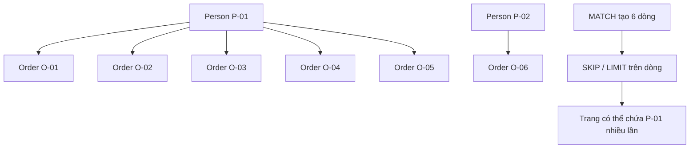

# Phân trang entity gốc và tránh nhân bản kết quả do relationship

Khi phân trang một danh sách entity có nhiều relationship, hãy phân trang các node gốc trước rồi mới tải các node và relationship liên quan. Nếu đặt `SKIP` và `LIMIT` sau một `MATCH` mở rộng collection relationship, Cypher phân trang các dòng kết quả chứ không phân trang entity gốc. Một người có nhiều đơn hàng có thể xuất hiện nhiều lần trong một trang, đồng thời relationship của người đó bị chia sang các trang khác nhau.

Spring Data Neo4j (SDN) ánh xạ kết quả custom query theo record. Mỗi entity gốc cần có đủ dữ liệu graph trong một record để SDN dựng association đúng. Vì vậy, khi query có nhiều dòng cho cùng root node, hãy gom relationship và node liên quan bằng `collect()` hoặc subquery tổng hợp trước khi trả kết quả.

Trong module `SPRING_DATA_NEO4J`, kỹ thuật này giúp repository trả `Page<Person>` hoặc `Slice<Person>` với số lượng entity gốc đúng, quan hệ được hydrate đầy đủ và truy vấn có thể mở rộng khi graph lớn. Bài học cũng giải thích cách viết `countQuery`, chọn thứ tự ổn định, tránh Cartesian product và cân nhắc keyset pagination khi offset quá sâu.

## 1. Vì sao phân trang sau MATCH relationship bị sai?

Giả sử domain có `Person` và `Order`. Một người có thể đặt nhiều đơn hàng:

```cypher
CREATE (p1:Person {id: 'P-01'}),
       (p2:Person {id: 'P-02'}),
       (o1:Order {id: 'O-01'}),
       (o2:Order {id: 'O-02'}),
       (o3:Order {id: 'O-03'}),
       (o4:Order {id: 'O-04'}),
       (o5:Order {id: 'O-05'}),
       (o6:Order {id: 'O-06'});

MATCH (p1:Person {id: 'P-01'}), (p2:Person {id: 'P-02'}),
      (o1:Order {id: 'O-01'}), (o2:Order {id: 'O-02'}),
      (o3:Order {id: 'O-03'}), (o4:Order {id: 'O-04'}),
      (o5:Order {id: 'O-05'}), (o6:Order {id: 'O-06'})
CREATE (p1)-[:PLACED]->(o1),
       (p1)-[:PLACED]->(o2),
       (p1)-[:PLACED]->(o3),
       (p1)-[:PLACED]->(o4),
       (p1)-[:PLACED]->(o5),
       (p2)-[:PLACED]->(o6);
```

Query ngây thơ:

```cypher
MATCH (p:Person)-[r:PLACED]->(o:Order)
RETURN p, r, o
ORDER BY p.name
SKIP $skip
LIMIT $limit;
```

Nếu `P-01` có năm đơn hàng, kết quả trung gian có năm dòng cho cùng một `Person`. Với `LIMIT 3`, trang đầu có thể chứa ba dòng của `P-01`, mặc dù ứng dụng mong muốn ba người khác nhau. Trang tiếp theo có thể bắt đầu bằng hai đơn còn lại của `P-01` rồi mới tới `P-02`.



Đây là vấn đề ở cấp record, không phải lỗi của `Pageable`. Neo4j trả một record cho mỗi cặp relationship/node khớp. SDN nhận nhiều record chứa cùng root node, nên kết quả có thể lặp entity hoặc chỉ hydrate được một phần association tùy cấu trúc query. Tài liệu SDN khuyến nghị custom query không xây dựng result set có nhiều record cho cùng root node.

## 2. Phân biệt entity gốc, record và relationship

Khi phân trang, cần xác định rõ đơn vị mà API muốn trả về:

| Khái niệm | Ví dụ | Ý nghĩa |
|---|---|---|
| Entity gốc (root entity) | Một `Person` | Đơn vị được tính là một phần tử trong trang |
| Record Cypher | Một dòng `p, r, o` | Một hàng trong result set của query |
| Relationship | Một cạnh `PLACED` | Có thể làm một root entity sinh nhiều record |
| Node liên quan | Một `Order` | Dữ liệu cần gom cùng relationship để hydrate association |

Nếu API trả danh sách người, `pageSize = 20` phải có nghĩa là tối đa 20 `Person`, không phải 20 relationship hoặc 20 dòng sau khi join. Số phần tử tổng (`totalElements`) cũng phải đếm `Person` thỏa điều kiện, không đếm số đơn hàng.

`RETURN DISTINCT p` không phải cách đầy đủ để sửa query trên. Nó có thể loại các dòng trùng root node, nhưng khi chỉ trả `p`, các relationship và node liên quan không còn trong record để SDN hydrate. Nếu trả `DISTINCT p, r, o`, mỗi relationship khác nhau vẫn tạo một record riêng. Cần gom dữ liệu quan hệ thành collection.

## 3. Mô hình entity minh họa

Ví dụ sử dụng ID nghiệp vụ dạng `String` để câu Cypher dễ đọc. Các accessor và constructor không liên quan đến truy vấn được lược bớt:

```java
import java.time.Instant;
import java.util.List;

import org.springframework.data.neo4j.core.schema.Id;
import org.springframework.data.neo4j.core.schema.Node;
import org.springframework.data.neo4j.core.schema.Relationship;

@Node("Person")
public class Person {

    @Id
    private String id;

    private String name;
    private boolean active;
    private Instant createdAt;

    @Relationship(type = "PLACED", direction = Relationship.Direction.OUTGOING)
    private List<Order> orders;
}
```

```java
import org.springframework.data.neo4j.core.schema.Id;
import org.springframework.data.neo4j.core.schema.Node;

@Node("Order")
public class Order {

    @Id
    private String id;

    private String status;
}
```

`Person.orders` là collection relationship. Khi đọc một `Person`, SDN cần node `Person`, relationship `PLACED` và các node `Order` liên quan để dựng danh sách `orders`.

## 4. Quy tắc đúng: phân trang root trước, mở rộng graph sau

Đầu tiên chỉ tìm và sắp xếp các node gốc. Sau đó áp dụng `SKIP`/`LIMIT`. Khi đã xác định xong trang root node, mới tìm các relationship và node con rồi gom chúng thành collection:

```cypher
MATCH (p:Person)
WHERE p.active = $active
WITH p
ORDER BY p.createdAt DESC, p.id ASC
SKIP $skip
LIMIT $limit
CALL {
    WITH p
    OPTIONAL MATCH (p)-[r:PLACED]->(o:Order)
    RETURN collect(r) AS placedRelationships,
           collect(o) AS orders
}
RETURN p, placedRelationships, orders
ORDER BY p.createdAt DESC, p.id ASC;
```

Query thực hiện theo thứ tự:

1. `MATCH (p:Person)` tìm các node gốc.
2. `WHERE` lọc theo thuộc tính của `Person`.
3. `WITH p` chuyển tập root node sang giai đoạn tiếp theo.
4. `ORDER BY`, `SKIP`, `LIMIT` chọn đúng trang `Person`.
5. `CALL { ... }` mở rộng từng `Person` trong trang và gom relationship cùng node `Order`.
6. `RETURN` tạo một record cho mỗi `Person`, gồm root node và các collection liên quan.

`OPTIONAL MATCH` giữ lại người chưa có đơn hàng. Khi không có relationship phù hợp, `collect()` trả collection rỗng thay vì loại root node khỏi kết quả. Nếu nghiệp vụ chỉ muốn người đã có đơn, hãy lọc điều kiện đó ở giai đoạn root trước khi phân trang.

Điều kiện quan trọng là `SKIP` và `LIMIT` phải nằm trước phần mở rộng collection. Nếu chuyển chúng xuống cuối query, lỗi phân trang theo relationship sẽ quay trở lại.

## 5. Lọc root entity theo điều kiện relationship mà không nhân dòng

Đôi khi danh sách người được lọc theo trạng thái đơn hàng, ví dụ chỉ lấy người có ít nhất một đơn `PAID`. Nếu viết trực tiếp:

```cypher
MATCH (p:Person)-[:PLACED]->(o:Order)
WHERE o.status = $status
RETURN p;
```

thì người có nhiều đơn `PAID` vẫn tạo nhiều dòng. Có thể thêm `WITH DISTINCT p`, nhưng với điều kiện tồn tại, `EXISTS` subquery diễn đạt đúng ý định hơn và không mở rộng tập root thành nhiều dòng:

```cypher
MATCH (p:Person)
WHERE p.active = $active
  AND EXISTS {
      MATCH (p)-[:PLACED]->(o:Order)
      WHERE o.status = $status
  }
WITH p
ORDER BY p.createdAt DESC, p.id ASC
SKIP $skip
LIMIT $limit
CALL {
    WITH p
    OPTIONAL MATCH (p)-[r:PLACED]->(o:Order)
    WHERE o.status = $status
    RETURN collect(r) AS placedRelationships,
           collect(o) AS orders
}
RETURN p, placedRelationships, orders
ORDER BY p.createdAt DESC, p.id ASC;
```

`EXISTS` chỉ kiểm tra có ít nhất một đơn phù hợp, không tạo thêm record cho mỗi đơn. Sau khi đã chọn trang người, subquery tải những đơn phù hợp để hydrate collection. Nếu muốn hiển thị tất cả đơn của người được chọn, bỏ điều kiện `o.status` trong subquery nhưng giữ điều kiện `EXISTS` ở phần root.

Với điều kiện quan hệ phức tạp hơn, hãy cố gắng biểu diễn điều kiện lọc bằng `EXISTS` hoặc subquery trả về một giá trị tổng hợp cho mỗi root node. Chỉ dùng `MATCH` mở rộng trực tiếp khi đã gom kết quả về một record cho mỗi root trước khi phân trang.

## 6. Gọi custom query qua repository với Slice

SDN hỗ trợ `Pageable`, `Slice` và `Page` trong query method. Với custom query trả `Slice<T>`, Cypher phải tự sử dụng cả hai tham số `$skip` và `$limit`. `Slice` cho biết có trang tiếp theo hay không, không yêu cầu tổng số phần tử.

```java
import org.springframework.data.domain.Pageable;
import org.springframework.data.domain.PageRequest;
import org.springframework.data.domain.Slice;
import org.springframework.data.neo4j.repository.Neo4jRepository;
import org.springframework.data.neo4j.repository.query.Query;
import org.springframework.data.repository.query.Param;

public interface PersonRepository extends Neo4jRepository<Person, String> {

    @Query("""
        MATCH (p:Person)
        WHERE p.active = $active
        WITH p
        ORDER BY p.createdAt DESC, p.id ASC
        SKIP $skip LIMIT $limit
        CALL {
            WITH p
            OPTIONAL MATCH (p)-[r:PLACED]->(o:Order)
            RETURN collect(r) AS placedRelationships,
                   collect(o) AS orders
        }
        RETURN p, placedRelationships, orders
        ORDER BY p.createdAt DESC, p.id ASC
        """)
    Slice<Person> findActivePeople(
        @Param("active") boolean active,
        Pageable pageable
    );
}
```

Khi gọi custom `Slice` query, truyền `Pageable` không có sort vì thứ tự đã được khai báo tường minh trong Cypher:

```java
Pageable pageable = PageRequest.of(0, 20);
Slice<Person> firstSlice = personRepository.findActivePeople(true, pageable);

boolean hasMore = firstSlice.hasNext();
```

Các lưu ý quan trọng:

- Query phải chứa cả `$skip` và `$limit`; nếu thiếu, SDN sẽ cảnh báo và phân trang không hoạt động như mong đợi.
- Custom query phải có thứ tự ổn định. Ở đây `createdAt DESC, id ASC` dùng ID làm tie-breaker khi nhiều người có cùng thời điểm tạo.
- SDN không tự áp dụng sort trong `Pageable` vào custom query này. Hãy để `Pageable` ở trạng thái unsorted hoặc chủ động dùng cơ chế `orderBy` của SDN nếu thực sự cần sort động.
- `Slice` không cung cấp `totalElements` hoặc `totalPages`; nó chỉ cho biết có thể lấy tiếp hay không.

## 7. Dùng Page khi cần tổng số entity gốc

`Page<T>` có metadata về tổng phần tử và tổng số trang. Vì vậy, SDN cần chạy thêm một count query. Với custom query, hãy khai báo `countQuery` và bảo đảm query này đếm root entity theo cùng điều kiện lọc.

```java
import org.springframework.data.domain.Page;
import org.springframework.data.domain.Pageable;
import org.springframework.data.neo4j.repository.Neo4jRepository;
import org.springframework.data.neo4j.repository.query.Query;
import org.springframework.data.repository.query.Param;

public interface PersonRepository extends Neo4jRepository<Person, String> {

    @Query(
        value = """
            MATCH (p:Person)
            WHERE p.active = $active
              AND EXISTS {
                  MATCH (p)-[:PLACED]->(o:Order)
                  WHERE o.status = $status
              }
            WITH p
            ORDER BY p.createdAt DESC, p.id ASC
            SKIP $skip LIMIT $limit
            CALL {
                WITH p
                OPTIONAL MATCH (p)-[r:PLACED]->(o:Order)
                WHERE o.status = $status
                RETURN collect(r) AS placedRelationships,
                       collect(o) AS orders
            }
            RETURN p, placedRelationships, orders
            ORDER BY p.createdAt DESC, p.id ASC
            """,
        countQuery = """
            MATCH (p:Person)
            WHERE p.active = $active
              AND EXISTS {
                  MATCH (p)-[:PLACED]->(o:Order)
                  WHERE o.status = $status
              }
            RETURN count(p)
            """
    )
    Page<Person> findPeopleWithOrdersInStatus(
        @Param("active") boolean active,
        @Param("status") String status,
        Pageable pageable
    );
}
```

Count query không cần tải `Order` hoặc `PLACED` vì chúng chỉ được dùng để kiểm tra điều kiện tồn tại. Mỗi `Person` chỉ tạo một dòng trong count query, nên `count(p)` chính là tổng số root entity thỏa điều kiện.

Giống custom `Slice`, custom `Page` cũng cần query tự chứa `SKIP`/`LIMIT` và thứ tự ổn định. Vì Cypher đã khai báo `ORDER BY`, hãy truyền `Pageable` không có sort; `countQuery` được thực thi riêng để tạo metadata tổng số phần tử.

Nếu count query buộc phải `MATCH` qua collection relationship, hãy đếm distinct root node:

```cypher
MATCH (p:Person)-[:PLACED]->(o:Order)
WHERE o.status = $status
RETURN count(DISTINCT p);
```

Không dùng `count(*)` hoặc `count(o)` nếu API cần tổng số người. Những biểu thức đó đếm dòng hoặc đơn hàng, không đếm root entity. Count query phải giữ nguyên logic lọc của query nội dung; nếu hai query dùng điều kiện khác nhau, `totalElements` sẽ không khớp dữ liệu thực tế.

## 8. Khi nào dùng derived finder thay vì @Query?

Nếu điều kiện chỉ dựa trên property của root entity, derived finder thường ngắn gọn hơn và SDN tự xử lý `Pageable`:

```java
Page<Person> findByActiveTrue(Pageable pageable);
```

Đây là lựa chọn phù hợp khi không cần kiểm soát Cypher và query không cần tùy biến cách hydrate graph. Nếu chỉ cần biết còn trang tiếp theo hay không, có thể dùng `Slice<Person>` làm kiểu trả về cho finder tương ứng; khai báo một trong hai kiểu trả về cho mỗi method. Dùng custom `@Query` khi cần:

- Lọc root node theo điều kiện relationship phức tạp.
- Chọn các relationship/node cụ thể cần hydrate.
- Dùng `EXISTS`, subquery hoặc phép tổng hợp đặc thù.
- Điều khiển thứ tự, phân trang root và count query rõ ràng.

Với query custom, SDN giả định kết quả trả về đã được định hình để ánh xạ domain model. Tránh trả một entity chỉ được hydrate một phần rồi dùng chính object đó làm đầu vào cho thao tác ghi, vì những relationship không có trong query có thể bị xem như không tồn tại khi persistence.

## 9. Tránh Cartesian product khi có nhiều collection relationship

Một root node có thể có nhiều loại collection, ví dụ `Person` có `PLACED` orders và `REVIEWED` books. Nếu mở rộng cả hai nhánh trong cùng query:

```cypher
MATCH (p:Person)
OPTIONAL MATCH (p)-[orderRel:PLACED]->(o:Order)
OPTIONAL MATCH (p)-[reviewRel:REVIEWED]->(b:Book)
RETURN p, orderRel, o, reviewRel, b;
```

Một người có 4 đơn hàng và 3 sách đã đánh giá sẽ tạo tối đa 12 dòng do tích Descartes giữa hai nhánh. Nếu gom trực tiếp, mỗi order và review có thể xuất hiện lặp nhiều lần trong collection.

Hãy tổng hợp từng nhánh độc lập bằng correlated subquery:

```cypher
MATCH (p:Person)
WHERE p.active = $active
WITH p
ORDER BY p.createdAt DESC, p.id ASC
SKIP $skip LIMIT $limit
CALL {
    WITH p
    OPTIONAL MATCH (p)-[orderRel:PLACED]->(o:Order)
    RETURN collect(orderRel) AS orderRelationships,
           collect(o) AS orders
}
CALL {
    WITH p
    OPTIONAL MATCH (p)-[reviewRel:REVIEWED]->(b:Book)
    RETURN collect(reviewRel) AS reviewRelationships,
           collect(b) AS reviewedBooks
}
RETURN p,
       orderRelationships,
       orders,
       reviewRelationships,
       reviewedBooks
ORDER BY p.createdAt DESC, p.id ASC;
```

Mỗi subquery trả một record tổng hợp cho một `Person`; các nhánh không nhân số dòng của nhau. SDN nhận một record chứa root và từng collection relationship/node, do đó có thể hydrate các association tương ứng.

`collect(DISTINCT value)` có thể hữu ích nếu một nhánh tự tạo ra dòng trùng, nhưng không nên dùng nó để che giấu query có cấu trúc sai. Hãy xác định vì sao mỗi relationship bị lặp và ưu tiên tách nhánh tổng hợp độc lập. `DISTINCT` trên relationship vẫn giữ các relationship khác nhau, nhưng nó không sửa được việc phân trang đã xảy ra trên dòng nhân bản trước đó.

## 10. Giới hạn kích thước graph được hydrate

Phân trang root entity chỉ giới hạn số người trong trang. Nó không giới hạn số relationship của mỗi người. Nếu một `Person` có hàng trăm nghìn đơn hàng, `collect()` toàn bộ đơn hàng vẫn tạo record rất lớn dù trang chỉ có 10 người.

Hãy chọn dữ liệu theo nhu cầu màn hình hoặc use case:

- Nếu màn hình chỉ cần số lượng đơn, trả `count(o)` dưới dạng DTO thay vì hydrate toàn bộ `Order`.
- Nếu chỉ cần vài đơn gần nhất, dùng subquery có `ORDER BY` và `LIMIT` riêng cho từng root.
- Nếu cần danh sách đơn đầy đủ, phân trang `Order` trong một endpoint hoặc repository riêng.
- Nếu cần graph đầy đủ cho một thao tác domain, tải graph trong một use case cụ thể thay vì dùng query list tổng quát.

Ví dụ trả số đơn theo từng người:

```cypher
MATCH (p:Person)
WHERE p.active = $active
WITH p
ORDER BY p.createdAt DESC, p.id ASC
SKIP $skip LIMIT $limit
CALL {
    WITH p
    OPTIONAL MATCH (p)-[:PLACED]->(o:Order)
    RETURN count(o) AS orderCount
}
RETURN p.id AS personId,
       p.name AS name,
       orderCount
ORDER BY p.createdAt DESC, p.id ASC;
```

Kết quả này phù hợp với DTO/read model, không phải entity `Person` đầy đủ. Nếu muốn SDN hydrate relationship collection, hãy trả root node cùng các relationship và node tương ứng như các ví dụ trước.

## 11. Thứ tự ổn định và offset pagination

Một query phân trang cần thứ tự xác định. Nếu chỉ `ORDER BY p.createdAt DESC` mà nhiều người có cùng timestamp, thứ tự giữa họ không được bảo đảm. Khi chuyển từ trang này sang trang khác, một node có thể đổi vị trí và xuất hiện lặp hoặc bị bỏ qua.

Thêm một khóa duy nhất làm tie-breaker:

```cypher
ORDER BY p.createdAt DESC, p.id ASC
```

Nếu `id` là property nghiệp vụ duy nhất của `Person`, nó tạo thứ tự toàn phần ổn định. Hãy bảo đảm có uniqueness constraint cho property này nếu domain yêu cầu tính duy nhất.

Offset pagination dùng `SKIP`/`LIMIT` dễ tích hợp với `Pageable`, nhưng offset càng lớn thì Neo4j càng phải duyệt và bỏ qua nhiều dòng trước khi trả trang. Với trang rất sâu hoặc dữ liệu thay đổi liên tục, hãy cân nhắc keyset pagination.

### Keyset pagination theo cursor

Với thứ tự `createdAt DESC, id ASC`, cursor lưu timestamp và ID của phần tử cuối trang trước. Trang kế tiếp chỉ lấy các node đứng sau cursor:

```cypher
MATCH (p:Person)
WHERE p.active = $active
  AND (
      p.createdAt < $lastCreatedAt
      OR (p.createdAt = $lastCreatedAt AND p.id > $lastId)
  )
WITH p
ORDER BY p.createdAt DESC, p.id ASC
LIMIT $limit
CALL {
    WITH p
    OPTIONAL MATCH (p)-[r:PLACED]->(o:Order)
    RETURN collect(r) AS placedRelationships,
           collect(o) AS orders
}
RETURN p, placedRelationships, orders
ORDER BY p.createdAt DESC, p.id ASC;
```

Trang đầu tiên không có cursor nên dùng query riêng hoặc điều kiện cursor tùy chọn được thiết kế cẩn thận. Keyset không cần `SKIP`, thường ổn định và hiệu quả hơn với tập dữ liệu lớn. Đổi lại, API thường trả `Slice`/cursor thay vì số trang tuyệt đối; client cần gửi lại cursor từ phần tử cuối trang trước.

Keyset cũng không tự tạo snapshot bất biến giữa nhiều request. Nếu dữ liệu sắp xếp bị sửa trong khi người dùng duyệt, vị trí của record vẫn có thể thay đổi. Dùng trường sort ổn định, bất biến nếu có thể, và xác định rõ nghiệp vụ có chấp nhận thay đổi trong lúc phân trang hay không.

## 12. Index và cách đo hiệu năng

Phân trang root-first giảm sai lệch kết quả, nhưng query vẫn cần tìm và sắp xếp root node hiệu quả. Hãy tạo index phù hợp với điều kiện lọc và thứ tự truy vấn.

Ví dụ index cho `active` và `createdAt`:

```cypher
CREATE RANGE INDEX person_active_created_idx IF NOT EXISTS
FOR (p:Person)
ON (p.active, p.createdAt);
```

Nếu `id` là business key, tạo uniqueness constraint riêng:

```cypher
CREATE CONSTRAINT person_id_unique IF NOT EXISTS
FOR (p:Person)
REQUIRE p.id IS UNIQUE;
```

Index composite có thể hỗ trợ truy vấn theo equality predicate rồi sort/range trên các property phù hợp. Hiệu quả thực tế phụ thuộc thứ tự property trong index, loại predicate, cardinality và phiên bản Neo4j. Đừng tạo index chỉ vì property xuất hiện trong `ORDER BY`; hãy xác minh query plan.

Đo query bằng `EXPLAIN` để xem kế hoạch thực thi và `PROFILE` trong môi trường phù hợp để quan sát số row, DB hits và operator thực tế. Kiểm tra:

- Root node có được tìm bằng index/constraint phù hợp không.
- `SKIP`/`LIMIT` có áp dụng trước khi mở rộng collection không.
- Có operator tạo nhiều dòng do Cartesian product không.
- Số record cuối cùng có bằng số root entity trong trang không.
- Các subquery có chỉ tải relationship cần thiết không.
- Count query có quét relationship không cần thiết hoặc đếm nhầm child node không.

Đừng chỉ đo thời gian query trên graph rất nhỏ. Hãy dùng dữ liệu có phân bố fan-out thực tế, bao gồm root có rất nhiều relationship và các root không có relationship.

## 13. Kiểm thử tính đúng của phân trang

Một kiểm thử hữu ích nên tạo dữ liệu có số lượng relationship không đồng đều, chẳng hạn:

- `P-01` có 5 đơn hàng.
- `P-02` có 1 đơn hàng.
- `P-03` không có đơn hàng.
- `P-04` có 3 đơn hàng.

Với page size bằng 2, kiểm tra:

1. Mỗi trang chứa tối đa hai `Person` khác nhau.
2. Không có `Person` xuất hiện lặp giữa các trang khi dữ liệu không đổi.
3. `totalElements` bằng số `Person` thỏa điều kiện, không phải tổng số đơn hàng.
4. `Person` có nhiều đơn vẫn có đủ relationship/node cần hydrate trong trang.
5. `Person` không có đơn vẫn xuất hiện nếu query dùng `OPTIONAL MATCH` và nghiệp vụ cho phép.
6. Các relationship không bị lặp do Cartesian product giữa hai collection độc lập.
7. Thứ tự trang ổn định khi nhiều `Person` có cùng `createdAt`.

Ví dụ assertion với repository:

```java
import java.util.Set;
import java.util.stream.Collectors;

import org.springframework.data.domain.Page;
import org.springframework.data.domain.PageRequest;
import org.springframework.data.domain.Pageable;

Pageable firstPageRequest = PageRequest.of(0, 2);
Pageable secondPageRequest = PageRequest.of(1, 2);

Page<Person> firstPage = repository.findPeopleWithOrdersInStatus(
    true, "PAID", firstPageRequest
);
Page<Person> secondPage = repository.findPeopleWithOrdersInStatus(
    true, "PAID", secondPageRequest
);

assertThat(firstPage.getContent()).hasSizeLessThanOrEqualTo(2);
assertThat(firstPage.getTotalElements()).isEqualTo(expectedPeopleCount);

Set<String> firstIds = firstPage.getContent().stream()
    .map(Person::getId)
    .collect(Collectors.toSet());
Set<String> secondIds = secondPage.getContent().stream()
    .map(Person::getId)
    .collect(Collectors.toSet());

assertThat(firstIds).doesNotContainAnyElementsOf(secondIds);
```

Đây là đoạn minh họa cho test có database fixture cố định; cần bổ sung imports và setup dữ liệu của project. Nếu dữ liệu được cập nhật giữa hai request trang, offset pagination có thể dịch chuyển kết quả; test tính duy nhất giữa trang nên chạy trên dataset không đổi.

## 14. Các lỗi thường gặp

| Biểu hiện | Nguyên nhân | Cách xử lý |
|---|---|---|
| Một `Person` xuất hiện nhiều lần trong một trang | `SKIP`/`LIMIT` chạy sau `MATCH` collection relationship | Phân trang root node trước khi mở rộng relationship |
| Relationship của một người bị chia giữa hai trang | Mỗi relationship tạo một record trước khi phân trang | Dùng `collect()` để trả một record cho mỗi root |
| `totalElements` lớn hơn số người thực tế | Count query đếm dòng join hoặc child node | Đếm `count(p)` khi mỗi root một dòng hoặc `count(DISTINCT p)` |
| Root node không có relationship biến mất | Dùng `MATCH` bắt buộc với collection | Dùng `OPTIONAL MATCH` nếu cần giữ root không có child |
| Relationship bị lặp nhiều lần trong collection | Nhiều collection được mở rộng trong cùng query tạo Cartesian product | Tách từng nhánh bằng correlated subquery và tổng hợp riêng |
| `Page` báo tổng số sai | `countQuery` không có cùng điều kiện lọc với query nội dung | Đồng bộ predicate và đếm root entity |
| Custom `Slice` không phân trang | Query thiếu `$skip` hoặc `$limit` | Đưa cả hai tham số vào Cypher |
| Trang thay đổi thứ tự giữa các lần gọi | `ORDER BY` không có tie-breaker duy nhất | Thêm ID ổn định vào cuối thứ tự |
| Trang sâu ngày càng chậm | Offset lớn với `SKIP` | Cân nhắc keyset pagination |
| Query trả entity nhưng association rỗng | Chỉ trả root node hoặc query không trả đủ relationship/node | Trả root cùng `collect(relationship)` và `collect(node)` |
| Hydrate một trang vẫn tốn nhiều bộ nhớ | Mỗi root có quá nhiều child và `collect()` toàn bộ | Trả projection/DTO hoặc phân trang child riêng |
| Dữ liệu bị ghi mất sau custom query | Dùng entity được hydrate một phần làm đầu vào save | Không dùng partial read model làm write model; tải graph đầy đủ hoặc dùng DTO |

## 15. Tự kiểm tra

1. Vì sao `MATCH (p)-[r]->(o) ... SKIP ... LIMIT ...` phân trang dòng thay vì phân trang `Person`?
2. Vì sao SDN khuyến nghị một record cho mỗi root node trong custom query?
3. `RETURN DISTINCT p` giải quyết được vấn đề nào và còn thiếu điều gì để hydrate relationship?
4. `collect(r)` và `collect(o)` giúp SDN dựng association ra sao?
5. Vì sao nên lọc root bằng `EXISTS` khi điều kiện chỉ yêu cầu có ít nhất một relationship phù hợp?
6. Custom `Slice` query cần những tham số phân trang nào?
7. Vì sao custom `Page` query cần `countQuery` và count query phải đếm root entity?
8. Cartesian product xuất hiện thế nào khi một root có hai collection relationship?
9. Correlated subquery giúp tránh nhân dòng giữa các collection như thế nào?
10. Vì sao cần tie-breaker duy nhất trong `ORDER BY`?
11. Khi nào nên chuyển từ offset pagination sang keyset pagination?
12. Vì sao page size nhỏ vẫn có thể tạo kết quả rất lớn nếu mỗi root có quá nhiều relationship?

Phân trang đúng trong SDN bắt đầu từ việc xác định root entity là đơn vị của trang. Hãy lọc và sắp xếp root node, áp dụng `SKIP`/`LIMIT`, sau đó mới mở rộng graph và gom relationship/node thành một record cho mỗi root. Dùng `countQuery` để đếm đúng root, `EXISTS` để lọc theo relationship mà không nhân dòng, subquery riêng cho từng collection và thứ tự có tie-breaker ổn định. Với tập dữ liệu lớn hoặc trang sâu, cân nhắc keyset pagination và chỉ hydrate lượng relationship mà use case thực sự cần.

## Tài liệu tham khảo

- [Spring Data Neo4j 8.2 — Custom queries and relationship mapping](https://docs.spring.io/spring-data/neo4j/reference/appendix/custom-queries.html)
- [Spring Data Neo4j — FAQ: Pages and Slices in custom queries](https://docs.spring.io/spring-data/neo4j/reference/faq.html)
- [Spring Data Neo4j — Defining query methods and pagination](https://docs.spring.io/spring-data/neo4j/reference/repositories/query-methods-details.html)
- [Neo4j Cypher Manual — WITH clause](https://neo4j.com/docs/cypher-manual/current/clauses/with/)
- [Neo4j Cypher Manual — CALL subqueries](https://neo4j.com/docs/cypher-manual/current/subqueries/call-subquery/)
- [Neo4j Cypher Manual — EXISTS subqueries](https://neo4j.com/docs/cypher-manual/current/subqueries/existential/)
