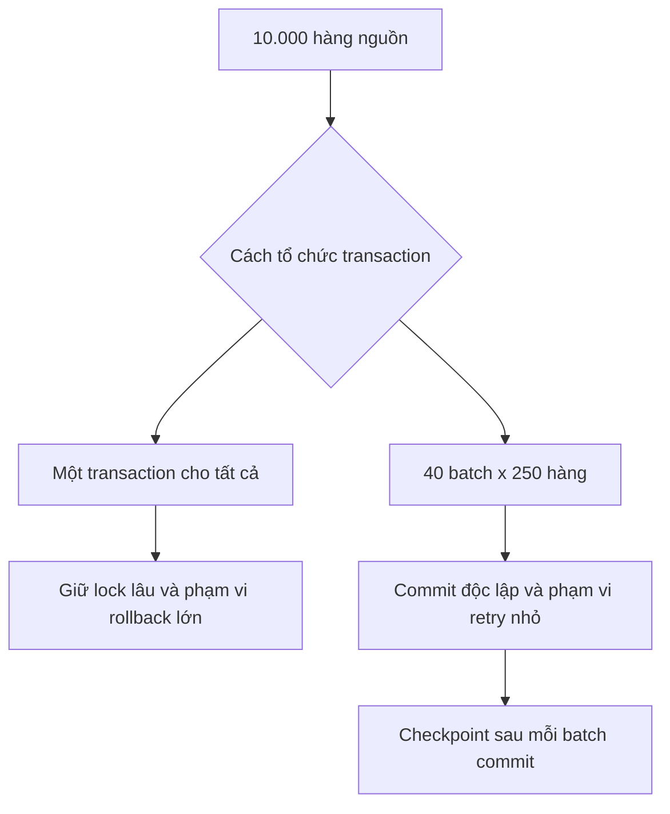

# Giới hạn kích thước giao dịch và số phần tử mỗi lô

Khi ghi nhiều node và relationship bằng Spring Data Neo4j (SDN), một transaction quá lớn có thể giữ nhiều lock, tiêu thụ nhiều transaction memory và mất nhiều thời gian để commit hoặc rollback. Ngược lại, chia dữ liệu thành quá nhiều batch nhỏ làm tăng số round trip, số lần mở/commit transaction và chi phí điều phối. Cần chọn cả kích thước batch lẫn phạm vi transaction dựa trên lượng công việc graph thực tế.

Hai khái niệm này liên quan nhưng không giống nhau. **Batch size** là số hàng đầu vào được xử lý trong một lô. **Transaction size** là tổng công việc database được commit hoặc rollback cùng nhau, bao gồm số node/relationship bị tác động, lượng property thay đổi, thời gian giữ lock và bộ nhớ transaction. Một batch 500 hàng có thể tạo ra hàng trăm nghìn relationship nếu mỗi hàng có fan-out lớn; vì vậy số hàng không phải thước đo đầy đủ cho kích thước transaction.

## 1. Phân biệt batch size và transaction size

Ví dụ nhập dữ liệu khách hàng, mỗi hàng có thể tạo một node `Customer` và liên kết đến nhiều `Tag`. Nếu một batch có 500 hàng và mỗi khách hàng liên kết trung bình 4 tag, transaction có thể thay đổi khoảng 2.500 node/relationship cùng nhiều property. Nếu mỗi khách hàng có 1.000 liên kết, cùng batch size 500 lại tạo ra lượng công việc lớn hơn rất nhiều.

| Khái niệm | Đo lường | Ảnh hưởng chính |
|---|---|---|
| Batch size | Số hàng đầu vào trong một lô | Payload gửi đến Neo4j, số vòng lặp, chi phí round trip |
| Transaction size | Tổng node, relationship, property và công việc trong một transaction | Transaction memory, lock duration, thời gian commit/rollback |
| Transaction duration | Thời gian từ lúc bắt đầu đến commit/rollback | Thời gian giữ lock, khả năng cạnh tranh và timeout |
| Concurrency | Số batch/transaction chạy đồng thời | Throughput, tổng memory đang dùng, lock contention và deadlock |

Nếu mỗi batch được gọi qua một method `@Transactional` riêng, một batch có thể tương ứng một transaction. Nếu vòng lặp batch nằm bên trong một method `@Transactional` bên ngoài, các lời gọi repository thường tham gia transaction đang hoạt động; khi đó nhiều batch logic vẫn có thể trở thành một transaction dài. Cần thiết kế transaction boundary rõ ràng thay vì chỉ nhìn tên biến `batch`.

## 2. Vì sao transaction quá lớn gây vấn đề?

Transaction lớn có một số chi phí:

- **Transaction memory:** Neo4j phải theo dõi trạng thái thay đổi, lock và thông tin cần thiết để commit/rollback.
- **Lock duration:** lock được giữ đến khi transaction kết thúc. Transaction càng dài thì các transaction khác càng có thể phải chờ.
- **Rollback cost:** nếu một lỗi xảy ra gần cuối, toàn bộ thay đổi của transaction chưa commit phải rollback.
- **Recovery và retry:** retry một transaction lớn tốn thời gian và tài nguyên hơn retry một batch nhỏ.
- **Operational visibility:** một transaction dài khó xác định batch/record nào làm chậm hoặc gây lỗi nếu không có metadata và checkpoint.

Transaction nhỏ quá mức cũng có chi phí: nhiều round trip, nhiều lần commit và overhead xử lý mỗi batch. Mục tiêu là tìm kích thước đủ lớn để tận dụng throughput nhưng đủ nhỏ để memory, lock và thời gian xử lý luôn nằm trong giới hạn vận hành.

## 3. Xác định batch size theo lượng công việc graph

Không có con số cố định phù hợp cho mọi ứng dụng. Có thể bắt đầu thử nghiệm với 100–500 hàng cho một batch ghi node đơn giản, sau đó đo và tăng dần. Với hàng có nhiều relationship, payload lớn hoặc nhiều thao tác phụ, bắt đầu nhỏ hơn. Những con số này chỉ là điểm khởi đầu để benchmark, không phải giới hạn mặc định của Neo4j.

Khi chọn batch size, xem xét:

1. **Số node tạo/cập nhật mỗi hàng:** một hàng có thể tác động một node hoặc nhiều node.
2. **Relationship fan-out:** một hàng có thể tạo nhiều cạnh và cập nhật các node ở hai đầu.
3. **Payload:** số lượng và kích thước string, list, map hoặc property được gửi.
4. **Index/constraint:** `MERGE` có thể tìm node hiệu quả hơn khi có index/uniqueness constraint phù hợp.
5. **Mức độ trùng lặp:** nhiều hàng cùng cập nhật một node sẽ làm tăng lock contention.
6. **Thời gian query:** batch phải hoàn tất trong khoảng thời gian chấp nhận được, kể cả khi cần retry.
7. **Khả năng phục hồi:** batch lỗi cần có thể chạy lại mà không tạo node hoặc relationship trùng.

Một cách ước lượng ban đầu là tính số thao tác graph trung bình trên mỗi hàng, rồi giới hạn tổng số thao tác dự kiến trong một batch. Ví dụ, nếu mỗi hàng tạo một node và trung bình 5 relationship, batch 200 hàng có thể tác động khoảng 1.200 phần tử graph, chưa tính property và index. Đây chỉ là ước lượng để bắt đầu đo; số thực tế phụ thuộc query plan và dữ liệu.

## 4. Gửi một batch bằng UNWIND và Neo4jClient

`UNWIND` biến danh sách map thành các hàng Cypher. Cách này giảm round trip khi so với gửi một query riêng cho từng record:

```cypher
UNWIND $rows AS row
MERGE (c:Customer {externalId: row.externalId})
SET c.name = row.name,
    c.email = row.email,
    c.updatedAt = datetime();
```

Trong Java, bind cả collection vào một tham số:

```java
import java.util.Collection;
import java.util.Map;

import org.neo4j.driver.summary.ResultSummary;
import org.springframework.data.neo4j.core.Neo4jClient;
import org.springframework.stereotype.Repository;

@Repository
public class CustomerBatchRepository {

    private static final String UPSERT = """
            UNWIND $rows AS row
            MERGE (c:Customer {externalId: row.externalId})
            SET c.name = row.name,
                c.email = row.email,
                c.updatedAt = datetime()
            """;

    private final Neo4jClient client;

    public CustomerBatchRepository(Neo4jClient client) {
        this.client = client;
    }

    public ResultSummary write(Collection<Map<String, Object>> rows) {
        if (rows.isEmpty()) {
            throw new IllegalArgumentException("rows must not be empty");
        }

        return client.query(UPSERT)
                .bind(rows).to("rows")
                .run();
    }
}
```

Mỗi lần gọi `write` gửi một list hàng trong một query. Nhưng `UNWIND` tự nó không chia query thành nhiều transaction. Nếu `$rows` có 100.000 phần tử, câu lệnh trên vẫn xử lý toàn bộ list trong transaction của lần gọi đó, trừ khi dùng cơ chế transaction batching riêng như `CALL { ... } IN TRANSACTIONS`.

Chỉ bind các field được phép ghi. Kiểm tra ID, dữ liệu bắt buộc và null semantics trước khi gửi. `MERGE` nên dựa trên khóa ổn định có uniqueness constraint; các thuộc tính có thể thay đổi nên cập nhật qua `SET`.

## 5. Chia dữ liệu thành các batch ở tầng ứng dụng

Nếu ứng dụng cần checkpoint, validation hoặc retry theo từng nhóm, hãy chia nguồn dữ liệu trước khi gọi repository:

Record đầu vào của ví dụ:

```java
public record CustomerRow(
        String externalId,
        String name,
        String email) {
}
```

```java
import java.util.ArrayList;
import java.util.List;

public final class BatchSupport {

    private BatchSupport() {
    }

    public static <T> List<List<T>> split(List<T> source, int batchSize) {
        if (batchSize <= 0) {
            throw new IllegalArgumentException("batchSize must be positive");
        }

        List<List<T>> result = new ArrayList<>();
        for (int start = 0; start < source.size(); start += batchSize) {
            int end = Math.min(start + batchSize, source.size());
            result.add(source.subList(start, end));
        }
        return result;
    }
}
```

Ví dụ chia 10.000 hàng thành các batch 250 hàng:

```java
for (List<CustomerRow> batch : BatchSupport.split(rows, 250)) {
    batchWriter.writeOneBatch(toMaps(batch));
}
```

Trong ví dụ, `toMaps` là mapper chuyển `CustomerRow` thành map có các key khớp với `$row` trong Cypher; `log` ở ví dụ bên dưới là logger của service. Mapper nên kiểm tra dữ liệu và chỉ đưa các property được phép ghi vào map.

Đoạn code trên chỉ minh họa việc chia list. Với nguồn dữ liệu lớn hơn heap, không tải toàn bộ dữ liệu vào `List`; hãy đọc theo stream hoặc page và chỉ giữ batch hiện tại trong bộ nhớ.

`subList()` tạo view trên list nguồn. Nếu batch được xử lý bất đồng bộ hoặc lưu lại để retry sau khi list nguồn thay đổi, hãy tạo snapshot bằng `List.copyOf(source.subList(start, end))` hoặc map sang DTO bất biến trước khi gửi.

## 6. Mỗi batch một transaction trong Spring Data Neo4j

Để batch thành công được commit độc lập, đặt `@Transactional` trên method xử lý một batch ở bean riêng:

```java
import java.util.Collection;
import java.util.Map;

import org.neo4j.driver.summary.ResultSummary;
import org.springframework.stereotype.Service;
import org.springframework.transaction.annotation.Transactional;

@Service
public class TransactionalCustomerBatchWriter {

    private final CustomerBatchRepository repository;

    public TransactionalCustomerBatchWriter(CustomerBatchRepository repository) {
        this.repository = repository;
    }

    @Transactional
    public ResultSummary writeOneBatch(Collection<Map<String, Object>> rows) {
        return repository.write(rows);
    }
}
```

Orchestrator gọi bean này một lần cho mỗi batch:

```java
public void importCustomers(List<CustomerRow> rows, int batchSize) {
    for (List<CustomerRow> batch : BatchSupport.split(rows, batchSize)) {
        ResultSummary summary = batchWriter.writeOneBatch(toMaps(batch));
        log.info("Batch completed: nodesCreated={}, propertiesSet={}",
                summary.counters().nodesCreated(),
                summary.counters().propertiesSet());
    }
}
```

Method `importCustomers` không mở transaction bao trùm vòng lặp. Mỗi lần gọi `writeOneBatch` đi qua Spring proxy và có transaction riêng. Nếu batch thứ 8 thất bại, các batch đã commit trước đó vẫn còn; chỉ batch lỗi bị rollback. Migration cần stable ID và upsert idempotent để có thể chạy lại từ checkpoint hoặc gửi lại batch lỗi.

Không đặt `@Transactional` lên `importCustomers` nếu mục tiêu là commit từng batch. Nếu có transaction bên ngoài, propagation mặc định `REQUIRED` sẽ khiến method con tham gia transaction đó thay vì mở transaction mới. Cũng không gọi `this.writeOneBatch(...)` trong cùng class để kỳ vọng proxy tạo transaction; self-invocation không đi qua proxy.

## 7. Repository saveAll không phải batch-size policy

`saveAll(entities)` tiện khi cần lưu nhiều entity qua repository, nhưng lời gọi này không thay thế quyết định về transaction boundary và batch size. Không nên suy luận rằng `saveAll` luôn tạo đúng một câu Cypher `UNWIND`, tự chia collection thành các transaction nhỏ hoặc tự commit từng nhóm.

Hãy kiểm tra phiên bản SDN và cách repository được gọi trong ứng dụng. Nếu cần kiểm soát chính xác số hàng mỗi transaction, chia collection ở tầng service và gọi một method transactional riêng cho mỗi batch. Nếu cần một câu Cypher xử lý list, dùng `Neo4jClient` với `UNWIND` và đo hiệu năng thực tế.

Không lưu một collection rất lớn chỉ vì API nhận `Iterable`. Kích thước collection, số relationship được mapping và transaction đang hoạt động đều ảnh hưởng đến lượng công việc thực tế.

## 8. Dùng CALL { ... } IN TRANSACTIONS cho batch ở phía Cypher

Cypher hỗ trợ transaction batching ngay trong query:

```cypher
UNWIND $rows AS row
CALL {
    WITH row
    MERGE (c:Customer {externalId: row.externalId})
    SET c.name = row.name,
        c.email = row.email,
        c.updatedAt = datetime()
} IN TRANSACTIONS OF 500 ROWS;
```

Các hàng đầu vào được chia thành nhóm 500; mỗi nhóm chạy trong transaction con và commit độc lập. Nếu không ghi `OF n ROWS`, kích thước mặc định của Cypher hiện hành là 1.000 hàng. Có thể chọn giá trị nhỏ hơn hoặc lớn hơn theo benchmark và mức độ công việc của mỗi hàng.

Điểm quan trọng là batching áp dụng cho các hàng đầu vào được đưa vào subquery. Hãy đặt `UNWIND`, `LOAD CSV` hoặc `MATCH` tạo ra các hàng ở bên ngoài `CALL`; nếu đặt toàn bộ nguồn dữ liệu bên trong subquery thì batching có thể không chia công việc như mong muốn.

**`CALL { ... } IN TRANSACTIONS` chỉ chạy trong implicit transaction.** Không bọc query này bên trong một explicit transaction như `@Transactional` đang hoạt động hoặc Driver `executeWrite(...)`. Khi gọi qua Driver, dùng auto-commit `session.run(...)` phù hợp; khi dùng công cụ Neo4j Browser, bật chế độ auto-commit theo hướng dẫn của Browser.

Với SDN, nếu cần transaction boundary được Spring quản lý rõ ràng, thường dễ hiểu hơn khi chia batch ở ứng dụng và gọi một method `@Transactional` cho mỗi batch. Dùng `CALL ... IN TRANSACTIONS` khi muốn Cypher tự quản lý transaction con và có thể đáp ứng yêu cầu implicit transaction.

## 9. Transaction batching không đồng nghĩa với concurrent batching

Mặc định, `CALL { ... } IN TRANSACTIONS` chạy các batch tuần tự. Có thể dùng `IN CONCURRENT TRANSACTIONS` để chạy nhiều batch đồng thời, nhưng concurrency làm tăng tổng số transaction đang hoạt động, memory, áp lực I/O và nguy cơ lock contention/deadlock.

Chỉ tăng concurrency khi:

- Các hàng độc lập hoặc được phân vùng sao cho ít cập nhật cùng node/relationship.
- Query đã được đo và bottleneck thực sự là khả năng xử lý tuần tự.
- Batch size đã ổn định ở chế độ tuần tự.
- Có retry cho transient error và có thể xác định chính xác batch nào commit.
- Tổng transaction memory và connection pool còn đủ dư địa.

Nếu nhiều batch cùng `MERGE` hoặc cập nhật một node nóng, tăng concurrency có thể làm throughput giảm vì các transaction phải chờ lock. Với dữ liệu có quan hệ phụ thuộc, thứ tự commit song song cũng không được bảo đảm như xử lý tuần tự. Hãy bắt đầu tuần tự, sau đó thử tăng concurrency từng bước trong môi trường test.

## 10. Quản lý memory và giới hạn transaction

Neo4j có các cấu hình giới hạn transaction memory:

| Setting | Phạm vi |
|---|---|
| `db.memory.transaction.max` | Giới hạn memory của một transaction trong một database |
| `db.memory.transaction.total.max` | Giới hạn tổng transaction memory của tất cả transaction trong một database |
| `dbms.memory.transaction.total.max` | Giới hạn tổng transaction memory ở cấp DBMS, áp dụng cho các transaction đang chạy trên server |

Khi chạm một trong các giới hạn, transaction có thể bị terminate. Đây là cơ chế bảo vệ tài nguyên, không phải tín hiệu để tăng giới hạn vô điều kiện. Trước tiên hãy giảm transaction size, giới hạn fan-out, tránh giữ collection quá lớn và kiểm soát concurrency. Chỉ điều chỉnh setting sau khi đo memory và đánh giá heap/resource budget của server. Kiểm tra `SHOW SETTINGS` và tài liệu của đúng phiên bản Neo4j để xác nhận setting được hỗ trợ và giá trị hiệu lực.

Có thể theo dõi transaction đang chạy bằng `SHOW TRANSACTIONS` và các memory pool bằng `dbms.listPools()`:

```cypher
SHOW TRANSACTIONS;
```

```cypher
CALL dbms.listPools();
```

Kết hợp các thông tin này với query log, thời gian transaction, số lần retry và `ResultSummary` để tìm batch có lượng công việc bất thường. Không dùng một giá trị memory limit chung cho mọi môi trường mà không đo tải đồng thời và cấu hình heap.

## 11. Retry, checkpoint và tính idempotent

Khi mỗi batch là một transaction riêng, migration có thể dừng giữa chừng. Để tiếp tục an toàn:

1. Mỗi record có stable ID từ nguồn dữ liệu.
2. `MERGE` dựa trên stable ID và uniqueness constraint bảo vệ khóa đó.
3. `SET` gán giá trị mong muốn thay vì cộng dồn ngoài ý muốn.
4. Ghi checkpoint sau khi batch commit; nếu checkpoint cùng database, có thể ghi trong cùng transaction.
5. Nếu checkpoint nằm ngoài Neo4j, chấp nhận rằng crash sau commit nhưng trước checkpoint có thể khiến batch chạy lại; query phải idempotent.
6. Retry có giới hạn và backoff cho lỗi transient; không retry vô hạn lỗi dữ liệu hoặc constraint violation.

Ví dụ một query upsert có thể chạy lại:

```cypher
UNWIND $rows AS row
MERGE (p:Product {sku: row.sku})
SET p.name = row.name,
    p.priceMinor = row.priceMinor,
    p.sourceVersion = row.sourceVersion;
```

Không dùng `SET p.importCount = coalesce(p.importCount, 0) + 1` nếu cùng batch có thể được gửi lại, vì mỗi lần retry sẽ tăng count thêm một lần. Nếu cần ghi nhận event riêng, deduplicate bằng event ID trước khi áp dụng side effect.

Driver managed transaction có thể retry callback khi gặp lỗi transient. Callback có thể được thực thi lại, vì vậy chỉ đặt thao tác database idempotent trong callback; không gửi email, gọi API hoặc publish message trực tiếp trong đó. Với Spring `@Transactional`, retry cần được đặt ở lớp bao ngoài transaction để mỗi lần thử tạo transaction mới.

## 12. Đo và điều chỉnh batch size

Đừng chọn batch size chỉ dựa vào số hàng mỗi giây. Cần quan sát nhiều chỉ số cùng lúc:

| Chỉ số | Điều cần quan sát |
|---|---|
| Throughput | Số hàng, node và relationship được commit mỗi giây |
| Batch latency | Thời gian từ lúc bắt đầu đến commit của một batch |
| Transaction duration | Thời gian transaction thực sự mở |
| Transaction memory | Mức memory theo transaction và tổng database |
| Lock wait/contention | Thời gian chờ lock, deadlock và số lần retry |
| Heap phía ứng dụng | Bộ nhớ dùng để giữ nguồn, DTO và parameter maps |
| Failure rate | Batch rollback, timeout, lỗi constraint và batch phải chạy lại |

Quy trình benchmark:

1. Dùng cùng một tập dữ liệu và query plan để so sánh.
2. Chạy tuần tự với batch nhỏ, ví dụ 100 hoặc 250 hàng.
3. Tăng batch size từng bước, ví dụ 250 → 500 → 1.000.
4. Ghi lại throughput, p95 batch latency, transaction memory và lỗi.
5. Thử dữ liệu có fan-out cao, không chỉ dữ liệu trung bình.
6. Thử tải đồng thời gần production.
7. Chọn điểm cân bằng có headroom cho peak traffic và retry.

Batch size tối ưu là điểm mà tăng thêm kích thước không còn cải thiện throughput đáng kể nhưng bắt đầu làm tăng latency, memory hoặc failure rate. Hãy cấu hình batch size để có thể thay đổi theo môi trường mà không phải sửa logic nghiệp vụ.

## 13. Ví dụ so sánh hai cách tổ chức transaction



Giả sử có 10.000 hàng:

| Cách làm | Transaction | Khi batch/operation lỗi |
|---|---|---|
| Một transaction lớn | 1 transaction cho 10.000 hàng | Rollback toàn bộ 10.000 hàng chưa commit |
| Chia 250 hàng/lô | 40 transaction, mỗi transaction 250 hàng | Các lô đã commit giữ nguyên; chỉ lô lỗi rollback |
| `CALL ... IN TRANSACTIONS OF 250 ROWS` | Cypher tạo transaction con theo 250 hàng | Transaction con đã commit không bị rollback cùng transaction con lỗi |

Chia nhỏ làm giảm phạm vi rollback và dễ tiếp tục, nhưng không tạo tính nguyên tử toàn bộ migration. Nếu nghiệp vụ yêu cầu tất cả dữ liệu phải xuất hiện đồng thời, cần một chiến lược migration khác như nạp vào vùng/staging riêng rồi chuyển trạng thái bằng một bước kiểm soát; không thể đạt atomicity toàn bộ chỉ bằng cách commit từng batch.

## 14. Những lỗi thường gặp

| Lỗi | Hệ quả | Cách xử lý |
|---|---|---|
| Coi batch size là transaction size | Batch có fan-out lớn vẫn tạo transaction nặng | Ước lượng node/relationship/property bị tác động |
| Gửi một list khổng lồ qua `UNWIND` | Vẫn là một transaction lớn nếu không dùng subtransaction | Chia batch ở ứng dụng hoặc dùng `CALL ... IN TRANSACTIONS` |
| Đặt `@Transactional` trên toàn bộ import | Các batch logic có thể tham gia một transaction dài | Đặt transaction trên method ghi một batch riêng |
| Tăng batch size chỉ để tăng throughput | Memory, lock duration và rollback cost tăng | Benchmark theo nhiều chỉ số và dữ liệu fan-out cao |
| Giảm batch size quá thấp | Tăng round trip và commit overhead | Tăng dần đến điểm throughput ổn định |
| Dùng `saveAll` và giả định nó tự chunk | Transaction hoặc cách ghi có thể không như mong đợi | Chia batch tường minh khi cần kiểm soát |
| Chạy concurrent batches trên cùng node nóng | Lock contention và deadlock tăng | Phân vùng dữ liệu hoặc chạy tuần tự |
| Dùng `CALL ... IN TRANSACTIONS` trong explicit transaction | Query không hợp lệ trong execution mode đó | Gọi bằng implicit/auto-commit transaction |
| Retry batch không idempotent | Tạo dữ liệu trùng hoặc cộng dồn nhiều lần | Stable ID, `MERGE`, uniqueness constraint và `SET` xác định |
| Ghi checkpoint trước commit | Có thể bỏ qua batch chưa được lưu | Ghi checkpoint sau commit hoặc cùng transaction |
| Tăng transaction memory limit để chữa query nặng | Có thể đẩy server đến thiếu memory | Tối ưu query, batch size và concurrency trước |

## 15. Bài tập thực hành

Giả sử cần import 20.000 `Customer`, mỗi khách hàng có từ 0 đến 50 relationship `HAS_TAG`:

1. Tạo uniqueness constraint cho `Customer.externalId` và `Tag.tagId`.
2. Viết query `UNWIND $rows` dùng `MERGE` để upsert Customer.
3. Mở rộng query để tạo relationship `HAS_TAG` từ danh sách tag ID.
4. Chạy lần lượt batch size 100, 250, 500 và 1.000 trong môi trường test.
5. Ghi throughput, p95 batch latency, số node/relationship tạo mới và thời gian transaction.
6. Chạy thêm tập dữ liệu fan-out cao để xem batch size theo row có còn phù hợp.
7. Đặt `@Transactional` trên method ghi một batch và xác nhận mỗi lần gọi commit độc lập.
8. Thử đặt transaction bên ngoài vòng lặp để quan sát vì sao nhiều batch logic có thể trở thành một transaction.
9. So sánh với `CALL { ... } IN TRANSACTIONS OF 500 ROWS` chạy bằng implicit transaction.
10. Mô phỏng lỗi ở batch thứ 5, chạy lại từ checkpoint và xác nhận không tạo Customer hoặc relationship trùng.
11. Thử tăng concurrency với dữ liệu độc lập rồi với dữ liệu cùng cập nhật một node; so sánh lock contention.

Sau bài tập, hãy giải thích được vì sao số hàng không phản ánh đầy đủ transaction size, cách xác định transaction boundary trong SDN và cách chọn batch size dựa trên throughput, memory, lock và khả năng retry.

## Kết luận

Batch size là số hàng được gửi trong một lô; transaction size là toàn bộ công việc graph được commit hoặc rollback cùng nhau. Dùng `UNWIND` để giảm round trip, nhưng nhớ rằng một list lớn vẫn có thể nằm trong một transaction lớn. Khi cần commit từng phần, chia dữ liệu ở ứng dụng và gọi method `@Transactional` cho từng batch, hoặc dùng `CALL { ... } IN TRANSACTIONS` trong implicit transaction. Đo số node/relationship thực tế, transaction duration, memory, lock contention và retry để chọn kích thước phù hợp. Stable ID, uniqueness constraint, upsert idempotent và checkpoint giúp mỗi batch có thể chạy lại an toàn sau sự cố.

## Tài liệu tham khảo

- [Neo4j Cypher Manual – CALL subqueries in transactions](https://neo4j.com/docs/cypher-manual/current/subqueries/subqueries-in-transactions/)
- [Neo4j Operations Manual – Memory configuration](https://neo4j.com/docs/operations-manual/current/performance/memory-configuration/)
- [Neo4j Operations Manual – Configuration settings](https://neo4j.com/docs/operations-manual/current/configuration/configuration-settings/)
- [Neo4j Data Ingestion Guide – Transactional and concurrent Cypher ingestion](https://neo4j.com/docs/data-ingestion-guide/best-practices/transactional-and-concurrent-cypher-ingestion/)
- [Neo4j Java Driver Manual – Transactions](https://neo4j.com/docs/java-manual/current/transactions/)
