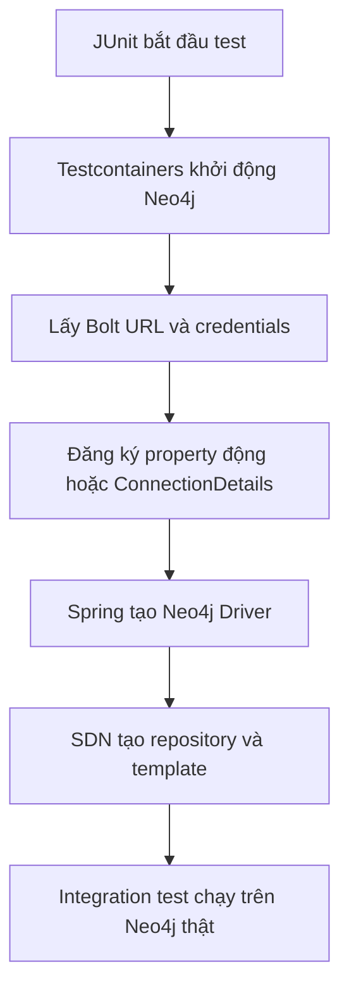

# @DynamicPropertySource hoặc service connection theo Spring Boot

Khi kiểm thử Spring Data Neo4j (SDN) với Neo4j Testcontainers, cổng Bolt và thông tin đăng nhập thường chỉ được biết sau khi container khởi động. Ứng dụng Spring cần nhận đúng URI và credentials đó trước khi tạo Neo4j Driver, repository và template.

Có hai cách tích hợp phổ biến:

- `@DynamicPropertySource` đăng ký trực tiếp các giá trị động vào Spring `Environment`. Cách này linh hoạt và có thể dùng với Spring TestContext mà không phụ thuộc Spring Boot.
- `@ServiceConnection` để Spring Boot suy ra thông tin kết nối từ container và tạo `Neo4jConnectionDetails`. Cách này ngắn gọn hơn khi dùng auto-configuration của Boot.

Hai cơ chế cùng giải quyết việc cấu hình endpoint động nhưng có mức trừu tượng khác nhau. Hãy chọn theo phiên bản Spring Boot, loại container và mức độ tùy chỉnh kết nối của bài kiểm thử.

## 1. Vì sao cấu hình Neo4j trong test cần giá trị động?

Ở môi trường production, ứng dụng thường lấy URI từ cấu hình:

```properties
spring.neo4j.uri=bolt://neo4j.internal:7687
spring.neo4j.authentication.username=neo4j
spring.neo4j.authentication.password=secret
```

Trong test, Testcontainers có thể cấp một cổng host ngẫu nhiên để tránh xung đột với dịch vụ khác. Vì vậy không thể giả định Neo4j luôn chạy ở `localhost:7687`.

Một `Neo4jContainer` cung cấp các thông tin sau sau khi khởi động:

- Bolt URL, ví dụ `bolt://localhost:<mapped-port>`.
- Username `neo4j`.
- Password được đặt bằng `withAdminPassword(...)` hoặc do container quản lý.

Spring cần những giá trị này khi tạo `Driver`. Nếu property vẫn trỏ đến server production hoặc địa chỉ mặc định, test có thể kết nối nhầm database, thất bại do sai credentials hoặc chạy trên một Neo4j local không liên quan.



Mục tiêu là cấu hình Spring context từ đúng container mà test đang quản lý, trước khi các bean kết nối database được khởi tạo.

## 2. Dependency cần thiết

Một bài kiểm thử tích hợp thường cần:

- Spring Boot test support.
- Spring Data Neo4j hoặc `spring-boot-starter-data-neo4j`.
- Testcontainers JUnit Jupiter integration.
- Testcontainers Neo4j module.
- `spring-boot-testcontainers` nếu dùng `@ServiceConnection`.

Ví dụ Gradle Kotlin DSL cho Spring Boot 4.x và Testcontainers 2.x:

Testcontainers 2.x dùng package import mới cho Neo4jContainer. Với Spring Boot 3.1–3.5, dự án thường dùng Testcontainers 1.x theo dependency management của Boot và import Neo4jContainer từ package cũ. @ServiceConnection có từ Boot 3.1, nhưng không nên ghép tùy ý Testcontainers 2.x vào một bản Boot 3.x cũ.

```kotlin
dependencies {
    testImplementation("org.springframework.boot:spring-boot-starter-test")

    // Chỉ cần khi dùng @ServiceConnection.
    testImplementation("org.springframework.boot:spring-boot-testcontainers")

    testImplementation(platform("org.testcontainers:testcontainers-bom:2.0.5"))
    testImplementation("org.testcontainers:testcontainers-junit-jupiter")
    testImplementation("org.testcontainers:testcontainers-neo4j")
}
```

Hãy dùng phiên bản Testcontainers được quản lý tương thích với Spring Boot của dự án. Ví dụ trên minh họa cách khai báo cho Testcontainers 2.x; không ép phiên bản 2.x vào một dự án Spring Boot cũ nếu dependency management của dự án yêu cầu Testcontainers 1.x.

Testcontainers 2.x dùng package `org.testcontainers.neo4j.Neo4jContainer`. Với Testcontainers 1.x, class thường nằm trong package `org.testcontainers.containers.Neo4jContainer`. Khi nâng cấp major version, kiểm tra cả dependency artifact lẫn package import; không trộn ví dụ của hai thế hệ.

## 3. Dùng @DynamicPropertySource

`@DynamicPropertySource` thuộc Spring TestContext Framework, được giới thiệu từ Spring Framework 5.2.5. Phương thức được đánh dấu phải là `static` và nhận đúng một tham số `DynamicPropertyRegistry`.

Registry thêm các cặp tên property và supplier vào Spring `Environment`. Supplier chỉ được gọi khi giá trị property được phân giải, vì vậy nên truyền method reference như `neo4j::getBoltUrl` thay vì đọc giá trị quá sớm.

Ví dụ dùng `@DataNeo4jTest` để kiểm thử repository:

```java
import org.junit.jupiter.api.Test;
import org.springframework.beans.factory.annotation.Autowired;
import org.springframework.boot.test.autoconfigure.data.neo4j.DataNeo4jTest;
import org.springframework.data.neo4j.core.Neo4jClient;
import org.springframework.test.context.DynamicPropertyRegistry;
import org.springframework.test.context.DynamicPropertySource;
import org.testcontainers.junit.jupiter.Container;
import org.testcontainers.junit.jupiter.Testcontainers;
import org.testcontainers.neo4j.Neo4jContainer;

import static org.assertj.core.api.Assertions.assertThat;

@Testcontainers
@DataNeo4jTest
class MovieRepositoryTest {

    @Container
    static final Neo4jContainer<?> neo4j =
            new Neo4jContainer<>("neo4j:5")
                    .withAdminPassword("test-password");

    @DynamicPropertySource
    static void neo4jProperties(DynamicPropertyRegistry registry) {
        registry.add("spring.neo4j.uri", neo4j::getBoltUrl);
        registry.add(
                "spring.neo4j.authentication.username",
                () -> "neo4j");
        registry.add(
                "spring.neo4j.authentication.password",
                neo4j::getAdminPassword);
    }

    @Autowired
    Neo4jClient neo4jClient;

    @Test
    void connectsToTheContainer() {
        Long count = neo4jClient.query("MATCH (n) RETURN count(n)")
                .fetchAs(Long.class)
                .one()
                .orElseThrow();

        assertThat(count).isZero();
    }
}
```

Trong ví dụ:

1. `@Testcontainers` kích hoạt JUnit Jupiter extension của Testcontainers.
2. `@Container` đánh dấu container được extension quản lý.
3. `static` khiến container tồn tại trong phạm vi test class, thay vì khởi động lại cho từng method.
4. `@DynamicPropertySource` đăng ký URI, username và password.
5. `@DataNeo4jTest` tạo test slice cho SDN, bao gồm các thành phần repository cần thiết.

`Neo4jContainer` được cấu hình password rõ ràng để test có thể đăng ký cùng một giá trị mà container sử dụng. Trong dự án dùng `withoutAuthentication()`, không nên đăng ký username/password giả; cấu hình kết nối phải phản ánh đúng chế độ authentication của container.

### Các property Neo4j cần đăng ký

| Property | Giá trị lấy từ container |
|---|---|
| `spring.neo4j.uri` | `neo4j::getBoltUrl` |
| `spring.neo4j.authentication.username` | Thường là `neo4j` |
| `spring.neo4j.authentication.password` | `neo4j::getAdminPassword` |

Spring Boot dùng prefix `spring.neo4j.*` để cấu hình Neo4j Driver. Không dùng nhầm property của một client khác hoặc property cũ từ cấu hình Neo4j-OGM.

## 4. Cách Spring xử lý dynamic property

`DynamicPropertyRegistry.add(name, supplier)` đăng ký một property có giá trị được lấy động. Supplier được gọi khi Spring cần phân giải property, không nhất thiết ngay tại thời điểm phương thức `@DynamicPropertySource` chạy.

Ví dụ:

```java
@DynamicPropertySource
static void neo4jProperties(DynamicPropertyRegistry registry) {
    registry.add("spring.neo4j.uri", neo4j::getBoltUrl);
    registry.add("spring.neo4j.authentication.password",
            neo4j::getAdminPassword);
}
```

Đây là cách nên dùng vì container có thể cấp mapped port ngẫu nhiên sau khi start. Không hard-code `bolt://localhost:7687` và cũng không tự ghép URI từ cổng mặc định.

Dynamic properties có độ ưu tiên cao hơn:

- Property từ `@TestPropertySource`.
- Biến môi trường của hệ điều hành.
- Java system properties.
- Property được khai báo bằng `@PropertySource` hoặc thêm bằng cách thông thường trong application context.

Do đó, test có thể ghi đè cấu hình kết nối của môi trường mà không sửa `application.properties` của ứng dụng.

Tuy nhiên, nếu Spring Boot đang dùng `@ServiceConnection`, `ConnectionDetails` của service connection lại có độ ưu tiên cao hơn các connection-related properties. Không nên đăng ký cùng một URI bằng cả hai cách rồi mong dynamic property thắng.

## 5. Dùng @ServiceConnection theo Spring Boot

Spring Boot giới thiệu `@ServiceConnection` từ phiên bản 3.1. Annotation này cho phép Boot nhận diện loại container và tự tạo bean `ConnectionDetails` tương ứng.

Với Neo4j, Boot tạo `Neo4jConnectionDetails`. Neo4j auto-configuration dùng bean này để tạo Driver kết nối tới container. Ứng dụng không phải đăng ký riêng URI, username và password.

Ví dụ dùng Spring Boot 4.x và Testcontainers 2.x:

```java
import org.junit.jupiter.api.Test;
import org.springframework.boot.test.context.SpringBootTest;
import org.springframework.boot.testcontainers.service.connection.ServiceConnection;
import org.testcontainers.junit.jupiter.Container;
import org.testcontainers.junit.jupiter.Testcontainers;
import org.testcontainers.neo4j.Neo4jContainer;

@Testcontainers
@SpringBootTest
class MovieIntegrationTest {

    @Container
    @ServiceConnection
    static final Neo4jContainer<?> neo4j =
            new Neo4jContainer<>("neo4j:5")
                    .withAdminPassword("test-password");

    @Test
    void applicationContextConnectsToNeo4j() {
        // Test sử dụng repository, service hoặc Neo4jClient đã được inject.
    }
}
```

Spring Boot tự tạo `Neo4jConnectionDetails` từ `Neo4jContainer`. Auto-configuration dùng connection details này để kết nối đến Neo4j trong container.

Để dùng service connection, cần thêm dependency `org.springframework.boot:spring-boot-testcontainers` vào test classpath. Chỉ có `spring-boot-starter-test` và Testcontainers Neo4j module là chưa đủ để kích hoạt cơ chế này.

### Vì sao cách này ít mã hơn?

Với `@DynamicPropertySource`, test phải biết tên property của Spring Boot và tự ánh xạ từng giá trị. Với `@ServiceConnection`, Boot hiểu kiểu container và chuyển nó thành một abstraction kết nối:

```text
Neo4jContainer
      |
      v
@ServiceConnection
      |
      v
Neo4jConnectionDetails
      |
      v
Neo4j auto-configuration
      |
      v
Neo4j Driver
```

Test không cần phụ thuộc trực tiếp vào tên property `spring.neo4j.uri` hoặc cấu trúc property authentication.

## 6. Quản lý container theo vòng đời ApplicationContext

Hai ví dụ trên dùng JUnit extension để quản lý container. Với static `@Container`, Testcontainers khởi động container trước các test trong class và dừng container sau khi class hoàn tất. Với field không static, container thường được khởi động và dừng cho từng test method.

Spring TestContext Framework có thể cache và tái sử dụng `ApplicationContext` giữa nhiều test class. Nếu container bị JUnit extension dừng nhưng Spring vẫn giữ context chứa Neo4j Driver trỏ đến container đó, test chạy sau có thể thất bại vì Driver đang kết nối tới một server đã dừng.

Khi cần giữ context sử dụng được trong suốt thời gian cache, có thể để Spring Boot quản lý container như một bean:

```java
import org.springframework.boot.test.context.TestConfiguration;
import org.springframework.boot.testcontainers.service.connection.ServiceConnection;
import org.springframework.context.annotation.Bean;
import org.testcontainers.neo4j.Neo4jContainer;

@TestConfiguration(proxyBeanMethods = false)
class Neo4jContainerConfiguration {

    @Bean
    @ServiceConnection
    Neo4jContainer<?> neo4jContainer() {
        return new Neo4jContainer<>("neo4j:5")
                .withAdminPassword("test-password");
    }
}
```

Import cấu hình vào test:

```java
import org.springframework.boot.test.context.SpringBootTest;
import org.springframework.context.annotation.Import;

@SpringBootTest
@Import(Neo4jContainerConfiguration.class)
class MovieIntegrationTest {
    // Container được quản lý theo vòng đời ApplicationContext.
}
```

Container bean được tạo và dừng cùng ApplicationContext. Khi context được cache, container có thể tiếp tục chạy để phục vụ các test class dùng lại context đó.

Với Boot hỗ trợ `@ImportTestcontainers`, có thể tổ chức container declaration dùng chung trong interface hoặc class riêng rồi import vào test. Cách tổ chức này hữu ích khi nhiều test class cần dùng chung một cấu hình container.

Không kết hợp tùy tiện JUnit lifecycle và Spring bean lifecycle cho cùng một container instance. Chọn một thành phần quản lý start/stop để tránh container bị dừng quá sớm hoặc khởi động trùng.

## 7. So sánh @DynamicPropertySource và @ServiceConnection

| Tiêu chí | `@DynamicPropertySource` | `@ServiceConnection` |
|---|---|---|
| Nơi cung cấp | Spring TestContext Framework | Spring Boot |
| Phiên bản tối thiểu | Spring Framework 5.2.5 | Spring Boot 3.1 |
| Cách hoạt động | Đăng ký property thông qua supplier | Tạo `ConnectionDetails` từ container |
| Neo4j URI | Test tự đăng ký `spring.neo4j.uri` | Boot suy ra từ `Neo4jContainer` |
| Credentials | Test tự đăng ký username/password | Boot lấy thông tin xác thực từ container |
| Tính linh hoạt | Đăng ký property tùy ý cho nhiều loại resource | Tập trung vào các loại service được Boot hỗ trợ |
| Dependency riêng | Spring Test | `spring-boot-testcontainers` |
| Phù hợp | Spring không dùng Boot, property tùy chỉnh, container chưa được hỗ trợ | Spring Boot auto-configuration và container được nhận diện |

### Khi nào chọn DynamicPropertySource?

- Dự án dùng Spring Framework nhưng không dùng Spring Boot.
- Dự án dùng Spring Boot cũ hơn 3.1.
- Resource là custom container hoặc external service mà không có `ConnectionDetails` factory phù hợp.
- Test cần đăng ký property riêng ngoài thông tin kết nối được Boot hỗ trợ.
- Cần kiểm soát chính xác từng property được truyền vào `Environment`.

### Khi nào chọn ServiceConnection?

- Dự án dùng Spring Boot 3.1 trở lên.
- Testcontainers cung cấp container type được Boot nhận diện, như `Neo4jContainer`.
- Ứng dụng dùng Neo4j auto-configuration mặc định của Boot.
- Test chỉ cần kết nối tới container và không cần tự xử lý nhiều property connection.

Với một dự án Spring Boot hiện đại dùng Neo4j Testcontainers, `@ServiceConnection` thường là lựa chọn gọn hơn. `@DynamicPropertySource` vẫn hữu ích khi cần kiểm soát property hoặc tích hợp với resource đặc biệt.

## 8. Kết hợp service connection với property tùy chỉnh

Một test có thể cần vừa kết nối Neo4j bằng service connection, vừa đăng ký property động riêng cho ứng dụng. Hai cơ chế có thể cùng xuất hiện nếu chúng quản lý các giá trị khác nhau.

Ví dụ, service connection cung cấp endpoint Neo4j, còn dynamic property cung cấp URL của một test stub:

```java
@DynamicPropertySource
static void externalServiceProperties(DynamicPropertyRegistry registry) {
    registry.add("catalog.stub-url", catalogStub::getUrl);
}
```

Không cần đăng ký lại `spring.neo4j.uri`, username hoặc password nếu `@ServiceConnection` đã tạo `Neo4jConnectionDetails`.

Nếu cần thay đổi các thiết lập Neo4j không được biểu diễn bởi `Neo4jConnectionDetails`, hãy kiểm tra xem property đó có thực sự được auto-configuration sử dụng và có bị connection details thay thế hay không. Không suy luận rằng mọi property dưới `spring.neo4j.*` đều có thể ghi đè service connection.

## 9. Dùng GenericContainer hoặc custom image

Khi dùng GenericContainer trong ví dụ dưới đây, import class từ package org.testcontainers.containers.

Spring Boot nhận diện service connection chủ yếu qua kiểu container hoặc Docker image name. Vì vậy, dùng `Neo4jContainer` có kiểu cụ thể thường đơn giản nhất:

```java
@Container
@ServiceConnection
static Neo4jContainer<?> neo4j =
        new Neo4jContainer<>("neo4j:5");
```

Nếu dùng `GenericContainer<?>` với một image Neo4j tùy chỉnh, Boot không thể luôn suy ra loại service từ kiểu Java. Có thể cung cấp tên service rõ ràng:

```java
@Container
@ServiceConnection(name = "neo4j")
static GenericContainer<?> neo4j =
        new GenericContainer<>("registry.example/neo4j-test:5")
                .withExposedPorts(7687);
```

Tuy nhiên, custom container phải thực sự cung cấp giao thức và thông tin kết nối mà Neo4j driver cần. `name = "neo4j"` chỉ giúp Boot chọn connection details factory; nó không tự làm một image tùy ý trở thành Neo4j tương thích.

Nếu custom container không cung cấp thông tin mà factory cần hoặc có cơ chế authentication riêng, `@DynamicPropertySource` hoặc cấu hình Driver tường minh có thể phù hợp hơn.

## 10. Dùng với @DataNeo4jTest và @SpringBootTest

`@ServiceConnection` cấu hình các bean do Spring Boot auto-configure. Nếu ứng dụng tự khai báo một `Driver` hoặc connection bean riêng khiến auto-configuration lùi lại, không giả định service connection sẽ tự cấu hình bean tùy chỉnh đó; hãy cấu hình bean riêng từ `Neo4jConnectionDetails` hoặc property thích hợp.

Hai annotation kiểm thử có phạm vi khác nhau:

| Annotation | Phạm vi |
|---|---|
| `@DataNeo4jTest` | Test slice cho entity, repository, mapping và các thành phần truy cập dữ liệu Neo4j |
| `@SpringBootTest` | Khởi tạo toàn bộ Spring Boot application context để kiểm tra tích hợp nhiều tầng |

Với `@DataNeo4jTest`, test thường cần repository, `Neo4jClient` hoặc `Neo4jTemplate`. Có thể dùng `@DynamicPropertySource` để cung cấp kết nối tới Testcontainers như ví dụ ở phần 3.

Với `@SpringBootTest`, có thể kiểm tra cả service, transaction, security hoặc các bean tích hợp khác. Đây là nơi `@ServiceConnection` thường thể hiện rõ lợi ích vì Boot tự cấu hình Neo4j Driver cho toàn ứng dụng.

Không dùng `@SpringBootTest` cho mọi test repository nếu test slice đã đủ. Context đầy đủ thường khởi tạo nhiều bean hơn và làm test chậm hơn.

## 11. Kiểm tra cấu hình đã kết nối đúng container

Sau khi context khởi tạo, nên xác minh bằng một truy vấn nhỏ thay vì chỉ kiểm tra rằng Spring đã tạo bean.

Ví dụ:

```java
@Autowired
Neo4jClient neo4jClient;

@Test
void executesQueryAgainstTestDatabase() {
    Optional<Long> count = neo4jClient.query(
                    "MATCH (n) RETURN count(n)")
            .fetchAs(Long.class)
            .one();

    assertThat(count).contains(0L);
}
```

Test trên giả định container dùng database mới và chưa có fixture. Nếu test đã seed dữ liệu, hãy xác minh bằng một node hoặc marker được tạo riêng cho test.

Với repository, có thể lưu rồi đọc lại một entity:

```java
@Autowired
MovieRepository movieRepository;

@Test
void savesAndLoadsMovie() {
    Movie movie = new Movie("movie-42", "Graph Testing");

    movieRepository.save(movie);

    Optional<Movie> loaded = movieRepository.findById("movie-42");

    assertThat(loaded)
            .isPresent()
            .get()
            .extracting(Movie::getTitle)
            .isEqualTo("Graph Testing");
}
```

Ví dụ giả định entity có constructor và repository phù hợp. Điều cần xác minh là thao tác thực sự đi qua SDN và Neo4j container, không chỉ mock repository.

## 12. Các lỗi thường gặp

| Lỗi | Nguyên nhân | Cách xử lý |
|---|---|---|
| Kết nối tới `localhost:7687` thay vì container | Dùng URI cố định | Lấy `getBoltUrl()` hoặc dùng `@ServiceConnection` |
| Authentication thất bại | Property password không khớp container | Dùng cùng `withAdminPassword()` và `getAdminPassword()` |
| Không tìm thấy `@ServiceConnection` | Thiếu `spring-boot-testcontainers` | Thêm module vào test classpath |
| Không tìm thấy `Neo4jContainer` sau khi nâng cấp | Package Testcontainers đã đổi | Kiểm tra import theo major version |
| `@DynamicPropertySource` không hoạt động | Method không static hoặc sai tham số | Dùng static method nhận `DynamicPropertyRegistry` |
| Supplier trả về giá trị quá sớm | Gọi getter trực tiếp khi đăng ký | Dùng method reference hoặc lambda |
| Dynamic property không ghi đè cấu hình mong đợi | Có `ConnectionDetails` từ service connection | Kiểm tra độ ưu tiên và không đăng ký trùng URI |
| Driver kết nối tới container đã dừng | JUnit dừng container nhưng Spring context vẫn được cache | Quản lý container theo vòng đời Spring context hoặc cấu hình cache phù hợp |
| Container khởi động lại cho từng test | Dùng field không static với `@Container` | Dùng static container nếu cần chia sẻ trong test class |
| Boot không nhận diện GenericContainer | Không biết image đại diện service nào | Dùng container type cụ thể hoặc `@ServiceConnection(name = "neo4j")` |
| Test chỉ chạy được trên máy cá nhân | CI không có Docker-compatible runtime | Cấu hình container runtime cho CI và kiểm tra log Testcontainers |
| Kết nối nhầm database ngoài test | Property production vẫn được sử dụng | Xác minh URI động và không dùng credentials production trong test |

## 13. Checklist trước khi viết integration test

1. Dự án dùng Spring Framework và Spring Boot phiên bản nào?
2. Spring Framework có hỗ trợ `@DynamicPropertySource` không?
3. Spring Boot có từ 3.1 để dùng `@ServiceConnection` không?
4. Phiên bản Testcontainers đang dùng là 1.x hay 2.x?
5. Package import và dependency Neo4j module có khớp phiên bản Testcontainers không?
6. Test cần `@DataNeo4jTest` hay toàn bộ `@SpringBootTest`?
7. Container có dùng authentication không và password được cấu hình ở đâu?
8. URI có lấy từ `getBoltUrl()` hoặc `Neo4jConnectionDetails` không?
9. Container lifecycle có tương thích với Spring `ApplicationContext` cache không?
10. Có test truy vấn thực tế để xác nhận kết nối đúng container không?

## 14. Tự kiểm tra

1. Vì sao không nên hard-code `bolt://localhost:7687` khi dùng Testcontainers?
2. `@DynamicPropertySource` được giới thiệu từ phiên bản Spring Framework nào?
3. Phương thức được đánh dấu `@DynamicPropertySource` cần tuân theo chữ ký nào?
4. Vì sao `DynamicPropertyRegistry` nhận `Supplier` thay vì chỉ nhận giá trị đã tính?
5. Dynamic properties có độ ưu tiên như thế nào so với `@TestPropertySource` và environment variables?
6. `@ServiceConnection` được giới thiệu từ Spring Boot phiên bản nào?
7. `Neo4jConnectionDetails` giúp Boot cấu hình Neo4j Driver như thế nào?
8. Dependency nào cần có để sử dụng `@ServiceConnection` với Testcontainers?
9. Khi nào nên chọn `@DynamicPropertySource` thay cho `@ServiceConnection`?
10. Vì sao JUnit có thể dừng container trong khi Spring vẫn giữ `ApplicationContext` đã cache?
11. Khác biệt giữa Testcontainers 1.x và 2.x về package `Neo4jContainer` là gì?
12. Vì sao cần chạy một truy vấn thật để xác minh test đang kết nối đúng Neo4j container?

Khi hiểu rõ hai cơ chế đăng ký kết nối động, người học có thể cấu hình Neo4j Testcontainers theo đúng phiên bản Spring Framework, Spring Boot và Testcontainers; lựa chọn giữa property động và service connection; đồng thời tránh lỗi lifecycle khiến Spring Driver tiếp tục trỏ đến một container đã dừng.

## Tài liệu tham khảo

- [Spring Boot — Testcontainers and Service Connections](https://docs.spring.io/spring-boot/reference/testing/testcontainers.html)
- [Spring Boot 3.1 — Improved Testcontainers Support](https://spring.io/blog/2023/06/23/improved-testcontainers-support-in-spring-boot-3-1/)
- [Spring Framework — Context Configuration with Dynamic Property Sources](https://docs.spring.io/spring-framework/reference/testing/testcontext-framework/ctx-management/dynamic-property-sources.html)
- [Spring Data Neo4j — Testing with Spring Boot](https://docs.spring.io/spring-data/neo4j/reference/testing/testing-with-spring-boot.html)
- [Testcontainers for Java — Neo4j Module](https://java.testcontainers.org/modules/databases/neo4j/)
