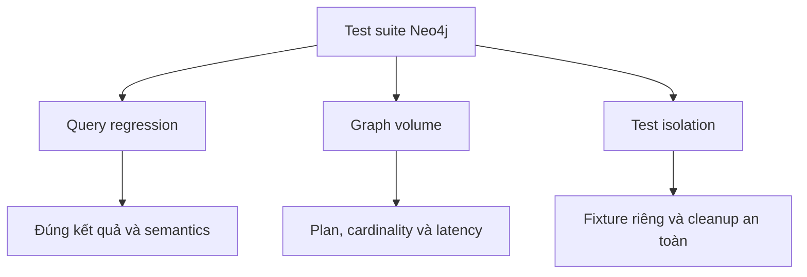

# Kiểm thử hồi quy truy vấn, dung lượng đồ thị và tính cô lập giữa test

Một truy vấn Spring Data Neo4j có thể vẫn chạy thành công sau khi code thay đổi nhưng trả sai số lượng node, bỏ sót relationship, sắp xếp khác trước hoặc chậm rõ rệt khi graph lớn lên. Ngoài ra, test có thể pass khi chạy riêng nhưng fail khi chạy song song vì dùng chung database, cùng business ID hoặc cleanup quá rộng. Vì vậy, kiểm thử tầng dữ liệu cần bao phủ ba lớp: **hồi quy ngữ nghĩa truy vấn**, **hành vi theo quy mô graph**, và **cô lập dữ liệu giữa các test**.

Bài này sử dụng một graph đơn giản gồm `Customer`, `Product` và relationship `PURCHASED`. Các ví dụ dùng JUnit 5, AssertJ, Spring Data Neo4j, `Neo4jClient` và Testcontainers. Có thể thay domain model bằng node/relationship của ứng dụng, nhưng nguyên tắc fixture, assertion và isolation vẫn giữ nguyên.

## 1. Ba lớp kiểm thử cần tách biệt

| Lớp kiểm thử | Câu hỏi cần trả lời | Cách kiểm tra chính |
| --- | --- | --- |
| Query regression | Truy vấn còn trả đúng graph, số lượng, thứ tự và trường dữ liệu không? | Fixture xác định, assertion kết quả và edge case |
| Graph volume / performance | Kết quả và query plan có còn phù hợp khi số node/relationship tăng không? | Dataset có cardinality kiểm soát, `EXPLAIN`, `PROFILE`, metrics |
| Test isolation | Test có thể chạy lặp, chạy song song và theo thứ tự bất kỳ mà không ảnh hưởng nhau không? | Testcontainers, ID riêng, cleanup có scope, schema setup ổn định |

Không nên dùng một test duy nhất để trả lời cả ba câu hỏi. Query regression cần ưu tiên tính đúng đắn và ổn định; volume test cần dữ liệu đủ lớn và đo riêng; isolation test cần chứng minh fixture của test này không thể bị test khác đọc hoặc xóa.



## 2. Dùng Neo4j thật cho integration test

Unit test có thể mock repository hoặc `Neo4jClient` để kiểm tra logic service, nhưng mock không chứng minh Cypher chạy đúng, mapping relationship đúng hoặc transaction rollback thật. Với custom Cypher, repository query và graph mapping, nên có integration test kết nối một Neo4j instance thật.

Testcontainers có thể khởi chạy Neo4j trong Docker cho test:

```java
import org.springframework.boot.test.context.SpringBootTest;
import org.springframework.context.annotation.Import;
import org.springframework.test.context.DynamicPropertyRegistry;
import org.springframework.test.context.DynamicPropertySource;
import org.testcontainers.containers.Neo4jContainer;
import org.testcontainers.junit.jupiter.Container;
import org.testcontainers.junit.jupiter.Testcontainers;

@Testcontainers
@SpringBootTest
@Import(ProductFixture.class)
abstract class ProductQueryIntegrationTest {

    private static final String NEO4J_PASSWORD = "test-password";

    @Container
    static final Neo4jContainer<?> neo4j =
        new Neo4jContainer<>("neo4j:5.26-community")
            .withAdminPassword(NEO4J_PASSWORD);

    @DynamicPropertySource
    static void neo4jProperties(DynamicPropertyRegistry registry) {
        registry.add("spring.neo4j.uri", neo4j::getBoltUrl);
        registry.add("spring.neo4j.authentication.username", () -> "neo4j");
        registry.add("spring.neo4j.authentication.password", () -> NEO4J_PASSWORD);
    }
}
```

Ví dụ giả định dự án đã có Spring Boot test, `spring-boot-starter-data-neo4j`, Testcontainers JUnit Jupiter và module Testcontainers Neo4j. Chọn image Neo4j tương thích với phiên bản SDN/Driver trong dependency management của dự án; pin version cụ thể để kết quả CI có thể tái lập. Docker phải sẵn sàng khi test chạy.

`@SpringBootTest` khởi tạo application context và dùng cấu hình Neo4j từ container. Với test tập trung vào repository, có thể dùng test slice `@DataNeo4jTest` nếu cấu hình dự án hỗ trợ; cần import các bean phụ trợ mà slice không tự quét. Dù dùng slice hay full context, test truy vấn thực tế phải kết nối Neo4j chứ không chỉ mock.

### Không dùng database production cho test

Integration test có thể tạo, sửa và xóa dữ liệu. Hãy dùng container riêng hoặc database test chuyên dụng. Không trỏ test suite vào database chứa dữ liệu thật, kể cả khi dự định rollback sau mỗi test.

## 3. Thiết kế fixture có định danh riêng

Fixture tốt phải nhỏ, dễ hiểu, xác định được kết quả mong đợi và không phụ thuộc thứ tự test. Ví dụ test truy vấn tổng số lượng sản phẩm khách hàng đã mua:

```cypher
MATCH (c:Customer {customerId: $customerId})-[r:PURCHASED]->(p:Product)
WITH p, sum(r.quantity) AS totalQuantity
WHERE totalQuantity >= $minimumQuantity
RETURN p.sku AS sku,
       p.name AS name,
       totalQuantity
ORDER BY totalQuantity DESC, sku ASC
```

Fixture gồm:

| Customer | Product | Số lượng trong từng relationship | Tổng |
| --- | --- | --- | ---: |
| C-TEST | SKU-A | 2 và 1 | 3 |
| C-TEST | SKU-B | 3 | 3 |
| C-TEST | SKU-C | 1 | 1 |

Với `minimumQuantity = 3`, kết quả mong đợi là `SKU-A` rồi `SKU-B`. Hai sản phẩm cùng tổng số lượng nên `sku ASC` bảo đảm thứ tự ổn định. `SKU-C` phải bị loại bởi điều kiện `WHERE` sau phép tổng hợp.

Trong test thực tế, tạo `testRunId` riêng cho từng test và gắn vào tất cả node/relationship được tạo. ID của Customer/Product cũng nên chứa `testRunId` để tránh va chạm với test khác.

## 4. Kiểm thử query regression qua repository

Entity được dùng trong ví dụ:

```java
import org.springframework.data.neo4j.core.schema.Id;
import org.springframework.data.neo4j.core.schema.Node;

@Node("Product")
public class Product {

    @Id
    private String sku;

    private String name;

    public String getSku() { return sku; }
    public String getName() { return name; }
    public void setSku(String sku) { this.sku = sku; }
    public void setName(String name) { this.name = name; }
}
```

Khai báo repository có custom query:

```java
import java.util.List;

import org.springframework.data.neo4j.repository.Neo4jRepository;
import org.springframework.data.neo4j.repository.query.Query;
import org.springframework.data.repository.query.Param;

public interface ProductRepository extends Neo4jRepository<Product, String> {

    @Query("""
        MATCH (c:Customer {customerId: $customerId})-[r:PURCHASED]->(p:Product)
        WITH p, sum(r.quantity) AS totalQuantity
        WHERE totalQuantity >= $minimumQuantity
        RETURN p
        ORDER BY totalQuantity DESC, p.sku ASC
        """)
    List<Product> findPurchasedProducts(
        @Param("customerId") String customerId,
        @Param("minimumQuantity") long minimumQuantity
    );
}
```

Repository trả về `Product` nên test tập trung vào kết quả mapping entity. Nếu query trả DTO/projection, cần assertion thêm cho từng field được alias trong Cypher. Không chỉ kiểm tra danh sách có phần tử; hãy kiểm tra đầy đủ cardinality, thứ tự và giá trị.

### Tạo fixture bằng `Neo4jClient`

```java
import java.util.List;
import java.util.Map;
import org.springframework.data.neo4j.core.Neo4jClient;

public class ProductFixture {

    private final Neo4jClient neo4jClient;

    public ProductFixture(Neo4jClient neo4jClient) {
        this.neo4jClient = neo4jClient;
    }

    public void createPurchaseGraph(String runId) {
        String customerId = "C-" + runId;

        neo4jClient.query("""
                CREATE (c:Customer {
                    customerId: $customerId,
                    testRunId: $runId
                })
                WITH c
                UNWIND $rows AS row
                MERGE (p:Product {sku: row.sku})
                SET p.name = row.name,
                    p.testRunId = $runId
                CREATE (c)-[:PURCHASED {
                    quantity: row.quantity,
                    testRunId: $runId
                }]->(p)
                """)
            .bind(customerId).to("customerId")
            .bind(runId).to("runId")
            .bind(List.of(
                Map.of("sku", "A-" + runId, "name", "Product A", "quantity", 2),
                Map.of("sku", "A-" + runId, "name", "Product A", "quantity", 1),
                Map.of("sku", "B-" + runId, "name", "Product B", "quantity", 3),
                Map.of("sku", "C-" + runId, "name", "Product C", "quantity", 1)
            )).to("rows")
            .run();
    }
}
```

Đoạn fixture trên tạo một Customer và ba Product, trong đó hai relationship trỏ tới cùng một SKU-A để kiểm tra aggregation. Entity `Product` dùng `sku` làm `@Id`; fixture thêm suffix run ID vào SKU để bảo đảm mỗi test có business key riêng.

## 5. Assertion cho kết quả, thứ tự và edge case

Test nên thể hiện rõ điều gì là contract của truy vấn:

```java
import static org.assertj.core.api.Assertions.assertThat;

import java.util.List;
import java.util.UUID;

import org.junit.jupiter.api.AfterEach;
import org.junit.jupiter.api.BeforeEach;
import org.junit.jupiter.api.Test;
import org.springframework.beans.factory.annotation.Autowired;
import org.springframework.data.neo4j.core.Neo4jClient;

class ProductQueryRegressionTest extends ProductQueryIntegrationTest {

    @Autowired ProductRepository productRepository;
    @Autowired ProductFixture productFixture;
    @Autowired Neo4jClient neo4jClient;

    private String runId;
    private String customerId;

    @BeforeEach
    void setUp() {
        runId = UUID.randomUUID().toString();
        customerId = "C-" + runId;
        productFixture.createPurchaseGraph(runId);
    }

    @AfterEach
    void cleanUp() {
        neo4jClient.query("""
                MATCH (n {testRunId: $runId})
                DETACH DELETE n
                """)
            .bind(runId).to("runId")
            .run();
    }

    @Test
    void aggregatesQuantityAndUsesStableTieBreakOrder() {
        List<Product> result = productRepository.findPurchasedProducts(customerId, 3);

        assertThat(result)
            .extracting(Product::getSku)
            .containsExactly("A-" + runId, "B-" + runId);
    }

    @Test
    void returnsEmptyWhenCustomerDoesNotExist() {
        assertThat(productRepository.findPurchasedProducts("missing-" + runId, 1))
            .isEmpty();
    }

    @Test
    void appliesMinimumQuantityBoundary() {
        assertThat(productRepository.findPurchasedProducts(customerId, 4)).isEmpty();
    }
}
```

Ví dụ dùng một abstract base test class để chia sẻ cấu hình Testcontainers và Spring Test giữa các lớp regression test. Nếu dự án không muốn kế thừa base class, có thể chuyển cấu hình container sang test configuration dùng chung và import vào từng test class; tránh kế thừa một test class cụ thể có method `@Test` vì test runner có thể chạy lại các test được kế thừa.

Những assertion hữu ích khác:

- Đúng hướng relationship: `Customer -[:PURCHASED]-> Product`, không chấp nhận hướng ngược.
- Không nhân bản kết quả khi một Product có nhiều relationship.
- Giá trị tổng hợp đúng khi có nhiều relationship tới cùng node.
- Ngưỡng bằng, nhỏ hơn và lớn hơn giá trị thực tế.
- Kết quả rỗng khi node gốc không tồn tại.
- Property null hoặc thiếu được xử lý theo semantics đã định.
- Sort ổn định khi hai kết quả có cùng điểm/tổng.
- Pagination không lặp hoặc bỏ sót record giữa các trang.
- Parameter được bind đúng, không nối chuỗi dữ liệu người dùng vào Cypher.

## 6. Kiểm thử query mapping và relationship

Với repository trả entity có relationship, cần xác minh graph được hydrate đúng:

1. Tạo node đầu và node đích bằng fixture có ID riêng.
2. Tạo relationship với đúng type, direction và property.
3. Gọi `findById` hoặc custom query.
4. Kiểm tra node đích, relationship property và cardinality.
5. Thêm trường hợp không có relationship và trường hợp có nhiều relationship.

Ví dụ query kiểm tra relationship property:

```cypher
MATCH (c:Customer {customerId: $customerId})-[r:PURCHASED]->(p:Product)
RETURN p.sku AS sku, r.quantity AS quantity
ORDER BY sku, quantity
```

Không chỉ kiểm tra số lượng Product trả về. Một lỗi mapping có thể vẫn trả đúng node nhưng làm mất quantity, đọc sai hướng hoặc tạo duplicate relationship. Với custom query có aggregation, hãy kiểm tra cả số row trước và sau aggregation.

## 7. Kiểm thử hồi quy bằng dữ liệu biên

Một query regression suite tốt nên có fixture nhỏ nhưng bao phủ các trường hợp có thể làm query đổi semantics:

| Trường hợp | Điều cần xác minh |
| --- | --- |
| Không có node gốc | Kết quả rỗng, không ném lỗi ngoài contract |
| Node gốc không có relationship | Kết quả rỗng hoặc vẫn có node nếu dùng `OPTIONAL MATCH` theo yêu cầu |
| Một node có nhiều relationship | Không nhân bản kết quả ngoài ý muốn |
| Hai nhánh relationship cùng trỏ một node | Aggregation và `DISTINCT` đúng |
| Property bị thiếu hoặc null | Điều kiện `WHERE`, `coalesce` và mapping đúng semantics |
| Giá trị nằm đúng ngưỡng | Boundary condition chính xác |
| Hai kết quả bằng điểm | Có tie-breaker ổn định |
| Page cuối ít hơn page size | Tổng số record qua các page đúng |
| Relationship ngược hướng | Query không vô tình match |
| Parameter chứa ký tự đặc biệt | Binding an toàn và kết quả đúng |

Đừng snapshot toàn bộ query plan hoặc chuỗi Cypher sinh ra như một golden file bất biến. Framework và planner có thể thay đổi cách viết query mà không đổi kết quả. Hãy ưu tiên kiểm tra contract dữ liệu; chỉ kiểm tra plan ở test hiệu năng chuyên biệt.

## 8. Kiểm tra query plan bằng `EXPLAIN` và `PROFILE`

`EXPLAIN` yêu cầu Neo4j lập kế hoạch cho query nhưng không thực thi query. `PROFILE` thực thi query và thu thập số liệu thực tế của các operator. Vì `PROFILE` thực sự chạy câu lệnh, không dùng tùy tiện với query ghi trên database dùng chung.

Ví dụ kiểm tra kế hoạch của truy vấn:

```cypher
EXPLAIN
MATCH (c:Customer {customerId: $customerId})-[r:PURCHASED]->(p:Product)
RETURN p.sku, sum(r.quantity)
```

Khi phân tích trong môi trường test riêng:

```cypher
PROFILE
MATCH (c:Customer {customerId: $customerId})-[r:PURCHASED]->(p:Product)
RETURN p.sku, sum(r.quantity)
```

Các điểm cần quan sát:

- Lookup node theo business key có dùng index seek phù hợp hay đang scan toàn label.
- Số row đi qua từng operator có tăng bất thường do relationship fan-out hay không.
- Có `CartesianProduct` ngoài ý muốn không.
- Có sort/aggregation trên tập dữ liệu quá lớn hay không.
- Số database hits và thời gian từng operator thay đổi thế nào khi cardinality tăng.
- Query có trả quá nhiều cột hoặc hydrate graph không cần thiết hay không.

Không nên khẳng định mọi query phải có đúng tên operator `NodeIndexSeek` hoặc một plan tree cố định. Tên operator và lựa chọn planner có thể thay đổi theo Neo4j version, thống kê, index và dữ liệu. Hãy kiểm tra mục tiêu thực tế: lookup có giới hạn, số row hợp lý và không có scan/cartesian ngoài ý muốn.

## 9. Tạo graph có dung lượng kiểm soát

Volume test cần fixture có quy mô xác định. Có thể dùng `UNWIND` để tạo dữ liệu test nhanh, đồng thời gắn `testRunId` cho cleanup:

```cypher
UNWIND range(1, $nodeCount) AS i
CREATE (:Product {
    sku: $runId + '-' + toString(i),
    name: 'Product ' + toString(i),
    testRunId: $runId,
    sequence: i
})
```

Tạo relationship có mật độ xác định:

```cypher
MATCH (p:Product {testRunId: $runId})
WITH p ORDER BY p.sequence
WITH collect(p) AS products
UNWIND range(0, size(products) - 2) AS i
WITH products[i] AS source, products[i + 1] AS target
CREATE (source)-[:RELATED_TO {testRunId: $runId}]->(target)
```

Query thứ hai tạo một chuỗi relationship tuyến tính. Với graph có fan-out, hãy tạo số relationship trung bình trên mỗi node theo tham số riêng để kiểm tra các mức density khác nhau.

Không dùng dữ liệu ngẫu nhiên không seed cho benchmark; cùng một test run cần có cardinality và phân bố dữ liệu tái lập. Có thể tạo các mức 1.000, 10.000 và 100.000 node, nhưng chọn mức phù hợp tài nguyên CI và thời gian pipeline.

## 10. Đo kết quả khi graph tăng kích thước

Kiểm thử volume không chỉ đếm node. Hãy xác định graph shape:

| Tham số | Ví dụ | Tác động |
| --- | ---: | --- |
| Node count | 1k / 10k / 100k | Kích thước graph |
| Relationship count | 2k / 50k / 500k | Chi phí traversal và fan-out |
| Degree trung bình | 2 / 5 / 20 | Số neighbor cần duyệt |
| Degree tối đa | 100 / 1k | Hot node và skew |
| Property size | nhỏ / trung bình / lớn | Payload và heap khi mapping |
| Tỷ lệ node phù hợp filter | 1% / 10% / 100% | Selectivity của query |

Với mỗi mức dữ liệu, ghi nhận:

- Kết quả đúng và số record trả về.
- Query latency p50/p95, không chỉ một lần chạy.
- Throughput khi chạy batch.
- Database hits, rows processed và query plan.
- Heap, transaction memory và thời gian giữ transaction.
- Lock wait, deadlock và retry nếu có concurrent writer.

Tách thời gian tạo fixture khỏi thời gian query được đo. Warm up connection pool và query plan trước khi lấy số liệu. Nếu test đo cả container startup, kết quả đó phản ánh startup cost chứ không phải query performance.

## 11. Viết volume test có thể tái lập

Ví dụ helper tạo node theo batch:

```java
import java.util.Map;

import org.springframework.data.neo4j.core.Neo4jClient;

public class GraphVolumeFixture {

    private final Neo4jClient neo4jClient;

    public GraphVolumeFixture(Neo4jClient neo4jClient) {
        this.neo4jClient = neo4jClient;
    }

    public long createProducts(String runId, int nodeCount) {
        Map<String, Object> result = neo4jClient.query("""
                UNWIND range(1, $nodeCount) AS i
                CREATE (:Product {
                    sku: $runId + '-' + toString(i),
                    name: 'Product ' + toString(i),
                    testRunId: $runId,
                    sequence: i
                })
                RETURN count(*) AS created
                """)
            .bind(nodeCount).to("nodeCount")
            .bind(runId).to("runId")
            .fetch()
            .one()
            .orElseThrow();

        return ((Number) result.get("created")).longValue();
    }
}
```

Test xác minh cardinality trước khi chạy query:

```java
long created = graphVolumeFixture.createProducts(runId, 10_000);
assertThat(created).isEqualTo(10_000);

long actual = neo4jClient.query("""
        MATCH (p:Product {testRunId: $runId})
        RETURN count(p) AS total
        """)
    .bind(runId).to("runId")
    .fetchAs(Long.class)
    .one()
    .orElseThrow();

assertThat(actual).isEqualTo(10_000L);
```

Nếu cần test relationship volume, đếm relationship được gắn `testRunId` riêng. Không suy số relationship từ số node vì graph có thể có degree phân bố không đồng đều.

## 12. Performance assertion: tránh ngưỡng thời gian mong manh

Không nên viết unit test kiểu:

```java
assertThat(Duration.between(start, end).toMillis()).isLessThan(50);
```

Ngưỡng tuyệt đối quá nhỏ dễ fail do CPU, GC, Docker scheduling, CI load hoặc cache lạnh. Thay vào đó:

- Functional CI: xác minh đúng kết quả, không có query plan rõ ràng bất hợp lý và không có tăng cardinality ngoài dự kiến.
- Performance pipeline riêng: chạy dataset lớn hơn, warm-up, lặp nhiều lần và lưu p50/p95/throughput.
- So sánh tương đối giữa phiên bản trên cùng loại runner, cùng container image, cùng dataset và cùng cấu hình.
- Dùng regression budget có biên độ phù hợp và yêu cầu nhiều lần đo vượt ngưỡng trước khi kết luận.
- Ghi lại Neo4j version, SDN/Driver version, heap, index, dataset size và cấu hình container cùng kết quả.

Nếu cần cảnh báo plan regression, hãy kiểm tra đặc tính có ý nghĩa như query bắt đầu scan toàn label lớn hoặc tạo Cartesian product. Tránh phụ thuộc toàn bộ chuỗi plan vì planner có thể đổi operator mà vẫn giữ hiệu năng tốt.

## 13. Kiểm tra index và constraint trong test

Volume test cần chạy với index/constraint giống môi trường ứng dụng. Ví dụ:

```cypher
CREATE CONSTRAINT product_sku_unique IF NOT EXISTS
FOR (p:Product)
REQUIRE p.sku IS UNIQUE
```

```cypher
CREATE INDEX customer_id_index IF NOT EXISTS
FOR (c:Customer)
ON (c.customerId)
```

Đảm bảo index đã ở trạng thái `ONLINE` trước khi benchmark. Index vừa tạo có thể cần thời gian populate; đo query trước khi index sẵn sàng sẽ cho kết quả sai lệch. Không tạo/xóa schema trong mỗi test method; schema setup nên chạy một lần cho test database hoặc qua migration test.

Không nên dựa vào constraint `IF NOT EXISTS` để chứng minh schema đúng: nếu constraint cùng tên tồn tại nhưng cấu hình khác, test vẫn cần kiểm tra label/property/type mong đợi. Schema regression nên có assertion riêng về index/constraint cần thiết.

## 14. Cô lập dữ liệu giữa test bằng `testRunId`

Một test không được phụ thuộc vào dữ liệu do test trước tạo ra. Cách đơn giản và hiệu quả là sinh `testRunId` duy nhất cho mỗi test, gắn vào mọi node và relationship thuộc fixture:

```java
private String runId;

@BeforeEach
void setUp() {
    runId = UUID.randomUUID().toString();
}
```

Khi tạo dữ liệu:

```cypher
CREATE (c:Customer {
    customerId: $customerId,
    testRunId: $runId
})
CREATE (p:Product {
    sku: $sku,
    testRunId: $runId
})
CREATE (c)-[:PURCHASED {testRunId: $runId, quantity: 1}]->(p)
```

Cleanup chỉ xóa dữ liệu thuộc test hiện tại:

```cypher
MATCH (n {testRunId: $runId})
DETACH DELETE n
```

`DETACH DELETE` xóa node và các relationship gắn với node đó. Chỉ dùng cách này khi fixture của test không kết nối tới node dùng chung. Nếu có relationship nối tới dữ liệu dùng chung, hãy xóa relationship có `testRunId` trước, sau đó xóa node test; không detach một node test khỏi graph dùng chung ngoài ý muốn.

Không dùng cleanup rộng như:

```cypher
MATCH (n)
DETACH DELETE n
```

trên database được chia sẻ bởi nhiều test hoặc test worker. Câu lệnh này có thể xóa dữ liệu do test khác đang dùng và làm lỗi trở nên không ổn định.

## 15. Cleanup relationship và node theo scope

Khi test có thể nối node fixture với node ngoài fixture, xóa relationship được gắn run ID trước:

```cypher
MATCH ()-[r {testRunId: $runId}]-()
DELETE r
```

Sau đó xóa các node thuộc run:

```cypher
MATCH (n {testRunId: $runId})
DELETE n
```

Nếu mọi node và relationship đều do test sở hữu, một câu `MATCH (n {testRunId}) DETACH DELETE n` ngắn hơn. Chọn một quy ước thống nhất cho fixture builder và cleanup helper.

Với test volume tạo hàng trăm nghìn node, cleanup cũng có thể là workload lớn. Thực hiện cleanup sau khi đo xong, hoặc hủy toàn bộ container/database test chuyên biệt thay vì chạy một lệnh delete lớn nếu vòng đời môi trường cho phép. Không tính thời gian cleanup vào latency query đang benchmark.

## 16. Transaction rollback có đủ để cô lập test không?

Transaction rollback hữu ích nhưng không nên là cơ chế cô lập duy nhất:

- Repository method có thể mở transaction riêng nếu test không chạy trong cùng transaction context.
- Test gọi nhiều thread/session có thể tạo transaction độc lập.
- Async worker có thể tiếp tục ghi sau khi test method kết thúc.
- Reactive transaction gắn với Reactor Context; một test publisher không tự động tham gia imperative test-managed transaction.
- Test dùng `REQUIRES_NEW` có thể commit độc lập với transaction ngoài.
- DDL/schema operation có thể có quy tắc transaction riêng.

Nếu dùng test-managed transaction của Spring, hãy xác minh rollback thực tế với transaction manager Neo4j và đường gọi đang kiểm thử. Với test reactive, dùng `StepVerifier` để subscribe/await publisher và quản lý transaction bằng `TransactionalOperator` hoặc service boundary phù hợp. Dù vậy, unique fixture ID và cleanup có scope vẫn giúp test bền vững hơn.

`@DirtiesContext` làm mới Spring application context, không đồng nghĩa xóa dữ liệu trong Neo4j container đang chạy. Không dùng nó thay cho database cleanup.

## 17. Chạy test song song an toàn

JUnit có thể chạy test method hoặc class song song. Nếu nhiều test dùng chung Neo4j container/database:

1. Sinh `testRunId` duy nhất cho mỗi test, không chỉ mỗi class.
2. Dùng business ID có suffix/prefix từ run ID.
3. Mọi fixture node và relationship đều mang run ID.
4. Cleanup chỉ xóa dữ liệu thuộc run hiện tại.
5. Không thay đổi schema trong từng test method; tạo schema một lần trước suite.
6. Không dùng một mutable singleton fixture builder giữ state giữa test.
7. Nếu một test cần thay đổi global schema hoặc cấu hình database, chạy tuần tự hoặc dùng database/container riêng.
8. Tránh một test cleanup toàn bộ label trong khi test khác đang query label đó.

Nếu không thể bảo đảm isolation bằng key riêng, có thể tắt parallel execution cho nhóm test dùng chung database bằng JUnit `@ResourceLock` hoặc cấu hình suite. Đây là biện pháp đồng bộ, không thay thế fixture và cleanup đúng scope.

## 18. Tổ chức Testcontainers theo chi phí

| Chiến lược | Ưu điểm | Đánh đổi |
| --- | --- | --- |
| Container static dùng chung trong một test class | Startup một lần, test nhanh | Cần fixture ID riêng và cleanup chặt |
| Singleton container cho cả suite | Giảm thời gian startup nhiều class | Các class phải tuân thủ isolation và schema lifecycle chung |
| Container riêng cho từng class | Cô lập giữa class tốt hơn | Startup và tài nguyên Docker tăng |
| Container riêng cho từng method | Cô lập mạnh | Rất chậm, tốn CPU/RAM; hiếm khi cần |
| Database riêng cho từng test | Cô lập dữ liệu tốt nếu edition hỗ trợ multi-database | Provisioning phức tạp và có thể cần Enterprise |

Với CI thông thường, một container cho một class hoặc một suite cùng `testRunId` riêng thường là điểm cân bằng tốt. Nếu dùng singleton container, không để test tự dừng container hoặc xóa schema dùng chung.

## 19. Kiểm thử tính cô lập bằng một test âm

Ngoài việc kiểm tra test chạy độc lập, có thể xác minh dữ liệu của run A không xuất hiện trong query của run B:

```cypher
MATCH (p:Product {testRunId: $runId})
RETURN count(p) AS total
```

Test tạo hai run ID, hai tập dữ liệu riêng, sau đó xác minh mỗi query chỉ nhìn thấy dữ liệu của run tương ứng. Sau cleanup run A, run B vẫn phải tồn tại:

```java
assertThat(countProducts(runA)).isEqualTo(2);
assertThat(countProducts(runB)).isEqualTo(3);

deleteRun(runA);

assertThat(countProducts(runA)).isZero();
assertThat(countProducts(runB)).isEqualTo(3);
```

Đây là kiểm thử quan trọng cho cleanup helper, nhất là khi CI chia test thành nhiều worker hoặc test class chạy đồng thời.

## 20. Reactive test và tính cô lập

Với reactive repository, publisher chỉ chạy khi được subscribe. Dùng `StepVerifier` để đợi hoàn tất trước cleanup:

```java
StepVerifier.create(reactiveProductRepository.findById(productId))
    .assertNext(product -> assertThat(product.getSku()).isEqualTo(productId))
    .verifyComplete();
```

Không gọi `subscribe()` rồi kết thúc test ngay; cleanup có thể chạy trước khi query hoàn tất. Nếu cần kiểm thử nhiều thao tác trong một reactive transaction, compose chúng trong cùng pipeline và dùng `TransactionalOperator` hoặc `@Transactional` reactive đúng transaction manager.

Ví dụ:

```java
Mono<Void> work = reactiveProductRepository.save(product)
    .then(reactiveProductRepository.findById(product.getSku()))
    .switchIfEmpty(Mono.error(new AssertionError("Product was not visible")))
    .then();

StepVerifier.create(transactionalOperator.transactional(work))
    .verifyComplete();
```

Nếu test cần xác minh rollback, sau khi publisher transaction kết thúc hãy đọc bằng một transaction mới để xác nhận node không tồn tại. Không dựa vào một query chạy trong cùng transaction để kết luận dữ liệu đã rollback.

## 21. CI: chia test theo mục tiêu

Một pipeline có thể tách thành các nhóm:

| Nhóm | Nội dung | Tần suất gợi ý |
| --- | --- | --- |
| Unit | Mapping helper, service logic, parameter preparation | Mỗi commit |
| Query integration | Custom Cypher, repository mapping, transaction | Mỗi pull request |
| Isolation | Cleanup, run ID, parallel execution | Mỗi pull request hoặc nightly |
| Graph volume | Dataset lớn, cardinality, `PROFILE`, p95 | Nightly hoặc trước release |
| Compatibility | Neo4j versions/editions được hỗ trợ | Theo release matrix |

Không để volume test lớn làm chậm mọi vòng feedback của developer. Nhưng cũng không bỏ nó hoàn toàn: query regression nhỏ không phát hiện được mọi vấn đề chỉ xuất hiện khi graph có hàng triệu relationship hoặc degree bị lệch mạnh.

## 22. Lỗi thường gặp

| Biểu hiện | Nguyên nhân | Cách xử lý |
| --- | --- | --- |
| Test pass riêng nhưng fail khi chạy suite | Dùng business ID cố định hoặc dữ liệu còn sót | Tạo `testRunId` và cleanup theo scope |
| Kết quả query thay đổi thứ tự | Không có `ORDER BY` tie-breaker | Sắp xếp ổn định theo key phụ |
| Số row tăng gấp nhiều lần | Relationship fan-out hoặc thiếu aggregation/`DISTINCT` | Assertion cardinality và kiểm tra plan |
| Query chậm khi graph lớn | Label scan, thiếu index, traversal quá rộng | `EXPLAIN`/`PROFILE`, index đúng property và giới hạn traversal |
| Benchmark CI lúc pass lúc fail | Ngưỡng latency quá chặt hoặc fixture chưa warm | Tách performance pipeline, warm-up và đo nhiều lần |
| Test xóa dữ liệu của test khác | Cleanup `MATCH (n) DETACH DELETE n` quá rộng | Xóa theo `testRunId` |
| Reactive test kết thúc quá sớm | Không chờ publisher hoàn tất | Dùng `StepVerifier` hoặc await phù hợp |
| `@DirtiesContext` nhưng dữ liệu vẫn còn | Context reset không xóa database | Cleanup graph hoặc hủy container |
| Profile query làm thay đổi database | `PROFILE` thực thi query | Dùng database test riêng và cleanup; `EXPLAIN` cho plan không thực thi |
| Volume test cho kết quả thấp bất thường | Đo cả thời gian tạo fixture/index | Tách setup, index population và query measurement |

## 23. Checklist trước khi merge

1. Mỗi custom query có test cho kết quả chính, empty result và boundary conditions.
2. Assertion kiểm tra cả cardinality, thứ tự, relationship direction và property cần thiết.
3. Fixture được tạo bằng Neo4j thật cho query/mapping quan trọng.
4. Test dữ liệu có `testRunId` riêng cho từng test.
5. Cleanup không xóa node/relationship ngoài phạm vi test.
6. Schema/index được tạo một lần và đã online trước volume test.
7. Graph volume có nhiều mức node count, relationship count và degree.
8. `EXPLAIN`/`PROFILE` được dùng đúng mục đích; không snapshot plan quá cứng.
9. Performance budget đo trên môi trường ổn định, có warm-up và nhiều lần chạy.
10. Test song song không chia sẻ business ID hoặc mutable fixture state.
11. Reactive publisher được subscribe và hoàn tất trước cleanup.
12. Test rollback được xác minh bằng transaction mới hoặc đọc lại sau khi transaction kết thúc.

## Kết luận

Kiểm thử hồi quy truy vấn phải xác minh semantics của graph: đúng node, đúng relationship, aggregation, cardinality, thứ tự và các trường hợp biên. Kiểm thử dung lượng cần tạo graph có quy mô và degree kiểm soát, quan sát `EXPLAIN`/`PROFILE`, đo nhiều lần và tách setup khỏi thời gian query. Tính cô lập được bảo đảm bằng Neo4j test instance, `testRunId` duy nhất, fixture không chia sẻ ngoài ý muốn và cleanup theo scope; rollback hoặc `@DirtiesContext` không thay thế toàn bộ các biện pháp đó. Khi ba lớp này được thiết kế riêng nhưng chạy cùng pipeline, thay đổi query và mapping sẽ dễ phát hiện hồi quy hơn, kể cả khi graph lớn hoặc test chạy song song.

## Tài liệu tham khảo

- [Spring Boot — `@DataNeo4jTest` test slice](https://docs.spring.io/spring-boot/reference/testing/spring-boot-applications.html)
- [Spring Data Neo4j 8.1.2 — Testing and repository integration](https://docs.spring.io/spring-data/neo4j/reference/testing.html)
- [Testcontainers — Neo4j module](https://java.testcontainers.org/modules/databases/neo4j/)
- [Neo4j Cypher Manual — `EXPLAIN` and `PROFILE`](https://neo4j.com/docs/cypher-manual/current/planning-and-tuning/execution-plans/)
- [Neo4j Cypher Manual — `UNWIND`](https://neo4j.com/docs/cypher-manual/current/clauses/unwind/)
- [Neo4j Operations Manual — Indexes](https://neo4j.com/docs/operations-manual/current/performance/index-configuration/)
- [JUnit 5 User Guide — Parallel Execution and Resource Locks](https://junit.org/junit5/docs/current/user-guide/#writing-tests-parallel-execution)
