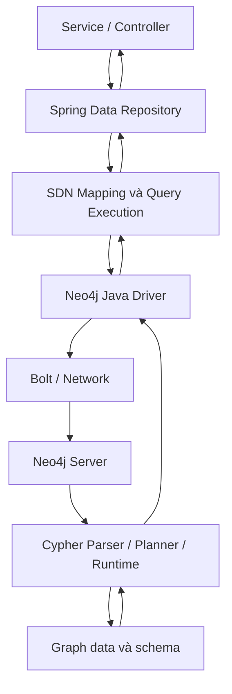

# Phân biệt lỗi driver, lỗi Cypher, lỗi mapping và lỗi Spring Data

Khi một thao tác Spring Data Neo4j (SDN) thất bại, exception xuất hiện ở nơi ứng dụng gọi repository chưa chắc là nơi phát sinh lỗi. Một lỗi mạng có thể được bọc trong exception của Spring; một câu Cypher hợp lệ có thể trả dữ liệu không đúng hình dạng mà entity converter cần; một derived query sai tên property có thể thất bại ngay lúc khởi tạo repository, trước khi có kết nối tới Neo4j. Chẩn đoán đúng bắt đầu bằng việc xác định lớp phát sinh và lần theo chuỗi `cause`, thay vì chỉ đọc dòng message ngoài cùng.

Bài học thuộc module **SPRING_DATA_NEO4J**, nơi xây dựng tầng dữ liệu đồ thị qua node entity, relationship, repository và truy vấn Cypher. Ta dùng `Person`, `Movie` và `ACTED_IN` để phân biệt lỗi kết nối của Driver, lỗi thực thi Cypher phía server, lỗi ánh xạ node/relationship và lỗi từ Spring Data repository, sau đó xây dựng quy trình thu thập diagnostics an toàn.

## 1. Nhìn exception theo từng lớp

Một lần gọi repository đi qua nhiều lớp. Mỗi lớp có thể phát hiện một loại lỗi riêng:



| Lớp | Nhóm lỗi thường gặp | Ví dụ |
|---|---|---|
| Driver / kết nối | Network, routing, authentication, session | `ServiceUnavailableException`, `SessionExpiredException`, `AuthenticationException` |
| Neo4j server / Cypher | Syntax, tham số, quyền, constraint, lỗi database | `ClientException`, `DatabaseException`, `TransientException` |
| SDN mapping | Không tìm được root node, entity metadata hoặc không chuyển đổi được giá trị | `MappingException`, `NoRootNodeMappingException`, `UnknownEntityException` |
| Spring Data repository | Derived query sai property, sai cardinality hoặc API được dùng không hợp lệ | `PropertyReferenceException`, `IncorrectResultSizeDataAccessException` |
| Ứng dụng | Validation, business rule, null hoặc lỗi trong callback | `IllegalArgumentException`, custom domain exception |

Các nhóm này không hoàn toàn loại trừ nhau. Ví dụ, lỗi Driver có thể được chuyển thành `DataAccessException` khi đi qua repository proxy; lỗi mapping có thể xuất hiện sau khi Cypher đã chạy thành công. Vì vậy, hãy xem cả exception ngoài cùng lẫn `getCause()`.

## 2. Quy trình chẩn đoán nhanh

Khi nhận được lỗi, đi theo thứ tự sau:

1. **Xác định thời điểm:** lỗi xảy ra lúc Spring khởi động, lúc tạo repository, khi gọi query, khi mapping record hay khi commit transaction?
2. **Đọc toàn bộ cause chain:** ghi nhận class của exception ngoài cùng và nguyên nhân sâu nhất. Không chỉ dựa vào message.
3. **Xác định lớp:** Driver/kết nối, Cypher/server, SDN mapping, Spring Data hay code nghiệp vụ.
4. **Nếu là Driver:** kiểm tra URI, DNS, port, TLS, credentials, database name, routing và trạng thái session.
5. **Nếu là Cypher:** chạy lại query với cùng database và tham số đã được làm sạch; kiểm tra status code, vị trí lỗi và schema.
6. **Nếu là mapping:** kiểm tra kiểu dữ liệu trả về, root node, label, alias, relationship shape, constructor và custom converter.
7. **Nếu là Spring Data:** kiểm tra tên property trong derived query, kiểu trả về, cardinality, repository scan và transaction configuration.
8. **Tạo test tái hiện nhỏ:** dùng Neo4j Test Harness cho mapping/Cypher hoặc Testcontainers khi cần cấu hình server gần production.

Một câu hỏi hữu ích là: *lỗi xuất hiện trước khi có request Bolt, trong lúc server chạy Cypher, hay sau khi record đã về tới ứng dụng?* Câu trả lời giúp thu hẹp phạm vi nhanh hơn việc thay đổi nhiều cấu hình cùng lúc.

## 3. Lỗi Driver và kết nối

Neo4j Java Driver có lớp cơ sở `Neo4jException` và nhiều lớp con để phân biệt lỗi giao tiếp, xác thực, discovery, thao tác client và lỗi server. Các lớp thường gặp:

| Exception | Ý nghĩa | Hướng kiểm tra |
|---|---|---|
| `ServiceUnavailableException` | Driver không thể giao tiếp với cluster | Server có chạy không, network/firewall, DNS, URI, advertised address, connection timeout |
| `SessionExpiredException` | Session không còn đáp ứng điều kiện khi được cấp, ví dụ server không còn nhận write trên route cũ | Bỏ session hết hạn; tạo session mới và chạy lại toàn bộ đơn vị công việc nếu thao tác an toàn |
| `DiscoveryException` | Lỗi khi lấy routing table từ server | Database có sẵn sàng không, router có truy cập được không, routing URI và topology |
| `FatalDiscoveryException` | Không thể lấy routing table vì vấn đề không thể giải quyết bằng thử lại đơn thuần, ví dụ database không tồn tại | Kiểm tra database name, quyền và cấu hình cluster |
| `ConnectionReadTimeoutException` | Đọc phản hồi vượt thời gian timeout do server cung cấp | Query có chạy lâu, client có đọc result đủ nhanh, network có ổn định không |
| `AuthenticationException` | Driver không xác thực được với server | Username/password, auth provider, secret rotation |
| `AuthorizationExpiredException` / `TokenExpiredException` | Thông tin xác thực hoặc token hết hạn | Làm mới token qua auth provider và kiểm tra vòng đời token |
| `ProtocolException` / `UntrustedServerException` | Lỗi hợp đồng giao thức hoặc server không được xác minh là Neo4j | Kiểm tra endpoint, TLS, proxy và phiên bản tương thích |

### 3.1. Kiểm tra URI và database

Với cluster, URI routing thường có dạng `neo4j://` hoặc URI TLS như `neo4j+s://`. `bolt://` kết nối trực tiếp tới một host; nó không thay thế routing URI khi ứng dụng cần driver chọn thành viên theo vai trò.

```properties
spring.neo4j.uri=neo4j://neo4j-router.example.com:7687
spring.neo4j.authentication.username=${NEO4J_USERNAME}
spring.neo4j.authentication.password=${NEO4J_PASSWORD}
spring.neo4j.database=neo4j
```

Hãy kiểm tra các điểm sau:

- Host và port có thể truy cập từ đúng môi trường chạy ứng dụng.
- URI dùng đúng scheme cho yêu cầu TLS.
- DNS phân giải được cả seed/router lẫn địa chỉ thành viên mà cluster quảng bá.
- Database name tồn tại và tài khoản có quyền truy cập.
- Credentials được lấy từ secret manager/environment, không bị sai do khoảng trắng hoặc rotation.
- Pool và timeout phù hợp với workload; không tăng timeout để che giấu query chậm hoặc pool cạn.

Có thể kiểm tra kết nối khi khởi động bằng `Driver.verifyConnectivity()` nếu ứng dụng quản lý Driver trực tiếp hoặc có quyền truy cập bean Driver. Kiểm tra thành công chỉ chứng minh kết nối được tại thời điểm đó; nó không bảo đảm database sẽ luôn sẵn sàng.

### 3.2. Session hết hạn không có nghĩa chỉ cần chạy lại một câu lệnh

Khi session hết hạn, không tiếp tục dùng session cũ. Cần tạo session mới và quyết định có thể replay toàn bộ công việc hay không. Nếu transaction trước có thể đã commit nhưng client mất phản hồi, kết quả commit có thể chưa xác định. Dùng business key hoặc idempotency key để tránh ghi trùng khi chạy lại.

Không retry mù quáng các lỗi authentication, lỗi quyền, database name sai hoặc lỗi cấu hình TLS. Những lỗi này cần sửa nguyên nhân trước.

## 4. Lỗi Cypher và lỗi từ Neo4j server

Cypher lỗi có thể phát sinh khi parser không hiểu cú pháp, tham số sai kiểu, truy vấn vi phạm constraint, tài khoản không đủ quyền hoặc server gặp lỗi thực thi. Driver nhận lỗi server và thường biểu diễn chúng qua các lớp con của `Neo4jException`.

| Dấu hiệu | Nguyên nhân thường gặp | Cách xử lý |
|---|---|---|
| `ClientException` | Query hoặc thao tác phía client không hợp lệ | Sửa cú pháp, tên label/property, tham số hoặc câu lệnh |
| `DatabaseException` | Database không thể phục vụ request do trạng thái/lỗi phía server | Kiểm tra database logs, health, storage và trạng thái cluster |
| `TransientException` | Lỗi tạm thời có thể hồi phục, ví dụ một số deadlock hoặc tình trạng tài nguyên | Chỉ retry có giới hạn nếu thao tác idempotent; kiểm tra nguyên nhân gốc |
| Constraint violation | Dữ liệu vi phạm uniqueness, existence hoặc schema constraint | Kiểm tra business key, dữ liệu trùng và quy tắc ghi |
| Authorization error | Query yêu cầu privilege mà user không có | Kiểm tra role/privilege và database được chọn |
| Procedure/function error | Procedure không tồn tại, lỗi tham số hoặc code extension | Kiểm tra tên, signature, plugin và server log |

Ví dụ lỗi cú pháp:

```cypher
MATCH (p:Person
RETURN p;
```

Query thiếu dấu đóng `)` sau pattern. Neo4j trả lỗi statement syntax; hãy kiểm tra vị trí line/column được cung cấp thay vì đoán từ toàn bộ query.

Ví dụ lỗi tham số:

```cypher
MATCH (p:Person)
WHERE p.born >= $fromYear
RETURN p;
```

Nếu `fromYear` bị bind thành chuỗi không thể so sánh với kiểu property thực tế, lỗi có thể xuất hiện khi thực thi. Bind giá trị theo kiểu phù hợp và xác nhận dữ liệu nguồn nhất quán.

### 4.1. Đừng nhầm kết quả rỗng với lỗi Cypher

Một query hợp lệ nhưng không tìm thấy node thường trả về zero records, không ném exception:

```cypher
MATCH (p:Person {personId: $personId})
RETURN p;
```

Nếu `personId` không tồn tại, repository có thể trả `Optional.empty()`, `null` hoặc `Mono.empty()` tùy return type. Đây là kết quả nghiệp vụ hợp lệ, không phải lỗi Driver.

Ngược lại, nếu phương thức yêu cầu đúng một kết quả nhưng query trả nhiều hơn một record, Spring Data có thể ném `IncorrectResultSizeDataAccessException`. Hãy kiểm tra uniqueness constraint hoặc sửa query để bảo đảm cardinality đúng.

## 5. Đọc Neo4j error code và GQLSTATUS

Khi Driver nhận lỗi server, `Neo4jException` cung cấp các thông tin có cấu trúc:

- `code()`: Neo4j status code, thường có dạng `Neo.ClientError...`, `Neo.TransientError...` hoặc `Neo.DatabaseError...`.
- `gqlStatus()`: mã GQLSTATUS 5 ký tự theo chuẩn GQL, nếu server/driver hỗ trợ.
- `statusDescription()`: mô tả dễ đọc của GQLSTATUS.
- `classification()`: phân loại như `CLIENT_ERROR`, `TRANSIENT_ERROR` hoặc `DATABASE_ERROR`.
- `diagnosticRecord()`: các trường bổ sung, có thể gồm vị trí liên quan trong query.
- `gqlCause()`: thông tin nguyên nhân theo chuỗi GQL error nếu có.

Ba nhóm phân loại server quan trọng:

| Classification | Ý nghĩa | Hành động thường gặp |
|---|---|---|
| `CLIENT_ERROR` | Request từ client không hợp lệ hoặc không được phép | Sửa query, tham số hoặc privilege |
| `TRANSIENT_ERROR` | Sự cố tạm thời | Kiểm tra trạng thái hệ thống và cân nhắc retry có giới hạn |
| `DATABASE_ERROR` | Database không thể phục vụ request | Kiểm tra trạng thái database, logs và vận hành |

GQLSTATUS có thể dùng để phân loại sâu hơn: nhóm `08` là connection exception, `22` là data exception, `25` là invalid transaction state, `40` là transaction rollback, `42` là syntax/access rule violation, `50` là general processing exception, `51` là configuration/operation exception, `52`/`53` liên quan procedure/function.

Không parse `statusDescription()` để viết logic vì phần mô tả có thể thay đổi. Dùng code/classification để điều khiển xử lý. GQLSTATUS được truyền đầy đủ qua Bolt khi cả Neo4j server và Driver hỗ trợ giao thức tương ứng (Neo4j 5.26+/Driver 5.26+). Với tổ hợp phiên bản cũ/mới, Driver có thể không nhận được GQL object hoặc tạo mã mặc định như `50N42`; vì vậy hãy luôn giữ `code()` và exception type làm nguồn chẩn đoán bổ sung.

Ví dụ ghi diagnostics từ Driver:

```java
import org.neo4j.driver.Driver;
import org.neo4j.driver.exceptions.Neo4jException;

try {
    try (var session = driver.session()) {
        session.run("MATCH (p:Person) RETURN count(p) AS total").consume();
    }
} catch (Neo4jException ex) {
    log.error(
        "Neo4j request failed: code={}, gqlStatus={}, classification={}",
        ex.code(),
        ex.gqlStatus(),
        ex.rawClassification(),
        ex
    );
    throw ex;
}
```

Đây là ví dụ khi caller nhận trực tiếp exception của Driver. Khi đi qua Spring Data repository, exception có thể đã được chuyển thành một kiểu Spring khác; khi đó hãy tìm `Neo4jException` trong cause chain thay vì chỉ catch một lớp cụ thể ở ngoài cùng.

## 6. Lỗi mapping của Spring Data Neo4j

Mapping diễn ra sau khi query có thể đã thực thi thành công. Vì thế, nếu server không báo lỗi nhưng SDN không thể tạo entity từ record, cần kiểm tra hình dạng kết quả Cypher và metadata của entity.

### 6.1. Query trả về scalar/map thay vì root node

Giả sử repository yêu cầu trả về `Person`:

```java
@Query("""
    MATCH (p:Person {personId: $personId})
    RETURN p
    """)
Optional<Person> findPerson(String personId);
```

Query trả về node `p`, SDN có thể ánh xạ node thành entity. Nếu đổi query thành:

```cypher
MATCH (p:Person {personId: $personId})
RETURN p.name AS name;
```

kết quả chỉ còn một scalar column `name`, không còn root node để ánh xạ thành `Person`. Hãy chọn return type tương ứng:

- Trả node `p` nếu muốn mapping thành entity.
- Trả các property nếu muốn projection/DTO và viết mapping tương ứng.
- Dùng `Neo4jClient.fetchAs(...).mappedBy(...)` khi cần kiểm soát mapping DTO.

`NoRootNodeMappingException` được SDN ném khi entity converter không tìm thấy node hoặc map structure phù hợp để mapping. Node được xem là đủ điều kiện cần có primary label của entity; map trả về cũng cần có cấu trúc phù hợp. Đây là một `MappingException`, không phải lỗi cú pháp Cypher.

Trong API hiện hành, `NoRootNodeMappingException` được đánh dấu là API nội bộ của SDN. Có thể nhận diện nó khi đọc stack trace, nhưng không nên xây contract nghiệp vụ hoặc logic ứng dụng phụ thuộc trực tiếp vào class nội bộ này; nếu cần bắt nhóm lỗi mapping, ưu tiên kiểu cha `MappingException`.

### 6.2. Entity metadata không được đăng ký

Nếu class không được SDN nhận diện như persistent entity, có thể gặp lỗi dạng `UnknownEntityException` hoặc lỗi metadata tương ứng. Kiểm tra:

- Class có annotation `@Node` khi cần khai báo rõ label.
- Package chứa entity được scan bởi cấu hình SDN.
- Repository generic type trỏ tới đúng entity.
- Không dùng một DTO projection như thể nó là entity `@Node`.
- Kiểu ID và property phù hợp với mapping đã khai báo.

### 6.3. Kiểu property hoặc constructor không khớp

Spring Data phải tạo instance rồi gán các property từ giá trị Neo4j. Nếu constructor yêu cầu tham số không tương thích, tên property không khớp hoặc converter không thể chuyển đổi kiểu, mapping có thể thất bại.

Ví dụ entity:

```java
@Node("Person")
public class Person {

    @Id
    private String personId;

    private Integer born;

    public Person(String personId, Integer born) {
        this.personId = personId;
        this.born = born;
    }
}
```

Nếu dữ liệu graph có `born: "1975"` dưới dạng chuỗi, trong khi entity yêu cầu `Integer`, cần chuẩn hóa dữ liệu hoặc cấu hình converter phù hợp. Không nên âm thầm ép kiểu ở nhiều nơi; hãy thống nhất schema property và kiểu Java.

### 6.4. Relationship mapping không đúng

Khi entity chứa `@Relationship`, kiểm tra relationship type, direction, target entity và dữ liệu node ở đầu kia. Một query custom trả về relationship không theo cấu trúc SDN mong đợi có thể làm mapping thiếu node liên quan hoặc tạo kết quả không đầy đủ.

Ví dụ mapping:

```java
@Node("Person")
public class Person {

    @Id
    private String personId;

    @Relationship(type = "ACTED_IN", direction = Relationship.Direction.OUTGOING)
    private List<Movie> movies;
}
```

Query trả về root `Person` và graph path/relationship cần thiết cho mapping:

```cypher
MATCH (p:Person {personId: $personId})
OPTIONAL MATCH (p)-[r:ACTED_IN]->(m:Movie)
RETURN p, collect(r), collect(m);
```

Với query custom có relationship, SDN xử lý theo record. Nếu một root node có nhiều relationship, hãy thu thập relationship và node liên quan để giữ một record cho root node; nếu trả nhiều record trùng root, mapping có thể tạo danh sách entity lặp hoặc graph không đầy đủ. Với graph sâu hơn, xem hướng dẫn custom query của SDN về database-side/client-side reduction và path mapping.

## 7. Lỗi ở Spring Data repository

Một số lỗi xảy ra trước khi query được gửi tới Neo4j:

| Exception | Thời điểm | Nguyên nhân |
|---|---|---|
| `PropertyReferenceException` | Khi Spring tạo repository/query method | Derived query tham chiếu property không tồn tại hoặc sai đường dẫn |
| `QueryCreationException` | Khi khởi tạo repository | Spring không thể tạo query từ method signature hoặc cấu hình |
| `IncorrectResultSizeDataAccessException` | Khi query trả kết quả | Return type chỉ cho phép 0/1 kết quả nhưng query trả nhiều hơn một |
| `NoResultException` / `EmptyResultDataAccessException` | Khi method yêu cầu bắt buộc có kết quả | Query không trả record dù contract yêu cầu một kết quả |
| `InvalidDataAccessApiUsageException` | Khi dùng API hoặc metadata không hợp lệ | Entity/repository/configuration không phù hợp |

Ví dụ derived query sai:

```java
public interface PersonRepository extends Neo4jRepository<Person, String> {

    Optional<Person> findByFirstNmae(String firstName);
}
```

Nếu entity có property `firstName` nhưng method dùng `FirstNmae`, Spring Data không phân giải được property path. Lỗi có thể xuất hiện lúc ApplicationContext khởi động, trước khi Neo4j nhận bất kỳ Cypher nào. Sửa tên method hoặc khai báo `@Query` với property thực tế.

Ví dụ sai cardinality:

```java
Optional<Person> findByName(String name);
```

Nếu nhiều `Person` có cùng `name`, query có thể trả nhiều kết quả và Spring Data báo sai kích thước kết quả. Nếu tên không duy nhất, dùng `List<Person>` hoặc query theo business key có uniqueness constraint.

`Optional.empty()` khi không tìm thấy là kết quả bình thường với method có `Optional` return type. `NoResultException` thuộc trường hợp method/query yêu cầu phải có kết quả; hãy đọc contract cụ thể trước khi xem đây là lỗi database.

## 8. Spring exception translation và cause chain

Spring có cơ chế chuyển exception của persistence technology sang hệ thống `DataAccessException` chung. Mục tiêu là giúp tầng service xử lý lỗi dữ liệu mà không phải phụ thuộc hoàn toàn vào exception native của từng driver.

Khi thao tác qua repository proxy, caller có thể nhận một exception thuộc `org.springframework.dao`, chẳng hạn `DataIntegrityViolationException`, `IncorrectResultSizeDataAccessException` hoặc `InvalidDataAccessApiUsageException`. Tùy đường gọi và loại lỗi, cause chain có thể giữ exception từ SDN hoặc Neo4j Driver ở bên trong.

Không giả định mọi exception đều được chuyển đổi thành một lớp `DataAccessException` duy nhất. Exception translation chỉ chuyển những lỗi persistence mà translator nhận diện được; lỗi từ code nghiệp vụ hoặc lỗi không được hỗ trợ có thể đi qua dưới dạng runtime exception ban đầu.

Hàm nhỏ sau giúp tìm Neo4j exception trong cause chain khi cần log diagnostics:

```java
import org.neo4j.driver.exceptions.Neo4jException;

static Neo4jException findNeo4jCause(Throwable failure) {
    for (Throwable current = failure;
         current != null;
         current = current.getCause()) {
        if (current instanceof Neo4jException neo4jException) {
            return neo4jException;
        }
    }
    return null;
}
```

Sử dụng ở tầng service:

```java
try {
    return personRepository.save(person);
} catch (DataAccessException ex) {
    Neo4jException neo4jCause = findNeo4jCause(ex);

    if (neo4jCause != null) {
        log.error("Neo4j code={}, gqlStatus={}",
            neo4jCause.code(), neo4jCause.gqlStatus(), ex);
    } else {
        log.error("Spring data access failed: {}", ex.getClass().getName(), ex);
    }

    throw ex;
}
```

Không dùng helper này để quyết định mọi logic nghiệp vụ. Nó phục vụ diagnostics; xử lý nghiệp vụ nên dựa vào loại lỗi ổn định ở tầng mà ứng dụng kiểm soát.

## 9. Xử lý lỗi trong reactive repository

Với reactive SDN, exception thường được phát thành `onError` signal khi publisher được subscribe. Vì publisher lazy, lỗi có thể xuất hiện sau khi method service đã trả về `Mono` hoặc `Flux`.

```java
public Mono<Person> findPerson(String personId) {
    return reactivePersonRepository.findById(personId)
        .switchIfEmpty(Mono.error(
            new PersonNotFoundException(personId)
        ))
        .onErrorMap(DataAccessException.class, ex ->
            new PersonStoreException("Cannot load person", ex)
        );
}
```

`onErrorMap` chỉ đổi loại lỗi cho caller; nó không khôi phục database hay sửa query. Giữ exception gốc làm cause để diagnostics không mất thông tin. Nếu muốn fallback cho một lỗi cụ thể, dùng `onErrorResume` có điều kiện; tránh biến mọi lỗi database thành `Mono.empty()` vì điều đó làm lỗi kết nối trông giống như không tìm thấy dữ liệu.

Không đặt `try/catch` quanh thao tác tạo publisher rồi kỳ vọng bắt được lỗi xảy ra khi subscribe:

```java
// Không bắt được lỗi bất đồng bộ phát ra sau này.
try {
    return reactivePersonRepository.findById(personId);
} catch (RuntimeException ex) {
    // Chỉ bắt lỗi phát sinh đồng bộ khi tạo publisher.
    throw ex;
}
```

Hãy dùng `onErrorMap`, `onErrorResume`, `doOnError` hoặc error handling ở WebFlux boundary. Không gọi `.block()` để bắt lỗi reactive trong service.

## 10. Phân biệt lỗi có thể retry và lỗi cần sửa

Không retry mọi lỗi. Quyết định cần dựa trên loại exception, status code, transaction state và tính idempotent của thao tác:

| Nhóm | Ví dụ | Có nên retry? |
|---|---|---|
| Kết nối tạm thời | `ServiceUnavailableException`, `SessionExpiredException` | Có thể, với session/transaction mới và retry budget giới hạn |
| Server transient | `TransientException`, classification `TRANSIENT_ERROR` | Có thể nếu toàn bộ thao tác có thể chạy lại an toàn |
| Cú pháp/query sai | `ClientException`, status syntax error | Không; sửa Cypher hoặc parameter |
| Authentication/authorization | `AuthenticationException`, lỗi privilege | Không retry mù; sửa credentials/privilege hoặc refresh token theo cơ chế auth |
| Mapping | `MappingException`, `NoRootNodeMappingException` | Không; sửa result shape/entity mapping |
| Spring repository | `PropertyReferenceException`, sai cardinality | Không; sửa method signature hoặc return type |
| Constraint/data conflict | Unique constraint violation, invalid property value | Không retry cùng input; xử lý xung đột hoặc dữ liệu |

Driver có marker `RetryableException` cho một số lỗi có thể thử lại. Tuy nhiên, việc một exception có thể retry ở mức transport không có nghĩa toàn bộ use case tự động an toàn. Với thao tác ghi, hãy dùng business key, uniqueness constraint hoặc idempotency key; không gửi email/thanh toán hoặc side effect bên ngoài database bên trong transaction callback có thể chạy lại.

Đặc biệt, khi mất kết nối quanh thời điểm commit, client có thể không biết transaction đã commit hay chưa. Không suy luận timeout đồng nghĩa rollback. Hãy truy vấn lại theo idempotency key hoặc business key trước khi quyết định gửi lại lệnh ghi.

## 11. Ví dụ quy trình chẩn đoán một repository method

Giả sử repository có query:

```java
public interface PersonRepository extends Neo4jRepository<Person, String> {

    @Query("""
        MATCH (p:Person)-[:ACTED_IN]->(m:Movie)
        WHERE m.title = $title
        RETURN p
        """)
    List<Person> findActors(String title);
}
```

Nếu method thất bại, kiểm tra lần lượt:

1. **Repository startup:** method có được parse không? Nếu lỗi `PropertyReferenceException` hoặc `QueryCreationException`, kiểm tra signature và cấu hình repository.
2. **Driver:** URI, credentials và database có kết nối được không? Nếu `ServiceUnavailableException`, kiểm tra network/topology trước khi sửa Cypher.
3. **Cypher:** chạy query trong Neo4j Browser/Cypher Shell với cùng database và tham số; xem `Neo4jException.code()` hoặc GQLSTATUS nếu server/driver hỗ trợ.
4. **Mapping:** `RETURN p` trả node có label `Person`; nếu đổi thành `RETURN p.name`, không thể tiếp tục ánh xạ thành `Person` như cũ.
5. **Cardinality:** method trả `List<Person>` nên chấp nhận nhiều người; nếu đổi sang `Optional<Person>`, query phải đảm bảo tối đa một record.
6. **Transaction:** nếu lỗi chỉ xuất hiện khi ghi hoặc khi commit, kiểm tra constraint, transaction boundary và lỗi transient/deadlock.

Thay đổi một yếu tố mỗi lần để giữ được quan hệ giữa triệu chứng và nguyên nhân.

## 12. Thu thập diagnostics mà không làm lộ dữ liệu

Log hữu ích nên giúp nối request ở ứng dụng với transaction/query phía Neo4j. Các trường thường nên ghi:

- Correlation ID hoặc trace ID.
- Tên use case/repository method, không nhất thiết là toàn bộ query.
- Database và application instance.
- Exception class, Neo4j `code()`, GQLSTATUS/classification nếu có.
- Root cause class và stack trace ở log nội bộ.
- Thời gian thực thi, attempt count và trạng thái retry.
- Query ID/transaction ID nếu môi trường có cung cấp.

Tránh ghi:

- Password, bearer token, auth token hoặc secret.
- Toàn bộ parameter có chứa email, số điện thoại, dữ liệu cá nhân hoặc dữ liệu nghiệp vụ nhạy cảm.
- Cypher chứa literal được nối trực tiếp từ input người dùng.
- Diagnostic record chưa được xem xét nếu có khả năng chứa dữ liệu nhạy cảm.

Ưu tiên bind Cypher parameter thay vì nối giá trị vào query string. Nếu cần ghi query để debug, dùng query template hoặc tên query cố định, và che/redact giá trị nhạy cảm. Query log phía Neo4j có thể cung cấp thông tin bổ sung; bật mức log chi tiết trong môi trường phù hợp và theo chính sách bảo mật.

## 13. Công cụ theo từng loại lỗi

| Công cụ | Khi dùng | Điều cần tìm |
|---|---|---|
| Application log / stack trace | Mọi lỗi | Exception chain, request ID, method và thời điểm |
| Neo4j Java Driver exception API | Lỗi Driver hoặc server trả qua Bolt | Exception class, `code()`, `gqlStatus()`, classification |
| Neo4j query log | Query chậm hoặc lỗi server | Query text/template, duration, errorInfo, database và transaction |
| Neo4j debug/security log | Lỗi server, authentication, authorization hoặc cluster | Chi tiết vận hành phía server |
| Neo4j Browser / Cypher Shell | Nghi ngờ Cypher hoặc dữ liệu | Chạy query độc lập với cùng database và tham số đã làm sạch |
| `EXPLAIN` / `PROFILE` | Query hợp lệ nhưng chậm | Plan, operator, Rows, DB Hits, memory |
| Test Harness | Mapping/repository/Cypher integration test | Reproduce nhanh với Neo4j instance cô lập |
| Testcontainers / staging | TLS, plugin, server config, network, cluster | Hành vi gần deployment thực tế |

`EXPLAIN` lập kế hoạch mà không thực thi query; `PROFILE` thực sự chạy query. Tránh chạy `PROFILE` cho lệnh ghi/xóa nguy hiểm trên production chỉ để quan sát.

## 14. Lỗi thường gặp

| Triệu chứng | Nhầm lẫn phổ biến | Hướng chẩn đoán đúng |
|---|---|---|
| `ServiceUnavailableException` | Nghĩ Cypher sai | Kiểm tra server, network, URI, DNS, routing và TLS |
| `SessionExpiredException` | Tiếp tục dùng session cũ | Tạo session/transaction mới và replay toàn bộ thao tác an toàn |
| `AuthenticationException` | Retry liên tục | Kiểm tra credentials và auth provider |
| `ClientException` | Đổ lỗi cho SDN mapping | Xem Cypher status code, query position và parameter |
| Query trả rỗng | Nghĩ server lỗi | Kiểm tra điều kiện `MATCH` và return type; zero records có thể hợp lệ |
| `NoRootNodeMappingException` | Nghĩ node không tồn tại | Kiểm tra query có trả root node/map đúng cấu trúc và label không |
| `PropertyReferenceException` | Nghĩ database thiếu property | Kiểm tra tên property trong derived repository method và entity Java |
| `IncorrectResultSizeDataAccessException` | Retry query | Kiểm tra dữ liệu trùng và return type có cho phép nhiều kết quả không |
| `MappingException` | Sửa Cypher tùy tiện | Kiểm tra kiểu property, constructor, converter, label và relationship mapping |
| `DataAccessException` ngoài cùng | Chỉ log message | Lần theo cause chain để tìm SDN/Driver exception gốc |
| Reactive publisher báo lỗi muộn | Dùng try/catch quanh lúc tạo publisher | Xử lý `onError` bằng Reactor operator hoặc WebFlux boundary |
| Log chứa parameter nhạy cảm | Bật verbose logging vô điều kiện | Redact hoặc tắt parameter logging |

## 15. Checklist chẩn đoán

- Ghi nhận thời điểm lỗi: startup, query execution, mapping hay commit.
- Đọc exception ngoài cùng và toàn bộ cause chain.
- Phân loại lỗi Driver, Cypher/server, SDN mapping, Spring Data hay business logic.
- Với Driver, kiểm tra URI, network, TLS, authentication, database và routing.
- Với Cypher, kiểm tra `code()`, GQLSTATUS, classification và query position.
- Với mapping, kiểm tra root node, label, alias, relationship shape và property type.
- Với repository, kiểm tra derived property path, return type và cardinality.
- Không nhầm zero records với exception.
- Không retry lỗi cú pháp, quyền, mapping hoặc validation.
- Retry lỗi tạm thời có giới hạn, session/transaction mới và thao tác idempotent.
- Bảo toàn cause khi chuyển exception sang domain exception.
- Không log credentials, token hoặc parameter nhạy cảm.
- Dùng Test Harness/Testcontainers để tạo test tái hiện phù hợp với loại lỗi.

## 16. Bài tập thực hành

1. Cố ý tắt Neo4j hoặc cấu hình sai URI; nhận diện `ServiceUnavailableException` và phân biệt với lỗi Cypher.
2. Cấu hình sai username/password; xác định `AuthenticationException` và cách xử lý credentials.
3. Viết Cypher sai cú pháp; đọc Neo4j status code và vị trí lỗi trong query.
4. Tạo uniqueness constraint rồi ghi một business key trùng; phân biệt lỗi constraint với lỗi mapping.
5. Viết custom query trả `p.name` nhưng khai báo return type `Person`; quan sát lỗi mapping và sửa query/DTO.
6. Bỏ label chính của node hoặc trả map không phù hợp; tìm hiểu `NoRootNodeMappingException`.
7. Đổi `findByFirstName` thành `findByFirstNmae`; quan sát `PropertyReferenceException` lúc khởi động.
8. Dùng `Optional<Person>` cho query có thể trả nhiều người; kiểm tra `IncorrectResultSizeDataAccessException`.
9. Tạo một lỗi trong reactive repository và xử lý bằng `onErrorMap`/`onErrorResume` cùng `StepVerifier`.
10. Viết helper tìm `Neo4jException` trong cause chain của một `DataAccessException`.
11. Bật query log trong môi trường test và đối chiếu lỗi ứng dụng với `errorInfo` phía server.
12. Viết retry có giới hạn cho một thao tác ghi idempotent; chứng minh không retry lỗi syntax/authentication và không tạo node trùng.

Khi hoàn thành, bạn cần phân biệt lỗi kết nối của Driver, lỗi thực thi Cypher, lỗi mapping graph thành entity và lỗi do Spring Data repository. Hãy đọc exception chain, status code và cấu trúc record để xác định đúng lớp; sau đó chọn cách sửa phù hợp thay vì retry hoặc thay đổi cấu hình một cách ngẫu nhiên.

## Tài liệu tham khảo

- [Neo4j Java Driver 6.3 API — Exception package](https://neo4j.com/docs/api/java-driver/current/org.neo4j.driver/org/neo4j/driver/exceptions/package-summary.html)
- [Neo4j Java Driver API — Neo4jException](https://neo4j.com/docs/api/java-driver/current/org.neo4j.driver/org/neo4j/driver/exceptions/Neo4jException.html)
- [Neo4j Status Codes — Server errors](https://neo4j.com/docs/status-codes/current/errors/)
- [Neo4j Status Codes — GQLSTATUS error codes](https://neo4j.com/docs/status-codes/current/errors/gql-errors/)
- [Neo4j Operations Manual — Query logging](https://neo4j.com/docs/operations-manual/current/monitoring/logging/)
- [Spring Data Neo4j 8.1 — NoRootNodeMappingException API](https://docs.spring.io/spring-data/neo4j/reference/api/java/org/springframework/data/neo4j/core/mapping/NoRootNodeMappingException.html)
- [Spring Data Neo4j — Repository query return types](https://docs.spring.io/spring-data/neo4j/reference/repositories/query-return-types-reference.html)
- [Spring Data Neo4j — Custom queries and relationship mapping](https://docs.spring.io/spring-data/neo4j/reference/appendix/custom-queries.html)
- [Spring Data Commons — PropertyReferenceException API](https://docs.spring.io/spring-data/commons/docs/current/api/org/springframework/data/core/PropertyReferenceException.html)
- [Spring Framework — PersistenceExceptionTranslator API](https://docs.spring.io/spring-framework/docs/current/javadoc-api/org/springframework/dao/support/PersistenceExceptionTranslator.html)
