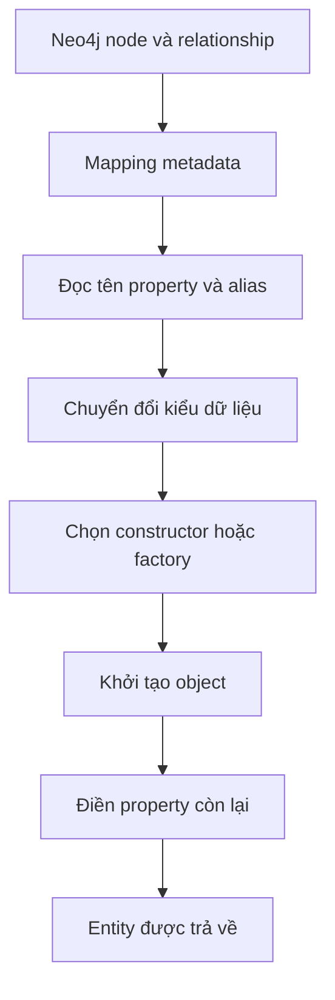

# Constructor, alias, kiểu property và giá trị null không khớp

## Mục tiêu bài học

Spring Data Neo4j (SDN) chuyển dữ liệu graph thành object Java hoặc Kotlin và chuyển object thành node, relationship cùng property khi ghi. Một lỗi mapping có thể làm repository trả về object thiếu dữ liệu, lỗi khi tạo entity, chuyển đổi sai kiểu hoặc xóa property ngoài ý muốn.

Các lỗi thường tập trung ở bốn điểm:

- Constructor được SDN chọn không đúng hoặc tham số không khớp property của entity.
- Tên property trong class, tên property lưu trong Neo4j và alias trong Cypher không đồng nhất.
- Kiểu Java không tương thích với kiểu giá trị Cypher hoặc thiếu custom converter.
- Ứng dụng hiểu sai khác biệt giữa property không tồn tại, giá trị `null`, giá trị mặc định và property bắt buộc.

Bài học này trình bày cách đọc dấu hiệu lỗi, xác minh dữ liệu graph, sửa mapping metadata và thiết kế integration test để tránh lỗi tái diễn.

## 1. Hiểu luồng mapping trước khi chẩn đoán

Khi đọc một node, SDN phải xác định class đích, tạo object, rồi đưa các giá trị đọc được vào property tương ứng. Khi ghi, SDN thực hiện chiều ngược lại: lấy giá trị từ entity, chuyển đổi sang kiểu mà Neo4j hỗ trợ và ghi property hoặc relationship.

Có thể hình dung luồng đọc như sau:



Một lỗi ở bước đầu có thể xuất hiện ở bước sau. Ví dụ, tên alias không khớp có thể khiến constructor nhận `null`; lỗi kiểu dữ liệu có thể xuất hiện như lỗi khởi tạo constructor; property thiếu có thể làm primitive nhận giá trị mặc định.

Khi chẩn đoán, cần tách ba câu hỏi:

1. Query có trả về đúng node và đúng key không?
2. Giá trị từ Neo4j có chuyển được sang kiểu Java đích không?
3. SDN có đưa giá trị đó vào đúng constructor hoặc property không?

Đừng bắt đầu bằng cách sửa constructor nếu dữ liệu query thực tế đã thiếu key hoặc trả về alias khác.

## 2. Constructor nào được SDN sử dụng?

Spring Data tự chọn constructor hoặc factory method để tạo entity khi đọc dữ liệu. Với Java, thứ tự lựa chọn hiện hành về cơ bản là:

1. Dùng static factory method duy nhất được đánh dấu `@PersistenceCreator`, nếu có.
2. Nếu class chỉ có một constructor, dùng constructor đó.
3. Nếu có nhiều constructor và chỉ một constructor được đánh dấu `@PersistenceCreator`, dùng constructor đó.
4. Với Java record, dùng canonical constructor.
5. Nếu không có lựa chọn phù hợp ở trên và class có constructor không tham số, dùng constructor không tham số; các constructor khác bị bỏ qua.

Nếu có nhiều constructor nhưng không xác định được constructor phù hợp, mapping có thể thất bại. Vì vậy, không nên thêm constructor tiện dụng vào entity mà quên chỉ rõ constructor dành cho persistence.

### Ví dụ có nhiều constructor

```java
import org.springframework.data.annotation.PersistenceCreator;
import org.springframework.data.neo4j.core.schema.GeneratedValue;
import org.springframework.data.neo4j.core.schema.Id;
import org.springframework.data.neo4j.core.schema.Node;

@Node("Customer")
public class Customer {

    @Id
    @GeneratedValue
    private Long id;

    private String name;
    private Integer loyaltyPoints;

    public Customer(String name) {
        this(null, name, 0);
    }

    @PersistenceCreator
    public Customer(Long id, String name, Integer loyaltyPoints) {
        this.id = id;
        this.name = name;
        this.loyaltyPoints = loyaltyPoints;
    }

    public Long getId() {
        return id;
    }

    public String getName() {
        return name;
    }

    public Integer getLoyaltyPoints() {
        return loyaltyPoints;
    }
}
```

Constructor có `@PersistenceCreator` là constructor SDN dùng khi hydrate entity. Constructor một tham số vẫn có thể được ứng dụng dùng để tạo object mới.

Nếu bỏ `@PersistenceCreator` trong class có nhiều constructor, SDN có thể không chọn constructor mà bạn mong muốn. Một constructor không tham số do Lombok sinh ra cũng có thể làm thay đổi quy tắc lựa chọn. Khi dùng Lombok, hãy kiểm tra constructor thực tế được sinh ra, không chỉ nhìn phần source ngắn gọn.

### Tên tham số constructor phải khớp property

Tên tham số constructor phải tương ứng với tên property trong mô hình entity. Spring Data cần đọc được tên tham số từ bytecode hoặc từ `@ConstructorProperties`.

Ví dụ:

```java
@PersistenceCreator
public Customer(Long id, String name, Integer loyaltyPoints) {
    this.id = id;
    this.name = name;
    this.loyaltyPoints = loyaltyPoints;
}
```

Nếu class chỉ có property `loyaltyPoints` nhưng constructor khai báo `Integer points`, Spring Data không thể tự suy ra rằng `points` là `loyaltyPoints`. Hãy đổi tên tham số hoặc khai báo metadata constructor phù hợp.

Với Java compiler, có thể bật tùy chọn `-parameters` để lưu tên tham số trong bytecode. Một lựa chọn khác là dùng `java.beans.ConstructorProperties`:

```java
import java.beans.ConstructorProperties;
import org.springframework.data.annotation.PersistenceCreator;

@PersistenceCreator
@ConstructorProperties({"id", "name", "loyaltyPoints"})
public Customer(Long id, String name, Integer points) {
    this.id = id;
    this.name = name;
    this.loyaltyPoints = points;
}
```

Các tên trong `@ConstructorProperties` phải theo đúng thứ tự tham số. Nếu dùng annotation này, hãy giữ tên property logic của entity trong danh sách.

### Immutable entity và property được điền sau constructor

Sau khi tạo object, SDN điền các property chưa được constructor tiêu thụ. Nó có thể dùng setter, field mutable, phương thức `with…` hoặc constructor persistence để tạo bản sao mới cho property immutable.

Nếu class có field `final` nhưng constructor persistence không nhận field đó và cũng không có cơ chế tạo bản sao, SDN có thể không điền được giá trị. Cách khắc phục:

- Đưa property vào persistence constructor.
- Dùng wither tương ứng như `withDisplayName(...)` hoặc `withId(...)` cho property immutable cần thay đổi sau khi tạo.
- Dùng field mutable hoặc setter nếu domain model cho phép.
- Với ID được sinh tự động, thiết kế constructor và cơ chế cập nhật ID theo mẫu mapping immutable của Spring Data.

Không nên thêm setter cho mọi field chỉ để né lỗi mapping. Hãy chọn một mô hình nhất quán: entity immutable với persistence constructor đầy đủ, hoặc entity mutable có đường điền property rõ ràng.

### Java record và Kotlin data class

Với Java record, SDN dùng canonical constructor. Tên component phải trùng tên property cần ánh xạ.

Với Kotlin, Spring Data ưu tiên constructor được đánh dấu `@PersistenceCreator`, sau đó là primary constructor của data class và các quy tắc tương ứng. Tham số có giá trị mặc định có thể nhận default khi property không có trong kết quả hoặc trả về `null`. Đây là khác biệt quan trọng khi so sánh entity Java và Kotlin.

## 3. Phân biệt tên class, tên property và alias

Trong mapping có nhiều loại tên, mỗi loại có vai trò riêng:

| Tên | Ví dụ | Dùng ở đâu |
|---|---|---|
| Tên class | `Customer` | Kiểu object Java |
| Label Neo4j | `Customer` | Nhận diện node trong graph |
| Tên property Java | `displayName` | Entity, constructor và derived query |
| Tên property Neo4j | `full_name` | Dữ liệu node và Cypher |
| Alias kết quả Cypher | `displayName` | Tên cột trả về cho projection/DTO |

### Dùng @Property để ánh xạ tên property

Nếu database hiện có property `full_name`, trong Java có thể dùng tên dễ đọc hơn là `displayName`:

```java
import org.springframework.data.neo4j.core.schema.Node;
import org.springframework.data.neo4j.core.schema.Property;
import org.springframework.data.neo4j.core.schema.GeneratedValue;
import org.springframework.data.neo4j.core.schema.Id;

@Node("Customer")
public class Customer {

    @Id
    @GeneratedValue
    private Long id;

    @Property("full_name")
    private String displayName;

    public Customer(String displayName) {
        this.displayName = displayName;
    }

    public String getDisplayName() {
        return displayName;
    }
}
```

Ở đây:

- `displayName` là property logic trong entity.
- `full_name` là key được lưu trên node.
- Constructor nhận tham số `displayName`, không phải `full_name`.

Nếu có `@Property("full_name")` mà constructor nhận `String full_name`, tên tham số không còn khớp property logic. Đây là nguyên nhân thường gặp khiến giá trị constructor không được cấp đúng.

### Alias trong @Node

`@Node` có thuộc tính `labels`; thuộc tính `value` là alias của `labels`. Hai cách sau có ý nghĩa tương đương:

```java
@Node("Customer")
class Customer {
}
```

```java
@Node(labels = "Customer")
class Customer {
}
```

Alias của `@Node` điều khiển label node, không điều khiển tên property. Không nhầm alias label với alias property.

### Alias trong custom Cypher

Khi query trả về projection hoặc DTO, alias trong `RETURN` phải khớp với tên property/component mà kiểu đích mong đợi.

```cypher
MATCH (c:Customer)
RETURN c.full_name AS displayName
```

Ví dụ DTO:

```java
public record CustomerNameView(String displayName) {
}
```

Nếu query trả về `AS full_name` nhưng DTO có component `displayName`, ánh xạ projection có thể thiếu giá trị. Đặt alias nhất quán với tên component DTO.

Cần phân biệt hai trường hợp:

- Query trả về node `RETURN c`: SDN ánh xạ property của node theo metadata entity, bao gồm `@Property`.
- Query trả về scalar hoặc map projection: tên key trong kết quả query phải khớp tên property của projection/DTO. `@Property` không tự đổi tên alias mà bạn viết trong Cypher.

Derived query dùng tên property Java. Ví dụ `findByDisplayName(...)` dựa trên property `displayName`; khi SDN tạo query, metadata `@Property("full_name")` được dùng để truy cập đúng key trong graph.

## 4. Chẩn đoán lỗi tên property không khớp

Lỗi alias có thể không làm query thất bại. Node vẫn được đọc, nhưng property trong object có thể là `null` hoặc không được điền.

Giả sử entity:

```java
@Node("Customer")
public class Customer {

    @Property("full_name")
    private String displayName;
}
```

Dữ liệu thực tế trong Neo4j lại lưu `name`:

```cypher
CREATE (:Customer {name: "Lan"});
```

SDN tìm property `full_name`, không tìm thấy và trả về giá trị thiếu. Sửa một trong hai phía để chúng thống nhất:

```cypher
MATCH (c:Customer)
WHERE c.name IS NOT NULL
SET c.full_name = c.name
REMOVE c.name;
```

Hoặc đổi annotation để khớp schema đang có:

```java
@Property("name")
private String displayName;
```

### Kiểm tra key thật trong Neo4j

Dùng Cypher để xem các key của node:

```cypher
MATCH (c:Customer)
RETURN keys(c) AS propertyNames,
       c.full_name AS fullName,
       c.name AS legacyName
LIMIT 10;
```

So sánh kết quả với:

- Tên trong `@Property`.
- Tên property Java.
- Tên tham số constructor.
- Tên alias trong custom query.
- Tên component trong DTO hoặc record.

Không sửa database chỉ để làm cho tên key giống Java nếu database đang có quy ước đặt tên ổn định. `@Property` tồn tại để kết nối mô hình domain với schema thực tế.

## 5. Các kiểu Java và kiểu property Neo4j

Neo4j lưu property bằng các kiểu dữ liệu Cypher. SDN có sẵn nhiều chuyển đổi, nhưng không phải kiểu Java nào cũng được lưu nguyên dạng.

Một số ánh xạ phổ biến trong SDN hiện hành:

| Kiểu Java | Kiểu Cypher hoặc cách lưu |
|---|---|
| `Boolean`, `boolean` | Boolean |
| `Long`, `Integer`, `Short` | Integer |
| `Double` | Float |
| `String` | String |
| `byte[]` | ByteArray |
| `LocalDate` | Date |
| `LocalTime` | LocalTime |
| `OffsetTime` | Time |
| `LocalDateTime` | LocalDateTime |
| `ZonedDateTime` | DateTime |
| `Instant`, `OffsetDateTime` | DateTime qua conversion |
| `java.util.Date` | Chuỗi ISO-8601 theo UTC |
| `Duration`, `Period` | Duration |
| `BigDecimal`, `BigInteger` | String |
| `Float` và `float` | String theo conversion mặc định của SDN |
| `Enum` | String theo tên enum |
| `UUID`, `URI`, `URL` | String |
| `Point` | Point |

Hãy xem bảng conversion của đúng phiên bản SDN đang dùng khi lựa chọn kiểu domain. Đặc biệt, đừng giả định `Float` luôn được lưu thành Cypher FLOAT hoặc `BigDecimal` luôn được lưu thành số. Nếu cần tính toán, so sánh số học hoặc sắp xếp trong Cypher, hãy chọn cách biểu diễn phù hợp ngay từ đầu.

### Ví dụ lỗi sai kiểu dữ liệu

Entity khai báo:

```java
@Node("Invoice")
public class Invoice {

    @Id
    @GeneratedValue
    private Long id;

    private Long totalAmount;
}
```

Dữ liệu import trước đó lại lưu `totalAmount` dưới dạng chuỗi:

```cypher
CREATE (:Invoice {totalAmount: "125000"});
```

SDN cần chuyển String thành Long. Nếu conversion không được hỗ trợ trong đường mapping đang dùng, thao tác đọc có thể phát sinh lỗi chuyển đổi. Nếu muốn giữ kiểu số, hãy migrate dữ liệu:

```cypher
MATCH (i:Invoice)
WHERE valueType(i.totalAmount) = "STRING NOT NULL"
SET i.totalAmount = toInteger(i.totalAmount);
```

Trước khi chuyển đổi dữ liệu, hãy kiểm tra các giá trị không thể chuyển thành số để tránh làm migration thất bại giữa chừng:

```cypher
MATCH (i:Invoice)
WHERE valueType(i.totalAmount) = "STRING NOT NULL"
  AND toIntegerOrNull(i.totalAmount) IS NULL
RETURN i.id, i.totalAmount;
```

`valueType()` có từ Neo4j 5.13 và trả về cả thông tin nullability, vì vậy một chuỗi có giá trị thường có kiểu `STRING NOT NULL`. Nếu phiên bản Neo4j đang dùng chưa hỗ trợ `valueType()`, hãy kiểm tra kiểu dữ liệu bằng Neo4j Browser hoặc Neo4j Java Driver tương ứng với phiên bản đó.

## 6. Khi nào cần custom converter?

Dùng custom converter khi domain có kiểu riêng hoặc cần biểu diễn khác với conversion mặc định. Ví dụ, ứng dụng có kiểu `Money` và muốn lưu số tiền dưới dạng integer theo đơn vị nhỏ nhất để tránh sai số dấu phẩy động.

```java
public record Money(long minorUnits) {
}
```

Converter ghi:

```java
import org.neo4j.driver.Value;
import org.neo4j.driver.Values;
import org.springframework.core.convert.converter.Converter;
import org.springframework.data.convert.WritingConverter;

@WritingConverter
public class MoneyWriteConverter implements Converter<Money, Value> {

    @Override
    public Value convert(Money source) {
        return Values.value(source.minorUnits());
    }
}
```

Converter đọc:

```java
import org.neo4j.driver.Value;
import org.springframework.core.convert.converter.Converter;
import org.springframework.data.convert.ReadingConverter;

@ReadingConverter
public class MoneyReadConverter implements Converter<Value, Money> {

    @Override
    public Money convert(Value source) {
        return new Money(source.asLong());
    }
}
```

Đăng ký converter vào `Neo4jConversions`:

```java
import java.util.List;

import org.springframework.context.annotation.Bean;
import org.springframework.context.annotation.Configuration;
import org.springframework.data.neo4j.core.convert.Neo4jConversions;

@Configuration
class Neo4jConversionConfiguration {

    @Bean
    Neo4jConversions neo4jConversions() {
        return new Neo4jConversions(List.of(
                new MoneyWriteConverter(),
                new MoneyReadConverter()
        ));
    }
}
```

Converter phải có chiều ghi và chiều đọc khi entity property cần round-trip. Nếu converter chỉ phục vụ tham số của custom repository query, chiều chuyển đổi vào Neo4j `Value` có thể là đủ.

Nếu chỉ một property cần conversion riêng, có thể dùng `@ConvertWith` trên property thay vì đăng ký converter toàn cục. Chọn phạm vi converter sao cho không vô tình thay đổi cách các entity khác lưu cùng kiểu Java.

### Đừng biến dữ liệu số thành chuỗi ngoài ý muốn

Nếu lưu tiền dưới dạng chuỗi như `"125000"`, Cypher sẽ xử lý nó như String. Các phép so sánh và sắp xếp có thể cho kết quả khác với kiểu Integer. Ví dụ, sắp xếp chuỗi `"100"` và `"20"` theo thứ tự từ điển không giống sắp xếp số.

Với dữ liệu cần tính toán, chọn kiểu số phù hợp hoặc converter lưu theo đơn vị nhỏ nhất. Chỉ dùng chuỗi khi cần giữ định dạng hoặc khi domain thực sự là văn bản.

## 7. Property không tồn tại và null trong Neo4j

Trong Cypher, `null` biểu thị giá trị thiếu hoặc chưa xác định. Neo4j không lưu property có giá trị null. Khi gán `null` cho property, property đó bị xóa khỏi node hoặc relationship.

Ví dụ:

```cypher
MATCH (c:Customer {customerId: "C-100"})
SET c.nickname = null
RETURN c.nickname;
```

Kết quả của `c.nickname` là `null`, vì property không còn tồn tại. Khi đọc một property không có trên node, Cypher cũng trả về `null`.

Điều này có nghĩa:

- Property không tồn tại và giá trị Cypher `null` đều được nhìn thấy như giá trị thiếu khi đọc.
- Không thể lưu một property Neo4j với giá trị `null` để phân biệt với property chưa từng được tạo.
- `SET n.property = null` có tác dụng xóa property.
- Nếu cần phân biệt “chưa biết”, “đã xóa” và “không áp dụng”, hãy biểu diễn các trạng thái đó bằng một mô hình domain rõ ràng, chẳng hạn status hoặc cờ riêng.

### Dùng IS NULL, không dùng = null

Trong Cypher, biểu thức `null = null` không trả về true mà trả về `null`. Vì vậy, không dùng `WHERE n.nickname = null`.

Dùng:

```cypher
MATCH (c:Customer)
WHERE c.nickname IS NULL
RETURN c;
```

Để tìm property có giá trị:

```cypher
MATCH (c:Customer)
WHERE c.nickname IS NOT NULL
RETURN c;
```

Nếu cần giá trị thay thế chỉ cho kết quả truy vấn, dùng `coalesce`:

```cypher
MATCH (c:Customer)
RETURN coalesce(c.nickname, "Chưa đặt biệt danh") AS nickname;
```

`coalesce` không tự ghi giá trị mặc định trở lại node. Nó chỉ tạo giá trị thay thế trong kết quả của biểu thức.

## 8. Chọn primitive hay wrapper type?

Java primitive không thể biểu diễn trạng thái thiếu. Ví dụ:

- `int` luôn có một giá trị số, mặc định của field là `0`.
- `boolean` luôn là `true` hoặc `false`, mặc định của field là `false`.
- `Integer` và `Boolean` có thể là `null`.

Nếu property có thể vắng mặt trong graph, dùng wrapper để giữ khả năng biểu diễn giá trị thiếu:

```java
@Node("Customer")
public class Customer {

    private Integer age;

    private Boolean marketingOptIn;
}
```

Nếu dùng primitive:

```java
private int age;
private boolean marketingOptIn;
```

ứng dụng không thể phân biệt property thiếu với giá trị `0` hoặc `false` sau khi hydrate object. Tùy đường khởi tạo và cách điền property, giá trị mặc định của primitive có thể che giấu dữ liệu bị thiếu hoặc không hợp lệ.

Quy tắc thực tế:

| Ý nghĩa nghiệp vụ | Kiểu nên cân nhắc |
|---|---|
| Tuổi có thể chưa biết | `Integer` |
| Cờ có thể chưa được người dùng lựa chọn | `Boolean` |
| Số lần thử luôn phải có giá trị và mặc định 0 là hợp lệ | `int` hoặc `Integer` với default rõ ràng |
| Cờ bắt buộc và luôn được khởi tạo | `boolean` hoặc `Boolean` với validation |
| Ngày kết thúc có thể chưa xác định | `LocalDate` hoặc kiểu reference tương ứng |

Không chọn wrapper chỉ vì “an toàn hơn” nếu nghiệp vụ yêu cầu property bắt buộc. Khi property bắt buộc, hãy kiểm tra dữ liệu đầu vào, migration dữ liệu cũ và ràng buộc schema phù hợp. Đừng âm thầm chuyển dữ liệu thiếu thành 0 hoặc false nếu những giá trị đó có ý nghĩa thật.

## 9. Phân biệt không cập nhật và xóa property

Một lỗi phổ biến xảy ra khi service nhận request cập nhật một phần. Request không gửi `nickname` có thể được deserialize thành `null`. Khi entity được lưu, SDN có thể ghi `null` và khiến property bị xóa.

Ứng dụng cần phân biệt hai ý định:

1. Không gửi field: giữ nguyên giá trị hiện tại.
2. Gửi field với null: xóa giá trị hiện tại.

Một DTO chỉ có field nullable thường không giữ được sự khác biệt này. Có thể dùng một kiểu patch có cờ xác định field đã được cung cấp:

```java
public record FieldUpdate<T>(boolean supplied, T value) {
}
```

Mapper của request cần tạo `FieldUpdate(false, null)` khi field không xuất hiện và `FieldUpdate(true, null)` khi client gửi null có chủ đích. Trong service, bảo đảm wrapper `FieldUpdate` luôn được khởi tạo trước khi đọc `supplied`.

Service chỉ cập nhật khi `supplied` là true:

```java
if (request.nickname().supplied()) {
    customer.setNickname(request.nickname().value());
}
```

Nếu `value` là null, service hiểu đây là yêu cầu xóa. Nếu `supplied` là false, service giữ nguyên property. Quy tắc này đặc biệt quan trọng với API PATCH và luồng đồng bộ dữ liệu từng phần.

## 10. Các lỗi thường gặp và cách nhận diện

| Dấu hiệu | Nguyên nhân có thể | Cách kiểm tra |
|---|---|---|
| Entity được tạo nhưng field luôn null | Tên property hoặc alias không khớp | Kiểm tra `keys(node)`, `@Property` và query alias |
| Lỗi khởi tạo entity | Constructor không được xác định hoặc tham số không khớp | Kiểm tra constructor, `@PersistenceCreator` và parameter names |
| Giá trị field bị về 0 hoặc false | Dùng primitive cho property có thể thiếu | Đổi sang wrapper và kiểm tra dữ liệu cũ |
| Lỗi chuyển đổi kiểu | Neo4j lưu String nhưng entity yêu cầu số, hoặc ngược lại | Kiểm tra kiểu thực tế và conversion table |
| Giá trị thời gian lệch múi giờ | Dùng kiểu thời gian không giữ timezone mong muốn | Kiểm tra kiểu Java và conversion UTC |
| Query trả về DTO thiếu field | Alias trong RETURN khác component DTO | Đặt alias khớp property của projection |
| Ghi entity làm mất property | Field null được ghi thành property bị xóa | Kiểm tra DTO update và ý nghĩa null |
| Enum không đọc được | Giá trị trong graph không khớp tên enum | Kiểm tra giá trị chuỗi và converter |
| Giá trị số được sắp xếp sai | Property được lưu thành String | Kiểm tra kiểu Cypher và chuyển dữ liệu |
| Property immutable không được điền | Không có constructor/wither phù hợp | Đưa property vào persistence constructor hoặc cung cấp wither |

Tên exception thay đổi theo đường mapping và phiên bản thư viện. Có thể gặp `MappingException`, `MappingInstantiationException`, `ConversionFailedException`, `IllegalArgumentException` hoặc lỗi từ Neo4j Driver. Hãy đọc exception gốc ở phần `Caused by`; exception ngoài cùng thường chỉ cho biết tầng repository hoặc template nơi lỗi xuất hiện.

## 11. Quy trình chẩn đoán theo từng bước

Khi repository trả về object thiếu hoặc sai dữ liệu, hãy làm theo trình tự:

1. Xác định node hoặc relationship thực tế mà query phải đọc.
2. Dùng Cypher xem label, property key và giá trị đang lưu.
3. So sánh tên key với `@Property` và tên Java property.
4. Kiểm tra alias trong `RETURN` nếu query trả về projection hoặc DTO.
5. Kiểm tra kiểu Java so với kiểu Cypher thực tế.
6. Kiểm tra constructor mà SDN sẽ chọn và tên tham số.
7. Kiểm tra property immutable có cơ chế được điền sau constructor không.
8. Kiểm tra property thiếu, null và giá trị mặc định có đúng ý nghĩa nghiệp vụ không.
9. Viết integration test tái hiện đúng dữ liệu và query gây lỗi.
10. Chỉ sau khi test xác nhận mapping đúng mới triển khai migration hoặc thay đổi schema.

### Query hỗ trợ chẩn đoán

```cypher
MATCH (c:Customer {customerId: $customerId})
RETURN labels(c) AS labels,
       keys(c) AS propertyNames,
       c.full_name AS storedName,
       c.loyalty_points AS storedPoints,
       valueType(c.loyalty_points) AS pointsType;
```

Query này giúp xác minh label, key, giá trị và kiểu dữ liệu đang có. Thay các tên property bằng tên thật của schema. Nếu phiên bản server không hỗ trợ `valueType()`, tạm bỏ biểu thức đó và kiểm tra kiểu qua Neo4j Browser hoặc Driver.

## 12. Kiểm thử mapping bằng Neo4j thật

Unit test cho constructor hoặc service không chứng minh SDN hydrate dữ liệu đúng. Hãy dùng integration test với Neo4j thật để kiểm tra round-trip: ghi entity, đọc lại và so sánh giá trị.

Các trường hợp nên có:

- Constructor persistence được chọn đúng khi class có nhiều constructor.
- Property Java có alias bằng `@Property` được đọc và ghi đúng key.
- Custom Cypher alias khớp DTO projection.
- Giá trị số, thời gian, enum và custom type round-trip chính xác.
- Property không tồn tại được ánh xạ theo chính sách null đã chọn.
- Property nullable không bị ép thành primitive mặc định.
- Cập nhật một phần không xóa field không được gửi.
- Cập nhật với null có chủ đích xóa property.

### Ví dụ test alias và null

Entity `Customer.java`:

```java
import org.springframework.data.neo4j.core.schema.GeneratedValue;
import org.springframework.data.neo4j.core.schema.Id;
import org.springframework.data.neo4j.core.schema.Node;
import org.springframework.data.neo4j.core.schema.Property;

@Node("Customer")
public class Customer {

    @Id
    @GeneratedValue
    private Long id;

    private String customerId;

    @Property("full_name")
    private String displayName;

    private Integer loyaltyPoints;

    public Long getId() { return id; }
    public String getCustomerId() { return customerId; }
    public String getDisplayName() { return displayName; }
    public Integer getLoyaltyPoints() { return loyaltyPoints; }
}
```

Repository `CustomerRepository.java`:

```java
import java.util.Optional;

import org.springframework.data.neo4j.repository.Neo4jRepository;

public interface CustomerRepository
        extends Neo4jRepository<Customer, Long> {

    Optional<Customer> findByCustomerId(String customerId);
}
```

Integration test:

```java
import static org.assertj.core.api.Assertions.assertThat;

import org.junit.jupiter.api.Test;
import org.springframework.beans.factory.annotation.Autowired;
import org.springframework.boot.data.neo4j.test.autoconfigure.DataNeo4jTest;
import org.springframework.data.neo4j.core.Neo4jClient;

@DataNeo4jTest
class CustomerMappingTest {

    @Autowired
    CustomerRepository repository;

    @Autowired
    Neo4jClient neo4jClient;

    @Test
    void shouldMapAliasedPropertyAndOptionalValue() {
        neo4jClient.query("""
                CREATE (:Customer {
                    customerId: 'C-100',
                    full_name: 'Lan'
                })
                """).run();

        Customer customer = repository.findByCustomerId("C-100")
                .orElseThrow();

        assertThat(customer.getDisplayName()).isEqualTo("Lan");
        assertThat(customer.getLoyaltyPoints()).isNull();
    }
}
```

Test cần dùng database test sạch hoặc khóa dữ liệu riêng. Nếu test slice tự quản lý transaction, hãy hiểu transaction boundary của test khi kiểm tra commit/rollback. Với test round-trip, bảo đảm query setup và repository read cùng nhìn thấy dữ liệu theo đúng transaction semantics.
Ví dụ giả định Spring test context đã được nối tới Neo4j test instance, chẳng hạn bằng Testcontainers.

### Kiểm thử custom converter

Với kiểu riêng như `Money`, kiểm tra cả hai chiều:

1. Lưu entity có `Money`.
2. Đọc raw property qua Cypher hoặc Driver và xác nhận kiểu biểu diễn.
3. Đọc entity qua repository.
4. So sánh giá trị domain sau khi chuyển đổi.
5. Kiểm tra dữ liệu null hoặc không hợp lệ theo chính sách converter.

Không chỉ test hàm converter riêng. Cần một integration test để xác nhận converter đã được đăng ký vào `Neo4jConversions` mà SDN đang sử dụng.

## 13. Checklist trước khi sửa mapping

Trước khi sửa entity hoặc schema, hãy xác nhận:

- [ ] Đã xác định đúng node label và property key trong database.
- [ ] Tên Java property, constructor parameter và alias đã thống nhất.
- [ ] `@Property` đang trỏ đến key thực tế.
- [ ] Constructor persistence được xác định rõ.
- [ ] Parameter names có trong bytecode hoặc được khai báo qua `@ConstructorProperties`.
- [ ] Property immutable có thể được điền hoặc tạo bản sao.
- [ ] Kiểu Java có conversion được SDN hỗ trợ.
- [ ] Custom converter có chiều đọc/ghi cần thiết và đã được đăng ký.
- [ ] Property nullable dùng wrapper hoặc mô hình biểu diễn absence phù hợp.
- [ ] Query dùng `IS NULL` và `IS NOT NULL` khi kiểm tra null.
- [ ] API update phân biệt field không gửi với field được gửi null.
- [ ] Integration test xác nhận round-trip trên Neo4j thật.

## 14. Tự kiểm tra

1. SDN chọn constructor nào khi entity chỉ có một constructor?
2. Khi có nhiều constructor, `@PersistenceCreator` giải quyết vấn đề gì?
3. Vì sao tên tham số constructor phải khớp tên property Java?
4. `@Property("full_name")` ảnh hưởng thế nào đến tên tham số constructor?
5. Khác biệt giữa alias của `@Node`, alias property và alias trong Cypher là gì?
6. Vì sao custom query trả về DTO cần alias khớp component?
7. Những kiểu Java nào được chuyển thành String theo conversion mặc định của SDN?
8. Khi nào cần đăng ký custom converter trong `Neo4jConversions`?
9. Vì sao primitive không phù hợp với property có thể vắng mặt?
10. Neo4j xử lý `SET n.property = null` như thế nào?
11. Vì sao `WHERE n.property = null` không tìm được property thiếu?
12. Làm thế nào phân biệt không cập nhật field và chủ động xóa field trong API PATCH?
13. Tại sao unit test converter không đủ để xác nhận SDN mapping hoạt động?
14. Những dữ liệu nào cần kiểm tra trước khi sửa alias hoặc chuyển kiểu property?

Hãy tạo entity Customer có property Java `displayName` ánh xạ tới `full_name`, một persistence constructor có `@PersistenceCreator`, và một property tùy chọn kiểu `Integer`. Nạp node bằng Cypher, đọc qua repository, ghi lại entity rồi kiểm tra raw property. Thử thay đổi tên key, đổi kiểu số thành chuỗi và xóa property bằng cách gán null. Với mỗi tình huống, ghi nhận lỗi hoặc kết quả thực tế, sửa mapping và bổ sung integration test để bảo đảm lỗi không quay lại.

## Tài liệu tham khảo

- [Spring Data Neo4j — Metadata-based Mapping](https://docs.spring.io/spring-data/neo4j/reference/object-mapping/metadata-based-mapping.html)
- [Spring Data Neo4j — Conversions](https://docs.spring.io/spring-data/neo4j/reference/appendix/conversions.html)
- [Spring Data Commons — Object Mapping Fundamentals](https://docs.spring.io/spring-data/commons/reference/object-mapping.html)
- [Spring Boot — Auto-configured Data Neo4j Tests](https://docs.spring.io/spring-boot/reference/testing/spring-boot-applications.html)
- [Neo4j Java Driver Manual — Data types and mapping to Cypher types](https://neo4j.com/docs/java-manual/current/data-types/)
- [Neo4j Cypher Manual — Scalar functions and valueType()](https://neo4j.com/docs/cypher-manual/current/functions/scalar/)
- [Neo4j Cypher Manual — Working with null](https://neo4j.com/docs/cypher-manual/current/values-and-types/working-with-null/)
