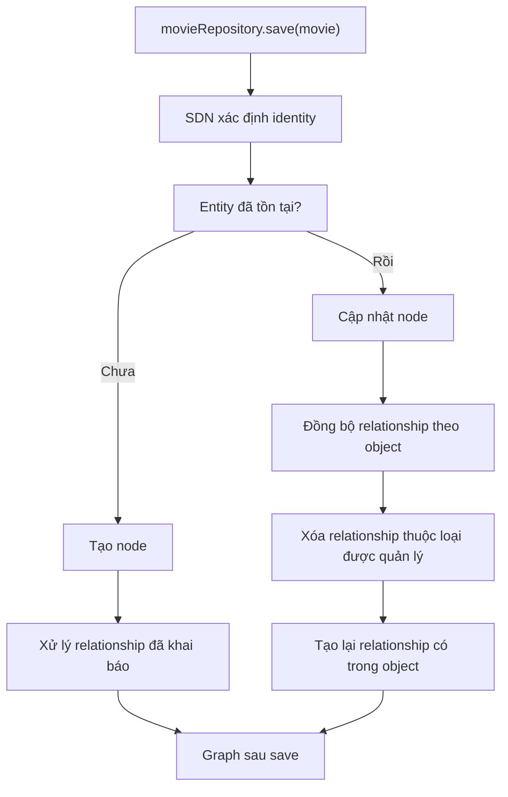

# Save tạo node trùng hoặc xóa liên kết ngoài dự kiến

Trong Spring Data Neo4j (SDN), `save(entity)` lưu entity cùng phần graph được mô hình hóa qua các relationship của entity đó. Đây không phải lúc nào cũng là thao tác cập nhật một vài property độc lập. SDN cần xác định node là mới hay đã tồn tại, sau đó đồng bộ các relationship được khai báo trong object với graph.

Hai nhóm lỗi thường gặp xuất phát từ hai quyết định khác nhau:

- **Node bị tạo trùng:** SDN không nhận ra object là entity đã tồn tại, thường do cách khai báo hoặc quản lý identity chưa đúng.
- **Relationship bị xóa:** object đem đi save chỉ chứa một phần các relationship hiện có, nên trạng thái object bị hiểu là trạng thái đầy đủ cần ghi xuống graph.

Muốn chẩn đoán đúng, cần kiểm tra cả identity của node lẫn mức độ đầy đủ của graph được ánh xạ vào object.

## 1. Hiểu đúng thao tác save của SDN

Một node được quản lý cần có identity để SDN liên kết instance Java với node trong Neo4j. Với entity đã tồn tại, SDN cập nhật property và xử lý những relationship được khai báo trong domain model.

Với một relationship được quản lý, quy trình save về cơ bản là:

1. Xác định node gốc là mới hay đã tồn tại.
2. Nếu node đã tồn tại, xóa các relationship thuộc loại được quản lý ở điểm đó để đồng bộ lại.
3. Lưu hoặc xác định các node đích được tham chiếu.
4. Tạo lại các relationship được biểu diễn trong object.
5. Tiếp tục xử lý các relationship được khai báo ở các entity liên quan trong graph được lưu.

Ví dụ, entity `Movie` khai báo relationship `ACTED_IN` đến các `Actor`. Khi save một `Movie` đã tồn tại, SDN có thể xóa các relationship `ACTED_IN` hiện tại của node phim rồi tạo lại các relationship có trong collection `actors` của object.



Đây là lý do SDN khuyến nghị tránh load, thao tác rồi save các subgraph không đầy đủ: các relationship không có trong object có thể bị loại khỏi graph.

`save` không có nghĩa là xóa node đích. Trong tình huống này, SDN thường xóa relationship rồi tạo lại các relationship được mô hình hóa; các node `Actor` vẫn có thể tồn tại độc lập trong graph.

## 2. Nguyên nhân node bị tạo trùng

### 2.1. Gán business ID nhưng không khai báo @Version

Một business ID thường được gán ngay khi tạo object:

```java
@Node("Movie")
public class Movie {

    @Id
    private String externalId;

    private String title;

    public Movie(String externalId, String title) {
        this.externalId = externalId;
        this.title = title;
    }
}
```

Vấn đề là `externalId` đã có giá trị trước khi SDN xử lý entity. Chỉ nhìn vào ID này, SDN không thể biết object vừa được tạo trong ứng dụng hay được load từ database. Theo hướng dẫn của SDN, với business ID được gán sẵn, SDN xem entity là mới nếu không có trường `@Version` để phân biệt trạng thái.

Vì vậy, mỗi lần gọi `save` với object mới có cùng `externalId`, ứng dụng có thể tạo thêm node:

```java
movieRepository.save(new Movie("movie-42", "Graph Journey"));
movieRepository.save(new Movie("movie-42", "Graph Journey - Updated"));
```

Đây không phải một upsert theo business ID mà ứng dụng có thể mặc định kỳ vọng. Cần cấu hình identity detection đúng với chiến lược ID đang dùng.

### 2.2. Dùng @Version cho business ID

Với business ID được gán từ ứng dụng, thêm trường `@Version`:

```java
import org.springframework.data.annotation.Version;
import org.springframework.data.neo4j.core.schema.Id;
import org.springframework.data.neo4j.core.schema.Node;

@Node("Movie")
public class Movie {

    @Id
    private String externalId;

    @Version
    private Long version;

    private String title;

    public Movie(String externalId, String title) {
        this.externalId = externalId;
        this.title = title;
    }

    public String getExternalId() {
        return externalId;
    }

    public String getTitle() {
        return title;
    }

    public void setTitle(String title) {
        this.title = title;
    }
}
```

`@Version` giúp SDN phân biệt entity mới và entity đã được lưu; đồng thời hỗ trợ optimistic locking:

- Khi tạo mới, SDN khởi tạo version.
- Khi cập nhật thành công, version được tăng tự động.
- Nếu một object cũ cố cập nhật entity đã bị transaction khác thay đổi, SDN có thể ném `OptimisticLockingFailureException`.

Không tự gán hoặc tăng `version`. Khi gặp optimistic locking failure, hãy load lại entity với version hiện tại, áp dụng lại thay đổi nghiệp vụ trên dữ liệu mới rồi retry theo chính sách của ứng dụng.

### 2.3. Dùng ID được sinh tự động

Nếu không cần business ID làm identity của entity, có thể dùng ID được SDN sinh:

```java
@Node("Movie")
public class Movie {

    @Id
    @GeneratedValue
    private Long id;

    private String title;

    public Movie(String title) {
        this.title = title;
    }

    public Long getId() {
        return id;
    }
}
```

Với `Long` và `@GeneratedValue`, SDN ánh xạ Neo4j internal ID. Một object mới có ID chưa được gán; sau save, entity trả về mang ID để các lần cập nhật tiếp theo có thể nhận diện đúng node.

Hãy giữ instance được trả về từ `save`, đặc biệt khi domain object bất biến hoặc ID được gán thông qua quá trình mapping:

```java
Movie movie = new Movie("Graph Journey");
movie = movieRepository.save(movie);

// Giữ movie đã được lưu và có identity.
movie.setTitle("Graph Journey - Updated");
movieRepository.save(movie);
```

Nếu ứng dụng bỏ kết quả save rồi liên tục tạo object mới với ID rỗng, SDN không có identity cũ để cập nhật. Mỗi object mới có thể tạo thêm node.

`@GeneratedValue` cũng hỗ trợ generator tùy chỉnh, chẳng hạn UUID string generator. Không tự điền một giá trị vào field vốn được cấu hình là generated ID.

### 2.4. Kiểm tra nhầm field identity

Các trường hợp sau có thể làm SDN không xác định đúng node:

- Field định danh chưa có `@Id`.
- `@Id` được đặt nhầm trên property có thể thay đổi như tên hiển thị.
- Một field business ID được gán sẵn nhưng thiếu `@Version`.
- Ứng dụng tạo object mới sau mỗi lần đọc/cập nhật và không mang identity đã lưu.
- `@GeneratedValue` bị dùng đồng thời với việc tự gán ID.
- Nhiều loại entity dùng chung label và có chiến lược ID không thống nhất.

Kiểm tra label và ID thực tế bằng Cypher:

```cypher
MATCH (m:Movie {externalId: $externalId})
RETURN count(m) AS matches,
       collect(elementId(m)) AS nodeIds;
```

Nếu `matches` lớn hơn một, dữ liệu đã có nhiều node dùng cùng business ID. Hãy xử lý dữ liệu trùng và thêm uniqueness constraint để ngăn việc tái diễn.

### 2.5. Bảo vệ business ID bằng uniqueness constraint

`@Id` trong mapping không tự thay thế việc quản lý constraint trong database. Với business ID, nên tạo uniqueness constraint:

```cypher
CREATE CONSTRAINT movie_external_id_unique IF NOT EXISTS
FOR (m:Movie)
REQUIRE m.externalId IS UNIQUE;
```

Constraint là lớp bảo vệ dữ liệu khi nhiều request hoặc instance cùng tạo một business ID. Nó không thay thế `@Version`: constraint ngăn hai node trùng key, còn `@Version` giúp SDN phân biệt entity mới/đã tồn tại và phát hiện cập nhật cạnh tranh.

Trước khi tạo constraint trên dữ liệu đang có, cần tìm và xử lý các node trùng key; nếu còn dữ liệu vi phạm, Neo4j sẽ không tạo được constraint.

## 3. Nguyên nhân relationship bị xóa ngoài dự kiến

### 3.1. Save một object chỉ chứa một phần relationship

Giả sử graph có:

```text
(Movie)-[:ACTED_IN]->(Actor A)
(Movie)-[:ACTED_IN]->(Actor B)
(Movie)-[:ACTED_IN]->(Actor C)
```

Domain model:

```java
@Node("Movie")
public class Movie {

    @Id
    @GeneratedValue
    private Long id;

    private String title;

    @Relationship(type = "ACTED_IN", direction = Relationship.Direction.OUTGOING)
    private List<Actor> actors = new ArrayList<>();
}
```

Nếu ứng dụng load một `Movie` chỉ với Actor A và B, hoặc tự tạo object chỉ chứa A và B, rồi gọi `save`, SDN có thể hiểu rằng danh sách đó là trạng thái relationship đầy đủ cần ghi. Relationship tới Actor C không có trong object nên có thể bị xóa.

Một trường hợp dễ gặp là lấy entity từ API request:

```java
// Mapper tạo một Movie mới từ payload chỉ chứa actor đang hiển thị.
Movie movie = movieRepository
        .findByExternalId(request.movieId())
        .orElseThrow();

movie.setTitle(request.title());
movie.setActors(request.actorsFromRequest());
movieRepository.save(movie);
```

Ví dụ giả định entity có các setter tương ứng. Dù entity được load đầy đủ từ database, dòng `setActors` vẫn thay collection hiện tại bằng danh sách từ request. Nếu request chỉ gửi các actor đang hiển thị trên màn hình, collection mới không phản ánh đầy đủ relationship trong database và lần save có thể xóa các liên kết còn lại.

### 3.2. Collection null hoặc rỗng không có nghĩa là “không cập nhật”

Trong một object mới dựng từ request:

- `actors == null` có thể biểu diễn field không được gửi lên.
- `actors.isEmpty()` có thể biểu diễn người dùng chủ động xóa tất cả actor.

Hai ý nghĩa này khác nhau về nghiệp vụ, nhưng không nên giả định SDN tự hiểu `null` là “bỏ qua field”. Nếu entity được save với relationship collection rỗng hoặc thiếu dữ liệu, các relationship được quản lý có thể bị loại bỏ khi đồng bộ.

Hãy phân biệt rõ ba trạng thái ở tầng API/service:

| Trạng thái đầu vào | Ý nghĩa nghiệp vụ | Cách xử lý |
|---|---|---|
| Field không được gửi | Không yêu cầu thay đổi relationship | Không đưa field này vào thao tác save |
| Collection rỗng có chủ đích | Xóa toàn bộ relationship loại đó | Thực hiện lệnh xóa rõ ràng |
| Collection có phần tử | Thay thế hoặc cập nhật theo danh sách được xác định | Load trạng thái cần thiết rồi áp dụng thay đổi |

Đừng dùng một collection rỗng để biểu diễn đồng thời “không biết dữ liệu” và “xóa hết liên kết”.

### 3.3. Load subgraph không đầy đủ rồi save lại

SDN xây dựng query dựa trên graph được khai báo trong domain model. Query tùy chỉnh hoặc projection có thể chỉ trả một phần property/relationship. Nếu lấy kết quả đó, chuyển thành entity rồi save như thể nó là aggregate đầy đủ, relationship không được load có thể bị hiểu là đã bị loại bỏ.

Ví dụ, một custom query chỉ trả node:

```java
@Query("""
    MATCH (m:Movie {externalId: $id})
    RETURN m
    """)
Optional<Movie> findNodeOnly(String id);
```

Nếu mapping không trả các relationship mà entity khai báo, không nên mặc định object kết quả có đầy đủ `actors`. Không lấy entity này làm nguồn cho một thao tác save toàn graph nếu nghiệp vụ cần giữ các liên kết chưa được tải.

Tương tự, không save entity được ghép từ nhiều nguồn hoặc DTO mà không xác định rõ property/relationship nào là đầy đủ và được phép thay đổi.

### 3.4. Relationship hai chiều làm graph được tải rộng hơn dự kiến

Nếu cùng một relationship được khai báo ở cả hai đầu entity, SDN có thể truy vấn sâu hơn: từ `Movie` sang `Actor`, rồi từ `Actor` sang các `Movie` khác. Điều này làm graph được load rộng và khiến save một object có thể tác động đến nhiều relationship hơn dự kiến.

Chỉ khai báo relationship ở phía aggregate thực sự sở hữu thao tác ghi nếu use case cho phép. Nếu cần truy vấn từ đầu còn lại, có thể dùng query/projection riêng thay vì khai báo mọi quan hệ hai chiều chỉ để tiện đọc.

## 4. Cách cập nhật an toàn khi cần giữ relationship

### 4.1. Load aggregate đầy đủ, thay đổi rồi save

Đây là lựa chọn phù hợp khi nghiệp vụ thực sự cập nhật entity cùng các relationship mà entity quản lý:

```java
@Service
public class MovieService {

    private final MovieRepository movieRepository;

    public MovieService(MovieRepository movieRepository) {
        this.movieRepository = movieRepository;
    }

    @Transactional
    public Movie renameMovie(String externalId, String newTitle) {
        Movie movie = movieRepository.findByExternalId(externalId)
                .orElseThrow();

        movie.setTitle(newTitle);

        return movieRepository.save(movie);
    }
}
```

Repository đọc entity theo cách SDN có thể hydrate graph được mô hình hóa. Service chỉ thay đổi title; collection actor được giữ nguyên từ object đã load.

Điều kiện quan trọng là query đọc phải trả đầy đủ relationship mà thao tác save sau đó sẽ quản lý. Nếu dùng query tùy chỉnh, hãy xác minh graph trả về có đủ association cần giữ.

### 4.2. Dùng @ReadOnlyProperty cho relationship chỉ cần đọc

Nếu một relationship cần được hydrate để hiển thị hoặc tính toán nhưng không được ghi qua entity đó, có thể đánh dấu `@ReadOnlyProperty`:

```java
import org.springframework.data.annotation.ReadOnlyProperty;

@Node("Movie")
public class Movie {

    @Id
    @GeneratedValue
    private Long id;

    private String title;

    @ReadOnlyProperty
    @Relationship(type = "ACTED_IN")
    private List<Actor> actors;
}
```

`@ReadOnlyProperty` cho phép đọc/hydrate field nhưng loại field đó khỏi thao tác ghi của mapping framework. Khi dùng trên relationship, lưu ý các entity trong collection đó sẽ không được persist từ field này nếu không được liên kết ở nơi khác.

Đây là lựa chọn phù hợp cho relationship được quản lý bởi một quy trình khác hoặc chỉ được dùng để đọc. Không dùng annotation này nếu service cần thêm/xóa actor thông qua `movieRepository.save(movie)`.

### 4.3. Dùng projection làm mặt nạ cho save

Nếu chỉ muốn cập nhật một số property hoặc relationship, SDN hỗ trợ projection làm giới hạn cho thao tác save. Ví dụ, projection chỉ cho phép ghi `title`:

```java
interface MovieTitleProjection {
    String getTitle();
}
```

Sau đó dùng `Neo4jTemplate`:

```java
MovieTitleProjection saved =
        neo4jTemplate.saveAs(movie, MovieTitleProjection.class);
```

Chỉ các field được projection khai báo mới tham gia thao tác save. Projection có thể giới hạn cả property và relationship.

Nếu projection có relationship, hãy bảo đảm đã load ít nhất tất cả dữ liệu cần ghi cho relationship đó. Projection không tự suy ra những association bị thiếu từ object.

Không nên tiếp tục dùng object trả về từ một thao tác save bị giới hạn như thể nó là entity đầy đủ nếu nó chưa được hydrate toàn bộ. Nếu cần thao tác tiếp trên aggregate, hãy load lại bằng repository/query phù hợp.

### 4.4. Dùng Cypher cập nhật hẹp cho một property

Nếu use case chỉ thay đổi một property, có thể dùng Cypher trực tiếp để tránh đồng bộ toàn bộ object graph:

```java
public void updateMovieTitle(String externalId, String title) {
    neo4jClient.query("""
            MATCH (m:Movie {externalId: $externalId})
            SET m.title = $title
            """)
            .bind(externalId).to("externalId")
            .bind(title).to("title")
            .run();
}
```

Lệnh này chỉ thay đổi property `title`; nó không yêu cầu SDN đồng bộ collection relationship trong một entity được dựng một phần.

Khi dùng Cypher trực tiếp:

- Bind tham số thay vì nối chuỗi dữ liệu vào query.
- Đặt thao tác trong transaction phù hợp nếu cần kết hợp với các thay đổi khác.
- Nếu entity dùng `@Version`, hãy quản lý optimistic locking nhất quán. Một câu Cypher tự viết không tự động thực hiện đầy đủ quy tắc version của `save`.
- Không trộn một bản entity cũ trong bộ nhớ với kết quả Cypher vừa cập nhật rồi save lại mà không reload; dữ liệu cũ có thể ghi đè thay đổi mới.

## 5. Relationship có property cần identity riêng

Khi relationship có property nghiệp vụ như vai diễn, thời điểm tham gia hoặc trạng thái, hãy mô hình hóa bằng `@RelationshipProperties`:

```java
@RelationshipProperties
public class ActingCredit {

    @RelationshipId
    private Long id;

    private String role;

    @TargetNode
    private Actor actor;

    public ActingCredit(Actor actor, String role) {
        this.actor = actor;
        this.role = role;
    }
}
```

Trong entity:

```java
@Relationship(type = "ACTED_IN")
private List<ActingCredit> credits = new ArrayList<>();
```

Field `@RelationshipId` giữ internal identity của relationship. SDN dùng identity này để xác định relationship hiện có nào có thể được cập nhật an toàn, tránh ghi đè nhầm property của một relationship khác.

Nếu thiếu relationship ID trong class `@RelationshipProperties`, SDN có thể không khởi động được mapping. Ở các phiên bản SDN cũ hơn, tài liệu dùng `@Id @GeneratedValue` cho internal relationship ID; hãy theo đúng API của phiên bản dự án đang sử dụng.

Relationship ID không thay thế identity của node đầu/cuối và cũng không có nghĩa có thể save một collection relationship chưa đầy đủ. Vẫn cần truyền đúng graph mà nghiệp vụ muốn ghi.

## 6. Quy trình chẩn đoán node trùng

### Bước 1: Kiểm tra số node theo business key

```cypher
MATCH (m:Movie {externalId: $externalId})
RETURN count(m) AS nodeCount,
       collect(elementId(m)) AS elementIds;
```

Nếu `nodeCount` lớn hơn một, xác nhận có duplicate node theo business key.

### Bước 2: Kiểm tra mapping identity

Xác minh:

- Class có đúng `@Node` và label không?
- Field `@Id` có đúng property định danh không?
- Nếu dùng `@GeneratedValue`, ứng dụng có giữ instance đã save và identity được trả về không?
- Nếu dùng business ID, đã khai báo `@Version` chưa?
- Có code nào tạo object mới với cùng business ID cho mỗi lần cập nhật không?

### Bước 3: Kiểm tra uniqueness constraint

```cypher
SHOW CONSTRAINTS
YIELD name, type, labelsOrTypes, properties
RETURN name, type, labelsOrTypes, properties
ORDER BY name;
```

Xác nhận constraint đang bảo vệ đúng label và property business ID.

### Bước 4: Kiểm tra version

Với entity có `@Version`, đọc version từ database và so sánh với object đang save. Nếu object cũ hơn, xử lý `OptimisticLockingFailureException` bằng cách reload và áp dụng lại thay đổi.

## 7. Quy trình chẩn đoán relationship bị xóa

### Bước 1: Đếm relationship trước và sau save

```cypher
MATCH (m:Movie {externalId: $externalId})
OPTIONAL MATCH (m)-[r:ACTED_IN]->(a:Actor)
RETURN count(r) AS actingCredits,
       collect(a.externalId) AS actorIds;
```

Chạy query trước và sau thao tác save để biết relationship nào biến mất.

### Bước 2: Kiểm tra object ngay trước save

Log hoặc debug:

- Root entity có đúng ID không?
- Collection relationship là `null`, rỗng hay có phần tử?
- Collection có đủ toàn bộ relationship cần giữ không?
- Entity có được tạo từ request DTO hoặc custom query chỉ trả một phần graph không?
- Có code nào replace collection bằng danh sách chỉ chứa phần tử đang hiển thị không?

### Bước 3: Kiểm tra domain mapping

Đối chiếu:

- `@Relationship` type và direction.
- Relationship được khai báo ở một đầu hay cả hai đầu.
- Có dùng `@ReadOnlyProperty` không?
- Relationship có property riêng và `@RelationshipId` không?
- Projection hoặc custom save có giới hạn field nào được ghi không?

### Bước 4: Xem Cypher thực thi

Khi cần, bật query logging phù hợp với phiên bản Neo4j Driver/SDN hoặc xem query log ở database. Tìm các đoạn `DELETE` relationship theo type và các đoạn tạo lại relationship.

Không chỉ kiểm tra câu lệnh `DELETE`: hãy xem node bắt đầu, relationship type, direction và điều kiện match để xác định phạm vi thực tế.

## 8. Kiểm thử để ngăn lỗi quay lại

Một integration test nên kiểm tra cả identity và relationship:

```java
@DataNeo4jTest
class MovieSaveTest {

    @Autowired
    MovieRepository movieRepository;

    @Autowired
    Neo4jClient neo4jClient;

    @Test
    void updatingMovieDoesNotCreateAnotherNodeOrRemoveActors() {
        Movie movie = movieRepository
                .findByExternalId("movie-42")
                .orElseThrow();

        int actorCountBefore = countActors("movie-42");

        movie.setTitle("Updated title");
        movieRepository.save(movie);

        assertThat(countMovies("movie-42")).isEqualTo(1);
        assertThat(countActors("movie-42")).isEqualTo(actorCountBefore);
    }

    private long countMovies(String externalId) {
        return neo4jClient.query("""
                MATCH (m:Movie {externalId: $externalId})
                RETURN count(m) AS total
                """)
                .bind(externalId).to("externalId")
                .fetchAs(Long.class)
                .one()
                .orElseThrow();
    }

    private long countActors(String externalId) {
        return neo4jClient.query("""
                MATCH (m:Movie {externalId: $externalId})
                OPTIONAL MATCH (m)-[:ACTED_IN]->(a:Actor)
                RETURN count(a) AS total
                """)
                .bind(externalId).to("externalId")
                .fetchAs(Long.class)
                .one()
                .orElseThrow();
    }
}
```

Test giả định fixture đã tạo một phim có `externalId` và các actor liên quan. Repository và entity trong dự án cần cung cấp finder, setter và mapping tương ứng.

Nên bổ sung các trường hợp:

1. Save entity mới lần đầu và kiểm tra ID/version được gán.
2. Save lại entity đã load và xác nhận node count không tăng.
3. Cập nhật property nhưng giữ nguyên số lượng relationship.
4. Cập nhật có chủ đích danh sách relationship và xác nhận đúng các liên kết bị thêm/xóa.
5. Gửi request không có field relationship và xác nhận service không biến nó thành collection rỗng rồi save.
6. Tạo hai transaction cập nhật cùng entity và xác nhận optimistic locking được xử lý đúng.
7. Lưu relationship có property và xác nhận các property của relationship vẫn còn sau update.

Dùng Neo4j thật hoặc Testcontainers cho các test này. Mock repository không thể xác minh cách SDN tạo Cypher và đồng bộ graph.

## 9. Bảng lỗi và hướng xử lý

| Triệu chứng | Nguyên nhân có thể | Hướng xử lý |
|---|---|---|
| Mỗi lần save tạo thêm node cùng business ID | Business ID được gán sẵn nhưng thiếu `@Version` | Thêm `@Version` và kiểm tra identity detection |
| Mỗi request tạo object mới có ID rỗng | Không giữ identity của entity đã save | Dùng ID generated đúng cách và giữ kết quả save |
| Node trùng key xuất hiện khi nhiều request đồng thời | Không có uniqueness constraint | Tạo constraint trên business key và xử lý conflict |
| Save một phim làm mất actor không có trong request | Collection relationship chỉ chứa một phần dữ liệu | Load đầy đủ aggregate hoặc dùng thao tác cập nhật hẹp |
| Save entity với collection rỗng làm mất tất cả liên kết | Empty collection bị hiểu là trạng thái cần ghi | Phân biệt “không cập nhật” với “xóa hết” |
| Custom query load node nhưng không load relationship | Entity kết quả không phải aggregate đầy đủ | Không save lại toàn entity; dùng projection hoặc Cypher |
| Save DTO được chuyển thành entity làm mất liên kết | DTO không mang đầy đủ graph state | Load entity trong service rồi áp dụng field được phép sửa |
| Relationship có property bị mất hoặc ghi đè | Thiếu identity cho relationship properties hoặc collection không đầy đủ | Khai báo `@RelationshipId` và load đúng relationship |
| Cập nhật bị `OptimisticLockingFailureException` | Object đang save có version cũ | Reload, áp dụng lại thay đổi và retry |
| Save một entity làm thay đổi nhiều nhánh graph | Relationship được khai báo hai chiều hoặc cascade sâu | Thiết kế aggregate boundary và query/projection có chủ đích |
| Relationship chỉ dùng để hiển thị nhưng bị ghi lại | Field read/write chưa được tách | Cân nhắc `@ReadOnlyProperty` |

## 10. Checklist trước khi gọi save

1. `@Id` đang đại diện cho internal/generated ID hay business ID?
2. Nếu business ID được gán trước, entity đã có `@Version` chưa?
3. Business ID đã được bảo vệ bằng uniqueness constraint chưa?
4. Với generated ID, ứng dụng có giữ entity trả về từ `save` không?
5. Entity đem save có phải object đầy đủ được load từ database không?
6. Mọi relationship collection được SDN quản lý có chứa đủ dữ liệu cần giữ không?
7. `null`, collection rỗng và “không cập nhật” có được phân biệt ở tầng nghiệp vụ không?
8. Có thể dùng `@ReadOnlyProperty`, projection hoặc Cypher hẹp thay cho save toàn graph không?
9. Relationship có property đã có `@RelationshipId` đúng phiên bản SDN chưa?
10. Có test xác minh node count, relationship count và optimistic locking không?

## 11. Tự kiểm tra

1. Vì sao `save(entity)` trong SDN không nên được hiểu như một lệnh patch vài property?
2. Vì sao business ID được gán sẵn có thể khiến SDN xem entity là mới nếu thiếu `@Version`?
3. `@Version` vừa hỗ trợ identity detection vừa bảo vệ cập nhật đồng thời như thế nào?
4. Vì sao nên giữ instance được trả về từ `repository.save()` khi dùng generated ID?
5. SDN xử lý relationship đã tồn tại và relationship có trong object như thế nào khi save entity?
6. Vì sao collection rỗng và field không được gửi từ API cần có ý nghĩa nghiệp vụ riêng?
7. Khi nào nên đánh dấu relationship bằng `@ReadOnlyProperty`?
8. Projection có thể giới hạn phạm vi save như thế nào?
9. Vì sao `@RelationshipId` quan trọng với `@RelationshipProperties`?
10. Khi nào nên dùng Cypher cập nhật một property thay cho `save(entity)`?

Khi identity được khai báo đúng và object đem save phản ánh đúng graph cần quản lý, SDN có thể cập nhật node và relationship một cách dự đoán được. Nếu use case chỉ thay đổi một phần dữ liệu, hãy giới hạn rõ phạm vi ghi bằng projection, `@ReadOnlyProperty` hoặc Cypher thay vì đưa một subgraph chưa đầy đủ vào thao tác save toàn entity.

## Tài liệu tham khảo

- [Spring Data Neo4j — Query creation and save behavior](https://docs.spring.io/spring-data/neo4j/reference/7.5/appendix/query-creation.html)
- [Spring Data Neo4j — Metadata-based Mapping](https://docs.spring.io/spring-data/neo4j/reference/8.0/object-mapping/metadata-based-mapping.html)
- [Spring Data Neo4j — Handling and provisioning of unique IDs](https://docs.spring.io/spring-data/neo4j/reference/8.2/object-mapping/mapping-ids.html)
- [Spring Data Neo4j — Projections and persistence boundaries](https://docs.spring.io/spring-data/neo4j/reference/projections/sdn-projections.html)
- [Spring Data Commons — Entity State Detection Strategies](https://docs.spring.io/spring-data/commons/reference/is-new-state-detection.html)
