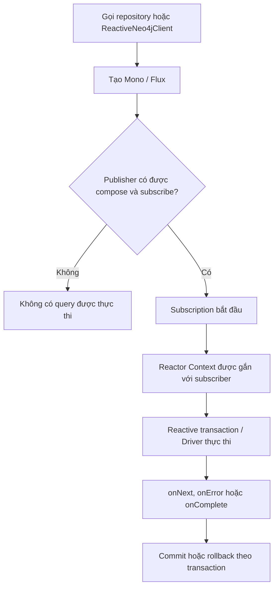
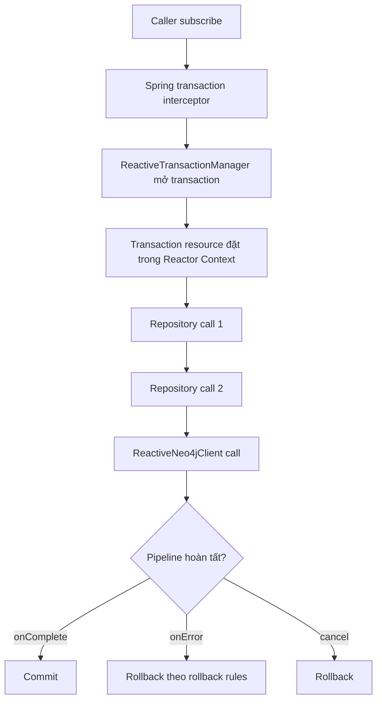

# Chuỗi reactive không được thực thi hoặc mất phạm vi giao dịch

Trong Spring Data Neo4j (SDN), các repository reactive và `ReactiveNeo4jClient` trả về `Mono` hoặc `Flux`. Những giá trị này mô tả một công việc bất đồng bộ; chúng không chạy query ngay tại thời điểm được tạo. Nếu bỏ publisher, không nối nó vào chuỗi hoặc tự gọi `subscribe()` ở giữa service, query có thể không chạy, lỗi có thể không tới caller và thao tác có thể nằm ngoài transaction dự kiến. Reactive transaction của Spring gắn với Reactor Context, vì vậy mọi thao tác cần cùng transaction phải được compose trong cùng một pipeline được quản lý.

Bài học thuộc module **SPRING_DATA_NEO4J**, nơi xây dựng tầng dữ liệu đồ thị qua node entity, relationship, repository và Cypher. Ta dùng `Person`, `Movie` và `ACTED_IN` để nhận diện publisher bị bỏ quên, chọn đúng toán tử `map`/`flatMap`/`then`, cấu hình `ReactiveNeo4jTransactionManager`, giữ Reactor Context và kiểm thử commit/rollback.

## 1. Publisher chỉ mô tả công việc, subscription mới khởi chạy

Reactor dùng mô hình lazy. Khi gọi một phương thức trả `Mono` hoặc `Flux`, ứng dụng nhận một mô tả về chuỗi xử lý. Query chỉ được thực thi khi có subscriber yêu cầu dữ liệu hoặc tín hiệu hoàn tất.



Ví dụ sau tạo publisher nhưng không subscribe:

```java
Mono<Person> pending = personRepository.save(person);
// Chưa có query nào được thực thi chỉ vì biến pending đã được tạo.
```

Nếu publisher được trả về từ controller hoặc được compose tiếp vào chuỗi, framework sẽ subscribe ở ranh giới phù hợp. Nếu chỉ tạo biến rồi bỏ đi, công việc bị bỏ qua.

Với `ReactiveNeo4jClient`, các thao tác `fetch().one()`, `fetch().first()`, `fetch().all()` và `run()` trả publisher. Theo tài liệu SDN, tương tác với database chỉ diễn ra khi publisher được subscribe; publisher được tạo từ client query cũng không nên được dùng lại cho nhiều subscription. Khi cần thực thi lại, hãy tạo một publisher mới từ lời gọi query mới hoặc đặt việc tạo publisher trong `defer` phù hợp.

## 2. Lỗi phổ biến: gọi save nhưng bỏ qua publisher

Đoạn code sau trông giống imperative code nhưng không lưu `Person`:

```java
public Mono<Person> create(Person person) {
    personRepository.save(person); // Publisher bị bỏ qua.
    return Mono.just(person);
}
```

`save()` trả về `Mono<Person>`. Vì không có toán tử nào nối publisher này vào kết quả trả về, thao tác lưu không được subscribe. `Mono.just(person)` chỉ phát object đang có trong bộ nhớ, không chứng minh database đã lưu thành công.

Sửa bằng cách trả trực tiếp publisher:

```java
public Mono<Person> create(Person person) {
    return personRepository.save(person);
}
```

Hoặc nối kết quả sau khi lưu:

```java
public Mono<PersonView> create(Person person) {
    return personRepository.save(person)
        .map(PersonView::from);
}
```

Nếu chỉ cần chờ thao tác hoàn tất và không cần giá trị phát ra, dùng `then()`:

```java
public Mono<Void> delete(String personId) {
    return personRepository.deleteById(personId)
        .then();
}
```

`then()` tạo một publisher hoàn tất sau khi publisher nguồn hoàn tất. Nó giữ thứ tự và tín hiệu lỗi, dù bỏ giá trị `onNext` của nguồn.

## 3. Chọn đúng map, flatMap và then

Ba toán tử thường quyết định publisher có được thực thi đúng hay không:

| Toán tử | Dùng khi | Kết quả |
|---|---|---|
| `map` | Biến đổi đồng bộ một giá trị đã phát | `T` thành `R` |
| `flatMap` | Từ một giá trị tạo thêm một publisher bất đồng bộ | `T` thành publisher `R`, rồi compose kết quả |
| `then` | Chạy publisher tiếp theo sau khi nguồn hoàn tất | Bỏ giá trị nguồn, chờ bước tiếp theo |
| `thenReturn` | Chờ nguồn hoàn tất rồi phát một giá trị cố định | Bỏ giá trị nguồn, phát `R` |
| `concatMap` | Với `Flux`, thực hiện publisher con tuần tự theo từng phần tử | Giữ thứ tự xử lý |

### 3.1. Dùng map khi chỉ chuyển đổi dữ liệu

```java
return personRepository.findById(personId)
    .map(person -> new PersonView(
        person.getPersonId(),
        person.getName()
    ));
```

Hàm trong `map` nên thực hiện phép biến đổi đồng bộ, không trả về `Mono` hoặc `Flux`.

### 3.2. Dùng flatMap khi bước tiếp theo truy cập database

```java
return personRepository.findById(personId)
    .flatMap(person -> {
        person.setName(newName);
        return personRepository.save(person);
    });
```

`flatMap` nối publisher do `save()` trả về vào chuỗi chính. Caller chỉ nhận kết quả sau khi thao tác save phát tín hiệu.

### 3.3. Lỗi lồng publisher khi dùng map

Đoạn sau tạo `Mono<Mono<Person>>`:

```java
return Mono.just(person)
    .map(personRepository::save);
```

Publisher bên trong chỉ là một object nằm trong `onNext`; nó chưa được compose nên query save chưa chạy. Dùng `flatMap`:

```java
return Mono.just(person)
    .flatMap(personRepository::save);
```

### 3.4. Dùng then để tuần tự hóa nhiều thao tác

Nếu cần lưu hai node theo thứ tự:

```java
return personRepository.save(person)
    .then(movieRepository.save(movie))
    .then();
```

Query lưu `Movie` chỉ bắt đầu sau khi publisher lưu `Person` hoàn tất. `then()` cuối cùng chuyển kết quả thành `Mono<Void>`.

## 4. Không gọi subscribe() bên trong service

Một lỗi nghiêm trọng là tự subscribe một publisher con rồi trả về một publisher khác:

```java
public Mono<Person> create(Person person) {
    personRepository.save(person).subscribe();
    return Mono.just(person);
}
```

Lời gọi `subscribe()` tạo một subscription độc lập. Service không còn kiểm soát việc lưu đã xong hay chưa, lỗi của subscription con có thể không được chuyển tới caller, và thao tác đó không tự tham gia transaction của chuỗi bên ngoài. Transaction bên ngoài có thể kết thúc trước khi thao tác lưu độc lập hoàn tất.

Hãy compose publisher thay vì tự subscribe:

```java
public Mono<Person> create(Person person) {
    return personRepository.save(person);
}
```

Trong ứng dụng WebFlux, controller trả `Mono`/`Flux` để framework quản lý subscription. Trong worker hoặc scheduler, hãy trả publisher cho thành phần sở hữu lifecycle hoặc subscribe tại đúng composition root, nơi có xử lý lỗi, cancellation và observability đầy đủ. Không tạo subscription phụ tùy tiện bên trong repository/service.

## 5. Không dùng block() để biến reactive thành imperative

`block()` chờ publisher hoàn tất bằng cách chặn thread và tạo subscription đồng bộ:

```java
public Person create(Person person) {
    return personRepository.save(person).block();
}
```

Cách này có một số vấn đề:

- Chặn event-loop thread trong WebFlux làm giảm khả năng phục vụ request khác.
- Subscription do `block()` tạo không kế thừa transaction Reactor Context của một chuỗi khác như một toán tử compose thông thường.
- Nếu gọi trong cùng luồng tài nguyên đang cần publisher hoàn tất, có thể gây deadlock hoặc timeout.
- Lỗi reactive bị ném đồng bộ tại điểm block, làm mất lợi ích của error signal và composition.

Giữ method reactive từ đầu tới cuối:

```java
public Mono<Person> create(Person person) {
    return personRepository.save(person);
}
```

Chỉ chuyển sang blocking ở ranh giới tích hợp được thiết kế riêng, chẳng hạn adapter bắt buộc dùng API đồng bộ và được chạy trên scheduler dành cho blocking. Không dùng `block()` như cách sửa lỗi publisher chưa được subscribe.

## 6. Nhiều thao tác phải nằm trong cùng pipeline

Giả sử một use case cần cập nhật người và tạo audit node. Hai thao tác phải thành công hoặc rollback cùng nhau:

```java
@Service
public class PersonService {

    private final ReactivePersonRepository people;
    private final ReactiveAuditRepository audits;

    public PersonService(
            ReactivePersonRepository people,
            ReactiveAuditRepository audits) {
        this.people = people;
        this.audits = audits;
    }

    @Transactional(transactionManager = "reactiveTransactionManager")
    public Mono<Person> rename(String personId, String newName) {
        return people.findById(personId)
            .switchIfEmpty(Mono.error(
                new PersonNotFoundException(personId)
            ))
            .flatMap(person -> {
                person.setName(newName);
                return people.save(person);
            })
            .flatMap(saved -> {
                AuditEvent event = AuditEvent.personRenamed(
                    saved.getPersonId(),
                    saved.getName()
                );

                return audits.save(event).thenReturn(saved);
            });
    }
}
```

`findById`, `save(person)` và `save(event)` được compose trong cùng publisher được trả về từ method transactional. Khi được gọi qua Spring proxy và dùng đúng reactive transaction manager, các thao tác SDN tham gia cùng transaction reactive.

Các class `ReactivePersonRepository`, `ReactiveAuditRepository`, `PersonNotFoundException` và `AuditEvent` là kiểu do ứng dụng định nghĩa. Điểm cốt lõi là mỗi lời gọi repository trả publisher và publisher đó phải được trả về hoặc compose tiếp.

Nếu một bước lỗi và lỗi đi ra khỏi transaction boundary, Spring có thể rollback các thay đổi trước đó trong transaction. Nếu bắt lỗi rồi chuyển thành completion bên trong transaction, hành vi commit/rollback sẽ khác; phần sau giải thích thứ tự này.

## 7. Reactive transaction dùng Reactor Context

Transaction imperative của Spring thường gắn với thread hiện tại. Reactive transaction dùng `ReactiveTransactionManager` và Reactor Context. Transaction context đi theo subscription, không dựa trên một thread cố định.

Điều đó có nghĩa:

- Các thao tác database cần tham gia transaction phải nằm trong cùng reactive pipeline/context.
- Đổi thread bằng Reactor operator như `publishOn` hoặc `subscribeOn` không tự động làm mất Reactor Context; Reactor Context được truyền theo subscriber.
- Tự tạo subscription mới bằng `subscribe()` hoặc `block()` không còn là một phần của subscription cha và có thể mất transaction context.
- Dùng `ThreadLocal`, `SecurityContextHolder` imperative hoặc API blocking để đọc trạng thái trong reactive flow không tương đương đọc Reactor Context.



Spring Framework xác định reactive transaction khi method transactional trả về reactive type như `Publisher`/`Mono`/`Flux`, rồi dùng `ReactiveTransactionManager`. Các thao tác cần tham gia transaction phải chạy trong cùng Reactor Context.

## 8. Chọn đúng ReactiveNeo4jTransactionManager

SDN cung cấp `ReactiveNeo4jTransactionManager` để quản lý transaction reactive với Neo4j Java Driver. Nếu ứng dụng có cả imperative và reactive transaction manager, hãy chỉ rõ manager được dùng để tránh chọn nhầm.

Ví dụ cấu hình tường minh:

```java
import org.neo4j.driver.Driver;
import org.springframework.context.annotation.Bean;
import org.springframework.context.annotation.Configuration;
import org.springframework.data.neo4j.core.transaction.ReactiveNeo4jTransactionManager;
import org.springframework.data.neo4j.repository.config.EnableReactiveNeo4jRepositories;

@Configuration
@EnableReactiveNeo4jRepositories(
    basePackages = "com.example.graph.repository",
    transactionManagerRef = "reactiveTransactionManager"
)
public class ReactiveNeo4jConfiguration {

    @Bean
    ReactiveNeo4jTransactionManager reactiveTransactionManager(Driver driver) {
        return new ReactiveNeo4jTransactionManager(driver);
    }
}
```

Trong ứng dụng Spring Boot, auto-configuration có thể đã tạo sẵn các bean SDN cần thiết. Chỉ khai báo cấu hình thủ công khi dự án cần kiểm soát rõ việc scan repository hoặc transaction manager; không tạo bean trùng tên với bean Boot đã cấu hình.

`@EnableReactiveNeo4jRepositories` có thuộc tính `transactionManagerRef`, mặc định tham chiếu bean `reactiveTransactionManager`. Nếu dùng nhiều manager, hãy cấu hình tên rõ ràng và bảo đảm manager dùng cùng Driver instance với reactive client/repository.

## 9. @Transactional phải bao quanh method trả publisher

Một method reactive transactional nên trả `Mono` hoặc `Flux`:

```java
@Transactional(transactionManager = "reactiveTransactionManager")
public Mono<Person> updateName(String personId, String newName) {
    return people.findById(personId)
        .switchIfEmpty(Mono.error(new PersonNotFoundException(personId)))
        .flatMap(person -> {
            person.setName(newName);
            return people.save(person);
        });
}
```

Đừng viết method `void` hoặc trả entity đồng bộ rồi bên trong tạo reactive publisher:

```java
@Transactional(transactionManager = "reactiveTransactionManager")
public void updateName(String personId, String newName) {
    people.findById(personId)
        .flatMap(person -> {
            person.setName(newName);
            return people.save(person);
        });
}
```

Method trên vừa bỏ publisher vừa không trả reactive type. Transaction interceptor không thể quản lý lifecycle bất đồng bộ dựa trên publisher đã bị bỏ đi. Hãy trả `Mono<Void>` hoặc `Mono<Person>`:

```java
@Transactional(transactionManager = "reactiveTransactionManager")
public Mono<Void> updateName(String personId, String newName) {
    return people.findById(personId)
        .switchIfEmpty(Mono.error(new PersonNotFoundException(personId)))
        .flatMap(person -> {
            person.setName(newName);
            return people.save(person);
        })
        .then();
}
```

Khi có nhiều transaction manager, thuộc tính `transactionManager` của `@Transactional` giúp chọn đúng bean. Method transactional cần được gọi qua Spring proxy; gọi một method transactional khác bằng `this.someMethod()` trong cùng object (self-invocation) sẽ bỏ qua proxy trong chế độ proxy mặc định.

## 10. Dùng TransactionalOperator khi cần transaction tường minh

`TransactionalOperator` hữu ích khi transaction boundary được quyết định ở cấp một chuỗi reactive thay vì annotation trên method:

```java
import org.springframework.stereotype.Service;
import org.springframework.transaction.reactive.TransactionalOperator;
import reactor.core.publisher.Mono;

@Service
public class PersonGraphWriter {

    private final ReactivePersonRepository people;
    private final ReactiveAuditRepository audits;
    private final TransactionalOperator transaction;

    public PersonGraphWriter(
            ReactivePersonRepository people,
            ReactiveAuditRepository audits,
            TransactionalOperator transaction) {
        this.people = people;
        this.audits = audits;
        this.transaction = transaction;
    }

    public Mono<Person> rename(String personId, String newName) {
        Mono<Person> work = people.findById(personId)
            .switchIfEmpty(Mono.error(new PersonNotFoundException(personId)))
            .flatMap(person -> {
                person.setName(newName);
                return people.save(person);
            })
            .flatMap(saved -> audits.save(
                AuditEvent.personRenamed(saved.getPersonId(), saved.getName())
            ).thenReturn(saved));

        return work.as(transaction::transactional);
    }
}
```

`TransactionalOperator` nhận một publisher và bọc toàn bộ chuỗi trong transaction. Tạo operator từ `ReactiveNeo4jTransactionManager` phù hợp với database đang dùng:

```java
@Bean
TransactionalOperator neo4jTransactionalOperator(
        ReactiveNeo4jTransactionManager reactiveTransactionManager) {
    return TransactionalOperator.create(reactiveTransactionManager);
}
```

Spring khuyến nghị `TransactionalOperator` cho quản lý transaction theo chương trình trong reactive flow.

## 11. Vì sao transaction có vẻ bị tách?

Một số mẫu code khiến thao tác database rời khỏi transaction cha:

| Mẫu code | Vấn đề | Cách sửa |
|---|---|---|
| `repository.save(x);` rồi trả `Mono.just(x)` | Publisher bị bỏ, query không chạy | Trả publisher hoặc compose bằng `flatMap`/`then` |
| `repository.save(x).subscribe()` trong service | Subscription mới, lỗi và lifecycle tách rời | Trả publisher cho caller |
| `repository.save(x).block()` trong reactive flow | Blocking và subscription đồng bộ riêng | Compose bằng `flatMap`/`then` |
| `map(x -> repository.save(x))` | Tạo `Mono<Mono<T>>` | Dùng `flatMap` |
| Gọi imperative `Neo4jClient`/`Neo4jTemplate` trong reactive flow | Có thể dùng transaction imperative/đường gọi blocking riêng | Dùng `ReactiveNeo4jClient`/`ReactiveNeo4jTemplate` |
| Dùng Java Driver reactive session độc lập trong Spring transaction | Driver API thuần không tự tham gia transaction Spring | Dùng SDN reactive client hoặc quản lý transaction Driver riêng biệt |
| Chọn `Neo4jTransactionManager` thay vì reactive manager | Transaction được gắn theo thread | Dùng `ReactiveNeo4jTransactionManager` |
| Gọi method `@Transactional` qua self-invocation | Không đi qua Spring proxy | Gọi qua bean khác hoặc dùng `TransactionalOperator` |
| Tạo Driver thứ hai cho custom client | Transaction manager và client có thể không chia sẻ resource | Dùng cùng Driver bean được cấu hình cho SDN |

SDN cung cấp `ReactiveNeo4jClient` để tích hợp với transaction quản lý bởi Spring. Java Driver thuần không tự tích hợp transaction cấp ứng dụng Spring; vì vậy, nếu cần cùng transaction với repository, hãy dùng reactive client/template của SDN hoặc chủ động quản lý toàn bộ transaction ở tầng Driver mà không trộn hai cơ chế.

## 12. Đổi scheduler không tự làm mất Reactor Context

Một hiểu lầm thường gặp là cứ dùng `publishOn()` hoặc `subscribeOn()` thì reactive transaction mất. Điều đó không đúng với Reactor-native operators: Reactor Context gắn với subscriber và được truyền theo cơ chế subscription, không phụ thuộc thread cố định.

Ví dụ đổi scheduler trong cùng pipeline:

```java
return people.findById(personId)
    .publishOn(Schedulers.parallel())
    .flatMap(person -> {
        person.setName(newName);
        return people.save(person);
    });
```

Việc đổi scheduler không tự tạo subscription mới. Tuy nhiên, không nên đưa công việc blocking hoặc code phụ thuộc `ThreadLocal` vào scheduler reactive chỉ để né lỗi transaction. Các API imperative có thể không nhìn thấy Reactor Context.

Những trường hợp thực sự dễ mất context:

- Tự gọi `subscribe()` tạo subscription mới.
- Dùng `block()` tạo subscription độc lập.
- Chuyển sang `CompletableFuture.supplyAsync(...)` hoặc executor tự quản lý mà không có cơ chế context propagation thích hợp.
- Callback bên ngoài Reactor tự tạo publisher rồi subscribe riêng.
- Dùng `ThreadLocal` hoặc `SecurityContextHolder` imperative để tìm trạng thái trong reactive flow.
- Dùng `contextWrite` sai vị trí và sau đó mong operator ở phía upstream nhìn thấy giá trị không thuộc context của nó.

Reactor Context là immutable và được gắn với subscriber. `contextWrite` ảnh hưởng tới các operator ở upstream của vị trí đặt nó; thứ tự operator có ý nghĩa. Không tự chỉnh sửa key nội bộ mà Spring dùng để giữ transaction.

## 13. Phân biệt lỗi mất transaction với transaction bị rollback

Không phải mọi trường hợp không thấy dữ liệu đều là transaction bị mất. Hãy phân biệt các tình huống:

| Triệu chứng | Nguyên nhân có thể | Cách kiểm tra |
|---|---|---|
| Không có node trong database | Publisher save chưa được subscribe | Gắn `doOnSubscribe`, kiểm tra publisher được trả về caller |
| Node đã lưu nhưng audit node không có | Publisher thứ hai bị bỏ hoặc chạy subscription độc lập | Kiểm tra `flatMap`/`then` và transaction boundary |
| Hai thao tác cùng chạy nhưng chỉ một commit | Chúng nằm ở hai transaction riêng hoặc một bước thất bại sau commit | Kiểm tra reactive transaction manager và cause chain |
| Thay đổi trước đó biến mất sau lỗi | Transaction rollback đúng như thiết kế | Kiểm tra `onError` có thoát ra transaction boundary không |
| Method báo thành công nhưng transaction rollback | Có thể lỗi đã bị `onErrorResume` nuốt, hoặc cancellation xảy ra | Kiểm tra operator order, cancellation và log transaction |
| Query không tham gia transaction mong muốn | Dùng Driver/client hoặc manager khác | Xác minh cùng Driver bean và đúng transaction manager |

## 14. onErrorResume có thể khiến transaction commit

Transaction manager quyết định commit/rollback dựa trên tín hiệu kết thúc của publisher và rollback rules. Nếu lỗi bị chuyển thành một giá trị hoặc completion trước khi đi qua transaction boundary, transaction có thể thấy thành công và commit.

Ví dụ nuốt lỗi bên trong transaction:

```java
return updatePerson()
    .then(writeAudit())
    .onErrorResume(ex -> Mono.empty())
    .as(transaction::transactional);
```

Nếu `writeAudit()` phát lỗi nhưng `onErrorResume` đổi nó thành `onComplete`, transaction operator có thể xem chuỗi là hoàn tất bình thường và thử commit. Nếu lỗi trước đó chỉ là lỗi ở tầng ứng dụng và Neo4j chưa đánh dấu native transaction là failed, thay đổi đã thực hiện có thể được commit. Nếu Neo4j đã đánh dấu transaction là failed, commit vẫn có thể thất bại và rollback. Vì vậy, không nuốt lỗi khi nghiệp vụ yêu cầu hai thao tác phải atomic.

Nếu yêu cầu rollback rồi mới trả fallback, đặt xử lý lỗi bên ngoài transaction boundary:

```java
return updatePerson()
    .then(writeAudit())
    .as(transaction::transactional)
    .onErrorResume(ex -> {
        log.warn("Graph update rolled back", ex);
        return Mono.empty();
    });
```

Trong ví dụ thứ hai, transaction operator nhìn thấy lỗi và rollback trước khi `onErrorResume` bên ngoài xử lý fallback. Nếu lỗi phải được báo cho caller, hãy không nuốt nó; có thể log bằng `doOnError` rồi để error signal tiếp tục.

Mặc định Spring rollback với unchecked exception và `Error`; checked exception cần rollback rule phù hợp. Khi thiết kế reactive flow, phải bảo đảm lỗi thực sự đi tới transaction boundary và không bị biến thành completion trước đó.

## 15. Cancellation có thể rollback transaction

Trong Reactive Streams, subscriber có thể hủy subscription. Một số toán tử như `take(1)`, `next()` hoặc `timeout(...)` có thể gửi cancellation upstream.

Với Spring reactive transaction, cancellation dẫn tới rollback. Vì thế, nếu dùng `Flux` bên trong transaction và downstream chỉ lấy một phần kết quả rồi cancel, transaction không được xem là đã hoàn tất thành công. Với publisher nhiều phần tử, cần tiêu thụ đầy đủ output để transaction có thể kết thúc bình thường.

Ví dụ cần cẩn trọng:

```java
return people.findAll()
    .as(transaction::transactional)
    .take(1);
```

`take(1)` chỉ lấy một phần tử rồi cancel nguồn. Nếu mục tiêu là lấy một người, hãy dùng query giới hạn phù hợp hoặc repository method trả một kết quả. Nếu mục tiêu là xử lý toàn bộ batch ghi, hãy tiêu thụ chuỗi đầy đủ và kết thúc bằng `then()` hoặc `thenReturn(...)`.

Không dùng `take`, `next` hoặc timeout như cách cắt ngắn một luồng ghi trong transaction mà vẫn mong commit toàn bộ. Cancellation semantics được Spring mô tả rõ trong hướng dẫn `TransactionalOperator`.

## 16. Retry phải tạo lại transaction cho mỗi lần thử

Khi cần retry một reactive use case, vị trí của `retryWhen` rất quan trọng. Muốn mỗi lần thử có transaction mới, hãy bọc công việc trong transaction trước rồi đặt retry bên ngoài:

```java
return Mono.defer(this::performGraphUpdate)
    .as(transaction::transactional)
    .retryWhen(
        Retry.backoff(2, Duration.ofMillis(200))
            .filter(this::isRetryable)
    );
```

Mỗi lần retry resubscribe vào publisher transactional, từ đó tạo một transaction mới. Không đặt retry bên trong transaction boundary nếu mục tiêu là chạy lại toàn bộ công việc trong transaction mới:

```java
// Retry nằm bên trong transaction boundary.
return Mono.defer(this::performGraphUpdate)
    .retryWhen(retryPolicy)
    .as(transaction::transactional);
```

Vị trí thứ hai có thể thử lại phần publisher trong cùng phạm vi transaction đã mở; transaction đã lỗi hoặc rollback-only không phù hợp để tiếp tục dùng. Chỉ retry lỗi tạm thời, có giới hạn và với thao tác idempotent. Dùng business key/uniqueness constraint để tránh tạo node hoặc relationship trùng khi kết quả commit trước đó chưa rõ.

`Mono.defer(...)` tạo lại công việc ở mỗi subscription. Nếu tái sử dụng một publisher one-shot từ `ReactiveNeo4jClient`, hãy tạo query publisher mới trong hàm defer thay vì giữ publisher đã được subscribe trước đó.

## 17. Kiểm thử bằng StepVerifier

`StepVerifier` subscribe vào publisher và kiểm tra tín hiệu phát ra. Đây là cách phù hợp để kiểm thử reactive repository/service mà không gọi `.block()`.

```java
import static org.assertj.core.api.Assertions.assertThat;

import org.junit.jupiter.api.Test;
import org.springframework.beans.factory.annotation.Autowired;
import reactor.test.StepVerifier;

class PersonServiceTest {

    @Autowired
    PersonService personService;

    @Test
    void shouldRenamePerson() {
        StepVerifier.create(
                personService.rename("P-100", "An Nguyen")
            )
            .assertNext(person -> {
                assertThat(person.getPersonId()).isEqualTo("P-100");
                assertThat(person.getName()).isEqualTo("An Nguyen");
            })
            .verifyComplete();
    }
}
```

Test class cần được cấu hình Spring context và Neo4j test database, đồng thời có fixture `P-100`. `verifyComplete()` thực sự subscribe và đợi chuỗi hoàn tất; chỉ tạo `Mono` trong test không làm query chạy.

### 17.1. Kiểm tra dữ liệu sau khi transaction hoàn tất

Sau khi gọi service, đọc lại bằng repository để xác minh trạng thái đã commit:

```java
StepVerifier.create(
        personService.rename("P-100", "An Nguyen")
            .then(personRepository.findById("P-100"))
    )
    .assertNext(person ->
        assertThat(person.getName()).isEqualTo("An Nguyen")
    )
    .verifyComplete();
```

Ở ví dụ này, thao tác đọc nằm sau publisher transactional mà service trả về; transaction của service đã hoàn tất trước khi query kiểm chứng bắt đầu. Nếu cần kiểm tra transaction boundary độc lập rõ ràng hơn, tách bước đọc thành một subscription/test assertion tiếp theo.

### 17.2. Kiểm tra rollback khi publisher phát lỗi

```java
StepVerifier.create(
        personService.renameAndFail("P-100", "Temporary Name")
    )
    .expectError(TestFailure.class)
    .verify();

StepVerifier.create(personRepository.findById("P-100"))
    .assertNext(person ->
        assertThat(person.getName()).isNotEqualTo("Temporary Name")
    )
    .verifyComplete();
```

`renameAndFail` là method test fixture được thiết kế để cập nhật node rồi phát `TestFailure` trước khi transaction hoàn tất. Lần đọc tiếp theo xác nhận thay đổi đã rollback. Trong test thật, đảm bảo không có transaction test bao ngoài hoặc fixture dùng chung làm sai kết quả quan sát.

## 18. Chẩn đoán pipeline bằng log và checkpoint

Khi không biết query đã được subscribe hay lỗi ở đâu, thêm instrumentation tạm thời:

```java
return people.findById(personId)
    .doOnSubscribe(subscription -> log.debug("findById subscribed"))
    .doOnNext(person -> log.debug("Person received: {}", person.getPersonId()))
    .doOnError(error -> log.error("findById failed", error))
    .checkpoint("PersonService.rename.findById");
```

Các tín hiệu giúp phân biệt:

- Không có `doOnSubscribe`: publisher chưa được subscribe hoặc phần code tạo nó chưa chạy.
- Có subscribe nhưng không có `onNext`: query có thể trả rỗng, đang chờ hoặc bị cancel; kiểm tra `switchIfEmpty`, timeout và log Driver.
- Có `onError`: đọc cause chain và transaction manager logs.
- Có `onNext` nhưng không commit: kiểm tra bước tiếp theo, cancellation, rollback-only và lỗi khi commit.

`checkpoint()` thêm điểm nhận diện vào stack trace reactive. `Hooks.onOperatorDebug()` có thể hữu ích trong môi trường phát triển nhưng làm tăng overhead; không bật toàn cục tùy tiện trong production. Không ghi parameter nhạy cảm hoặc token vào log.

## 19. Lỗi thường gặp

| Triệu chứng | Nguyên nhân | Cách xử lý |
|---|---|---|
| Repository method trả `Mono` nhưng không thấy query | Publisher không được subscribe hoặc bị bỏ | Trả publisher tới caller và compose đầy đủ |
| `save()` không lưu dữ liệu | Gọi `save()` rồi bỏ giá trị trả về | `return save(...)`, `flatMap` hoặc `then` |
| Method trả `Mono<Mono<T>>` | Dùng `map` với hàm trả publisher | Dùng `flatMap` |
| Log báo thành công nhưng database không đổi | Tự gọi `subscribe()` và không chờ lỗi/commit | Bỏ nested subscribe; trả một pipeline |
| Event loop bị treo | Gọi `.block()` trong WebFlux | Giữ reactive end-to-end |
| Hai thao tác không rollback cùng nhau | Một publisher chạy ngoài subscription/transaction cha | Compose chúng trước transaction boundary |
| Transaction không được áp dụng | Dùng imperative manager hoặc method không trả reactive type | Dùng `ReactiveNeo4jTransactionManager` và trả `Mono`/`Flux` |
| Transaction annotation không có hiệu lực | Self-invocation không đi qua Spring proxy | Gọi qua bean proxy hoặc dùng `TransactionalOperator` |
| Chuyển scheduler rồi mất context | Code phụ thuộc ThreadLocal hoặc tạo subscription/async task riêng | Dùng Reactor Context-aware flow và tránh API imperative |
| Dữ liệu đã đổi dù một bước báo lỗi | `onErrorResume` nuốt lỗi bên trong transaction | Đặt fallback ngoài transaction hoặc đánh dấu rollback-only |
| Flux transaction rollback khi chỉ lấy một phần tử | Downstream gửi cancel qua `take`/`next` | Tiêu thụ hết publisher hoặc giới hạn query từ server |
| Retry tiếp tục dùng transaction lỗi | `retryWhen` đặt trong transaction boundary | Đặt retry ngoài transaction để mỗi attempt có transaction mới |
| `ReactiveNeo4jClient` không tham gia transaction | Dùng client/Driver khác hoặc publisher độc lập | Dùng client SDN và cùng Driver/manager bean |

## 20. Checklist kiểm tra reactive pipeline và transaction

- Mọi lời gọi repository/ReactiveNeo4jClient đều trả publisher được compose hoặc trả cho caller.
- Không bỏ qua publisher từ `save`, `delete`, `run` hoặc `fetch`.
- Dùng `map` cho biến đổi đồng bộ; `flatMap` cho publisher con; `then` cho thứ tự hoàn tất.
- Không gọi `subscribe()` hoặc `block()` bên trong service reactive.
- Method `@Transactional` trả `Mono`/`Flux` và được gọi qua Spring proxy.
- Chọn `ReactiveNeo4jTransactionManager`, không dùng nhầm imperative manager.
- Repository, reactive client và transaction manager dùng cùng Driver instance.
- Các thao tác cần atomicity nằm trong cùng reactive pipeline/context.
- Không xem đổi scheduler bằng Reactor operator là tự động mất Reactor Context.
- Không dựa vào ThreadLocal hoặc API imperative để đọc reactive transaction context.
- Không nuốt lỗi bên trong transaction nếu cần rollback.
- Kiểm tra cancellation khi dùng `take`, `next`, `timeout` hoặc downstream subscriber.
- Đặt retry bên ngoài transaction boundary nếu cần transaction mới cho mỗi attempt.
- Dùng StepVerifier để kiểm tra success, error, cancellation và rollback.
- Log subscription, signal và checkpoint mà không làm lộ dữ liệu nhạy cảm.

## 21. Bài tập thực hành

1. Viết method gọi `ReactivePersonRepository.save()` nhưng bỏ publisher; dùng `StepVerifier` để chứng minh không có thao tác lưu.
2. Sửa method trên bằng cách trả publisher và kiểm tra dữ liệu sau khi commit.
3. Tạo lỗi `Mono<Mono<Person>>` bằng `map`, sau đó sửa thành `flatMap`.
4. Nối hai thao tác ghi bằng `then()` và xác nhận bước hai chỉ chạy sau khi bước một hoàn tất.
5. Viết một service có `subscribe()` bên trong; quan sát lỗi không được chuyển về caller, rồi bỏ nested subscription.
6. Gọi `.block()` trong WebFlux handler và thay bằng composition reactive.
7. Cấu hình `ReactiveNeo4jTransactionManager` và chỉ rõ `transactionManagerRef` cho reactive repositories.
8. Viết method `@Transactional` trả `Mono<Person>` cập nhật `Person` và tạo `AuditEvent` trong cùng transaction.
9. Cố ý làm bước audit phát lỗi; dùng `StepVerifier` xác nhận cập nhật `Person` được rollback.
10. Đặt `onErrorResume` trước và sau `TransactionalOperator`; quan sát khác biệt commit/rollback.
11. Dùng `take(1)` trên một `Flux` transactional và kiểm tra cancellation; sau đó sửa để tiêu thụ đầy đủ output.
12. Chuyển scheduler bằng `publishOn` và kiểm tra Reactor Context vẫn được truyền trong cùng pipeline.
13. Tạo một `CompletableFuture`/executor độc lập rồi so sánh với publisher được compose bằng `flatMap`.
14. Viết retry ngoài `TransactionalOperator` và xác nhận mỗi attempt có transaction mới.
15. Thêm `doOnSubscribe`, `doOnError` và `checkpoint()` để xác định một query chưa subscribe hay đã lỗi khi thực thi.

Khi hoàn thành, bạn cần nhận ra publisher bị bỏ quên, biết compose thao tác database bằng toán tử Reactor phù hợp và hiểu reactive transaction của Spring gắn với Reactor Context. Giữ các thao tác trong cùng pipeline, dùng đúng reactive transaction manager, kiểm soát error/cancel signal và kiểm thử bằng `StepVerifier` để xác nhận commit hoặc rollback thực tế.

## Tài liệu tham khảo

- [Spring Data Neo4j 8.1 — Neo4jClient](https://docs.spring.io/spring-data/neo4j/reference/8.1/appendix/neo4j-client.html)
- [Spring Data Neo4j 8.1.2 API — ReactiveNeo4jTransactionManager](https://docs.spring.io/spring-data/data-neo4j/reference/api/java/org/springframework/data/neo4j/core/transaction/ReactiveNeo4jTransactionManager.html)
- [Spring Data Neo4j 8.1.2 API — EnableReactiveNeo4jRepositories](https://docs.spring.io/spring-data/neo4j/reference/api/java/org/springframework/data/neo4j/repository/config/EnableReactiveNeo4jRepositories.html)
- [Spring Framework — Understanding reactive transaction management](https://docs.spring.io/spring/reference/7.0/data-access/transaction/declarative/tx-decl-explained.html)
- [Spring Framework — Programmatic transaction management and TransactionalOperator](https://docs.spring.io/spring-framework/reference/data-access/transaction/programmatic.html)
- [Spring Framework — Using @Transactional](https://docs.spring.io/spring-framework/reference/data-access/transaction/declarative/annotations.html)
- [Project Reactor — Introduction to reactive programming](https://projectreactor.io/docs/core/release/reference/reactiveProgramming.html)
- [Project Reactor — Reactor Context](https://projectreactor.io/docs/core/release/reference/advancedFeatures/context.html)
