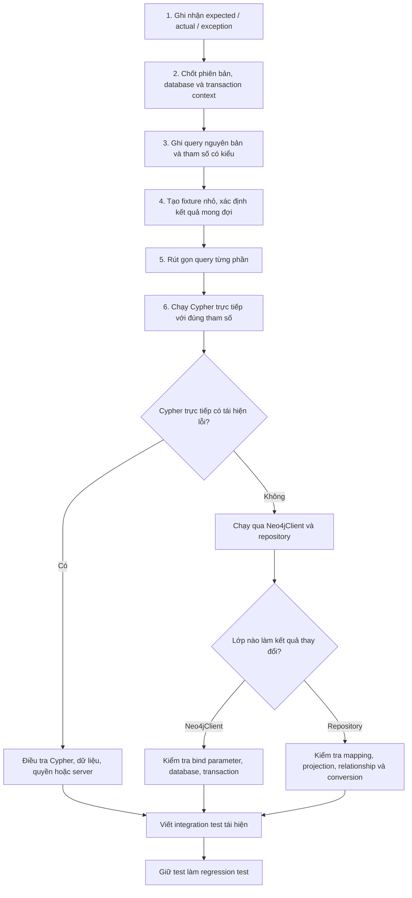

# Quy trình tái hiện lỗi bằng truy vấn tối thiểu, tham số và kiểm thử tích hợp

Khi một repository method trong Spring Data Neo4j (SDN) trả kết quả sai hoặc ném exception, cách chẩn đoán hiệu quả là tái hiện cùng một thao tác ở từng lớp: xác định dữ liệu và tham số đầu vào, rút gọn Cypher đến phần nhỏ nhất còn tái hiện lỗi, chạy truy vấn đó trực tiếp trên Neo4j, sau đó chạy lại qua `Neo4jClient` hoặc repository trong một integration test. Quy trình này giúp phân biệt lỗi cú pháp Cypher, dữ liệu không khớp, kiểu tham số, mapping entity, transaction và môi trường kết nối.

Trong module `SPRING_DATA_NEO4J`, repository và mapping context chịu trách nhiệm chuyển giữa domain object Java và graph. Vì thế, việc một câu Cypher chạy được trong Neo4j Browser chưa chứng minh repository sẽ hydrate đúng entity; ngược lại, một query trả về rỗng chưa chắc là lỗi nếu dữ liệu test không thỏa predicate. Hãy giữ nguyên query, tham số, kiểu Java, database và transaction context khi tái hiện.

## 1. Quy trình chẩn đoán có thể lặp lại

Một báo cáo lỗi hữu ích cần cho người khác tái hiện cùng kết quả mà không phải đoán dữ liệu hoặc tự tạo lại request. Thực hiện theo trình tự:



Không thay đổi nhiều yếu tố trong cùng một lần thử. Nếu vừa sửa query, đổi tham số, đổi database và sửa entity cùng lúc, bạn sẽ không biết thay đổi nào đã loại bỏ lỗi.

## 2. Ghi lại triệu chứng và bối cảnh trước khi sửa

Trước khi chỉnh code, lưu các thông tin tối thiểu sau:

| Thông tin | Cần ghi nhận | Ví dụ |
|---|---|---|
| Kết quả mong đợi | Một kết quả có thể kiểm tra được | Một người có email `an@example.test` thuộc nhóm `engineering` |
| Kết quả thực tế | Giá trị trả về, số record hoặc side effect | `Optional.empty()`, thiếu relationship hoặc exception |
| Exception | Class, Neo4j error code, message và cause chain | `Neo.ClientError.Statement.SyntaxError` |
| Query | Chuỗi Cypher đúng lúc lỗi xảy ra | Query sau khi SDN bind tham số, nếu có thể lấy được |
| Parameters | Tên, giá trị mẫu đã làm sạch và kiểu Java | `email: String`, `minimumAge: Long` |
| Database | Tên database và loại môi trường | `neo4j`, Testcontainers hoặc cluster |
| Phiên bản | SDN, Spring Boot, Neo4j server và Java Driver | Phiên bản dependency thực tế trong ứng dụng |
| Transaction | Có `@Transactional` không, read-only hay write, commit/rollback | Hai repository call cùng một transaction |
| Thời điểm | Request ID/correlation ID và timestamp | `traceId=...` |

Đừng chỉ sao chép dòng message cuối cùng. Hãy giữ exception class, Neo4j error code và toàn bộ cause chain vì lỗi kết nối, lỗi server, lỗi cú pháp và lỗi conversion thường có cách xử lý khác nhau. Message có thể thay đổi giữa các phiên bản; mã lỗi có tính ổn định tốt hơn để phân loại.

Khi chia sẻ log hoặc fixture, loại bỏ mật khẩu, token, email thật, dữ liệu khách hàng và thông tin nhạy cảm. Dùng dữ liệu giả nhưng giữ nguyên kiểu, độ dài, nullability và cấu trúc quan hệ gây lỗi. Không ghi toàn bộ parameter nhạy cảm vào log production chỉ để hỗ trợ debug.

## 3. Tạo một graph fixture nhỏ và xác định kết quả chuẩn

Giả sử lỗi xảy ra khi tìm người thuộc một nhóm. Graph tối thiểu chỉ cần hai label và một relationship:

```cypher
CREATE (p:Person {
    id: 'P-100',
    email: 'an@example.test',
    active: true
})
CREATE (g:Group {code: 'engineering'})
CREATE (p)-[:MEMBER_OF]->(g);
```

Truy vấn tối thiểu:

```cypher
MATCH (p:Person {email: $email})-[:MEMBER_OF]->(g:Group)
RETURN p.id AS personId, g.code AS groupCode;
```

Với tham số `email = 'an@example.test'`, kết quả chuẩn là đúng một record:

| personId | groupCode |
|---|---|
| `P-100` | `engineering` |

Khi tái hiện, luôn ghi rõ số record mong đợi, cột mong đợi và side effect có/không có. Một query trả zero record có thể là kết quả hợp lệ nếu không có node khớp; nó chỉ là lỗi khi fixture và điều kiện nghiệp vụ xác nhận phải có kết quả.

### Làm fixture độc lập

- Dùng ID/email giả và duy nhất để test không phụ thuộc dữ liệu có sẵn.
- Tạo node và relationship cần thiết một cách tường minh.
- Không dựa vào thứ tự record nếu query không có `ORDER BY`.
- Tạo cả trường hợp biên: node không có relationship, property null, nhiều relationship trùng predicate hoặc dữ liệu không tồn tại.
- Chạy trên database test riêng; không dùng `MATCH (n) DETACH DELETE n` trên database dùng chung.

Nếu fixture được chạy nhiều lần, dùng một database mới cho mỗi test class hoặc dọn đúng các node mang test key. `MERGE` có thể giúp fixture idempotent, nhưng cần bảo đảm nó không tái sử dụng node từ một test khác với property khác nhau.

## 4. Rút gọn Cypher từng bước

Hãy bắt đầu từ query thật, giữ nguyên tham số, rồi loại dần các phần không cần thiết. Với ví dụ trên:

**Bước 1 — Kiểm tra node gốc có tồn tại không:**

```cypher
MATCH (p:Person {email: $email})
RETURN p.id, p.email, p.active;
```

Nếu query này không có record, kiểm tra label, tên property, giá trị chính xác, kiểu dữ liệu và database đang kết nối.

**Bước 2 — Thêm điều kiện lọc từng phần:**

```cypher
MATCH (p:Person {email: $email})
WHERE p.active = $active
RETURN p.id, p.email, p.active;
```

Nếu query bước 1 có kết quả nhưng bước 2 không có, vấn đề nằm ở predicate hoặc giá trị/kiểu của `$active`.

**Bước 3 — Thêm relationship:**

```cypher
MATCH (p:Person {email: $email})-[:MEMBER_OF]->(g:Group)
RETURN p.id, g.code;
```

Nếu node gốc có nhưng query này không có kết quả, kiểm tra relationship type, chiều quan hệ, endpoint label và dữ liệu liên kết. Đổi hướng `->` thành `<-` chỉ khi mô hình dữ liệu cho phép và cần xác minh chiều thực tế.

**Bước 4 — Thêm projection và aggregation:**

```cypher
MATCH (p:Person {email: $email})
OPTIONAL MATCH (p)-[r:MEMBER_OF]->(g:Group)
RETURN p.id AS personId,
       collect(r) AS memberships,
       collect(g.code) AS groupCodes;
```

Nếu query cơ bản chạy đúng nhưng query đầy đủ sai, thêm lại từng `OPTIONAL MATCH`, `WITH`, `UNWIND`, `collect`, `ORDER BY`, `SKIP` hoặc `LIMIT` để tìm clause làm thay đổi số dòng hoặc kiểu kết quả.

Không xóa ngay một điều kiện có vẻ thừa. Một predicate có thể đang giới hạn tenant, quyền truy cập hoặc trạng thái nghiệp vụ. Mục tiêu là xác định chính xác điều kiện nào làm thay đổi kết quả rồi đối chiếu với yêu cầu domain.

## 5. Dùng đúng tham số và kiểu dữ liệu

Cypher parameters tách giá trị đầu vào khỏi cấu trúc câu query. Dùng parameter giúp tránh nối chuỗi, giảm rủi ro injection và cho phép Neo4j tái sử dụng query plan tốt hơn.

Trong Neo4j Browser hoặc Cypher Shell, khai báo tham số:

```cypher
:param email => 'an@example.test';
:param active => true;

MATCH (p:Person {email: $email})
WHERE p.active = $active
RETURN p;
```

Trong Java Driver, truyền giá trị riêng khỏi câu query:

```java
import java.util.Map;

import org.neo4j.driver.Driver;
import org.neo4j.driver.QueryConfig;

void reproduce(Driver driver) {
    var result = driver.executableQuery("""
            MATCH (p:Person {email: $email})
            WHERE p.active = $active
            RETURN p.id AS id
            """)
        .withParameters(Map.of(
            "email", "an@example.test",
            "active", true
        ))
        .withConfig(QueryConfig.builder().withDatabase("neo4j").build())
        .execute();

    System.out.println(result.records());
}
```

Với Spring Data Neo4j, bind giá trị bằng `Neo4jClient`:

```java
var rows = neo4jClient.query("""
        MATCH (p:Person {email: $email})
        WHERE p.active = $active
        RETURN p.id AS id
        """)
    .bind("an@example.test").to("email")
    .bind(true).to("active")
    .fetch()
    .all();
```

Khi chạy lại lỗi, bảo đảm giá trị và kiểu Java tương ứng với request thật. Ví dụ `42L` là `Long`, `42` là `Integer`; cả hai có thể được ánh xạ thành Cypher Integer nhưng vẫn nên giữ đúng kiểu được ứng dụng gửi. Với list, map, temporal và point, hãy dùng đúng kiểu Driver hỗ trợ thay vì chuyển tất cả thành String.

### Các lỗi thường gặp về parameter

| Tình huống | Triệu chứng | Cách kiểm tra |
|---|---|---|
| Sai tên parameter | Query báo thiếu parameter hoặc giá trị null ngoài ý muốn | So sánh `$email` với tên bind `email` từng ký tự |
| Không truyền parameter | Lỗi runtime về parameter chưa được cung cấp | Kiểm tra tất cả placeholder trong query |
| Giá trị sai kiểu | So sánh không khớp hoặc lỗi type conversion | Ghi kiểu Java và kiểu property trong graph |
| Truyền chuỗi thay cho boolean | Predicate không khớp dù nhìn giá trị có vẻ giống | Bind `true`/`false` dạng Boolean |
| Truyền thời gian dưới dạng text | So sánh temporal hoặc conversion sai | Dùng `LocalDate`, `LocalDateTime`, `ZonedDateTime` phù hợp |
| Truyền `null` bằng `Map.of` | Java ném `NullPointerException` trước khi query chạy | Dùng map có hỗ trợ null hoặc biểu diễn case null riêng |
| So sánh property với null bằng `=` | Predicate trả `null`, không phải `true` | Dùng `IS NULL` hoặc điều kiện `$value IS NULL` |
| Nối parameter vào query string | Injection risk, query text thay đổi liên tục | Dùng `$parameter` và bind giá trị |

Trong Cypher, property không tồn tại và giá trị null đều được quan sát như `null`. Biểu thức `p.nickname = $nickname` không đúng khi một vế là null; hãy viết `p.nickname IS NULL` hoặc `($nickname IS NULL OR p.nickname = $nickname)` tùy ý nghĩa lọc. Đừng thay null bằng chuỗi `"null"` vì đó là một giá trị String khác.

Parameter chỉ thay thế giá trị ở những vị trí Cypher hỗ trợ. Không thể dùng `$label` thay cho label hoặc `$type` thay cho relationship type trong cú pháp tĩnh thông thường. Nếu query cần identifier động, dùng cú pháp dynamic label/type được phiên bản Neo4j hỗ trợ hoặc ánh xạ lựa chọn qua whitelist trong ứng dụng; không ghép chuỗi tùy ý từ input người dùng.

## 6. Chạy cùng query trực tiếp trên Neo4j

Khi đã có query và tham số chính xác, chạy chúng bằng Neo4j Browser hoặc Cypher Shell trên đúng database. Nếu kết quả khác với SDN, kiểm tra lần lượt:

1. Browser đang chọn đúng database chưa?
2. Dữ liệu fixture có tồn tại trên database đó không?
3. Parameter có cùng giá trị và kiểu với request Java không?
4. Query có chạy trong transaction khác hoặc sau một commit chưa?
5. Ứng dụng có kết nối tới một cluster member khác hoặc database khác không?
6. Có filter tenant/authorization được thêm ở tầng service hoặc repository không?

Đừng chỉ copy câu query mà quên parameter. Query `WHERE p.email = $email` không thể tái hiện nếu chạy mà chưa khai báo `$email`, hoặc dùng giá trị email khác request ban đầu.

Nếu query ghi dữ liệu, chạy trong database test riêng hoặc trong transaction có thể rollback. Không dùng `PROFILE` cho query ghi trên dữ liệu thật chỉ để xem plan; `PROFILE` thực thi query. `EXPLAIN` lập kế hoạch nhưng không chạy statement và không thay đổi dữ liệu.

## 7. Phân biệt lỗi Cypher, lỗi kết nối và lỗi mapping

Kết quả ở từng lớp giúp khoanh vùng nguyên nhân:

| Cypher trực tiếp | `Neo4jClient` | Repository | Khả năng cần điều tra |
|---|---|---|---|
| Lỗi | Chưa cần chạy tiếp | Chưa cần chạy tiếp | Cú pháp, schema/query semantics, parameter, quyền hoặc server |
| Đúng | Lỗi | Lỗi | Driver config, database selection, bind parameter, transaction hoặc authentication |
| Đúng | Đúng | Lỗi | Repository query, projection, entity mapping, relationship hydration hoặc converter |
| Trả rỗng | Trả rỗng | Trả rỗng | Fixture, predicate, database hoặc kỳ vọng nghiệp vụ |
| Đúng | Đúng | Kết quả thiếu association | Query không trả đủ root/relationship/related node cho mapping |
| Chạy thành công nhưng dữ liệu không commit | Thấy trong transaction, mất sau đó | Có thể tương tự | Rollback, exception bị bắt trong transaction hoặc transaction boundary |

### Khi Neo4jClient chạy được nhưng repository thất bại

Hãy kiểm tra:

- Tên cột `RETURN` có phù hợp với getter của interface projection/DTO không.
- Query entity có trả root node đúng alias và các relationship/node cần hydrate không.
- Một root entity có bị trả thành nhiều record do join collection relationship không.
- Field Java có kiểu phù hợp với property Neo4j không.
- Custom converter có được đăng ký trong `Neo4jConversions` không.
- Repository method có dùng đúng `@Param` và tên placeholder không.
- Method có chạy trong transaction hoặc database selection khác với query thủ công không.

Một query trả `p.id AS id` là scalar projection; nó không tương đương với query trả `p` để SDN hydrate toàn bộ entity. Khi test repository entity, hãy dùng cùng hình dạng result mà method dự kiến ánh xạ.

## 8. Tái hiện qua @Query và Neo4jClient

Đặt query tối thiểu vào repository method với tham số tường minh:

```java
import java.util.Optional;

import org.springframework.data.neo4j.repository.Neo4jRepository;
import org.springframework.data.neo4j.repository.query.Query;
import org.springframework.data.repository.query.Param;

public interface PersonRepository extends Neo4jRepository<Person, String> {

    @Query("""
        MATCH (p:Person {email: $email})
        RETURN p
        """)
    Optional<Person> findPersonByEmail(@Param("email") String email);
}
```

So sánh cùng một thao tác qua `Neo4jClient`:

```java
import org.springframework.data.neo4j.core.Neo4jClient;

var result = neo4jClient.query("""
        MATCH (p:Person {email: $email})
        RETURN p.id AS id, p.email AS email
        """)
    .bind("an@example.test").to("email")
    .fetch()
    .all();
```

Nếu cả hai cùng trả kết quả nhưng entity sai, tập trung vào entity mapping. Nếu `Neo4jClient` trả kết quả còn repository trả empty, so sánh chính xác query repository, parameter annotation và database context. Đừng giả định hai đoạn code giống nhau chỉ vì chúng có cùng tên method hoặc cùng ý định nghiệp vụ.

Đối với projection, đặt alias rõ ràng:

```java
import java.util.List;

public interface PersonMembershipView {
    String getPersonId();
    String getGroupCode();
}
```

```java
@Query("""
    MATCH (p:Person {email: $email})-[:MEMBER_OF]->(g:Group)
    RETURN p.id AS personId, g.code AS groupCode
    """)
List<PersonMembershipView> findMemberships(@Param("email") String email);
```

Projection này trả dữ liệu dạng scalar. Nó không hydrate `Person` và collection relationship của entity. Nếu mục tiêu là đọc entity graph, hãy trả đúng graph structure mà mapping yêu cầu.

## 9. Kiểm tra transaction và trạng thái dữ liệu

Một query có thể chạy đúng nhưng ứng dụng vẫn nhìn thấy dữ liệu cũ hoặc không thấy thay đổi do transaction boundary. Khi tái hiện, xác định rõ:

- Query ghi và query đọc có nằm trong cùng `@Transactional` method không?
- Exception có bị bắt và không được ném lại khiến transaction đánh dấu rollback-only không?
- Có gọi `save()` rồi đọc bằng transaction khác trước khi commit không?
- Test có transaction mặc định và rollback sau mỗi method không?
- Có dùng reactive transaction nhưng gọi API imperative hoặc tạo subscription ngoài luồng không?
- Ứng dụng có nhiều service/instance hoặc Neo4j cluster với read routing không?

Ví dụ service giữ các thao tác liên quan trong cùng transaction:

```java
import org.springframework.stereotype.Service;
import org.springframework.transaction.annotation.Transactional;

@Service
public class PersonService {

    private final PersonRepository people;

    public PersonService(PersonRepository people) {
        this.people = people;
    }

    @Transactional
    public Person createAndLoad(String email) {
        Person saved = people.save(new Person(email));
        return people.findById(saved.getId()).orElseThrow();
    }
}
```

Khi một thao tác ghi đã commit ở transaction A nhưng request đọc chạy ở transaction B, cluster có thể cần bookmark để bảo đảm causal consistency. SDN quản lý bookmark theo cấu hình mặc định cho các transaction trong cùng luồng được quản lý; các process/service độc lập không tự chia sẻ bookmark. Nếu lỗi chỉ xuất hiện khi request được phân phối qua nhiều instance, kiểm tra bookmark propagation và read routing trước khi kết luận query sai.

Đừng dùng retry để che giấu transaction bị rollback hoặc dữ liệu chưa commit. Trước tiên xác minh transaction nào thực sự commit và database nào đang được đọc.

## 10. Đọc error code và phân loại nguyên nhân

Neo4j phân nhóm lỗi theo nguồn gốc. Nhìn prefix hoặc GQL classification giúp chọn hướng xử lý ban đầu:

| Nhóm | Đặc điểm | Ví dụ | Hướng xử lý |
|---|---|---|---|
| `Neo.ClientError` | Request, cú pháp, tham số, quyền hoặc dữ liệu do client gửi | `Neo.ClientError.Statement.SyntaxError` | Sửa query, parameter hoặc quyền; retry cùng request thường không giải quyết được |
| `Neo.TransientError` | Lỗi tạm thời, có thể thành công khi thử lại | `Neo.TransientError.General.DatabaseUnavailable`, `...DeadlockDetected` | Kiểm tra nguyên nhân tạm thời; retry có giới hạn và backoff nếu thao tác an toàn |
| `Neo.DatabaseError` | Lỗi xử lý hoặc trạng thái phía database | Lỗi database/server cụ thể | Lấy server logs, error code, phiên bản và thông tin vận hành để điều tra |

Java Driver cho phép lấy mã lỗi từ `Neo4jException.code()`:

```java
import org.neo4j.driver.Driver;
import org.neo4j.driver.exceptions.Neo4jException;

void executeAndClassify(Driver driver) {
    try {
        driver.executableQuery("RETURN 1").execute();
    } catch (Neo4jException exception) {
        String code = exception.code();
        String message = exception.getMessage();

        // Ghi code và correlation ID; chỉ ghi message/parameters đã làm sạch.
        throw exception;
    }
}
```

Không dùng message làm điều kiện phân loại lỗi nếu có thể dùng error code. Message có thể đổi theo phiên bản hoặc ngôn ngữ; code là định danh phù hợp hơn cho metric, alert và logic xử lý.

Không retry mọi exception. Syntax error, invalid parameter, authentication failure hoặc constraint violation thường cần sửa request/dữ liệu. Một số lỗi transient như database unavailable, leader switch, deadlock hoặc execution timeout có thể thử lại sau khi đã xác định thao tác có an toàn khi lặp hay không.

## 11. Phân tích query plan khi lỗi liên quan đến hiệu năng

Nếu lỗi là query quá chậm hoặc timeout, hãy kiểm tra plan sau khi đã tái hiện được query với dữ liệu và parameter đại diện.

`EXPLAIN` tạo execution plan ước lượng nhưng không thực thi query:

```cypher
EXPLAIN
MATCH (p:Person {email: $email})-[:MEMBER_OF]->(g:Group)
RETURN p, g;
```

`PROFILE` thực thi query và bổ sung số liệu thực tế như rows, DB hits, memory và operator:

```cypher
PROFILE
MATCH (p:Person {email: $email})-[:MEMBER_OF]->(g:Group)
RETURN p, g;
```

Khi đọc plan, chú ý:

- `AllNodesScan` hoặc `NodeByLabelScan` có thể chỉ ra truy vấn đang quét nhiều node.
- `NodeIndexSeek`/`NodeUniqueIndexSeek` cho thấy index/constraint được sử dụng.
- Số `Rows` tăng đột biến sau `Expand` có thể do relationship fan-out lớn.
- `DB Hits` phản ánh lượng truy cập storage, không đồng nghĩa với số record.
- Chênh lệch lớn giữa `Estimated Rows` và `Rows` có thể làm planner chọn plan kém phù hợp.
- `PROFILE` có chi phí và có thể thực thi write; dùng trên dữ liệu test hoặc query chỉ đọc khi phù hợp.

Đừng kết luận hiệu năng chỉ từ một lần chạy trên database trống. Dùng fixture có cardinality và phân bố relationship gần với production, đồng thời phân biệt cold cache với warm cache.

## 12. Quan sát query log và transaction

Khi query chạy được trong test nhưng lỗi ở môi trường triển khai, dùng query log và transaction metadata để xác định thời gian, database, query và transaction liên quan.

Neo4j hỗ trợ query logging qua các setting như `db.logs.query.enabled` và `db.logs.query.threshold`. Trong môi trường điều tra, có thể cấu hình log các query vượt ngưỡng để tìm truy vấn chậm; bật log toàn bộ query trong production có thể tạo lượng log lớn. Query log có thể chứa câu query và thông tin có giá trị nhạy cảm, vì vậy cần kiểm soát quyền truy cập, retention và redaction theo chính sách vận hành.

Với Java Driver, transaction metadata có thể gắn thông tin nhận diện ứng dụng hoặc workflow để hiển thị trong query log và `SHOW TRANSACTIONS`. Chỉ gắn thông tin chẩn đoán không nhạy cảm như service name, operation và trace ID; không gắn access token hoặc dữ liệu cá nhân.

Khi điều tra một request, đối chiếu:

1. Trace ID ở application log.
2. Timestamp và database ở query log.
3. Query/error code và thời gian thực thi.
4. Transaction ID hoặc metadata nếu được cấu hình.
5. Server member xử lý request nếu đang chạy cluster.

## 13. Tạo integration test tái hiện lỗi

Sau khi tìm được query tối thiểu, giữ nó thành regression test để lỗi không quay lại. Dùng Neo4j server thật qua Testcontainers và `@DataNeo4jTest` để kiểm tra cả Cypher lẫn mapping Spring.

Ví dụ test slice kết nối tới Neo4j:

```java
import org.springframework.beans.factory.annotation.Autowired;
import org.springframework.boot.test.autoconfigure.data.neo4j.DataNeo4jTest;
import org.springframework.data.neo4j.core.Neo4jClient;
import org.springframework.test.context.DynamicPropertyRegistry;
import org.springframework.test.context.DynamicPropertySource;
import org.testcontainers.junit.jupiter.Container;
import org.testcontainers.junit.jupiter.Testcontainers;
import org.testcontainers.neo4j.Neo4jContainer;

@DataNeo4jTest
@Testcontainers
class PersonQueryIntegrationTest {

    private static final String PASSWORD = "test-password";

    @Container
    static final Neo4jContainer<?> neo4j =
        new Neo4jContainer<>("neo4j:5.26")
            .withAdminPassword(PASSWORD);

    @Autowired
    Neo4jClient neo4jClient;

    @Autowired
    PersonRepository people;

    @DynamicPropertySource
    static void databaseProperties(DynamicPropertyRegistry registry) {
        registry.add("spring.neo4j.uri", neo4j::getBoltUrl);
        registry.add("spring.neo4j.authentication.username", () -> "neo4j");
        registry.add("spring.neo4j.authentication.password", () -> PASSWORD);
    }
}
```

Trong method test, tạo fixture và chạy đúng query:

```java
import static org.assertj.core.api.Assertions.assertThat;

import org.junit.jupiter.api.Test;

@Test
void minimalQueryFindsExpectedMembership() {
    neo4jClient.query("""
            CREATE (p:Person {
                id: 'P-100',
                email: 'an@example.test',
                active: true
            })
            CREATE (g:Group {code: 'engineering'})
            CREATE (p)-[:MEMBER_OF]->(g)
            """)
        .run();

    var rows = neo4jClient.query("""
            MATCH (p:Person {email: $email})-[:MEMBER_OF]->(g:Group)
            RETURN p.id AS personId, g.code AS groupCode
            """)
        .bind("an@example.test").to("email")
        .fetch()
        .all();

    assertThat(rows).hasSize(1);
    assertThat(rows.iterator().next())
        .containsEntry("personId", "P-100")
        .containsEntry("groupCode", "engineering");
}
```

Sau khi xác nhận Cypher trực tiếp, gọi repository method và kiểm tra entity hoặc projection. Giữ test nhỏ, deterministic và chỉ tạo fixture cần thiết. `@DataNeo4jTest` mặc định chạy test trong transaction và rollback sau mỗi method; điều này giúp dữ liệu test không rò sang test khác. Nếu lỗi phụ thuộc hai transaction commit riêng, hãy thiết kế test transaction boundary rõ ràng thay vì vô tình chạy toàn bộ test trong một transaction.

### Khi cần tái hiện lỗi theo kiểu parameter cụ thể

Tạo test riêng cho từng kiểu đầu vào, ví dụ:

```java
@Test
void filtersByLongParameter() {
    neo4jClient.query("CREATE (:Person {id: 'P-200', age: 42})").run();

    var rows = neo4jClient.query("""
            MATCH (p:Person)
            WHERE p.age >= $minimumAge
            RETURN p.id AS id
            """)
        .bind(42L).to("minimumAge")
        .fetch()
        .all();

    assertThat(rows).extracting(row -> row.get("id"))
        .containsExactly("P-200");
}
```

Nếu lỗi gốc liên quan đến `null`, temporal, list hoặc map, hãy giữ nguyên kiểu đó trong test. Không thay một parameter null bằng chuỗi rỗng chỉ để test chạy qua; điều đó thay đổi hợp đồng đầu vào.

## 14. Test cả kết quả đúng và trường hợp biên

Một regression test chỉ kiểm tra happy path có thể bỏ sót nguyên nhân thực sự. Với query tìm thành viên nhóm, nên có các trường hợp:

| Fixture | Kết quả mong đợi |
|---|---|
| Người tồn tại và có đúng một nhóm | Một membership |
| Người tồn tại nhưng không có nhóm | Không có membership nếu dùng `MATCH`; vẫn có người nếu dùng `OPTIONAL MATCH` |
| Email không tồn tại | Kết quả rỗng |
| Email trùng trên nhiều node | Nhiều kết quả hoặc lỗi constraint tùy invariant domain |
| Node có `active = false` | Bị loại nếu query lọc active |
| Property `active` không tồn tại | Predicate boolean không match |
| Relationship có chiều ngược lại | Không match nếu pattern yêu cầu chiều outgoing |
| Có hai relationship phù hợp | Hai record hoặc một collection chứa hai phần tử tùy query |

Test phải xác định rõ contract. Ví dụ, repository trả `Optional<Person>` cần bảo đảm query có tối đa một kết quả; nếu dữ liệu có thể trùng, hãy thêm uniqueness constraint hoặc đổi kiểu trả về thành collection. Đừng dùng `.single()` trong test khi query có thể hợp lệ trả nhiều record.

## 15. Retry, timeout và tính idempotent

Neo4j Java Driver có thể tự retry managed transaction khi lỗi được phân loại transient. Điều này không có nghĩa mọi query của Spring `@Transactional` tự được retry theo cùng cách. Với Spring-managed transaction, nếu cần retry, hãy đặt retry policy ở bên ngoài transaction boundary để mỗi lần thử tạo transaction mới.

Chỉ retry khi thao tác có thể lặp an toàn. Một transaction callback có thể được thực thi nhiều lần; không đặt side effect ngoài database như gửi email, trừ tiền ở hệ thống khác hoặc phát event không idempotent bên trong callback có thể retry mà không có cơ chế bảo vệ. Dùng idempotency key hoặc outbox khi nghiệp vụ cần phối hợp với hệ thống bên ngoài.

Với timeout, phân biệt:

- Connection timeout: ứng dụng không thiết lập được kết nối tới Bolt endpoint.
- Transaction timeout: server kết thúc transaction chạy quá thời gian được cấu hình.
- Lock acquisition timeout/deadlock: transaction không lấy được lock hoặc bị database hủy để phá deadlock.
- Query execution timeout: statement không hoàn tất trong giới hạn server.
- Bookmark timeout: server chưa đạt trạng thái được bookmark yêu cầu.

Tăng timeout có thể giúp query hợp lệ hoàn tất nhưng không sửa query có plan kém hoặc graph fan-out quá lớn. Trước khi tăng giới hạn, hãy đo query plan, số dòng, DB hits và thời gian chờ ở từng lớp.

## 16. Mẫu báo cáo lỗi có thể chuyển cho người khác

Khi cần nhờ đồng nghiệp điều tra, dùng một báo cáo có đủ dữ kiện để chạy lại:

```text
Title:
  Person lookup returns no membership for an existing user

Environment:
  Spring Boot:
  Spring Data Neo4j:
  Neo4j Server:
  Java Driver:
  Java:
  Database:

Expected:
  One row: personId=P-100, groupCode=engineering

Actual:
  Zero rows

Exception:
  Class:
  Neo4j error code:
  Message/cause:

Cypher:
  MATCH (p:Person {email: $email})-[:MEMBER_OF]->(g:Group)
  RETURN p.id AS personId, g.code AS groupCode

Parameters:
  email: String = an@example.test

Minimal fixture:
  Person P-100, email an@example.test
  Group engineering
  (P-100)-[:MEMBER_OF]->(engineering)

Reproduction:
  1. Create fixture in isolated database.
  2. Run Cypher with parameter above.
  3. Run same query through Neo4jClient.
  4. Run repository method.

Observed at each layer:
  Neo4j Browser:
  Neo4jClient:
  Repository:

Transaction/routing:
  @Transactional:
  Read-only:
  Cluster/instance:

Regression test:
  Class/method:
```

Đính kèm query plan hoặc sanitized log khi lỗi liên quan đến hiệu năng/server. Đừng chỉ gửi screenshot của exception nếu người nhận cần chạy lại query.

## 17. Các lỗi thường gặp khi tái hiện

| Biểu hiện | Nguyên nhân | Cách xử lý |
|---|---|---|
| Query chạy trong Browser nhưng không trong ứng dụng | Khác database, parameter, user hoặc transaction | So sánh URI/database/user và giá trị có kiểu |
| Query trả rỗng nhưng không ném exception | Không có node/relationship thỏa predicate | Kiểm tra fixture từng bước, label, property và chiều relationship |
| Query thủ công chạy được nhưng `Neo4jClient` lỗi | Bind sai tên/kiểu, kết nối hoặc quyền | Tái hiện cùng query và bind trong integration test |
| `Neo4jClient` chạy được nhưng repository lỗi | Mapping/projection hoặc repository query khác | So sánh result columns, root entity và annotation `@Param` |
| Repository trả thiếu relationship | Query không trả đủ graph structure hoặc association bị chia record | Trả root cùng relationship/node, dùng `collect()` khi cần |
| Test pass nhưng production lỗi | Khác version, database, data shape hoặc routing | Pin version, tạo fixture sát production và kiểm tra query log |
| Lỗi chỉ xuất hiện khi có null | Predicate dùng `= null` hoặc test không truyền đúng null | Dùng `IS NULL` và test null tường minh |
| Lỗi chỉ xuất hiện với một kiểu số | Java `Integer`/`Long` hoặc property type khác nhau | Ghi kiểu đầu vào, kiểu property và dùng parameter đúng kiểu |
| Query chậm dù trả đúng dữ liệu | Full scan, fan-out, sort/aggregation hoặc thiếu index | Dùng `EXPLAIN`/`PROFILE` và fixture có cardinality thực tế |
| Retry làm phát sinh dữ liệu lặp | Transaction không idempotent | Dùng business key/`MERGE`, idempotency key và giới hạn retry |
| Kết quả đọc không thấy write vừa commit | Đọc ở transaction/instance khác hoặc thiếu causal bookmark | Kiểm tra commit, bookmark và routing cluster |
| Test không cô lập dữ liệu | Fixture dùng chung key hoặc cleanup quá rộng | Dùng database/container riêng và test key duy nhất |

## 18. Checklist trước khi kết luận đã tìm được nguyên nhân

- [ ] Có mô tả expected và actual cụ thể.
- [ ] Có exception class, error code và cause chain nếu có lỗi.
- [ ] Đã ghi phiên bản SDN, Neo4j, Driver và Java.
- [ ] Đã xác nhận đúng database và database user.
- [ ] Có query nguyên bản và parameter cùng kiểu Java.
- [ ] Có fixture nhỏ, độc lập và tái tạo được.
- [ ] Đã chạy query từng bước để tìm clause làm kết quả thay đổi.
- [ ] Đã chạy cùng query trên Neo4j trực tiếp với cùng parameter.
- [ ] Đã so sánh kết quả qua Neo4jClient và repository.
- [ ] Đã kiểm tra transaction, rollback, bookmark và routing khi phù hợp.
- [ ] Đã dùng EXPLAIN/PROFILE nếu vấn đề liên quan đến hiệu năng.
- [ ] Đã viết regression integration test cho nguyên nhân đã xác nhận.
- [ ] Đã loại bỏ dữ liệu nhạy cảm khỏi fixture, log và báo cáo.

## 19. Tự kiểm tra

1. Vì sao một query trả rỗng chưa đủ để kết luận Neo4j hoặc SDN bị lỗi?
2. Những thông tin nào cần ghi lại trước khi sửa query?
3. Tại sao phải giữ nguyên giá trị và kiểu parameter khi tái hiện lỗi?
4. Làm thế nào để rút gọn query mà vẫn giữ được điều kiện gây lỗi?
5. Nếu node gốc tồn tại nhưng query có relationship không trả kết quả, cần kiểm tra những gì?
6. Vì sao query chạy được trong Neo4j Browser chưa chứng minh repository hydrate entity đúng?
7. Khi nào dùng `Neo4jClient` để tách lỗi query khỏi lỗi entity mapping?
8. `Neo.ClientError` và `Neo.TransientError` khác nhau thế nào về hướng xử lý?
9. Vì sao không nên retry một thao tác ghi không idempotent?
10. Khi nào cần dùng EXPLAIN và khi nào cần PROFILE?
11. Những transaction/routing khác biệt nào có thể khiến kết quả đọc giữa các instance không giống nhau?
12. Một regression integration test tốt cần cố định những yếu tố nào?

Một lỗi SDN chỉ thực sự được khoanh vùng khi người khác có thể chạy lại cùng fixture, query và parameter rồi quan sát cùng kết quả. Hãy đi từ dữ liệu tối thiểu đến Cypher tối thiểu, chạy trực tiếp trên Neo4j, so sánh qua `Neo4jClient` và repository, kiểm tra transaction/mapping theo lớp, sau đó giữ nguyên tình huống thành integration test. Quy trình này tạo bằng chứng rõ ràng để sửa đúng nguyên nhân và ngăn lỗi quay lại.

## Tài liệu tham khảo

- [Spring Data Neo4j — Custom queries](https://docs.spring.io/spring-data/neo4j/reference/appendix/custom-queries.html)
- [Spring Data Neo4j — Testing with Spring Boot](https://docs.spring.io/spring-data/neo4j/reference/testing/testing-with-spring-boot.html)
- [Neo4j Cypher Manual — Parameters](https://neo4j.com/docs/cypher-manual/current/syntax/parameters/)
- [Neo4j Cypher Manual — Execution plans](https://neo4j.com/docs/cypher-manual/current/planning-and-tuning/execution-plans/)
- [Neo4j Java Driver Manual — Query execution summary](https://neo4j.com/docs/java-manual/current/result-summary/)
- [Neo4j Java Driver Manual — Transactions](https://neo4j.com/docs/java-manual/current/transactions/)
- [Neo4j Status Codes — Errors](https://neo4j.com/docs/status-codes/current/errors/)
- [Neo4j Operations Manual — Logging](https://neo4j.com/docs/operations-manual/current/monitoring/logging/)
