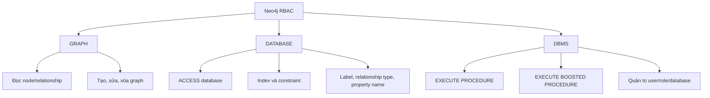
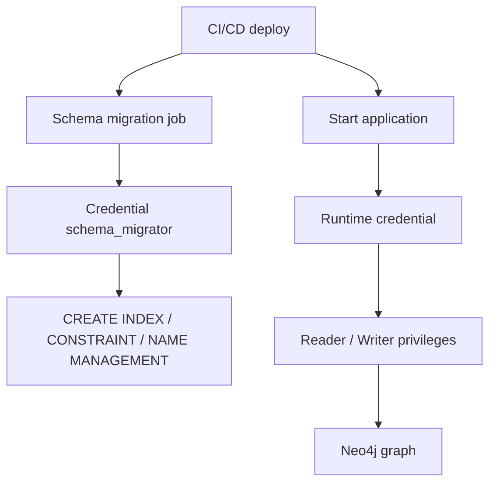

# Tách quyền đọc, ghi, migration và gọi procedure

Một ứng dụng Spring Data Neo4j thường có nhiều loại thao tác: API đọc dữ liệu, API cập nhật graph, pipeline triển khai schema và một số chức năng gọi stored procedure. Nếu tất cả cùng kết nối bằng tài khoản Neo4j có quyền rộng, một lỗi trong API đọc hoặc một câu Cypher bị chèn sai có thể gây thay đổi dữ liệu, xóa graph hoặc thực hiện thao tác quản trị ngoài dự kiến.

Neo4j cung cấp Role-Based Access Control (RBAC) để gán quyền cho role rồi gán role cho user. Một thiết kế vận hành an toàn nên tách ít nhất bốn nhóm danh tính: **reader**, **writer**, **schema migrator** và **procedure caller**. Mỗi user chỉ nhận role phù hợp với công việc; migration và thủ tục đặc quyền không chạy bằng credential của ứng dụng runtime.

## 1. Phân biệt ba phạm vi quyền của Neo4j

Neo4j có các privilege scope khác nhau. Cần chọn đúng scope trước khi viết lệnh `GRANT`:

| Scope | Dùng cho | Ví dụ |
| --- | --- | --- |
| `ON GRAPH` | Đọc và thay đổi node, relationship, property | `MATCH`, `CREATE`, `DELETE`, `SET PROPERTY` |
| `ON DATABASE` | Kết nối database, quản lý index, constraint và tên label/type/property | `ACCESS`, `CREATE INDEX`, `CREATE CONSTRAINT`, `NAME MANAGEMENT` |
| `ON DBMS` | Quyền áp dụng toàn DBMS như gọi procedure, quản lý user/role/database | `EXECUTE PROCEDURE`, `EXECUTE BOOSTED PROCEDURE` |

Ví dụ, quyền đọc `Product` là graph privilege; quyền tạo uniqueness constraint cho `Product.sku` là database privilege; quyền gọi `acme.reporting.summary` là DBMS privilege. Cấp một loại quyền không tự cấp hai loại còn lại.



Các lệnh quản trị role và privilege thường được chạy bằng tài khoản quản trị trên database `system`. Quyền dữ liệu ứng dụng lại được giới hạn trên database đích, ví dụ `appdb`.

## 2. Nguyên tắc least privilege

Least privilege nghĩa là mỗi user chỉ được cấp quyền tối thiểu để hoàn thành nhiệm vụ của mình. Không cấp `admin`, `ALL GRAPH PRIVILEGES`, `ALL DATABASE PRIVILEGES` hoặc `ALL DBMS PRIVILEGES` cho ứng dụng runtime chỉ để tránh lỗi thiếu quyền.

Một phân chia thực tế:

| Danh tính | Nhiệm vụ | Quyền chính | Không nên có |
| --- | --- | --- | --- |
| `app_read_user` | API truy vấn và báo cáo | `ACCESS`, `MATCH` trên graph cần đọc | `CREATE`, `DELETE`, schema management |
| `app_write_user` | Ghi entity và relationship | `ACCESS`, `MATCH`/`MERGE` hoặc write privileges có scope | Tạo/xóa index, constraint, quản trị DBMS |
| `schema_migrator` | Migration schema khi deploy | `ACCESS`, index/constraint/name management | Quyền ghi graph runtime nếu migration không backfill dữ liệu |
| `procedure_runner` | Gọi một nhóm procedure đã duyệt | `ACCESS`, `EXECUTE PROCEDURE` cụ thể và graph privilege mà procedure cần | `EXECUTE BOOSTED` hoặc admin procedures nếu không có yêu cầu |

Một user Neo4j có thể được gán nhiều role và quyền hiệu lực là tổng hợp từ các role đó. Nếu cùng một user được gán cả reader, writer và migrator, việc tách role không còn giúp giới hạn credential runtime. Hãy tách user/service account tương ứng với ranh giới triển khai và vận hành.

## 3. Tạo role và gán cho user

Ví dụ dưới đây giả định database ứng dụng tên `appdb` và các user đã được tạo bởi quy trình quản trị danh tính riêng:

```cypher
CREATE ROLE app_reader IF NOT EXISTS;
CREATE ROLE app_writer IF NOT EXISTS;
CREATE ROLE schema_migrator IF NOT EXISTS;
CREATE ROLE procedure_runner IF NOT EXISTS;

GRANT ROLE app_reader TO app_read_user;
GRANT ROLE app_writer TO app_write_user;
GRANT ROLE schema_migrator TO app_migration_user;
GRANT ROLE procedure_runner TO app_procedure_user;
```

Tài khoản quản trị cần có quyền quản lý role và gán role. Không đưa password thật vào migration script hoặc source code; user provisioning và secret rotation nên do quy trình bảo mật quản lý.

## 4. Role chỉ đọc dữ liệu

Để kết nối tới database, user cần `ACCESS`. Để tìm node/relationship và đọc property, Neo4j có ba read privilege:

- `TRAVERSE`: cho phép tìm/thấy node hoặc relationship.
- `READ`: cho phép đọc property trên entity đã được phép traverse.
- `MATCH`: kết hợp `TRAVERSE` và `READ`.

Role reader chỉ cần `ACCESS` và `MATCH` trên phần graph được phép đọc:

```cypher
GRANT ACCESS ON DATABASE appdb TO app_reader;

GRANT MATCH {*} ON GRAPH appdb NODES Customer, Product
TO app_reader;

GRANT MATCH {*} ON GRAPH appdb RELATIONSHIPS PURCHASED
TO app_reader;
```

Trong ví dụ, reader chỉ được tìm Customer, Product và relationship PURCHASED. Nếu ứng dụng cần đọc thêm `Category` hoặc `BELONGS_TO`, bổ sung đúng label/type đó. Không cấp `MATCH {*} ON GRAPH *` nếu user chỉ làm việc với một database hoặc một tập graph cụ thể.

### Giới hạn property nhạy cảm

Có thể chỉ cấp quyền đọc một số property thay vì toàn bộ property:

```cypher
GRANT MATCH { customerId, displayName, status }
ON GRAPH appdb NODES Customer
TO app_reader;
```

Không có quyền `MATCH` với property bị ẩn thì query đọc property đó có thể trả giá trị không hiển thị theo semantics của RBAC. Nếu cần ẩn field như `nationalId`, `salary` hoặc `secret`, hãy thiết kế privilege theo property và kiểm thử truy vấn thực tế.

`MATCH {*} ` bao gồm cả property được thêm trong tương lai. Vì vậy, nếu graph có thể xuất hiện field nhạy cảm mới, quyền đọc wildcard cần được đánh giá lại khi schema thay đổi.

## 5. Role ghi dữ liệu

Neo4j có các write privilege riêng:

- `CREATE`: tạo node và relationship.
- `DELETE`: xóa node và relationship.
- `SET PROPERTY`: cập nhật property.
- `SET LABEL` và `REMOVE LABEL`: thêm hoặc gỡ label.
- `MERGE`: privilege tổng hợp cho `TRAVERSE`, `READ`, `CREATE` và `SET PROPERTY` để dùng Cypher `MERGE`.
- `WRITE`: cấp toàn bộ thao tác ghi trên graph.

Nếu ứng dụng chủ yếu upsert node/relationship bằng `MERGE`, có thể cấp `MATCH`/`MERGE` theo label và relationship type cần thiết:

```cypher
GRANT ACCESS ON DATABASE appdb TO app_writer;

GRANT MERGE {*}
ON GRAPH appdb NODES Customer, Product
TO app_writer;

GRANT MERGE {*}
ON GRAPH appdb RELATIONSHIPS PURCHASED
TO app_writer;
```

`MERGE` cho phép tìm entity, tạo entity nếu chưa có và cập nhật property theo pattern. Nó không tự cấp quyền xóa. Nếu chức năng nghiệp vụ thật sự cần xóa Product, cấp riêng:

```cypher
GRANT DELETE ON GRAPH appdb NODES Product TO app_writer;
```

`DETACH DELETE` còn phải truy cập các relationship liên quan; quyền traverse bị giới hạn có thể khiến thao tác xóa detach không thực hiện được trong mọi trường hợp. Hãy kiểm thử theo graph pattern thật và chỉ cấp quyền relationship cần thiết.

### Khi nào dùng `WRITE`?

```cypher
GRANT MATCH {*} ON GRAPH appdb ELEMENTS * TO app_writer;
GRANT WRITE ON GRAPH appdb TO app_writer;
```

`WRITE` tiện cho user cần mọi thao tác ghi, nhưng rộng hơn `MERGE` hoặc các quyền riêng. Nó không tự cấp `CREATE NEW LABEL`, `CREATE NEW RELATIONSHIP TYPE` hay `CREATE NEW PROPERTY NAME`; các quyền quản lý tên thuộc `ON DATABASE`. Chỉ dùng `WRITE` khi ứng dụng thực sự cần create/delete/set trên toàn graph.

## 6. Phân biệt ghi dữ liệu với tạo tên schema

Neo4j tách quyền tạo graph element khỏi quyền tạo tên mới:

| Thao tác | Privilege |
| --- | --- |
| Tạo node hoặc relationship với label/type đã tồn tại | Graph `CREATE` hoặc `MERGE` |
| Sửa property đã tồn tại | Graph `SET PROPERTY` hoặc `MERGE` |
| Tạo label mới | Database `CREATE NEW LABEL` |
| Tạo relationship type mới | Database `CREATE NEW TYPE` |
| Tạo property key mới | Database `CREATE NEW NAME` |

Vì vậy, runtime writer có thể tạo `(:Product)` nếu label `Product` đã được provision, nhưng không nhất thiết có quyền tự tạo label mới `(:PremiumProduct)`. Tương tự, việc thêm property key chưa từng xuất hiện có thể cần `CREATE NEW PROPERTY NAME`.

Thiết kế tốt thường để migration tạo label, relationship type và property name trước; runtime user chỉ thao tác dữ liệu trên vocabulary đã được duyệt. Cách này tránh việc code runtime vô tình mở rộng schema ngoài quy trình review.

## 7. Role chỉ chạy schema migration

Schema migration thường cần tạo/xóa index, constraint và quản lý tên label/type/property. Các quyền này nằm ở database scope:

```cypher
GRANT ACCESS ON DATABASE appdb TO schema_migrator;

GRANT CREATE INDEX ON DATABASE appdb TO schema_migrator;
GRANT DROP INDEX ON DATABASE appdb TO schema_migrator;
GRANT SHOW INDEX ON DATABASE appdb TO schema_migrator;

GRANT CREATE CONSTRAINT ON DATABASE appdb TO schema_migrator;
GRANT DROP CONSTRAINT ON DATABASE appdb TO schema_migrator;
GRANT SHOW CONSTRAINT ON DATABASE appdb TO schema_migrator;

GRANT NAME MANAGEMENT ON DATABASE appdb TO schema_migrator;
```

`NAME MANAGEMENT` bao gồm tạo label mới, relationship type mới và property name mới. Nếu migration chỉ cần một loại token, có thể cấp hẹp hơn:

```cypher
GRANT CREATE NEW LABEL ON DATABASE appdb TO schema_migrator;
GRANT CREATE NEW TYPE ON DATABASE appdb TO schema_migrator;
GRANT CREATE NEW NAME ON DATABASE appdb TO schema_migrator;
```

Role này có thể tạo index/constraint nhưng không cần quyền cập nhật nội dung Customer hoặc Product. Không cấp graph `WRITE` cho migration user nếu migration chỉ thay đổi schema.

### Migration schema và migration dữ liệu là hai pha khác nhau

Một migration có thể gồm:

1. Tạo index hoặc constraint.
2. Thêm label/relationship type/property name mới.
3. Backfill hoặc chuyển đổi dữ liệu cũ.

Hai bước đầu dùng database schema privileges. Bước backfill là thao tác dữ liệu, cần graph read/write privileges tương ứng. Nếu migration có backfill, nên dùng một role tạm thời hoặc phase credential riêng có quyền giới hạn theo label/property cần cập nhật; sau khi deploy xong, thu hồi quyền tạm thời.

Quản lý schema trong database `appdb` cũng khác với provisioning database hoặc user/role ở cấp DBMS. Quyền `CREATE DATABASE`, `DROP DATABASE`, user management và role management không thuộc role schema migrator thông thường.

## 8. Role chỉ gọi procedure

Quyền chạy procedure được cấp ở DBMS scope, ví dụ:

```cypher
GRANT ACCESS ON DATABASE appdb TO procedure_runner;

GRANT EXECUTE PROCEDURE acme.reporting.*
ON DBMS TO procedure_runner;
```

Role này được phép gọi các procedure trong namespace `acme.reporting`. Tên procedure được so khớp theo pattern; nên dùng namespace riêng cho procedure nội bộ thay vì cấp wildcard cho mọi procedure.

`EXECUTE PROCEDURE` chỉ cho phép gọi procedure. Các thao tác mà procedure thực hiện vẫn chịu kiểm tra quyền của user gọi. Nếu procedure đọc graph, caller cần graph read privilege phù hợp; nếu procedure ghi graph, caller cần graph write privilege phù hợp.

Ví dụ nếu `acme.reporting.customerSummary` chỉ đọc Customer và PURCHASED:

```cypher
GRANT MATCH {*}
ON GRAPH appdb NODES Customer, Product
TO procedure_runner;

GRANT MATCH {*}
ON GRAPH appdb RELATIONSHIPS PURCHASED
TO procedure_runner;
```

Không cấp `WRITE` cho procedure runner chỉ vì procedure được gọi bằng `CALL`. Hãy xác định procedure có đọc hay ghi và cấp graph privilege đúng với hành vi đó.

## 9. Phân biệt `EXECUTE PROCEDURE` và `EXECUTE BOOSTED PROCEDURE`

Neo4j hỗ trợ procedure chạy với quyền của user gọi hoặc chạy với quyền nâng cao (boosted):

- `EXECUTE PROCEDURE`: cho phép gọi procedure; procedure chạy theo privilege thông thường của user.
- `EXECUTE BOOSTED PROCEDURE`: cho phép nâng quyền trong lúc procedure chạy, nhưng không tự cho phép gọi procedure.

Muốn chạy một procedure ở chế độ boosted, cần cả hai privilege:

```cypher
GRANT EXECUTE PROCEDURE acme.reporting.exportSummary
ON DBMS TO procedure_runner;

GRANT EXECUTE BOOSTED PROCEDURE acme.reporting.exportSummary
ON DBMS TO procedure_runner;
```

Quyền nâng cao chỉ áp dụng trong lúc procedure thực thi. Nó có thể khiến procedure nhìn thấy hoặc thay đổi dữ liệu mà user thông thường không có quyền truy cập. Vì vậy, chỉ cấp boosted cho procedure cụ thể đã review code, input validation, output và side effect.

Không dùng:

```cypher
GRANT EXECUTE BOOSTED PROCEDURE * ON DBMS TO procedure_runner;
```

cho tài khoản runtime thông thường. Wildcard boosted có thể nâng quyền cho rất nhiều procedure, kể cả procedure được cài thêm sau này.

### Admin procedure

Procedure được đánh dấu `@Admin` cần quyền elevated để thực thi. Neo4j có `EXECUTE ADMIN PROCEDURES` tương đương cấp quyền thực thi và boosted cho các admin procedure. Đây là quyền rất mạnh; không cấp cho role gọi procedure nghiệp vụ thông thường. Nếu một tác vụ thực sự cần admin procedure, nên chạy bằng service account vận hành riêng, giới hạn thời gian và giám sát.

User-defined function (UDF) có privilege riêng là `EXECUTE USER DEFINED FUNCTION` và `EXECUTE BOOSTED USER DEFINED FUNCTION`. Không dùng `EXECUTE PROCEDURE` để cấp quyền cho UDF; hãy kiểm tra đúng loại đối tượng được gọi.

## 10. Kiểm tra role `PUBLIC` trước khi tạo allowlist procedure

Neo4j tự gán role `PUBLIC` cho mọi user. Theo cấu hình mặc định, role này có quyền truy cập home database và quyền thực thi procedure/function. Vì vậy, chỉ cấp `EXECUTE PROCEDURE acme.reporting.*` cho một role riêng chưa chắc đã tạo được allowlist thực sự nếu user còn nhận quyền rộng qua `PUBLIC`.

Kiểm tra quyền hiện tại:

```cypher
SHOW ROLE PUBLIC PRIVILEGES AS COMMANDS;
SHOW ROLE procedure_runner PRIVILEGES AS COMMANDS;
SHOW USER app_procedure_user PRIVILEGES AS COMMANDS;
```

Nếu `PUBLIC` đang cấp quyền thực thi rộng, hãy đánh giá tác động trước khi thay đổi. Có thể dùng `DENY EXECUTE PROCEDURE` cho procedure nhạy cảm để chặn quyền hiệu lực:

```cypher
DENY EXECUTE PROCEDURE dbms.cluster*
ON DBMS TO procedure_runner;
```

Ví dụ trên chỉ là minh họa; chọn namespace thực sự cần chặn và kiểm tra các ứng dụng khác dùng chung role `PUBLIC` trước khi áp dụng chính sách ở cấp đó. `DENY` có ưu tiên hơn grant tương ứng, vì vậy một grant khác không thể đơn giản ghi đè deny.

## 11. Hiểu đúng `GRANT`, `DENY` và `REVOKE`

| Lệnh | Ý nghĩa |
| --- | --- |
| `GRANT` | Cấp quyền cho role |
| `DENY` | Từ chối quyền tương ứng; deny có ưu tiên hơn grant |
| `REVOKE GRANT` | Gỡ privilege đã grant |
| `REVOKE DENY` | Gỡ privilege đã deny |
| `REVOKE` không ghi GRANT/DENY | Gỡ các privilege phù hợp theo cú pháp lệnh |

`DENY` không xóa grant cũ. Ví dụ, nếu role có cả `GRANT EXECUTE PROCEDURE *` và `DENY EXECUTE PROCEDURE dbms.cluster.*`, quyền gọi nhóm `dbms.cluster.*` vẫn bị từ chối. Nếu muốn xóa grant ban đầu, dùng `REVOKE GRANT ...` thay vì chỉ thêm deny.

Không dùng `DENY` như cách thu hồi grant thông thường. Hãy phân biệt rõ: deny là chính sách chặn; revoke là thay đổi cấu hình privilege đã tồn tại.

## 12. Gán user riêng cho từng workload

Sau khi tạo role và cấp privilege, gán mỗi user đúng vai trò:

```cypher
GRANT ROLE app_reader TO app_read_user;
GRANT ROLE app_writer TO app_write_user;
GRANT ROLE schema_migrator TO app_migration_user;
GRANT ROLE procedure_runner TO app_procedure_user;
```

Không gán `schema_migrator` cho user mà Spring Boot dùng trong production request. Pipeline deploy có thể lấy credential migration từ secret store trong thời gian chạy migration rồi bỏ credential khỏi môi trường runtime.

Nếu cùng một microservice có endpoint đọc và ghi, có hai hướng:

- Dùng service/process riêng cho read và write, mỗi service có một Driver credential và role tương ứng.
- Tạo nhiều Driver/Neo4jClient/transaction manager có tên riêng trong cùng application context, sau đó inject đúng client/manager vào component phù hợp.

Spring Boot mặc định thường cấu hình một Driver chính từ `spring.neo4j.authentication.username/password`. Nếu mọi repository và `Neo4jClient` dùng chung Driver đó, chúng cùng kết nối bằng một Neo4j identity. Việc thêm `@Transactional(readOnly = true)` không đổi credential hoặc privilege ở server.

### `readOnly = true` không thay thế RBAC

```java
@Transactional(readOnly = true)
public List<Product> findProducts() {
    return productRepository.findAll();
}
```

`readOnly = true` là transaction hint/semantics ở tầng Spring và transaction manager. Nó không cấp quyền `MATCH`, cũng không biến một user có quyền ghi thành user chỉ đọc trong Neo4j. Nếu cần enforcement bảo mật, hãy dùng Neo4j role/privilege và credential đúng.

## 13. Gọi procedure từ Spring Data Neo4j

Procedure có thể được gọi bằng `Neo4jClient` hoặc custom repository query. Ví dụ:

```java
import java.util.Map;

import org.springframework.data.neo4j.core.Neo4jClient;
import org.springframework.stereotype.Repository;

@Repository
public class ReportingProcedureClient {

    private final Neo4jClient neo4jClient;

    public ReportingProcedureClient(Neo4jClient neo4jClient) {
        this.neo4jClient = neo4jClient;
    }

    public Map<String, Object> customerSummary(String customerId) {
        return neo4jClient.query("""
                CALL acme.reporting.customerSummary($customerId)
                YIELD totalOrders, totalSpent
                RETURN totalOrders, totalSpent
                """)
            .bind(customerId).to("customerId")
            .fetch()
            .one()
            .orElseThrow();
    }
}
```

Driver credential của `Neo4jClient` phải thuộc user được cấp `EXECUTE PROCEDURE` cho procedure này. Nếu procedure chạy trong transaction Spring, nó dùng cùng connection identity/transaction context của client tương ứng. Không kỳ vọng procedure tự chuyển sang user migration hoặc admin.

Nếu ứng dụng cần gọi procedure bằng một user khác, cấu hình client/Driver riêng cho workload đó hoặc dùng cơ chế impersonation đã được quản trị và cấp quyền đúng. Không truyền username tùy ý từ request để thay đổi security principal.

## 14. Tách schema migration khỏi runtime Spring Boot

Quy trình triển khai nên có hai loại credential:



Ví dụ cấu hình runtime chỉ chứa user ứng dụng:

```yaml
spring:
  neo4j:
    uri: ${NEO4J_URI}
    authentication:
      username: ${NEO4J_RUNTIME_USER}
      password: ${NEO4J_RUNTIME_PASSWORD}
```

Migration job nhận `NEO4J_MIGRATION_USER` và `NEO4J_MIGRATION_PASSWORD` từ secret store trong pipeline deploy. Không đưa migration credential vào image hoặc biến môi trường của pod runtime sau khi migration kết thúc.

Nếu migration cần data backfill, hãy cấp graph privileges tạm thời trong đúng thời gian migration và thu hồi sau khi hoàn tất. Không gộp quyền DDL và quyền DML vào một tài khoản vĩnh viễn chỉ vì migration tool dùng một connection.

## 15. Kiểm tra privilege sau khi cấu hình

Không nên chỉ đọc script `GRANT` rồi giả định user có đúng quyền. Kiểm tra role và quyền hiệu lực:

```cypher
SHOW ROLES;
SHOW POPULATED ROLES WITH USERS;
SHOW ROLE app_reader PRIVILEGES AS COMMANDS;
SHOW ROLE app_writer PRIVILEGES AS COMMANDS;
SHOW ROLE schema_migrator PRIVILEGES AS COMMANDS;
SHOW ROLE procedure_runner PRIVILEGES AS COMMANDS;
SHOW USER app_read_user PRIVILEGES AS COMMANDS;
```

Kiểm tra user riêng biệt quan trọng vì quyền hiệu lực có thể đến từ nhiều role, bao gồm `PUBLIC` và built-in roles. Hãy xác minh không có role ngoài ý muốn như `publisher`, `architect` hoặc `admin` được gán cho user runtime.

## 16. Kiểm thử ma trận quyền

Kiểm thử authorization nên có cả thao tác được phép và thao tác phải bị từ chối:

| User | Thao tác | Kỳ vọng |
| --- | --- | --- |
| `app_read_user` | `MATCH` Customer/Product | Thành công |
| `app_read_user` | `CREATE` Product | Bị từ chối |
| `app_read_user` | `CREATE INDEX` | Bị từ chối |
| `app_write_user` | `MERGE` Product đã có label/property | Thành công |
| `app_write_user` | `DROP CONSTRAINT` | Bị từ chối |
| `app_migration_user` | `CREATE INDEX` hoặc `CREATE CONSTRAINT` | Thành công |
| `app_migration_user` | `DELETE` Customer | Bị từ chối nếu không cấp graph delete |
| `app_procedure_user` | `CALL acme.reporting.customerSummary` | Thành công |
| `app_procedure_user` | Gọi procedure ngoài allowlist | Bị từ chối theo chính sách hiệu lực |
| `app_procedure_user` | `CALL` admin procedure | Bị từ chối nếu không cấp admin/boosted privilege |

Chạy integration test với Neo4j Enterprise hoặc Aura tier hỗ trợ fine-grained RBAC. Mock `Neo4jClient` không thể xác minh server-side authorization. Với mỗi role, kiểm tra cả query hợp lệ lẫn query cố ý vượt quyền.

## 17. Built-in roles và khi nào nên dùng custom role

Neo4j có các built-in role như `reader`, `editor`, `publisher`, `architect` và `admin`. Chúng tiện cho nhu cầu chung, nhưng thường rộng hơn một workload cụ thể:

| Built-in role | Phạm vi khái quát |
| --- | --- |
| `reader` | Đọc graph trên các database được role cho phép |
| `editor` | Đọc và ghi dữ liệu hiện có |
| `publisher` | Đọc/ghi và tạo label, relationship type, property name mới |
| `architect` | Publisher cộng quản lý index/constraint |
| `admin` | Quản trị rộng ở cấp DBMS |

Nếu mục tiêu là tách rõ runtime write với schema migration, không nên dùng `architect` cho runtime writer vì role này bao gồm quyền quản lý index/constraint. Nếu cần giới hạn graph, property hoặc procedure cụ thể, hãy tạo custom role và privilege theo đúng scope.

## 18. Giới hạn theo edition và deployment

Fine-grained RBAC với graph/database/DBMS privileges và custom privilege management cần Neo4j Enterprise Edition hoặc AuraDB tier hỗ trợ như Business Critical và Virtual Dedicated Cloud. Community Edition và Aura tier không hỗ trợ cùng mức fine-grained privilege control; cần kiểm tra edition/tier thực tế trước khi thiết kế role matrix phụ thuộc vào các privilege này.

Một số built-in role có sẵn không đồng nghĩa mọi lệnh `GRANT`, `DENY`, `EXECUTE BOOSTED` hoặc property-based access control đều khả dụng trên mọi edition. Hãy đối chiếu phiên bản server và `SHOW SUPPORTED PRIVILEGES` trong môi trường triển khai.

## 19. Lỗi thường gặp

| Biểu hiện | Nguyên nhân | Cách xử lý |
| --- | --- | --- |
| Reader không truy vấn được database | Có graph `MATCH` nhưng thiếu database `ACCESS` | Cấp `ACCESS ON DATABASE` |
| Reader thấy node nhưng không đọc được property | Có `TRAVERSE` nhưng thiếu `READ`, hoặc property bị deny | Cấp `MATCH`/`READ` đúng property và kiểm tra deny |
| Writer dùng `MERGE` bị từ chối | Thiếu quyền `MATCH`, `CREATE` hoặc `SET PROPERTY` trong compound privilege | Cấp `MERGE` đúng graph element hoặc quyền thành phần |
| Writer tạo label mới thất bại | Thiếu `CREATE NEW LABEL` trên database | Đưa token creation vào migration hoặc cấp quyền có scope |
| Migration tạo index thất bại | Thiếu `CREATE INDEX` hoặc database access | Cấp database privilege tương ứng |
| Migration tạo constraint thất bại | Thiếu `CREATE CONSTRAINT` | Cấp quyền trên database đích |
| Procedure có execute privilege nhưng vẫn lỗi khi đọc graph | Procedure chạy theo privilege của caller | Cấp graph read/write privilege cần thiết hoặc đánh giá boosted thật kỹ |
| Procedure không chạy boosted | Chỉ có `EXECUTE BOOSTED PROCEDURE` mà thiếu `EXECUTE PROCEDURE` | Cấp cả hai cho đúng procedure |
| Procedure ngoài allowlist vẫn chạy | User thừa quyền từ `PUBLIC` hoặc role khác | Kiểm tra quyền user hiệu lực và targeted DENY |
| Runtime user có quyền DDL | Bị gán role `architect` hoặc `schema_migrator` | Tách user/role và thu hồi quyền không cần thiết |
| DENY không gỡ grant cũ | Nhầm `DENY` với `REVOKE` | Dùng `REVOKE GRANT` để xóa grant |

## 20. Checklist vận hành

1. Liệt kê workload: đọc, ghi, schema migration, procedure execution và DBMS provisioning.
2. Tạo user riêng cho runtime reader, runtime writer, migration và procedure caller.
3. Cấp `ACCESS` đúng database trước khi cấp graph privilege.
4. Giới hạn `MATCH` theo label, relationship type và property cần đọc.
5. Dùng `MERGE` hoặc các write privilege cụ thể; tránh `WRITE` nếu không cần toàn bộ thao tác ghi.
6. Giữ `CREATE INDEX`, `CREATE CONSTRAINT` và `NAME MANAGEMENT` ở migration identity.
7. Cấp `EXECUTE PROCEDURE` theo tên procedure; không wildcard toàn DBMS nếu không có lý do.
8. Chỉ cấp `EXECUTE BOOSTED PROCEDURE` khi đã review rủi ro và cấp đồng thời execute thường.
9. Kiểm tra quyền mặc định từ `PUBLIC` và mọi built-in role được gán.
10. Kiểm tra quyền hiệu lực bằng `SHOW USER ... PRIVILEGES`.
11. Kiểm thử cả thao tác hợp lệ và thao tác phải bị từ chối trên Neo4j thật.
12. Lưu secret ngoài source code, xoay credential và thu hồi quyền tạm sau migration.

## Kết luận

Tách quyền đọc, ghi, migration và procedure bằng các Neo4j user/role riêng giúp giới hạn tác động khi ứng dụng lỗi hoặc credential bị lộ. Reader cần `ACCESS` và `MATCH`; writer cần graph privileges phù hợp với `MERGE`, `CREATE`, `SET` hoặc `DELETE`; migrator cần database privileges cho index, constraint và name management; procedure caller cần `EXECUTE PROCEDURE` đúng tên và chỉ nhận boosted khi thật sự cần. Luôn phân biệt graph, database và DBMS scope, kiểm tra quyền kế thừa từ `PUBLIC`, xác minh privilege hiệu lực và chạy test âm để chứng minh các thao tác vượt quyền bị từ chối.

## Tài liệu tham khảo

- [Neo4j Operations Manual — Role-based access control](https://neo4j.com/docs/operations-manual/current/authentication-authorization/manage-privileges/)
- [Neo4j Operations Manual — Read privileges](https://neo4j.com/docs/operations-manual/current/authentication-authorization/privileges-reads/)
- [Neo4j Operations Manual — Write privileges](https://neo4j.com/docs/operations-manual/current/authentication-authorization/privileges-writes/)
- [Neo4j Operations Manual — Database privileges](https://neo4j.com/docs/operations-manual/current/authentication-authorization/database-administration/)
- [Neo4j Operations Manual — DBMS procedure execution privileges](https://neo4j.com/docs/operations-manual/current/authentication-authorization/dbms-administration/dbms-execute-privileges/)
- [Neo4j Operations Manual — Built-in roles and privileges](https://neo4j.com/docs/operations-manual/current/authentication-authorization/built-in-roles/)
- [Neo4j Operations Manual — Manage roles](https://neo4j.com/docs/operations-manual/current/authentication-authorization/manage-roles/)
- [Spring Data Neo4j — Neo4jClient](https://docs.spring.io/spring-data/neo4j/reference/appendix/neo4j-client.html)
