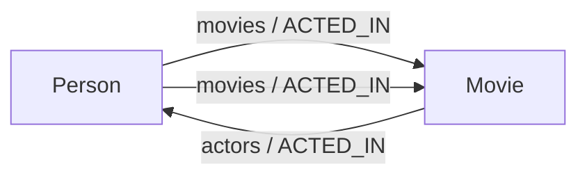

# Tuần tự hóa DTO để tránh vòng lặp, lộ thông tin và payload quá rộng

Entity trong Spring Data Neo4j mô tả graph để lưu trữ và truy vấn; JSON response lại là hợp đồng dữ liệu dành cho client. Nếu trả thẳng entity có relationship hai chiều, Jackson có thể đi từ `Person` sang `Movie`, rồi quay lại `Person` và tiếp tục đệ quy cho tới `StackOverflowError`. Nếu entity còn chứa email nội bộ, password hash, token hoặc thuộc tính vận hành, những trường đó có thể vô tình xuất hiện trong response. Nếu entity mang theo nhiều relationship, API còn có thể trả một graph rất lớn dù màn hình chỉ cần vài trường. Cách kiểm soát tốt là thiết kế DTO đầu ra theo từng use case, lấy đúng dữ liệu bằng projection/query phù hợp và kiểm tra quyền trước khi tạo response.

Bài học thuộc module **SPRING_DATA_NEO4J**, tập trung xây dựng tầng dữ liệu đồ thị qua node entity, relationship, repository và Cypher. Ta dùng `Person`, `Movie` và `ACTED_IN` để hiểu vòng lặp object graph, phân biệt entity với DTO, chọn SDN projection, kiểm soát Jackson serialization, bảo vệ trường nhạy cảm và giới hạn payload.

## 1. Entity graph không phải JSON contract

Một entity có thể chứa nhiều thông tin cần cho persistence:

```java
@Node("Person")
public class Person {

    @Id
    private String personId;

    private String name;
    private String email;
    private String passwordHash;
    private String tenantId;

    @Relationship(type = "ACTED_IN", direction = Relationship.Direction.OUTGOING)
    private List<Movie> movies = new ArrayList<>();
}

@Node("Movie")
public class Movie {

    @Id
    private String movieId;

    private String title;
    private Integer released;

    @Relationship(type = "ACTED_IN", direction = Relationship.Direction.INCOMING)
    private List<Person> actors = new ArrayList<>();
}
```

Trong graph, `Person` liên kết tới `Movie` qua `ACTED_IN`; phía `Movie` cũng có thể tham chiếu ngược về `Person`. Mô hình hai chiều giúp domain code điều hướng graph thuận tiện. Nhưng khi Jackson serialize `Person`, nó có thể duyệt `movies`, rồi mỗi `Movie` duyệt `actors`, rồi lại quay về `Person`.



Jackson không tự hiểu rằng đây là cùng một graph node đã được thăm. Mặc định, nó tuần tự hóa theo cây object được truy cập qua getter/field. Với tham chiếu vòng, quá trình có thể lặp vô hạn và ném `StackOverflowError`.

Vòng lặp object graph cũng có thể ảnh hưởng tới log và equality nếu entity dùng Lombok `@Data` hoặc tự sinh `toString()`, `equals()` và `hashCode()` bao gồm relationship hai chiều. Với entity graph, hãy viết các method này có chủ đích hoặc loại relationship khỏi `toString`/`equals`/`hashCode`; không đưa toàn bộ graph vào log để debug.

Ngay cả khi không có vòng lặp, trả entity trực tiếp cũng có thể làm lộ các property nội bộ và mở rộng response theo mọi relationship được Jackson nhìn thấy. Vì vậy, hãy coi entity là mô hình persistence/domain, còn DTO là mô hình request/response của API.

## 2. Thiết kế DTO theo nhu cầu của endpoint

DTO nên chứa đúng những trường mà một use case cần trả về. Ví dụ trang chi tiết người chỉ cần ID nghiệp vụ, tên và danh sách phim rút gọn:

```java
public record MovieItemResponse(
        String movieId,
        String title,
        Integer released) {
}

public record PersonDetailResponse(
        String personId,
        String name,
        List<MovieItemResponse> movies) {
}
```

DTO không chứa `passwordHash`, email riêng tư, tenant nội bộ, toàn bộ danh sách actor hay reference ngược từ `Movie` về `Person`. Response có hình dạng hữu hạn:

```json
{
  "personId": "P-100",
  "name": "An Nguyen",
  "movies": [
    {
      "movieId": "M-10",
      "title": "The Graph",
      "released": 2025
    }
  ]
}
```

Service chuyển entity sang DTO:

Ví dụ mapping dưới đây giả định collection `movies` đã được giới hạn bởi projection/query phù hợp. Nếu `person.getMovies()` chứa hàng nghìn phần tử đã tải về, việc map sang DTO chỉ làm JSON nhỏ hơn; nó không giảm chi phí đọc graph. Phần tiếp theo trình bày cách giới hạn dữ liệu ngay ở SDN.

```java
public PersonDetailResponse toResponse(Person person) {
    List<MovieItemResponse> movies = person.getMovies().stream()
        .map(movie -> new MovieItemResponse(
            movie.getMovieId(),
            movie.getTitle(),
            movie.getReleased()
        ))
        .toList();

    return new PersonDetailResponse(
        person.getPersonId(),
        person.getName(),
        movies
    );
}
```

Controller chỉ trả DTO:

```java
@RestController
@RequestMapping("/api/people")
public class PersonController {

    private final PersonService personService;

    public PersonController(PersonService personService) {
        this.personService = personService;
    }

    @GetMapping("/{personId}")
    public PersonDetailResponse getPerson(@PathVariable String personId) {
        return personService.findDetail(personId);
    }
}
```

Spring MVC/WebFlux sẽ dùng message converter để serialize giá trị controller trả về thành response body. Việc trả DTO khiến hình dạng JSON trở thành hợp đồng rõ ràng, không phụ thuộc vào việc entity được mở rộng thêm relationship hoặc property persistence trong tương lai.

## 3. Tách DTO đầu vào và DTO đầu ra

Không dùng một class cho cả request body và response. Client có thể gửi một số trường để tạo/cập nhật, nhưng không được tự quyết định trường nội bộ như `tenantId`, role, trạng thái kiểm duyệt hoặc `passwordHash`.

```java
public record CreatePersonRequest(
        String name,
        String email,
        String password) {
}

public record PersonResponse(
        String personId,
        String name) {
}
```

Service tự băm password và xác định tenant từ security context đã xác thực:

```java
public PersonResponse create(CreatePersonRequest request) {
    Person person = new Person();
    person.setPersonId(idGenerator.nextPersonId());
    person.setName(request.name());
    person.setEmail(request.email());
    person.setPasswordHash(passwordEncoder.encode(request.password()));
    person.setTenantId(currentTenant.requireTenantId());

    Person saved = personRepository.save(person);
    return new PersonResponse(saved.getPersonId(), saved.getName());
}
```

Không nhận `passwordHash` từ request và không trả password hoặc password hash về response. Một DTO đầu vào chỉ chứa trường được phép ghi; DTO đầu ra chỉ chứa trường được phép đọc. Đây là allow-list rõ ràng hơn việc nhận cả entity rồi cố gắng loại bỏ các trường không mong muốn.

## 4. Dùng SDN projection để giới hạn dữ liệu lấy từ graph

Chuyển entity sang DTO ở service ngăn lộ dữ liệu trong JSON, nhưng nếu repository đã tải một graph lớn thì ứng dụng vẫn phải trả chi phí đọc, mapping và giữ object trong heap. Spring Data Neo4j hỗ trợ interface-based và DTO-based projections. Cả hai loại projection ảnh hưởng trực tiếp tới property và relationship được truy vấn/truyền về, nhờ đó có thể giảm lượng dữ liệu lấy từ database.

Ví dụ interface projection chỉ đọc các trường cần cho màn hình:

```java
public interface PersonSummaryProjection {

    String getPersonId();

    String getName();

    List<MovieSummaryProjection> getMovies();

    interface MovieSummaryProjection {
        String getMovieId();
        String getTitle();
        Integer getReleased();
    }
}
```

Repository:

```java
public interface PersonRepository extends Neo4jRepository<Person, String> {

    Optional<PersonSummaryProjection> findByPersonId(String personId);
}
```

Các accessor trong projection phải khớp với property của entity: `personId`, `name`, `movies`, `movieId`, `title`, `released`. Projection lồng nhau giới hạn độ sâu quan hệ mà use case cần. Ở đây response không cần `Movie.actors`, nên projection không yêu cầu đường tham chiếu ngược.

SDN hỗ trợ multi-level projections và logic projection tạo query không đi theo chu trình vô hạn. Tuy nhiên, cần thiết kế các mức lồng nhau có chủ đích; projection ba hoặc bốn tầng vẫn có thể tạo lượng dữ liệu lớn nếu mỗi node có nhiều relationship.

## 5. DTO projection với custom Cypher

Với endpoint chỉ cần vài property và dữ liệu tổng hợp, custom query có thể trả trực tiếp một DTO projection:

```java
public record PersonMovieTitles(
        String personId,
        String name,
        List<String> movieTitles) {
}
```

```java
import org.springframework.data.repository.query.Param;

// Ví dụ repository riêng cho DTO projection.
public interface PersonRepository extends Neo4jRepository<Person, String> {

    @Query("""
        MATCH (p:Person {personId: $personId})
        OPTIONAL MATCH (p)-[:ACTED_IN]->(m:Movie)
        RETURN p.personId AS personId,
               p.name AS name,
               collect(m.title) AS movieTitles
        """)
    Optional<PersonMovieTitles> findMovieTitles(@Param("personId") String personId);
}
```

Nếu kết hợp với interface repository ở phần projection trước, hãy thêm method `findMovieTitles` vào cùng interface thay vì tạo hai interface trùng tên trong một package.

Trong DTO projection, SDN dùng property của domain type để điền dữ liệu tương ứng; các thuộc tính bổ sung có thể được lấy từ record của custom query nếu tên khớp chính xác. Kiểu bổ sung cần thuộc nhóm simple types hoặc persistent entities đã biết; collection được hỗ trợ nhưng `Map` không phải kiểu bổ sung được hỗ trợ cho cơ chế này. Hãy đặt alias Cypher đúng với tên constructor property của DTO.

Ví dụ trên trả danh sách title thay vì trả cả node `Movie` cùng các relationship của nó. Nếu một endpoint cần thêm `movieId` và `released`, có thể trả một DTO row hoặc projection lồng phù hợp. Tránh trả cả graph node khi API chỉ cần một chuỗi.

## 6. Dùng DTO row và phân trang relationship

Một người có thể tham gia hàng nghìn phim. Không nên mặc định trả toàn bộ phim trong một response. Có thể tạo DTO cho từng dòng phim:

```java
public record MovieSummaryRow(
        String movieId,
        String title,
        Integer released) {
}
```

Query giới hạn số dòng và sắp xếp ổn định:

```java
// Thêm method này vào PersonRepository ở phần trước.
@Query("""
    MATCH (p:Person {personId: $personId})-[:ACTED_IN]->(m:Movie)
    RETURN m.movieId AS movieId,
           m.title AS title,
           m.released AS released
    ORDER BY m.released DESC, m.movieId ASC
    SKIP $skip
    LIMIT $pageSize
    """)
List<MovieSummaryRow> findMoviePage(
    @Param("personId") String personId,
    @Param("skip") long skip,
    @Param("pageSize") int pageSize
);
```

`movieId` được thêm làm tie-breaker để thứ tự ổn định khi nhiều phim có cùng năm phát hành. Query trả từng row DTO nhỏ thay vì trả một object graph lồng nhau. API có thể trả `PersonResponse` riêng cùng `movies` page và thông tin phân trang.

`LIMIT` ở query này giới hạn số relationship row được trả về cho một người. Nếu query có nhiều người, `LIMIT` tổng không có nghĩa là giới hạn số phim trên mỗi người. Khi cần phân trang theo từng parent, hãy thiết kế subquery/endpoint riêng theo khả năng Cypher của phiên bản Neo4j đang dùng và đo query plan.

Không dùng `collect()` trên một tập relationship không giới hạn rồi mới cắt list ở Java. Khi đó payload HTTP có thể nhỏ nhưng server và ứng dụng vẫn phải xử lý tập dữ liệu lớn. Hãy giới hạn dữ liệu càng gần query càng tốt.

## 7. Phân biệt SDN projection và API response DTO

Hai loại DTO/projection có mục đích gần nhau nhưng nằm ở hai ranh giới khác nhau:

| Thành phần | Mục đích | Kiểm soát |
|---|---|---|
| SDN projection | Giới hạn property/relationship được tải từ Neo4j | Query shape, mapping và chi phí đọc database |
| API response DTO | Định nghĩa dữ liệu được serialize cho client | Hợp đồng JSON, field được phép công khai, cấu trúc response |
| Request DTO | Định nghĩa dữ liệu client được phép gửi | Input validation và mass-assignment boundary |
| Domain entity | Mô hình nghiệp vụ và persistence | State, relationship và quy tắc domain |

Có thể dùng một DTO projection làm kiểu trả về ở repository rồi chuyển sang API response DTO trong service. Cách này tách việc database cần đọc khỏi việc API cần công khai. Với ứng dụng nhỏ, hai cấu trúc có thể giống nhau; nhưng không nên để hợp đồng HTTP vô tình phụ thuộc vào entity hoặc schema graph.

## 8. Các annotation Jackson để xử lý vòng lặp

DTO là lựa chọn chính khi thiết kế response. Trong một số hệ thống cũ phải serialize entity trực tiếp, Jackson cung cấp annotation để điều khiển reference. Chúng giải quyết vấn đề serialization, không thay thế thiết kế API.

### 8.1. @JsonIgnore

Đơn giản nhất là bỏ qua property tạo vòng lặp hoặc property không được phép serialize:

```java
@Node("Movie")
public class Movie {

    @Id
    private String movieId;

    private String title;

    @JsonIgnore
    @Relationship(type = "ACTED_IN", direction = Relationship.Direction.INCOMING)
    private List<Person> actors = new ArrayList<>();
}
```

Khi Jackson serialize `Movie`, property `actors` không được đi theo, nên không quay ngược về `Person`. Có thể dùng `@JsonIgnore` cho `passwordHash`, token hoặc field nội bộ nếu entity buộc phải xuất hiện trong serialization.

`@JsonIgnore` tác động tới property trong quá trình Jackson xử lý; theo mặc định, việc bỏ qua có thể ảnh hưởng cả serialization và deserialization. Nếu cần nhận một giá trị nhưng không xuất nó, hãy dùng DTO request riêng hoặc cấu hình access phù hợp như `@JsonProperty(access = JsonProperty.Access.WRITE_ONLY)` sau khi hiểu rõ contract.

### 8.2. @JsonIgnoreProperties

Có thể bỏ qua một hoặc nhiều property ở cấp class/property:

```java
@JsonIgnoreProperties({"actors"})
@Node("Movie")
public class Movie {
    // Properties và relationships.
}
```

Trên `Person`, nếu vẫn phải serialize entity cũ, có thể bỏ qua các property của chính entity đó bằng `@JsonIgnoreProperties({"passwordHash", "tenantId"})`. Đặt annotation trên đúng class sở hữu các property cần bỏ qua.

Annotation này thuận tiện khi cần loại bỏ một nhóm property trong một mô hình cũ. Tuy nhiên, danh sách bỏ qua có thể bị quên cập nhật khi entity được thêm field mới. Với yêu cầu bảo mật, allow-list DTO vẫn rõ ràng hơn block-list annotation.

### 8.3. @JsonManagedReference và @JsonBackReference

Hai annotation này biểu diễn một cặp parent/child: phía managed được serialize, phía back reference không được serialize theo chiều ngược lại.

```java
public class Department {

    @JsonManagedReference("department-employees")
    private List<Employee> employees;
}

public class Employee {

    @JsonBackReference("department-employees")
    private Department department;
}
```

Đây là mô hình cha-con một chiều rõ ràng. Graph Neo4j thường là many-to-many, có nhiều loại relationship và có thể có nhiều đường đi giữa các node. `@JsonManagedReference`/`@JsonBackReference` không phải công cụ tổng quát để serialize mọi graph; nếu dùng cho nhiều cặp quan hệ, cần đặt tên reference riêng và kiểm tra deserialization.

### 8.4. @JsonIdentityInfo

Jackson có thể biểu diễn object identity: lần xuất hiện đầu serialize object đầy đủ kèm ID, các lần tham chiếu sau dùng ID thay cho việc mở rộng object lần nữa.

```java
@JsonIdentityInfo(
    generator = ObjectIdGenerators.PropertyGenerator.class,
    property = "personId"
)
@Node("Person")
public class Person {
    @Id
    private String personId;
    // Các property và relationship khác.
}
```

Nếu dùng cách này cho `Movie`, hãy chọn property ID phù hợp như `movieId`. Object ID phải ổn định và duy nhất trong phạm vi mà Jackson xử lý. JSON sẽ chứa giá trị tham chiếu thay cho object lặp lại; client phải hiểu định dạng đó.

`@JsonIdentityInfo` có thể ngăn lặp vô hạn nhưng không tự giới hạn độ sâu graph hoặc số lượng node được serialize. Object đầu tiên vẫn có thể rất lớn. Vì vậy, không xem object identity là biện pháp thay thế DTO/projection.

## 9. @JsonView và @JsonInclude có vai trò gì?

Spring hỗ trợ Jackson `@JsonView` để chỉ render một tập property nhất định:

```java
public class PersonViews {
    public interface Public {}
    public interface Internal extends Public {}
}

public class PersonResponseCandidate {

    private String personId;
    private String name;
    private String email;

    @JsonView(PersonViews.Public.class)
    public String getPersonId() { return personId; }

    @JsonView(PersonViews.Public.class)
    public String getName() { return name; }

    @JsonView(PersonViews.Internal.class)
    public String getEmail() { return email; }
}
```

Controller có thể chọn view:

```java
@GetMapping("/{personId}")
@JsonView(PersonViews.Public.class)
public PersonResponseCandidate getPerson(@PathVariable String personId) {
    return service.findCandidate(personId);
}
```

`@JsonView` hữu ích khi một model có các nhóm serialization được xác định rõ. Tuy nhiên, view không tự kiểm tra quyền của người gọi. Nếu chọn nhầm view hoặc cấu hình default inclusion không như dự kiến, dữ liệu có thể xuất hiện ngoài ý muốn. Với response có quyền truy cập khác nhau, các DTO riêng theo use case thường dễ review và an toàn hơn.

`@JsonInclude(JsonInclude.Include.NON_NULL)` loại bỏ property null khỏi JSON. Nó không che một property có giá trị, không kiểm tra quyền và không ngăn lộ thông tin. Không dùng việc ẩn null làm biện pháp bảo mật.

## 10. Bảo vệ thông tin nhạy cảm ở service và query

Tuần tự hóa chỉ là bước cuối. Nếu caller không có quyền đọc một thông tin, ứng dụng không nên tải hoặc đưa thông tin đó vào response ngay từ đầu.

Các trường cần xem xét kỹ:

- `password`, `passwordHash`, API key, refresh token, reset token.
- Email cá nhân, số điện thoại, địa chỉ hoặc dữ liệu định danh.
- `tenantId`, internal database ID, quyền quản trị, cờ moderation.
- Ghi chú nội bộ, trạng thái fraud/risk, dữ liệu billing.
- Relationship metadata chỉ dành cho nội bộ như `createdBy`, `reviewedBy`, `moderationReason`.

Có thể bảo vệ service method bằng method security:

```java
@Service
public class PersonQueryService {

    @PreAuthorize("hasAuthority('person:read')")
    public PersonDetailResponse findDetail(String personId) {
        // Load dữ liệu phù hợp với quyền và map sang response DTO.
    }
}
```

Method security cần được bật bằng `@EnableMethodSecurity` trong cấu hình ứng dụng. Quyền truy cập ở service không thay thế điều kiện lọc dữ liệu theo owner/tenant. Nếu người dùng chỉ được đọc dữ liệu trong tenant của mình, tenant phải được lấy từ principal đã xác thực và đưa vào điều kiện query; không tin một `tenantId` tùy ý do client gửi lên.

Ví dụ repository query theo tenant:

```java
@Query("""
    MATCH (p:Person {personId: $personId, tenantId: $tenantId})
    RETURN p
    """)
Optional<Person> findInTenant(String personId, String tenantId);
```

Service lấy `tenantId` từ authenticated context rồi gọi repository. Không để endpoint nhận `tenantId` từ request và dùng trực tiếp làm ranh giới phân quyền nếu chưa kiểm tra quyền của tenant đó.

## 11. Đừng dùng annotation serialization thay cho authorization

Một số sai lầm thường gặp:

- Thêm `@JsonIgnore` vào `passwordHash` nhưng vẫn trả entity chứa email, tenant và admin flag.
- Dùng `@JsonView(Public.class)` rồi cho rằng view là chính sách phân quyền.
- Dùng `@JsonInclude(NON_NULL)` để mong field nhạy cảm biến mất.
- Ẩn property trong JSON nhưng query vẫn tải toàn bộ graph lớn.
- Lọc relationship ở controller sau khi đã tải dữ liệu của tenant khác.

Phân quyền phải được kiểm tra ở tầng service và query/data access. DTO chỉ quyết định hình dạng dữ liệu được phép trả về sau khi authorization đã thành công.

## 12. Giới hạn payload theo độ sâu và số lượng relationship

Một endpoint cần thông tin người và vài phim gần đây không cần serialize mọi người liên quan tới các phim đó, rồi mọi phim khác của những người đó. Hãy đặt giới hạn rõ:

- Chọn số tầng relationship cần cho màn hình.
- Giới hạn số phần tử trong collection.
- Phân trang relationship có thể tăng rất lớn.
- Chọn property ngắn gọn, không trả metadata nội bộ không cần thiết.
- Tránh trả nguyên node/relationship object nếu DTO chỉ cần vài trường.
- Dùng query aggregate có kiểm soát; không `collect()` toàn bộ graph không giới hạn.

Ví dụ lấy một trang phim của một người:

```cypher
MATCH (p:Person {personId: $personId})-[:ACTED_IN]->(m:Movie)
RETURN m.movieId AS movieId,
       m.title AS title,
       m.released AS released
ORDER BY m.released DESC, m.movieId ASC
SKIP $skip
LIMIT $pageSize;
```

Query chỉ trả các cột cần cho `MovieSummaryRow`, không trả `Person`, `Movie.actors` hoặc các relationship khác. Với endpoint cần person header, có thể lấy thông tin person riêng hoặc thiết kế query trả header cùng page row bằng cách phù hợp với result mapping.

Giới hạn payload và giới hạn công việc database là hai việc khác nhau. Nếu ứng dụng tải toàn bộ entity graph rồi chỉ lấy ba trường để tạo DTO, response nhỏ nhưng database/network/memory cost có thể vẫn lớn. Hãy dùng projection/query để giảm dữ liệu đọc và DTO để giảm dữ liệu serialize.

## 13. Kiểm tra JSON response thực tế

Đừng chỉ kiểm tra DTO bằng mắt. Hãy serialize bằng `ObjectMapper` được cấu hình giống ứng dụng:

```java
@SpringBootTest
class PersonResponseSerializationTest {

    @Autowired
    ObjectMapper objectMapper;

    @Test
    void responseContainsOnlyPublicFields() throws Exception {
        PersonDetailResponse response = new PersonDetailResponse(
            "P-100",
            "An Nguyen",
            List.of(new MovieItemResponse("M-10", "The Graph", 2025))
        );

        String json = objectMapper.writeValueAsString(response);

        assertThat(json)
            .contains("personId", "name", "movies", "movieId", "title")
            .doesNotContain("passwordHash", "tenantId", "actors", "email");
    }
}
```

Với controller integration test, dùng `MockMvc` hoặc `WebTestClient` để kiểm tra response body thực tế. Xác nhận cả HTTP status, property name, trường không được phép xuất hiện, độ sâu lồng nhau và giới hạn phần tử.

Nếu API có các quyền khác nhau, viết test cho từng role/authority. Test response công khai phải chứng minh user không có quyền không thể nhận field nội bộ; test quyền quản trị cần xác nhận chỉ đúng role mới nhận response mở rộng.

## 14. Kiểm tra vòng lặp và kích thước response

Một số kiểm tra hữu ích:

```java
String json = objectMapper.writeValueAsString(response);

assertThat(json).doesNotContain("actors");
assertThat(json).doesNotContain("passwordHash");
assertThat(response.movies()).hasSizeLessThanOrEqualTo(20);
assertThat(json.length()).isLessThan(20_000);
```

Ngưỡng 20.000 ký tự ở đây chỉ là ví dụ cho một response nhỏ; hãy đặt ngưỡng dựa trên hợp đồng API và dữ liệu thật. Với payload production, đo byte UTF-8 sau serialization hoặc HTTP response size thay vì dùng số ký tự làm số byte chính xác.

Đối với entity cũ vẫn phải serialize trực tiếp, hãy có test regression cho trường hợp relationship hai chiều. Tạo một graph nhỏ có `Person -> Movie -> Person` và xác nhận serialization không ném `StackOverflowError`. Tuy nhiên, test này chỉ chứng minh annotation/config hiện tại không lặp; nó không chứng minh response an toàn hoặc nhỏ.

## 15. Các lỗi thường gặp

| Triệu chứng | Nguyên nhân | Cách xử lý |
|---|---|---|
| `StackOverflowError` khi trả entity | Relationship hai chiều tạo vòng lặp object | Dùng DTO/projection; hoặc bỏ qua một phía reference khi phải serialize entity |
| JSON chứa `passwordHash` hoặc `tenantId` | Trả trực tiếp entity và Jackson phát hiện property | Dùng response DTO allow-list; kiểm tra JSON thực tế |
| Response có quá nhiều relationship | Entity/projection lấy graph sâu hoặc collection không giới hạn | Giới hạn projection depth, query và pagination |
| Đã thêm `@JsonIgnore` nhưng query vẫn chậm | Annotation chỉ tác động serialization, không đảm bảo giảm dữ liệu fetch | Dùng SDN projection hoặc custom query |
| Dùng `@JsonIdentityInfo` nhưng JSON vẫn rất lớn | Object đầu tiên vẫn serialize đầy đủ và graph vẫn rộng | Giới hạn DTO/projection và số relationship |
| `@JsonManagedReference` không xử lý được graph many-to-many | Annotation hướng tới cặp parent/child | Dùng DTO hoặc object identity có kiểm soát |
| DTO projection không được map field bổ sung | Alias Cypher không khớp chính xác constructor property | Đồng bộ tên field/alias và kiểu dữ liệu |
| DTO projection khai báo `Map` không được hỗ trợ | SDN DTO projection không hỗ trợ map bổ sung theo cơ chế này | Dùng DTO scalar/collection hoặc `Neo4jClient` với mapper thủ công |
| `@JsonView` vẫn để lộ dữ liệu | View được chọn hoặc default inclusion không như dự kiến | Dùng DTO riêng và test role cụ thể |
| API nhận được `tenantId` do client tự gửi | Tin input làm ranh giới phân quyền | Lấy tenant từ authenticated principal và lọc trong query |
| `collect()` tạo payload lớn | Thu thập không giới hạn trước khi serialize | Giới hạn query, phân trang và chọn trường cần thiết |
| Thêm field vào entity làm thay đổi JSON ngoài ý muốn | API contract phụ thuộc persistence model | Chỉ expose response DTO đã được thiết kế |

## 16. Checklist trước khi trả graph data qua REST

- Controller trả response DTO thay vì domain entity.
- Request DTO và response DTO được tách riêng.
- DTO chỉ chứa field được phép công khai cho use case.
- Không trả password hash, token, secret, tenant/internal metadata hoặc relationship metadata nhạy cảm.
- Dùng SDN interface/DTO projection để giới hạn property và relationship được tải.
- Projection nested chỉ đi tới độ sâu cần thiết và không yêu cầu reference ngược vô ích.
- Custom DTO query dùng alias khớp chính xác tên property/constructor.
- Không dùng `Map` như property bổ sung của SDN DTO projection.
- Relationship collection có pagination hoặc giới hạn rõ ràng.
- Không dùng `collect()` không giới hạn rồi mới cắt payload ở Java.
- Authorization được kiểm tra ở service/query; serializer không phải lớp phân quyền.
- Tenant/owner filter lấy từ principal đã xác thực, không tin input tùy ý.
- Jackson annotations chỉ dùng như biện pháp điều khiển serialization có chủ đích.
- Kiểm tra response JSON thực tế bằng ObjectMapper và controller integration test.
- Có test cho vòng lặp, field nhạy cảm, số phần tử và payload size.

## 17. Bài tập thực hành

1. Tạo entity `Person` và `Movie` có relationship hai chiều; trả entity trực tiếp và quan sát lỗi serialize vòng lặp.
2. Tạo `PersonDetailResponse` và `MovieItemResponse`; map entity sang DTO và xác nhận JSON không có `actors`.
3. Thêm `passwordHash`, `tenantId` và `adminNote` vào entity; viết test bảo đảm các field này không xuất hiện trong response.
4. Tạo interface projection có nested `MovieSummaryProjection`; kiểm tra repository chỉ tải property cần thiết.
5. Tạo DTO projection `PersonMovieTitles` với custom Cypher alias; cố ý đổi alias sai để quan sát lỗi mapping.
6. Tạo query trả `MovieSummaryRow` với `SKIP`/`LIMIT`; xác nhận page size và thứ tự ổn định.
7. Thử `@JsonIgnore` ở phía relationship ngược; so sánh JSON và lưu ý rằng annotation không tự giới hạn query fetch.
8. Tạo ví dụ parent/child với `@JsonManagedReference` và `@JsonBackReference`; giải thích vì sao nó không phù hợp cho mọi graph many-to-many.
9. Dùng `@JsonIdentityInfo` cho `Person` và `Movie`; quan sát JSON reference ID và so sánh kích thước với DTO.
10. Dùng `@JsonView` cho public/internal response; viết test xác nhận view không được xem là authorization.
11. Thêm `@PreAuthorize` và tenant filter lấy từ principal; kiểm tra người dùng tenant khác không đọc được dữ liệu.
12. Đo byte JSON UTF-8 của response trước/sau khi chuyển sang DTO và giới hạn relationship.
13. Viết controller test bằng MockMvc hoặc WebTestClient kiểm tra status, field allow-list và payload shape.

Khi hoàn thành, bạn cần biết entity graph phục vụ persistence còn DTO phục vụ hợp đồng API. Hãy dùng DTO để kiểm soát chính xác trường công khai, dùng SDN projection/query để tránh tải graph thừa, áp dụng authorization trước serialization và giới hạn relationship theo nhu cầu endpoint. Jackson annotations có thể hỗ trợ xử lý reference trong mô hình cũ, nhưng không thay thế DTO, phân quyền hay kiểm soát kích thước dữ liệu.

## Tài liệu tham khảo

- [Spring Data Neo4j 8.2 — Projections](https://docs.spring.io/spring-data/neo4j/reference/projections/sdn-projections.html)
- [Spring Data Neo4j — Repository Projections](https://docs.spring.io/spring-data/neo4j/reference/repositories/projections.html)
- [Spring Framework 7.1 — Jackson JSON and @JsonView](https://docs.spring.io/spring-framework/reference/web/webmvc/mvc-controller/ann-methods/jackson.html)
- [Spring Framework — @ResponseBody and message conversion](https://docs.spring.io/spring-framework/reference/web/webmvc/mvc-controller/ann-methods/responsebody.html)
- [Spring Security 7.2 — Method Security](https://docs.spring.io/spring-security/reference/servlet/authorization/method-security.html)
- [FasterXML — Jackson Annotations](https://github.com/FasterXML/jackson-annotations/wiki/Jackson-Annotations)
- [FasterXML — Jackson Identity Info source](https://github.com/FasterXML/jackson-annotations/blob/2.x/src/main/java/com/fasterxml/jackson/annotation/JsonIdentityInfo.java)
