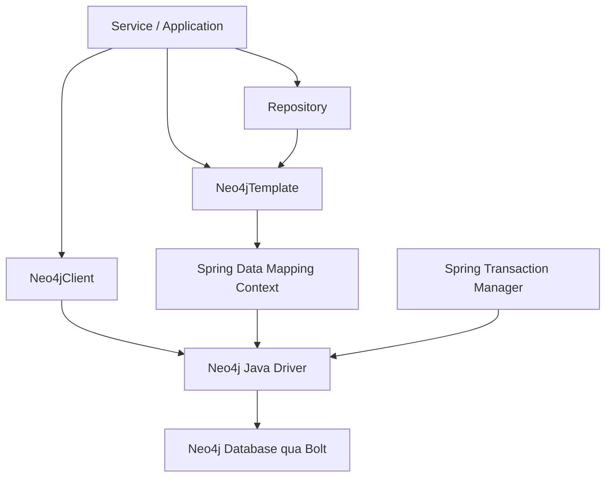

# Phân biệt tài liệu SDN hiện đại với tài liệu OGM cũ

Khi tìm ví dụ Spring Data Neo4j (SDN), bạn có thể gặp hai kiến trúc khác nhau: SDN 5.x tích hợp Neo4j-OGM và SDN 6 trở lên dùng mapping infrastructure của Spring Data cùng Neo4j Java Driver. Cả hai đều ánh xạ node/relationship thành object Java, nhưng API, annotation, transaction, cấu hình và cách truy vấn khác nhau. Vì vậy, một đoạn code có `SessionFactory`, `Session` hoặc `@NodeEntity` có thể đúng với ứng dụng cũ mà không áp dụng được cho SDN hiện đại.

Trong module `SPRING_DATA_NEO4J`, hãy nhận diện phiên bản và kiến trúc trước khi làm theo tài liệu. SDN hiện đại vẫn thực hiện object-graph mapping (OGM theo nghĩa khái niệm), nhưng không sử dụng thư viện Neo4j-OGM riêng làm backend. Mapping được thực hiện bởi Spring Data mapping context; ứng dụng làm việc qua repository, `Neo4jTemplate`, `Neo4jClient` và Neo4j Java Driver. Neo4j-OGM vẫn có tài liệu và có thể được dùng độc lập trong một số ứng dụng, nhưng không phải dependency của SDN hiện đại.

## 1. Mốc thay đổi: SDN+OGM và SDN hiện đại

Ranh giới quan trọng nằm ở major version 6:

| Dòng phiên bản | Kiến trúc | Mapping và truy cập dữ liệu |
|---|---|---|
| SDN 5.x cùng Neo4j-OGM 3.x | SDN dùng thư viện Neo4j-OGM riêng ở bên dưới | OGM `SessionFactory`, `Session`, OGM annotations và OGM driver |
| SDN 6.x trở lên | SDN tự đảm nhiệm mapping bằng Spring Data infrastructure | Spring Data mapping context, Neo4j Java Driver, `Neo4jClient`, `Neo4jTemplate`, repository và transaction manager của SDN |
| Neo4j-OGM độc lập | Thư viện object-graph mapping riêng, có thể được dùng mà không cần SDN | `SessionFactory`, `Session`, OGM annotations và driver mà phiên bản OGM hỗ trợ |

SDN 6 là một thay đổi kiến trúc lớn, không phải chỉ là đổi tên package. Từ thời điểm đó, SDN không cần và không hỗ trợ Neo4j-OGM như một dependency riêng. Khái niệm object graph mapping vẫn còn: entity Java tiếp tục biểu diễn node và relationship, nhưng framework thực hiện mapping đã thay đổi.

Neo4j-OGM không đồng nghĩa với toàn bộ khái niệm OGM. Nếu tài liệu nói “OGM” theo nghĩa chung là ánh xạ object-graph, điều đó vẫn đúng với SDN hiện đại. Nếu tài liệu nói đến class/package cụ thể như `org.neo4j.ogm.session.Session`, đó là API của thư viện Neo4j-OGM.

## 2. Cách nhận diện tài liệu đang đọc

Trước khi sao chép một ví dụ, kiểm tra các dấu hiệu sau:

| Dấu hiệu trong tài liệu hoặc source code | Thường thuộc kiến trúc | Ý nghĩa |
|---|---|---|
| `org.neo4j.ogm.*` | Neo4j-OGM / SDN+OGM | Package của thư viện OGM riêng |
| `SessionFactory`, `Session`, `session.load(...)`, `session.save(...)` | Neo4j-OGM | API Unit of Work và persistence session |
| `@NodeEntity`, `@RelationshipEntity`, `@StartNode`, `@EndNode` | Neo4j-OGM | Annotation mô hình domain của OGM |
| `org.springframework.data.neo4j.core.schema.*` | SDN hiện đại | Annotation mapping của SDN 6+ |
| `@Node`, `@RelationshipProperties`, `@TargetNode` | SDN hiện đại | Mapping node và relationship properties |
| `Neo4jClient`, `ReactiveNeo4jClient`, `Neo4jTemplate` | SDN hiện đại | API truy vấn và persistence của SDN |
| `Neo4jTransactionManager`, `ReactiveNeo4jTransactionManager` | SDN hiện đại | Transaction manager tích hợp với Spring |
| `spring.neo4j.uri` | Spring Boot với SDN hiện đại | Cấu hình kết nối driver hiện hành |
| `spring.data.neo4j.uri` | Tài liệu/cấu hình cũ | Property thuộc cấu hình SDN+OGM trước đây |

Đừng nhận diện chỉ dựa vào một từ “Neo4jTemplate” hoặc “repository”. Hãy kiểm tra import đầy đủ, dependency trong build file và phiên bản Spring Data Neo4j. Một bài viết cũ có thể dùng cùng tên khái niệm nhưng class thực tế thuộc package khác.

## 3. Khác biệt về thành phần kiến trúc

### SDN+OGM cũ

Trong kiến trúc cũ, Neo4j-OGM chịu trách nhiệm chính về metadata mapping, quản lý session, theo dõi object graph và tạo Cypher để lưu thay đổi. `SessionFactory` quét domain package để xây dựng metadata và tạo `Session` khi cần. `Session` cung cấp các thao tác như `load`, `loadAll`, `save`, `delete` và thực thi Cypher.

Spring Data Neo4j 5.x bổ sung tích hợp Spring Data và repository abstraction trên OGM. Repository cũ thường hoạt động thông qua OGM session ở bên dưới. Ứng dụng có thể truy cập trực tiếp `Session` khi cần các thao tác mà repository không biểu diễn được.

```java
// Ví dụ minh họa API Neo4j-OGM cũ, không dùng cho SDN hiện đại.
SessionFactory sessionFactory = new SessionFactory(configuration, "com.example.domain");

Session session = sessionFactory.openSession();
Person person = session.load(Person.class, personId, 1);
person.setName("An Nguyen");
session.save(person);
```

Ví dụ rút gọn để minh họa API OGM; trong ứng dụng thực tế, quản lý vòng đời session và transaction theo cấu hình OGM của phiên bản đang dùng.

`Session` của OGM theo dõi object graph đã tải, có cache trong phạm vi session và hỗ trợ persistence theo các thay đổi của graph. Độ sâu khi load ảnh hưởng đến phần graph được hydrate. Đây là đặc tính quan trọng khi đọc tài liệu OGM: một object được tải trong session có thể được quản lý theo state của session đó.

### SDN hiện đại

SDN 6+ dùng Spring Data mapping context để phân tích domain metadata. Neo4j Java Driver thực hiện giao tiếp với database. `Neo4jClient` cung cấp API Cypher tích hợp với transaction Spring; `Neo4jTemplate` cung cấp thao tác mapping/persistence mức template; repository cung cấp abstraction quen thuộc của Spring Data.



Không có OGM `SessionFactory` hoặc OGM `Session` ở giữa SDN và driver. SDN quản lý mapping metadata bằng Spring Data, và transaction manager liên kết các thao tác driver với transaction Spring.

Điều này thay đổi cách suy nghĩ về persistence: không nên mang giả định về một session cache/dirty tracking lâu dài từ OGM sang SDN. Hãy dùng repository/template theo transaction boundary, và dùng `Neo4jClient` khi cần kiểm soát Cypher hoặc mapping kết quả thủ công.

## 4. Khác biệt về annotation và package

Các annotation cũ của OGM nằm trong `org.neo4j.ogm.annotation`. Annotation mapping của SDN hiện đại nằm trong `org.springframework.data.neo4j.core.schema`. Cùng tên ý nghĩa không có nghĩa hai annotation là cùng một class.

| SDN+OGM cũ | SDN hiện đại | Ghi chú |
|---|---|---|
| `org.neo4j.ogm.annotation.NodeEntity` | `org.springframework.data.neo4j.core.schema.Node` | Đánh dấu class ánh xạ tới node/label |
| `org.neo4j.ogm.annotation.Id` | `org.springframework.data.neo4j.core.schema.Id` hoặc Spring Data `@Id` | Định danh entity |
| `org.neo4j.ogm.annotation.GeneratedValue` | `org.springframework.data.neo4j.core.schema.GeneratedValue` | Chiến lược sinh ID |
| `org.neo4j.ogm.annotation.Property` | `org.springframework.data.neo4j.core.schema.Property` | Đổi tên property graph |
| `org.neo4j.ogm.annotation.Relationship` | `org.springframework.data.neo4j.core.schema.Relationship` | Ánh xạ relationship |
| `@RelationshipEntity` cùng `@StartNode`/`@EndNode` | `@RelationshipProperties` cùng `@TargetNode` | Mô hình relationship có property |
| `@QueryResult` của SDN cũ | Projection interface/DTO hoặc `Neo4jClient` mapper | Không còn arbitrary mapping kiểu `@QueryResult` cũ |
| `@Index`, `@CompositeIndex`, `@Required` của OGM | Cypher schema migration | Quản lý index/constraint riêng khỏi domain annotation |

Các annotation không có mapping thay thế một-một. Trước khi chuyển, hãy lập danh sách tất cả annotation đang dùng và kiểm tra migration guide theo phiên bản SDN đích. Không tự động đổi tên import hàng loạt rồi cho rằng mapping đã tương đương.

### Ví dụ ánh xạ node

OGM cũ:

```java
import org.neo4j.ogm.annotation.GeneratedValue;
import org.neo4j.ogm.annotation.Id;
import org.neo4j.ogm.annotation.NodeEntity;
import org.neo4j.ogm.annotation.Property;

@NodeEntity(label = "Person")
public class Person {

    @Id
    @GeneratedValue
    private Long id;

    @Property(name = "full_name")
    private String name;
}
```

SDN hiện đại:

```java
import org.springframework.data.neo4j.core.schema.GeneratedValue;
import org.springframework.data.neo4j.core.schema.Id;
import org.springframework.data.neo4j.core.schema.Node;
import org.springframework.data.neo4j.core.schema.Property;

@Node("Person")
public class Person {

    @Id
    @GeneratedValue
    private Long id;

    @Property("full_name")
    private String name;
}
```

Graph vẫn có label `Person` và property `full_name` nếu mapping mới giữ nguyên tên. Việc đổi annotation Java không tự đổi label hoặc property trong database. Nếu tên label/property vẫn giữ nguyên và cách biểu diễn dữ liệu tương thích, dữ liệu graph có thể tiếp tục được dùng; nếu đổi tên hoặc semantics, cần migration dữ liệu riêng.

## 5. Relationship có property: @RelationshipEntity và @RelationshipProperties

Đây là một khác biệt dễ gặp khi nâng cấp. Neo4j-OGM dùng `@RelationshipEntity` để biểu diễn relationship có property. Class relationship thường có `@StartNode` và `@EndNode` để chỉ hai đầu của cạnh.

OGM cũ:

```java
import org.neo4j.ogm.annotation.EndNode;
import org.neo4j.ogm.annotation.GeneratedValue;
import org.neo4j.ogm.annotation.Id;
import org.neo4j.ogm.annotation.RelationshipEntity;
import org.neo4j.ogm.annotation.StartNode;

@RelationshipEntity(type = "MEMBER_OF")
public class Membership {

    @Id
    @GeneratedValue
    private Long id;

    @StartNode
    private Person person;

    @EndNode
    private Group group;

    private String role;
}
```

SDN hiện đại mô hình relationship properties từ góc nhìn của node gốc. Class có `@RelationshipProperties`, một ID nội bộ cho relationship và một field `@TargetNode` trỏ tới node ở đầu kia:

```java
import org.springframework.data.neo4j.core.schema.RelationshipId;
import org.springframework.data.neo4j.core.schema.RelationshipProperties;
import org.springframework.data.neo4j.core.schema.TargetNode;

@RelationshipProperties
public class Membership {

    @RelationshipId
    private Long id;

    private String role;

    @TargetNode
    private Group group;

    public Membership(Group group, String role) {
        this.group = group;
        this.role = role;
    }

    public Group getGroup() {
        return group;
    }

    public String getRole() {
        return role;
    }
}
```

Node gốc khai báo relationship:

```java
import java.util.List;
import java.util.ArrayList;

import org.springframework.data.neo4j.core.schema.Id;
import org.springframework.data.neo4j.core.schema.Node;
import org.springframework.data.neo4j.core.schema.Relationship;

@Node("Person")
public class Person {

    @Id
    private String id;

    private String email;
    private String name;
    private boolean active;

    @Relationship(type = "MEMBER_OF")
    private List<Membership> memberships = new ArrayList<>();

    public void rename(String name) {
        this.name = name;
    }

    public void addMembership(Membership membership) {
        memberships.add(membership);
    }
}
```

`@TargetNode` xác định node đích của relationship theo hướng khai báo trên field `@Relationship`. `@RelationshipId` cho SDN biết identity nội bộ của relationship để xác định cạnh nào có thể cập nhật an toàn mà không vô tình ghi đè property của cạnh khác. Không thay `@TargetNode` bằng hai field `@StartNode`/`@EndNode` như model OGM cũ.

Lưu ý: class relationship properties của SDN không phải `@Node` và không phải entity node độc lập. Nó đại diện cho dữ liệu trên cạnh cùng với node ở đầu kia. Khi chuyển domain model, hãy kiểm tra chiều relationship và vị trí node gốc; một relationship có thể cần một model tương ứng theo góc nhìn của từng aggregate.

## 6. Session của OGM so với repository, template và client của SDN

Trong OGM, ứng dụng thường làm việc trực tiếp với session:

| API OGM | Vai trò |
|---|---|
| `SessionFactory` | Xây dựng metadata và tạo OGM session |
| `Session` | Load/save/delete object graph và chạy Cypher |
| `session.load(type, id, depth)` | Tải entity với độ sâu graph chỉ định |
| `session.save(entity)` | Persist thay đổi của object graph được quản lý |
| `session.clear()` | Xóa state/cache đang được session theo dõi |

Trong SDN hiện đại, dùng API phù hợp với mức trừu tượng:

| API SDN | Vai trò |
|---|---|
| `Neo4jRepository<T, ID>` | CRUD và query methods theo Spring Data |
| `Neo4jTemplate` | Thao tác mapping/persistence ở mức template |
| `Neo4jClient` | Chạy Cypher, bind parameter và ánh xạ kết quả linh hoạt |
| `ReactiveNeo4jClient` | Phiên bản reactive của client |
| `Neo4jTransactionManager` | Quản lý imperative transaction của Neo4j trong Spring |
| `ReactiveNeo4jTransactionManager` | Quản lý reactive transaction |

Ví dụ repository hiện đại:

```java
import java.util.Optional;

import org.springframework.data.neo4j.repository.Neo4jRepository;

public interface PersonRepository extends Neo4jRepository<Person, String> {
    Optional<Person> findByEmail(String email);
}
```

Service dùng repository và transaction Spring:

```java
import org.springframework.stereotype.Service;
import org.springframework.transaction.annotation.Transactional;

@Service
public class PersonService {

    private final PersonRepository people;

    public PersonService(PersonRepository people) {
        this.people = people;
    }

    @Transactional
    public Person rename(String id, String newName) {
        Person person = people.findById(id).orElseThrow();
        person.rename(newName);
        return people.save(person);
    }
}
```

Không tạo một `Session` thủ công cho mỗi request trong SDN hiện đại. Hãy để repository/template/client tham gia transaction Spring đang hoạt động. Nếu cần Cypher tùy chỉnh, dùng `Neo4jClient` với parameter thay vì cố truy cập OGM session.

## 7. Transaction và bookmark

OGM session có thể mở transaction qua API session/transaction của OGM; các thao tác persistence được thực hiện trong transaction đó. Trong SDN+OGM, Spring transaction integration được xây dựng quanh OGM session và cấu hình OGM tương ứng.

SDN hiện đại dùng `Neo4jTransactionManager` để tích hợp transaction của Neo4j Java Driver với `@Transactional`. Với reactive stack, dùng `ReactiveNeo4jTransactionManager` và các API reactive. Bookmark management được SDN quản lý mặc định; các annotation/bean bookmark cũ như `@EnableBookmarkManagement`, `@UseBookmark` và `CaffeineBookmarkManager` không cần chuyển sang.

```java
import org.springframework.stereotype.Service;
import org.springframework.transaction.annotation.Transactional;

@Service
public class MembershipService {

    private final PersonRepository people;

    public MembershipService(PersonRepository people) {
        this.people = people;
    }

    @Transactional
    public Person addMembership(String personId, Membership membership) {
        Person person = people.findById(personId).orElseThrow();
        person.addMembership(membership);
        return people.save(person);
    }
}
```

Đừng sao chép cấu hình transaction cũ sang ứng dụng mới mà chưa xác định loại transaction đang dùng. Một ứng dụng reactive cần reactive transaction infrastructure và phải compose thao tác trong reactive pipeline; việc thêm `@Transactional` imperative hoặc gọi blocking repository từ reactive flow không biến code thành reactive.

## 8. Neo4jClient và ReactiveNeo4jClient thay cho truy vấn qua OGM Session

OGM `Session` cho phép thực hiện Cypher trực tiếp, nhưng code cũ thường gắn query vào vòng đời OGM session. SDN hiện đại cung cấp client mỏng trên Neo4j Java Driver, tích hợp với transaction Spring và cung cấp API nhất quán giữa imperative/reactive.

Ví dụ dùng `Neo4jClient`:

```java
import java.util.Map;

import org.springframework.data.neo4j.core.Neo4jClient;
import org.springframework.stereotype.Repository;

@Repository
public class PersonLookup {

    private final Neo4jClient client;

    public PersonLookup(Neo4jClient client) {
        this.client = client;
    }

    public Map<String, Object> findByEmail(String email) {
        return client.query("""
                MATCH (p:Person {email: $email})
                RETURN p.id AS id, p.name AS name
                """)
            .bind(email).to("email")
            .fetch()
            .one()
            .orElseThrow();
    }
}
```

`Neo4jClient` phù hợp khi cần trả projection, map hoặc DTO theo cách tự kiểm soát. Nếu muốn hydrate entity graph, hãy trả kết quả đúng cấu trúc mà SDN mapping cần hoặc dùng repository/template. `ReactiveNeo4jClient` có cách gọi tương tự nhưng trả publisher và chỉ thực thi khi publisher được subscribe.

Khi tự tạo `Driver`, client và transaction manager, phải dùng cùng một `Driver` instance để client có thể tham gia transaction do transaction manager quản lý. Trong Spring Boot, starter thường tự cấu hình và cung cấp bean phù hợp; không tạo driver/client mới cho từng query.

## 9. Khác biệt về cấu hình kết nối

SDN+OGM dùng OGM `Configuration` và các property cũ. SDN hiện đại cấu hình Neo4j Java Driver qua Spring Boot properties hoặc Java configuration.

| SDN+OGM cũ | SDN hiện đại |
|---|---|
| `spring.data.neo4j.uri` | `spring.neo4j.uri` |
| `spring.data.neo4j.username` | `spring.neo4j.authentication.username` |
| `spring.data.neo4j.password` | `spring.neo4j.authentication.password` |
| `spring.data.neo4j.embedded.enabled` | Không còn hỗ trợ |
| `org.neo4j.ogm.config.Configuration` | Cấu hình driver Spring Boot/Java Driver |
| OGM XML configuration | Java configuration / Spring Boot auto-configuration |

Ví dụ cấu hình cũ:

```properties
spring.data.neo4j.embedded.enabled=false
spring.data.neo4j.uri=bolt://localhost:7687
spring.data.neo4j.username=neo4j
spring.data.neo4j.password=secret
```

Cấu hình SDN hiện đại:

```properties
spring.neo4j.uri=bolt://localhost:7687
spring.neo4j.authentication.username=neo4j
spring.neo4j.authentication.password=secret
```

Trong môi trường cluster, URI `neo4j://` có thể được dùng để hỗ trợ routing; hãy chọn scheme và driver configuration phù hợp topology. Không chuyển property một cách máy móc nếu ứng dụng cũ dùng embedded hoặc HTTP transport.

## 10. Driver và transport

Các ứng dụng SDN+OGM cũ có thể dùng embedded driver, HTTP driver hoặc Bolt driver tùy phiên bản OGM. SDN hiện đại làm việc qua Neo4j Java Driver và kết nối Neo4j server qua Bolt. Không còn embedded Neo4j được khởi tạo bên trong SDN hiện đại.

Nếu ứng dụng cũ dùng embedded database:

1. Chuẩn bị một Neo4j server độc lập.
2. Chuyển dữ liệu từ database embedded sang server theo quy trình backup/restore hoặc migration phù hợp phiên bản.
3. Cấu hình kết nối Bolt.
4. Xác minh ứng dụng cũ chạy ổn qua server trước khi thay mapping framework.

Nếu ứng dụng cũ dùng OGM HTTP driver, hãy chuẩn bị chuyển sang Bolt trước hoặc trong kế hoạch nâng cấp theo migration guide. Nếu đã dùng OGM Bolt driver, URI có thể tiếp tục dùng được, nhưng vẫn phải chuyển dependency và property Spring sang kiến trúc mới.

Tách bước chuyển transport khỏi bước chuyển mapping giúp khoanh vùng lỗi dễ hơn. Khi cả transport và framework cùng thay đổi, một lỗi kết nối có thể bị nhầm với lỗi annotation hoặc repository.

## 11. Query result và projection

Tài liệu SDN+OGM cũ có thể dùng `@QueryResult` để ánh xạ kết quả Cypher tùy ý thành class. Cơ chế này không còn là cách mapping custom result trong SDN hiện đại. Dùng projection interface/DTO cho kết quả có cấu trúc rõ ràng hoặc dùng `Neo4jClient` để tự map record.

Ví dụ projection hiện đại:

```java
public interface PersonSummary {
    String getPersonId();
    String getFullName();
}
```

```java
import java.util.List;

import org.springframework.data.neo4j.repository.Neo4jRepository;
import org.springframework.data.neo4j.repository.query.Query;
import org.springframework.data.repository.query.Param;

public interface PersonSummaryRepository
        extends Neo4jRepository<Person, String> {

    @Query("""
        MATCH (p:Person)
        WHERE p.active = $active
        RETURN p.id AS personId, p.name AS fullName
        """)
    List<PersonSummary> findSummaries(@Param("active") boolean active);
}
```

Tên alias trong `RETURN` phải khớp với accessor của projection. Projection này chỉ trả scalar data, không hydrate toàn bộ graph `Person` và relationships. Nếu cần entity, trả root node và dữ liệu liên quan theo yêu cầu mapping.

Với kết quả phức tạp hoặc procedure trả map/lists, dùng `Neo4jClient` và mapper tường minh. Đừng giả định mọi custom query có thể được ánh xạ thành entity chỉ vì cột kết quả có tên giống field Java.

## 12. Index và constraint: chuyển từ annotation sang schema migration

Neo4j-OGM cũ có các annotation như `@Index`, `@CompositeIndex` và `@Required`, cùng cơ chế automatic index manager trong một số phiên bản SDN+OGM. Những annotation này đã bị loại bỏ trong SDN hiện đại. Lý do quan trọng là schema database cần được quản lý có kiểm soát khi nhiều phiên bản ứng dụng cùng chạy và khi triển khai production.

Thay vì khai báo index/constraint trong entity, hãy dùng Cypher migration hoặc công cụ quản lý schema như Neo4j Migrations/Liquigraph phù hợp với hệ thống.

Ví dụ tạo uniqueness constraint:

```cypher
CREATE CONSTRAINT person_email_unique IF NOT EXISTS
FOR (p:Person)
REQUIRE p.email IS UNIQUE;
```

Ví dụ tạo index:

```cypher
CREATE RANGE INDEX person_created_at_idx IF NOT EXISTS
FOR (p:Person)
ON (p.createdAt);
```

Trước khi tạo constraint trên dữ liệu hiện có, kiểm tra duplicate và xử lý dữ liệu vi phạm. Đặt migration version rõ ràng và chạy trong pipeline triển khai database. Không trông chờ SDN tự tạo schema chỉ vì entity có annotation `@Id` hoặc `@Node`.

## 13. Dependency và build file

Trong SDN+OGM cũ, build file có thể chứa nhiều artifact `org.neo4j:neo4j-ogm-*`, ví dụ `neo4j-ogm-core`, `neo4j-ogm-bolt-driver` hoặc `neo4j-ogm-http-driver`. Khi chuyển sang SDN hiện đại, loại bỏ các dependency OGM riêng và dùng dependency SDN phù hợp với Spring Boot/Spring Data release train.

Với ứng dụng Spring Boot, starter thường được dùng:

```xml
<dependency>
    <groupId>org.springframework.boot</groupId>
    <artifactId>spring-boot-starter-data-neo4j</artifactId>
</dependency>
```

Nếu tích hợp trực tiếp không dùng Spring Boot, dùng `org.springframework.data:spring-data-neo4j` cùng Neo4j Java Driver và cấu hình Spring cần thiết. Để Spring Boot BOM hoặc Spring Data release train quản lý các version tương thích; không tự ghép SDN, Spring Framework và Driver theo các version rời rạc.

Không thêm `neo4j-ogm-core` trở lại chỉ vì thấy một tutorial cũ có `Session`. Nếu ứng dụng có một module độc lập thật sự dùng Neo4j-OGM, hãy đánh giá nó như một integration riêng và tránh để dependency cũ xung đột với SDN hiện đại.

## 14. Lộ trình chuyển ứng dụng SDN+OGM sang SDN hiện đại

Hãy chia migration thành các bước nhỏ để mỗi bước có thể kiểm thử độc lập.

### Bước 1 — Kiểm kê kiến trúc cũ

Ghi lại:

- Phiên bản SDN, Neo4j-OGM, Neo4j server và Java Driver.
- Các dependency `neo4j-ogm-*` và OGM driver đang dùng.
- Các import `org.neo4j.ogm.*` trong domain/service/configuration.
- Các điểm tạo `SessionFactory`, mở `Session`, gọi `load`, `save`, `delete`.
- Annotation `@NodeEntity`, `@RelationshipEntity`, `@QueryResult`, `@Index` và các annotation khác.
- Cấu hình OGM, XML, bookmark manager, transaction và schema.
- Các query tùy chỉnh và cách ánh xạ result.

### Bước 2 — Đưa database về Neo4j server qua Bolt

Nếu ứng dụng đang dùng embedded hoặc HTTP transport, chuyển database sang server và xác minh kết nối Bolt. Nếu đã dùng Bolt, kiểm tra URI, authentication, database name và khả năng routing.

### Bước 3 — Cập nhật dependency và cấu hình

Chọn phiên bản SDN/Spring Boot tương thích, loại bỏ dependency OGM cũ, chuyển property kết nối và thay OGM Configuration bằng cấu hình Java Driver/Spring Boot.

### Bước 4 — Chuyển domain annotations

Đổi `@NodeEntity` thành `@Node`, các annotation ID/property/relationship sang package SDN, relationship entity sang relationship properties và xem xét các annotation không có thay thế.

### Bước 5 — Chuyển session API sang repository/template/client

Thay `SessionFactory`/`Session` bằng repository cho CRUD thông thường; dùng `Neo4jTemplate` cho persistence mapping cần kiểm soát; dùng `Neo4jClient` cho Cypher tùy chỉnh. Xác định lại transaction boundary và không giữ logic phụ thuộc session cache cũ.

### Bước 6 — Chuyển custom query result và schema management

Thay `@QueryResult` bằng projection/DTO hoặc mapper. Di chuyển index/constraint sang migration script và loại bỏ bookmark manager cũ.

### Bước 7 — Kiểm thử mapping và nghiệp vụ

Kiểm thử ID, relationship direction, relationship properties, custom conversion, query result, transaction, rollback, optimistic locking và các luồng read-after-write. So sánh graph trước/sau migration để xác nhận dữ liệu cũ được ánh xạ đúng.

### Bước 8 — Triển khai có kiểm soát

Triển khai trên môi trường test/staging với bản sao dữ liệu phù hợp, chạy schema migration, xác minh query và log, rồi mới đưa phiên bản mới vào production. Có kế hoạch rollback ứng dụng và phục hồi dữ liệu nếu migration có thay đổi graph.

## 15. Những gì không tự động thay đổi khi đổi framework

Chuyển từ SDN+OGM sang SDN hiện đại là thay đổi lớp truy cập và mapping. Nó không tự động:

- Đổi label node, property key hoặc relationship type trong database.
- Chuyển business rule nằm trong custom OGM event listener sang Spring event/callback.
- Tạo lại index/constraint đã từng được OGM automatic index manager quản lý.
- Chuyển `@QueryResult` class sang projection.
- Dịch mọi custom OGM converter sang `Neo4jConversions`.
- Bảo toàn hành vi của session cache, load depth hoặc dirty tracking theo cách cũ.
- Sửa query Cypher đã phụ thuộc vào internal ID, schema hoặc kiểu dữ liệu cũ.

Nếu graph schema giữ nguyên, nhiều dữ liệu có thể tiếp tục sử dụng mà không cần copy. Tuy nhiên, mapping phải khớp chính xác với label/property/relationship hiện có và cần integration test trên dữ liệu đại diện. Nếu đổi tên property, type hoặc cấu trúc relationship, hãy tạo data migration riêng trước hoặc trong giai đoạn deploy tương thích.

## 16. Các lỗi thường gặp khi đọc nhầm tài liệu

| Biểu hiện | Nguyên nhân | Cách xử lý |
|---|---|---|
| Không tìm thấy `SessionFactory` hoặc `Session` | Đang dùng SDN 6+ nhưng làm theo OGM tutorial | Chuyển sang repository, `Neo4jTemplate` hoặc `Neo4jClient` |
| Import `@NodeEntity` không tồn tại | Annotation OGM không nằm trong dependency SDN hiện đại | Dùng `@Node` từ `org.springframework.data.neo4j.core.schema` |
| `@RelationshipEntity` không được nhận diện | API relationship entity cũ | Dùng `@RelationshipProperties` và `@TargetNode` |
| `@QueryResult` không map được | Cơ chế arbitrary result mapping cũ | Dùng projection interface/DTO hoặc `Neo4jClient` mapper |
| OGM `Configuration` không được dùng | SDN hiện đại cấu hình Java Driver qua Spring | Chuyển sang `spring.neo4j.*` hoặc Driver bean |
| Ứng dụng không kết nối sau nâng cấp | Vẫn dùng property cũ hoặc embedded/HTTP transport | Kiểm tra URI, Bolt, authentication và database |
| Index không được tạo tự động | OGM automatic index manager không còn | Tạo index/constraint qua schema migration |
| Bookmark manager cũ không compile | Bookmark annotations/bean cũ đã bị loại bỏ | Dùng bookmark management mặc định của SDN |
| Dữ liệu relationship bị thiếu sau migrate | Model `@RelationshipProperties` hoặc hướng quan hệ chưa đúng | Kiểm tra `@TargetNode`, direction và mapping graph |
| Save tạo node mới thay vì update | Thay đổi ID strategy hoặc state detection | Kiểm tra `@Id`, `@GeneratedValue`, `@Version` và business ID |
| Kết quả custom query sai kiểu | `@QueryResult` được thay bằng projection hoặc client mapper | Kiểm tra alias, Java type và conversion |
| Test pass với OGM nhưng fail với SDN | Khác biệt về load depth, session cache hoặc transaction | Viết integration test mới theo hành vi SDN hiện đại |

## 17. Checklist nhận diện trước khi áp dụng ví dụ

- [ ] Đã xác định phiên bản Spring Data Neo4j trong ứng dụng.
- [ ] Đã xác định ví dụ thuộc SDN+OGM 5.x, SDN 6+ hay Neo4j-OGM standalone.
- [ ] Đã kiểm tra import package thay vì chỉ nhìn tên annotation.
- [ ] Đã kiểm tra dependency có `neo4j-ogm-*` hay không.
- [ ] Đã phân biệt `Session` của OGM với `Neo4jClient`/repository của SDN.
- [ ] Đã xác định driver/transport và URI đang dùng.
- [ ] Đã kiểm tra cách quản lý transaction và bookmark.
- [ ] Đã kiểm tra mapping relationship properties và query result.
- [ ] Đã xác định index/constraint được quản lý ở đâu.
- [ ] Đã đối chiếu tài liệu đúng major version trước khi copy code.

## 18. Tự kiểm tra

1. SDN+OGM 5.x khác SDN 6+ ở thành phần nào thực hiện object-graph mapping?
2. Vì sao nói SDN hiện đại vẫn là OGM theo nghĩa khái niệm nhưng không dùng thư viện Neo4j-OGM riêng?
3. `SessionFactory` và `Session` thuộc thư viện nào?
4. Những package nào giúp nhận diện annotation OGM cũ và annotation SDN hiện đại?
5. `@RelationshipEntity` được chuyển sang mô hình `@RelationshipProperties` như thế nào?
6. `@QueryResult` cũ được thay bằng projection hoặc `Neo4jClient` ra sao?
7. Vì sao `@Index`, `@CompositeIndex` và `@Required` không còn là annotation schema trong SDN hiện đại?
8. Property cấu hình kết nối cũ `spring.data.neo4j.*` được chuyển sang nhóm property nào?
9. Vì sao cần chuyển embedded/HTTP transport sang Bolt trước hoặc trong kế hoạch nâng cấp?
10. Đổi framework có tự đổi label, property và relationship type trong graph không?
11. Những hành vi session cache/load depth nào cần được kiểm thử lại sau khi bỏ OGM Session?
12. Làm thế nào để chia migration thành các bước có thể kiểm tra và rollback?

Khi đọc tài liệu Spring Data Neo4j, hãy kiểm tra major version, import package và dependency trước khi áp dụng code. SDN+OGM cũ dựa trên `SessionFactory`/`Session` của Neo4j-OGM; SDN hiện đại dùng Spring Data mapping context, Neo4j Java Driver, repository, `Neo4jTemplate` và `Neo4jClient`. Migration vì thế cần chuyển cả annotation, transaction, query result, configuration và schema management. Dữ liệu graph có thể được giữ lại nếu mapping không đổi, nhưng phải được xác minh bằng integration test trên database thực tế.

## Tài liệu tham khảo

- [Spring Data Neo4j — Migrating from SDN+OGM to SDN](https://docs.spring.io/spring-data/neo4j/reference/appendix/migrating.html)
- [Spring Data Neo4j — FAQ: How does SDN relate to Neo4j-OGM?](https://docs.spring.io/spring-data/neo4j/reference/faq.html)
- [Spring Data Neo4j — Metadata-based Mapping](https://docs.spring.io/spring-data/neo4j/reference/object-mapping/metadata-based-mapping.html)
- [Spring Data Neo4j — Neo4jClient](https://docs.spring.io/spring-data/neo4j/reference/appendix/neo4j-client.html)
- [Neo4j-OGM — Reference Manual](https://neo4j.com/docs/ogm-manual/current/reference/)
- [Neo4j-OGM — Session and persistence](https://neo4j.com/docs/ogm-manual/current/reference/#reference:session)
