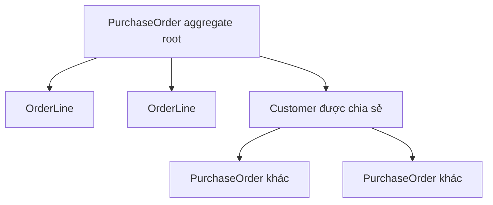

# Đối chiếu callback, projection, aggregate boundary và tính năng mới theo phiên bản

Khi nâng cấp Spring Data Neo4j (SDN), một số khác biệt không chỉ là đổi package hoặc tên annotation. Cách SDN nhận biết lifecycle của entity, cách repository dựng query, cách projection giới hạn graph được tải và cách mapping dừng ở ranh giới aggregate đều ảnh hưởng trực tiếp đến hành vi đọc/ghi. Nếu chỉ sửa import cho code biên dịch lại mà không kiểm tra những khác biệt này, ứng dụng có thể mất callback, tải quá nhiều relationship hoặc ghi đè dữ liệu chưa được hydrate.

Bài này đối chiếu SDN 5.x, 6.x, 7.x và 8.x, tập trung vào callback, projection, aggregate root và aggregate boundary. Mục tiêu là xác định API nào cần thay thế, tính năng nào xuất hiện từ phiên bản nào và các kiểm thử cần chạy trước khi đưa bản nâng cấp vào production.

## 1. Bản đồ thay đổi theo thế hệ SDN

| Thế hệ | Nền tảng mapping | Lifecycle chính | Projection và aggregate | Điều cần chú ý khi nâng cấp |
| --- | --- | --- | --- | --- |
| SDN 5.x | Neo4j-OGM, `SessionFactory`, `Session`, OGM annotations | OGM events: `PRE_SAVE`, `POST_SAVE`, `PRE_DELETE`, `POST_DELETE` | Repository aggregate root và projection theo Spring Data; chưa có `@Node.aggregateBoundary` | Callback/event gắn với OGM `Session`; custom Cypher qua `session.query()` không phát OGM persistence event |
| SDN 6.0–6.0.1 | Mapping tích hợp trong Spring Data, Neo4j Java Driver, `Neo4jClient`/`Neo4jTemplate` | Entity callback imperative/reactive được đưa vào SDN | Interface/DTO/dynamic projection; mapping graph theo domain type | Major migration từ SDN+OGM; callback API mới stable từ 6.0.2 |
| SDN 6.0.2–6.0.x | Kiến trúc SDN 6 | `BeforeBindCallback` imperative/reactive trong package mới | Projection đọc theo domain type; persistence projection `saveAs` chưa có | Callback package cũ dưới `repository.event` và default callback registrar bị deprecated |
| SDN 6.1–6.3 | Tiếp tục kiến trúc SDN 6 | `AfterConvertCallback` dùng chung imperative/reactive từ 6.3 | `saveAs(entity, Projection.class)` từ 6.1; predicate-based `saveAs` từ 6.3 | Có thể lưu entity theo projection, nhưng kết quả có thể chưa hydrate đầy đủ |
| SDN 7.x | Tiếp tục mapping và Driver architecture của SDN 6 | Giữ callback API mới, imperative/reactive | Interface, DTO, dynamic, multi-level projection và projection persistence | Kiểm tra Spring Data/Spring Framework/Driver theo BOM; chưa có aggregate boundary API như dòng 8.0 |
| SDN 8.0+ | Tiếp tục API SDN hiện đại | Callback và projection API tiếp tục được duy trì | Có `@Node(aggregateBoundary = ...)` để giới hạn traversal và mapping theo entity boundary | Rà boundary đã khai báo vì nó thay đổi dữ liệu được tải và ghi qua graph mapping |

Các mốc trên là mốc API cần quan tâm, không phải bảng tương thích đầy đủ giữa mọi phiên bản Neo4j Server, Java, Spring Boot và Driver. Khi nâng cấp thực tế, hãy lấy Spring Boot BOM hoặc Spring Data release train làm nguồn quản lý dependency chính; không tự nâng riêng SDN, Spring Data Commons và Neo4j Java Driver theo các số phiên bản độc lập.

## 2. SDN 5.x: lifecycle dựa trên Neo4j-OGM

SDN 5.x sử dụng Neo4j-OGM làm lớp object graph mapping. Domain model thường dùng các annotation OGM như `@NodeEntity`, `@RelationshipEntity`, `@StartNode` và `@EndNode`. `SessionFactory` tạo `Session`, còn OGM quản lý việc đồng bộ object graph với Neo4j.

Neo4j-OGM cung cấp bốn lifecycle event:

| OGM event | Thời điểm |
| --- | --- |
| `PRE_SAVE` | Trước khi lưu entity |
| `POST_SAVE` | Sau khi lưu entity |
| `PRE_DELETE` | Trước khi xóa entity |
| `POST_DELETE` | Sau khi xóa entity |

Các event có thể được phát cho node, relationship và object liên quan bị tác động bởi thao tác save/delete. Chúng chỉ phát khi dùng OGM `Session.save()` hoặc `Session.delete()`. Chạy Cypher trực tiếp bằng `Session.query()` không kích hoạt các persistence event này.

Ví dụ listener theo API OGM cũ:

```java
import org.neo4j.ogm.session.event.Event;
import org.neo4j.ogm.session.event.EventListener;

public class ProductOgmListener implements EventListener {

    @Override
    public void onPreSave(Event event) {
        Object entity = event.getObject();
        // Kiểm tra hoặc chuẩn bị entity trước khi OGM lưu.
    }

    @Override
    public void onPostSave(Event event) {
        Object entity = event.getObject();
        // Phản ứng sau khi OGM lưu entity.
    }

    @Override
    public void onPreDelete(Event event) {
        // Xử lý trước khi OGM xóa object.
    }

    @Override
    public void onPostDelete(Event event) {
        // Xử lý sau khi OGM xóa object.
    }
}
```

Đây là ví dụ cho code SDN+OGM cũ. Không mang `EventListener` của Neo4j-OGM sang SDN 6+ rồi kỳ vọng repository hoặc `Neo4jClient` sẽ gọi nó. Sau khi bỏ OGM, lifecycle và callback cần được chuyển sang Spring Data EntityCallback hoặc application/domain event phù hợp.

## 3. SDN 6+: thay đổi lớn về mapping và callback

SDN 6 là major version thay đổi kiến trúc. Chức năng OGM được đưa vào mapping infrastructure của Spring Data Neo4j; ứng dụng làm việc qua Neo4j Java Driver, `Neo4jClient`, `ReactiveNeo4jClient`, `Neo4jTemplate` và `ReactiveNeo4jTemplate`. SDN 6 đồng thời hỗ trợ imperative và reactive transaction, entity immutable và mapping Java record.

Các thay đổi thường gặp khi chuyển từ SDN 5:

| SDN 5.x | SDN 6+ |
| --- | --- |
| `org.neo4j.ogm.annotation.NodeEntity` | `org.springframework.data.neo4j.core.schema.Node` |
| `@RelationshipEntity` | `@RelationshipProperties` |
| `@StartNode`, `@EndNode` | `@TargetNode` cùng property quan hệ được mapping |
| OGM `SessionFactory` / `Session` | Neo4j `Driver`, SDN `Neo4jClient`, `Neo4jTemplate` |
| OGM `EventListener` | Spring Data `EntityCallback` hoặc application/domain event |
| OGM session query | `Neo4jClient` hoặc custom repository query |

Không phải mọi API đều có phép thay thế một-một. Hãy chuyển theo mục đích: sửa entity trước khi ghi dùng `BeforeBindCallback`; bổ sung dữ liệu sau khi mapping dùng `AfterConvertCallback`; phát thông báo nghiệp vụ dùng domain/application event; query không trả domain entity có thể dùng `Neo4jClient` và DTO mapping.

## 4. Callback mới: `BeforeBindCallback`

`BeforeBindCallback<T>` được gọi trước khi SDN chuyển entity thành record/map để bind vào câu lệnh ghi. Callback nhận entity và phải trả về entity tiếp tục được persistence pipeline sử dụng. Có thể trả lại cùng instance đã sửa hoặc trả một instance mới nếu entity immutable.

API này có trạng thái stable từ SDN 6.0.2. Package đúng là:

```java
org.springframework.data.neo4j.core.mapping.callback.BeforeBindCallback
```

Ví dụ chuẩn hóa tên sản phẩm trước khi ghi:

```java
import org.springframework.core.annotation.Order;
import org.springframework.data.neo4j.core.mapping.callback.BeforeBindCallback;
import org.springframework.stereotype.Component;

@Component
@Order(100)
public class NormalizeProductCallback implements BeforeBindCallback<Product> {

    @Override
    public Product onBeforeBind(Product product) {
        product.setName(product.getName().trim());
        return product;
    }
}
```

Callback được phát hiện như Spring bean trong application context. Không cần đăng ký lại vào OGM `SessionFactory`. Với entity immutable, hãy tạo và trả về instance mới chứa đầy đủ field cần lưu; nếu bỏ qua giá trị trả về hoặc quên sao chép field, dữ liệu được ghi có thể thiếu.

### 4.1. Callback sau khi mapping: `AfterConvertCallback`

`AfterConvertCallback<T>` có từ SDN 6.3.0, được gọi sau khi record đã được chuyển thành entity và các association của entity đã được xử lý. Nó phù hợp để bổ sung giá trị tính toán hoặc chuẩn hóa object sau khi đọc. API này không có reactive counterpart riêng và được dùng cho cả imperative lẫn reactive workload:

```java
import org.springframework.data.neo4j.core.mapping.Neo4jPersistentEntity;
import org.springframework.data.neo4j.core.mapping.callback.AfterConvertCallback;
import org.springframework.stereotype.Component;
import org.neo4j.driver.types.MapAccessor;

@Component
public class ProductAfterConvertCallback implements AfterConvertCallback<Product> {

    @Override
    public Product onAfterConvert(
        Product product,
        Neo4jPersistentEntity<Product> entity,
        MapAccessor source
    ) {
        product.setDisplayName(product.getName().toUpperCase());
        return product;
    }
}
```

Chữ ký callback phải được đối chiếu với API của SDN version đang dùng. Không copy callback từ một major version khác chỉ vì tên interface giống nhau. Tránh đặt side effect như gửi email hoặc gọi HTTP vào callback đọc/ghi; callback nên tập trung vào entity mapping.

### 4.2. Callback imperative và reactive không dùng thay thế cho nhau

SDN cung cấp hai nhóm callback trước khi bind và một callback dùng chung sau khi convert:

| Callback | Imperative | Reactive |
| --- | --- | --- |
| Trước khi bind | `BeforeBindCallback<T>` | `ReactiveBeforeBindCallback<T>` |
| Sau khi convert | `AfterConvertCallback<T>` | Dùng chung `AfterConvertCallback<T>` |
| Giá trị trả về | Entity | Callback trước bind reactive trả `Publisher`/reactive type; `AfterConvertCallback` trả entity |

Với callback trước khi bind, reactive persistence xét `ReactiveBeforeBindCallback`; đừng triển khai callback imperative rồi kỳ vọng `ReactiveNeo4jRepository` sẽ tự gọi nó. `AfterConvertCallback` là ngoại lệ: cùng một callback được dùng cho cả hai loại workload. Không gọi `.block()` bên trong reactive callback để chờ logic đồng bộ; hãy compose thành `Mono`/`Flux` trong pipeline.

Ví dụ callback reactive trước khi bind:

```java
import org.springframework.data.neo4j.core.mapping.callback.ReactiveBeforeBindCallback;
import org.springframework.stereotype.Component;
import reactor.core.publisher.Mono;

@Component
public class ReactiveNormalizeProductCallback
        implements ReactiveBeforeBindCallback<Product> {

    @Override
    public Mono<Product> onBeforeBind(Product product) {
        return Mono.fromSupplier(() -> {
            product.setName(product.getName().trim());
            return product;
        });
    }
}
```

## 5. Đổi package callback cũ trong SDN 6.0.2

Trong các bản SDN 6.0 đầu tiên, một số callback mới nằm dưới package `org.springframework.data.neo4j.repository.event`. Từ SDN 6.0.2, package này được deprecated và callback chính thức chuyển sang `org.springframework.data.neo4j.core.mapping.callback`.

| API cũ | API nên dùng từ 6.0.2 |
| --- | --- |
| `org.springframework.data.neo4j.repository.event.BeforeBindCallback` | `org.springframework.data.neo4j.core.mapping.callback.BeforeBindCallback` |
| `org.springframework.data.neo4j.repository.event.ReactiveBeforeBindCallback` | `org.springframework.data.neo4j.core.mapping.callback.ReactiveBeforeBindCallback` |
| `org.springframework.data.neo4j.repository.event.AuditingBeforeBindCallback` | `org.springframework.data.neo4j.core.mapping.callback.AuditingBeforeBindCallback` |
| `org.springframework.data.neo4j.repository.event.ReactiveAuditingBeforeBindCallback` | `org.springframework.data.neo4j.core.mapping.callback.ReactiveAuditingBeforeBindCallback` |
| `Neo4jDefaultCallbacksRegistrar` | Không cần tự đăng ký; hạ tầng tự thêm callback mặc định |

Khi nâng từ SDN 6.0.1 hoặc thấp hơn lên 6.0.2+, hãy tìm toàn bộ import `repository.event` và chuyển sang package mới. Không tiếp tục khai báo default callback registrar đã deprecated chỉ để bật auditing.

## 6. Callback, application event và domain event có mục đích khác nhau

Không phải mọi hành động sau khi lưu entity đều nên đặt trong entity callback:

| Cơ chế | Dùng khi | Đặc điểm |
| --- | --- | --- |
| `BeforeBindCallback` | Sửa entity ngay trước khi ghi | Nằm trong persistence pipeline, trả về entity được ghi |
| `AfterConvertCallback` | Sửa entity sau khi đọc và mapping | Chạy sau khi entity/association đã được convert |
| Spring application event | Thông báo một sự kiện cho thành phần khác | Có thể được cấu hình bất đồng bộ; không mặc nhiên phù hợp cho logic phải chạy đồng bộ với persistence |
| `@DomainEvents` trên aggregate root | Phát domain event từ thao tác repository | Gắn event với aggregate root; có thể dọn event sau khi publish bằng `@AfterDomainEventPublication` |

Ví dụ aggregate root công bố domain event:

```java
import java.util.Collection;
import java.util.List;

import org.springframework.data.domain.AfterDomainEventPublication;
import org.springframework.data.domain.DomainEvents;

public class PurchaseOrder {

    private String orderNumber;

    private final List<Object> domainEvents = new java.util.ArrayList<>();

    public void confirm() {
        // Cập nhật trạng thái nghiệp vụ...
        domainEvents.add(new PurchaseOrderConfirmed(orderNumber));
    }

    @DomainEvents
    Collection<Object> domainEvents() {
        return List.copyOf(domainEvents);
    }

    @AfterDomainEventPublication
    void clearDomainEvents() {
        domainEvents.clear();
    }
}

record PurchaseOrderConfirmed(String orderNumber) {
}
```

`@DomainEvents` được Spring Data gọi khi repository thực hiện các thao tác như `save`, `saveAll`, `delete` và `deleteAll`. Nếu cần đảm bảo event được xử lý theo ranh giới commit, hãy thiết kế transaction/event publication phù hợp, ví dụ transactional event listener hoặc outbox; đừng coi `@DomainEvents` tự nó là một message broker bảo đảm giao nhận exactly-once.

## 7. Projection: giới hạn dữ liệu trả về

Repository thường trả về domain type đã khai báo. Projection cho phép trả một view nhỏ hơn để giảm số property và relationship phải truyền qua Bolt, đặc biệt khi entity có nhiều association.

SDN hỗ trợ interface-based projection, class-based projection/DTO (bao gồm Java record), closed/open projection, dynamic projection và multi-level projection.

Projection được xây dựng dựa trên domain type của repository. Interface projection tạo proxy và accessor phải khớp với property của entity. DTO projection tạo object giá trị trực tiếp, không dùng proxy.

### 7.1. Interface-based projection

Ví dụ chỉ cần tên đơn hàng và tên khách hàng:

```java
public interface OrderSummary {

    String getOrderNumber();

    String getStatus();

    CustomerSummary getCustomer();

    interface CustomerSummary {
        String getDisplayName();
    }
}
```

Repository:

```java
import java.util.List;
import org.springframework.data.neo4j.repository.Neo4jRepository;

public interface PurchaseOrderRepository
        extends Neo4jRepository<PurchaseOrder, Long> {

    List<OrderSummary> findByStatus(String status);
}
```

SDN tạo projection proxy dựa trên `PurchaseOrder`. Các accessor như `getOrderNumber()` và `getStatus()` phải tương ứng với property trong domain type; projection lồng nhau có thể giới hạn field trên Customer.

### 7.2. Closed và open projection

Closed projection chỉ khai báo accessor khớp với property có sẵn trên aggregate. SDN biết chính xác các property cần thiết nên có thể tối ưu query.

Open projection dùng `@Value`/SpEL để tính property dựa trên `target`:

```java
import org.springframework.beans.factory.annotation.Value;

public interface CustomerNameView {

    @Value("#{target.firstName + ' ' + target.lastName}")
    String getFullName();
}
```

Vì SpEL có thể đọc bất kỳ property nào của target, SDN không thể tối ưu query theo danh sách field nhỏ như closed projection. Nếu chỉ nối hai field đã có trong projection, cân nhắc default method thay vì SpEL.

### 7.3. DTO projection và custom query

DTO projection phù hợp cho response có giá trị tổng hợp hoặc field không nằm trong entity:

```java
public record OrderReportRow(
    String orderNumber,
    long lineCount,
    long totalQuantity
) {
}
```

Query cần trả alias trùng chính xác với tên component:

```java
@Query("""
    MATCH (o:PurchaseOrder {status: $status})
    OPTIONAL MATCH (o)-[:CONTAINS]->(line:OrderLine)
    RETURN o.orderNumber AS orderNumber,
           count(line) AS lineCount,
           coalesce(sum(line.quantity), 0) AS totalQuantity
    """)
List<OrderReportRow> findReportRows(String status);
```

Với custom query, DTO có thể chứa thêm property ngoài domain type nếu record trả về field cùng tên. Property bổ sung cần là simple type hoặc persistent entity đã biết; map không được hỗ trợ như property DTO thông thường. Hãy đặt alias rõ ràng để tránh lỗi mapping.

### 7.4. Dynamic và multi-level projection

Dynamic projection cho phép chọn kiểu kết quả tại thời điểm gọi:

```java
<T> List<T> findByStatus(String status, Class<T> projectionType);
```

Ví dụ có thể gọi với `PurchaseOrder.class` hoặc `OrderSummary.class`. Không dùng một method repository override `findAll()` từ base repository rồi đổi return type để mong có projection; base method vẫn được dispatch về implementation gốc. Hãy đặt method query riêng hoặc dùng `@Query` phù hợp.

Multi-level projection có thể lồng các projection khác để giới hạn từng tầng. SDN không đi theo vòng lặp vô hạn của graph; projection query được tạo theo đường không chu kỳ. `RelationshipProperties` cũng được xem là entity trong quá trình áp dụng projection.

## 8. Projection không chỉ dùng để đọc: `saveAs`

Từ SDN 6.1, `Neo4jTemplate`/`Neo4jOperations` có thể dùng projection như blueprint cho thao tác lưu:

```java
OrderWriteView saved =
    neo4jTemplate.saveAs(order, OrderWriteView.class);
```

Projection có thể giới hạn property và relationship được cập nhật. API predicate-based `saveAs(entity, includeProperty)` có từ SDN 6.3 và có thể được xem như dynamic projection khi ghi.

Lưu ý quan trọng:

- Nếu muốn cập nhật property của related entity, phải include association property trong projection/predicate.
- Object trả về từ một save projection có thể chưa được hydrate đầy đủ.
- Không lấy object partial đó rồi gọi một save đầy đủ khác mà không tải lại dữ liệu cần thiết.
- Nếu relationship bị bỏ khỏi projection, thao tác ghi có thể thay đổi hoặc loại bỏ relationship ngoài ý muốn theo semantics persistence.

Khi migration từ SDN 6.1/6.3 lên 7.x hoặc 8.x, hãy kiểm thử các lệnh `saveAs` với graph có nhiều relationship. Không coi projection dùng để đọc và projection dùng để ghi là cùng một thao tác vô hại.

## 9. Aggregate root trong Spring Data Neo4j

Repository quản lý một domain type được xem là aggregate root. Ví dụ `PurchaseOrderRepository` quản lý `PurchaseOrder`; các entity/relationship được mapping từ `PurchaseOrder` tạo thành graph mà SDN có thể tải hoặc lưu theo domain model.

Trong graph database, một node có thể được nhiều node khác tham chiếu. Nếu model mọi relationship hai chiều rồi để mapping tự duyệt toàn bộ graph, query có thể tải quá nhiều dữ liệu hoặc gặp graph lớn có nhiều nhánh. Aggregate root vì thế là điểm bắt đầu của persistence operation, không có nghĩa mọi node liên quan chỉ thuộc về một root.

Ví dụ, Customer có thể liên quan tới nhiều PurchaseOrder. Khi tải một PurchaseOrder, ứng dụng có thể chỉ cần ID Customer để nối graph, không cần tải toàn bộ hồ sơ và các đơn hàng khác của Customer.



Đừng biến graph thành một object graph hai chiều không giới hạn. Hãy chọn chiều relationship theo use case và dùng projection hoặc aggregate boundary để giới hạn dữ liệu được hydrate.

## 10. `aggregateBoundary` trong SDN 8.0+

SDN 8.0 bổ sung `aggregateBoundary` trên `@Node`. Thuộc tính này nhận một hoặc nhiều class được xem là boundary trong quá trình mapping. Khi SDN gặp entity thuộc boundary, nó chỉ dùng `@Id` của entity đó; không tiếp tục theo relationship hoặc lấy các property khác.

Ví dụ `PurchaseOrder` cần giữ liên kết tới Customer nhưng không cần hydrate toàn bộ Customer:

```java
import java.util.List;

import org.springframework.data.neo4j.core.schema.GeneratedValue;
import org.springframework.data.neo4j.core.schema.Id;
import org.springframework.data.neo4j.core.schema.Node;
import org.springframework.data.neo4j.core.schema.Relationship;

@Node(aggregateBoundary = {Customer.class})
public class PurchaseOrder {

    @Id
    @GeneratedValue
    private Long id;

    private String orderNumber;

    private String status;

    @Relationship(type = "PLACED_BY")
    private Customer customer;

    @Relationship(type = "CONTAINS")
    private List<OrderLine> lines;
}
```

Customer vẫn là một node entity riêng:

```java
@Node
public class Customer {

    @Id
    private String customerId;

    private String displayName;

    private String email;
}
```

Với boundary trên `PurchaseOrder`, SDN chỉ dùng ID của Customer khi đi qua association đó; không tải các property Customer và không tiếp tục traversal qua graph của Customer. Nếu use case cần `displayName`, hãy dùng projection phù hợp hoặc query riêng để lấy Customer view.

`aggregateBoundary` không phải transaction boundary, database boundary hoặc security boundary. Nó không tạo transaction riêng, không cấp quyền truy cập và không ngăn Cypher tùy chỉnh truy cập graph. Đây là quy tắc mapping để giới hạn phần graph được SDN theo dõi trong entity operation.

### 10.1. Projection và aggregate boundary có thể phối hợp

Projection giới hạn dữ liệu cho một query/result type. Aggregate boundary khai báo giới hạn traversal ở cấp entity mapping. Interface projection có thể yêu cầu thêm property hoặc relationship của entity đang nằm ở boundary; projection đó có thể rộng hơn boundary được khai báo. Vì vậy, cần kiểm tra query/projection thực tế chứ không giả định aggregate boundary luôn chặn mọi đường tải dữ liệu.

### 10.2. Khi nào nên dùng aggregate boundary?

| Trường hợp | Cách xử lý |
| --- | --- |
| Entity liên quan có nhiều nhánh graph và chỉ cần ID | Dùng aggregate boundary |
| Màn hình cần một tập field nhỏ thay đổi theo use case | Dùng interface/DTO projection |
| Báo cáo cần count/sum hoặc field tính toán | Dùng custom query và DTO projection |
| Nghiệp vụ cần thay đổi nhiều aggregate độc lập | Thiết kế service/transaction rõ ràng; không dùng boundary để thay transaction |
| Query cần dữ liệu tùy biến vượt mapping domain | Dùng `Neo4jClient` với custom mapping |

## 11. Phân biệt aggregate root, aggregate boundary và projection

| Khái niệm | Quyết định điều gì? | Phạm vi |
| --- | --- | --- |
| Aggregate root | Repository bắt đầu persistence/query từ domain type nào | Domain/repository |
| `aggregateBoundary` | Mapping có dừng traversal và chỉ giữ ID của class nào không | Entity mapping |
| Projection | Query/save operation cần property và relationship nào | Từng query hoặc save operation |
| Transaction boundary | Các thay đổi nào commit/rollback cùng nhau | Transaction manager |

Ví dụ `PurchaseOrder` là aggregate root của repository. `Customer` có thể là aggregate boundary để chỉ giữ ID trong mapping của PurchaseOrder. `OrderSummary` là projection cho màn hình. Ba khái niệm này có thể cùng tồn tại nhưng không thay thế nhau.

## 12. Các tính năng mới cần đối chiếu theo phiên bản

| Tính năng | Mốc phiên bản | Ý nghĩa khi nâng cấp |
| --- | --- | --- |
| SDN không còn phụ thuộc Neo4j-OGM riêng | SDN 6.0 | Chuyển `Session`/OGM sang Driver, Client, Template và mapping Spring Data |
| Reactive transaction và reactive repository | SDN 6.0 | Có thể dùng imperative và reactive trong cùng binary; cần chọn đúng API |
| Immutable entity và Java record mapping | SDN 6.0 generation; Java 15 records còn ở giai đoạn preview khi SDN 6.0 ra mắt | Rà constructor, property population và callback trả instance mới; dự án Java 8 dùng immutable class/wither thay cho record |
| Callback API mới | `BeforeBindCallback` stable từ SDN 6.0.2; `AfterConvertCallback` từ SDN 6.3 | Chuyển package cũ `repository.event` sang `core.mapping.callback`; `AfterConvertCallback` không có reactive counterpart riêng |
| `saveAs(entity, Projection.class)` | SDN 6.1 | Có thể dùng projection làm blueprint cho persistence |
| Predicate-based `saveAs` | SDN 6.3 | Có thể định nghĩa field được lưu bằng predicate |
| `@Node.aggregateBoundary` | Dòng SDN 8.0 | Có thể giới hạn traversal và mapping theo boundary class |
| Projection nhiều tầng và relationship properties | SDN 6+; tiếp tục ở 7.x/8.x | Rà graph depth, alias và số relationship thực sự cần tải |

Không nên hiểu bảng này là mọi tính năng mới của từng major version. Nó tập trung vào các API liên quan trực tiếp tới callback, projection và aggregate boundary. Khi đọc release notes của patch/minor release, kiểm tra thêm các thay đổi deprecation, bug fix mapping và Driver compatibility.

## 13. Quy trình migration từ SDN 5.x lên SDN 6+

Đây là bước migration lớn nhất vì thay đổi cả mapping stack:

1. Ghi nhận các dependency Neo4j-OGM, driver và transport đang sử dụng.
2. Liệt kê tất cả entity dùng annotation OGM, relationship entity, custom converter và ID strategy.
3. Liệt kê mọi `EventListener`, `@PostLoad`, OGM event và chỗ gọi `Session.query()`.
4. Chuyển mapping annotation sang `org.springframework.data.neo4j.core.schema`.
5. Thay `SessionFactory`/`Session` bằng Driver, Client, Template và repository infrastructure.
6. Chuyển event tiền lưu thành `BeforeBindCallback`; event sau mapping thành `AfterConvertCallback` nếu đúng lifecycle.
7. Chuyển reactive workload sang callback reactive tương ứng.
8. Kiểm tra projection và custom query để bảo đảm domain entity không bị hydrate thiếu.
9. Kiểm thử lại transaction, relationship direction, optimistic locking và ID generation.
10. Chạy integration test trên đúng Neo4j server/Driver tương thích với release train mới.

Đặc biệt, OGM event từng phát cho nhiều object liên quan trong một lần save. `BeforeBindCallback<T>` mới gắn với domain type cụ thể và chạy tại checkpoint trước khi bind entity. Không giả định số lần callback hoặc tập object nhận callback sẽ giống hệt OGM event cũ; hãy viết test xác nhận các side effect cần giữ.

## 14. Quy trình migration từ SDN 6.x lên 7.x/8.x

Với nâng cấp minor/major trong kiến trúc SDN hiện đại, không cần viết lại toàn bộ mapping như khi bỏ OGM, nhưng vẫn cần kiểm tra:

- Callback còn dùng package mới hay vẫn import package deprecated?
- Imperative và reactive callback có đúng loại persistence API?
- Projection interface có getter trùng property của domain type?
- DTO constructor/component name có khớp alias trong custom query?
- Projection write có lưu đủ relationship cần thiết?
- `@Node.aggregateBoundary` có được phiên bản đích hỗ trợ?
- Entity được dùng ở nhiều repository có bị boundary làm thay đổi graph hydration không?
- Custom `@Query` có trả partial domain object rồi object đó lại được save đầy đủ không?
- Driver, Spring Data Commons, Spring Framework và Spring Boot có được BOM quản lý đồng bộ không?

Nếu nâng từ SDN 7.5 lên 8.0+, hãy rà lại các entity được bổ sung `aggregateBoundary`. Nếu nâng từ 6.0.1 lên 6.0.2+, hãy sửa callback import đã deprecated. Nếu nâng từ 6.0 lên 6.1 hoặc 6.3, có thể cân nhắc `saveAs` theo nhu cầu; không cần chuyển mọi repository sang projection persistence.

## 15. Lỗi thường gặp sau khi nâng cấp

| Biểu hiện | Nguyên nhân thường gặp | Cách xử lý |
| --- | --- | --- |
| Callback không còn được gọi | Vẫn dùng OGM `EventListener` sau khi chuyển SDN 6+ | Dùng `BeforeBindCallback`/`AfterConvertCallback` phù hợp |
| Callback reactive không chạy | Chỉ đăng ký callback imperative | Triển khai reactive callback tương ứng |
| Compile warning về callback deprecated | Import package `repository.event` | Chuyển sang `core.mapping.callback` |
| Entity immutable không nhận thay đổi callback | Callback sửa object nhưng không trả instance mới | Trả về instance đã được tạo lại |
| DTO projection có field null | Alias query không khớp tên constructor/component | Đặt alias chính xác theo DTO |
| Interface projection không lấy được property | Getter không khớp property trong domain type | Đổi accessor hoặc dùng DTO/custom query |
| Query vẫn tải graph quá sâu | Projection mở rộng hoặc mapping relationship hai chiều | Dùng projection hẹp, aggregate boundary hoặc query riêng |
| Save projection làm mất relationship | Projection không bao gồm association cần giữ | Load và include đầy đủ association trước khi save |
| Custom query trả entity thiếu field rồi save làm mất dữ liệu | SDN coi domain model là mô tả dữ liệu cần persist | Trả projection/DTO hoặc hydrate đầy đủ trước khi ghi |
| `aggregateBoundary` không compile | Đang dùng SDN trước dòng 8.0 | Nâng phiên bản phù hợp hoặc dùng projection |
| Transaction/callback hoạt động khác trước | Thay đổi persistence API và transaction manager | Test trên Neo4j thật với transaction boundary thực tế |

## 16. Checklist kiểm tra trước khi hoàn tất migration

1. Xác định rõ SDN major/minor hiện tại và phiên bản đích.
2. Dùng dependency BOM phù hợp thay vì tự pin từng dependency không tương thích.
3. Không còn import Neo4j-OGM trong module SDN 6+ nếu đã chuyển hẳn khỏi OGM.
4. Không còn callback trong package deprecated từ SDN 6.0.2.
5. Callback imperative/reactive khớp với repository/template đang sử dụng.
6. Callback trả đúng instance cần persist, đặc biệt với entity immutable.
7. Projection interface có accessor khớp domain property.
8. DTO projection có constructor/component và query alias khớp chính xác.
9. Custom query projection trả đủ dữ liệu cần dùng; không save object partial như entity đầy đủ.
10. Projection persistence chỉ cập nhật field/relationship được chủ đích chọn.
11. Aggregate root và graph relationship được thiết kế theo use case, không tải toàn bộ graph.
12. `aggregateBoundary` chỉ được dùng trên phiên bản hỗ trợ và đã có test mapping.
13. Test save/load/delete, auditing, optimistic locking và relationship direction.
14. Kiểm tra số query, graph depth và hiệu năng trước/sau nâng cấp.
15. Kiểm tra event nghiệp vụ, transaction commit/rollback và side effect ngoài database.

## Kết luận

Khi đối chiếu SDN theo phiên bản, hãy xem SDN 5.x OGM events và SDN 6+ EntityCallbacks là hai lifecycle khác nhau. Callback mới ổn định từ SDN 6.0.2; `saveAs` theo projection xuất hiện từ 6.1 và predicate-based save projection từ 6.3. Projection giới hạn property/relationship theo query hoặc save operation, trong khi aggregate root xác định điểm bắt đầu của repository. Từ SDN 8.0, `@Node.aggregateBoundary` bổ sung cách giới hạn traversal và mapping tại một số entity liên quan. Nâng cấp an toàn đòi hỏi kiểm tra đồng thời callback, alias projection, graph depth, relationship persistence và transaction behavior trên đúng phiên bản SDN/Driver mục tiêu.

## Tài liệu tham khảo

- [Spring Data Neo4j 5.0.5 — Neo4j-OGM persistence events](https://docs.spring.io/spring-data/neo4j/docs/5.0.5.RELEASE/reference/pdf/spring-data-neo4j-reference.pdf)
- [Neo4j — Spring Data Neo4j 6 major version and architecture](https://neo4j.com/docs/getting-started/languages-guides/java/spring-data-neo4j/)
- [Spring Data Neo4j 6.0.2 API — `BeforeBindCallback`](https://docs.spring.io/spring-data/neo4j/docs/6.0.2/api/org/springframework/data/neo4j/core/mapping/callback/BeforeBindCallback.html)
- [Spring Data Neo4j 6.0.x API — Deprecated callback types](https://docs.spring.io/spring-data/neo4j/docs/6.0.x/api/deprecated-list.html)
- [Spring Data Neo4j 7.5.13 API — `Neo4jOperations.saveAs`](https://docs.spring.io/spring-data/neo4j/reference/7.5/api/java/org/springframework/data/neo4j/core/Neo4jOperations.html)
- [Spring Data Neo4j 7.5.13 API — `BeforeBindCallback`](https://docs.spring.io/spring-data/neo4j/reference/7.5/api/java/org/springframework/data/neo4j/core/mapping/callback/BeforeBindCallback.html)
- [Spring Data Neo4j 8.1.0 API — `AfterConvertCallback`](https://docs.spring.io/spring-data/neo4j/reference/api/java/org/springframework/data/neo4j/core/mapping/callback/AfterConvertCallback.html)
- [Spring Data Neo4j 8.0.9 API — `@Node.aggregateBoundary`](https://docs.spring.io/spring-data/neo4j/reference/8.0/api/java/org/springframework/data/neo4j/core/schema/Node.html)
- [Spring Data Neo4j 8.2.0 — Projections and aggregate boundaries](https://docs.spring.io/spring-data/neo4j/reference/projections/sdn-projections.html)
- [Spring Data Neo4j 8.2.0 — Repository projections](https://docs.spring.io/spring-data/neo4j/reference/repositories/projections.html)
- [Spring Data Commons — Entity callbacks](https://docs.spring.io/spring-data/commons/reference/entity-callbacks.html)
