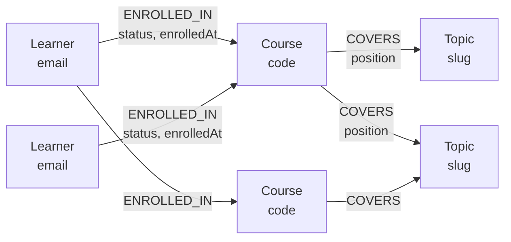

# Dựng database, migration, constraint và dữ liệu mẫu

Trong một ứng dụng Spring Data Neo4j (SDN), entity Java chỉ mô tả cách ánh xạ graph; chúng không tự tạo database, không thay thế quy trình quản lý schema và cũng không bảo đảm dữ liệu mẫu được nạp đúng thứ tự. Một project hoàn chỉnh cần có Neo4j instance, cấu hình kết nối, migration có version, constraint bảo vệ khóa nghiệp vụ và dữ liệu mẫu để kiểm tra repository.

Bài capstone này dựng một graph quản lý khóa học. Ta chạy Neo4j bằng Docker, kết nối từ Spring Boot qua Neo4j Java Driver, dùng Neo4j Migrations để áp dụng Cypher migration, tạo uniqueness constraint và index, nạp node/relationship mẫu rồi xác minh bằng SDN repository và integration test. Đây là một cách thực hành trọn luồng cho module `SPRING_DATA_NEO4J`, nơi tầng dữ liệu đồ thị được xây dựng từ entity, relationship, repository, Cypher và transaction.

## 1. Kết quả cần đạt

Sau khi hoàn thành, project có thể:

1. Khởi động một Neo4j database riêng cho môi trường phát triển.
2. Kết nối Spring Boot/SDN tới Neo4j qua Bolt.
3. Tự động áp dụng migration khi ứng dụng khởi động trong môi trường local.
4. Tạo uniqueness constraint để bảo vệ business key và index cho truy vấn thường dùng.
5. Nạp dữ liệu mẫu theo thứ tự node trước, relationship sau.
6. Thêm một migration mới để bổ sung thuộc tính và backfill dữ liệu cũ.
7. Đọc dữ liệu đã migrate bằng repository SDN.
8. Kiểm thử migration, constraint và mapping bằng Neo4j Testcontainers.

Graph cuối cùng có ba loại node và hai loại relationship:



| Thành phần | Business key | Property tiêu biểu |
|---|---|---|
| `Learner` | `email` | `displayName`, `active`, `createdAt` |
| `Course` | `code` | `title`, `createdAt`, `level` |
| `Topic` | `slug` | `name` |
| `ENROLLED_IN` | Một learner đăng ký một course | `enrollmentId`, `status`, `enrolledAt` |
| `COVERS` | Một course bao phủ một topic | `position` |

Business key được chọn làm `@Id` trong ví dụ để repository có thể tìm node theo định danh nghiệp vụ. Constraint trong database bảo vệ tính duy nhất của key đó kể cả khi dữ liệu được ghi bằng Cypher, import job hoặc ứng dụng khác.

## 2. Cấu trúc project

Các file liên quan đến bài thực hành được tổ chức như sau:

```text
neo4j-learning-app/
├── compose.yaml
├── pom.xml
└── src/
    ├── main/
    │   ├── java/com/example/learning/
    │   │   ├── domain/
    │   │   │   └── Course.java
    │   │   └── repository/
    │   │       └── CourseRepository.java
    │   └── resources/
    │       ├── application.yml
    │       └── neo4j/migrations/
    │           ├── V001__Create_constraints_and_indexes.cypher
    │           ├── V002__Seed_learning_graph.cypher
    │           └── V003__Add_course_level.cypher
    └── test/
        └── java/com/example/learning/
            └── DatabaseMigrationTest.java
```

Thư mục `src/main/resources/neo4j/migrations` là vị trí mặc định mà Neo4j Migrations Spring Boot Starter quét các script Cypher. Tên file migration có cấu trúc `V<version>__<description>.cypher`; hai dấu gạch dưới phân cách version và mô tả. Các version sẽ được áp dụng theo thứ tự.

## 3. Chuẩn bị dependency

Ứng dụng dùng Spring Boot dependency management để quản lý phiên bản Spring Data Neo4j và Neo4j Java Driver. Thêm starter SDN và Neo4j Migrations Spring Boot Starter:

```xml
<dependencies>
    <dependency>
        <groupId>org.springframework.boot</groupId>
        <artifactId>spring-boot-starter-data-neo4j</artifactId>
    </dependency>

    <dependency>
        <groupId>eu.michael-simons.neo4j</groupId>
        <artifactId>neo4j-migrations-spring-boot-starter</artifactId>
        <version>2.9.3</version>
    </dependency>

    <dependency>
        <groupId>org.springframework.boot</groupId>
        <artifactId>spring-boot-starter-test</artifactId>
        <scope>test</scope>
    </dependency>

    <dependency>
        <groupId>org.testcontainers</groupId>
        <artifactId>testcontainers-neo4j</artifactId>
        <version>2.0.5</version>
        <scope>test</scope>
    </dependency>

    <dependency>
        <groupId>org.testcontainers</groupId>
        <artifactId>testcontainers-junit-jupiter</artifactId>
        <version>2.0.5</version>
        <scope>test</scope>
    </dependency>
</dependencies>
```

Neo4j Migrations là công cụ migration của Neo4j Labs, hoạt động trực tiếp trên Neo4j Java Driver. Bản 2.9.3 yêu cầu Java 17 trở lên và Neo4j Java Driver 5.2 trở lên. Hãy kiểm tra ma trận tương thích của phiên bản Spring Boot, SDN, Driver và Neo4j mà project đang dùng; không tự ghép các phiên bản rời rạc khi dependency management đã cung cấp bộ tương thích.

Testcontainers 2.x đổi package của container class sang `org.testcontainers.neo4j` và dùng artifact có tiền tố `testcontainers-`. Nếu project vẫn dùng Testcontainers 1.x, import và dependency có thể khác.

## 4. Dựng Neo4j bằng Docker Compose

Tạo file `compose.yaml` ở root project:

```yaml
services:
  neo4j:
    image: neo4j:5.26-community
    container_name: learning-neo4j
    environment:
      NEO4J_AUTH: neo4j/dev-password
    ports:
      - "7474:7474"
      - "7687:7687"
    volumes:
      - neo4j_data:/data
      - neo4j_logs:/logs
      - ./import:/var/lib/neo4j/import:ro

volumes:
  neo4j_data:
  neo4j_logs:
```

Khởi động database:

```bash
docker compose up -d
```

Neo4j Browser có thể mở tại `http://localhost:7474`; ứng dụng Java kết nối qua Bolt ở `bolt://localhost:7687`. Tài khoản mẫu là `neo4j` với password `dev-password`.

Volume `neo4j_data` giữ database qua các lần restart container. Thư mục `./import` được mount read-only để minh họa nạp CSV ở phần sau. Password trong compose chỉ dùng cho môi trường local; môi trường dùng chung hoặc production phải lấy secret từ secret manager và không commit password thật vào source control.

Nếu muốn tạo lại database từ đầu, chỉ chạy `docker compose down -v` khi chắc chắn volume này là dữ liệu phát triển có thể xóa. Thao tác `-v` xóa volume và toàn bộ graph đang lưu trong đó.

## 5. Cấu hình Spring Boot và Neo4j Migrations

Tạo `src/main/resources/application.yml`:

```yaml
spring:
  neo4j:
    uri: ${NEO4J_URI:bolt://localhost:7687}
    authentication:
      username: ${NEO4J_USERNAME:neo4j}
      password: ${NEO4J_PASSWORD:dev-password}

org:
  neo4j:
    migrations:
      enabled: true
      validate-on-migrate: true
      locations-to-scan:
        - classpath:neo4j/migrations
```

Các property có ý nghĩa:

- `spring.neo4j.uri` xác định Bolt endpoint. Khi chạy ứng dụng bên trong cùng Docker Compose network, dùng `bolt://neo4j:7687` thay cho `localhost`.
- `spring.neo4j.authentication.*` là thông tin đăng nhập mà Neo4j Java Driver sử dụng.
- `org.neo4j.migrations.enabled` bật tự động áp dụng migration khi Spring Boot khởi động.
- `org.neo4j.migrations.locations-to-scan` chỉ rõ nơi chứa script. Đây cũng là vị trí mặc định của starter.
- `org.neo4j.migrations.validate-on-migrate` bật kiểm tra version và checksum của migration đã áp dụng.

Neo4j Migrations lưu lịch sử migration trong graph metadata của database. Starter sẽ tìm script trong `classpath:neo4j/migrations`; nếu thư mục mặc định không tồn tại, ứng dụng có thể thất bại khi khởi động. Hãy tạo ít nhất một migration trước khi bật starter.

## 6. Migration V001 — Tạo constraint và index

Tạo file `V001__Create_constraints_and_indexes.cypher`:

```cypher
CREATE CONSTRAINT learner_email_unique IF NOT EXISTS
FOR (l:Learner)
REQUIRE l.email IS UNIQUE;

CREATE CONSTRAINT course_code_unique IF NOT EXISTS
FOR (c:Course)
REQUIRE c.code IS UNIQUE;

CREATE CONSTRAINT topic_slug_unique IF NOT EXISTS
FOR (t:Topic)
REQUIRE t.slug IS UNIQUE;

CREATE RANGE INDEX course_title_idx IF NOT EXISTS
FOR (c:Course)
ON (c.title);
```

Ba uniqueness constraint bảo vệ business key cho ba loại node. `MERGE` trong các migration sau có thể dựa vào những key này để tìm node hiện có và tránh tạo trùng khi dữ liệu được nạp lại.

`CREATE RANGE INDEX` tạo index cho các truy vấn lọc hoặc tìm kiếm theo `Course.title`. Uniqueness constraint cũng được Neo4j hỗ trợ bằng một range index; không tạo thêm một index độc lập trên cùng label/property đã có uniqueness constraint vì sẽ trùng với index mà constraint sở hữu.

`IF NOT EXISTS` giúp câu lệnh không lỗi khi constraint/index tương đương đã tồn tại. Nó không sửa dữ liệu vi phạm và không làm cho hai constraint khác nhau trở nên tương thích. Tên index và constraint phải duy nhất trong database.

### Kiểm tra dữ liệu trước khi thêm constraint vào graph có sẵn

Capstone bắt đầu bằng database trống, nhưng nếu áp dụng V001 lên graph đã tồn tại, hãy kiểm tra duplicate và property thiếu trước.

Tìm learner thiếu email:

```cypher
MATCH (l:Learner)
WHERE l.email IS NULL
RETURN l;
```

Tìm email trùng:

```cypher
MATCH (l:Learner)
WITH l.email AS email, count(*) AS total
WHERE email IS NOT NULL AND total > 1
RETURN email, total
ORDER BY total DESC;
```

Lặp lại phép kiểm tra tương tự cho `Course.code` và `Topic.slug`. Constraint uniqueness không bắt buộc mọi node phải có property đó; nó chỉ bảo đảm các giá trị đã tồn tại không trùng nhau. Nếu domain yêu cầu property bắt buộc, hãy xác thực ở tầng ứng dụng hoặc dùng property existence/key constraint khi edition Neo4j hỗ trợ.

Tạo constraint là thao tác atomic và Neo4j cần quét dữ liệu hiện có trước khi constraint sẵn sàng. Với graph lớn, tính thời gian triển khai và xử lý mọi dữ liệu vi phạm trước khi chạy migration.

## 7. Migration V002 — Nạp node và relationship mẫu

Tạo file `V002__Seed_learning_graph.cypher`. Dữ liệu mẫu dùng `UNWIND` để biến danh sách map thành các dòng và `MERGE` theo business key.

```cypher
UNWIND [
    {email: 'linh@example.test', displayName: 'Linh Nguyen'},
    {email: 'minh@example.test', displayName: 'Minh Tran'}
] AS row
MERGE (l:Learner {email: row.email})
ON CREATE SET
    l.displayName = row.displayName,
    l.active = true,
    l.createdAt = datetime('2026-01-10T00:00:00Z');

UNWIND [
    {code: 'SDN-101', title: 'Spring Data Neo4j Fundamentals'},
    {code: 'CYPHER-201', title: 'Cypher Query Design'}
] AS row
MERGE (c:Course {code: row.code})
ON CREATE SET
    c.title = row.title,
    c.createdAt = datetime('2026-01-11T00:00:00Z');

UNWIND [
    {slug: 'mapping', name: 'Entity and Graph Mapping'},
    {slug: 'query-design', name: 'Cypher Query Design'},
    {slug: 'transactions', name: 'Transactions'}
] AS row
MERGE (t:Topic {slug: row.slug})
ON CREATE SET t.name = row.name;

MATCH (c:Course {code: 'SDN-101'}), (t:Topic {slug: 'mapping'})
MERGE (c)-[r:COVERS]->(t)
ON CREATE SET r.position = 1;

MATCH (c:Course {code: 'SDN-101'}), (t:Topic {slug: 'transactions'})
MERGE (c)-[r:COVERS]->(t)
ON CREATE SET r.position = 2;

MATCH (c:Course {code: 'CYPHER-201'}), (t:Topic {slug: 'query-design'})
MERGE (c)-[r:COVERS]->(t)
ON CREATE SET r.position = 1;

MATCH (l:Learner {email: 'linh@example.test'}),
      (c:Course {code: 'SDN-101'})
MERGE (l)-[e:ENROLLED_IN]->(c)
ON CREATE SET
    e.enrollmentId = 'ENR-001',
    e.status = 'ACTIVE',
    e.enrolledAt = date('2026-01-15');

MATCH (l:Learner {email: 'minh@example.test'}),
      (c:Course {code: 'SDN-101'})
MERGE (l)-[e:ENROLLED_IN]->(c)
ON CREATE SET
    e.enrollmentId = 'ENR-002',
    e.status = 'ACTIVE',
    e.enrolledAt = date('2026-01-16');

MATCH (l:Learner {email: 'linh@example.test'}),
      (c:Course {code: 'CYPHER-201'})
MERGE (l)-[e:ENROLLED_IN]->(c)
ON CREATE SET
    e.enrollmentId = 'ENR-003',
    e.status = 'ACTIVE',
    e.enrolledAt = date('2026-01-17');
```

Thứ tự trong script có chủ đích:

1. Tạo learner, course và topic trước.
2. Tạo `COVERS` sau khi course và topic đã tồn tại.
3. Tạo `ENROLLED_IN` sau khi learner và course đã tồn tại.

`MERGE` cùng uniqueness constraint bảo vệ các node theo business key. `ON CREATE SET` chỉ thiết lập dữ liệu mặc định khi node hoặc relationship vừa được tạo; nếu migration script được chạy thủ công lại, dữ liệu hiện có không bị ghi đè tùy tiện. Dù vậy, versioned migration được quản lý bởi công cụ và không nên chạy lại thủ công trên database production.

Mỗi file Cypher versioned được áp dụng một lần theo lịch sử migration. Trong Neo4j Migrations, các statement trong một script mặc định chạy trong một transaction cho migration đó. Vì vậy V002 hoặc toàn bộ seed script sẽ commit thành công cùng nhau; nếu một statement lỗi, transaction migration sẽ rollback.

## 8. Migration V003 — Thêm property và backfill dữ liệu cũ

Giả sử phiên bản tiếp theo của ứng dụng cần phân loại cấp độ khóa học. Thêm file `V003__Add_course_level.cypher`:

```cypher
MATCH (c:Course)
WHERE c.level IS NULL
SET c.level = 'BEGINNER';

CREATE RANGE INDEX course_level_idx IF NOT EXISTS
FOR (c:Course)
ON (c.level);
```

Đây là migration dữ liệu và schema trong cùng version:

- `MATCH` tìm mọi course hiện có.
- `WHERE c.level IS NULL` chỉ backfill node chưa có level.
- `SET` thêm giá trị mặc định.
- Index mới hỗ trợ các truy vấn lọc theo level.

Khi thêm một property mới vào graph đang chạy, hãy xác định giá trị backfill phù hợp với dữ liệu cũ. Nếu giá trị mới phải được tính từ các property khác, thực hiện phép chuyển đổi trước khi ứng dụng mới phụ thuộc vào nó. Nếu cần nhiều bước hoặc thời gian triển khai dài, cân nhắc chiến lược expand–migrate–contract để các phiên bản ứng dụng cũ và mới cùng hoạt động trong giai đoạn chuyển đổi.

Không sửa V001 hoặc V002 sau khi chúng đã được áp dụng. Nếu phát hiện thiếu constraint hoặc cần đổi cách seed, tạo migration version mới, ví dụ `V004__...cypher`. Neo4j Migrations lưu checksum của migration; thay nội dung file đã áp dụng làm validation thất bại.

## 9. Chạy migration và xác minh lịch sử

Khi Spring Boot khởi động, Neo4j Migrations Spring Boot Starter:

1. Tạo kết nối bằng Neo4j Java Driver đã cấu hình qua `spring.neo4j.*`.
2. Tìm migration script trong classpath location.
3. Đọc lịch sử version đã áp dụng và kiểm tra checksum.
4. Áp dụng migration còn pending theo thứ tự.
5. Lưu trạng thái migration để lần khởi động sau biết những version đã hoàn tất.

Khởi động ứng dụng local:

```bash
mvn spring-boot:run
```

Theo dõi log startup để xác nhận V001, V002 và V003 đã được áp dụng. Nếu ứng dụng không tìm thấy thư mục migration, kiểm tra vị trí file trong `src/main/resources/neo4j/migrations` và đường dẫn `locations-to-scan`.

Neo4j Migrations cung cấp các thao tác quản lý phổ biến:

| Thao tác | Mục đích |
|---|---|
| `info` | Xem database, migration đã áp dụng và migration còn pending |
| `migrate` / `apply` | Áp dụng các migration còn thiếu |
| `validate` | So sánh lịch sử trong database với version, thứ tự và checksum của file local |
| `clean` | Xóa metadata migration; thao tác destructive, không dùng tùy tiện trên production |

Trong môi trường local, có thể dùng Neo4j Migrations CLI để xem `info` hoặc chạy `validate` độc lập với ứng dụng. Trong production, chạy validation trong pipeline triển khai để phát hiện migration file bị sửa hoặc thiếu trước khi release.

## 10. Kiểm tra constraint, index và graph sau migration

Mở Neo4j Browser hoặc dùng Cypher Shell trên database `neo4j`.

Liệt kê constraint:

```cypher
SHOW CONSTRAINTS;
```

Kết quả cần có:

- `learner_email_unique`
- `course_code_unique`
- `topic_slug_unique`

Liệt kê index:

```cypher
SHOW INDEXES;
```

Kiểm tra các index `course_title_idx` và `course_level_idx`. Index mới có thể cần thời gian population; xem `state` và `populationPercent` trong kết quả `SHOW INDEXES`, chỉ dựa vào index ở trạng thái sẵn sàng khi đánh giá hiệu năng.

Đếm node theo label:

```cypher
MATCH (l:Learner)
RETURN count(l) AS learners;

MATCH (c:Course)
RETURN count(c) AS courses;

MATCH (t:Topic)
RETURN count(t) AS topics;
```

Với seed data hiện tại, kết quả mong đợi là 2 learner, 2 course và 3 topic.

Kiểm tra enrollment và topic:

```cypher
MATCH (l:Learner)-[e:ENROLLED_IN]->(c:Course)
RETURN l.email AS learner,
       c.code AS course,
       e.enrollmentId AS enrollmentId,
       e.status AS status
ORDER BY learner, course;
```

```cypher
MATCH (c:Course)-[r:COVERS]->(t:Topic)
RETURN c.code AS course,
       r.position AS position,
       t.slug AS topic
ORDER BY course, position;
```

Kiểm tra course đã được backfill:

```cypher
MATCH (c:Course)
RETURN c.code, c.title, c.level
ORDER BY c.code;
```

Cả hai course phải có `level = 'BEGINNER'` sau V003.

## 11. Ánh xạ dữ liệu bằng Spring Data Neo4j

Sau khi database đã có schema và seed data, tạo entity `Course`:

```java
package com.example.learning.domain;

import org.springframework.data.neo4j.core.schema.Id;
import org.springframework.data.neo4j.core.schema.Node;

@Node("Course")
public class Course {

    @Id
    private String code;

    private String title;
    private String level;

    protected Course() {
    }

    public String getCode() {
        return code;
    }

    public String getTitle() {
        return title;
    }

    public String getLevel() {
        return level;
    }
}
```

Ở đây `code` là business ID đã tồn tại trong graph. Không dùng `@GeneratedValue` vì code được cấp bởi nghiệp vụ và đã được seed trong migration.

Repository:

```java
package com.example.learning.repository;

import org.springframework.data.neo4j.repository.Neo4jRepository;
import com.example.learning.domain.Course;

public interface CourseRepository extends Neo4jRepository<Course, String> {
}
```

Repository có thể đọc ngay dữ liệu do migration tạo:

```java
import org.springframework.stereotype.Service;
import com.example.learning.domain.Course;
import com.example.learning.repository.CourseRepository;

@Service
public class CourseCatalogService {

    private final CourseRepository courses;

    public CourseCatalogService(CourseRepository courses) {
        this.courses = courses;
    }

    public Course getCourse(String code) {
        return courses.findById(code).orElseThrow();
    }
}
```

Migration quản lý cấu trúc và dữ liệu khởi tạo của graph; SDN mapping quản lý cách Java đọc/ghi graph đó. `@Node` không tự tạo uniqueness constraint và `@Id` không thay thế migration schema. Hai lớp phải thống nhất về label, property key và business key.

## 12. Kiểm thử migration cùng repository bằng Testcontainers

Integration test cần Neo4j thật vì phải thực thi Cypher DDL, tạo constraint, chạy migration và kiểm tra SDN mapping. Testcontainers dựng database tạm thời; `@DataNeo4jTest` cấu hình repository/client của SDN.

Khi dùng Neo4j Migrations Spring Boot Starter cùng `@DataNeo4jTest`, cần import migration auto-configuration vì test slice không tự bật tất cả auto-configuration của ứng dụng:

```java
package com.example.learning;

import static org.assertj.core.api.Assertions.assertThat;

import ac.simons.neo4j.migrations.springframework.boot.autoconfigure.MigrationsAutoConfiguration;
import com.example.learning.domain.Course;
import com.example.learning.repository.CourseRepository;
import org.junit.jupiter.api.Test;
import org.springframework.beans.factory.annotation.Autowired;
import org.springframework.boot.autoconfigure.ImportAutoConfiguration;
import org.springframework.boot.test.autoconfigure.data.neo4j.DataNeo4jTest;
import org.springframework.data.neo4j.core.Neo4jClient;
import org.springframework.test.context.DynamicPropertyRegistry;
import org.springframework.test.context.DynamicPropertySource;
import org.testcontainers.junit.jupiter.Container;
import org.testcontainers.junit.jupiter.Testcontainers;
import org.testcontainers.neo4j.Neo4jContainer;

@DataNeo4jTest
@Testcontainers
@ImportAutoConfiguration(MigrationsAutoConfiguration.class)
class DatabaseMigrationTest {

    private static final String PASSWORD = "test-password";

    @Container
    static final Neo4jContainer neo4j =
        new Neo4jContainer("neo4j:5.26-community")
            .withAdminPassword(PASSWORD);

    @DynamicPropertySource
    static void neo4jProperties(DynamicPropertyRegistry registry) {
        registry.add("spring.neo4j.uri", neo4j::getBoltUrl);
        registry.add("spring.neo4j.authentication.username", () -> "neo4j");
        registry.add("spring.neo4j.authentication.password", neo4j::getAdminPassword);
    }

    @Autowired
    CourseRepository courses;

    @Autowired
    Neo4jClient neo4jClient;

    @Test
    void migrationsCreateConstraintsAndSeedCourses() {
        Course course = courses.findById("SDN-101").orElseThrow();

        assertThat(course.getTitle())
            .isEqualTo("Spring Data Neo4j Fundamentals");
        assertThat(course.getLevel()).isEqualTo("BEGINNER");

        Long constraintCount = neo4jClient.query("""
                SHOW CONSTRAINTS YIELD name
                WHERE name IN [
                    'learner_email_unique',
                    'course_code_unique',
                    'topic_slug_unique'
                ]
                RETURN count(*) AS total
                """)
            .fetchAs(Long.class)
            .mappedBy((typeSystem, record) -> record.get("total").asLong())
            .one()
            .orElseThrow();

        assertThat(constraintCount).isEqualTo(3L);
    }
}
```

Khi Spring test context khởi tạo, Neo4j container được bật và các property kết nối được đăng ký động. Migration auto-configuration áp dụng V001–V003 trước khi test đọc repository. Test xác minh đồng thời:

- V001 đã tạo đủ ba uniqueness constraint.
- V002 đã seed node course.
- V003 đã backfill `level`.
- SDN repository hydrate được entity từ graph.

Nếu dùng `@SpringBootTest` thay vì `@DataNeo4jTest`, migration starter đã nằm trong application auto-configuration nên thường không cần import thủ công. Chọn test slice khi chỉ kiểm tra tầng dữ liệu; chọn full context khi cần xác minh cả ứng dụng.

## 13. Nạp dữ liệu lớn từ CSV

Seed bằng `UNWIND` phù hợp với một tập dữ liệu nhỏ, ổn định và cần đi cùng version ứng dụng. Với dữ liệu lớn, có thể dùng `LOAD CSV` từ thư mục import đã mount vào container.

Ví dụ file `import/learners.csv`:

```csv
email,displayName
hoa@example.test,Hoa Le
nam@example.test,Nam Pham
```

Cypher import:

```cypher
LOAD CSV WITH HEADERS FROM 'file:///learners.csv' AS row
MERGE (l:Learner {email: row.email})
ON CREATE SET
    l.displayName = row.displayName,
    l.active = true;
```

Nếu dữ liệu rất lớn, có thể chia batch bằng `CALL { ... } IN TRANSACTIONS OF 500 ROWS`. Tuy nhiên, lệnh này yêu cầu chạy trong implicit transaction. Neo4j Migrations mặc định chạy một file migration trong một transaction, nên không đặt `CALL ... IN TRANSACTIONS` vào script versioned mặc định. Hãy chạy bulk import bằng một job riêng hoặc công cụ ingestion phù hợp, có kiểm soát retry, checkpoint và idempotency.

Với dữ liệu nhập từ CSV, vẫn cần:

- Tạo uniqueness constraint trước khi import.
- Chuẩn hóa email, code và slug trước khi `MERGE`.
- Kiểm tra dòng thiếu key hoặc sai kiểu dữ liệu.
- Lưu báo cáo số dòng đọc, tạo mới, cập nhật và bị từ chối.
- Chạy truy vấn đối soát sau import.

## 14. Quy trình triển khai migration trong production

Ở môi trường local, starter tự chạy migration khi ứng dụng khởi động là cách nhanh để thực hành. Với production nhiều replica, nên đưa migration thành một bước riêng trong pipeline triển khai:

1. Build artifact ứng dụng chứa migration scripts đã review.
2. Backup database theo chính sách vận hành trước migration có thay đổi dữ liệu quan trọng.
3. Chạy `validate` để xác minh lịch sử và checksum.
4. Chạy migration bằng deployment job hoặc migration runner đúng một lần.
5. Kiểm tra constraint, index state, số lượng node/relationship và dữ liệu backfill.
6. Triển khai phiên bản ứng dụng tương thích với schema mới.
7. Sau khi xác nhận không còn phiên bản cũ phụ thuộc schema cũ, mới chạy migration contract để xóa cấu trúc đã hết dùng.

Nếu migration được chạy bởi job riêng, cấu hình `org.neo4j.migrations.enabled=false` ở application runtime để mỗi replica không tự khởi chạy migration. Job migration cần user có quyền tạo constraint/index và ghi dữ liệu; user runtime của ứng dụng chỉ nên có các quyền đọc/ghi graph cần thiết cho nghiệp vụ. Không dùng tài khoản quản trị Neo4j làm tài khoản mặc định cho mọi request ứng dụng.

Khi ứng dụng và migration job dùng chung Spring Boot config, thông tin xác thực của migration job có thể được cung cấp qua biến môi trường riêng trong bước deploy. Không ghi credential có quyền schema vào image hoặc repository.

## 15. Rollback, sửa lỗi và nguyên tắc bất biến

Migration versioned là lịch sử thay đổi database. Khi một migration đã áp dụng:

- Không sửa nội dung file cũ để “sửa nhanh”. Checksum sẽ không còn khớp lịch sử đã lưu.
- Không xóa node/relationship metadata migration khỏi database bằng Cypher thủ công.
- Không dùng `clean` trên production để chạy lại từ đầu. Đây là thao tác destructive và không phải rollback thông thường.
- Nếu migration có lỗi, xác định database đã commit đến bước nào, kiểm tra lịch sử và logs, sau đó tạo migration mới để sửa trạng thái theo hướng tiến lên.
- Với thay đổi phá hủy dữ liệu, chuẩn bị backup/restore hoặc kế hoạch phục hồi đã thử nghiệm trước khi triển khai.

Neo4j Migrations hỗ trợ `validate` để phát hiện thiếu version, sai thứ tự hoặc checksum khác nhau. Chỉ dùng thao tác repair khi đã xác định rõ lịch sử và trạng thái graph; không dùng repair để che giấu việc sửa migration đã phát hành.

## 16. Lỗi thường gặp

| Biểu hiện | Nguyên nhân | Cách xử lý |
|---|---|---|
| Spring Boot không khởi động vì migration location | Thiếu `src/main/resources/neo4j/migrations` hoặc cấu hình sai path | Tạo thư mục và ít nhất một script đúng naming convention; kiểm tra `locations-to-scan` |
| Migration không được nhận diện | Tên file sai prefix, version, separator hoặc extension | Dùng dạng `V001__Description.cypher` |
| Constraint creation thất bại | Graph cũ có duplicate hoặc property thiếu khi dùng constraint yêu cầu property | Chạy truy vấn preflight, làm sạch dữ liệu rồi tạo constraint |
| `IF NOT EXISTS` nhưng constraint vẫn không được tạo | Có constraint/index xung đột trên cùng schema hoặc tên | Đọc notification và `SHOW CONSTRAINTS`/`SHOW INDEXES` trước khi đổi tên |
| Migration validation báo checksum mismatch | File versioned đã áp dụng bị sửa | Khôi phục file nguyên bản và tạo migration version mới cho thay đổi |
| Node bị tạo trùng khi import | Không có uniqueness constraint hoặc `MERGE` không dùng business key ổn định | Tạo constraint trước và `MERGE` theo key chuẩn hóa |
| Relationship không được tạo | Node đầu/cuối chưa tồn tại nên `MATCH` không trả dòng | Kiểm tra thứ tự seed và đếm node trước khi tạo relationship |
| Relationship bị trùng | Dùng `CREATE` trong seed script thay vì `MERGE` theo hai đầu và type | Dùng `MERGE` relationship, cân nhắc business key nếu domain cho phép nhiều cạnh cùng cặp |
| Ứng dụng kết nối được nhưng migration lỗi quyền | Runtime user thiếu quyền `CREATE CONSTRAINT`, `CREATE INDEX` hoặc ghi dữ liệu | Chạy migration bằng user có quyền schema; giữ runtime user theo least privilege |
| Test không thấy dữ liệu seed | Test slice chưa import migration auto-configuration | Thêm `@ImportAutoConfiguration(MigrationsAutoConfiguration.class)` |
| Test container không khởi động | Docker daemon không sẵn sàng hoặc image tag không tồn tại | Kiểm tra Docker runtime và pin image Neo4j hợp lệ |
| Index chưa dùng được ngay | Index vẫn đang population | Kiểm tra `SHOW INDEXES` và chờ trạng thái `ONLINE` |
| Bulk import lỗi với `CALL IN TRANSACTIONS` | Đang chạy trong explicit transaction của migration | Chuyển bulk import sang implicit transaction/job riêng |
| Mỗi replica đều cố chạy migration lúc startup | Migration được gắn vào app startup trong deployment nhiều instance | Chạy migration ở một pipeline job và tắt auto-run trong app runtime |

## 17. Bài tập mở rộng

Sau khi capstone cơ bản chạy thành công, hãy thực hiện các phần mở rộng sau:

1. Thêm node `Instructor` với business key `employeeCode` và uniqueness constraint tương ứng.
2. Thêm relationship `TEACHES` giữa instructor và course, có property `assignedAt`.
3. Tạo V004 để thêm relationship mẫu bằng `MERGE`.
4. Thêm property `publishedAt` cho course và backfill giá trị hợp lý trong V005.
5. Viết repository method tìm course theo `level` và kiểm tra index bằng `EXPLAIN`.
6. Viết integration test xác minh V004 tạo đúng số relationship và V005 backfill không ghi đè giá trị đã có.
7. Tạo một migration cố ý vi phạm uniqueness constraint trong database test để quan sát lỗi và ghi lại error code.

## 18. Tiêu chí nghiệm thu

- [ ] Neo4j khởi động bằng Docker Compose và dữ liệu tồn tại sau khi restart container.
- [ ] Spring Boot kết nối bằng `spring.neo4j.*` properties.
- [ ] Migration files nằm trong `classpath:neo4j/migrations` và có tên versioned hợp lệ.
- [ ] V001 tạo ba uniqueness constraint và một index tìm kiếm course title.
- [ ] V002 tạo đủ learner, course, topic và relationship mẫu.
- [ ] V003 backfill `Course.level` và tạo index tương ứng.
- [ ] `SHOW CONSTRAINTS` và `SHOW INDEXES` cho kết quả mong đợi.
- [ ] Repository `CourseRepository` đọc được `SDN-101` với title và level chính xác.
- [ ] Integration test chạy trên Neo4j Testcontainers và xác minh migration cùng mapping.
- [ ] Migration đã áp dụng không bị sửa; thay đổi mới được thêm bằng version mới.
- [ ] Production plan có bước validate, backup khi cần, migration job và quyền tối thiểu.

## 19. Tự kiểm tra

1. Vì sao `@Node` và `@Id` không thay thế schema migration?
2. Neo4j Migrations nhận diện file Cypher versioned dựa trên quy tắc tên nào?
3. Vì sao phải tạo uniqueness constraint trước khi seed node bằng `MERGE`?
4. Uniqueness constraint có bắt buộc property phải tồn tại không?
5. Vì sao một uniqueness constraint thường đã có backing range index?
6. Vì sao không nên sửa migration file sau khi đã áp dụng trên database dùng chung?
7. `ON CREATE SET` giúp seed data tránh ghi đè dữ liệu hiện có như thế nào?
8. Vì sao cần tạo node trước khi tạo relationship?
9. Neo4j Migrations mặc định quản lý transaction theo từng script ra sao?
10. Vì sao `CALL { ... } IN TRANSACTIONS` không phù hợp bên trong migration script mặc định?
11. Vì sao `@DataNeo4jTest` cần import migration auto-configuration khi dùng Neo4j Migrations Starter?
12. Production nên chạy migration ở bước nào khi ứng dụng có nhiều replica?

Một database SDN có thể tái tạo được khi môi trường Neo4j, schema, constraint và dữ liệu khởi tạo đều được quản lý rõ ràng. Hãy dựng Neo4j bằng container, dùng versioned Cypher migrations để tạo constraint/index và seed graph, thêm migration mới cho mọi thay đổi về sau, rồi xác minh bằng SDN repository và Testcontainers. Khi triển khai production, giữ migration bất biến, validate checksum, chạy migration có kiểm soát và tách quyền schema khỏi quyền runtime của ứng dụng.

## Tài liệu tham khảo

- [Spring Data Neo4j 8.2 — Getting Started](https://docs.spring.io/spring-data/neo4j/reference/getting-started.html)
- [Spring Boot — Working with Neo4j](https://docs.spring.io/spring-boot/reference/data/nosql.html)
- [Neo4j Migrations 2.9.3 — Concepts and naming conventions](https://michael-simons.github.io/neo4j-migrations/2.9.3/)
- [Neo4j Migrations 2.9.3 — Spring Boot Starter and configuration](https://michael-simons.github.io/neo4j-migrations/2.9.3/)
- [Neo4j Cypher Manual — Create constraints](https://neo4j.com/docs/cypher-manual/current/schema/constraints/create-constraints/)
- [Neo4j Operations Manual — Docker configuration](https://neo4j.com/docs/operations-manual/current/docker/configuration/)
- [Testcontainers for Java — Neo4j module](https://java.testcontainers.org/modules/databases/neo4j/)
