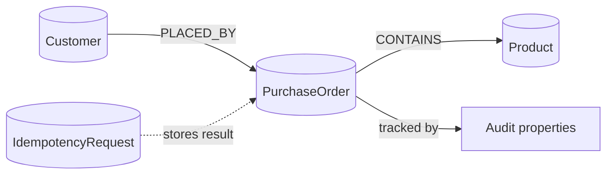

# Bổ sung auditing, optimistic locking và xử lý yêu cầu ghi lặp

Trong một ứng dụng đặt hàng, cùng một lệnh ghi có thể được gửi lại vì client timeout, mạng mất kết nối hoặc người dùng nhấn nút nhiều lần. Hai người vận hành cũng có thể cùng sửa một đơn hàng gần như đồng thời. Nếu chỉ dùng repository `save()` mà không có cơ chế kiểm soát, ứng dụng có thể tạo đơn trùng, ghi đè thay đổi mới hoặc không truy được ai đã sửa dữ liệu.

Capstone này xây dựng một luồng tạo và cập nhật đơn hàng với ba cơ chế phối hợp:

- **Auditing** ghi lại ai tạo, ai sửa và thời điểm thay đổi node.
- **Optimistic locking** dùng `@Version` để phát hiện một bản ghi đã bị transaction khác cập nhật.
- **Idempotency key** nhận diện một yêu cầu ghi logic, giúp retry cùng yêu cầu trả lại kết quả cũ thay vì tạo dữ liệu mới.

Điểm quan trọng là ba cơ chế giải quyết ba vấn đề khác nhau. Auditing cung cấp dấu vết, optimistic locking bảo vệ cập nhật cạnh tranh, còn idempotency xử lý việc gửi lại cùng một command. Chúng cần được đặt trong cùng transaction với thao tác graph liên quan để dữ liệu không rơi vào trạng thái nửa hoàn tất.

## 1. Bài toán và tiêu chí hoàn thành

Xây dựng API tạo đơn hàng và xác nhận đơn hàng cho một graph thương mại:



Graph có các thành phần:

- `Customer` là người đặt hàng.
- `PurchaseOrder` là node đơn hàng, có trạng thái, tổng tiền, audit metadata và version.
- `Product` là node sản phẩm.
- `CONTAINS` là relationship có thuộc tính `quantity` và `unitPrice`.
- `IdempotencyRequest` lưu phạm vi, key, hash payload và kết quả đã xử lý.

API cần đáp ứng các tiêu chí:

1. Khi tạo đơn, `createdAt`, `createdBy` được ghi tự động; `lastModifiedAt` và `lastModifiedBy` tuân theo chính sách auditing đã cấu hình.
2. Khi cập nhật đơn, `lastModifiedAt` và `lastModifiedBy` thay đổi; `createdAt` và `createdBy` được giữ nguyên.
3. `version` tăng tự động sau mỗi lần cập nhật thành công.
4. Hai transaction cùng sửa một version chỉ có tối đa một transaction lưu thành công; transaction còn lại nhận optimistic locking failure.
5. Gửi lại cùng idempotency key và cùng payload trả lại kết quả đã lưu, không tạo đơn thứ hai.
6. Dùng lại key với payload khác bị từ chối.
7. Nếu tạo đơn thất bại giữa transaction, cả đơn hàng và idempotency record đều rollback.
8. Các side effect ngoài Neo4j được phát qua outbox hoặc cơ chế idempotent riêng, không gửi trực tiếp bên trong transaction có thể retry.

## 2. Thiết kế schema và constraint

Business key của đơn hàng và idempotency key phải được bảo vệ bằng uniqueness constraint. Không dựa vào một lần `MATCH` trước `CREATE` để bảo đảm duy nhất, vì hai transaction đồng thời có thể cùng kiểm tra thấy chưa có dữ liệu.

```cypher
CREATE CONSTRAINT customer_id_unique IF NOT EXISTS
FOR (c:Customer)
REQUIRE c.customerId IS UNIQUE;

CREATE CONSTRAINT product_sku_unique IF NOT EXISTS
FOR (p:Product)
REQUIRE p.sku IS UNIQUE;

CREATE CONSTRAINT purchase_order_number_unique IF NOT EXISTS
FOR (o:PurchaseOrder)
REQUIRE o.orderNumber IS UNIQUE;

CREATE CONSTRAINT idempotency_scope_key_unique IF NOT EXISTS
FOR (r:IdempotencyRequest)
REQUIRE (r.scope, r.key) IS UNIQUE;
```

`scope` định danh tenant hoặc operation/API route; `key` là giá trị client gửi trong header `Idempotency-Key`. Constraint tổng hợp bảo đảm cùng key có thể được dùng ở các scope khác nhau nhưng không trùng trong một scope. Luôn ghi cả hai property khi tạo record vì uniqueness constraint không bắt buộc node phải có đủ property như key constraint.

Kiểm tra dữ liệu cũ trước khi tạo constraint. Nếu đã có hai node cùng `orderNumber` hoặc cùng cặp `scope`/`key`, việc tạo constraint sẽ thất bại cho đến khi dữ liệu xung đột được xử lý.

## 3. Mô hình entity và relationship

### Customer và Product

```java
import org.springframework.data.neo4j.core.schema.GeneratedValue;
import org.springframework.data.neo4j.core.schema.Id;
import org.springframework.data.neo4j.core.schema.Node;

@Node("Customer")
public class Customer {

    @Id
    @GeneratedValue
    private Long id;

    private String customerId;
    private String name;

    protected Customer() {
    }

    public Customer(String customerId, String name) {
        this.customerId = customerId;
        this.name = name;
    }

    public Long getId() { return id; }
    public String getCustomerId() { return customerId; }
    public String getName() { return name; }
}
```

```java
import java.math.BigDecimal;

import org.springframework.data.neo4j.core.schema.GeneratedValue;
import org.springframework.data.neo4j.core.schema.Id;
import org.springframework.data.neo4j.core.schema.Node;

@Node("Product")
public class Product {

    @Id
    @GeneratedValue
    private Long id;

    private String sku;
    private String name;
    private BigDecimal unitPrice;

    protected Product() {
    }

    public Product(String sku, String name, BigDecimal unitPrice) {
        this.sku = sku;
        this.name = name;
        this.unitPrice = unitPrice;
    }

    public Long getId() { return id; }
    public String getSku() { return sku; }
    public String getName() { return name; }
    public BigDecimal getUnitPrice() { return unitPrice; }
}
```

### Relationship properties của dòng hàng

```java
import java.math.BigDecimal;

import org.springframework.data.neo4j.core.schema.RelationshipId;
import org.springframework.data.neo4j.core.schema.RelationshipProperties;
import org.springframework.data.neo4j.core.schema.TargetNode;

@RelationshipProperties
public class OrderLine {

    @RelationshipId
    private Long id;

    private int quantity;
    private BigDecimal unitPrice;

    @TargetNode
    private Product product;

    protected OrderLine() {
    }

    public OrderLine(Product product, int quantity, BigDecimal unitPrice) {
        if (quantity <= 0) {
            throw new IllegalArgumentException("quantity must be positive");
        }
        this.product = product;
        this.quantity = quantity;
        this.unitPrice = unitPrice;
    }

    public Product getProduct() { return product; }
    public int getQuantity() { return quantity; }
    public BigDecimal getUnitPrice() { return unitPrice; }
}
```

Mỗi `OrderLine` đại diện cho một relationship `CONTAINS`; `@RelationshipId` giúp SDN nhận diện relationship khi đồng bộ aggregate. Không dùng relationship ID nội bộ làm mã nghiệp vụ.

### PurchaseOrder có auditing và optimistic locking

```java
import java.math.BigDecimal;
import java.time.Instant;
import java.util.ArrayList;
import java.util.List;

import org.springframework.data.annotation.CreatedBy;
import org.springframework.data.annotation.CreatedDate;
import org.springframework.data.annotation.LastModifiedBy;
import org.springframework.data.annotation.LastModifiedDate;
import org.springframework.data.annotation.Version;
import org.springframework.data.neo4j.core.schema.Direction;
import org.springframework.data.neo4j.core.schema.GeneratedValue;
import org.springframework.data.neo4j.core.schema.Id;
import org.springframework.data.neo4j.core.schema.Node;
import org.springframework.data.neo4j.core.schema.Relationship;

@Node("PurchaseOrder")
public class PurchaseOrder {

    @Id
    @GeneratedValue
    private Long id;

    @Version
    private Long version;

    private String orderNumber;
    private String status;
    private BigDecimal total;

    @CreatedDate
    private Instant createdAt;

    @LastModifiedDate
    private Instant lastModifiedAt;

    @CreatedBy
    private String createdBy;

    @LastModifiedBy
    private String lastModifiedBy;

    @Relationship(type = "PLACED_BY", direction = Direction.OUTGOING)
    private Customer customer;

    @Relationship(type = "CONTAINS", direction = Direction.OUTGOING)
    private List<OrderLine> lines = new ArrayList<>();

    protected PurchaseOrder() {
    }

    public PurchaseOrder(String orderNumber, Customer customer,
                         List<OrderLine> lines, BigDecimal total) {
        this.orderNumber = orderNumber;
        this.customer = customer;
        this.lines = new ArrayList<>(lines);
        this.total = total;
        this.status = "CREATED";
    }

    public void confirm() {
        if (!"CREATED".equals(status)) {
            throw new IllegalStateException("Only CREATED orders can be confirmed");
        }
        this.status = "CONFIRMED";
    }

    public void cancel() {
        if (!"CREATED".equals(status)) {
            throw new IllegalStateException("Only CREATED orders can be cancelled");
        }
        this.status = "CANCELLED";
    }

    public Long getId() { return id; }
    public Long getVersion() { return version; }
    public String getOrderNumber() { return orderNumber; }
    public String getStatus() { return status; }
    public BigDecimal getTotal() { return total; }
    public Instant getCreatedAt() { return createdAt; }
    public Instant getLastModifiedAt() { return lastModifiedAt; }
    public String getCreatedBy() { return createdBy; }
    public String getLastModifiedBy() { return lastModifiedBy; }
}
```

`@Version` phải đặt trên field kiểu `Long` và không được tự tăng hoặc gán từ request. SDN quản lý giá trị này: version khởi đầu bằng 0 và tự tăng khi cập nhật thành công. `@CreatedDate`, `@LastModifiedDate`, `@CreatedBy`, `@LastModifiedBy` là metadata của Spring Data Commons.

## 4. Bật auditing và xác định actor

Auditing chỉ hoạt động sau khi được bật trong Spring configuration. Nếu dùng `@CreatedBy` hoặc `@LastModifiedBy`, cần cung cấp `AuditorAware<T>` để xác định actor hiện tại. Ứng dụng dưới đây dùng imperative Spring Security; với WebFlux phải dùng `ReactiveAuditorAware` và reactive security context.

```java
import java.util.Optional;

import org.springframework.context.annotation.Bean;
import org.springframework.context.annotation.Configuration;
import org.springframework.data.domain.AuditorAware;
import org.springframework.data.neo4j.config.EnableNeo4jAuditing;
import org.springframework.security.authentication.AnonymousAuthenticationToken;
import org.springframework.security.core.Authentication;
import org.springframework.security.core.context.SecurityContextHolder;

@Configuration(proxyBeanMethods = false)
@EnableNeo4jAuditing(
        auditorAwareRef = "auditorAware",
        modifyOnCreate = true)
public class Neo4jAuditingConfiguration {

    @Bean
    AuditorAware<String> auditorAware() {
        return () -> Optional.ofNullable(SecurityContextHolder.getContext())
                .map(context -> context.getAuthentication())
                .filter(Authentication::isAuthenticated)
                .filter(authentication -> !(authentication instanceof AnonymousAuthenticationToken))
                .map(Authentication::getName)
                .or(() -> Optional.of("system"));
    }
}
```

Trong ví dụ, `modifyOnCreate = true` yêu cầu ghi cả metadata sửa đổi khi tạo mới; do đó `lastModifiedAt` và `lastModifiedBy` ban đầu có thể bằng giá trị tạo. Nếu muốn các field này chỉ có giá trị sau lần sửa đầu tiên, đặt `modifyOnCreate = false`.

Fallback `system` phù hợp cho tác vụ nền đã được xác định actor. Trong hệ thống cần audit nghiêm ngặt, không dùng fallback chung cho request không xác thực; hãy từ chối request hoặc truyền service identity rõ ràng. Không lấy tên actor từ body request vì client có thể giả mạo.

Nếu chỉ theo dõi ngày tạo và sửa mà không cần người thực hiện, không cần khai báo `AuditorAware`.

## 5. Repository và transaction boundary

```java
import java.util.Optional;

import org.springframework.data.neo4j.repository.Neo4jRepository;

public interface PurchaseOrderRepository
        extends Neo4jRepository<PurchaseOrder, Long> {

    Optional<PurchaseOrder> findByOrderNumber(String orderNumber);
    long countByOrderNumber(String orderNumber);
}
```

```java
import java.util.Optional;

import org.springframework.data.neo4j.repository.Neo4jRepository;

public interface CustomerRepository extends Neo4jRepository<Customer, Long> {
    Optional<Customer> findByCustomerId(String customerId);
}

public interface ProductRepository extends Neo4jRepository<Product, Long> {
    Optional<Product> findBySku(String sku);
}
```

Đặt hai interface repository trong hai file Java riêng khi triển khai dự án.

Tạo đơn, lưu idempotency record và cập nhật trạng thái record phải nằm trong cùng một Spring transaction. `Neo4jClient` được SDN cung cấp tham gia transaction management của Spring, vì vậy có thể phối hợp Cypher reservation với repository `save()` trong một method `@Transactional`, miễn là dùng cùng cấu hình SDN/transaction manager.

Không gọi `subscribe()` hoặc `block()` bên trong một service reactive. Capstone dùng imperative repository để tập trung vào transaction; nếu chuyển sang reactive stack, cần chuyển toàn bộ service, transaction manager và auditor sang reactive tương ứng.

## 6. Thiết kế idempotency key

Client gửi một key ổn định cho mỗi thao tác ghi logic:

```http
POST /orders
Idempotency-Key: 7a8e5c12-4c7d-4f8d-a0bb-...
Content-Type: application/json
```

Server xử lý key cùng một scope, ví dụ `tenant-42:POST:/orders`. Không dùng key đơn lẻ trên toàn hệ thống nếu nhiều tenant hoặc endpoint có thể sử dụng cùng giá trị.

### Quy tắc hợp đồng

| Trường hợp | Hành vi |
|---|---|
| Key mới + payload hợp lệ | Tạo đơn và lưu response result |
| Key đã dùng + cùng payload hash | Trả lại kết quả đã lưu, không tạo đơn mới |
| Key đã dùng + payload hash khác | Trả `409 Conflict`; client phải tạo key mới cho command khác |
| Cùng key đang được transaction khác xử lý | Transaction cạnh tranh chờ unique key được giải quyết; sau đó đọc kết quả đã commit hoặc trở thành transaction tạo mới nếu transaction trước rollback |
| Transaction tạo đơn thất bại | Rollback cả idempotency record và đơn hàng |

Hash phải được tạo từ payload đã canonicalize: sắp xếp key, chuẩn hóa kiểu số/ngày và chỉ đưa các field có ý nghĩa nghiệp vụ vào. Không hash trực tiếp JSON bytes nếu thứ tự key hoặc định dạng có thể thay đổi giữa các lần retry. Dùng SHA-256 hoặc thuật toán hash phù hợp; không lưu raw payload chứa token hay dữ liệu nhạy cảm nếu không cần thiết.

Nếu thứ tự dòng hàng có ý nghĩa trong nghiệp vụ, giữ thứ tự đó trong dữ liệu canonical; nếu thứ tự không có ý nghĩa, có thể sắp xếp theo SKU trước khi hash. Cùng một command logic phải luôn tạo cùng một hash.

### IdempotencyRequest được lưu trong graph

Node `IdempotencyRequest` có các property:

| Property | Ý nghĩa |
|---|---|
| `scope` | Tenant/operation namespace |
| `key` | Idempotency key từ client |
| `payloadHash` | Hash của command đã canonicalize |
| `state` | `PROCESSING` hoặc `COMPLETED` |
| `attemptId` | Token tạm để nhận biết transaction nào vừa tạo reservation |
| `orderNumber` | Business ID của kết quả đã tạo |
| `responseStatus` | HTTP status cần replay |
| `createdAt`, `completedAt` | Thời điểm tiếp nhận và hoàn tất |

Record idempotency không cần trở thành entity aggregate nếu chỉ dùng trong command handler. Có thể thao tác bằng `Neo4jClient` để tránh kéo metadata persistence không cần thiết vào model đơn hàng.

## 7. Reserve key bằng MERGE trong cùng transaction

`MERGE` tạo reservation nếu chưa có và đọc lại reservation nếu key đã tồn tại. `attemptId` được tạo mới cho mỗi lần gọi transaction. Nếu `attemptId` khớp, transaction hiện tại đã tạo record và được phép thực hiện command.

```cypher
MERGE (r:IdempotencyRequest {scope: $scope, key: $key})
ON CREATE SET
    r.payloadHash = $payloadHash,
    r.attemptId = $attemptId,
    r.state = 'PROCESSING',
    r.createdAt = datetime()
RETURN coalesce(r.attemptId = $attemptId, false) AS acquired,
       r.payloadHash AS payloadHash,
       r.state AS state,
       r.orderNumber AS orderNumber,
       r.responseStatus AS responseStatus;
```

Constraint tổng hợp ở mục 2 là bắt buộc. `MERGE` một mình không bảo đảm node uniqueness dưới các transaction đồng thời. Constraint bảo vệ cặp `(scope, key)` và cung cấp index để tìm reservation. `attemptId` chỉ là token tạm; khi hoàn tất transaction, xóa nó khỏi node.

Trong cùng transaction, sau khi `PurchaseOrderRepository.save()` thành công, đánh dấu request hoàn tất:

```cypher
MATCH (r:IdempotencyRequest {scope: $scope, key: $key})
SET r.state = 'COMPLETED',
    r.orderNumber = $orderNumber,
    r.responseStatus = 201,
    r.completedAt = datetime()
REMOVE r.attemptId;
```

Không commit reservation `PROCESSING` trong một transaction riêng rồi mới tạo đơn ở transaction khác. Nếu process dừng giữa hai bước, hệ thống sẽ để lại reservation mồ côi hoặc phải xây thêm lease, timeout và recovery protocol. Trong capstone, reservation, order và kết quả idempotency cùng commit hoặc cùng rollback.

## 8. Triển khai command handler idempotent

DTO kết quả và reservation:

```java
import java.util.List;

public record CreateOrderCommand(
        String customerId,
        List<Item> items) {

    public record Item(String sku, int quantity) {
    }
}

public interface OrderPayloadHasher {
    String sha256(CreateOrderCommand command);
}

public record CreateOrderResult(
        String orderNumber,
        int responseStatus,
        boolean replayed) {
}

public record Reservation(
        boolean acquired,
        String payloadHash,
        String state,
        String orderNumber,
        int responseStatus) {
}
```

Trong dự án, đặt `CreateOrderCommand`, `OrderPayloadHasher`, `CreateOrderResult` và `Reservation` trong các file riêng hoặc gom thành nested type theo quy ước package.

Mapper cho reservation dùng alias Cypher tường minh:

```java
private static final String RESERVE_REQUEST_CYPHER = """
        MERGE (r:IdempotencyRequest {scope: $scope, key: $key})
        ON CREATE SET
            r.payloadHash = $payloadHash,
            r.attemptId = $attemptId,
            r.state = 'PROCESSING',
            r.createdAt = datetime()
        RETURN coalesce(r.attemptId = $attemptId, false) AS acquired,
               r.payloadHash AS payloadHash,
               r.state AS state,
               r.orderNumber AS orderNumber,
               r.responseStatus AS responseStatus
        """;

private Reservation reserve(String scope, String key,
                            String payloadHash, String attemptId) {
    return neo4jClient.query(RESERVE_REQUEST_CYPHER)
            .bindAll(Map.of(
                    "scope", scope,
                    "key", key,
                    "payloadHash", payloadHash,
                    "attemptId", attemptId))
            .fetchAs(Reservation.class)
            .mappedBy((typeSystem, record) -> new Reservation(
                    record.get("acquired").asBoolean(),
                    record.get("payloadHash").asString(),
                    record.get("state").asString(),
                    record.get("orderNumber").asString(null),
                    record.get("responseStatus").asInt(0)))
            .one()
            .orElseThrow(() -> new IllegalStateException(
                    "Idempotency reservation returned no record"));
}
```

Phương thức hoàn tất reservation dùng cùng `Neo4jClient` và cùng transaction:

```java
private void completeReservation(String scope, String key, String orderNumber) {
    neo4jClient.query("""
            MATCH (r:IdempotencyRequest {scope: $scope, key: $key})
            SET r.state = 'COMPLETED',
                r.orderNumber = $orderNumber,
                r.responseStatus = 201,
                r.completedAt = datetime()
            REMOVE r.attemptId
            """)
            .bindAll(Map.of(
                    "scope", scope,
                    "key", key,
                    "orderNumber", orderNumber))
            .run();
}
```

Command handler:

```java
import java.util.UUID;
import java.math.BigDecimal;
import java.util.List;
import java.util.Map;

import org.springframework.data.neo4j.core.Neo4jClient;
import org.springframework.stereotype.Service;
import org.springframework.transaction.annotation.Transactional;

@Service
public class CreateOrderTransaction {

    private final PurchaseOrderRepository orders;
    private final CustomerRepository customers;
    private final ProductRepository products;
    private final Neo4jClient neo4jClient;
    private final OrderPayloadHasher payloadHasher;

    public CreateOrderTransaction(PurchaseOrderRepository orders,
                                  CustomerRepository customers,
                                  ProductRepository products,
                                  Neo4jClient neo4jClient,
                                  OrderPayloadHasher payloadHasher) {
        this.orders = orders;
        this.customers = customers;
        this.products = products;
        this.neo4jClient = neo4jClient;
        this.payloadHasher = payloadHasher;
    }

    @Transactional
    public CreateOrderResult createOnce(String scope, String key,
                                        CreateOrderCommand command) {
        String payloadHash = payloadHasher.sha256(command);
        String attemptId = UUID.randomUUID().toString();

        Reservation reservation = reserve(scope, key, payloadHash, attemptId);

        if (!reservation.acquired()) {
            if (!reservation.payloadHash().equals(payloadHash)) {
                throw new IdempotencyKeyReuseException(key);
            }
            if (!"COMPLETED".equals(reservation.state())) {
                throw new IdempotencyInProgressException(key);
            }
            return new CreateOrderResult(
                    reservation.orderNumber(),
                    reservation.responseStatus(),
                    true);
        }

        Customer customer = customers.findByCustomerId(command.customerId())
                .orElseThrow(() -> new CustomerNotFoundException(command.customerId()));

        List<OrderLine> lines = command.items().stream()
                .map(item -> {
                    Product product = products.findBySku(item.sku())
                            .orElseThrow(() -> new ProductNotFoundException(item.sku()));
                    return new OrderLine(product, item.quantity(), product.getUnitPrice());
                })
                .toList();

        BigDecimal total = lines.stream()
                .map(line -> line.getUnitPrice()
                        .multiply(BigDecimal.valueOf(line.getQuantity())))
                .reduce(BigDecimal.ZERO, BigDecimal::add);
        String orderNumber = "PO-" + UUID.randomUUID();

        PurchaseOrder order = new PurchaseOrder(
                orderNumber, customer, lines, total);
        PurchaseOrder saved = orders.save(order);

        completeReservation(scope, key, saved.getOrderNumber());

        return new CreateOrderResult(saved.getOrderNumber(), 201, false);
    }
}
```

Đây là skeleton của service; các exception và phần triển khai `OrderPayloadHasher` cần được khai báo theo domain. Giá bán được đọc từ node `Product` tại thời điểm tạo đơn, không tin giá hoặc tổng tiền do client gửi lên. Method `createOnce` là transaction boundary: `reserve`, `orders.save()` và `completeReservation` phải tham gia cùng transaction Neo4j.

Khi `acquired=false`, handler không ghi đơn mới. Nếu hash khớp và trạng thái đã hoàn tất, trả response đã lưu. Nếu hash khác, trả conflict. Với thiết kế transaction nguyên tử này, request `PROCESSING` không được commit riêng; trạng thái đó chỉ tồn tại bên trong transaction đang chạy. Nếu thấy record `PROCESSING` đã commit từ phiên bản cũ, cần một quy trình reconcile thay vì âm thầm tạo đơn lần nữa.

### Xử lý tranh chấp unique constraint

Constraint là hàng rào cuối cùng chống trùng key. Trong một số race hoặc đường ghi khác dùng `CREATE`, transaction có thể nhận lỗi unique constraint. Chỉ bắt lỗi đúng constraint idempotency; không chuyển mọi `DataIntegrityViolationException` thành response replay vì lỗi constraint trên order hoặc relationship có thể là lỗi nghiệp vụ khác.

Transaction đã thất bại phải rollback trước khi đọc lại reservation. Đặt phần đọc lại ở facade ngoài transaction hoặc một bean read service có transaction mới. Nếu record đã commit, so sánh payload hash và trả kết quả; nếu chưa có record, chỉ retry theo chính sách transient có giới hạn.

## 9. Cập nhật đơn hàng với optimistic locking

Repository load entity cùng version hiện tại. Client nên gửi version mà nó đã đọc trước đó, chẳng hạn qua `If-Match` hoặc field `expectedVersion` trong command.

```java
@Service
public class UpdateOrderService {

    private final PurchaseOrderRepository orders;

    public UpdateOrderService(PurchaseOrderRepository orders) {
        this.orders = orders;
    }

    @Transactional
    public PurchaseOrder confirm(String orderNumber, long expectedVersion) {
        PurchaseOrder order = orders.findByOrderNumber(orderNumber)
                .orElseThrow(() -> new OrderNotFoundException(orderNumber));

        if (!Long.valueOf(expectedVersion).equals(order.getVersion())) {
            throw new StaleOrderVersionException(orderNumber);
        }

        order.confirm();
        return orders.save(order);
    }
}
```

So sánh `expectedVersion` ở tầng service giúp trả conflict sớm nếu client đã gửi version cũ. `@Version` vẫn cần thiết vì hai transaction có thể cùng đọc version mới nhất sau bước kiểm tra và cùng sửa trước khi lưu. Khi transaction đầu tiên commit, version tăng; transaction thứ hai lưu với version cũ sẽ nhận `OptimisticLockingFailureException`.

Không sửa field `version` bằng setter, không đưa version từ client vào entity rồi gán trực tiếp. Client chỉ cung cấp expected version để kiểm tra điều kiện cập nhật; SDN là thành phần quản lý version persistence.

### Xử lý optimistic locking failure

Khi nhận `OptimisticLockingFailureException`:

1. Rollback transaction hiện tại.
2. Trả `409 Conflict` hoặc `412 Precondition Failed` nếu API dùng `If-Match`.
3. Để client tải bản mới và quyết định gửi lại command.
4. Nếu server tự retry, phải đọc entity mới trong transaction mới rồi áp dụng lại command sau khi kiểm tra invariant nghiệp vụ.

Không retry bằng chính object stale đã thất bại. Làm vậy sẽ tiếp tục dùng version cũ và lặp lại lỗi hoặc ghi đè logic nghiệp vụ đã thay đổi.

## 10. Tương tác giữa idempotency và optimistic locking

Hai cơ chế này bổ sung cho nhau:

| Tình huống | Idempotency key | `@Version` |
|---|---|---|
| Client gửi lại cùng lệnh tạo đơn | Ngăn tạo đơn thứ hai và replay response | Không thay thế được việc nhận diện request retry |
| Hai người dùng sửa cùng đơn từ cùng version | Không giúp nếu hai command có key khác nhau | Phát hiện stale update |
| Client gửi cùng key nhưng payload đã đổi | Phát hiện key bị tái sử dụng sai mục đích | Không phát hiện được điều này |
| Hai command khác nhau cùng cập nhật đơn | Mỗi command có key riêng | Bảo vệ cập nhật cạnh tranh |
| Transaction rollback trước commit | Record idempotency và đơn cùng rollback | Version không tăng vì update chưa commit |

Nếu endpoint cập nhật cũng cần chống retry, áp dụng idempotency key cho command update và vẫn giữ `expectedVersion`. Idempotency trả lại kết quả của cùng command đã xử lý; optimistic locking kiểm tra command đó có dựa trên version hợp lệ hay không.

## 11. Không để custom Cypher bỏ qua auditing và version

Auditing và optimistic locking được SDN áp dụng khi entity được lưu qua repository/template. Nếu tự viết `Neo4jClient` để cập nhật trực tiếp `PurchaseOrder`, các annotation không tự động chạy trên câu Cypher đó.

Một custom update phải tự kiểm tra version và cập nhật audit metadata:

```cypher
MATCH (o:PurchaseOrder {orderNumber: $orderNumber})
SET o._versionLock = true
REMOVE o._versionLock
WITH o
WHERE o.version = $expectedVersion
SET o.status = $newStatus,
    o.version = o.version + 1,
    o.lastModifiedAt = datetime(),
    o.lastModifiedBy = $actor
RETURN o.orderNumber AS orderNumber,
       o.version AS version,
       o.lastModifiedAt AS lastModifiedAt;
```

Hai clause đầu ghi rồi gỡ property tạm để lấy write lock trên node trước khi đọc `version`. Lock được giữ đến khi transaction kết thúc, nhờ đó transaction cạnh tranh phải chờ; điều kiện version được đánh giá sau khi lock đã được lấy. Dành riêng tên property `_versionLock` cho mục đích này và không dùng nó trong domain model. Đây là kỹ thuật Cypher cần cân nhắc kỹ và kiểm thử trên phiên bản Neo4j đang chạy. Nếu không có record trả về, có thể order không tồn tại hoặc version đã thay đổi; query/service cần phân biệt hai trường hợp trước khi trả response. Đừng chạy custom query trên cùng entity mà không cập nhật version, vì repository save tiếp theo có thể không phát hiện được một lần ghi ngoài SDN.

Quy tắc cho capstone: dùng repository `save()` cho aggregate `PurchaseOrder`; chỉ dùng `Neo4jClient` cho reservation node idempotency. Cách phân chia này giữ auditing và version của đơn hàng trong SDN.

## 12. Kiểm thử auditing

Chạy integration test với `@DataNeo4jTest` và Neo4j Testcontainers hoặc Neo4j Test Harness phù hợp với phiên bản ứng dụng. Import `Neo4jAuditingConfiguration` và cung cấp một `AuditorAware<String>` cố định trả về `test-user` để assertion xác định. Test slice imperative thường mở transaction bao quanh test và rollback khi kết thúc; với test concurrency cần hai transaction độc lập, hãy tắt transaction test cho method đó bằng `@Transactional(propagation = Propagation.NOT_SUPPORTED)` rồi để từng service call mở transaction riêng.

Kiểm tra cả metadata tạo mới lẫn metadata cập nhật. Test có thể dùng `AuditorAware` cố định để kết quả xác định:

```java
@Test
void writesAuditMetadataOnCreateAndUpdate() {
    PurchaseOrder created = orders.save(testOrder("PO-100"));

    assertThat(created.getCreatedAt()).isNotNull();
    assertThat(created.getLastModifiedAt()).isNotNull();
    assertThat(created.getCreatedBy()).isEqualTo("test-user");
    assertThat(created.getLastModifiedBy()).isEqualTo("test-user");

    Instant originalCreatedAt = created.getCreatedAt();
    String originalCreatedBy = created.getCreatedBy();

    created.confirm();
    PurchaseOrder updated = orders.save(created);

    assertThat(updated.getCreatedAt()).isEqualTo(originalCreatedAt);
    assertThat(updated.getCreatedBy()).isEqualTo(originalCreatedBy);
    assertThat(updated.getLastModifiedAt()).isAfterOrEqualTo(originalCreatedAt);
    assertThat(updated.getLastModifiedBy()).isEqualTo("test-user");
}
```

Test trên giả định auditing đã được bật và test context cung cấp actor `test-user`. Nếu `modifyOnCreate=false`, hai field `lastModified*` có thể chưa được điền khi tạo; điều chỉnh assertion theo chính sách đã cấu hình.

## 13. Kiểm thử optimistic locking

Đọc cùng một order thành hai object độc lập để mô phỏng hai người dùng giữ cùng version:

```java
@Test
void rejectsSecondSaveUsingStaleVersion() {
    PurchaseOrder initial = orders.save(testOrder("PO-200"));

    PurchaseOrder firstCopy = orders.findById(initial.getId()).orElseThrow();
    PurchaseOrder staleCopy = orders.findById(initial.getId()).orElseThrow();

    Long staleVersion = staleCopy.getVersion();

    firstCopy.confirm();
    PurchaseOrder saved = orders.save(firstCopy);

    assertThat(saved.getVersion()).isGreaterThan(staleVersion);

    staleCopy.cancel();
    assertThatThrownBy(() -> orders.save(staleCopy))
            .isInstanceOf(OptimisticLockingFailureException.class);
}
```

Với test concurrency thực tế, chạy hai transaction độc lập ở hai thread hoặc hai request, dùng latch để cả hai đọc cùng version trước khi lưu. Một transaction phải commit trước; transaction còn lại phải nhận optimistic locking failure.

Không đặt toàn bộ test concurrency trong một transaction test duy nhất rồi coi đó là hai transaction độc lập. Hãy dùng transaction boundary riêng cho mỗi worker và xác nhận dữ liệu cuối cùng sau khi cả hai hoàn tất.

## 14. Kiểm thử idempotency và rollback

### Gửi cùng key hai lần

```java
@Test
void replaysTheOriginalResultForTheSameKeyAndPayload() {
    CreateOrderCommand command = validCommand();

    CreateOrderResult first = service.createOnce("tenant-a", "key-300", command);
    CreateOrderResult replay = service.createOnce("tenant-a", "key-300", command);

    assertThat(first.orderNumber()).isEqualTo(replay.orderNumber());
    assertThat(first.responseStatus()).isEqualTo(replay.responseStatus());
    assertThat(first.replayed()).isFalse();
    assertThat(replay.replayed()).isTrue();
    assertThat(orders.countByOrderNumber(first.orderNumber())).isEqualTo(1);
}
```

### Dùng lại key với payload khác

```java
@Test
void rejectsReusingTheSameKeyWithDifferentPayload() {
    service.createOnce("tenant-a", "key-301", validCommand());

    assertThatThrownBy(() -> service.createOnce(
            "tenant-a", "key-301", validCommandWithDifferentItems()))
            .isInstanceOf(IdempotencyKeyReuseException.class);
}
```

### Lỗi giữa transaction phải rollback cả hai phần

Tạo một test hook chỉ dùng trong test để ném exception sau khi order đã được save nhưng trước khi idempotency record chuyển sang `COMPLETED`. Sau khi transaction kết thúc, xác nhận không có `PurchaseOrder` và không có `IdempotencyRequest` cho key đó. Điều này chứng minh reservation và business mutation thực sự nằm trong cùng transaction.

### Gửi đồng thời cùng key

Dùng hai thread hoặc hai HTTP request với cùng scope, key và payload. Cả hai cùng bắt đầu trước khi transaction đầu tiên hoàn tất. Xác nhận:

- Chỉ một order được tạo.
- Cả hai caller cuối cùng nhận cùng order number/response.
- Không có idempotency record trùng.
- Không có trạng thái `PROCESSING` đã commit trong thiết kế transaction nguyên tử.

Constraint tổng hợp là điều kiện cần để kiểm soát race. `MERGE` không thay thế uniqueness constraint cho node khi nhiều transaction ghi đồng thời.

## 15. Xử lý side effect ngoài Neo4j bằng outbox

Transaction Neo4j không thể tự rollback email đã gửi, message đã publish hoặc khoản thanh toán đã gọi qua một dịch vụ khác. Không thực hiện side effect đó ngay trong method `@Transactional` có thể rollback hoặc được retry.

Thay vào đó, trong cùng transaction tạo đơn, tạo thêm node outbox:

```cypher
CREATE (:OutboxEvent {
    eventId: $eventId,
    eventType: 'ORDER_CREATED',
    aggregateId: $orderNumber,
    state: 'PENDING',
    createdAt: datetime()
});
```

Worker nền đọc event `PENDING`, gửi message và đánh dấu hoàn tất. Consumer cần deduplicate theo `eventId`, vì worker có thể gửi lại nếu process dừng sau khi publish nhưng trước khi ghi trạng thái hoàn tất. Nếu gửi thanh toán, dùng idempotency key riêng mà payment provider hỗ trợ.

## 16. Chính sách lưu giữ idempotency record

Idempotency record cần được giữ lâu hơn khoảng thời gian client, gateway hoặc job có thể retry. Nếu xóa record quá sớm, một request cũ có thể được xem như request mới và tạo lại dữ liệu.

Chính sách vận hành nên xác định:

- Thời gian giữ record đã `COMPLETED`, ví dụ 24 giờ hoặc 7 ngày tùy API contract.
- Có lưu toàn bộ response snapshot hay chỉ lưu resource ID và status.
- Cách xử lý key hết hạn nhưng client vẫn retry.
- Quy trình dọn record theo batch và có log/metric.
- Không lưu raw request body hoặc thông tin thanh toán nhạy cảm trong idempotency record.
- Không xóa record `PROCESSING` theo TTL đơn giản nếu hệ thống cho phép trạng thái đó commit; cần lease, owner và recovery protocol rõ ràng.

Trong capstone này, chỉ `COMPLETED` được commit; `PROCESSING` là trạng thái tạm trong transaction. Nếu kiến trúc thay đổi sang reservation transaction riêng, cần bổ sung lease expiry và quy trình khôi phục trước khi dùng cleanup job.

## 17. Bảng tình huống và cách phản hồi API

| Tình huống | Kết quả trong database | Phản hồi gợi ý |
|---|---|---|
| Tạo đơn lần đầu | Order + idempotency record cùng commit | `201 Created` |
| Retry cùng key, cùng payload | Không thay đổi graph; đọc kết quả đã lưu | Replay status/body ban đầu |
| Cùng key, payload khác | Không tạo order mới | `409 Conflict` |
| Hai cập nhật cùng version | Một update commit; update còn lại rollback | `409 Conflict` hoặc `412 Precondition Failed` |
| Order không tồn tại | Không thay đổi graph | `404 Not Found` |
| Transaction tạo đơn lỗi | Cả order và reservation rollback | `5xx` hoặc lỗi nghiệp vụ tương ứng; client có thể retry cùng key |
| Constraint business key bị vi phạm | Không tạo dữ liệu trùng | `409 Conflict` nếu đúng là xung đột nghiệp vụ |
| Neo4j tạm thời không khả dụng | Transaction rollback hoặc kết quả commit chưa rõ với client | Retry cùng idempotency key, không tạo key mới |

Nếu client timeout sau khi server commit nhưng trước khi nhận response, lần retry cùng key sẽ lấy lại kết quả đã commit. Đây là tình huống idempotency key giải quyết tốt nhất.

## 18. Những lỗi thường gặp

| Lỗi | Hệ quả | Cách xử lý |
|---|---|---|
| Không bật `@EnableNeo4jAuditing` | Audit annotations không được xử lý | Bật auditing trong configuration |
| Dùng `@CreatedBy` nhưng không có `AuditorAware` | Không xác định được actor | Cung cấp `AuditorAware` hoặc bỏ field actor |
| Lấy actor từ request body | Client có thể giả mạo người sửa | Lấy principal đã xác thực hoặc service identity |
| Tự tăng field `@Version` | Sai lệch version và lỗi concurrency | Để SDN quản lý version |
| Bỏ `@Version` khi cần bảo vệ cập nhật | Last write có thể ghi đè thay đổi trước | Dùng `@Version Long` và xử lý conflict |
| Retry object stale sau optimistic lock failure | Tiếp tục dùng version cũ | Đọc lại entity trong transaction mới và kiểm tra nghiệp vụ |
| Dùng `CREATE` cho idempotency record | Retry có thể tạo record/đơn trùng | Dùng `MERGE` cùng uniqueness constraint |
| Chỉ dùng `MERGE`, không có constraint | Concurrent request có thể tạo node trùng | Tạo unique constraint trên `(scope, key)` |
| Lưu reservation ở transaction riêng | Có thể để lại `PROCESSING` mồ côi | Gộp reservation, order và completion trong một transaction |
| Ghi order bằng custom Cypher nhưng kỳ vọng auditing tự chạy | Audit fields không được cập nhật tự động | Dùng repository hoặc tự cập nhật audit/version trong Cypher |
| Bắt mọi lỗi constraint như duplicate request | Che giấu lỗi dữ liệu khác | Chỉ xử lý đúng constraint idempotency |
| Gửi email/message trong transaction callback | Side effect có thể lặp dù database rollback | Dùng transactional outbox và consumer idempotent |
| Xóa idempotency record quá sớm | Retry cũ có thể tạo dữ liệu mới | Đặt retention theo retry window của API |

## 19. Kế hoạch triển khai capstone

1. Tạo Customer, Product, PurchaseOrder và OrderLine mapping.
2. Tạo uniqueness constraint cho customer ID, SKU, order number và cặp scope/key.
3. Bật auditing; xác định actor từ security principal hoặc service identity.
4. Thêm `@Version Long` vào PurchaseOrder.
5. Viết repository và command DTO cho tạo/cập nhật đơn.
6. Viết payload canonicalizer và SHA-256 hasher.
7. Viết reservation Cypher bằng `MERGE`, `ON CREATE` và attempt token.
8. Gộp reservation, repository save và completion vào cùng `@Transactional` method.
9. Viết update service kiểm tra expected version và xử lý `OptimisticLockingFailureException`.
10. Viết integration test auditing, stale version, replay cùng key, key/payload mismatch, rollback và concurrent duplicate.
11. Thêm outbox nếu tạo đơn cần phát event hoặc gọi dịch vụ ngoài.
12. Xác định retention, metric và quy trình reconcile idempotency record.

## 20. Tiêu chí nghiệm thu

Capstone đạt yêu cầu khi tất cả điều kiện sau được chứng minh bằng integration test trên Neo4j:

- [ ] Tạo PurchaseOrder ghi được `createdAt`, `createdBy` và metadata sửa đổi theo cấu hình.
- [ ] Cập nhật đơn giữ nguyên created metadata và cập nhật last-modified metadata.
- [ ] Version tăng sau mỗi lần save thành công; client không thể tự gán version.
- [ ] Hai bản sao cùng version không thể cùng ghi đè; bản stale nhận optimistic locking failure.
- [ ] Cùng idempotency key và cùng payload trả cùng order number, không tạo order thứ hai.
- [ ] Cùng key với payload khác trả conflict.
- [ ] Lỗi sau khi save order nhưng trước completion làm rollback cả order và reservation.
- [ ] Hai request đồng thời cùng key không tạo hai order hoặc hai reservation.
- [ ] Custom Cypher không âm thầm bỏ qua auditing/version của PurchaseOrder.
- [ ] Side effect ngoài database đi qua outbox hoặc API đích có idempotency riêng.

## Kết luận

Auditing, optimistic locking và idempotency là ba lớp bảo vệ khác nhau trong một luồng ghi graph. Dùng `@EnableNeo4jAuditing` cùng `@Created*`/`@LastModified*` để ghi dấu vết actor và thời gian; dùng `@Version Long` để phát hiện stale update; dùng idempotency key có uniqueness constraint để nhận diện request retry. Với thao tác tạo đơn, reservation, graph mutation và response metadata cần commit trong cùng transaction. Khi có xung đột version, đọc lại entity và xác nhận nghiệp vụ trước khi retry; khi cần side effect ngoài Neo4j, dùng outbox. Bộ integration test phải chứng minh cả audit metadata, race condition, replay, payload mismatch và rollback.

## Tài liệu tham khảo

- [Spring Data Neo4j – Auditing](https://docs.spring.io/spring-data/neo4j/reference/auditing.html)
- [Spring Data Neo4j – Metadata-based Mapping](https://docs.spring.io/spring-data/neo4j/reference/object-mapping/metadata-based-mapping.html)
- [Spring Data Neo4j – FAQ: Auditing configuration](https://docs.spring.io/spring-data/neo4j/reference/faq.html)
- [Neo4j Cypher Manual – MERGE and concurrent updates](https://neo4j.com/docs/cypher-manual/current/clauses/merge/)
- [Neo4j Cypher Manual – Constraints](https://neo4j.com/docs/cypher-manual/current/schema/constraints/create-constraints/)
- [Neo4j Operations Manual – Concurrent data access and write locks](https://neo4j.com/docs/operations-manual/current/database-internals/concurrent-data-access/)
