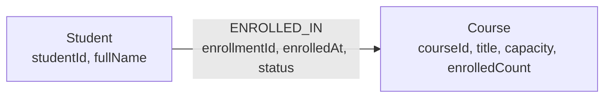

# Xây một luồng đọc–ghi reactive có giao dịch

Trong bài thực hành tổng hợp này, ta xây dựng chức năng đăng ký học viên vào khóa học còn chỗ. Một request phải đọc học viên và khóa học, kiểm tra điều kiện nghiệp vụ, tạo relationship ENROLLED_IN, sau đó đọc lại số lượng đăng ký và số chỗ còn lại. Tất cả thao tác database thuộc cùng một reactive transaction.

Bài thực hành kết hợp các phần chính của Spring Data Neo4j (SDN):

- Entity @Node và relationship có property với @RelationshipProperties.
- Repository reactive trả về Mono và Flux.
- ReactiveNeo4jClient cho câu Cypher tùy chỉnh.
- ReactiveNeo4jTransactionManager và @Transactional.
- Reactor pipeline, xử lý lỗi, rollback và kiểm thử bằng StepVerifier.

Kết quả cuối cùng là một endpoint WebFlux trả về publisher. Request chỉ thực thi khi framework subscribe; ứng dụng không gọi block() hoặc tự subscribe() trong service.

## 1. Bài toán và yêu cầu nghiệp vụ

Ứng dụng quản lý hai loại node:

- Student: học viên có mã, tên và danh sách đăng ký.
- Course: khóa học có mã, tên, sức chứa và số lượt đăng ký hiện tại.

Relationship ENROLLED_IN nối học viên với khóa học. Relationship có các property:

- enrollmentId: mã đăng ký nghiệp vụ.
- enrolledAt: thời điểm đăng ký.
- status: trạng thái như ACTIVE hoặc CANCELLED.

Một luồng đăng ký thành công cần:

1. Xác nhận Student tồn tại.
2. Xác nhận Course tồn tại.
3. Không cho cùng một Student đăng ký một Course hai lần khi đăng ký đang ở trạng thái ACTIVE.
4. Không vượt quá sức chứa của Course.
5. Tạo relationship ENROLLED_IN.
6. Đọc lại số đăng ký và số chỗ còn lại sau khi ghi.

Nếu bước kiểm tra hoặc ghi thất bại, toàn bộ thay đổi trong transaction phải rollback. Ví dụ, nếu Course đã hết chỗ, bộ đếm không được tăng và relationship không được tạo.

### Graph cần xây dựng



enrolledCount là bộ đếm được duy trì cùng transaction với relationship. Quy ước của bài thực hành là mọi thao tác tạo/hủy đăng ký đều phải cập nhật bộ đếm qua cùng service hoặc một command tương đương. Không ghi relationship trực tiếp bằng một đường khác mà bỏ qua bộ đếm.

## 2. Chuẩn bị dependency

Ví dụ dùng Spring Boot và Gradle Kotlin DSL. Để phiên bản thư viện đồng bộ, hãy để Spring Boot BOM quản lý SDN, Neo4j Java Driver và Reactor:

```kotlin
dependencies {
    implementation("org.springframework.boot:spring-boot-starter-data-neo4j")
    implementation("org.springframework.boot:spring-boot-starter-webflux")

    testImplementation("org.springframework.boot:spring-boot-starter-test")
    testImplementation("org.springframework.boot:spring-boot-testcontainers")
    testImplementation("org.testcontainers:testcontainers-junit-jupiter")
    testImplementation("org.testcontainers:testcontainers-neo4j")
}
```

spring-boot-starter-data-neo4j cung cấp SDN và driver; khi Project Reactor có mặt, Spring Boot có thể auto-configure reactive repository và ReactiveNeo4jTemplate. spring-boot-starter-webflux cung cấp WebFlux và Reactor types cho HTTP endpoint.

Nếu dự án không dùng Spring Boot, cần tự khai báo dependency Reactor, Neo4j Driver và SDN tương thích; đồng thời tự cấu hình driver, reactive client, template, repository scanning và transaction manager.

## 3. Khai báo entity và relationship

### Student

```java
import java.util.ArrayList;
import java.util.List;

import org.springframework.data.annotation.Id;
import org.springframework.data.annotation.Version;
import org.springframework.data.neo4j.core.schema.Node;
import org.springframework.data.neo4j.core.schema.Relationship;

@Node("Student")
public class Student {

    @Id
    private String studentId;

    @Version
    private Long version;

    private String fullName;

    @Relationship(
            type = "ENROLLED_IN",
            direction = Relationship.Direction.OUTGOING)
    private List<Enrollment> enrollments = new ArrayList<>();

    protected Student() {
    }

    public Student(String studentId, String fullName) {
        this.studentId = studentId;
        this.fullName = fullName;
    }

    public String getStudentId() {
        return studentId;
    }

    public String getFullName() {
        return fullName;
    }

    public List<Enrollment> getEnrollments() {
        return enrollments;
    }
}
```

studentId là business ID do ứng dụng cấp. @Version giúp SDN nhận diện trạng thái mới/đã lưu và hỗ trợ optimistic locking. Không tự gán hoặc tăng version; SDN quản lý field này.

Tạo uniqueness constraint cho business ID bằng migration Cypher:

```cypher
CREATE CONSTRAINT student_id_unique IF NOT EXISTS
FOR (s:Student)
REQUIRE s.studentId IS UNIQUE;
```

Nếu database đã có dữ liệu, kiểm tra và xử lý các Student trùng studentId trước khi tạo constraint. Chạy migration schema trước khi seed fixture hoặc nhận request đăng ký.

### Course

```java
import org.springframework.data.annotation.Id;
import org.springframework.data.annotation.Version;
import org.springframework.data.neo4j.core.schema.Node;

@Node("Course")
public class Course {

    @Id
    private String courseId;

    @Version
    private Long version;

    private String title;

    private int capacity;

    private int enrolledCount;

    protected Course() {
    }

    public Course(String courseId, String title, int capacity) {
        this.courseId = courseId;
        this.title = title;
        this.capacity = capacity;
        this.enrolledCount = 0;
    }

    public String getCourseId() {
        return courseId;
    }

    public String getTitle() {
        return title;
    }

    public int getCapacity() {
        return capacity;
    }

    public int getEnrolledCount() {
        return enrolledCount;
    }
}
```

enrolledCount là bộ đếm dùng để kiểm tra sức chứa nhanh. Câu Cypher trong phần sau tăng bộ đếm bằng một phép cập nhật có dependency trực tiếp vào giá trị cũ, nhờ đó Neo4j lấy write lock trên node Course trước khi đọc và cập nhật property.

Tạo uniqueness constraint tương ứng:

```cypher
CREATE CONSTRAINT course_id_unique IF NOT EXISTS
FOR (c:Course)
REQUIRE c.courseId IS UNIQUE;
```

Tương tự, cần xử lý các Course trùng courseId trước khi tạo constraint. @Id trong entity không tự tạo uniqueness constraint thay cho database.

### Enrollment relationship properties

```java
import java.time.ZonedDateTime;

import org.springframework.data.neo4j.core.schema.RelationshipId;
import org.springframework.data.neo4j.core.schema.RelationshipProperties;
import org.springframework.data.neo4j.core.schema.TargetNode;

@RelationshipProperties
public class Enrollment {

    @RelationshipId
    private Long id;

    private String enrollmentId;

    private ZonedDateTime enrolledAt;

    private String status;

    @TargetNode
    private Course course;

    protected Enrollment() {
    }

    public String getEnrollmentId() {
        return enrollmentId;
    }

    public ZonedDateTime getEnrolledAt() {
        return enrolledAt;
    }

    public String getStatus() {
        return status;
    }

    public Course getCourse() {
        return course;
    }
}
```

@RelationshipId là identity nội bộ của relationship do Neo4j quản lý. enrollmentId là mã nghiệp vụ có thể trả về API hoặc dùng trong log. Hai giá trị có mục đích khác nhau.

Trong bài thực hành, service tạo relationship bằng Cypher để kiểm soát điều kiện sức chứa trong cùng câu lệnh. Khi SDN đọc Student có relationship ENROLLED_IN, mapping trên cho phép ánh xạ relationship thành Enrollment.

## 4. Tạo reactive repositories

Repository reactive kế thừa ReactiveNeo4jRepository. Các thao tác CRUD trả về publisher thay vì kết quả đồng bộ:

```java
import org.springframework.data.neo4j.repository.ReactiveNeo4jRepository;

public interface StudentRepository
        extends ReactiveNeo4jRepository<Student, String> {
}
```

```java
import org.springframework.data.neo4j.repository.ReactiveNeo4jRepository;

public interface CourseRepository
        extends ReactiveNeo4jRepository<Course, String> {
}
```

Một số kiểu trả về thường dùng:

| Kiểu | Mục đích |
|---|---|
| Mono<Student> | Tìm tối đa một học viên |
| Mono<Course> | Tìm tối đa một khóa học |
| Mono<Boolean> | Kiểm tra một điều kiện |
| Mono<Long> | Đếm hoặc trả về một giá trị số |
| Flux<Student> | Phát nhiều học viên |
| Flux<Course> | Phát nhiều khóa học |

Không gọi block() để lấy entity từ repository. Hãy nối publisher bằng map, flatMap, switchIfEmpty, zip hoặc các operator phù hợp với thứ tự nghiệp vụ.

## 5. Cấu hình ReactiveNeo4jTransactionManager

Đây là bước cấu hình quan trọng. Spring Boot có thể auto-configure reactive repositories và template khi Reactor có mặt, nhưng không tự tạo ReactiveTransactionManager cho ứng dụng reactive Neo4j. Cần khai báo bean ReactiveNeo4jTransactionManager:

```java
import org.neo4j.driver.Driver;
import org.springframework.context.annotation.Bean;
import org.springframework.context.annotation.Configuration;
import org.springframework.data.neo4j.core.ReactiveDatabaseSelectionProvider;
import org.springframework.data.neo4j.core.transaction.ReactiveNeo4jTransactionManager;

@Configuration(proxyBeanMethods = false)
public class ReactiveNeo4jConfiguration {

    @Bean
    ReactiveNeo4jTransactionManager reactiveTransactionManager(
            Driver driver,
            ReactiveDatabaseSelectionProvider databaseSelectionProvider) {

        return new ReactiveNeo4jTransactionManager(
                driver,
                databaseSelectionProvider);
    }
}
```

Spring Boot cung cấp Driver và ReactiveDatabaseSelectionProvider trong cấu hình thông thường. Transaction manager sử dụng driver đó để mở reactive transaction trên database được chọn.

Trong các ví dụ tiếp theo, annotation chỉ rõ transactionManager = "reactiveTransactionManager" để tránh nhầm với transaction manager imperative nếu ứng dụng đồng thời có cả hai kiểu truy cập.

Nếu tự cấu hình Spring Data Neo4j ngoài Spring Boot, cần bật reactive repository scanning phù hợp và đăng ký transaction manager tương ứng. Không tạo thêm một Driver riêng trong service; dùng cùng bean Driver mà SDN, client và transaction manager đang chia sẻ.

## 6. Tạo ReactiveNeo4jClient và DTO kết quả

ReactiveNeo4jClient phù hợp khi repository method không đủ biểu đạt câu Cypher hoặc cần trả dữ liệu tùy chỉnh. Client tích hợp với Spring transaction manager: query được gọi trong cùng Reactor context sẽ tham gia transaction đang mở.

Khai báo DTO:

```java
import java.time.ZonedDateTime;

public record EnrollmentWriteResult(
        String outcome,
        long enrolledCount) {
}

public record CourseSummary(
        String courseId,
        String title,
        int capacity,
        long activeEnrollments,
        long availableSeats) {
}

public record EnrollmentReceipt(
        String enrollmentId,
        String studentId,
        String courseId,
        ZonedDateTime enrolledAt,
        long enrolledCount) {
}

public record EnrollmentResult(
        EnrollmentReceipt enrollment,
        CourseSummary course) {
}
```

Client được inject vào service:

```java
import org.springframework.data.neo4j.core.ReactiveNeo4jClient;

public EnrollmentService(
        StudentRepository studentRepository,
        CourseRepository courseRepository,
        ReactiveNeo4jClient neo4jClient) {
    this.studentRepository = studentRepository;
    this.courseRepository = courseRepository;
    this.neo4jClient = neo4jClient;
}
```

Khi cần map record sang DTO, dùng fetchAs(...).mappedBy(...). Publisher chỉ thực thi truy vấn khi có subscriber.

## 7. Đọc thông tin khóa học bằng reactive pipeline

Luồng đọc gồm hai thao tác:

1. Dùng CourseRepository lấy thông tin khóa học.
2. Dùng ReactiveNeo4jClient đếm relationship ENROLLED_IN có trạng thái ACTIVE.

```java
import org.springframework.transaction.annotation.Transactional;
import reactor.core.publisher.Mono;

@Transactional(
        transactionManager = "reactiveTransactionManager",
        readOnly = true)
public Mono<CourseSummary> getCourseSummary(String courseId) {

    return courseRepository.findById(courseId)
            .switchIfEmpty(Mono.error(
                    new CourseNotFoundException(courseId)))
            .flatMap(course -> neo4jClient.query("""
                    MATCH (c:Course {courseId: $courseId})
                    OPTIONAL MATCH
                        (:Student)-[e:ENROLLED_IN {status: 'ACTIVE'}]->(c)
                    RETURN count(e) AS activeEnrollments
                    """)
                    .bind(courseId).to("courseId")
                    .fetchAs(Long.class)
                    .mappedBy((typeSystem, record) ->
                            record.get("activeEnrollments").asLong())
                    .one()
                    .map(active -> new CourseSummary(
                            course.getCourseId(),
                            course.getTitle(),
                            course.getCapacity(),
                            active,
                            Math.max(0, course.getCapacity() - active))));
}
```

OPTIONAL MATCH giúp truy vấn vẫn trả về một hàng với count(e) = 0 khi chưa có học viên đăng ký. readOnly = true mô tả đây là luồng chỉ đọc; không dùng transaction này để tạo hoặc cập nhật relationship.

Đây là một reactive transaction gồm nhiều thao tác đọc. Nếu không cần gom nhiều query vào cùng một transaction, có thể bỏ annotation và để mỗi thao tác dùng transaction mặc định của SDN.

## 8. Ghi đăng ký và bảo vệ sức chứa khi có request đồng thời

Chỉ đọc enrolledCount, so sánh với capacity, rồi mới save relationship là chưa đủ khi có nhiều request đồng thời. Hai transaction có thể cùng đọc số chỗ còn lại cuối cùng và đều quyết định cho đăng ký.

Trong Neo4j, transaction mặc định dùng read-committed isolation. Với câu lệnh SET c.enrolledCount = coalesce(c.enrolledCount, 0) + 1, vế phải đọc trực tiếp property đang được cập nhật. Neo4j tự lấy write lock trên node Course trước khi đọc giá trị đó. Các request cùng cập nhật một Course vì thế được tuần tự hóa tại node này.

Câu Cypher sau:

1. Match Student và Course.
2. Tăng bộ đếm enrolledCount, qua đó lấy write lock trên Course.
3. Kiểm tra bộ đếm có vượt sức chứa hay không.
4. Kiểm tra học viên đã có đăng ký ACTIVE hay chưa.
5. Chỉ tạo relationship khi outcome là CREATED.
6. Trả outcome và số lượng sau thao tác.

```cypher
MATCH (s:Student {studentId: $studentId})
MATCH (c:Course {courseId: $courseId})
SET c.enrolledCount = coalesce(c.enrolledCount, 0) + 1
SET c.version = coalesce(c.version, 0) + 1
SET s.version = coalesce(s.version, 0) + 1
WITH s, c,
     CASE
         WHEN c.enrolledCount > c.capacity
             THEN 'CAPACITY_REACHED'
         WHEN EXISTS {
             MATCH (s)-[existing:ENROLLED_IN]->(c)
             WHERE existing.status = 'ACTIVE'
         }
             THEN 'ALREADY_ENROLLED'
         ELSE 'CREATED'
     END AS outcome
FOREACH (_ IN CASE WHEN outcome = 'CREATED' THEN [1] ELSE [] END |
    CREATE (s)-[:ENROLLED_IN {
        enrollmentId: $enrollmentId,
        enrolledAt: $enrolledAt,
        status: 'ACTIVE'
    }]->(c)
)
RETURN outcome, c.enrolledCount AS enrolledCount;
```

Nếu kết quả là CAPACITY_REACHED hoặc ALREADY_ENROLLED, query đã tạm tăng bộ đếm trong transaction nhưng chưa tạo relationship. Service sẽ phát lỗi nghiệp vụ; Spring rollback transaction và đưa bộ đếm về giá trị trước đó.

Không được nuốt lỗi rồi trả response thành công trong cùng transaction. Nếu biến lỗi thành kết quả bình thường, transaction có thể commit bộ đếm đã tăng mà không có relationship tương ứng.

### Hàm chạy câu lệnh ghi

```java
private Mono<EnrollmentWriteResult> reserveSeat(
        String studentId,
        String courseId,
        String enrollmentId,
        ZonedDateTime enrolledAt) {

    return neo4jClient.query("""
            MATCH (s:Student {studentId: $studentId})
            MATCH (c:Course {courseId: $courseId})
            SET c.enrolledCount = coalesce(c.enrolledCount, 0) + 1,
                c.version = coalesce(c.version, 0) + 1,
                s.version = coalesce(s.version, 0) + 1
            WITH s, c,
                 CASE
                     WHEN c.enrolledCount > c.capacity
                         THEN 'CAPACITY_REACHED'
                     WHEN EXISTS {
                         MATCH (s)-[existing:ENROLLED_IN]->(c)
                         WHERE existing.status = 'ACTIVE'
                     }
                         THEN 'ALREADY_ENROLLED'
                     ELSE 'CREATED'
                 END AS outcome
            FOREACH (_ IN CASE WHEN outcome = 'CREATED' THEN [1] ELSE [] END |
                CREATE (s)-[:ENROLLED_IN {
                    enrollmentId: $enrollmentId,
                    enrolledAt: $enrolledAt,
                    status: 'ACTIVE'
                }]->(c)
            )
            RETURN outcome, c.enrolledCount AS enrolledCount
            """)
            .bind(studentId).to("studentId")
            .bind(courseId).to("courseId")
            .bind(enrollmentId).to("enrollmentId")
            .bind(enrolledAt).to("enrolledAt")
            .fetchAs(EnrollmentWriteResult.class)
            .mappedBy((typeSystem, record) ->
                    new EnrollmentWriteResult(
                            record.get("outcome").asString(),
                            record.get("enrolledCount").asLong()))
            .one();
}
```

ZonedDateTime được Neo4j Java Driver chuyển thành giá trị temporal của Cypher. Các tham số được bind theo tên, không nối chuỗi dữ liệu người dùng vào câu Cypher.

Student và Course đều có @Version, nhưng câu Cypher tùy chỉnh không đi qua SDN entity mapper. Vì vậy câu lệnh ghi tăng version property tường minh trên cả hai node. Student/Course object đã load trước khi chạy query sẽ có version và relationship state cũ; không save lại các object đó sau query. Nếu cần dùng aggregate tiếp cho một thao tác persistence khác, hãy load lại để nhận version và graph mới.

### Đọc lại summary trong cùng transaction

Sau khi tạo relationship, dùng lại truy vấn đọc ở phần trước. Vì thao tác này vẫn chạy trong cùng reactive transaction, nó nhìn thấy thay đổi vừa ghi mà chưa cần đợi transaction commit hoặc replication sang member khác.

```java
private Mono<CourseSummary> readSummaryWithinTransaction(Course course) {

    return neo4jClient.query("""
            MATCH (c:Course {courseId: $courseId})
            OPTIONAL MATCH
                (:Student)-[e:ENROLLED_IN {status: 'ACTIVE'}]->(c)
            RETURN count(e) AS activeEnrollments
            """)
            .bind(course.getCourseId()).to("courseId")
            .fetchAs(Long.class)
            .mappedBy((typeSystem, record) ->
                    record.get("activeEnrollments").asLong())
            .one()
            .map(active -> new CourseSummary(
                    course.getCourseId(),
                    course.getTitle(),
                    course.getCapacity(),
                    active,
                    Math.max(0, course.getCapacity() - active)));
}
```

## 9. Ghép toàn bộ luồng đăng ký vào một service method

Đây là phần trung tâm của capstone. Method trả về Mono<EnrollmentResult> và được đánh dấu transactional. Tất cả thao tác đọc, ghi relationship và đọc lại summary đều nằm trong cùng một pipeline.

```java
import java.time.ZoneOffset;
import java.time.ZonedDateTime;
import java.util.UUID;

import org.springframework.stereotype.Service;
import org.springframework.transaction.annotation.Transactional;
import reactor.core.publisher.Mono;

@Service
public class EnrollmentService {

    private final StudentRepository studentRepository;
    private final CourseRepository courseRepository;
    private final ReactiveNeo4jClient neo4jClient;

    public EnrollmentService(
            StudentRepository studentRepository,
            CourseRepository courseRepository,
            ReactiveNeo4jClient neo4jClient) {
        this.studentRepository = studentRepository;
        this.courseRepository = courseRepository;
        this.neo4jClient = neo4jClient;
    }

    @Transactional(transactionManager = "reactiveTransactionManager")
    public Mono<EnrollmentResult> enrollAndRead(
            String studentId,
            String courseId) {

        return Mono.defer(() -> {
            String enrollmentId = UUID.randomUUID().toString();
            ZonedDateTime enrolledAt =
                    ZonedDateTime.now(ZoneOffset.UTC);

            return studentRepository.findById(studentId)
                    .switchIfEmpty(Mono.error(
                            new StudentNotFoundException(studentId)))
                    .flatMap(student ->
                            courseRepository.findById(courseId)
                                    .switchIfEmpty(Mono.error(
                                            new CourseNotFoundException(courseId)))
                                    .flatMap(course ->
                                            reserveSeat(
                                                    studentId,
                                                    courseId,
                                                    enrollmentId,
                                                    enrolledAt)
                                                    .switchIfEmpty(Mono.error(
                                                            new EnrollmentWriteException(
                                                                    "Không tìm thấy Student hoặc Course khi ghi")))
                                                    .flatMap(writeResult ->
                                                            toEnrollmentResult(
                                                                    student,
                                                                    course,
                                                                    enrollmentId,
                                                                    enrolledAt,
                                                                    writeResult))));
        });
    }

    private Mono<EnrollmentResult> toEnrollmentResult(
            Student student,
            Course course,
            String enrollmentId,
            ZonedDateTime enrolledAt,
            EnrollmentWriteResult writeResult) {

        if ("ALREADY_ENROLLED".equals(writeResult.outcome())) {
            return Mono.error(
                    new AlreadyEnrolledException(student.getStudentId(), course.getCourseId()));
        }

        if ("CAPACITY_REACHED".equals(writeResult.outcome())) {
            return Mono.error(new CourseFullException(course.getCourseId()));
        }

        if (!"CREATED".equals(writeResult.outcome())) {
            return Mono.error(new EnrollmentWriteException(
                    "Outcome không được hỗ trợ: " + writeResult.outcome()));
        }

        EnrollmentReceipt receipt = new EnrollmentReceipt(
                enrollmentId,
                student.getStudentId(),
                course.getCourseId(),
                enrolledAt,
                writeResult.enrolledCount());

        return readSummaryWithinTransaction(course)
                .map(summary -> new EnrollmentResult(receipt, summary));
    }

    // Đặt reserveSeat(...) và readSummaryWithinTransaction(...)
    // từ hai phần trước trong cùng service class.
}
```

Các exception nghiệp vụ như StudentNotFoundException, CourseNotFoundException, AlreadyEnrolledException, CourseFullException và EnrollmentWriteException nên kế thừa RuntimeException. Theo mặc định, Spring rollback reactive transaction khi publisher kết thúc bằng runtime exception hoặc error.

Ví dụ định nghĩa hai exception được dùng trong test:

```java
public class CourseFullException extends RuntimeException {
    public CourseFullException(String courseId) {
        super("Course is full: " + courseId);
    }
}

public class AlreadyEnrolledException extends RuntimeException {
    public AlreadyEnrolledException(String studentId, String courseId) {
        super("Student " + studentId + " is already enrolled in " + courseId);
    }
}

public class StudentNotFoundException extends RuntimeException {
    public StudentNotFoundException(String studentId) {
        super("Student not found: " + studentId);
    }
}

public class CourseNotFoundException extends RuntimeException {
    public CourseNotFoundException(String courseId) {
        super("Course not found: " + courseId);
    }
}

public class EnrollmentWriteException extends RuntimeException {
    public EnrollmentWriteException(String message) {
        super(message);
    }
}
```

Trong dự án thật, đặt mỗi public exception class trong file Java riêng hoặc dùng nested class phù hợp với cấu trúc package.

Mono.defer tạo mã đăng ký và thời điểm đăng ký tại thời điểm subscribe. Điều này giữ các giá trị phát sinh theo từng lần thực thi publisher thay vì tạo trước khi pipeline chạy.

### Điều gì làm cho method này là một transaction?

@Transactional được Spring áp dụng qua proxy. Khi method trả về Mono, transaction interceptor dùng ReactiveTransactionManager. Transaction bắt đầu khi pipeline được subscribe và tồn tại trong Reactor Context cho tới khi pipeline complete hoặc error.

Trong pipeline trên:

1. findById(studentId) đọc Student.
2. findById(courseId) đọc Course.
3. reserveSeat(...) cập nhật bộ đếm và tạo relationship.
4. readSummaryWithinTransaction(...) đọc lại graph.
5. Khi pipeline complete, Spring commit transaction.
6. Nếu một bước phát error, Spring rollback transaction.

Không tách các bước bằng một lần subscribe() riêng. Nếu gọi subscribe() bên trong service, thao tác đó có thể chạy ngoài transaction do proxy quản lý và service không còn kiểm soát kết quả của nó.

## 10. Expose luồng reactive qua WebFlux

Controller chỉ chuyển request thành lời gọi service và trả publisher cho WebFlux:

```java
import org.springframework.http.HttpStatus;
import org.springframework.http.ResponseEntity;
import org.springframework.web.bind.annotation.PathVariable;
import org.springframework.web.bind.annotation.PostMapping;
import org.springframework.web.bind.annotation.RequestMapping;
import org.springframework.web.bind.annotation.RestController;
import reactor.core.publisher.Mono;

@RestController
@RequestMapping("/api/courses")
public class EnrollmentController {

    private final EnrollmentService enrollmentService;

    public EnrollmentController(EnrollmentService enrollmentService) {
        this.enrollmentService = enrollmentService;
    }

    @PostMapping("/{courseId}/students/{studentId}")
    public Mono<ResponseEntity<EnrollmentResult>> enroll(
            @PathVariable String courseId,
            @PathVariable String studentId) {

        return enrollmentService.enrollAndRead(studentId, courseId)
                .map(result -> ResponseEntity
                        .status(HttpStatus.CREATED)
                        .body(result));
    }
}
```

WebFlux subscribe vào publisher và ghi response khi kết quả sẵn sàng. Controller không cần tự tạo thread hoặc chờ kết quả đồng bộ.

Trong ứng dụng thật, nên ánh xạ các exception nghiệp vụ thành HTTP status rõ ràng, ví dụ Student/Course không tồn tại thành 404, đăng ký trùng thành 409 và khóa học hết chỗ thành 409 hoặc 422 theo quy ước API.

## 11. Kiểm thử bằng StepVerifier và Neo4j Testcontainers

Integration test cần Neo4j thật vì mục tiêu là kiểm tra Cypher, relationship, transaction và rollback. Ví dụ dưới đây dùng Spring Boot 4.x, Testcontainers 2.x, @ServiceConnection và Neo4jContainer từ package org.testcontainers.neo4j:

```java
import org.junit.jupiter.api.Test;
import org.springframework.beans.factory.annotation.Autowired;
import org.springframework.boot.test.context.SpringBootTest;
import org.springframework.boot.testcontainers.service.connection.ServiceConnection;
import org.springframework.data.neo4j.core.ReactiveNeo4jClient;
import org.testcontainers.junit.jupiter.Container;
import org.testcontainers.junit.jupiter.Testcontainers;
import org.testcontainers.neo4j.Neo4jContainer;
import reactor.core.publisher.Mono;
import reactor.test.StepVerifier;

import static org.assertj.core.api.Assertions.assertThat;

@Testcontainers
@SpringBootTest
class EnrollmentServiceIT {

    @Container
    @ServiceConnection
    static final Neo4jContainer<?> neo4j =
            new Neo4jContainer<>("neo4j:5");

    @Autowired
    StudentRepository studentRepository;

    @Autowired
    CourseRepository courseRepository;

    @Autowired
    EnrollmentService enrollmentService;

    @Autowired
    ReactiveNeo4jClient neo4jClient;

    private void seed() {
        StepVerifier.create(
                neo4jClient.query("MATCH (n) DETACH DELETE n").run()
                        .then(studentRepository.save(
                                new Student("student-1", "An")))
                        .then(studentRepository.save(
                                new Student("student-2", "Binh")))
                        .then(courseRepository.save(
                                new Course("course-1", "Graph Data", 1))))
                .expectNextCount(1)
                .verifyComplete();
    }

    @Test
    void enrollsAndReadsBackInsideOneReactiveFlow() {
        seed();

        StepVerifier.create(
                enrollmentService.enrollAndRead("student-1", "course-1"))
                .assertNext(result -> {
                    assertThat(result.enrollment().enrollmentId())
                            .isNotBlank();
                    assertThat(result.course().activeEnrollments())
                            .isEqualTo(1);
                    assertThat(result.course().availableSeats())
                            .isZero();
                })
                .verifyComplete();
    }

    @Test
    void rollsBackCounterWhenCourseIsFull() {
        seed();

        StepVerifier.create(
                enrollmentService.enrollAndRead("student-1", "course-1"))
                .expectNextCount(1)
                .verifyComplete();

        StepVerifier.create(
                enrollmentService.enrollAndRead("student-2", "course-1"))
                .expectError(CourseFullException.class)
                .verify();

        StepVerifier.create(courseRepository.findById("course-1"))
                .assertNext(course ->
                        assertThat(course.getEnrolledCount()).isEqualTo(1))
                .verifyComplete();

        StepVerifier.create(countActiveEnrollments("course-1"))
                .expectNext(1L)
                .verifyComplete();
    }

    private Mono<Long> countActiveEnrollments(String courseId) {
        return neo4jClient.query("""
                MATCH (c:Course {courseId: $courseId})
                OPTIONAL MATCH
                    (:Student)-[e:ENROLLED_IN {status: 'ACTIVE'}]->(c)
                RETURN count(e) AS total
                """)
                .bind(courseId).to("courseId")
                .fetchAs(Long.class)
                .mappedBy((typeSystem, record) ->
                        record.get("total").asLong())
                .one();
    }
}
```

Testcontainers 2.x dùng package org.testcontainers.neo4j.Neo4jContainer. Với Spring Boot 3.x kết hợp Testcontainers 1.x, class Neo4jContainer nằm trong package org.testcontainers.containers. Hãy dùng import theo major version mà Spring Boot BOM của dự án quản lý. @ServiceConnection cần dependency spring-boot-testcontainers.

Trong test trên:

- StepVerifier subscribe vào publisher và kiểm tra tín hiệu onNext, onComplete hoặc onError.
- Test đầu xác nhận relationship được tạo và luồng đọc cuối transaction thấy dữ liệu vừa ghi.
- Test thứ hai xác nhận đăng ký thứ hai bị từ chối; bộ đếm và số relationship vẫn giữ nguyên sau rollback.

Các method seed dùng StepVerifier để chạy publisher trong test. Đây là test boundary; trong service/controller production vẫn không gọi block().

## 12. Kiểm thử đăng ký trùng và rollback

Thêm một test nữa để kiểm tra cùng học viên không thể đăng ký cùng khóa học hai lần:

```java
@Test
void rollsBackCounterWhenStudentAlreadyEnrolled() {
    seed();

    StepVerifier.create(
            enrollmentService.enrollAndRead("student-1", "course-1"))
            .expectNextCount(1)
            .verifyComplete();

    StepVerifier.create(
            enrollmentService.enrollAndRead("student-1", "course-1"))
            .expectError(AlreadyEnrolledException.class)
            .verify();

    StepVerifier.create(courseRepository.findById("course-1"))
            .assertNext(course ->
                    assertThat(course.getEnrolledCount()).isEqualTo(1))
            .verifyComplete();

    StepVerifier.create(countActiveEnrollments("course-1"))
            .expectNext(1L)
            .verifyComplete();
}
```

Khi query trả ALREADY_ENROLLED, service chuyển outcome thành Mono.error. Reactive transaction manager nhận error và rollback phép tăng enrolledCount đã thực hiện ở đầu câu Cypher. Test kiểm tra cả bộ đếm lẫn relationship để phát hiện dữ liệu lệch nhau.

## 13. Mô phỏng nhiều request đồng thời

Với khóa học chỉ còn một chỗ, nhiều học viên có thể gửi request gần như cùng lúc. Có thể mô phỏng bằng Flux:

```java
Flux<EnrollmentResult> attempts = Flux.range(1, 10)
        .flatMap(index -> enrollmentService
                .enrollAndRead("student-" + index, "course-1")
                .onErrorResume(CourseFullException.class, error -> Mono.empty()),
                10);
```

Đoạn code trên minh họa cách phát nhiều request đồng thời và bỏ qua các request bị từ chối do hết chỗ. Trong test thật, cần seed đủ 10 Student, đặt capacity phù hợp và xác minh:

- Số đăng ký ACTIVE không vượt quá capacity.
- enrolledCount bằng số relationship ACTIVE.
- Mỗi Student chỉ có tối đa một relationship ACTIVE đến Course đó.
- Chỉ số request thành công đúng bằng số chỗ ban đầu còn trống.

Các transaction này là các subscription độc lập, mỗi subscription mở transaction riêng. Câu SET c.enrolledCount = coalesce(c.enrolledCount, 0) + 1 tạo điểm tuần tự hóa trên node Course. Khi một transaction đang giữ write lock, transaction khác cần cập nhật cùng node phải chờ.

Lock contention có thể làm tăng latency khi một Course rất nóng. Nếu hệ thống có lưu lượng lớn, cần đo thời gian chờ lock, timeout và deadlock; cân nhắc chia nhỏ tài nguyên giới hạn hoặc dùng mô hình giữ chỗ chuyên biệt.

## 14. Những nguyên tắc quan trọng khi thiết kế reactive transaction

### Publisher phải được nối trong cùng pipeline

Đúng:

```java
return studentRepository.findById(studentId)
        .flatMap(student ->
                courseRepository.findById(courseId)
                        .flatMap(course -> reserveSeat(...)));
```

Không nên:

```java
studentRepository.findById(studentId).subscribe();
return courseRepository.findById(courseId);
```

Lệnh subscribe() đầu tiên tự khởi chạy một luồng riêng. Transaction của service không thể bảo đảm bao trọn thao tác đó.

### Không block event loop

Không dùng block(), blockFirst() hoặc blockLast() trong WebFlux service. Không gọi API HTTP/JDBC đồng bộ lâu dài trên event loop. Nếu một thư viện chỉ có API blocking, cần cách tích hợp và scheduler riêng được thiết kế có chủ đích.

### Reactor Context thay cho ThreadLocal

Reactive transaction được lưu trong Reactor Context, không gắn với một thread cố định. Pipeline có thể chuyển thread mà transaction vẫn được giữ nếu các thao tác tiếp tục trong cùng context. Không dùng ThreadLocal để tự truyền transaction hoặc bookmark qua các operator.

### Transaction boundary phải qua Spring proxy

@Transactional hoạt động qua proxy. Gọi một method transactional từ method khác trong cùng instance (self-invocation) có thể bỏ qua proxy và không mở transaction mới. Đặt transaction boundary ở public service method được gọi từ bean khác hoặc dùng TransactionalOperator nếu cần bao một đoạn pipeline cụ thể.

### Không chạy song song các query phụ thuộc trong cùng transaction

Các bước đọc/ghi có phụ thuộc thứ tự nên nối bằng flatMap hoặc then. Không dùng Mono.when hoặc zip để phát nhiều lệnh ghi đồng thời trong cùng một transaction/session nếu chưa xác minh driver và use case hỗ trợ. Trong bài này, đọc Student, đọc Course, ghi đăng ký và đọc lại summary cần thứ tự rõ ràng.

### Xử lý lỗi đúng vị trí

- Dùng switchIfEmpty(Mono.error(...)) cho entity không tồn tại.
- Dùng Mono.error(...) cho vi phạm nghiệp vụ cần rollback.
- Có thể dùng onErrorMap để chuyển lỗi kỹ thuật thành exception domain, nhưng phải giữ error signal.
- Không dùng onErrorResume(error -> Mono.just(defaultValue)) bên trong transaction nếu thay đổi trước đó cần rollback.

Nếu bắt buộc chuyển lỗi thành response bình thường, hãy xử lý sau khi transaction đã rollback hoặc đánh dấu transaction rollback-only bằng cơ chế phù hợp.

## 15. Dùng TransactionalOperator khi cần transaction boundary bằng code

Ngoài @Transactional, Spring cung cấp TransactionalOperator cho reactive flow. Cách này hữu ích khi transaction boundary được xây dựng động hoặc không phù hợp với AOP proxy:

```java
import org.springframework.stereotype.Component;
import org.springframework.transaction.reactive.TransactionalOperator;
import reactor.core.publisher.Mono;

@Component
public class EnrollmentWorkflow {

    private final TransactionalOperator transactionalOperator;
    private final EnrollmentService enrollmentService;

    public EnrollmentWorkflow(
            TransactionalOperator transactionalOperator,
            EnrollmentService enrollmentService) {
        this.transactionalOperator = transactionalOperator;
        this.enrollmentService = enrollmentService;
    }

    public Mono<EnrollmentResult> run(String studentId, String courseId) {
        return Mono.defer(() ->
                enrollmentService.enrollAndRead(studentId, courseId))
                .as(transactionalOperator::transactional);
    }
}
```

Trong ví dụ này, EnrollmentService.enrollAndRead đã có @Transactional; vì vậy không cần bọc thêm TransactionalOperator quanh cùng một method trong ứng dụng thực. Đoạn code chỉ minh họa API. Hãy chọn một nơi sở hữu transaction boundary để tránh lồng transaction không cần thiết.

Nếu chuyển transaction boundary hoàn toàn sang TransactionalOperator, bỏ annotation trên method được gọi và inject một operator được tạo từ đúng ReactiveNeo4jTransactionManager:

```java
TransactionalOperator operator =
        TransactionalOperator.create(reactiveNeo4jTransactionManager);

return workflow.as(operator::transactional);
```

## 16. Bảo đảm nhất quán của bộ đếm và relationship

Course.enrolledCount là dữ liệu dẫn xuất từ số relationship ACTIVE. Bộ đếm giúp câu lệnh kiểm tra sức chứa đơn giản và dùng một property để tuần tự hóa các request. Tuy nhiên, bộ đếm chỉ đáng tin nếu mọi đường ghi đều duy trì invariant:

```text
Course.enrolledCount
    = số relationship ENROLLED_IN có status = ACTIVE
```

Khi hủy đăng ký, cần thực hiện trong một transaction:

1. Lấy write lock trên Course bằng một phép cập nhật có dependency trực tiếp vào property.
2. Tìm relationship ACTIVE tương ứng với Student và Course.
3. Chuyển status sang CANCELLED hoặc xóa relationship theo chính sách nghiệp vụ.
4. Giảm enrolledCount đúng một lần nếu relationship ACTIVE thực sự tồn tại.
5. Đọc lại summary trước khi commit.

Không giảm bộ đếm nếu không tìm thấy relationship ACTIVE. Nếu request hủy bị gửi lặp, thao tác phải idempotent để không làm bộ đếm âm hoặc nhỏ hơn số relationship thật.

Nên có tác vụ kiểm tra định kỳ so sánh enrolledCount với số relationship ACTIVE. Nếu phát hiện sai lệch do dữ liệu cũ hoặc thao tác ngoài service, cần có quy trình reconciliation có audit.

## 17. Bookmark và read-your-writes

Trong luồng enrollAndRead, query đọc summary chạy sau query ghi trong cùng Spring reactive transaction. Vì cả hai thao tác tham gia cùng transaction, query đọc nhìn thấy relationship vừa tạo mà chưa cần đợi transaction commit hoặc replication sang member khác.

Sau khi transaction commit, SDN/Neo4j Driver quản lý bookmark cho các transaction tiếp theo. Nếu một request đọc độc lập chạy trên instance khác và cần thấy dữ liệu vừa ghi, đó là một causal flow mới; cần bảo đảm bookmark được truyền theo cơ chế phù hợp nếu yêu cầu read-your-writes xuyên instance.

Không tự quản lý bookmark cho mọi thao tác thông thường. SDN đã tích hợp bookmark management vào transaction manager; chỉ cần cấu hình tường minh khi ứng dụng phải capture hoặc seed bookmark qua ranh giới session/process.

## 18. Các lỗi thường gặp trong capstone

| Triệu chứng | Nguyên nhân | Cách xử lý |
|---|---|---|
| Repository reactive có nhưng @Transactional không rollback | Chưa khai báo ReactiveNeo4jTransactionManager | Đăng ký bean reactive transaction manager |
| Transaction chỉ bao một query | Các thao tác được subscribe riêng | Nối toàn bộ publisher trong cùng pipeline |
| @Transactional không có tác dụng khi gọi từ cùng class | Self-invocation bỏ qua proxy | Gọi qua bean proxy hoặc dùng TransactionalOperator |
| Dùng PlatformTransactionManager cho Mono | Chọn nhầm transaction manager imperative | Dùng ReactiveTransactionManager |
| Gọi block() làm chậm WebFlux | Chặn event loop | Trả publisher xuyên suốt controller/service |
| Hai request cùng lấy chỗ cuối cùng | Đọc capacity rồi ghi ở các bước không khóa | Dùng phép cập nhật property có write lock và kiểm tra trong transaction |
| enrolledCount tăng dù đăng ký bị từ chối | Lỗi bị nuốt thành kết quả thành công | Phát runtime error để transaction rollback |
| Bộ đếm lệch số relationship | Có đường ghi/hủy bỏ qua bộ đếm | Duy trì invariant trong mọi command và reconciliation |
| Không đọc thấy relationship vừa tạo | Query đọc chạy ở transaction khác hoặc ngoài pipeline | Đảm bảo client tham gia cùng Reactor Context |
| Duplicate enrollment | Chỉ kiểm tra trước transaction, không kiểm tra trong lệnh ghi | Kiểm tra relationship ACTIVE trong cùng transaction |
| Test chỉ mock repository | Không xác minh Cypher, lock hoặc rollback thật | Dùng Neo4j Testcontainers và StepVerifier |
| Flux trả dữ liệu quá lớn | Không giới hạn số phần tử | Dùng pagination, limit và backpressure |

## 19. Checklist hoàn thành bài thực hành

1. Student và Course có @Node, @Id và @Version phù hợp.
2. Relationship ENROLLED_IN có @RelationshipProperties, @RelationshipId và @TargetNode.
3. Repository kế thừa ReactiveNeo4jRepository.
4. Spring context có ReactiveNeo4jTransactionManager.
5. Service method trả về Mono hoặc Flux và dùng đúng reactive transaction manager.
6. Tất cả thao tác đọc–ghi–đọc lại nằm trong cùng pipeline.
7. Câu Cypher kiểm tra duplicate và capacity trong cùng transaction.
8. Cập nhật bộ đếm có write lock trên Course để tuần tự hóa request cạnh tranh.
9. Lỗi nghiệp vụ được phát thành error signal để rollback.
10. Controller trả publisher cho WebFlux, không block.
11. StepVerifier kiểm tra thành công, đăng ký trùng và hết chỗ.
12. Integration test xác nhận bộ đếm và số relationship luôn khớp.
13. Đã mô phỏng request đồng thời và đo lock contention.

## 20. Bài mở rộng

Sau khi hoàn thành luồng cơ bản, có thể mở rộng theo các hướng:

- Thêm chức năng hủy đăng ký và bảo đảm bộ đếm giảm đúng một lần.
- Thêm trạng thái WAITLISTED khi khóa học hết chỗ.
- Phát event sau commit để gửi email hoặc thông báo. Không gửi thông báo trước khi transaction commit thành công.
- Dùng outbox node/relationship để bảo đảm event được phát bền vững sau commit.
- Thêm phân trang cho danh sách học viên trong khóa học bằng Flux hoặc repository pageable phù hợp.
- Thêm optimistic locking cho cập nhật thông tin Student/Course qua entity save.
- Thêm retry có giới hạn cho lỗi transient; không retry lỗi nghiệp vụ như CourseFullException.
- Thêm tracing và metrics để đo latency của từng bước trong pipeline.

## 21. Tự kiểm tra

1. Vì sao reactive repository trả về Mono hoặc Flux thay vì entity trực tiếp?
2. Spring Boot có tự cấu hình ReactiveNeo4jTransactionManager khi Reactor có mặt không?
3. Transaction reactive được lưu trong ThreadLocal hay Reactor Context?
4. Vì sao mọi thao tác database trong một transaction phải ở cùng reactive pipeline?
5. Điều gì xảy ra nếu gọi subscribe() bên trong service?
6. @Transactional cần được gọi qua Spring proxy như thế nào?
7. ReactiveNeo4jClient tham gia transaction hiện tại bằng cách nào?
8. Vì sao đọc capacity rồi ghi relationship ở hai transaction riêng có thể vượt sức chứa?
9. Câu SET c.enrolledCount = c.enrolledCount + 1 giúp tuần tự hóa cập nhật ra sao?
10. Vì sao lỗi nghiệp vụ phải được phát thành error signal để rollback bộ đếm?
11. StepVerifier kiểm tra những tín hiệu reactive nào?
12. Vì sao test cần xác minh cả số relationship và bộ đếm sau rollback?

Khi hoàn thành capstone, người học có thể xây dựng một use case đọc–ghi Neo4j hoàn toàn reactive, dùng repository cho thao tác entity, ReactiveNeo4jClient cho Cypher tùy chỉnh và một reactive transaction bao trọn kiểm tra nghiệp vụ, ghi graph và đọc lại kết quả. Đây là nền tảng để triển khai các workflow reactive phức tạp hơn mà vẫn giữ tính nguyên tử và nhất quán của dữ liệu.

## Tài liệu tham khảo

- [Spring Boot — Working with NoSQL Technologies / Neo4j](https://docs.spring.io/spring-boot/reference/data/nosql.html)
- [Spring Data Neo4j — FAQ and reactive configuration](https://docs.spring.io/spring-data/neo4j/reference/faq.html)
- [Spring Data Neo4j API — ReactiveNeo4jTransactionManager](https://docs.spring.io/spring-data/data-neo4j/reference/api/java/org/springframework/data/neo4j/core/transaction/ReactiveNeo4jTransactionManager.html)
- [Spring Data Neo4j API — ReactiveNeo4jClient](https://docs.spring.io/spring-data/neo4j/reference/api/java/org/springframework/data/neo4j/core/ReactiveNeo4jClient.html)
- [Spring Data Neo4j API — ReactiveNeo4jRepository](https://docs.spring.io/spring-data/neo4j/reference/api/java/org/springframework/data/neo4j/repository/ReactiveNeo4jRepository.html)
- [Spring Framework — Declarative Transaction Implementation](https://docs.spring.io/spring/reference/7.0/data-access/transaction/declarative/tx-decl-explained.html)
- [Spring Framework — Programmatic Transaction Management](https://docs.spring.io/spring-framework/reference/data-access/transaction/programmatic.html)
- [Neo4j Java Driver — Reactive Streams](https://neo4j.com/docs/java-manual/current/reactive/)
- [Neo4j Operations Manual — Concurrent Data Access and Locks](https://neo4j.com/docs/operations-manual/current/database-internals/concurrent-data-access/)
