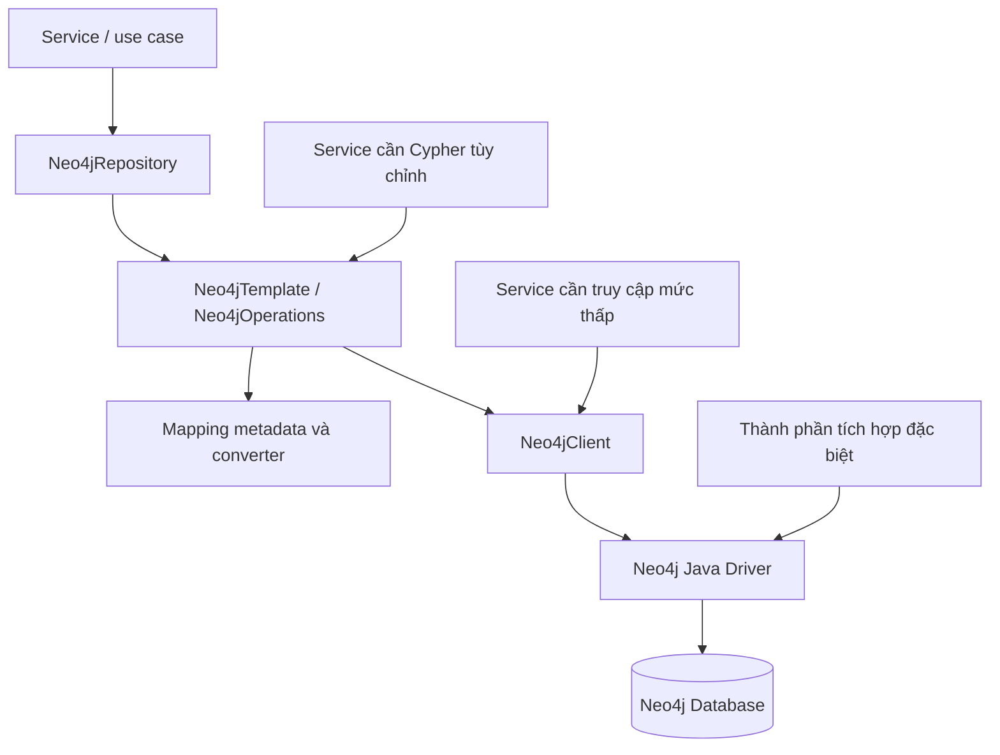

# Chuỗi thành phần repository → template → client → driver

Spring Data Neo4j (SDN) tổ chức việc truy cập đồ thị qua nhiều lớp API. Ở tầng ứng dụng, bạn thường gọi repository để thao tác với entity. Repository dựa trên các thao tác của `Neo4jTemplate`; template phối hợp cơ chế ánh xạ entity với `Neo4jClient`; client gửi câu lệnh và tham số xuống Neo4j Java Driver; driver quản lý kết nối và giao tiếp với máy chủ Neo4j.

Hiểu vai trò từng lớp giúp bạn chọn đúng điểm truy cập dữ liệu: repository cho nghiệp vụ thông thường, template khi cần điều khiển thao tác entity chi tiết hơn, client khi cần Cypher và kết quả tùy chỉnh, hoặc driver khi cần API mức thấp. Các lớp này tạo thành một chuỗi trừu tượng; ứng dụng có thể bắt đầu ở lớp phù hợp với nhu cầu thay vì luôn phải gọi lần lượt tất cả các API.

## 1. Nhìn tổng thể kiến trúc



Trong luồng repository, template xử lý các thao tác theo mô hình entity và sử dụng metadata ánh xạ để chuyển đổi dữ liệu. `Neo4jClient` cung cấp API truy vấn dựa trên driver, còn driver thực hiện giao tiếp với máy chủ. Sơ đồ thể hiện các lớp trách nhiệm chính; tùy điểm bắt đầu, một use case có thể dùng template hoặc client trực tiếp và bỏ qua lớp repository.

| Thành phần | Trách nhiệm chính | Khi nào nên dùng |
|---|---|---|
| `Neo4jRepository` | CRUD, phân trang/sắp xếp theo API hỗ trợ, derived query và truy vấn khai báo bằng `@Query` | Nghiệp vụ thao tác entity theo repository pattern |
| `Neo4jTemplate` | Thao tác entity theo API template, phối hợp metadata và mapping của SDN | Cần lưu, đọc, xóa hoặc thực hiện thao tác entity linh hoạt hơn repository |
| `Neo4jClient` | Gửi Cypher, bind tham số và ánh xạ record hoặc giá trị trả về | Truy vấn tùy chỉnh, dữ liệu tổng hợp, scalar, projection hoặc kết quả không phải entity đầy đủ |
| Neo4j Java Driver | Quản lý kết nối, session, transaction ở tầng driver và truyền lệnh tới máy chủ | Tích hợp mức thấp hoặc trường hợp cần API driver chuyên biệt |

## 2. Repository: điểm vào quen thuộc của tầng dữ liệu

Repository là API hướng miền nghiệp vụ. Bạn khai báo interface kế thừa `Neo4jRepository` với kiểu entity và kiểu định danh. SDN cung cấp phần triển khai để thực hiện các thao tác dữ liệu.

```java
import java.util.List;
import java.util.Optional;

import org.springframework.data.neo4j.repository.Neo4jRepository;
import org.springframework.data.neo4j.repository.query.Query;
import org.springframework.data.repository.query.Param;

public interface PersonRepository extends Neo4jRepository<Person, String> {

    Optional<Person> findByEmail(String email);

    List<Person> findByActiveTrue();

    @Query("""
        MATCH (p:Person)-[:KNOWS]->(friend:Person)
        WHERE p.email = $email
        RETURN friend
        """)
    List<Person> findFriendsByEmail(@Param("email") String email);
}
```

`findByEmail` và `findByActiveTrue` là derived query: SDN diễn giải tên phương thức dựa trên metadata entity để tạo truy vấn. `findFriendsByEmail` dùng Cypher tường minh vì nghiệp vụ cần đi qua relationship `KNOWS`. Trong cả hai trường hợp, kết quả có kiểu `Person`, nên SDN có thể ánh xạ node trả về thành entity.

Repository phù hợp khi API dữ liệu có thể diễn đạt bằng thao tác entity và truy vấn miền nghiệp vụ. Giữ repository gọn bằng cách đặt các phương thức liên quan tới một aggregate hoặc entity trong cùng interface. Service nên gọi repository để thực hiện use case, thay vì để controller tự xây dựng Cypher.

## 3. Template: thao tác entity linh hoạt hơn

`Neo4jTemplate` triển khai API `Neo4jOperations` và cung cấp thao tác ở mức entity. Nó hữu ích khi một use case cần điều khiển cách tìm, lưu hoặc xóa entity mà không phù hợp với một phương thức repository cụ thể.

```java
import java.util.Optional;

import org.springframework.data.neo4j.core.Neo4jTemplate;
import org.springframework.stereotype.Service;

@Service
public class PersonLookupService {

    private final Neo4jTemplate neo4jTemplate;

    public PersonLookupService(Neo4jTemplate neo4jTemplate) {
        this.neo4jTemplate = neo4jTemplate;
    }

    public Optional<Person> findPerson(String id) {
        return neo4jTemplate.findById(id, Person.class);
    }
}
```

Trong ví dụ, `findById` nhận định danh và kiểu entity đích. Template sử dụng thông tin mapping của `Person` để đọc node và chuyển dữ liệu thành đối tượng Java. Nhờ đó, service không phải tự đọc từng field từ record Cypher.

Template cũng cung cấp các thao tác lưu và xóa entity. Khi cần tạo hoặc cập nhật một entity, bạn có thể gọi `save` trên template; khi cần xóa, chọn API xóa phù hợp với mục tiêu và phiên bản SDN của dự án. Với thao tác CRUD đơn giản, repository thường diễn đạt ý định rõ hơn; template hữu ích khi cần ghép nhiều thao tác entity hoặc điều khiển chi tiết hơn.

## 4. Client: làm việc trực tiếp với Cypher và record

`Neo4jClient` là API truy vấn cấp thấp hơn template. Client cho phép viết Cypher, bind tham số và quyết định cách ánh xạ từng record. Đây là lựa chọn phù hợp khi kết quả là dữ liệu tổng hợp hoặc projection không tương ứng với một entity đầy đủ.

Ví dụ lấy tên bạn bè và số lượng bạn bè cho một người:

```java
import java.util.List;

import org.springframework.data.neo4j.core.Neo4jClient;
import org.springframework.stereotype.Repository;

record FriendCount(String name, long count) {
}

@Repository
public class PersonAnalyticsRepository {

    private final Neo4jClient neo4jClient;

    public PersonAnalyticsRepository(Neo4jClient neo4jClient) {
        this.neo4jClient = neo4jClient;
    }

    public List<FriendCount> countFriendsByPerson() {
        return neo4jClient.query("""
                MATCH (p:Person)-[:KNOWS]->(friend:Person)
                RETURN p.name AS name, count(friend) AS friendCount
                ORDER BY friendCount DESC
                """)
            .fetchAs(FriendCount.class)
            .mappedBy((typeSystem, record) -> new FriendCount(
                record.get("name").asString(),
                record.get("friendCount").asLong()))
            .all();
    }
}
```

Truy vấn trả về hai cột tổng hợp, không phải một node `Person`. `mappedBy` chuyển record thành DTO `FriendCount`. Nếu query nhận dữ liệu đầu vào, hãy bind tham số thay vì nối chuỗi:

```java
return neo4jClient.query("""
        MATCH (p:Person)-[:KNOWS]->(friend:Person)
        WHERE p.email = $email
        RETURN friend.name AS friendName
        """)
    .bind(email).to("email")
    .fetchAs(String.class)
    .mappedBy((typeSystem, record) -> record.get("friendName").asString())
    .all();
```

Bind tham số giúp tách dữ liệu đầu vào khỏi câu Cypher, tránh lỗi khi giá trị chứa ký tự đặc biệt và giảm nguy cơ chèn cú pháp ngoài ý muốn. Tên tham số trong `.to("email")` phải khớp với `$email` trong Cypher.

## 5. Driver: lớp giao tiếp với Neo4j

Neo4j Java Driver là thư viện chính thức để ứng dụng Java giao tiếp với máy chủ Neo4j. Trong ứng dụng Spring Boot dùng SDN, cấu hình kết nối thường được tạo tự động từ các thuộc tính như URI, username và password; SDN sử dụng driver đó cho các thao tác dữ liệu.

Driver cung cấp các khái niệm quan trọng:

- `Driver`: đối tượng quản lý kết nối và tài nguyên dùng chung; thường được tạo một lần và tái sử dụng trong ứng dụng.
- `Session`: đơn vị làm việc ở phía driver để chạy câu lệnh và quản lý transaction. Session không phải Neo4j-OGM `Session`.
- `Transaction`: nhóm các câu lệnh cần tuân theo tính nguyên tử; hoặc commit toàn bộ hoặc rollback khi thất bại.
- `Result`, `Record` và `Value`: biểu diễn kết quả truy vấn, từng bản ghi và từng giá trị trong record.

Ví dụ minh họa thao tác trực tiếp với driver:

```java
import org.neo4j.driver.Driver;
import org.neo4j.driver.Session;

public class Neo4jHealthCheck {

    private final Driver driver;

    public Neo4jHealthCheck(Driver driver) {
        this.driver = driver;
    }

    public long countPeople() {
        try (Session session = driver.session()) {
            return session.run("MATCH (p:Person) RETURN count(p) AS total")
                .single()
                .get("total")
                .asLong();
        }
    }
}
```

Đoạn mã minh họa cách mở và đóng driver session. Trong mã ứng dụng, hãy giữ `Driver` dùng chung theo vòng đời ứng dụng, còn session cần được đóng sau mỗi đơn vị công việc. Không giữ một driver session làm field dùng chung giữa các request hoặc thread. Khi dùng trực tiếp driver để ghi dữ liệu, bạn phải chủ động chọn API transaction phù hợp và ánh xạ kết quả; các tiện ích mapping entity và tích hợp transaction của SDN không tự áp dụng cho lệnh driver tự quản lý.

## 6. Một use case đi qua chuỗi thành phần

Giả sử nghiệp vụ cần tìm một người theo email, thêm một người bạn và trả về entity đã cập nhật. Nếu mô hình entity có relationship `KNOWS`, service có thể gọi repository trong một transaction Spring:

```java
import org.springframework.stereotype.Service;
import org.springframework.transaction.annotation.Transactional;

@Service
public class FriendshipService {

    private final PersonRepository personRepository;

    public FriendshipService(PersonRepository personRepository) {
        this.personRepository = personRepository;
    }

    @Transactional
    public Person addFriend(String ownerEmail, Person friend) {
        Person owner = personRepository.findByEmail(ownerEmail)
            .orElseThrow(() -> new IllegalArgumentException("Person not found"));

        owner.getFriends().add(friend);
        return personRepository.save(owner);
    }
}
```

Ở mức kiến trúc, luồng có thể được hiểu như sau:

1. Service bắt đầu use case và xác định ranh giới transaction bằng `@Transactional`.
2. `PersonRepository` nhận yêu cầu tìm và lưu entity.
3. Phần triển khai repository sử dụng các thao tác của SDN ở tầng template/operations.
4. Template phối hợp mapping entity và thực thi truy vấn thông qua client.
5. Client gửi Cypher và tham số xuống Neo4j Java Driver.
6. Driver giao tiếp với Neo4j; kết quả được chuyển ngược lên các lớp trên để trả về entity.

Ví dụ giả định entity `Person` đã có collection relationship `friends` được ánh xạ bằng `@Relationship` và phương thức truy cập phù hợp. Trong hệ thống thực tế, cần xác định rõ phía sở hữu cập nhật, hướng relationship và cách lưu entity theo mô hình đồ thị. Một truy vấn thêm relationship trực tiếp bằng Cypher có thể phù hợp hơn nếu nghiệp vụ chỉ cần cập nhật cạnh mà không cần tải toàn bộ đồ thị entity.

## 7. Transaction xuyên suốt các lớp

Transaction là ranh giới của nghiệp vụ, thường được đặt ở service. Với API imperative, `@Transactional` kết hợp transaction manager Neo4j của SDN giúp các thao tác SDN tham gia cùng transaction Spring. Template và client được sử dụng bên trong ranh giới đó sẽ làm việc trên transaction được quản lý tương ứng.

Một số nguyên tắc cần nhớ:

- Đặt transaction quanh nghiệp vụ cần tính nguyên tử, thay vì mở transaction riêng cho từng câu lệnh nhỏ.
- Không giả định một lệnh driver tự mở session bên ngoài transaction Spring sẽ tự tham gia transaction đang hoạt động. Hãy dùng cơ chế tích hợp phù hợp hoặc quản lý transaction driver một cách tường minh.
- Không trộn lẫn transaction imperative và reactive. Với luồng reactive, dùng API reactive và transaction manager tương ứng, giữ nguyên chuỗi publisher để transaction context được truyền đúng.
- Kiểm thử cả trường hợp thành công và trường hợp một bước thất bại để xác nhận rollback.

Ví dụ, nếu một use case tạo node rồi tạo relationship nhưng bước thứ hai thất bại, transaction đúng phải đưa cơ sở dữ liệu về trạng thái trước use case. Nếu mỗi thao tác commit độc lập, đồ thị có thể còn lại node mồ côi hoặc dữ liệu chỉ được ghi một phần.

## 8. Chọn lớp API phù hợp

| Nhu cầu | Lớp API nên bắt đầu | Lý do |
|---|---|---|
| Lưu, tìm, xóa entity theo ID hoặc thuộc tính | Repository | API ngắn gọn, hướng miền nghiệp vụ |
| Truy vấn entity có Cypher riêng | Repository với `@Query` | Giữ truy vấn trong hợp đồng repository và vẫn nhận entity đã ánh xạ |
| Ghép nhiều thao tác entity hoặc cần API entity linh hoạt | `Neo4jTemplate` | Làm việc trực tiếp với entity và metadata mapping |
| Trả về số liệu tổng hợp, scalar hoặc DTO tùy chỉnh | `Neo4jClient` | Chủ động ánh xạ record mà không cần dựng entity đầy đủ |
| Dùng tính năng đặc thù của driver hoặc tích hợp ngoài SDN | Neo4j Java Driver | Truy cập API giao tiếp ở mức thấp |

Không nên hạ xuống driver chỉ vì có thể viết Cypher trực tiếp. Repository, template và client đã cung cấp các mức trừu tượng phù hợp cho phần lớn ứng dụng Spring. Dùng driver trực tiếp đồng nghĩa với việc bạn chịu trách nhiệm nhiều hơn về session, transaction, chuyển đổi kiểu và xử lý kết quả.

## 9. Lỗi thiết kế thường gặp

| Lỗi | Hệ quả | Cách khắc phục |
|---|---|---|
| Để controller gọi driver và viết Cypher | Logic truy vấn và chi tiết kết nối rải rác ở tầng giao diện | Đưa truy vấn vào repository hoặc lớp truy cập dữ liệu chuyên biệt |
| Dùng repository cho mọi kết quả tổng hợp | Khó biểu đạt kết quả không tương ứng entity, mapping không cần thiết | Dùng `Neo4jClient` và DTO projection |
| Dùng client rồi tự ánh xạ entity phức tạp trong nhiều nơi | Mapping lặp lại và dễ thiếu relationship | Dùng repository hoặc template khi cần entity graph |
| Dùng driver trực tiếp trong khi kỳ vọng transaction Spring tự quản lý | Các câu lệnh có thể chạy ngoài transaction dự kiến | Dùng API tích hợp transaction hoặc quản lý transaction driver tường minh |
| Giữ `Session` của driver dùng chung | Vi phạm vòng đời và tính an toàn luồng của session | Tạo session theo đơn vị công việc và đóng sau khi dùng |
| Nhầm driver `Session` với OGM `Session` | Dùng sai API và kỳ vọng sai về mapping | Kiểm tra package import và phiên bản kiến trúc đang dùng |

## 10. Tự kiểm tra

1. Vì sao `Neo4jRepository` phù hợp với CRUD và derived query của entity?
2. `Neo4jTemplate` bổ sung điều gì khi so với repository?
3. Khi truy vấn trả về `count(friend)` hoặc một DTO tổng hợp, vì sao `Neo4jClient` thường phù hợp?
4. Neo4j Java Driver chịu trách nhiệm gì trong chuỗi truy cập dữ liệu?
5. Vì sao một `Session` của driver cần được đóng sau khi sử dụng và không nên giữ làm đối tượng dùng chung?
6. Điều gì có thể xảy ra nếu lệnh driver trực tiếp không tham gia transaction Spring của use case?

Khi phân biệt được bốn lớp repository, template, client và driver, bạn có thể chọn đúng mức trừu tượng cho từng thao tác. Ứng dụng giữ được mô hình entity rõ ràng ở tầng nghiệp vụ, vẫn khai thác Cypher khi cần và chỉ sử dụng driver trực tiếp trong những trường hợp thực sự cần quyền kiểm soát thấp hơn.
