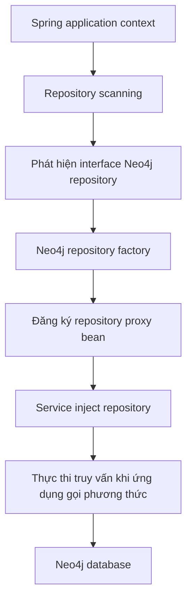

# Kích hoạt @EnableNeo4jRepositories và giới hạn package được quét

Spring Data Neo4j tạo các repository bean từ những interface kế thừa `Neo4jRepository` hoặc các kiểu repository Spring Data tương ứng. Để Spring tìm đúng interface và tạo proxy cho chúng, ứng dụng cần một cơ chế đăng ký repository. Trong Spring Boot, cơ chế tự động cấu hình thường đã thực hiện việc này theo package gốc của ứng dụng. Khi cần kiểm soát rõ phạm vi, ta dùng `@EnableNeo4jRepositories` và chỉ định package chứa repository Neo4j.

Bài học thuộc module **SPRING_DATA_NEO4J**, tập trung vào kiến trúc cấu hình tầng dữ liệu đồ thị: node entity, relationship, repository và truy vấn Cypher. Ví dụ xuyên suốt dùng `Person`, `Movie` và `ACTED_IN`; phần cấu hình sẽ giúp Spring đăng ký đúng repository làm việc với các node này, đồng thời tránh quét nhầm repository của những persistence store khác.

## 1. Repository được phát hiện và tạo bean như thế nào?

Một repository Spring Data thường là interface. Ví dụ:

```java
import org.springframework.data.neo4j.repository.Neo4jRepository;

public interface MovieRepository extends Neo4jRepository<Movie, Long> {
}
```

Ứng dụng không cần tự viết lớp triển khai `MovieRepository`. Khi repository infrastructure được kích hoạt, Spring Data quét package được cấu hình, nhận diện interface phù hợp, tạo repository factory và đăng ký proxy dưới dạng bean. Khi một service inject `MovieRepository`, Spring cung cấp proxy đó; các lời gọi phương thức được chuyển đến cơ chế thực thi repository của SDN.



Quá trình quét diễn ra khi khởi tạo application context. Nó tìm interface trong classpath và tạo bean; nó không duyệt toàn bộ node hoặc relationship trong database. Truy vấn dữ liệu chỉ diễn ra khi ứng dụng gọi repository hoặc API truy cập dữ liệu tương ứng.

`@EnableNeo4jRepositories` thuộc package `org.springframework.data.neo4j.repository.config`. Annotation này bật cơ chế đăng ký repository Neo4j và cho phép cấu hình phạm vi package được quét cùng một số tùy chọn của repository infrastructure.

## 2. Khi nào cần @EnableNeo4jRepositories?

Trong ứng dụng Spring Boot thông thường, nếu Spring Data Neo4j có trên classpath và cấu hình kết nối Neo4j hợp lệ, auto-configuration thường tự đăng ký repository trong các package thuộc phạm vi auto-configuration của ứng dụng. Phạm vi mặc định thường bắt đầu từ package chứa lớp `@SpringBootApplication` và đi xuống các package con.

Ví dụ cấu trúc:

```text
com.example.catalog
├── CatalogApplication.java       (@SpringBootApplication)
├── domain
│   ├── Movie.java
│   └── Person.java
├── service
│   └── MovieService.java
└── repository
    ├── MovieRepository.java
    └── PersonRepository.java
```

Với cấu trúc này, các repository nằm dưới package gốc `com.example.catalog` thường đã nằm trong phạm vi quét mặc định. Bạn không cần thêm `@EnableNeo4jRepositories` chỉ để lặp lại cấu hình mặc định.

Annotation trở nên hữu ích khi:

- Repository nằm ngoài package gốc mà Spring Boot đang dùng để tìm repository.
- Dự án chia repository theo module hoặc theo bounded context và muốn chỉ rõ package được quản lý.
- Ứng dụng có nhiều Spring Data module, chẳng hạn Neo4j và JPA, và cần tách package repository theo từng store.
- Một cấu hình persistence riêng cần kiểm soát chính xác repository nào thuộc Neo4j.

Khi tự khai báo `@EnableNeo4jRepositories`, hãy xác định một phạm vi quét rõ ràng và tránh tạo nhiều cấu hình cùng quét một tập interface. Trong ứng dụng Boot, hãy kiểm tra cách auto-configuration và cấu hình chủ động phối hợp để mỗi repository chỉ được đăng ký một lần.

## 3. Cấu hình bằng basePackages

Thuộc tính `basePackages` nhận tên package Java cần quét. Có thể truyền một package hoặc nhiều package:

```java
import org.springframework.context.annotation.Configuration;
import org.springframework.data.neo4j.repository.config.EnableNeo4jRepositories;

@Configuration
@EnableNeo4jRepositories(basePackages = {
    "com.example.catalog.graph.repository",
    "com.example.identity.graph.repository"
})
public class Neo4jRepositoryConfiguration {
}
```

Các giá trị là tên package Java dùng dấu chấm, không phải đường dẫn thư mục, không có phần mở rộng `.java` và không phải tên class. Ví dụ `com.example.catalog.graph.repository` tương ứng với package có khai báo:

```java
package com.example.catalog.graph.repository;
```

Spring quét package đã chỉ định và các package con của nó. Vì vậy, nếu chỉ định `com.example.catalog.graph.repository`, các interface trong `com.example.catalog.graph.repository.movie` cũng nằm trong phạm vi quét.

### 3.1. basePackages và value

`value` là alias của `basePackages`, do đó hai cách viết sau có cùng mục đích:

```java
@EnableNeo4jRepositories("com.example.catalog.graph.repository")
```

```java
@EnableNeo4jRepositories(
    basePackages = "com.example.catalog.graph.repository"
)
```

Nên dùng `basePackages` khi đọc cấu hình vì tên thuộc tính diễn đạt rõ ý nghĩa. Không cần truyền đồng thời `value` và `basePackages` cho cùng một mục đích.

### 3.2. Nhiều package và phạm vi quá rộng

Có thể truyền nhiều package dưới dạng mảng:

```java
@EnableNeo4jRepositories(basePackages = {
    "com.example.catalog.graph.repository",
    "com.example.people.graph.repository"
})
```

Tránh chỉ định package gốc quá rộng như `com.example` nếu bên dưới có repository cho nhiều store. Khi đó Neo4j repository scanner có thể gặp các interface không thuộc phạm vi mong muốn; trong dự án có nhiều Spring Data module, việc phân định store và repository có thể trở nên khó kiểm soát. Hãy chỉ định các package repository Neo4j cụ thể.

## 4. Cấu hình an toàn khi đổi package bằng basePackageClasses

`basePackageClasses` cho phép chỉ định một hoặc nhiều class làm mốc. Spring dùng package chứa các class đó làm package cần quét. Cách này tránh viết tên package dưới dạng chuỗi, nhờ đó việc đổi package trong IDE hoặc refactor source code ít có nguy cơ làm cấu hình bị lỗi âm thầm.

Tạo một interface rỗng làm package marker trong cùng package với repository:

```java
package com.example.catalog.graph.repository;

/** Marker type: package này chứa các Neo4j repository. */
public interface CatalogGraphRepositoryPackage {
}
```

Sau đó dùng marker trong cấu hình:

```java
import org.springframework.context.annotation.Configuration;
import org.springframework.data.neo4j.repository.config.EnableNeo4jRepositories;

@Configuration
@EnableNeo4jRepositories(basePackageClasses = {
    CatalogGraphRepositoryPackage.class,
    PeopleGraphRepositoryPackage.class
})
public class Neo4jRepositoryConfiguration {
}
```

Mỗi marker phải nằm trong package mà bạn muốn quét. Marker không phải repository và không cần kế thừa `Neo4jRepository`; nó chỉ xác định package tại thời điểm biên dịch. Có thể dùng chính một repository interface làm mốc, nhưng marker riêng thể hiện mục đích cấu hình rõ hơn và không phụ thuộc vào việc tên repository cụ thể có thay đổi hay không.

Nếu chỉ có một package, có thể đặt lớp cấu hình ngay trong package đó và dùng `@EnableNeo4jRepositories` mà không truyền `basePackages` hoặc `basePackageClasses`. Khi không khai báo package, Spring dùng package của lớp cấu hình được đánh dấu.

## 5. Ví dụ hoàn chỉnh với MovieRepository và PersonRepository

Giả sử dự án có cấu trúc:

```text
com.example.catalog
├── CatalogApplication.java
├── graph
│   ├── domain
│   │   ├── Movie.java
│   │   └── Person.java
│   └── repository
│       ├── CatalogGraphRepositoryPackage.java
│       ├── MovieRepository.java
│       └── PersonRepository.java
└── service
    └── MovieCatalogService.java
```

Repository cho phim:

```java
package com.example.catalog.graph.repository;

import java.util.Optional;

import org.springframework.data.neo4j.repository.Neo4jRepository;

import com.example.catalog.graph.domain.Movie;

public interface MovieRepository extends Neo4jRepository<Movie, Long> {

    Optional<Movie> findByTitleAndReleased(String title, Integer released);
}
```

Repository cho người:

```java
package com.example.catalog.graph.repository;

import java.util.Optional;

import org.springframework.data.neo4j.repository.Neo4jRepository;

import com.example.catalog.graph.domain.Person;

public interface PersonRepository extends Neo4jRepository<Person, Long> {

    Optional<Person> findByName(String name);
}
```

Marker type:

```java
package com.example.catalog.graph.repository;

public interface CatalogGraphRepositoryPackage {
}
```

Cấu hình repository:

```java
package com.example.catalog.config;

import org.springframework.context.annotation.Configuration;
import org.springframework.data.neo4j.repository.config.EnableNeo4jRepositories;

import com.example.catalog.graph.repository.CatalogGraphRepositoryPackage;

@Configuration
@EnableNeo4jRepositories(basePackageClasses = CatalogGraphRepositoryPackage.class)
public class Neo4jRepositoryConfiguration {
}
```

Service có thể inject các repository đã được đăng ký:

```java
package com.example.catalog.service;

import org.springframework.stereotype.Service;

import com.example.catalog.graph.repository.MovieRepository;
import com.example.catalog.graph.repository.PersonRepository;

@Service
public class MovieCatalogService {

    private final MovieRepository movieRepository;
    private final PersonRepository personRepository;

    public MovieCatalogService(
            MovieRepository movieRepository,
            PersonRepository personRepository) {
        this.movieRepository = movieRepository;
        this.personRepository = personRepository;
    }
}
```

Lớp `Neo4jRepositoryConfiguration` cũng phải được Spring phát hiện, ví dụ nằm dưới package gốc của lớp `@SpringBootApplication` hoặc được import tường minh. `@EnableNeo4jRepositories` đăng ký repository interface; nó không thay thế `@ComponentScan` để tìm service hoặc lớp cấu hình thông thường.

## 6. Những tùy chọn quét cần biết

Ngoài package gốc, `@EnableNeo4jRepositories` còn cung cấp các thuộc tính để điều chỉnh việc phát hiện repository. Chỉ nên dùng khi có yêu cầu cụ thể:

| Thuộc tính | Mục đích |
|---|---|
| `basePackages` / `value` | Chỉ định package bằng tên chuỗi |
| `basePackageClasses` | Chỉ định package thông qua class marker |
| `includeFilters` | Thêm điều kiện lọc interface được xem xét trong phạm vi quét |
| `excludeFilters` | Loại một số kiểu khỏi phạm vi quét |
| `considerNestedRepositories` | Cho phép xem xét repository interface lồng bên trong kiểu khác; mặc định không bật |
| `repositoryImplementationPostfix` | Chỉ định hậu tố dùng để tìm phần triển khai tùy chỉnh của repository |
| `queryLookupStrategy` | Chọn cách Spring Data phân giải truy vấn repository |
| `transactionManagerRef` | Chỉ định bean transaction manager cho repository khi cần phân biệt nhiều manager |

Các thuộc tính lọc dùng kiểu filter của Spring Framework. Chúng hữu ích trong cấu hình đặc biệt, nhưng với ứng dụng thông thường, giới hạn package bằng `basePackages` hoặc `basePackageClasses` thường dễ đọc và ít gây bất ngờ hơn.

Repository interface lồng trong một class không được xem xét theo mặc định. Hãy ưu tiên repository top-level để cấu trúc dễ tìm và tránh phải bật `considerNestedRepositories`. Nếu có interface nền dùng chung cho nhiều repository, đánh dấu interface nền bằng `@NoRepositoryBean` để Spring Data không tạo repository bean trực tiếp từ interface chưa phải repository cụ thể:

```java
import org.springframework.data.repository.NoRepositoryBean;
import org.springframework.data.neo4j.repository.Neo4jRepository;

@NoRepositoryBean
public interface BaseGraphRepository<T, ID> extends Neo4jRepository<T, ID> {
    // Các phương thức dùng chung cho repository cụ thể.
}
```

`@NoRepositoryBean` thuộc Spring Data Commons. Các interface cụ thể như `MovieRepository extends BaseGraphRepository<Movie, Long>` vẫn có thể được phát hiện và tạo bean.

## 7. Tách phạm vi Neo4j và JPA trong ứng dụng nhiều store

Một ứng dụng có thể dùng Neo4j cho dữ liệu đồ thị và PostgreSQL/MySQL cho dữ liệu quan hệ. Khi đó nên tổ chức package theo store:

```text
com.example
├── graph
│   ├── domain
│   └── repository
│       ├── MovieGraphRepository.java
│       └── PersonGraphRepository.java
├── relational
│   ├── entity
│   └── repository
│       ├── AccountJpaRepository.java
│       └── AuditJpaRepository.java
└── config
    ├── Neo4jRepositoryConfiguration.java
    └── JpaRepositoryConfiguration.java
```

Mỗi cấu hình bật repository cho đúng store:

```java
@Configuration
@EnableNeo4jRepositories(
    basePackages = "com.example.graph.repository"
)
public class Neo4jRepositoryConfiguration {
}
```

```java
@Configuration
@EnableJpaRepositories(
    basePackages = "com.example.relational.repository"
)
public class JpaRepositoryConfiguration {
}
```

Hai annotation có package và repository factory riêng. Giữ package tách biệt giúp tránh cấu hình một scanner trên toàn bộ `com.example` rồi phải suy luận repository nào thuộc Neo4j, repository nào thuộc JPA. Với nhiều transaction manager, cần cấu hình tham chiếu manager tương ứng ở từng nơi và kiểm tra transaction của service dùng đúng store.

## 8. Kiểm tra repository scan khi ứng dụng khởi động

Khi một service không inject được repository, hãy kiểm tra theo thứ tự:

1. **Kiểm tra package khai báo.** Package trong `basePackages` phải trùng với package Java thực tế, viết đúng chữ hoa/chữ thường và không dùng đường dẫn hệ thống.
2. **Kiểm tra vị trí marker.** Với `basePackageClasses`, package chứa marker phải là package bạn muốn quét.
3. **Kiểm tra kiểu interface.** Repository cần kế thừa `Neo4jRepository` hoặc abstraction Spring Data phù hợp; interface nền dùng chung cần `@NoRepositoryBean`.
4. **Kiểm tra cấu hình có được nạp không.** Lớp cấu hình chứa `@EnableNeo4jRepositories` phải nằm trong component scan hoặc được import.
5. **Kiểm tra nhiều scanner.** Xác nhận cấu hình Neo4j và JPA không cùng quét một vùng repository ngoài ý muốn.
6. **Đọc log khởi động.** Bật log phù hợp cho package repository configuration khi cần để xem số repository được phát hiện và nguyên nhân interface bị bỏ qua.
7. **Kiểm tra cấu hình kết nối riêng.** Việc tìm thấy repository bean không chứng minh kết nối Neo4j hoạt động; kiểm tra driver, URI, xác thực và transaction khi thực thi thao tác dữ liệu.

Một số dấu hiệu và nguyên nhân thường gặp:

| Dấu hiệu | Nguyên nhân có thể | Hướng xử lý |
|---|---|---|
| `NoSuchBeanDefinitionException` khi inject repository | Package không nằm trong phạm vi scan hoặc lớp cấu hình không được nạp | Kiểm tra `basePackages`, marker và component scan |
| Repository không xuất hiện trong log khởi động | Interface nằm ngoài package hoặc không phải repository hợp lệ | Kiểm tra package, kiểu kế thừa và `@NoRepositoryBean` |
| Lỗi repository bean trùng hoặc xung đột | Nhiều cấu hình đăng ký cùng interface | Thu hẹp package và chỉ định một cấu hình sở hữu repository |
| Repository JPA xuất hiện trong vùng cấu hình Neo4j | Package dùng chung cho nhiều store | Tách package và cấu hình scanner riêng |
| Repository bean tồn tại nhưng truy vấn thất bại | Lỗi kết nối, transaction hoặc Cypher khi chạy | Kiểm tra cấu hình Neo4j và lỗi thực thi riêng biệt |

## 9. Bài tập thực hành

1. Tạo `MovieRepository` và `PersonRepository` trong package `com.example.catalog.graph.repository`.
2. Tạo marker `CatalogGraphRepositoryPackage` trong cùng package và cấu hình `basePackageClasses`.
3. Chuyển hai repository sang một package con `com.example.catalog.graph.repository.catalog`; xác nhận package cha vẫn quét được package con.
4. Đặt một repository JPA ở `com.example.catalog.relational.repository`, sau đó cấu hình `@EnableJpaRepositories` với package riêng.
5. Tạo interface nền `BaseGraphRepository` và đánh dấu `@NoRepositoryBean`; xác nhận Spring chỉ tạo bean cho các repository cụ thể.
6. Cố ý đặt một repository ngoài package được quét, quan sát lỗi inject, rồi sửa cấu hình.

Khi hoàn thành, bạn cần giải thích được repository scan xảy ra lúc nào, package nào được quét, vì sao marker class giúp cấu hình an toàn hơn và cách tách repository Neo4j khỏi repository của store khác. Đây là nền tảng để tổ chức cấu hình Spring Data Neo4j rõ ràng khi ứng dụng phát triển thành nhiều module và nhiều miền nghiệp vụ.
