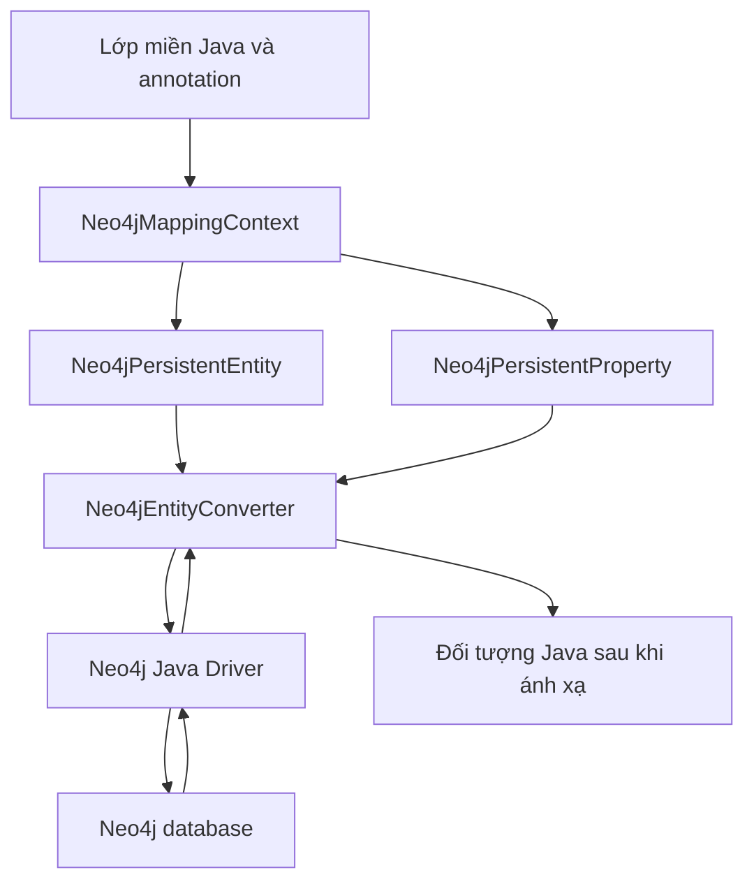

# Neo4jMappingContext và metadata của mô hình miền

## Mục tiêu bài học

Sau bài này, bạn có thể:

- Giải thích vai trò của `Neo4jMappingContext` trong Spring Data Neo4j (SDN).
- Phân biệt metadata của entity, metadata của property và metadata của relationship.
- Hiểu cách các annotation trên mô hình Java được chuyển thành mô tả node, label, property và relationship.
- Mô tả cách SDN dùng metadata để đọc dữ liệu từ Neo4j và ghi đối tượng Java xuống đồ thị.
- Nhận biết giới hạn của mapping metadata và các ảnh hưởng của mô hình relationship đến phạm vi dữ liệu được ánh xạ.

## 1. Metadata mô hình miền là gì?

Trong ứng dụng Java, mô hình miền thường được biểu diễn bằng các lớp như `Person`, `Product`, `Order` hoặc `Company`. Mỗi lớp có thuộc tính và có thể tham chiếu đến các lớp khác. Neo4j lưu các thực thể đó dưới dạng node, property và relationship.

Để chuyển đổi giữa hai cách biểu diễn, SDN cần biết nhiều thông tin hơn tên lớp Java. Chẳng hạn:

- Lớp `Person` tương ứng với node có label nào?
- Trường `displayName` được lưu thành property nào?
- Trường `friends` là property thông thường hay relationship?
- Relationship có kiểu gì, hướng nào và kết nối đến loại node nào?
- Thuộc tính nào là ID, thuộc tính nào dùng optimistic locking?
- Khi đọc node, SDN cần gọi constructor nào và chuyển đổi kiểu dữ liệu ra sao?

Tập thông tin mô tả cách lớp Java tương ứng với đồ thị Neo4j được gọi là **mapping metadata**. Metadata cho biết cách ánh xạ mô hình miền; nó không phải dữ liệu nghiệp vụ của từng đối tượng và cũng không phải bản sao của toàn bộ schema đang tồn tại trong cơ sở dữ liệu.

Ví dụ, một đối tượng `Person` có thể tương ứng với node `(:Person)`, property `full_name` và các relationship `KNOWS` hướng ra ngoài. Metadata giúp SDN hiểu cách tạo hoặc đọc cấu trúc đó mà không cần viết thủ công toàn bộ phần chuyển đổi.

## 2. Neo4jMappingContext đảm nhiệm điều gì?

`Neo4jMappingContext` là thành phần của SDN triển khai cơ chế `MappingContext` của Spring Data cho Neo4j. Nó thu thập, xây dựng và quản lý metadata của các kiểu miền được ánh xạ.

Có thể hiểu vai trò của nó qua ba nhiệm vụ:

1. **Nhận diện kiểu miền:** xác định lớp Java nào được quản lý như một node hoặc một lớp mô tả relationship.
2. **Xây dựng mô tả:** phân tích annotation, kiểu dữ liệu, trường định danh, thuộc tính và liên kết để tạo metadata.
3. **Cung cấp metadata:** đưa mô tả đó cho các thành phần khác của SDN, đặc biệt là bộ chuyển đổi entity và các API truy cập dữ liệu.

Các kiểu metadata quan trọng gồm:

| Kiểu | Ý nghĩa |
| --- | --- |
| `Neo4jPersistentEntity` | Mô tả một kiểu miền được quản lý, bao gồm label, định danh, property và relationship |
| `Neo4jPersistentProperty` | Mô tả một thuộc tính Java và cách thuộc tính đó tham gia ánh xạ |
| `NodeDescription` | Mô tả node trong đồ thị, gồm label, property và các relationship có thể đi tới |
| `RelationshipDescription` | Mô tả liên kết giữa kiểu node nguồn và kiểu node đích, cùng thông tin relationship properties nếu có |

`Neo4jPersistentEntity` kế thừa các khả năng mô tả entity của Spring Data và bổ sung thông tin dành cho Neo4j. `Neo4jPersistentProperty` bổ sung thông tin về property đồ thị, ID, association và các đặc điểm riêng của SDN.

Trong ứng dụng Spring Boot sử dụng cấu hình SDN thông thường, mapping context được cấu hình trong Spring container. Nhà phát triển chủ yếu khai báo mô hình miền và repository. Việc tự tạo một `Neo4jMappingContext` riêng thường chỉ cần thiết khi có yêu cầu cấu hình mapping chuyên biệt.

## 3. Annotation tạo nên metadata của mô hình miền

Annotation trên lớp và thuộc tính là nguồn thông tin quan trọng để mapping context xây dựng metadata.

### 3.1. @Node xác định loại node và label

`@Node` đánh dấu một lớp là kiểu miền được quản lý và chỉ định label dùng để ánh xạ node:

```java
import org.springframework.data.neo4j.core.schema.Node;

@Node("Person")
public class Person {
    // Các thuộc tính được ánh xạ ở bên dưới
}
```

Trong ví dụ, lớp `Person` được ánh xạ với node mang label `Person`. Nếu không khai báo label, SDN dùng tên lớp đơn giản làm primary label.

Một lớp cũng có thể sử dụng nhiều label:

```java
@Node(labels = {"Person", "Auditable"}, primaryLabel = "Person")
public class Person {
    // ...
}
```

`Person` là primary label; `Auditable` là additional label. Primary label nên phản ánh loại miền cụ thể nhất của lớp. Các label tĩnh này được dùng khi SDN đọc và ghi node.

`@Node` không bắt buộc trong mọi trường hợp để mapping một POJO, nhưng được khuyến nghị vì giúp mapping context nhận diện và tiền xử lý kiểu miền. Nếu không có annotation này, POJO vẫn có thể được ánh xạ; metadata có thể phải được xây dựng khi đối tượng được lưu lần đầu, làm phát sinh thêm chi phí ở lần sử dụng đầu tiên.

### 3.2. @Id và @GeneratedValue xác định metadata định danh

Mỗi entity node cần một trường định danh:

```java
import org.springframework.data.neo4j.core.schema.GeneratedValue;
import org.springframework.data.neo4j.core.schema.Id;
import org.springframework.data.neo4j.core.schema.Node;

@Node("Person")
public class Person {

    @Id
    @GeneratedValue
    private Long id;

    private String name;
}
```

Mapping metadata đánh dấu `id` là trường định danh của entity. `@GeneratedValue` mô tả chiến lược tạo ID. Với ví dụ trên, SDN dùng cơ chế internal ID mặc định của Neo4j.

Cần phân biệt trường ID nội bộ với property thông thường trên node. Khi dùng internal ID, trường này phục vụ định danh và ánh xạ, không được lưu như một property có tên `id` trên node. Nếu muốn một mã UUID hoặc business ID được lưu thành property, cần chọn chiến lược ID tương ứng.

### 3.3. @Property ánh xạ tên thuộc tính

Theo mặc định, tên trường Java được dùng làm tên property trong Neo4j. `@Property` cho phép chỉ định tên khác:

```java
import org.springframework.data.neo4j.core.schema.Property;

@Property("display_name")
private String displayName;
```

Metadata ghi nhận rằng trường Java `displayName` tương ứng với property `display_name`. Điều này hữu ích khi ứng dụng dùng tên Java theo quy ước riêng nhưng cần tương thích với dữ liệu đồ thị đã có.

Các kiểu đơn giản như chuỗi, số, boolean, ngày giờ hoặc kiểu có converter phù hợp thường được ánh xạ thành property. Một trường tham chiếu đến entity khác hoặc collection của entity thường được xem là association và cần được mô tả như relationship.

### 3.4. @Relationship mô tả association giữa các node

`@Relationship` cung cấp kiểu và hướng của liên kết:

```java
import java.util.ArrayList;
import java.util.List;

import org.springframework.data.neo4j.core.schema.Relationship;

@Relationship(type = "KNOWS", direction = Relationship.Direction.OUTGOING)
private List<Person> friends = new ArrayList<>();
```

Metadata của thuộc tính này khác với metadata của một property thông thường:

- Tên trường Java là `friends`.
- Kiểu relationship trong Neo4j là `KNOWS`.
- Hướng relationship là `OUTGOING`.
- Kiểu node đích là `Person`.
- Giá trị Java là một collection các đối tượng `Person`.

Mặc định, hướng relationship của SDN là `OUTGOING`. Khai báo hướng tường minh giúp người đọc mô hình nhận biết đúng chiều của liên kết. Tên trường Java không quyết định kiểu relationship trong Neo4j; thuộc tính `type` của annotation mới đảm nhiệm việc đó.

### 3.5. @RelationshipProperties và @TargetNode mô tả dữ liệu trên relationship

Nếu relationship có property riêng, SDN cần metadata cho một lớp mô tả relationship:

```java
import org.springframework.data.neo4j.core.schema.RelationshipId;
import org.springframework.data.neo4j.core.schema.RelationshipProperties;
import org.springframework.data.neo4j.core.schema.TargetNode;

@RelationshipProperties
public class Membership {

    @RelationshipId
    private Long id;

    private String role;

    @TargetNode
    private Person member;

    protected Membership() {
    }

    public Membership(String role, Person member) {
        this.role = role;
        this.member = member;
    }
}
```

`@RelationshipProperties` đánh dấu lớp chứa metadata của relationship. Trường `role` là property trên relationship, còn `@TargetNode` xác định entity ở đầu còn lại. Lớp này cần đúng một trường `@TargetNode` để chỉ ra node đích theo ngữ cảnh của relationship.

`@RelationshipId` cung cấp nơi lưu định danh nội bộ của relationship để SDN theo dõi và cập nhật liên kết an toàn. Đây là thông tin kỹ thuật phục vụ ánh xạ, không phải mã nghiệp vụ của membership.

Một entity có thể khai báo collection của lớp này:

```java
import java.util.ArrayList;
import java.util.List;

import org.springframework.data.annotation.Version;
import org.springframework.data.neo4j.core.schema.Id;
import org.springframework.data.neo4j.core.schema.Node;
import org.springframework.data.neo4j.core.schema.Relationship;

@Node("Group")
public class Group {

    @Id
    private String code;

    @Version
    private Long version;

    @Relationship(type = "HAS_MEMBER", direction = Relationship.Direction.OUTGOING)
    private List<Membership> members = new ArrayList<>();
}
```

Metadata lúc này mô tả đường đi từ `Group` qua relationship `HAS_MEMBER`, mỗi relationship mang property `role` và trỏ đến một node `Person`.

## 4. Ví dụ metadata được hình thành từ một mô hình miền

Xét mô hình rút gọn sau:

```java
import java.util.ArrayList;
import java.util.List;

import org.springframework.data.neo4j.core.schema.GeneratedValue;
import org.springframework.data.neo4j.core.schema.Id;
import org.springframework.data.neo4j.core.schema.Node;
import org.springframework.data.neo4j.core.schema.Property;
import org.springframework.data.neo4j.core.schema.Relationship;

@Node("Person")
public class Person {

    @Id
    @GeneratedValue
    private Long id;

    @Property("full_name")
    private String name;

    @Relationship(type = "KNOWS", direction = Relationship.Direction.OUTGOING)
    private List<Person> friends = new ArrayList<>();

    protected Person() {
    }

    public Person(String name) {
        this.name = name;
    }
}
```

Từ lớp Java này, metadata có thể được diễn giải như sau:

| Thành phần Java | Metadata SDN ghi nhận | Cách biểu diễn trong Neo4j |
| --- | --- | --- |
| Lớp `Person` | Kiểu node, primary label `Person` | Node mang label `Person` |
| Trường `id` | Định danh, generator nội bộ | Internal ID do Neo4j quản lý |
| Trường `name` | Graph property, tên lưu `full_name` | Property `full_name` |
| Trường `friends` | Association, kiểu `KNOWS`, hướng outgoing, đích `Person` | Relationship `KNOWS` nối đến node `Person` |

Ví dụ này cho thấy mapping context không chỉ đọc tên trường. Nó phân biệt trường nào trở thành property, trường nào là định danh và trường nào mô tả relationship. Đây là cơ sở để SDN tạo câu lệnh lưu và diễn giải kết quả truy vấn.

## 5. Metadata được dùng trong quá trình đọc và ghi như thế nào?

Mapping context không tự thực hiện mọi thao tác truy cập cơ sở dữ liệu. Nó cung cấp metadata cho các thành phần thực hiện việc chuyển đổi.



Khi ghi dữ liệu:

1. Repository hoặc `Neo4jTemplate` nhận entity từ ứng dụng.
2. SDN tra cứu metadata tương ứng với kiểu entity.
3. Bộ chuyển đổi đọc ID, graph properties và các association từ entity.
4. SDN tạo dữ liệu cần thiết cho node và relationship, sau đó driver gửi thao tác đến Neo4j.
5. Kết quả lưu được dùng để đồng bộ các giá trị do cơ sở dữ liệu hoặc generator tạo ra.

Khi đọc dữ liệu:

1. Neo4j trả về record chứa node, relationship và property theo truy vấn.
2. Bộ chuyển đổi sử dụng metadata để xác định kiểu entity, label, property và association.
3. SDN chuyển các giá trị sang kiểu Java tương ứng, tạo đối tượng qua constructor hoặc cơ chế truy cập thuộc tính phù hợp.
4. Các relationship được ánh xạ thành tham chiếu hoặc collection theo mô hình miền.

`Neo4jEntityConverter` là thành phần điều phối chuyển đổi giữa record Neo4j và đối tượng Java. `Neo4jMappingContext` cung cấp metadata mà converter cần để biết phải đọc hoặc ghi trường nào và chuyển đổi ra sao.

## 6. Metadata về constructor, kiểu dữ liệu và chuyển đổi

Metadata không chỉ bao gồm label và relationship. SDN còn cần biết cách tạo instance Java và xử lý kiểu dữ liệu.

### Constructor và đối tượng bất biến

Nếu entity có nhiều constructor, có thể dùng `@PersistenceCreator` để chỉ rõ constructor được ưu tiên khi SDN tái tạo entity từ dữ liệu:

```java
import org.springframework.data.annotation.PersistenceCreator;
import org.springframework.data.annotation.Version;
import org.springframework.data.neo4j.core.schema.Id;
import org.springframework.data.neo4j.core.schema.Node;

@Node("Product")
public class Product {

    @Id
    private final String sku;

    @Version
    private Long version;

    private final String name;

    @PersistenceCreator
    public Product(String sku, String name) {
        this.sku = sku;
        this.name = name;
    }

    public String getSku() {
        return sku;
    }

    public String getName() {
        return name;
    }
}
```

Với entity bất biến, SDN cần xác định constructor và các tham số tương ứng với property. Tên tham số, metadata thuộc tính và cơ chế truy cập phải nhất quán để việc tái tạo đối tượng thành công.

Với entity mutable, SDN có thể sử dụng constructor phù hợp rồi gán các thuộc tính thông qua field, setter hoặc cơ chế wither tùy cách entity được thiết kế.

### Chuyển đổi kiểu dữ liệu

Neo4j có các kiểu property riêng. Một số kiểu Java được SDN hỗ trợ trực tiếp; kiểu tùy chỉnh có thể cần converter. `Neo4jConversions` và conversion service liên quan đến việc chuyển đổi giá trị giữa Java và kiểu mà Neo4j Driver hỗ trợ.

Ví dụ, ứng dụng có kiểu miền `Money` gồm số tiền và đơn vị tiền tệ. Thay vì giả định Neo4j hiểu trực tiếp kiểu này, cần quyết định biểu diễn nó thành property đơn giản, composite property hoặc một cấu trúc node phù hợp. Nếu chọn converter, converter phải được đăng ký trong cấu hình SDN và phù hợp cả chiều đọc lẫn chiều ghi.

Mapping metadata xác định thuộc tính nào cần chuyển đổi; converter định nghĩa cách chuyển giá trị. Hai trách nhiệm này phối hợp với nhau nhưng không đồng nhất.

## 7. Metadata không phải schema migration

Một nhầm lẫn phổ biến là xem annotation như lệnh tạo schema cho Neo4j. Trên thực tế, `Neo4jMappingContext` mô tả cách SDN ánh xạ các lớp Java; nó không tự động đồng bộ toàn bộ cấu trúc của database theo mô hình miền.

Ví dụ:

- `@Node("Person")` mô tả label mà SDN sử dụng khi đọc và ghi entity.
- `@Property("email")` mô tả tên property được ánh xạ.
- `@Relationship(type = "KNOWS")` mô tả liên kết mà SDN cần đọc hoặc ghi.
- Unique constraint, index và các quy tắc bảo vệ dữ liệu cần được quản lý trong Neo4j bằng Cypher hoặc công cụ migration phù hợp.

Có thể tạo constraint riêng bằng Cypher:

```cypher
CREATE CONSTRAINT person_email_unique IF NOT EXISTS
FOR (person:Person)
REQUIRE person.email IS UNIQUE
```

Constraint này là một phần schema của database. Annotation `@Property` không tự tạo ra constraint tương ứng. Dự án nên quản lý schema và mapping metadata như hai phần liên quan nhưng có vòng đời riêng.

Tương tự, metadata không phải kết quả introspection đầy đủ của mọi node hiện có trong database. Nó được hình thành từ các kiểu miền mà ứng dụng quản lý. Nếu database chứa label hoặc property được ứng dụng khác tạo ra, SDN chỉ ánh xạ những phần được mô hình và truy vấn yêu cầu.

## 8. Quan hệ trong metadata ảnh hưởng đến phạm vi ánh xạ

Một trường relationship không chỉ mô tả cách lưu liên kết. Nó còn ảnh hưởng đến cấu trúc đối tượng mà SDN cần đọc và ghi.

Nếu một entity có nhiều relationship được khai báo, SDN có thể đi theo các liên kết trong mô hình khi xây dựng dữ liệu cần ánh xạ. Mô hình hai chiều có thể làm phạm vi dữ liệu được tải rộng hơn dự kiến. Ví dụ, nếu `Movie` có danh sách diễn viên và `Person` cũng có danh sách phim đã tham gia, khi đọc một bộ phim, việc ánh xạ tiếp các quan hệ từ diễn viên sang các phim khác có thể tạo ra một đồ thị đối tượng lớn.

Vì vậy, không nên khai báo relationship ở cả hai phía chỉ vì muốn truy cập thuận tiện từ mọi hướng. Hãy cân nhắc:

- Phía nào là nơi sở hữu thao tác cập nhật relationship?
- Use case nào thực sự cần đi theo hướng ngược lại?
- Có cần tải toàn bộ liên kết hay chỉ một projection của dữ liệu?
- Có thể dùng truy vấn tùy chỉnh để giới hạn kết quả không?

Projection và truy vấn có phạm vi rõ ràng giúp tránh ánh xạ nhiều dữ liệu không cần thiết. Mô hình miền nên thể hiện các liên kết có ý nghĩa đối với ứng dụng, thay vì cố gắng tái tạo toàn bộ đồ thị trong mọi object.

## 9. Khi nào cần quan tâm trực tiếp đến Neo4jMappingContext?

Phần lớn code nghiệp vụ không cần thao tác trực tiếp với mapping context. Repository và `Neo4jTemplate` đã sử dụng metadata phía dưới. Tuy vậy, hiểu thành phần này hữu ích trong một số tình huống:

- **Lỗi mapping:** kiểm tra label, ID, property name hoặc relationship direction có khớp với mô hình và dữ liệu hay không.
- **Entity phức tạp:** xác định vì sao một trường được xem là property, association hoặc kiểu cần converter.
- **Kiểu miền mới:** kiểm tra annotation và chiến lược chuyển đổi để SDN có thể tạo metadata phù hợp.
- **Cấu hình nâng cao:** khi cần kiểm soát tập entity ban đầu hoặc cấu hình mapping context theo yêu cầu của ứng dụng.

SDN cung cấp các kiểu như `Neo4jPersistentEntity`, `Neo4jPersistentProperty` và `NodeDescription` để biểu diễn metadata. Một số API mô tả schema nội bộ của SDN phục vụ chính framework; không nên phụ thuộc vào các chi tiết nội bộ đó trong logic nghiệp vụ thông thường vì chúng có thể thay đổi giữa các phiên bản.

Nếu gặp lỗi ánh xạ, hãy kiểm tra lần lượt lớp có được nhận diện hay không, primary label có đúng không, tên property có khớp không, relationship có đúng kiểu và hướng không, rồi mới kiểm tra converter hoặc constructor. Cách kiểm tra theo từng lớp metadata giúp khoanh vùng nguyên nhân rõ ràng.

## 10. Câu hỏi tự kiểm tra

1. Mapping metadata khác dữ liệu node và schema database như thế nào?
2. `Neo4jMappingContext` quản lý hai kiểu metadata quan trọng nào?
3. `Neo4jPersistentEntity` và `Neo4jPersistentProperty` mô tả những thông tin gì?
4. `@Node`, `@Property` và `@Relationship` đóng góp thông tin khác nhau ra sao?
5. Vì sao một lớp có `@RelationshipProperties` cần trường `@TargetNode`?
6. `Neo4jEntityConverter` sử dụng metadata trong quá trình đọc và ghi như thế nào?
7. Vì sao annotation mapping không tự động thay thế migration hoặc việc tạo unique constraint?
8. Vì sao mô hình relationship hai chiều có thể làm phạm vi dữ liệu được ánh xạ rộng hơn mong muốn?

## Kết luận

`Neo4jMappingContext` là trung tâm quản lý metadata của mô hình miền trong Spring Data Neo4j. Nó xây dựng mô tả entity và property từ kiểu Java cùng annotation, rồi cung cấp mô tả đó cho converter và các thành phần truy cập dữ liệu.

`Neo4jPersistentEntity` mô tả node, label, ID, property và relationship; `Neo4jPersistentProperty` mô tả cách từng thuộc tính Java tham gia ánh xạ. Các annotation như `@Node`, `@Property`, `@Relationship`, `@RelationshipProperties` và `@TargetNode` giúp mô hình miền thể hiện rõ cấu trúc đồ thị.

Khi thiết kế ứng dụng, hãy giữ mapping metadata nhất quán với mô hình miền, giới hạn relationship theo nhu cầu nghiệp vụ và quản lý index, constraint bằng quy trình schema riêng. Nhờ đó, tầng ánh xạ Java và cấu trúc dữ liệu Neo4j phối hợp rõ ràng, dễ kiểm soát và dễ bảo trì.
