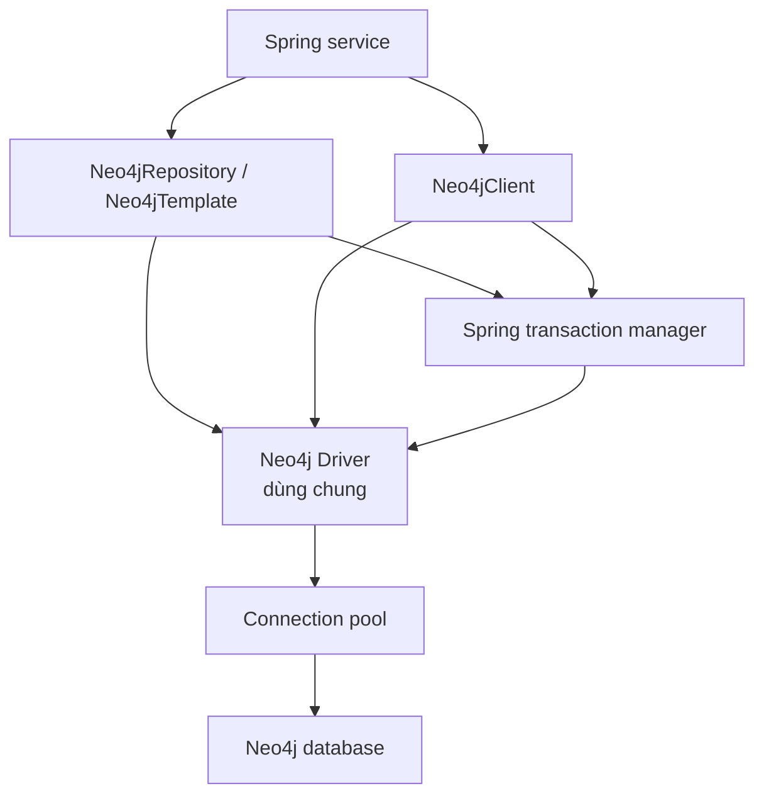

# Quản lý vòng đời Driver, session và tài nguyên kết nối

Trong ứng dụng Spring Data Neo4j (SDN), `Driver`, `Session`, transaction và connection pool đảm nhiệm những vai trò khác nhau. Hiểu đúng vòng đời của từng thành phần giúp ứng dụng dùng lại kết nối hiệu quả, tránh rò rỉ tài nguyên và bảo đảm các thao tác dữ liệu chạy trong đúng transaction.

Nguyên tắc vận hành thường dùng là: tạo một `Driver` dùng chung cho toàn ứng dụng, để Spring quản lý vòng đời của driver, mở session trong phạm vi thao tác cần thiết và đóng session ngay sau khi hoàn tất. Với nghiệp vụ dùng repository hoặc `Neo4jClient`, để transaction manager của Spring điều phối transaction. Chỉ quản lý session và transaction trực tiếp khi thực sự cần dùng Java Driver API ở mức thấp.

## 1. Kiến trúc kết nối trong ứng dụng SDN

Một ứng dụng có thể truy cập Neo4j thông qua repository, `Neo4jTemplate`, `Neo4jClient` hoặc Java Driver trực tiếp. Các thành phần này cùng dựa trên `Driver` để giao tiếp với cơ sở dữ liệu.



| Thành phần | Vai trò | Vòng đời nên dùng |
|---|---|---|
| `Driver` | Quản lý cấu hình kết nối, xác thực và pool kết nối tới Neo4j | Một instance dùng chung trong ứng dụng; đóng khi ứng dụng dừng |
| `Session` | Tạo ngữ cảnh làm việc, chọn database và thực thi transaction | Ngắn hạn theo một đơn vị công việc; đóng sau khi dùng |
| `Transaction` | Nhóm các câu lệnh thành một đơn vị đọc hoặc ghi có tính nhất quán | Bắt đầu và kết thúc trong phạm vi nghiệp vụ |
| Connection pool | Tái sử dụng các kết nối mạng vật lý tới máy chủ Neo4j | Do `Driver` quản lý; tồn tại cùng vòng đời driver |
| `Neo4jClient` / repository | Cung cấp API truy cập dữ liệu cho tầng ứng dụng | Được Spring quản lý và dùng lại như bean |

`Driver` không phải một kết nối TCP đơn lẻ. Nó là đối tượng cấp cao quản lý cấu hình, xác thực và các kết nối được cấp phát từ pool. `Session` cũng không phải một kết nối mạng chuyên dụng tồn tại vĩnh viễn. Session là ngữ cảnh thao tác; khi cần giao tiếp với máy chủ, driver lấy kết nối phù hợp từ pool.

## 2. Driver: tạo một lần và dùng lại

`org.neo4j.driver.Driver` là đối tượng thread-safe, được thiết kế để chia sẻ giữa nhiều luồng. Việc tạo driver có chi phí và driver sở hữu pool kết nối, vì vậy không nên tạo mới driver cho từng request, từng repository hoặc từng lần gọi service.

Trong ứng dụng Spring Boot, cách đơn giản nhất là cấu hình thuộc tính kết nối để Spring Boot tự tạo và quản lý driver:

```yaml
spring:
  neo4j:
    uri: ${NEO4J_URI:neo4j://localhost:7687}
    authentication:
      username: ${NEO4J_USERNAME:neo4j}
      password: ${NEO4J_PASSWORD}
    pool:
      max-connection-pool-size: 50
      connection-acquisition-timeout: 30s
      max-connection-lifetime: 1h
```

Ứng dụng lấy URI và thông tin xác thực từ biến môi trường hoặc hệ thống quản lý bí mật. Không đưa mật khẩu thật vào file cấu hình được commit lên kho mã nguồn. Giá trị mặc định trong ví dụ chỉ phục vụ môi trường phát triển; môi trường triển khai cần cấu hình riêng.

Các URI thường gặp gồm `neo4j://` cho kết nối Bolt có định tuyến, `bolt://` cho kết nối trực tiếp, và các biến thể `neo4j+s://`, `bolt+s://` để dùng TLS với chứng chỉ được tin cậy. `+ssc` là biến thể mã hóa chấp nhận chứng chỉ tự ký; chỉ dùng khi chính sách hạ tầng cho phép và đã hiểu cách xác minh danh tính máy chủ. Hãy chọn URI theo topology và cấu hình bảo mật thực tế của cụm Neo4j.

Spring Boot auto-configuration cung cấp driver cho các bean SDN sử dụng. Vì vậy, nếu chỉ cần repository, `Neo4jTemplate` hoặc `Neo4jClient`, thường không cần tự tạo thêm một driver thứ hai.

### Khi nào cần tự khai báo Driver?

Chỉ tự tạo bean `Driver` khi cần cấu hình đặc biệt mà auto-configuration hiện tại không đáp ứng, hoặc ứng dụng có yêu cầu quản lý nhiều cụm Neo4j riêng biệt. Ví dụ cấu hình thủ công:

```java
@Configuration
public class Neo4jDriverConfiguration {

    @Bean(destroyMethod = "close")
    Driver neo4jDriver(
            @Value("${app.neo4j.uri}") String uri,
            @Value("${app.neo4j.username}") String username,
            @Value("${app.neo4j.password}") String password) {

        Config driverConfig = Config.builder()
                .withMaxConnectionPoolSize(50)
                .withConnectionAcquisitionTimeout(30, TimeUnit.SECONDS)
                .withMaxConnectionLifetime(1, TimeUnit.HOURS)
                .build();

        return GraphDatabase.driver(
                uri,
                AuthTokens.basic(username, password),
                driverConfig);
    }
}
```

Ví dụ lược bỏ import. `@Bean` đăng ký một driver trong application context; `destroyMethod = "close"` yêu cầu Spring đóng driver khi bean bị hủy, từ đó giải phóng pool và các tài nguyên mạng. Khi tự cấu hình driver cho SDN, hãy bảo đảm `Neo4jClient`, template và transaction manager đều dùng đúng instance đó. Tránh vô tình để auto-configuration và cấu hình riêng tạo ra hai pool không cần thiết.

## 3. Session: ngữ cảnh làm việc ngắn hạn

Java Driver tạo session từ driver. Session có thể xác định database, access mode, bookmark và một số tùy chọn thực thi. Session không thread-safe, do đó không chia sẻ một session đang hoạt động giữa nhiều request hoặc nhiều luồng song song.

Mẫu sử dụng phổ biến là mở session trong phạm vi một thao tác, thực hiện công việc rồi đóng bằng `try-with-resources`:

```java
try (Session session = driver.session(
        SessionConfig.forDatabase("neo4j"))) {

    List<String> titles = session.executeRead(tx ->
            tx.run(
                    "MATCH (m:Movie) RETURN m.title AS title ORDER BY title")
              .list(record -> record.get("title").asString()));

    titles.forEach(System.out::println);
}
```

`try-with-resources` bảo đảm `Session.close()` được gọi cả khi câu truy vấn ném exception. Tên database trong ví dụ là `neo4j`; hãy thay bằng database mà ứng dụng được cấp quyền truy cập. Nếu dùng database mặc định, có thể bỏ cấu hình tên database tùy môi trường.

Session thường nhẹ hơn việc tự tạo driver, nhưng vẫn cần được đóng đúng lúc. Không giữ session trong field của singleton service, không lưu session vào cache và không truyền session qua ranh giới request. Nếu một tác vụ nền cần nhiều bước, hãy xác định phạm vi transaction phù hợp và tạo session cho tác vụ đó; không biến session thành tài nguyên dùng chung lâu dài.

### Session khác connection như thế nào?

Một session có thể thực hiện nhiều transaction tuần tự. Trong quá trình đó, driver quản lý việc lấy và trả kết nối từ pool. Connection pool có thể phục vụ nhiều session theo thời gian, và một session không nên được hiểu là đang sở hữu riêng một socket cố định trong toàn bộ vòng đời.

Sự phân biệt này quan trọng khi xử lý tải đồng thời: tăng số session không có nghĩa là phải tạo cùng số driver hoặc mở cùng số kết nối vật lý. Số kết nối đang hoạt động bị chi phối bởi số thao tác đồng thời và giới hạn pool.

## 4. Transaction: xác định ranh giới nghiệp vụ

Transaction nhóm các câu lệnh cần được thực hiện như một đơn vị. Ví dụ, tạo một đánh giá phim có thể cần tạo node `Rating`, nối nó với `Viewer` và nối nó với `Movie`. Nếu một bước thất bại, ứng dụng thường muốn rollback toàn bộ thay đổi.

Khi thao tác thông qua Spring Data Neo4j, hãy đặt ranh giới transaction ở tầng service bằng `@Transactional`:

```java
@Service
public class RatingService {

    private final RatingRepository ratingRepository;

    public RatingService(RatingRepository ratingRepository) {
        this.ratingRepository = ratingRepository;
    }

    @Transactional
    public Rating createRating(Rating rating) {
        validate(rating);
        return ratingRepository.save(rating);
    }

    private void validate(Rating rating) {
        if (rating.getScore() == null
                || rating.getScore() < 1
                || rating.getScore() > 10) {
            throw new IllegalArgumentException("Score must be between 1 and 10");
        }
    }
}
```

Đây là ví dụ rút gọn; mapping liên kết của `Rating` và phần kiểm tra các node liên quan phụ thuộc mô hình miền của ứng dụng. `@Transactional` yêu cầu transaction manager của SDN điều phối transaction cho thao tác repository. Các lời gọi repository tham gia transaction đang hoạt động khi chúng dùng cùng cấu hình transaction và cùng hạ tầng driver.

Trong ứng dụng Spring Boot có SDN, auto-configuration thường cung cấp transaction manager phù hợp khi driver đã được cấu hình. Với cấu hình thủ công, cần đăng ký `Neo4jTransactionManager` cho ứng dụng imperative. Ứng dụng reactive dùng cơ chế tương ứng `ReactiveNeo4jTransactionManager` và transaction context của Reactor.

Một số lưu ý khi dùng `@Transactional`:

- Đặt annotation ở phương thức service đại diện cho một nghiệp vụ hoàn chỉnh, thay vì tạo transaction riêng cho từng câu lệnh nhỏ.
- Trong mô hình proxy mặc định của Spring, lời gọi nội bộ từ một phương thức sang phương thức khác trong cùng object không đi qua proxy; không dựa vào self-invocation để mở transaction mới.
- Transaction imperative thường gắn với luồng thực thi hiện tại. Khi chuyển công việc sang executor hoặc `@Async`, cần thiết kế transaction cho luồng công việc mới.
- Không giữ transaction mở trong khi chờ người dùng, gọi dịch vụ ngoài lâu hoặc thực hiện công việc không liên quan đến cơ sở dữ liệu.
- Với reactive stack, giữ chuỗi xử lý non-blocking và dùng transaction reactive; không gọi blocking API trong luồng reactive.

### Transaction thủ công với Java Driver

Khi cần dùng Driver API trực tiếp, có thể chọn `executeRead` hoặc `executeWrite`:

```java
try (Session session = driver.session()) {
    Integer created = session.executeWrite(tx -> {
        Result result = tx.run(
                "CREATE (m:Movie {id: $id, title: $title}) RETURN count(m) AS total",
                Values.parameters("id", "movie-42", "title", "Graph Stories"));
        return result.single().get("total").asInt();
    });
}
```

Các transaction function quản lý transaction và có thể thử lại khi gặp lỗi tạm thời mà driver xác định có thể phục hồi. Vì callback có thể được thực thi lại, không đặt side effect bên ngoài Neo4j vào callback, chẳng hạn gửi email, trừ khi thao tác đó được thiết kế idempotent hoặc được xử lý qua cơ chế phù hợp như outbox. Kết quả callback nên được tạo từ dữ liệu transaction.

Không mở transaction thủ công lồng bên trong một phương thức đã có `@Transactional` chỉ để thực hiện cùng nghiệp vụ. Chọn một cơ chế điều phối transaction nhất quán cho mỗi luồng công việc; nếu phải kết hợp nhiều API, cần hiểu rõ chúng có tham gia cùng transaction hay không.

## 5. Connection pool và các giới hạn quan trọng

Driver quản lý connection pool để tái sử dụng kết nối mạng. Khi một thao tác cần truy cập Neo4j, driver lấy một connection khả dụng; sau khi hoàn tất, connection được trả lại pool để thao tác khác dùng tiếp. Pool giúp tránh chi phí tạo kết nối mới liên tục và giới hạn mức sử dụng tài nguyên trên cả ứng dụng lẫn máy chủ.

Các thiết lập thường cần xem xét:

| Thiết lập | Ý nghĩa | Cách lựa chọn |
|---|---|---|
| `maxConnectionPoolSize` | Số kết nối tối đa trong pool theo phạm vi driver/server address | Dựa trên tải đồng thời, giới hạn Neo4j và số instance ứng dụng |
| `connectionAcquisitionTimeout` | Thời gian tối đa chờ lấy được connection | Đủ cho tải đỉnh hợp lý; timeout giúp phát hiện pool bão hòa |
| `maxConnectionLifetime` | Tuổi thọ tối đa của connection trước khi được thay thế | Phù hợp với chính sách mạng, proxy và hạ tầng cơ sở dữ liệu |
| `maxConnectionIdleTime` | Thời gian connection nhàn rỗi tối đa trước khi bị loại bỏ | Hữu ích khi hạ tầng đóng connection nhàn rỗi |
| `connectionLivenessCheckTimeout` | Ngưỡng để kiểm tra connection nhàn rỗi còn hoạt động trước khi dùng lại | Cân bằng chi phí kiểm tra với độ ổn định mạng |

Tên thuộc tính cấu hình có thể khác giữa Java Driver API và Spring Boot properties. Khi dùng Spring Boot, đặt giá trị theo namespace `spring.neo4j.pool`; khi tự tạo `Config`, dùng các phương thức builder tương ứng của phiên bản driver trong dự án.

Không nên đặt pool size thật lớn chỉ để tránh timeout. Nếu có nhiều instance ứng dụng, tổng số connection có thể xấp xỉ số instance nhân với giới hạn pool của mỗi instance. Ví dụ, 8 instance với giới hạn 50 connection có thể tạo ra nhu cầu tối đa khoảng 400 connection cho một địa chỉ máy chủ. Hãy đối chiếu với giới hạn máy chủ, tải thực tế và các ứng dụng khác dùng chung Neo4j.

### Nhận biết pool bị quá tải

Các dấu hiệu thường gặp gồm:

- Request chờ lâu trước khi câu Cypher bắt đầu chạy.
- Lỗi timeout khi lấy connection từ pool.
- Số lượng thao tác đồng thời tăng nhưng throughput không tăng tương ứng.
- Nhiều session hoặc transaction tồn tại quá lâu do ứng dụng không đóng tài nguyên hoặc truy vấn chạy chậm.

Khi gặp các dấu hiệu này, cần phân biệt thời gian chờ connection với thời gian thực thi Cypher. Kiểm tra session có được đóng, transaction có bị giữ mở, truy vấn có trả quá nhiều dữ liệu và số connection có phù hợp với tổng tải hay không. Tăng pool chỉ có ích nếu Neo4j và hạ tầng còn đủ năng lực xử lý.

## 6. Đóng tài nguyên đúng thời điểm

Quy tắc đóng tài nguyên phụ thuộc vào đối tượng sở hữu nó:

| Tài nguyên | Ai sở hữu? | Khi nào đóng? |
|---|---|---|
| `Driver` do Spring Boot auto-configure | Spring application context | Khi ứng dụng dừng hoặc context bị đóng |
| `Driver` do ứng dụng khai báo bằng `@Bean` | Spring application context | Khai báo destroy method `close` hoặc cơ chế hủy bean tương đương |
| `Session` tạo trực tiếp bằng `driver.session()` | Đoạn mã tạo session | Ngay sau khi hoàn tất; ưu tiên `try-with-resources` |
| Transaction thủ công | Session / transaction function | Hoàn tất commit hoặc rollback trong phạm vi thao tác |
| Repository, `Neo4jClient`, `Neo4jTemplate` do Spring tạo | Spring application context | Dùng lại như bean; không tự đóng sau mỗi lần gọi |

Không gọi `driver.close()` sau mỗi request hoặc trong `finally` của từng service method. Việc đó sẽ đóng pool dùng chung và làm các request khác thất bại. Chỉ thành phần sở hữu driver ở cấp ứng dụng mới chịu trách nhiệm đóng nó, thường là Spring khi shutdown.

Với session thủ công, nếu không dùng `try-with-resources`, phải gọi `close()` trong `finally`. Cần bảo đảm đường thoát do exception cũng đóng session. Đừng đóng driver khi vẫn còn service hoặc background worker có thể dùng nó.

Khi ứng dụng nhận tín hiệu shutdown, Spring đóng application context và gọi lifecycle callback của các bean. Driver được đóng ở giai đoạn này để giải phóng connection pool và socket. Các tác vụ đang chạy cần có thời gian hoàn tất hợp lý trước khi context bị hủy; nếu hệ thống có job nền, cần phối hợp graceful shutdown của job executor với vòng đời datasource/driver.

## 7. Chọn database, xác thực và bảo mật kết nối

Một driver có thể được dùng để tạo session làm việc với database cụ thể. Trong môi trường có nhiều database, hãy chỉ rõ database trong cấu hình session hoặc trong cấu hình SDN tương ứng để tránh phụ thuộc vào database mặc định.

Session cũng có thể được cấu hình access mode đọc hoặc ghi. Access mode là gợi ý định tuyến cho driver trong môi trường hỗ trợ routing; nó không thay thế quyền truy cập của tài khoản Neo4j và cũng không thay thế transaction semantics. Người dùng cơ sở dữ liệu vẫn cần được cấp đúng quyền.

Các nguyên tắc bảo mật kết nối:

- Dùng tài khoản ứng dụng có quyền tối thiểu cần thiết, tránh dùng tài khoản quản trị cho mọi service.
- Lưu mật khẩu và token trong secret manager hoặc biến môi trường được bảo vệ.
- Dùng URI TLS phù hợp khi kết nối qua mạng không tin cậy; quản lý trust chain và chứng chỉ đúng cách.
- Không ghi password, token, thông tin xác thực hoặc dữ liệu nhạy cảm vào log.
- Không vô hiệu hóa xác minh chứng chỉ chỉ để làm cho kết nối hoạt động trong môi trường triển khai.
- Tách thông tin kết nối phát triển, kiểm thử và production; không để ứng dụng vô tình trỏ vào database production từ cấu hình local.

## 8. Kiểm tra kết nối và xử lý lỗi

Việc tạo đối tượng `Driver` không nhất thiết chứng minh máy chủ Neo4j đã truy cập được. Driver có thể được khởi tạo trước và chỉ mở kết nối khi có thao tác cần mạng. Nếu cần phát hiện cấu hình sai ngay khi khởi động, có thể chủ động gọi `verifyConnectivity()` trong bước health check hoặc startup phù hợp:

```java
@Component
public class Neo4jConnectivityCheck implements ApplicationRunner {

    private final Driver driver;

    public Neo4jConnectivityCheck(Driver driver) {
        this.driver = driver;
    }

    @Override
    public void run(ApplicationArguments args) {
        driver.verifyConnectivity();
    }
}
```

Đoạn mã minh họa một kiểm tra kết nối chủ động; ứng dụng có thể dùng health indicator thay vì tự kiểm tra trong `ApplicationRunner`. Cần quyết định chính sách khi Neo4j tạm thời chưa sẵn sàng: không cho ứng dụng khởi động, hay cho phép khởi động và báo trạng thái health chưa tốt. Không thực hiện kiểm tra kết nối quá dày trong từng request.

Một số lỗi thường gặp và hướng kiểm tra:

| Biểu hiện | Nguyên nhân có thể | Hướng kiểm tra |
|---|---|---|
| Authentication failure | Sai username/password hoặc tài khoản bị khóa | Secret, user và quyền trên database |
| Service unavailable / connection refused | Neo4j dừng, sai host/port hoặc mạng bị chặn | Trạng thái server, DNS, firewall và URI |
| TLS handshake failure | Chứng chỉ hoặc trust configuration không phù hợp | URI scheme, certificate chain và trust settings |
| Connection acquisition timeout | Pool cạn hoặc thao tác giữ connection quá lâu | Thời gian transaction, truy vấn chậm và pool sizing |
| Transaction timeout / transient failure | Tải cao, xung đột ghi hoặc sự cố tạm thời | Log server, truy vấn, retry policy và idempotency |
| Resource leak warning | Session không được đóng hoặc giữ quá lâu | Tìm nơi tạo session và bảo đảm đóng trên mọi nhánh |

## 9. Những lỗi thiết kế vòng đời cần tránh

| Cách làm sai | Hậu quả | Cách làm phù hợp |
|---|---|---|
| Tạo `Driver` trong mỗi request | Tạo nhiều pool, tốn socket và tài nguyên | Dùng một driver bean được chia sẻ |
| Giữ `Session` trong field của service singleton | Session bị chia sẻ đồng thời giữa nhiều luồng | Mở session ngắn hạn theo thao tác |
| Không đóng session thủ công | Giữ tài nguyên và có thể làm pool thiếu connection | Dùng `try-with-resources` |
| Đóng driver sau từng lần truy vấn | Làm hỏng kết nối của các request khác | Để Spring đóng driver khi shutdown |
| Mở transaction quá rộng | Giữ connection lâu, tăng tranh chấp và độ trễ | Chọn ranh giới transaction theo nghiệp vụ |
| Gọi API ngoài trong transaction callback có retry | Side effect có thể xảy ra nhiều lần | Tách side effect hoặc thiết kế idempotent/outbox |
| Tăng pool mà không xem tổng số instance | Có thể làm quá tải Neo4j | Tính tổng connection và đo tải thực tế |
| Trộn transaction Spring với transaction Driver thủ công | Khó đoán tính nhất quán và ranh giới commit | Dùng một cơ chế điều phối rõ ràng cho từng luồng |

## 10. Checklist vận hành

Trước khi triển khai, hãy kiểm tra các câu hỏi sau:

1. Ứng dụng chỉ có một driver bean dùng chung cho cụm Neo4j cần kết nối hay chưa?
2. Driver được Spring quản lý và có lifecycle đóng rõ ràng hay chưa?
3. Mọi session tạo trực tiếp có được đóng ngay cả khi phát sinh exception hay chưa?
4. Session có bị chia sẻ qua nhiều luồng hoặc lưu trong singleton service hay không?
5. Transaction có bao trọn nghiệp vụ cần tính nguyên tử và kết thúc nhanh hay không?
6. Cấu hình pool có phù hợp với số instance, tải đồng thời và giới hạn Neo4j hay không?
7. URI, TLS, secret và quyền database có phù hợp với môi trường triển khai hay không?
8. Health check có phát hiện được lỗi kết nối mà không tạo tải kiểm tra quá mức hay không?
9. Log và metric có đủ thông tin phân biệt lỗi mạng, lỗi xác thực, pool timeout và truy vấn chậm hay không?

## 11. Tự kiểm tra

1. Vì sao `Driver` nên là bean dùng chung trong khi `Session` nên có vòng đời ngắn?
2. `Session` có phải là một kết nối TCP cố định không? Connection pool tham gia vào quá trình nào?
3. Điều gì có thể xảy ra nếu một session được chia sẻ giữa hai request đồng thời?
4. Vì sao `try-with-resources` phù hợp khi tạo session trực tiếp bằng Java Driver?
5. Khi dùng repository trong service có `@Transactional`, thành phần nào điều phối transaction?
6. Vì sao không nên gọi `driver.close()` sau mỗi lần gọi repository?
7. Những thông số nào ảnh hưởng tới khả năng cấp phát connection khi tải tăng?
8. Vì sao callback của `executeWrite` cần tránh side effect bên ngoài có thể lặp lại?

Khi nắm được các vòng đời này, người học có thể cấu hình kết nối Neo4j trong Spring Boot, xác định đúng ranh giới transaction, quản lý session thủ công an toàn và điều chỉnh connection pool dựa trên tải thực tế của ứng dụng Spring Data Neo4j.
