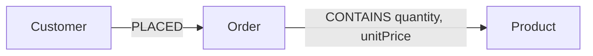

# Từ câu hỏi nghiệp vụ đến node, relationship và property

Thiết kế mô hình Neo4j nên bắt đầu từ những câu hỏi mà ứng dụng cần trả lời, sau đó mới quyết định dữ liệu nào là node, dữ liệu nào là relationship và dữ liệu nào chỉ cần lưu thành property. Cách làm này giúp đồ thị phản ánh đúng nghiệp vụ, đồng thời tạo ra các đường đi tự nhiên cho truy vấn Cypher và ánh xạ entity bằng Spring Data Neo4j (SDN).

Trong một tầng dữ liệu đồ thị dùng SDN, node thường được ánh xạ thành lớp `@Node`, relationship được mô tả bằng `@Relationship` hoặc lớp `@RelationshipProperties`, còn các giá trị đơn giản được ánh xạ thành property. Mỗi lựa chọn ảnh hưởng đến cách lưu dữ liệu, cách truy vấn, ranh giới transaction và khả năng thay đổi mô hình về sau.

## 1. Bắt đầu bằng câu hỏi nghiệp vụ

Giả sử xây dựng hệ thống bán hàng. Thay vì bắt đầu bằng danh sách bảng hoặc lớp Java, hãy ghi lại những câu hỏi cụ thể mà người dùng và nghiệp vụ cần trả lời:

- Một khách hàng đã đặt những đơn hàng nào?
- Đơn hàng gồm những sản phẩm nào và mỗi sản phẩm có số lượng bao nhiêu?
- Sản phẩm nào thường được mua cùng nhau?
- Doanh thu theo sản phẩm trong một khoảng thời gian là bao nhiêu?
- Những khách hàng nào đã mua một sản phẩm thuộc cùng danh mục với sản phẩm X?

Các câu hỏi này hé lộ những đường đi cần có trong đồ thị. Ví dụ, để trả lời câu hỏi về sản phẩm trong đơn hàng, ứng dụng cần đi từ `Customer` qua `Order` đến `Product`. Số lượng và đơn giá thuộc về lần xuất hiện của sản phẩm trong một đơn hàng, vì vậy chúng mô tả mối liên kết giữa `Order` và `Product`.

Nên phân loại câu hỏi theo ba nhóm:

| Nhóm câu hỏi | Điều cần tìm trong mô hình |
| --- | --- |
| Tìm một đối tượng theo định danh hoặc thuộc tính | Node và property dùng để nhận diện, lọc |
| Tìm mối liên hệ giữa các đối tượng | Relationship, type và direction |
| Tìm thông tin chỉ có ý nghĩa trong một mối liên hệ | Property của relationship |

Hãy ưu tiên các truy vấn quan trọng, thường xuyên và có yêu cầu hiệu năng rõ ràng. Một mô hình tốt phải biểu diễn được nghiệp vụ, nhưng cũng phải giúp các truy vấn chính đi qua số bước hợp lý và không cần quét dữ liệu không liên quan.

## 2. Quyết định điều gì trở thành node

Một khái niệm nghiệp vụ thường phù hợp làm node khi nó có định danh riêng, có vòng đời hoặc trạng thái riêng, được nhiều đối tượng khác tham chiếu, hoặc cần kết nối với nhiều loại đối tượng khác.

Trong ví dụ bán hàng:

- `Customer` có mã khách hàng, thông tin liên hệ và lịch sử hoạt động riêng.
- `Order` có mã đơn, thời điểm đặt, trạng thái và vòng đời xử lý riêng.
- `Product` có SKU, tên, giá niêm yết và có thể xuất hiện trong nhiều đơn hàng.

Ba khái niệm này nên là ba loại node. Chúng có danh tính độc lập và có thể được truy vấn hoặc liên kết từ nhiều ngữ cảnh khác nhau.

Ngược lại, không phải mọi danh từ trong yêu cầu đều cần một node. Một `phoneNumber` đơn giản có thể là property của `Customer` nếu nó chỉ là giá trị liên hệ. Một `quantity` không phải đối tượng độc lập; nó là thuộc tính của một dòng sản phẩm trong đơn hàng.

Một cách kiểm tra hữu ích là đặt các câu hỏi:

1. Khái niệm này có cần ID riêng hay cần được tham chiếu từ nhiều nơi không?
2. Nó có trạng thái hoặc vòng đời độc lập không?
3. Nó có tham gia vào nhiều loại quan hệ hoặc nhiều truy vấn đường đi không?
4. Nếu xóa hoặc thay đổi nó, có cần xử lý một đối tượng nghiệp vụ riêng không?

Nếu phần lớn câu trả lời là có, node có thể là lựa chọn phù hợp. Nếu không, property hoặc relationship property thường đơn giản hơn. Đây là nguyên tắc định hướng, không phải quy tắc cứng: quyết định cuối cùng vẫn phải dựa trên ngữ nghĩa và truy vấn thực tế.

## 3. Dùng relationship để mô tả sự kết nối

Relationship biểu diễn một sự kiện hoặc liên kết có ý nghĩa giữa hai node. Ví dụ:

```cypher
(:Customer)-[:PLACED]->(:Order)
(:Order)-[:CONTAINS]->(:Product)
```

`PLACED` diễn đạt khách hàng đã đặt đơn hàng; `CONTAINS` diễn đạt đơn hàng có sản phẩm. Relationship có type và direction. Hướng đi nên thống nhất theo cách diễn đạt nghiệp vụ, để đường đi trong Cypher dễ đọc và ít gây nhầm lẫn.

Neo4j lưu relationship có hướng. Khi truy vấn, Cypher có thể khớp theo hướng đã chỉ định hoặc dùng mẫu không chỉ định hướng nếu nghiệp vụ chỉ cần biết có kết nối. Tuy nhiên, khi thiết kế schema và ánh xạ SDN, vẫn nên chọn một hướng chuẩn. Không tạo hai relationship ngược chiều chỉ để thuận tiện cho hai cách truy vấn; có thể duyệt cùng relationship theo chiều ngược lại trong Cypher.

Các câu hỏi giúp quyết định có cần relationship riêng:

- Hai đối tượng có liên hệ nghiệp vụ trực tiếp không?
- Liên hệ đó có tên và ý nghĩa riêng không, ví dụ `PLACED`, `MANAGES`, `BELONGS_TO`?
- Ứng dụng có cần duyệt qua liên hệ đó để tìm đối tượng liên quan không?
- Liên hệ có thể mang dữ liệu riêng như thời điểm bắt đầu, vai trò, số lượng hoặc điểm đánh giá không?

Đặt tên relationship theo hành động hoặc ý nghĩa nghiệp vụ, thường dùng dạng chữ hoa có dấu gạch dưới như `PLACED`, `REPORTS_TO`, `CONTAINS`. Duy trì cùng một quy ước trong toàn bộ graph để truy vấn và mã Java dễ đọc.

## 4. Dùng property cho dữ liệu mô tả

Property là giá trị mô tả node hoặc relationship. Một property phù hợp khi giá trị không cần danh tính độc lập và không cần được duyệt như một đối tượng trong đồ thị.

Ví dụ, node `Product` có thể lưu `sku`, `name`, `brand`, `active` và `listPrice`. Node `Order` có thể lưu `orderNumber`, `placedAt` và `status`. Những dữ liệu này mô tả chính đối tượng đó.

```cypher
CREATE (p:Product {
    sku: "KB-204",
    name: "Bàn phím cơ",
    brand: "KeyWorks",
    active: true
})
```

Không nên tạo node chỉ để chứa một giá trị đơn giản như `name`, `status` hoặc `createdAt` nếu giá trị đó không có vòng đời, định danh hay quan hệ độc lập. Việc tạo quá nhiều node nhỏ khiến truy vấn phải đi qua nhiều relationship mà không tăng thêm ý nghĩa của mô hình.

Tuy nhiên, một giá trị có thể bắt đầu là property rồi trở thành node khi yêu cầu nghiệp vụ thay đổi. Ví dụ, `Category` chỉ là chuỗi trong phiên bản đầu, nhưng khi cần phân cấp danh mục, mô tả riêng, người quản lý và quan hệ giữa các danh mục, nó trở thành một node phù hợp hơn.

## 5. Khi nào dữ liệu thuộc về relationship?

Một câu hỏi quan trọng là dữ liệu mô tả node nào, hay mô tả chính mối quan hệ giữa hai node. Với đơn hàng, `quantity` và `unitPrice` không phải thuộc tính cố định của `Product`: cùng một sản phẩm có thể có số lượng và giá bán khác nhau trong các đơn hàng khác nhau. Vì vậy, chúng thuộc về relationship `CONTAINS` giữa `Order` và `Product`.

```cypher
MATCH (o:Order {orderNumber: "SO-1008"})
MATCH (p:Product {sku: "KB-204"})
CREATE (o)-[:CONTAINS {
    quantity: 2,
    unitPrice: 850000
}]->(p)
```

Trong ví dụ này:

- `Order` và `Product` là node vì mỗi đối tượng có định danh và vòng đời riêng.
- `CONTAINS` là relationship vì nó mô tả sản phẩm xuất hiện trong một đơn hàng.
- `quantity` và `unitPrice` là relationship properties vì chúng phụ thuộc vào lần xuất hiện đó.

Nếu đưa `quantity` lên node `Product`, số lượng của một đơn hàng sẽ bị nhầm với một thuộc tính toàn cục của sản phẩm. Nếu đưa `unitPrice` lên node `Product`, lịch sử giá tại thời điểm đặt hàng cũng bị mất ý nghĩa. Mô hình hóa đúng vị trí dữ liệu giúp tránh các lỗi ngữ nghĩa này.

### Ánh xạ relationship properties trong SDN

SDN hỗ trợ lớp `@RelationshipProperties` để ánh xạ relationship có thuộc tính. `@TargetNode` chỉ node ở đầu kia của relationship; `@RelationshipId` có thể dùng để lưu định danh relationship do Neo4j quản lý.

```java
import java.math.BigDecimal;

import org.springframework.data.neo4j.core.schema.RelationshipId;
import org.springframework.data.neo4j.core.schema.RelationshipProperties;
import org.springframework.data.neo4j.core.schema.TargetNode;

@RelationshipProperties
public class OrderItem {

    @RelationshipId
    private Long id;

    private int quantity;

    private BigDecimal unitPrice;

    @TargetNode
    private Product product;
}
```

Node `PurchaseOrder` khai báo collection của các relationship properties:

```java
import java.util.List;

import org.springframework.data.neo4j.core.schema.Id;
import org.springframework.data.neo4j.core.schema.Node;
import org.springframework.data.neo4j.core.schema.Relationship;

@Node("Order")
public class PurchaseOrder {

    @Id
    private String orderNumber;

    private String status;

    @Relationship(type = "CONTAINS")
    private List<OrderItem> items;
}
```

`OrderItem` không phải node entity. Nó là lớp mô tả relationship `CONTAINS`, gồm sản phẩm đích, số lượng và đơn giá tại thời điểm đặt. Với mô hình này, mỗi dòng trong `items` tương ứng một relationship từ đơn hàng đến sản phẩm.

Nếu dòng đơn hàng cần có định danh nghiệp vụ riêng, được tham chiếu từ nhiều nơi, có trạng thái xử lý riêng hoặc có nhiều quan hệ riêng, hãy cân nhắc mô hình nó thành node `OrderLine`. Khi đó, đường đi có thể là `Order -[:HAS_LINE]-> OrderLine -[:FOR_PRODUCT]-> Product`. Không nên tạo node trung gian chỉ để thay thế một relationship property đơn giản.

## 6. Ghép các thành phần thành mô hình đồ thị

Từ các quyết định trên, mô hình bán hàng có thể biểu diễn như sau:



| Thành phần | Loại | Dữ liệu tiêu biểu |
| --- | --- | --- |
| `Customer` | Node | `customerId`, `name`, `email` |
| `Order` | Node | `orderNumber`, `placedAt`, `status` |
| `Product` | Node | `sku`, `name`, `listPrice` |
| `PLACED` | Relationship | Có thể có `channel` hoặc `source` nếu chúng mô tả lần đặt hàng |
| `CONTAINS` | Relationship | `quantity`, `unitPrice` |

Ví dụ truy vấn tìm các sản phẩm trong đơn hàng của một khách hàng:

```cypher
MATCH (c:Customer {customerId: $customerId})
      -[:PLACED]->(o:Order)
      -[line:CONTAINS]->(p:Product)
RETURN o.orderNumber AS orderNumber,
       p.sku AS sku,
       p.name AS productName,
       line.quantity AS quantity,
       line.unitPrice AS unitPrice
ORDER BY orderNumber, sku
```

Truy vấn thể hiện trực tiếp câu hỏi nghiệp vụ: bắt đầu từ khách hàng, đi theo các đơn đã đặt, rồi lấy sản phẩm và dữ liệu của từng dòng hàng. Tham số `$customerId` tách dữ liệu đầu vào khỏi câu Cypher.

Ví dụ tính doanh thu theo SKU trong một khoảng thời gian:

```cypher
MATCH (:Customer)-[:PLACED]->(o:Order)
      -[line:CONTAINS]->(p:Product)
WHERE o.placedAt >= $from AND o.placedAt < $to
RETURN p.sku AS sku,
       sum(line.quantity * line.unitPrice) AS revenue
ORDER BY revenue DESC
```

Khi một câu hỏi nghiệp vụ không thể diễn đạt bằng một đường đi dễ hiểu, hãy xem lại mô hình: có thiếu node trung gian, thiếu relationship hoặc đặt property sai vị trí không? Ngược lại, nếu một câu hỏi đơn giản cần quá nhiều bước chỉ để lấy vài giá trị, có thể mô hình đang bị chia nhỏ quá mức.

## 7. Chọn định danh, ràng buộc và index

Node cần một cách nhận diện ổn định. Với dữ liệu nghiệp vụ, thường nên chọn business key như `customerId`, `orderNumber` hoặc `sku`. Business key giúp truy vấn và tích hợp hệ thống dễ hiểu hơn. Không dùng tên hiển thị hoặc email làm định danh nếu chúng có thể thay đổi hoặc không được bảo đảm duy nhất.

Trong SDN, một business key có thể được đánh dấu bằng `@Id`:

```java
@Node("Customer")
public class Customer {

    @Id
    private String customerId;

    private String name;
}
```

Định nghĩa `@Id` trong entity không thay thế constraint ở database. Hãy tạo uniqueness constraint cho business key để ngăn dữ liệu trùng khi có nhiều luồng ghi hoặc nhiều ứng dụng cùng truy cập Neo4j. Ví dụ với cú pháp Neo4j 5:

```cypher
CREATE CONSTRAINT customer_id_unique IF NOT EXISTS
FOR (c:Customer)
REQUIRE c.customerId IS UNIQUE
```

Tạo index cho các property thường xuyên được dùng để tìm node hoặc lọc kết quả, sau khi xem xét truy vấn thực tế. Không nên tạo index cho mọi property; index làm tăng chi phí lưu trữ và cập nhật. Với truy vấn quan trọng, dùng `EXPLAIN` hoặc `PROFILE` để kiểm tra kế hoạch thực thi và xác nhận index được sử dụng như mong đợi.

## 8. Kiểm tra cardinality và các trường hợp biên

Trước khi chốt mô hình, cần xác định số lượng liên kết hợp lệ trong nghiệp vụ:

- Một khách hàng có thể đặt nhiều đơn hàng; một đơn hàng thuộc về một khách hàng hay có thể có nhiều người mua chung?
- Một đơn hàng có thể chứa nhiều sản phẩm; một sản phẩm có thể xuất hiện trong nhiều đơn hàng không?
- Một sản phẩm có thể xuất hiện nhiều lần trong cùng đơn hàng dưới các dòng hàng khác nhau không?
- Một nhân viên có thể báo cáo cho một quản lý hay nhiều quản lý theo từng giai đoạn?

Neo4j không áp đặt quan hệ một-nhiều hoặc nhiều-nhiều như một số cơ sở dữ liệu quan hệ. Mô hình và tầng nghiệp vụ phải bảo đảm các quy tắc cardinality cần thiết. Nếu nghiệp vụ yêu cầu một node chỉ có một relationship trong một ngữ cảnh, hãy kiểm tra điều đó trong service, transaction hoặc bằng các constraint phù hợp với schema.

Hãy nghĩ cả trường hợp thiếu dữ liệu, dữ liệu trùng, node bị xóa, relationship hết hiệu lực và thay đổi trạng thái. Ví dụ, nếu một nhân viên chuyển bộ phận, nghiệp vụ cần lưu lịch sử chuyển đổi hay chỉ cần biết bộ phận hiện tại? Nếu cần lịch sử, relationship `WORKED_IN` có thể mang `startDate` và `endDate`; nếu chỉ cần trạng thái hiện tại, một relationship hiện hành có thể đủ.

## 9. Ánh xạ mô hình vào Spring Data Neo4j

Sau khi mô hình đồ thị rõ ràng, ánh xạ sang SDN theo các nguyên tắc:

- Dùng `@Node` cho loại node và khai báo label ổn định.
- Dùng `@Id` cho định danh entity; chọn business key hoặc chiến lược ID phù hợp với hệ thống.
- Dùng `@Property` khi tên property trong Neo4j khác tên field Java.
- Dùng `@Relationship` để khai báo type, direction và thuộc tính quan hệ cần thiết.
- Dùng `@RelationshipProperties` cùng `@TargetNode` khi relationship có dữ liệu riêng.
- Dùng repository cho thao tác entity thông thường; dùng `Neo4jClient` hoặc `@Query` khi truy vấn Cypher cần thể hiện rõ đường đi nghiệp vụ.

Ví dụ về node khách hàng và relationship đặt đơn:

```java
import java.util.Set;

import org.springframework.data.neo4j.core.schema.Id;
import org.springframework.data.neo4j.core.schema.Node;
import org.springframework.data.neo4j.core.schema.Relationship;

@Node("Customer")
public class Customer {

    @Id
    private String customerId;

    private String name;

    @Relationship(type = "PLACED")
    private Set<PurchaseOrder> orders;
}
```

Đây là một góc nhìn hướng entity của cùng mô hình đồ thị. Khi thiết kế collection relationship, hãy cân nhắc số lượng liên kết có thể lớn và cách ứng dụng thực sự cần đọc chúng. Không nên tải một tập quan hệ khổng lồ nếu API chỉ cần một phần nhỏ; dùng truy vấn tùy chỉnh hoặc projection để lấy đúng dữ liệu cần thiết.

Các thao tác thay đổi nhiều node và relationship thuộc cùng một nghiệp vụ nên được đặt trong ranh giới transaction phù hợp, thường ở service Spring. Như vậy, nếu tạo đơn hàng, liên kết khách hàng và thêm các dòng sản phẩm thất bại giữa chừng, transaction có thể rollback toàn bộ thay đổi thay vì để lại đồ thị dở dang.

## 10. Những lỗi thiết kế thường gặp

| Lỗi | Hệ quả | Cách xử lý |
| --- | --- | --- |
| Tạo node cho mọi thuộc tính | Đồ thị quá vụn, truy vấn phải đi qua nhiều bước vô ích | Giữ giá trị mô tả đơn giản thành property |
| Đặt dữ liệu của mối quan hệ lên một node đầu mút | Dữ liệu bị dùng chung sai ngữ nghĩa, ví dụ giá bán của sản phẩm bị nhầm với giá trong từng đơn | Chuyển dữ liệu phụ thuộc liên kết thành relationship property |
| Dùng property dạng chuỗi để lưu danh sách ID liên quan | Khó duyệt quan hệ, khó kiểm tra tính toàn vẹn và khó truy vấn theo đường đi | Biểu diễn liên kết bằng relationship thật |
| Tạo hai relationship ngược chiều cho cùng một sự kiện | Dữ liệu trùng và phải đồng bộ hai phía | Chọn một hướng chuẩn, truy vấn theo hướng cần thiết |
| Không có business key hoặc uniqueness constraint | Có thể sinh node trùng khi ghi đồng thời | Chọn định danh ổn định và tạo constraint |
| Chỉ thiết kế theo cấu trúc Java hiện tại | Mô hình khó trả lời câu hỏi nghiệp vụ mới | Kiểm tra mô hình bằng các truy vấn quan trọng và trường hợp biên |
| Tải toàn bộ neighborhood lớn cho mọi thao tác | Tốn bộ nhớ và thời gian, API trả dữ liệu thừa | Dùng query/projection có phạm vi rõ ràng |

## 11. Quy trình thực hành

Khi bắt đầu một tính năng mới, có thể đi theo trình tự sau:

1. Viết các câu hỏi nghiệp vụ cần trả lời, ưu tiên những câu hỏi thường xuyên và quan trọng.
2. Xác định các khái niệm có định danh hoặc vòng đời riêng để tạo node.
3. Xác định hành động hoặc liên kết có ý nghĩa giữa các node để tạo relationship và chọn hướng chuẩn.
4. Phân loại dữ liệu còn lại: property của node hay property của relationship.
5. Ghi lại cardinality, định danh, ràng buộc và các trường hợp thiếu hoặc trùng dữ liệu.
6. Viết vài truy vấn Cypher đại diện cho các câu hỏi ban đầu để kiểm tra đường đi.
7. Ánh xạ node và relationship vào SDN, rồi kiểm tra cách repository hoặc custom query trả dữ liệu.
8. Đo truy vấn quan trọng bằng dữ liệu gần với thực tế; bổ sung index hoặc điều chỉnh mô hình khi có bằng chứng.

Mô hình đồ thị không cần hoàn hảo ngay từ đầu. Nó cần phản ánh đúng nghiệp vụ hiện tại, hỗ trợ truy vấn chính và có thể thay đổi có kiểm soát khi yêu cầu mới xuất hiện. Hãy để câu hỏi nghiệp vụ dẫn đường cho cấu trúc node, relationship và property; sau đó dùng Cypher và mapping của Spring Data Neo4j để xác minh mô hình đó trong ứng dụng.
