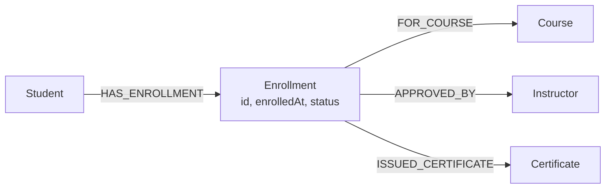

# Quan hệ có thuộc tính hay node trung gian?

Trong mô hình đồ thị Neo4j, một mối liên hệ giữa hai thực thể có thể được biểu diễn trực tiếp bằng relationship có property, hoặc bằng một node trung gian đứng giữa hai hay nhiều thực thể. Hai cách đều hợp lệ, nhưng thể hiện hai ý nghĩa dữ liệu khác nhau. Chọn đúng cách giúp đồ thị dễ truy vấn, dễ ánh xạ bằng Spring Data Neo4j và phù hợp với vòng đời nghiệp vụ.

Với `SPRING_DATA_NEO4J`, framework hỗ trợ ánh xạ property của relationship qua `@RelationshipProperties`, `@TargetNode` và `@Relationship`. Khi bản thân mối liên hệ trở thành một thực thể có định danh, trạng thái và các mối quan hệ riêng, hãy mô hình hóa nó thành node được đánh dấu `@Node`. Bài học dùng ví dụ đăng ký khóa học để phân biệt hai trường hợp.

## 1. Bắt đầu từ ý nghĩa của dữ liệu

Giả sử hệ thống có hai thực thể `Student` và `Course`. Một sinh viên đăng ký một khóa học. Mối quan hệ đăng ký có thể chứa ngày đăng ký, trạng thái và điểm cuối khóa.

Nếu các thông tin này chỉ mô tả mối liên hệ giữa sinh viên và khóa học, ta có thể đặt chúng trực tiếp lên relationship:


Nếu một lần đăng ký có mã riêng, có thể được duyệt bởi giảng viên, có thanh toán, chứng chỉ hoặc lịch sử xử lý, nó đã trở thành một đối tượng nghiệp vụ. Khi đó, dùng node `Enrollment`:



Trong mô hình thứ hai, `Enrollment` có thể liên kết đến nhiều loại node khác và được truy vấn độc lập. Đây là khả năng mà một relationship đơn lẻ không cung cấp: relationship luôn nối đúng hai node và không thể trở thành đầu mút của một relationship khác.

## 2. Dùng relationship có thuộc tính khi nào?

Neo4j relationship không chỉ biểu diễn việc hai node có liên kết. Nó có hướng, một loại relationship và có thể chứa các cặp key-value để mô tả cách hai node liên quan với nhau.

Ví dụ:

```cypher
MATCH (s:Student {id: $studentId})
MATCH (c:Course {id: $courseId})
MERGE (s)-[r:ENROLLED_IN]->(c)
ON CREATE SET r.enrolledAt = date($enrolledAt),
              r.status = 'ACTIVE'
ON MATCH SET r.status = 'ACTIVE'
RETURN s, r, c;
```

Ở đây, `enrolledAt` và `status` mô tả mối liên hệ giữa một sinh viên và một khóa học. Không cần tạo node chỉ để chứa hai property này. Có thể bổ sung các thông tin khác như `role`, `since`, `weight`, `rating` hoặc `quantity` nếu chúng vẫn là thuộc tính của chính mối quan hệ.

Relationship có thuộc tính phù hợp khi:

- Dữ liệu chỉ có ý nghĩa khi xét cùng hai đầu mút của relationship.
- Mối liên hệ không cần được tham chiếu như một thực thể độc lập.
- Không cần nối relationship đó với node khác.
- Các thao tác chính là tạo, tìm và cập nhật mối liên hệ giữa hai node.
- Truy vấn thường bắt đầu từ một đầu mút rồi đi qua relationship đến đầu mút còn lại.

Một số ví dụ thường gặp:

| Relationship | Property có thể đặt trên relationship |
|---|---|
| `ACTED_IN` giữa `Person` và `Movie` | `role`, `screenTime` |
| `RATED` giữa `User` và `Product` | `score`, `ratedAt`, `comment` ngắn |
| `WORKED_AT` giữa `Person` và `Company` | `startDate`, `endDate`, `jobTitle` |
| `TRANSFERRED_TO` giữa hai `Account` | `amount`, `occurredAt`, `referenceCode` |

Đừng tự động biến mọi relationship có property thành node. Property là một phần tự nhiên của relationship trong mô hình property graph; việc có `startDate`, `endDate` hoặc `role` chưa đủ để kết luận cần node trung gian.

## 3. Ánh xạ relationship properties trong Spring Data Neo4j

Spring Data Neo4j dùng `@RelationshipProperties` để ánh xạ property của relationship vào một lớp Java. Lớp này không phải node entity. Nó cần đúng một trường `@TargetNode` để chỉ node ở đầu còn lại của relationship và một ID nội bộ do framework quản lý để nhận diện relationship khi lưu.

Ví dụ với `Student` đăng ký `Course`:

```java
import org.springframework.data.neo4j.core.schema.GeneratedValue;
import org.springframework.data.neo4j.core.schema.Id;
import org.springframework.data.neo4j.core.schema.Node;
import org.springframework.data.neo4j.core.schema.Relationship;
import org.springframework.data.neo4j.core.schema.RelationshipProperties;
import org.springframework.data.neo4j.core.schema.TargetNode;

import java.time.LocalDate;
import java.util.HashSet;
import java.util.Set;

@Node("Student")
public class Student {

    @Id
    private String id;

    private String name;

    @Relationship(type = "ENROLLED_IN")
    private Set<EnrollmentDetails> enrollments = new HashSet<>();
}

@Node("Course")
public class Course {

    @Id
    private String id;

    private String title;
}

@RelationshipProperties
public class EnrollmentDetails {

    @Id
    @GeneratedValue
    private Long id;

    private LocalDate enrolledAt;
    private String status;
    private Integer finalScore;

    @TargetNode
    private Course course;

    public EnrollmentDetails(Course course, LocalDate enrolledAt, String status) {
        this.course = course;
        this.enrolledAt = enrolledAt;
        this.status = status;
    }
}
```

Các điểm cần hiểu trong ví dụ:

- `@Relationship(type = "ENROLLED_IN")` khai báo relationship mà collection `enrollments` đại diện. Hướng mặc định của Spring Data Neo4j là `OUTGOING`, tức từ `Student` đến `Course`.
- `EnrollmentDetails` chứa các property được lưu trên relationship, không tạo thêm label hay node `EnrollmentDetails` trong Neo4j.
- `@TargetNode` chỉ `Course`, là node đích của relationship trong ngữ cảnh này.
- Trường `Long id` với `@Id @GeneratedValue` là ID nội bộ để Spring Data Neo4j theo dõi relationship khi ghi. Framework quản lý trường này; không dùng nó làm mã đăng ký nghiệp vụ hoặc tự gán giá trị.
- Lớp `@RelationshipProperties` không được đánh dấu `@Node` và phải có đúng một trường `@TargetNode`.

Khi lưu `Student` cùng collection `enrollments`, Spring Data Neo4j dùng metadata để tạo hoặc cập nhật các relationship tương ứng. Entity `Course` ở đầu kia vẫn là node entity độc lập. Nếu cần tải các relationship cùng property, truy vấn phải trả về đủ phần đồ thị để converter ánh xạ.

Truy vấn relationship properties bằng Cypher:

```cypher
MATCH (s:Student {id: $studentId})-[r:ENROLLED_IN]->(c:Course)
WHERE r.status = 'ACTIVE'
RETURN c.title AS courseTitle,
       r.enrolledAt AS enrolledAt,
       r.status AS status,
       r.finalScore AS finalScore;
```

Ở đây, `r` là relationship nên có thể truy cập trực tiếp `r.status`, `r.enrolledAt` và `r.finalScore`. Không cần thêm một bước đi qua node trung gian.

## 4. Khi nào nên tạo node trung gian?

Node trung gian phù hợp khi mối liên hệ đã có danh tính hoặc vòng đời riêng. Ví dụ, một lần đăng ký khóa học có thể có mã đăng ký, được duyệt, bị hủy, thanh toán, cấp chứng chỉ và có lịch sử thay đổi trạng thái. Đây không còn chỉ là một property của cạnh giữa `Student` và `Course`.

Mô hình Cypher:

```cypher
MATCH (s:Student {id: $studentId})
MATCH (c:Course {id: $courseId})
CREATE (s)-[:HAS_ENROLLMENT]->
       (e:Enrollment {
           id: $enrollmentId,
           enrolledAt: date($enrolledAt),
           status: 'PENDING'
       })-[:FOR_COURSE]->(c)
RETURN s, e, c;
```

Node `Enrollment` là đối tượng có thể được nhận diện bằng ID riêng. Nó cũng có thể kết nối với các thực thể khác:

```cypher
MATCH (e:Enrollment {id: $enrollmentId})
MATCH (i:Instructor {id: $instructorId})
MATCH (k:Certificate {id: $certificateId})
MERGE (e)-[:APPROVED_BY]->(i)
MERGE (e)-[:ISSUED_CERTIFICATE]->(k)
RETURN e, i, k;
```

Những mối liên hệ `APPROVED_BY` và `ISSUED_CERTIFICATE` gắn trực tiếp với lần đăng ký cụ thể. Nếu chỉ dùng relationship `ENROLLED_IN`, ta không thể nối một relationship đến `Instructor` hoặc `Certificate`; node `Enrollment` giải quyết việc đó bằng cách biến lần đăng ký thành một node có thể tham gia nhiều relationship.

Trong Spring Data Neo4j, node trung gian được ánh xạ như entity bình thường:

```java
import org.springframework.data.neo4j.core.schema.Id;
import org.springframework.data.neo4j.core.schema.Node;
import org.springframework.data.neo4j.core.schema.Relationship;

import java.time.LocalDate;
import java.util.HashSet;
import java.util.Set;

@Node("Enrollment")
public class Enrollment {

    @Id
    private String id;

    private LocalDate enrolledAt;
    private String status;

    @Relationship(type = "FOR_COURSE")
    private Course course;

    @Relationship(type = "APPROVED_BY")
    private Instructor approvedBy;

    @Relationship(type = "ISSUED_CERTIFICATE")
    private Certificate certificate;
}

@Node("Student")
public class Student {

    @Id
    private String id;

    @Relationship(type = "HAS_ENROLLMENT")
    private Set<Enrollment> enrollments = new HashSet<>();
}
```

Trong ví dụ, `Enrollment.id` là property ID do ứng dụng cấp. Có thể dùng UUID hoặc mã nghiệp vụ và tạo unique constraint cho label `Enrollment`:

```cypher
CREATE CONSTRAINT enrollment_id_unique IF NOT EXISTS
FOR (e:Enrollment)
REQUIRE e.id IS UNIQUE;
```

Nếu `Enrollment` cần được quản lý độc lập qua repository, nó có thể là aggregate hoặc entity mà service tải, cập nhật trạng thái và lưu theo ID. Nó cũng có thể có thêm property như `paymentReference`, `cancelledAt`, `attemptNumber` hoặc liên kết đến `Payment`, `Instructor`, `Certificate` và `AuditEvent`.

## 5. So sánh hai mô hình qua truy vấn

### Relationship properties

Tìm các khóa học mà một sinh viên đang tham gia:

```cypher
MATCH (s:Student {id: $studentId})-[r:ENROLLED_IN]->(c:Course)
WHERE r.status = 'ACTIVE'
RETURN c.id, c.title, r.enrolledAt, r.finalScore
ORDER BY r.enrolledAt DESC;
```

Truy vấn đi từ sinh viên qua một relationship đến khóa học. Các thuộc tính về lần đăng ký nằm ngay trên `r`.

### Node trung gian

Tìm các khóa học, trạng thái đăng ký và người duyệt:

```cypher
MATCH (s:Student {id: $studentId})
      -[:HAS_ENROLLMENT]->(e:Enrollment)
      -[:FOR_COURSE]->(c:Course)
OPTIONAL MATCH (e)-[:APPROVED_BY]->(i:Instructor)
RETURN e.id AS enrollmentId,
       c.title AS courseTitle,
       e.status AS status,
       i.name AS approvedBy
ORDER BY e.enrolledAt DESC;
```

Truy vấn có thêm một hop qua `Enrollment`, nhưng từ đây có thể mở rộng sang các nhánh liên quan đến thanh toán, chứng chỉ hoặc kiểm duyệt. Node trung gian tạo điểm neo để truy vấn một lần đăng ký cụ thể và các dữ liệu gắn với nó.

Khi đưa Cypher tùy chỉnh vào `@Query`, cần trả về các node và relationship mà kiểu kết quả cần ánh xạ. Với projection, hãy trả các cột có alias khớp với property của projection. Một truy vấn chạy đúng trong Neo4j Browser chưa chắc tự động dựng đủ entity graph nếu phần `RETURN` không cung cấp đủ dữ liệu.

## 6. Bảng quyết định

| Câu hỏi thiết kế | Relationship có thuộc tính | Node trung gian |
|---|---|---|
| Mối liên hệ chỉ cần nối hai node? | Phù hợp | Có thể dùng nhưng tăng cấu trúc |
| Thuộc tính chỉ mô tả cách hai node liên quan? | Phù hợp | Thường không cần |
| Mối liên hệ có ID nghiệp vụ riêng? | Có thể có ID nội bộ phục vụ SDN, nhưng không phải entity độc lập | Phù hợp khi cần ID nghiệp vụ riêng |
| Mối liên hệ cần được nối với node thứ ba? | Không thể nối relationship trực tiếp với node khác | Phù hợp |
| Có vòng đời riêng như duyệt, hủy, thanh toán? | Phù hợp nếu chỉ là vài trạng thái đơn giản của cạnh | Phù hợp khi các trạng thái và bước xử lý thuộc về một đối tượng nghiệp vụ |
| Cần truy vấn độc lập theo mã của mối liên hệ? | Thường phải đi qua hai đầu mút hoặc lọc relationship | Có thể `MATCH` trực tiếp node theo label và ID |
| Cần tái sử dụng một đối tượng quan hệ trong nhiều ngữ cảnh? | Hạn chế | Phù hợp |
| Muốn mô hình gọn và truy vấn đường đi ngắn? | Phù hợp | Có thêm node và hop |

Một quy tắc thực hành hữu ích: nếu câu hỏi nghiệp vụ là “A liên quan với B như thế nào?”, property của relationship thường đủ. Nếu câu hỏi là “lần liên quan này là đối tượng gì, có mã nào, trạng thái nào, ai xử lý và nó nối với những gì khác?”, hãy xem xét node trung gian.

## 7. Các trường hợp cần cân nhắc kỹ

### Quan hệ lặp giữa cùng hai node

Neo4j cho phép nhiều relationship cùng loại giữa một cặp node. Ví dụ một sinh viên có thể đăng ký lại cùng khóa học ở các học kỳ khác nhau. Nếu dùng relationship properties, phải xác định mỗi relationship đại diện cho lần đăng ký nào và đưa các thuộc tính phân biệt như `term` hoặc `attempt` vào pattern khi dùng `MERGE`:

```cypher
MATCH (s:Student {id: $studentId})
MATCH (c:Course {id: $courseId})
MERGE (s)-[r:ENROLLED_IN {term: $term, attempt: $attempt}]->(c)
ON CREATE SET r.enrolledAt = date(),
              r.status = 'ACTIVE'
RETURN r;
```

Nếu lần đăng ký có mã riêng, cần được thanh toán, duyệt hoặc lưu lịch sử độc lập, node `Enrollment` thường diễn đạt rõ hơn. Dù chọn mô hình nào, phải xác định rõ tiêu chí phân biệt hai lần đăng ký để tránh `MERGE` vô tình dùng lại một lần cũ.

### Nhiều bên tham gia một sự kiện

Relationship trong Neo4j luôn nối đúng hai node. Nếu một sự kiện gắn với sinh viên, khóa học, giảng viên duyệt và chứng chỉ, một relationship không thể kết nối đồng thời cả bốn node. Node trung gian biểu diễn sự kiện đó và tạo các cạnh đến từng bên.

### Chia sẻ cùng một ngữ cảnh

Nếu nhiều người cùng tham gia một sự kiện hoặc cùng nhận một nội dung, node trung gian cho phép lưu phần dữ liệu chung một lần và liên kết nhiều người đến cùng node. Điều này giúp tránh sao chép nội dung trên nhiều relationship và làm cho việc truy vấn các bên cùng tham gia dễ dàng hơn.

### Lịch sử và phiên bản

Nếu cần lưu các phiên bản hoặc sự kiện thay đổi theo thời gian, node trung gian có thể đại diện từng sự kiện hoặc từng trạng thái, với các property thời gian và relationship nối thành chuỗi. Không nên ghi đè một property trạng thái duy nhất nếu nghiệp vụ yêu cầu truy vấn lại lịch sử.

## 8. Những lỗi thiết kế thường gặp

| Biểu hiện | Nguyên nhân | Hướng xử lý |
|---|---|---|
| Tạo node trung gian cho mọi relationship có `since` hoặc `role` | Nhầm rằng relationship không thể có property | Đặt thuộc tính trực tiếp lên relationship nếu chúng chỉ mô tả mối liên hệ |
| Dùng relationship cho một lần giao dịch có mã, thanh toán và phê duyệt | Mô hình hóa một đối tượng nghiệp vụ như cạnh đơn giản | Tạo node trung gian để quản lý ID, trạng thái và các liên kết liên quan |
| Không truy vấn được sự kiện qua mã riêng | Sự kiện chỉ tồn tại dưới dạng relationship | Chuyển sang node trung gian nếu cần tra cứu độc lập theo mã |
| `MERGE` tái sử dụng nhầm relationship cũ | Pattern không chứa thuộc tính phân biệt lần quan hệ | Xác định khóa của lần quan hệ hoặc dùng node trung gian có ID riêng |
| Lưu relationship properties nhưng thiếu trường ID nội bộ | Lớp `@RelationshipProperties` chưa đáp ứng yêu cầu mapping của SDN | Thêm một trường `Long` với `@Id @GeneratedValue` theo cấu hình hiện hành |
| `@TargetNode` không trỏ đúng đầu mút | Nhầm hướng relationship với phía sở hữu thuộc tính Java | Kiểm tra `direction` và ý nghĩa node đích trong ngữ cảnh ánh xạ |
| Tải ra đồ thị lớn ngoài dự kiến | Khai báo cùng relationship hai chiều ở nhiều entity khiến SDN mở rộng đồ thị cần ánh xạ | Chỉ khai báo hướng sở hữu cần thiết và kiểm soát dữ liệu trong `RETURN` |

Khi thiết kế, hãy bắt đầu từ câu hỏi nghiệp vụ và các truy vấn cần hỗ trợ. Vẽ node, relationship, property và hướng trước khi viết entity Java. Sau đó mới quyết định mối liên hệ là một relationship properties hay một node độc lập. Điều này tránh việc mô hình Java dẫn dắt sai cấu trúc đồ thị.

## 9. Tự kiểm tra

1. Một relationship `WORKED_AT` có `startDate`, `endDate` và `jobTitle`. Khi nào các property này nên nằm trực tiếp trên relationship?
2. Vì sao `@RelationshipProperties` cần một trường `@TargetNode`?
3. Trong Spring Data Neo4j hiện đại, trường `Long` với `@Id @GeneratedValue` trong lớp relationship properties phục vụ mục đích gì?
4. Nếu một lần đăng ký có mã riêng, người duyệt và chứng chỉ, vì sao node `Enrollment` phù hợp hơn một relationship đơn lẻ?
5. Neo4j có cho phép nhiều relationship cùng loại giữa cùng hai node không? Khi dùng `MERGE`, cần phân biệt các lần quan hệ như thế nào?
6. Tại sao khai báo relationship hai chiều trong nhiều entity có thể khiến Spring Data Neo4j tải một đồ thị lớn hơn dự kiến?

Khi mối liên hệ chỉ mô tả cách hai node kết nối, relationship có thuộc tính giữ đồ thị gọn và tự nhiên. Khi mối liên hệ có danh tính, vòng đời hoặc các kết nối riêng, node trung gian giúp mô hình hóa nó như một thực thể thực sự. Spring Data Neo4j hỗ trợ cả hai cách: `@RelationshipProperties` cho property của cạnh và `@Node`/`@Relationship` cho đối tượng trung gian.

## Tài liệu tham khảo

- [Spring Data Neo4j — Metadata-based mapping: relationship properties](https://docs.spring.io/spring-data/neo4j/reference/object-mapping/metadata-based-mapping.html)
- [Spring Data Neo4j — `@RelationshipProperties` API](https://docs.spring.io/spring-data/neo4j/docs/current/api/org/springframework/data/neo4j/core/schema/RelationshipProperties.html)
- [Neo4j — Modeling designs: intermediate nodes](https://neo4j.com/docs/getting-started/data-modeling/modeling-designs/)
- [Neo4j — Graph data modeling tutorial: relationship properties](https://neo4j.com/docs/getting-started/data-modeling/tutorial-data-modeling/)
