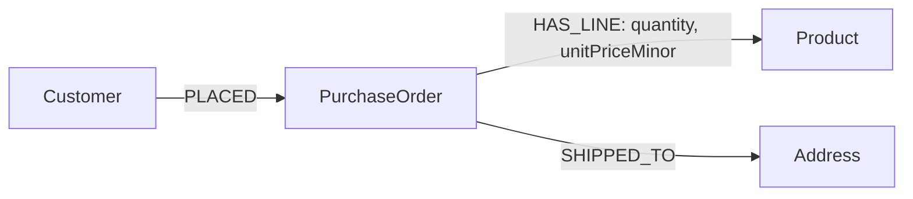

# Ranh giới aggregate và phạm vi đọc–ghi trong một đồ thị liên kết

Một đồ thị Neo4j có thể nối hàng nghìn node qua nhiều loại relationship, nhưng điều đó không có nghĩa một thao tác ghi phải tải và cập nhật toàn bộ vùng đồ thị liên quan. Khi thiết kế ứng dụng Spring Data Neo4j (SDN), cần phân biệt phạm vi truy vấn với ranh giới aggregate: truy vấn đọc có thể đi qua nhiều aggregate, còn một lệnh ghi nên tập trung vào aggregate root chịu trách nhiệm bảo vệ các quy tắc nhất quán của nó.

Ranh giới này giúp xác định dữ liệu nào cần được đọc để xử lý một lệnh, dữ liệu nào được phép thay đổi cùng nhau và transaction cần bao phủ đến đâu. Nó cũng giúp tránh việc biến một đồ thị kết nối phong phú thành một object graph quá lớn trong bộ nhớ ứng dụng.

## 1. Aggregate là ranh giới nhất quán

Trong Domain-Driven Design (DDD), aggregate là một nhóm đối tượng miền nghiệp vụ được quản lý như một đơn vị nhất quán. Mỗi aggregate có một **aggregate root** làm điểm truy cập chính từ bên ngoài. Các quy tắc nghiệp vụ cần được bảo đảm tức thời trong aggregate được kiểm tra thông qua root trước khi thay đổi được lưu.

Ví dụ trong hệ thống bán hàng:

- `PurchaseOrder` là aggregate root của đơn hàng.
- Các dòng hàng và thông tin số lượng, đơn giá tại thời điểm đặt hàng thuộc phạm vi nhất quán của đơn hàng.
- `Product` là một aggregate riêng, có vòng đời và quy tắc cập nhật riêng.
- `Customer` cũng có thể là một aggregate riêng.

Trong Neo4j, những thực thể này có thể được nối thành một đồ thị:



Sơ đồ mô tả các liên kết trong đồ thị. Ranh giới aggregate là quyết định của mô hình nghiệp vụ, không tự động được xác định bởi việc node có relationship hay không. `PurchaseOrder` có thể là root quản lý các dòng hàng của nó, trong khi `Product`, `Customer` và `Address` vẫn là các thực thể độc lập.

Một số nguyên tắc quan trọng:

- Aggregate root là điểm vào để thực hiện thay đổi nghiệp vụ đối với aggregate.
- Các bất biến cần đúng ngay sau mỗi lệnh phải được kiểm tra trong phạm vi aggregate liên quan.
- Aggregate khác thường được tham chiếu bằng định danh; không mặc nhiên trở thành một phần của object graph cần sửa cùng lúc.
- Relationship có thể mang dữ liệu nghiệp vụ riêng, nhưng việc có property trên relationship không tự quyết định aggregate ownership.
- Một transaction Neo4j có thể cập nhật nhiều node, nhưng việc gom nhiều aggregate vào một lệnh ghi làm tăng phạm vi nhất quán cần điều phối.

## 2. Không đồng nhất vùng đồ thị với aggregate

Đồ thị được thiết kế để thể hiện quan hệ. Một node `Customer` có thể nối với nhiều `PurchaseOrder`, mỗi đơn hàng nối với nhiều `Product`, và sản phẩm có thể được dùng trong hàng nghìn đơn hàng. Nếu coi toàn bộ vùng node có thể đi tới từ `Customer` là một aggregate, một thay đổi nhỏ như thêm dòng hàng có thể kéo theo việc tải một lượng lớn dữ liệu không liên quan.

Hãy phân biệt ba khái niệm:

| Khái niệm | Câu hỏi cần trả lời | Ví dụ |
|---|---|---|
| Đồ thị liên kết | Những thực thể nào có quan hệ với nhau? | Khách hàng đặt đơn hàng, đơn hàng chứa sản phẩm |
| Aggregate | Những dữ liệu nào phải được kiểm tra và thay đổi như một đơn vị nhất quán? | Đơn hàng và các dòng hàng của đơn hàng |
| Phạm vi truy vấn | Một use case cần đọc qua những node và relationship nào? | Báo cáo doanh thu theo khách hàng, sản phẩm và đơn hàng |

Một truy vấn báo cáo có thể đi qua nhiều aggregate để tổng hợp dữ liệu. Điều đó không khiến các aggregate được gộp thành một đơn vị ghi. Ngược lại, một lệnh thêm dòng hàng chỉ cần đọc đơn hàng, kiểm tra trạng thái và quy tắc của dòng hàng, rồi cập nhật phần dữ liệu thuộc aggregate đơn hàng.

## 3. Thiết kế aggregate root và relationship properties

Giả sử một đơn hàng có nhiều dòng hàng. Mỗi dòng hàng cần lưu số lượng và đơn giá tại thời điểm đặt hàng. Đơn giá này là dữ liệu lịch sử của giao dịch, không nên phụ thuộc vào giá hiện tại của sản phẩm.

Trong Neo4j, có thể mô hình hóa dòng hàng bằng relationship có property:

```cypher
CREATE (o:PurchaseOrder {orderId: 'ORD-1001', status: 'DRAFT'})
CREATE (p:Product {productId: 'PRD-01', name: 'Keyboard'})
CREATE (o)-[:HAS_LINE {quantity: 2, unitPriceMinor: 850000}]->(p);
```

Ở đây, `PurchaseOrder` là node root. Relationship `HAS_LINE` lưu số lượng và đơn giá chốt tại thời điểm tạo đơn. `Product` được tham chiếu từ đơn hàng và có thể thuộc một aggregate khác.

SDN hỗ trợ ánh xạ relationship có property bằng `@RelationshipProperties` và `@TargetNode`:

```java
import org.springframework.data.neo4j.core.schema.RelationshipId;
import org.springframework.data.neo4j.core.schema.RelationshipProperties;
import org.springframework.data.neo4j.core.schema.TargetNode;

@RelationshipProperties
public class OrderLine {

    @RelationshipId
    private Long id;

    private int quantity;
    private long unitPriceMinor;

    @TargetNode
    private Product product;

    protected OrderLine() {
    }

    public OrderLine(Product product, int quantity, long unitPriceMinor) {
        this.product = product;
        this.quantity = quantity;
        this.unitPriceMinor = unitPriceMinor;
    }
}
```

Aggregate root có thể ánh xạ collection các dòng hàng:

```java
import java.util.ArrayList;
import java.util.List;

import org.springframework.data.annotation.Id;
import org.springframework.data.annotation.Version;
import org.springframework.data.neo4j.core.schema.Node;
import org.springframework.data.neo4j.core.schema.Relationship;

@Node("PurchaseOrder")
public class PurchaseOrder {

    @Id
    private String orderId;

    @Version
    private Long version;

    private String status;

    @Relationship(type = "HAS_LINE")
    private List<OrderLine> lines = new ArrayList<>();

    protected PurchaseOrder() {
    }

    public void addLine(Product product, int quantity, long priceAtOrderMinor) {
        if (!"DRAFT".equals(status)) {
            throw new IllegalStateException("Only draft orders can be changed");
        }
        if (quantity <= 0) {
            throw new IllegalArgumentException("Quantity must be positive");
        }
        lines.add(new OrderLine(product, quantity, priceAtOrderMinor));
    }
}
```

Đây là ví dụ rút gọn về cấu trúc mapping; dự án cần bổ sung constructor, getter, setter hoặc phương thức miền nghiệp vụ phù hợp với cách SDN tạo và nạp entity. `orderId` là định danh do ứng dụng cấp. `@Version` dùng optimistic locking để phát hiện cập nhật dựa trên phiên bản cũ. Import `@Id` và `@Version` từ `org.springframework.data.annotation`; các annotation relationship thuộc package schema của SDN.

Trong mô hình này, `PurchaseOrder` kiểm soát việc thêm dòng hàng và trạng thái đơn. `OrderLine` là dữ liệu liên kết thuộc phạm vi đơn hàng, còn `Product` được tham chiếu như node riêng. Khi giá sản phẩm thay đổi, giá đã lưu trên `HAS_LINE` vẫn giữ nguyên lịch sử của đơn hàng.

Không phải relationship nào cũng cần class `@RelationshipProperties`. Nếu relationship không có property và không có hành vi miền nghiệp vụ riêng, một mapping relationship đơn giản có thể đủ. Nếu relationship có dữ liệu như số lượng, thứ tự, vai trò, thời điểm hiệu lực hoặc trạng thái, relationship properties thường thể hiện mô hình rõ hơn.

## 4. Xác định phạm vi đọc cho từng use case

Phạm vi đọc được quyết định bởi dữ liệu mà một màn hình, API hoặc quy trình cần trả lời. Nó có thể đi qua nhiều aggregate và không cần giống phạm vi ghi.

Ví dụ, màn hình chi tiết đơn hàng cần mã đơn, trạng thái, tên sản phẩm, số lượng và đơn giá đã chốt. Có thể truy vấn trực tiếp qua graph và trả về projection chỉ chứa các trường cần thiết:

```java
public interface OrderLineView {
    String getOrderId();
    String getProductId();
    String getProductName();
    Integer getQuantity();
    Long getUnitPriceMinor();
}
```

```java
import java.util.List;

import org.springframework.data.neo4j.repository.Neo4jRepository;
import org.springframework.data.neo4j.repository.query.Query;
import org.springframework.data.repository.query.Param;

public interface PurchaseOrderRepository
        extends Neo4jRepository<PurchaseOrder, String> {

    @Query("""
        MATCH (o:PurchaseOrder {orderId: $orderId})
              -[line:HAS_LINE]->(p:Product)
        RETURN o.orderId AS orderId,
               p.productId AS productId,
               p.name AS productName,
               line.quantity AS quantity,
               line.unitPriceMinor AS unitPriceMinor
        ORDER BY p.name
        """)
    List<OrderLineView> findOrderLines(@Param("orderId") String orderId);
}
```

Truy vấn đọc đi từ đơn hàng đến sản phẩm để lấy tên hiện tại của sản phẩm và số lượng, đơn giá lịch sử từ relationship. Kết quả là projection, không yêu cầu nạp toàn bộ entity graph vào bộ nhớ. Tùy phiên bản SDN và cách khai báo projection, cần bảo đảm alias trong `RETURN` khớp với tên property hoặc accessor mà projection yêu cầu.

Một số lựa chọn khi thiết kế phạm vi đọc:

1. Chỉ truy vấn các node và relationship thực sự cần cho use case.
2. Dùng projection hoặc DTO khi chỉ cần một tập trường nhỏ.
3. Dùng `DISTINCT` khi nhiều đường đi có thể tạo dòng kết quả trùng và nghiệp vụ muốn loại trùng.
4. Dùng `OPTIONAL MATCH` khi một liên kết có thể chưa tồn tại và kết quả vẫn cần được trả về.
5. Đặt điều kiện lọc gần pattern phù hợp và xem kế hoạch bằng `EXPLAIN` hoặc `PROFILE` khi truy vấn có nhiều bước.

Không nên nạp một aggregate lớn chỉ để hiển thị một con số hoặc một vài trường. Cũng không nên ép mọi truy vấn đọc phải đi qua aggregate root nếu một projection Cypher có thể trả lời use case trực tiếp và rõ ràng.

## 5. Xác định phạm vi ghi và bảo vệ bất biến

Một command nên bắt đầu từ aggregate root mà nó cần thay đổi. Root kiểm tra điều kiện nghiệp vụ trước khi thay đổi state. Ví dụ, thêm dòng hàng cần kiểm tra đơn vẫn ở trạng thái `DRAFT`, số lượng dương và các quy tắc liên quan đến sản phẩm.

Service có thể điều phối thao tác trong một transaction Spring:

```java
import org.springframework.stereotype.Service;
import org.springframework.transaction.annotation.Transactional;

@Service
public class OrderCommandService {

    private final PurchaseOrderRepository orders;
    private final ProductRepository products;

    public OrderCommandService(
            PurchaseOrderRepository orders,
            ProductRepository products) {
        this.orders = orders;
        this.products = products;
    }

    @Transactional
    public void addLine(
            String orderId,
            String productId,
            int quantity,
            long priceAtOrderMinor) {

        PurchaseOrder order = orders.findById(orderId)
                .orElseThrow(() -> new IllegalArgumentException("Order not found"));
        Product product = products.findById(productId)
                .orElseThrow(() -> new IllegalArgumentException("Product not found"));

        order.addLine(product, quantity, priceAtOrderMinor);
        orders.save(order);
    }
}
```

Service nạp root cần thay đổi, lấy tham chiếu sản phẩm và gọi hành vi miền nghiệp vụ trên root. `@Transactional` tạo phạm vi transaction cho các thao tác repository trong service. Hãy cấu hình transaction manager Neo4j của ứng dụng và gọi phương thức qua Spring proxy để transaction được áp dụng đúng.

Ví dụ này giả định `findById` nạp đủ các dòng hàng mà quy tắc `addLine` cần kiểm tra. Trong ứng dụng thực tế, cần xác định rõ dữ liệu quan hệ nào phải được nạp để thực thi invariant; nếu collection bị giới hạn hoặc chưa đầy đủ, hãy dùng truy vấn nạp phù hợp hoặc truy vấn kiểm tra chuyên biệt trước khi lưu.

Không nên lấy một projection chỉ có vài trường, chuyển nó thành entity có collection rỗng rồi gọi `save` như thể đó là toàn bộ aggregate. Khi SDN lưu entity có mapping relationship, tập quan hệ trong object graph có thể ảnh hưởng đến trạng thái quan hệ được đồng bộ. Hãy bảo đảm entity dùng cho lệnh ghi có dữ liệu quan hệ cần thiết và hiểu rõ save semantics của phiên bản SDN đang dùng.

## 6. Transaction và cập nhật nhiều aggregate

Transaction Neo4j cho phép nhóm nhiều thao tác đọc/ghi để commit hoặc rollback cùng nhau. Trong SDN, `@Transactional` ở tầng service thường là nơi thể hiện ranh giới transaction của use case.

Tuy vậy, transaction database và aggregate boundary giải quyết hai câu hỏi khác nhau:

- Transaction xác định các thao tác database nào cùng commit hoặc rollback.
- Aggregate xác định nhóm dữ liệu nào cần bảo vệ các invariant như một đơn vị nghiệp vụ.

Một lệnh cập nhật `PurchaseOrder` không nên tự ý sửa dữ liệu mô tả `Product` chỉ vì hai node đang nối với nhau. Nếu nghiệp vụ yêu cầu thay đổi nhiều aggregate và cần tính nguyên tử ngay lập tức, có thể cân nhắc một transaction Neo4j bao trùm các thay đổi đó, nhưng cần kiểm soát phạm vi, khóa cạnh tranh và nguy cơ phụ thuộc chặt giữa các phần miền nghiệp vụ.

Nếu các bước có thể hoàn tất độc lập hoặc kéo dài qua nhiều hệ thống, hãy cân nhắc quy trình nghiệp vụ theo sự kiện hoặc saga. Ví dụ, xác nhận đơn hàng có thể phát sinh yêu cầu giữ tồn kho, thanh toán và giao hàng; mỗi phần quản lý state riêng và quy trình điều phối xử lý thành công hoặc bù trừ khi một bước thất bại.

### Phát hiện cập nhật đồng thời

Khi hai request cùng đọc một aggregate rồi cập nhật gần như đồng thời, optimistic locking giúp phát hiện request dựa trên phiên bản cũ. Trong SDN có thể khai báo trường `@Version` trên entity:

```java
@Version
private Long version;
```

SDN dùng giá trị phiên bản để kiểm tra cập nhật. Nếu một request đã ghi phiên bản mới trước request còn lại, request cũ có thể gặp lỗi optimistic locking thay vì âm thầm ghi đè thay đổi. Ứng dụng cần xử lý trường hợp xung đột bằng cách tải lại dữ liệu, kiểm tra lại điều kiện nghiệp vụ và yêu cầu thử lại khi phù hợp.

Optimistic locking không thay thế transaction và cũng không tự bảo vệ mọi invariant xuyên nhiều aggregate. Nó hỗ trợ phát hiện xung đột cập nhật trên entity được version hóa.

## 7. Chọn chiến lược đọc và ghi theo nhu cầu

Một mô hình tốt có thể dùng nhiều kiểu truy cập khác nhau trên cùng đồ thị:

| Nhu cầu | Phạm vi phù hợp | Cách triển khai gợi ý |
|---|---|---|
| Thêm dòng hàng vào đơn | Aggregate `PurchaseOrder` | Nạp root và dữ liệu cần cho invariant, gọi hành vi trên root, lưu trong transaction |
| Đổi tên sản phẩm | Aggregate `Product` | Nạp và cập nhật Product qua repository của nó |
| Hiển thị chi tiết đơn hàng | Đơn hàng, relationship dòng hàng và sản phẩm | Cypher projection/DTO chỉ lấy các trường cần thiết |
| Báo cáo doanh thu theo khách hàng | Nhiều khách hàng, đơn hàng và dòng hàng | Truy vấn tổng hợp qua graph, có thể dùng projection hoặc read model |
| Xác nhận đơn và yêu cầu giữ tồn kho | Nhiều aggregate và quy trình nghiệp vụ | Transaction ngắn nếu cần nguyên tử trong một database; sự kiện/saga nếu có nhiều bước độc lập |

Khi truy vấn đọc trở nên phức tạp hoặc chạy thường xuyên, có thể xây dựng read model phù hợp với màn hình hoặc báo cáo. Read model có thể được tính từ graph gốc hoặc cập nhật qua sự kiện. Nó giúp tối ưu đọc mà không buộc mô hình ghi phải có cấu trúc giống hệt màn hình.

## 8. Những lỗi thiết kế thường gặp

| Lỗi | Hệ quả | Hướng xử lý |
|---|---|---|
| Coi mọi node có thể đi tới là cùng một aggregate | Aggregate quá lớn, tải và cập nhật nhiều dữ liệu không cần thiết | Xác định boundary theo invariant và vòng đời nghiệp vụ |
| Coi mọi relationship là quan hệ sở hữu | Dễ làm thay đổi node dùng chung khi lưu một aggregate | Phân biệt relationship thuộc aggregate với liên kết tham chiếu sang aggregate khác |
| Dùng entity graph ghi cho mọi truy vấn đọc | Nạp nhiều dữ liệu và tăng chi phí mapping | Dùng projection hoặc DTO cho use case đọc |
| Lưu entity có collection quan hệ chưa đầy đủ | Có thể làm mất hoặc thay đổi liên kết ngoài ý muốn tùy mapping và save semantics | Nạp đúng dữ liệu cần ghi; không biến projection thành aggregate để save |
| Đặt invariant ở controller hoặc repository query rời rạc | Quy tắc nghiệp vụ bị phân tán và dễ bị bỏ qua | Đưa hành vi và kiểm tra vào aggregate root hoặc domain service phù hợp |
| Gộp nhiều aggregate vào một transaction theo thói quen | Tăng cạnh tranh và liên kết chặt giữa các use case | Chỉ dùng transaction rộng khi cần tính nguyên tử tức thời |
| Cho rằng `@Version` thay thế transaction | Các thao tác nhiều bước có thể không còn nguyên tử | Kết hợp optimistic locking với transaction phù hợp |

## 9. Quy trình thiết kế cho một use case

Trước khi viết repository hoặc Cypher, hãy mô tả use case bằng các câu hỏi sau:

1. **Lệnh hay truy vấn?** Use case thay đổi state hay chỉ đọc dữ liệu?
2. **Root nào chịu trách nhiệm?** Aggregate root nào bảo vệ invariant cần kiểm tra?
3. **Cần nạp gì?** Chỉ tải các node, relationship và property cần để thực thi quy tắc nghiệp vụ.
4. **Có thay đổi aggregate khác không?** Nếu có, xác định rõ lý do cần nhất quán tức thời và phạm vi transaction.
5. **Kết quả cần trả về là gì?** Entity, projection hay DTO? Với truy vấn đọc, ưu tiên đúng tập trường cần dùng.
6. **Có cạnh tranh cập nhật không?** Cân nhắc `@Version` và cách xử lý optimistic locking.
7. **Truy vấn có mở rộng quá rộng không?** Đặt điều kiện lọc, giới hạn traversal khi thích hợp và kiểm tra bằng `PROFILE`.

Áp dụng vào use case thêm sản phẩm vào đơn hàng: đây là command; `PurchaseOrder` là root; cần nạp đơn và dữ liệu sản phẩm cần thiết; thay đổi nằm trong aggregate đơn hàng; lưu trong transaction; kiểm tra version khi có cập nhật đồng thời. Với màn hình hiển thị đơn, truy vấn có thể đi từ đơn qua relationship đến sản phẩm và trả về projection. Hai use case dùng cùng đồ thị nhưng có phạm vi đọc–ghi khác nhau.

## Kết luận

Aggregate boundary là ranh giới nhất quán của mô hình nghiệp vụ, còn graph traversal là cách truy cập các node và relationship cần cho một use case. Trong Spring Data Neo4j, hãy để aggregate root bảo vệ các thay đổi thuộc phạm vi của nó, dùng transaction cho đơn vị công việc cần commit hoặc rollback cùng nhau, và dùng Cypher projection hoặc DTO cho các truy vấn đọc qua nhiều aggregate. Phân biệt rõ hai phạm vi này giúp mô hình đồ thị giữ được tính liên kết mà các thao tác ghi vẫn có giới hạn và dễ kiểm soát.
