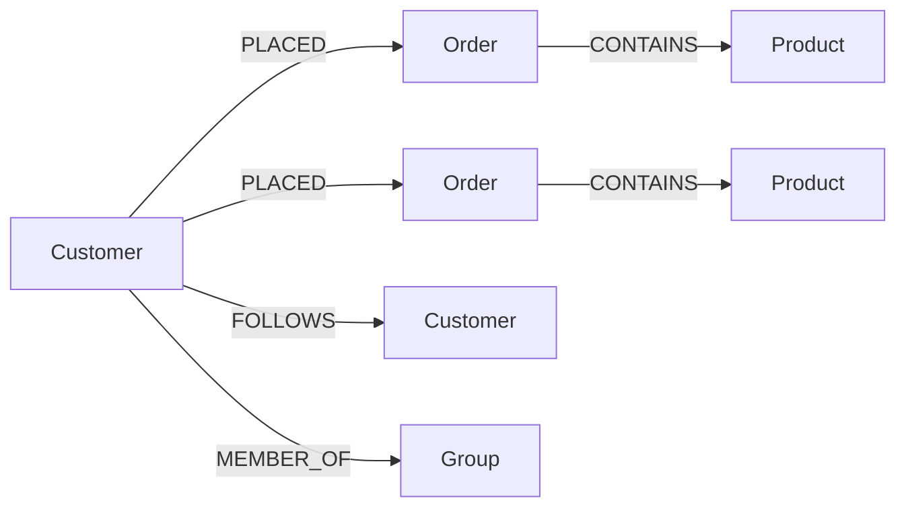

# Chọn hướng ánh xạ theo ca sử dụng thay vì sao chép mọi quan hệ

## Mục tiêu bài học

Một graph Neo4j có thể chứa rất nhiều loại relationship giữa các node. Tuy nhiên, một màn hình hoặc một nghiệp vụ thường chỉ cần đi qua một phần nhỏ của graph. Khi dùng Spring Data Neo4j (SDN), việc đưa tất cả relationship vào mọi entity có thể làm object graph phức tạp, truy vấn nặng và khó kiểm soát cập nhật.

Bài học này hướng dẫn cách chọn relationship cần ánh xạ dựa trên ca sử dụng, xác định hướng từ góc nhìn của node đang được ánh xạ, và chọn giữa entity mapping, relationship properties hoặc truy vấn trả về projection. Mục tiêu là xây dựng tầng dữ liệu đồ thị phù hợp với cách ứng dụng đọc và ghi dữ liệu, đồng thời giữ được ý nghĩa của mô hình Neo4j.

## 1. Mô hình graph và object graph phục vụ những mục đích khác nhau

Giả sử một hệ thống bán hàng có graph như sau:



Graph có thể biểu diễn toàn bộ các liên kết trên. Nhưng từng ca sử dụng có phạm vi khác nhau:

- Trang hồ sơ khách hàng cần thông tin khách hàng và có thể cần danh sách đơn hàng gần đây.
- Trang chi tiết đơn hàng cần đơn hàng, các sản phẩm trong đơn và có thể cần tên khách hàng.
- Báo cáo doanh thu chỉ cần một số thuộc tính của đơn hàng, không cần nạp toàn bộ entity khách hàng hoặc sản phẩm.
- Trang cộng đồng cần các nhóm khách hàng tham gia, không cần duyệt các đơn hàng.

Entity mapping mô tả cách SDN ánh xạ node và những relationship mà ứng dụng muốn truy cập qua entity. Nó không phải là bản sao bắt buộc của toàn bộ graph. Nếu thêm mọi relationship vào mọi entity chỉ vì chúng tồn tại trong Neo4j, ứng dụng sẽ tạo ra một object graph lớn hơn nhu cầu thực tế.

Một nguyên tắc hữu ích là: **ánh xạ đường đi mà ca sử dụng thực sự cần, rồi dùng truy vấn chuyên biệt cho những góc nhìn còn lại**. Một relationship vẫn tồn tại và có thể được truy vấn bằng Cypher dù entity hiện tại không khai báo trường tương ứng.

## 2. Chọn hướng relationship từ góc nhìn của entity

Relationship trong Neo4j có hướng từ node bắt đầu đến node kết thúc. Trong SDN, thuộc tính `direction` của `@Relationship` mô tả hướng đi từ entity đang chứa trường quan hệ:

- `Direction.OUTGOING`: relationship đi từ node hiện tại đến node đích.
- `Direction.INCOMING`: relationship đi từ node nguồn khác vào node hiện tại.

Ví dụ graph có cạnh:

```cypher
(:Customer)-[:PLACED]->(:Order)
```

Nếu entity gốc là `Customer`, trường danh sách đơn hàng là quan hệ outgoing. Nếu entity gốc là `Order`, trường khách hàng là quan hệ incoming. Hướng trong graph không đổi; chỉ góc nhìn ánh xạ thay đổi.

### Ca sử dụng lấy đơn hàng từ khách hàng

Khi nghiệp vụ thường bắt đầu từ khách hàng rồi xem các đơn hàng của họ, có thể ánh xạ theo hướng outgoing:

```java
@Node("Customer")
public class Customer {

    @Id
    private String id;

    private String name;

    @Relationship(type = "PLACED", direction = Direction.OUTGOING)
    private Set<Order> orders = new LinkedHashSet<>();

    // Constructor, getter và setter được lược bỏ.
}

@Node("Order")
public class Order {

    @Id
    private String id;

    private String number;

    private BigDecimal total;

    private LocalDateTime createdAt;

    // Constructor, getter và setter được lược bỏ.
}
```

Trường `orders` biểu diễn các node `Order` mà khách hàng hiện tại đã tạo. Dùng `Set` nếu tập liên kết cần loại bỏ phần tử trùng theo quy tắc equality của entity; dùng `List` khi thứ tự hoặc việc giữ các phần tử lặp có ý nghĩa. Thứ tự kết quả vẫn nên được quy định rõ trong truy vấn nếu nghiệp vụ yêu cầu sắp xếp.

### Ca sử dụng bắt đầu từ đơn hàng

Nếu ứng dụng chủ yếu mở trang chi tiết đơn hàng và cần biết khách hàng đặt đơn đó, có thể chọn entity `Order` làm điểm bắt đầu ánh xạ:

```java
@Node("Order")
public class Order {

    @Id
    private String id;

    private String number;

    @Relationship(type = "PLACED", direction = Direction.INCOMING)
    private Customer customer;

    // Các thuộc tính và phương thức khác được lược bỏ.
}
```

Với khai báo này, SDN tìm node `Customer` có relationship `PLACED` hướng vào `Order` hiện tại. Ví dụ trên là một lựa chọn mô hình theo góc nhìn đơn hàng. Không cần khai báo thêm một trường quan hệ đối ứng trên `Customer` chỉ để lặp lại cùng một liên kết nếu ca sử dụng không cần điều đó.

Nếu một ứng dụng có nhiều luồng nghiệp vụ cần cả hai góc nhìn, hãy cân nhắc giữ một mô hình entity nhất quán và dùng truy vấn tùy chỉnh cho góc nhìn còn lại. Chỉ ánh xạ hai chiều khi object model thực sự cần điều hướng từ cả hai phía và nhóm phát triển đã kiểm soát được việc lưu, nạp và tuần tự hóa object graph.

## 3. Khi nào nên ánh xạ relationship thành thuộc tính của entity?

Hãy khai báo `@Relationship` khi entity cần điều hướng qua liên kết đó trong những thao tác đọc hoặc ghi thường xuyên. Không cần thêm trường quan hệ chỉ vì graph có cạnh tương ứng.

| Nhu cầu của ca sử dụng | Cách biểu diễn phù hợp |
|---|---|
| Đọc khách hàng và danh sách đơn hàng của họ | Trường `@Relationship` trên `Customer` |
| Mở đơn hàng và tìm khách hàng đặt đơn | Relationship `PLACED` incoming trên `Order`, nếu đây là đường đi thường dùng |
| Chỉ lấy mã đơn, số đơn và tổng tiền cho bảng báo cáo | Cypher với projection hoặc DTO |
| Lọc đơn hàng theo trạng thái hoặc thời gian mà không cần object graph đầy đủ | Truy vấn Cypher chuyên biệt trả về các trường cần thiết |
| Lưu vai trò thành viên hoặc thời điểm tham gia trên chính liên kết | `@RelationshipProperties` |
| Quan hệ ít dùng, chỉ xuất hiện trong một truy vấn đặc thù | Không nhất thiết phải đưa vào entity mapping |

Một trường `@Relationship` có thể khiến SDN phải nạp thêm các node và relationship theo cấu trúc mapping. Nếu entity lại chứa những entity khác có nhiều trường quan hệ, phạm vi object graph có thể mở rộng qua nhiều tầng. Hãy cân nhắc số lượng liên kết, độ sâu và số node có thể được nạp khi thiết kế.

### Relationship có thuộc tính riêng

Nếu dữ liệu mô tả chính liên kết, ví dụ vai trò của khách hàng trong một nhóm, hãy dùng lớp relationship properties. Giá trị `role` có thể khác nhau ở từng nhóm nên không phù hợp để đặt thành thuộc tính chung trên `Customer`:

```java
@Node("Customer")
public class Customer {

    @Id
    private String id;

    @Relationship(type = "MEMBER_OF", direction = Direction.OUTGOING)
    private Set<Membership> memberships = new LinkedHashSet<>();

    // Constructor, getter và setter được lược bỏ.
}

@Node("Group")
public class Group {

    @Id
    private String id;

    private String name;

    // Constructor, getter và setter được lược bỏ.
}

@RelationshipProperties
public class Membership {

    @RelationshipId
    private Long relationshipId;

    private String role;

    private LocalDate joinedAt;

    @TargetNode
    private Group group;

    // Constructor, getter và setter được lược bỏ.
}
```

Trong ví dụ này, `Membership` mô tả relationship `MEMBER_OF`. `@TargetNode` đánh dấu node đích là `Group`; các trường `role` và `joinedAt` là thuộc tính của relationship. `@RelationshipId` là định danh nội bộ do SDN quản lý, không phải mã nghiệp vụ của thành viên.

Nếu ca sử dụng chỉ cần danh sách nhóm mà khách hàng tham gia và không cần thuộc tính trên liên kết, một collection trỏ trực tiếp đến `Group` sẽ đơn giản hơn. Chọn lớp relationship properties khi metadata của cạnh thực sự được dùng trong domain logic hoặc truy vấn.

## 4. Dùng projection khi ca sử dụng chỉ cần một góc nhìn dữ liệu

Entity mapping phù hợp khi ứng dụng cần làm việc với domain object và các liên kết của nó. Các trang danh sách, báo cáo và API đọc thường chỉ cần một tập trường nhỏ. Với các trường hợp đó, truy vấn Cypher trả về projection giúp tránh nạp toàn bộ object graph.

Ví dụ, màn hình lịch sử mua hàng chỉ cần mã đơn, số đơn và tổng tiền:

```java
public interface OrderSummary {
    String getOrderId();
    String getOrderNumber();
    BigDecimal getTotal();
}
```

Repository có thể khai báo truy vấn riêng:

```java
public interface CustomerRepository
        extends Neo4jRepository<Customer, String> {

    @Query("MATCH (c:Customer)-[:PLACED]->(o:Order) " +
           "WHERE c.id = $customerId " +
           "RETURN o.id AS orderId, " +
           "o.number AS orderNumber, " +
           "o.total AS total " +
           "ORDER BY o.createdAt DESC")
    List<OrderSummary> findOrderSummaries(
            @Param("customerId") String customerId);
}
```

Truy vấn bắt đầu từ `Customer`, đi theo `PLACED` đến `Order`, rồi chỉ trả về ba trường mà màn hình cần. Alias trong `RETURN` cần khớp với getter của projection. Nếu cần giới hạn số đơn gần đây, có thể thêm tham số giới hạn và mệnh đề `LIMIT` phù hợp với quy tắc phân trang của ứng dụng.

Điểm quan trọng là truy vấn vẫn duyệt được relationship `PLACED` dù entity `Customer` không khai báo trường `orders`. Cypher mô tả đường đi trong graph; entity mapping mô tả object graph mà SDN ánh xạ. Hai cơ chế hỗ trợ nhau nhưng không bắt buộc phải giống hệt nhau.

Projection cũng hữu ích khi cần truy vấn từ hướng ngược lại. Ví dụ, tìm khách hàng đã đặt một đơn hàng cụ thể:

```cypher
MATCH (c:Customer)-[:PLACED]->(o:Order {id: $orderId})
RETURN c.id AS customerId, c.name AS customerName
```

Truy vấn này không đòi hỏi entity `Order` phải có trường `customer`. Khi góc nhìn chỉ phục vụ một endpoint hoặc một báo cáo, projection thường giúp giữ entity gọn và làm rõ dữ liệu trả về.

## 5. Chọn mô hình cho thao tác ghi

Khi ghi dữ liệu, cần xác định entity nào là aggregate root và những relationship nào thuộc phạm vi cập nhật của nghiệp vụ. Ví dụ, quy trình tạo đơn hàng có thể bắt đầu từ một khách hàng, tạo node `Order`, rồi nối bằng relationship `PLACED`. Các bước cần thành công hoặc thất bại cùng nhau nên nằm trong một transaction ở tầng service:

```java
@Service
public class OrderService {

    private final CustomerRepository customerRepository;

    public OrderService(CustomerRepository customerRepository) {
        this.customerRepository = customerRepository;
    }

    @Transactional
    public void placeOrder(String customerId, Order order) {
        Customer customer = customerRepository.findById(customerId)
                .orElseThrow(() -> new IllegalArgumentException(
                        "Customer not found"));

        // Kiểm tra dữ liệu đơn hàng và quy tắc nghiệp vụ.
        // Gắn order vào aggregate theo mô hình đã chọn.
        // customer.addOrder(order);
        // customerRepository.save(customer);
    }
}
```

Đây là khung minh họa ranh giới transaction; phần gắn và lưu relationship cần được triển khai theo constructor, phương thức domain và quy tắc aggregate của ứng dụng. Không nên xem một object entity chỉ chứa một phần thuộc tính hoặc một phần collection relationship như một bản vá tự động. Khi gọi `save`, hãy hiểu rõ phạm vi dữ liệu quan hệ mà object graph đại diện và cách phiên bản SDN của dự án đồng bộ các liên kết đó.

Với cập nhật nhỏ như đổi vai trò trên một relationship, một câu Cypher có tham số có thể rõ ràng hơn việc nạp và lưu lại toàn bộ aggregate:

```cypher
MATCH (c:Customer {id: $customerId})-[r:MEMBER_OF]->(g:Group {id: $groupId})
SET r.role = $role
RETURN c.id AS customerId, g.id AS groupId, r.role AS role
```

Đặt câu lệnh trong repository hoặc thành phần truy cập dữ liệu phù hợp, rồi gọi từ service có transaction nếu nghiệp vụ gồm nhiều thao tác cần tính nguyên tử. Truy vấn tùy chỉnh cần trả về đúng dữ liệu mà tầng gọi mong đợi; không giả định rằng cập nhật bằng Cypher sẽ tự đồng bộ mọi object đang nằm trong bộ nhớ.

## 6. Tránh object graph quá rộng và vòng tham chiếu

Ánh xạ relationship ở cả hai phía có thể tạo cấu trúc tham chiếu vòng trong Java. Chẳng hạn `Customer` chứa danh sách `Order`, đồng thời mỗi `Order` lại chứa `Customer`. Khi tuần tự hóa trực tiếp entity thành JSON, cấu trúc này có thể gây đệ quy hoặc tạo payload lớn ngoài ý muốn.

Một số nguyên tắc giúp giữ mô hình dễ quản lý:

- Chọn một phía làm đường điều hướng chính cho từng aggregate hoặc ca sử dụng.
- Dùng projection hoặc DTO cho API thay vì trả trực tiếp entity có nhiều relationship.
- Chỉ ánh xạ relationship mà domain logic thực sự cần truy cập.
- Dùng truy vấn có điều kiện, giới hạn kết quả và trả về các trường cần thiết.
- Tránh dùng collection relationship không giới hạn cho các node có thể có số liên kết rất lớn.
- Tách các truy vấn báo cáo khỏi thao tác nạp và lưu aggregate khi hai nhu cầu có phạm vi dữ liệu khác nhau.

Một graph có thể có nhiều cạnh và nhiều hướng duyệt, nhưng điều đó không có nghĩa mọi object Java đều phải giữ tham chiếu đến tất cả node lân cận. Truy vấn Cypher cho phép ứng dụng khai thác graph theo nhu cầu mà không cần mở rộng entity mapping cho mọi trường hợp.

## 7. Kiểm tra hiệu quả truy vấn

Sau khi chọn các relationship cần ánh xạ, hãy kiểm tra truy vấn mà SDN thực thi hoặc câu Cypher tùy chỉnh. Một số điểm nên xem xét:

1. **Điểm bắt đầu:** Truy vấn có định vị node nguồn bằng nhãn và thuộc tính có index hay không?
2. **Hướng duyệt:** Mẫu relationship có đi đúng chiều nghiệp vụ và đúng kiểu không?
3. **Phạm vi mở rộng:** Truy vấn có duyệt sang những nhánh mà ca sử dụng không cần không?
4. **Kết quả:** Ứng dụng cần entity graph hay chỉ cần vài trường trong projection?
5. **Kích thước:** Collection có thể tăng không giới hạn hay cần phân trang, giới hạn hoặc truy vấn riêng?
6. **Kế hoạch thực thi:** Dùng `EXPLAIN` để xem kế hoạch dự kiến và `PROFILE` để đo các operator, số dòng và lượng dữ liệu thực tế.

Nếu một entity được dùng ở nhiều màn hình với nhu cầu dữ liệu khác nhau, đừng mặc định tăng số trường relationship trên entity cho đến khi nó trở thành một object graph khổng lồ. Hãy xác định ca sử dụng nào cần domain entity, ca sử dụng nào cần projection và đo truy vấn trên dữ liệu có quy mô đại diện.

## 8. Các lỗi thiết kế thường gặp

| Cách làm | Vấn đề | Điều chỉnh |
|---|---|---|
| Ánh xạ mọi relationship có trong graph vào entity | Object graph lớn và khó dự đoán phạm vi nạp | Chỉ ánh xạ liên kết cần cho domain logic |
| Chọn `OUTGOING` hoặc `INCOMING` theo tên trường Java | Hướng không khớp với hướng cạnh trong graph | Xác định node nguồn và node đích trước khi khai báo |
| Khai báo quan hệ đối ứng ở mọi entity | Có thể tạo tham chiếu vòng và làm thao tác lưu khó kiểm soát | Chọn hướng điều hướng chính; dùng truy vấn cho góc nhìn khác |
| Dùng entity đầy đủ cho bảng báo cáo | Nạp nhiều thuộc tính và quan hệ không cần thiết | Dùng `@Query` và projection |
| Đặt thuộc tính của relationship lên node | Dữ liệu bị gắn sai phạm vi, ví dụ vai trò thành viên chỉ có một giá trị cho mọi nhóm | Dùng `@RelationshipProperties` |
| Lưu object được dựng thiếu relationship như bản vá | Có nguy cơ làm trạng thái graph khác với ý định cập nhật | Nạp đúng aggregate hoặc dùng Cypher update có phạm vi cụ thể |
| Trả entity trực tiếp từ API | Payload lớn hoặc gặp vòng tham chiếu | Chuyển sang DTO phù hợp với endpoint |

## 9. Tự kiểm tra

1. Graph có `(:Customer)-[:PLACED]->(:Order)`. Nếu entity gốc là `Customer` và cần danh sách đơn hàng, nên chọn hướng nào?
2. Nếu entity gốc là `Order` và cần điều hướng đến khách hàng đặt đơn, hướng ánh xạ thay đổi ra sao?
3. Một báo cáo chỉ cần mã đơn và tổng tiền. Có nhất thiết phải nạp entity `Customer` cùng các relationship của nó không?
4. Khi một relationship `MEMBER_OF` có thuộc tính `role`, nên đặt `role` ở đâu?
5. Vì sao cần cẩn trọng khi gọi `save` với entity được dựng từ một phần dữ liệu?
6. Nếu Cypher có thể truy vấn cạnh theo cả hai hướng, điều đó có buộc entity phải khai báo relationship ở cả hai phía không?

Hãy chọn một endpoint cụ thể của ứng dụng, ghi rõ node bắt đầu, relationship cần duyệt và các trường cần trả về. Từ đó quyết định endpoint nên dùng entity mapping hay projection. Thử so sánh hai cách bằng `EXPLAIN` hoặc `PROFILE` trên dữ liệu có kích thước gần với môi trường thực tế.
