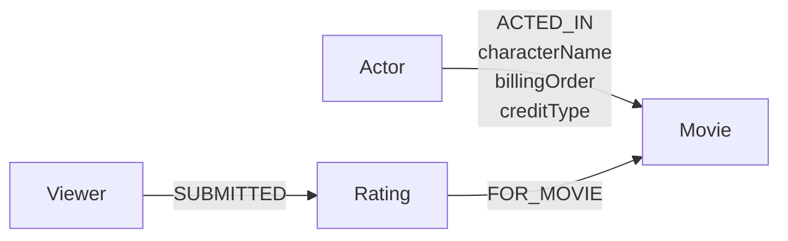
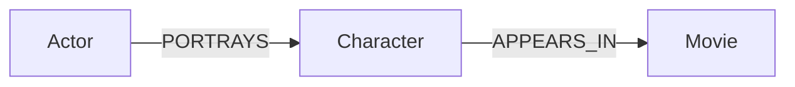

# Thiết kế mô hình phim, diễn viên, vai diễn và đánh giá

Một ứng dụng phim thường cần trả lời những câu hỏi như: phim nào có sự tham gia của một diễn viên, diễn viên đóng nhân vật nào, thứ tự xuất hiện trong danh sách diễn viên ra sao, ai đã đánh giá phim và điểm trung bình hiện tại là bao nhiêu? Đây là bài toán phù hợp với Neo4j vì dữ liệu có nhiều mối liên hệ và các truy vấn thường đi qua nhiều loại đối tượng.

Với Spring Data Neo4j (SDN), ta thiết kế đồ thị trước, sau đó ánh xạ node thành entity Java, relationship thành trường quan hệ hoặc lớp relationship properties, rồi dùng repository và Cypher để thao tác. Bài học này xây dựng một mô hình có bốn loại node chính: `Movie`, `Actor`, `Viewer` và `Rating`. Vai diễn của diễn viên trong một phim được biểu diễn bằng relationship `ACTED_IN` có property.

## 1. Xác định yêu cầu và ranh giới dữ liệu

Giả sử hệ thống cần quản lý các thông tin sau:

- Một phim có tiêu đề, năm phát hành và ngôn ngữ gốc.
- Một diễn viên có thể tham gia nhiều phim; một phim có thể có nhiều diễn viên.
- Một diễn viên có thể đóng nhiều vai trong cùng một phim. Mỗi lần tham gia có tên nhân vật, loại vai và thứ tự hiển thị trong danh sách diễn viên.
- Một người xem có thể gửi đánh giá cho nhiều phim. Một phim có thể nhận nhiều đánh giá.
- Mỗi đánh giá có điểm số, nội dung nhận xét, thời điểm gửi và trạng thái kiểm duyệt.

Trước khi tạo entity, cần quyết định thông tin nào là một đối tượng độc lập, thông tin nào chỉ mô tả mối liên hệ. Tiêu đề và năm phát hành mô tả phim nên thuộc node `Movie`. Tên nhân vật và thứ tự credit chỉ có ý nghĩa khi một diễn viên tham gia một phim cụ thể, vì vậy chúng thuộc relationship `ACTED_IN`. Một đánh giá có người gửi, phim được đánh giá, thời điểm và trạng thái riêng; nó có vòng đời riêng nên được mô hình hóa thành node `Rating`.

## 2. Sơ đồ đồ thị đề xuất

*Mỗi mũi tên biểu diễn hướng lưu trữ của relationship trong Neo4j.*



| Thành phần | Loại | Dữ liệu tiêu biểu | Lý do thiết kế |
|---|---|---|---|
| `Movie` | Node, label `Movie` | `id`, `title`, `releaseYear`, `originalLanguage` | Phim có định danh và thuộc tính riêng |
| `Actor` | Node, label `Actor` | `id`, `name` | Diễn viên xuất hiện trong nhiều phim |
| `ACTED_IN` | Relationship từ `Actor` tới `Movie` | `characterName`, `billingOrder`, `creditType` | Mô tả vai diễn và credit trong một phim cụ thể |
| `Viewer` | Node, label `Viewer` | `id`, `displayName` | Người gửi đánh giá có thể tham gia nhiều hoạt động khác |
| `Rating` | Node, label `Rating` | `id`, `score`, `reviewText`, `createdAt`, `status` | Đánh giá có trạng thái và vòng đời riêng |
| `SUBMITTED` | Relationship từ `Viewer` tới `Rating` | Thường không cần property | Xác định ai gửi đánh giá |
| `FOR_MOVIE` | Relationship từ `Rating` tới `Movie` | Thường không cần property | Xác định phim được đánh giá |

Mô hình tách `Rating` thành node giúp lưu lịch sử, kiểm duyệt, phản hồi hoặc các sự kiện liên quan đến đánh giá mà không phải nhồi thêm nhiều thuộc tính vào một relationship. Nếu hệ thống chỉ cần một điểm đánh giá hiện tại cho mỗi người xem và phim, không có vòng đời độc lập, có thể dùng relationship `RATED` với các property như `score` và `createdAt`; lựa chọn này được so sánh ở phần sau.

## 3. Thiết kế node Movie và Actor

### Movie

`Movie` đại diện cho một tác phẩm phim. `id` là mã ổn định do ứng dụng cấp; `title` không nên được dùng làm định danh vì có thể có nhiều phim trùng tên, bản làm lại hoặc phiên bản phát hành ở các thị trường khác nhau.

```java
@Node("Movie")
public class Movie {

    @Id
    private String id;

    private String title;

    private Integer releaseYear;

    private String originalLanguage;
}
```

Với `@Node("Movie")`, SDN ánh xạ entity này tới node có label `Movie`. Các trường thông thường như `title` và `releaseYear` được ánh xạ thành property cùng tên. Vì ví dụ dùng mã nghiệp vụ kiểu `String`, ứng dụng phải gán `id` trước khi lưu và tạo unique constraint tương ứng trong Neo4j.

### Actor

`Actor` đại diện cho diễn viên. Mối quan hệ tham gia phim được khai báo ở phía diễn viên theo hướng đi ra ngoài:

```java
@Node("Actor")
public class Actor {

    @Id
    private String id;

    private String name;

    @Relationship(type = "ACTED_IN", direction = Relationship.Direction.OUTGOING)
    private List<ActingCredit> filmography = new ArrayList<>();
}
```

`filmography` là danh sách các lần tham gia phim. Dùng `List` giúp giữ được nhiều credit giữa cùng một diễn viên và một phim, chẳng hạn diễn viên đóng hai nhân vật trong cùng tác phẩm. Mỗi phần tử có thể chứa dữ liệu relationship và node phim đích.

Không cần khai báo thêm một collection ngược trên `Movie` chỉ để có thể truy vấn danh sách diễn viên. Cypher có thể đi ngược chiều từ `Movie` tới `Actor`. Chỉ thêm mapping hai chiều khi use case cần nó và nhóm phát triển đã xác định rõ cách SDN đọc, cập nhật các liên kết đó.

## 4. Biểu diễn vai diễn bằng relationship properties

Vai diễn trong ví dụ là thông tin về lần một diễn viên tham gia một phim. Tên nhân vật, loại vai và thứ tự credit thay đổi theo từng phim, vì vậy chúng thuộc relationship `ACTED_IN`, không thuộc riêng `Actor` hay `Movie`.

SDN dùng `@RelationshipProperties` để ánh xạ relationship có property. Trường `@TargetNode` tham chiếu tới node ở đầu kia của relationship:

```java
@RelationshipProperties
public class ActingCredit {

    @RelationshipId
    private Long id;

    private String characterName;

    private Integer billingOrder;

    private String creditType;

    @TargetNode
    private Movie movie;
}
```

`@RelationshipId` là định danh kỹ thuật do SDN sử dụng để nhận diện relationship khi ánh xạ. Không nên coi giá trị này là mã vai diễn nghiệp vụ hoặc công khai nó như một ID ổn định cho API. Nếu nghiệp vụ cần mã credit riêng, hãy khai báo một property do ứng dụng quản lý và xác định quy tắc duy nhất cho nó.

`@TargetNode` chỉ rõ node đích của `ACTED_IN`. Khi SDN tải `Actor` cùng relationship này, `ActingCredit` cung cấp cả dữ liệu của relationship lẫn entity `Movie` tương ứng.

### Khi nào vai diễn nên là node riêng?

Relationship properties phù hợp khi vai diễn chỉ là thông tin của một lần tham gia phim. Nếu nhân vật hư cấu có danh tính độc lập và được dùng xuyên suốt nhiều phim, có tiểu sử, phe phái, quan hệ với nhân vật khác hoặc cần truy vấn như một đối tượng riêng, hãy tạo node `Character`.

Ví dụ mô hình mở rộng:



Trong mô hình này, `Character` mô tả nhân vật trong thế giới tác phẩm. Nếu cần phân biệt lần xuất hiện của nhân vật ở từng phim, relationship `APPEARS_IN` có thể mang property như `billingOrder` hoặc `screenTime`. Hãy chọn mô hình dựa trên câu hỏi nghiệp vụ mà ứng dụng cần trả lời, tránh tạo node chỉ vì có một danh từ trong yêu cầu.

## 5. Thiết kế Rating và người gửi đánh giá

Một đánh giá thường có nhiều dữ liệu hơn một con số: người gửi, phim được đánh giá, nội dung nhận xét, thời điểm tạo và trạng thái kiểm duyệt. Vì vậy, ví dụ chọn `Rating` làm node độc lập.

### Viewer

```java
@Node("Viewer")
public class Viewer {

    @Id
    private String id;

    private String displayName;

    @Relationship(type = "SUBMITTED", direction = Relationship.Direction.OUTGOING)
    private List<Rating> ratings = new ArrayList<>();
}
```

### Rating

```java
@Node("Rating")
public class Rating {

    @Id
    private String id;

    private Integer score;

    private String reviewText;

    private LocalDateTime createdAt;

    private String status;

    @Relationship(type = "FOR_MOVIE", direction = Relationship.Direction.OUTGOING)
    private Movie movie;
}
```

Node `Rating` được nối với người gửi bằng `SUBMITTED` và với phim bằng `FOR_MOVIE`. Trạng thái có thể dùng các giá trị được quy định ở tầng nghiệp vụ, ví dụ `PENDING`, `PUBLISHED` hoặc `REJECTED`. Chỉ những đánh giá đã được công bố mới nên tham gia phép tính điểm trung bình công khai.

`score` nên được kiểm tra ở tầng nghiệp vụ, ví dụ chỉ chấp nhận số nguyên từ 1 đến 10. Neo4j lưu giá trị property; quy tắc miền như thang điểm, nội dung bắt buộc hay trạng thái chuyển tiếp cần được thực thi trong service và có thể được kiểm tra thêm ở các tầng phù hợp.

### So sánh Rating node với relationship RATED

| Tiêu chí | `Rating` là node | `RATED` là relationship có property |
|---|---|---|
| Nhiều lần đánh giá của cùng người xem cho cùng phim | Biểu diễn tự nhiên bằng nhiều node | Có thể có nhiều relationship, nhưng cần quản lý vòng đời và nhận diện từng lần |
| Kiểm duyệt, phản hồi, lịch sử chỉnh sửa | Dễ nối thêm node hoặc relationship vào `Rating` | Dễ làm relationship phức tạp và khó mở rộng hơn |
| Truy vấn điểm và thời điểm đơn giản | Cần đi qua node `Rating` | Có thể đọc trực tiếp property trên `RATED` |
| Đối tượng đánh giá có quy trình riêng | Phù hợp | Ít phù hợp hơn |

Nếu hệ thống chỉ giữ một đánh giá hiện tại cho mỗi cặp người xem và phim, có thể dùng mô hình gọn hơn:

```cypher
(viewer:Viewer)-[:RATED {
    score: 8,
    createdAt: datetime('2026-05-12T09:30:00')
}]->(movie:Movie)
```

Khi đó, trong SDN có thể ánh xạ `RATED` bằng một lớp `@RelationshipProperties` tương tự `ActingCredit`. Cần xác định rõ quy tắc một đánh giá hiện tại cho mỗi cặp người xem/phim và bảo đảm quy tắc đó trong thao tác ghi. Không nên chọn một mô hình chỉ vì nó có ít node hơn nếu sau này đánh giá cần được kiểm duyệt hoặc lưu lịch sử.

## 6. Ghép các entity thành mô hình SDN

Các lớp sau thể hiện cấu trúc chính của mô hình. Để tập trung vào quan hệ, ví dụ lược bỏ import, constructor, getter, setter và phần xác thực đầu vào.

```java
@Node("Movie")
public class Movie {
    @Id
    private String id;
    private String title;
    private Integer releaseYear;
    private String originalLanguage;
}

@Node("Actor")
public class Actor {
    @Id
    private String id;
    private String name;

    @Relationship(type = "ACTED_IN", direction = Relationship.Direction.OUTGOING)
    private List<ActingCredit> filmography = new ArrayList<>();
}

@RelationshipProperties
public class ActingCredit {
    @RelationshipId
    private Long id;
    private String characterName;
    private Integer billingOrder;
    private String creditType;

    @TargetNode
    private Movie movie;
}

@Node("Viewer")
public class Viewer {
    @Id
    private String id;
    private String displayName;

    @Relationship(type = "SUBMITTED", direction = Relationship.Direction.OUTGOING)
    private List<Rating> ratings = new ArrayList<>();
}

@Node("Rating")
public class Rating {
    @Id
    private String id;
    private Integer score;
    private String reviewText;
    private LocalDateTime createdAt;
    private String status;

    @Relationship(type = "FOR_MOVIE", direction = Relationship.Direction.OUTGOING)
    private Movie movie;
}
```

Các trường `id` trong ví dụ là mã nghiệp vụ do ứng dụng cấp. Vì vậy, service phải tạo mã trước khi gọi `save`. Nếu chọn cơ chế sinh ID của SDN, cần cấu hình `@GeneratedValue` và kiểu ID tương ứng với cơ chế đó; không trộn lẫn hai chiến lược trong cùng một entity.

## 7. Tạo dữ liệu mẫu bằng Cypher

Trước khi tạo dữ liệu, tạo unique constraint cho các mã node. Điều này giúp Neo4j bảo vệ tính duy nhất ngay cả khi có nhiều ứng dụng cùng ghi dữ liệu:

```cypher
CREATE CONSTRAINT movie_id IF NOT EXISTS
FOR (m:Movie)
REQUIRE m.id IS UNIQUE;

CREATE CONSTRAINT actor_id IF NOT EXISTS
FOR (a:Actor)
REQUIRE a.id IS UNIQUE;

CREATE CONSTRAINT viewer_id IF NOT EXISTS
FOR (v:Viewer)
REQUIRE v.id IS UNIQUE;

CREATE CONSTRAINT rating_id IF NOT EXISTS
FOR (r:Rating)
REQUIRE r.id IS UNIQUE;
```

Sau đó tạo một phim, một diễn viên, người xem và đánh giá:

```cypher
CREATE (m:Movie {
    id: 'movie-001',
    title: 'The Graph Journey',
    releaseYear: 2025,
    originalLanguage: 'en'
})
CREATE (a:Actor {
    id: 'actor-017',
    name: 'Linh Tran'
})
CREATE (a)-[:ACTED_IN {
    characterName: 'Mira',
    billingOrder: 1,
    creditType: 'LEAD'
}]->(m)
CREATE (v:Viewer {
    id: 'viewer-203',
    displayName: 'Minh'
})
CREATE (r:Rating {
    id: 'rating-9001',
    score: 9,
    reviewText: 'A thoughtful story with a strong cast.',
    createdAt: datetime('2026-05-12T09:30:00'),
    status: 'PUBLISHED'
})
CREATE (v)-[:SUBMITTED]->(r)
CREATE (r)-[:FOR_MOVIE]->(m);
```

Trong ví dụ, `ACTED_IN` lưu thông tin vai diễn. `Rating` là node riêng và có hai relationship để xác định tác giả lẫn phim được đánh giá. Các mã minh họa chỉ nhằm giúp đọc truy vấn; ứng dụng thực tế cần sinh mã duy nhất theo quy tắc của hệ thống.

## 8. Truy vấn các câu hỏi nghiệp vụ

### Lấy danh sách phim và vai diễn của một diễn viên

```cypher
MATCH (a:Actor {id: $actorId})-[credit:ACTED_IN]->(m:Movie)
RETURN m.id AS movieId,
       m.title AS movieTitle,
       credit.characterName AS characterName,
       credit.creditType AS creditType,
       credit.billingOrder AS billingOrder
ORDER BY credit.billingOrder, m.releaseYear DESC;
```

Tham số `$actorId` giúp tái sử dụng truy vấn và tránh ghép dữ liệu đầu vào trực tiếp vào chuỗi Cypher. Các property `characterName`, `creditType` và `billingOrder` nằm trên relationship nên được đọc từ biến `credit`.

### Lấy dàn diễn viên của một phim

```cypher
MATCH (m:Movie {id: $movieId})<-[credit:ACTED_IN]-(a:Actor)
RETURN a.id AS actorId,
       a.name AS actorName,
       credit.characterName AS characterName,
       credit.billingOrder AS billingOrder
ORDER BY credit.billingOrder;
```

Relationship được lưu theo hướng `Actor` tới `Movie`, vì vậy truy vấn bắt đầu từ phim dùng mũi tên đi vào `Movie`. Hướng truy vấn có thể khác hướng lưu trữ; điều đó không yêu cầu tạo thêm relationship ngược.

### Tính điểm trung bình và số lượt đánh giá đã công bố

```cypher
MATCH (m:Movie {id: $movieId})
OPTIONAL MATCH (r:Rating {status: 'PUBLISHED'})-[:FOR_MOVIE]->(m)
RETURN m.title AS movieTitle,
       avg(r.score) AS averageScore,
       count(r) AS ratingCount;
```

`OPTIONAL MATCH` giữ lại phim ngay cả khi phim chưa có đánh giá được công bố. Khi không có đánh giá, `averageScore` là `null` và `ratingCount` là `0`; tầng ứng dụng có thể hiển thị thông điệp phù hợp thay vì tự coi điểm trung bình là 0.

### Tìm phim có điểm trung bình từ 8 trở lên

```cypher
MATCH (r:Rating {status: 'PUBLISHED'})-[:FOR_MOVIE]->(m:Movie)
WITH m, avg(r.score) AS averageScore, count(r) AS ratingCount
WHERE averageScore >= 8
RETURN m.id AS movieId,
       m.title AS title,
       averageScore,
       ratingCount
ORDER BY averageScore DESC, ratingCount DESC;
```

Truy vấn chỉ tính các đánh giá có trạng thái `PUBLISHED`. Nếu yêu cầu sản phẩm thay đổi, chẳng hạn cần hiển thị điểm trung bình theo từng giai đoạn hoặc theo ngôn ngữ, hãy bổ sung điều kiện và xác định rõ cách nhóm dữ liệu.

## 9. Repository và projection cho dữ liệu tổng hợp

Repository phù hợp với các thao tác theo entity. Một phương thức derived query như `findAllByTitleContainingIgnoreCase(String title)` có thể tìm phim theo một phần tiêu đề. Với dữ liệu tổng hợp như điểm trung bình, không nhất thiết phải ánh xạ kết quả thành một `Movie` đầy đủ. Có thể dùng projection để nhận đúng các cột mà màn hình cần:

```java
public interface MovieRatingSummary {
    String getMovieTitle();
    Double getAverageScore();
    Long getRatingCount();
}
```

```java
public interface MovieRepository extends Neo4jRepository<Movie, String> {

    List<Movie> findAllByTitleContainingIgnoreCase(String title);

    @Query("""
        MATCH (m:Movie {id: $movieId})
        OPTIONAL MATCH (r:Rating {status: 'PUBLISHED'})-[:FOR_MOVIE]->(m)
        RETURN m.title AS movieTitle,
               avg(r.score) AS averageScore,
               count(r) AS ratingCount
        """)
    MovieRatingSummary getRatingSummary(@Param("movieId") String movieId);
}
```

Tên alias trong `RETURN` cần khớp với tên property mà projection cung cấp. `@Query` cho phép diễn đạt Cypher trực tiếp khi derived query không đủ rõ hoặc khi cần phép tổng hợp. Cần kiểm tra kiểu dữ liệu trả về của các hàm Cypher và kiểu Java trong projection, đặc biệt với giá trị có thể là `null`.

## 10. Transaction và quy tắc nhất quán

Một thao tác gửi đánh giá có thể gồm nhiều bước: xác định người xem, xác định phim, tạo node `Rating`, nối `SUBMITTED` và `FOR_MOVIE`. Các bước này thuộc cùng một nghiệp vụ. Nếu một bước thất bại, ứng dụng không nên để lại node đánh giá mồ côi hoặc một phần liên kết.

Đặt ranh giới transaction ở tầng service để các thao tác repository tham gia cùng một transaction Neo4j:

```java
@Service
public class RatingService {

    private final ViewerRepository viewerRepository;
    private final MovieRepository movieRepository;
    private final RatingRepository ratingRepository;

    @Transactional
    public void submitRating(String viewerId, String movieId, Rating rating) {
        Viewer viewer = viewerRepository.findById(viewerId)
            .orElseThrow(() -> new IllegalArgumentException("Viewer not found"));

        Movie movie = movieRepository.findById(movieId)
            .orElseThrow(() -> new IllegalArgumentException("Movie not found"));

        rating.setMovie(movie);
        ratingRepository.save(rating);

        viewer.getRatings().add(rating);
        viewerRepository.save(viewer);
    }
}
```

Đây là phác thảo luồng nghiệp vụ; các repository và constructor đã được lược bỏ. Khi triển khai thực tế, cần kiểm tra cách mapping quan hệ và chiến lược lưu của entity để tránh ghi cùng một thay đổi hai lần. Một cách khác là dùng một câu Cypher có tham số trong repository hoặc `Neo4jClient` để tạo node và các relationship trong một thao tác.

Các quy tắc cần xác định rõ ở tầng nghiệp vụ:

- Điểm đánh giá nằm trong thang hợp lệ, chẳng hạn từ 1 đến 10.
- Chỉ đánh giá đã được duyệt mới xuất hiện trong thống kê công khai.
- Nếu cho phép nhiều lần đánh giá, cần xác định cách hiển thị lịch sử và cách tính điểm: tính mọi lần hay chỉ lần mới nhất.
- Nếu chỉ cho phép một đánh giá hiện tại cho mỗi cặp người xem/phim, cần có quy tắc upsert và định danh ổn định cho cặp đó. Unique constraint trên `Rating.id` có thể hỗ trợ khi ID được tạo xác định từ cặp người xem/phim; service vẫn phải xử lý cập nhật đồng thời.
- Khi một phim hoặc người xem bị xóa, cần xác định chính sách với các đánh giá và credit liên quan: xóa theo, lưu ẩn danh, hay từ chối xóa.

## 11. Index, constraint và tối ưu truy vấn

Các truy vấn ví dụ thường bắt đầu từ `id`, do đó unique constraint trên ID vừa bảo vệ dữ liệu vừa hỗ trợ tìm kiếm theo định danh. Nếu hệ thống thường tìm theo tiêu đề phim hoặc tên diễn viên, có thể tạo index phù hợp:

```cypher
CREATE INDEX movie_title IF NOT EXISTS
FOR (m:Movie)
ON (m.title);

CREATE INDEX actor_name IF NOT EXISTS
FOR (a:Actor)
ON (a.name);
```

Index thường hữu ích cho điều kiện lọc trên property. Nếu cần tìm kiếm toàn văn, chẳng hạn tìm phim theo nhiều từ trong tiêu đề hoặc mô tả, hãy cân nhắc full-text index thay vì kỳ vọng index thông thường giải quyết mọi kiểu tìm kiếm.

Khi tối ưu truy vấn:

- Bắt đầu từ node có điều kiện lọc chọn lọc, thường là node được tìm theo ID.
- Chỉ `RETURN` các node, relationship và property cần cho use case.
- Dùng tham số Cypher thay cho nối chuỗi để truy vấn an toàn và có thể tái sử dụng.
- Giới hạn số kết quả bằng `LIMIT` và phân trang khi danh sách phim hoặc diễn viên lớn.
- Tránh tải toàn bộ `filmography` hoặc mọi `ratings` khi màn hình chỉ cần thông tin tóm tắt.
- Dùng `EXPLAIN` để xem kế hoạch mà không chạy truy vấn; dùng `PROFILE` để quan sát số hàng và lượng công việc thực tế khi kiểm thử trên dữ liệu phù hợp.
- Đo trên dữ liệu có quy mô gần với môi trường thật; một truy vấn nhanh trên vài chục node chưa chứng minh nó sẽ nhanh khi đồ thị tăng lên.

Không nên lưu `averageScore` trực tiếp trên node `Movie` ngay từ đầu nếu chưa có nhu cầu. Giá trị này có thể được tính từ `Rating` khi truy vấn. Nếu lưu sẵn để phục vụ tải lớn, cần thiết kế cơ chế cập nhật hoặc tính toán lại khi đánh giá được tạo, sửa, duyệt hoặc xóa để tránh số liệu cũ.

## 12. Những quyết định thiết kế cần xem xét

| Câu hỏi | Lựa chọn phù hợp | Khi nào nên chọn hướng khác? |
|---|---|---|
| Vai diễn là property hay node? | Property trên `ACTED_IN` khi vai diễn chỉ mô tả một credit | Tạo node `Character` khi nhân vật có danh tính và quan hệ riêng |
| Đánh giá là relationship hay node? | Node `Rating` khi có kiểm duyệt, lịch sử hoặc nhiều thuộc tính | Relationship `RATED` khi chỉ cần một liên kết gọn với vài property |
| Có cần quan hệ hai chiều trong entity? | Chỉ ánh xạ phía phục vụ use case chính | Thêm phía còn lại khi cần truy cập thường xuyên và đã kiểm soát mapping |
| Có nên dùng tiêu đề làm ID phim? | Dùng mã ổn định riêng cho phim | Tiêu đề chỉ phù hợp làm thuộc tính tìm kiếm, không bảo đảm duy nhất |
| Có nên lưu điểm trung bình trên Movie? | Tính từ các Rating khi quy mô cho phép | Lưu giá trị tổng hợp khi có yêu cầu hiệu năng và cơ chế đồng bộ đáng tin cậy |

Không có một sơ đồ duy nhất phù hợp với mọi ứng dụng phim. Mô hình tốt là mô hình phản ánh đúng quy tắc nghiệp vụ hiện tại, hỗ trợ các truy vấn quan trọng và có thể mở rộng khi xuất hiện yêu cầu mới mà không làm mất ý nghĩa của dữ liệu đã lưu.

## 13. Tự kiểm tra thiết kế

1. Vì sao `characterName` và `billingOrder` phù hợp với relationship `ACTED_IN` hơn là property của node `Actor`?
2. Trường hợp nào nên chuyển `Character` thành node độc lập?
3. Vì sao mô hình ví dụ dùng node `Rating` thay vì chỉ lưu `score` trên relationship giữa `Viewer` và `Movie`?
4. Nếu một diễn viên đóng hai nhân vật trong cùng một phim, cấu trúc `List<ActingCredit>` hỗ trợ tình huống này như thế nào?
5. Vì sao truy vấn lấy dàn diễn viên bắt đầu từ `Movie` lại dùng relationship theo chiều đi vào node phim?
6. Khi nào nên tính điểm trung bình bằng Cypher, và điều gì cần được xử lý nếu lưu sẵn điểm trung bình trên node `Movie`?
7. Những thao tác nào trong quy trình gửi đánh giá nên nằm trong cùng transaction?

Khi trả lời được các câu hỏi này, người học có thể giải thích lý do chọn node hay relationship cho từng phần dữ liệu, ánh xạ mô hình bằng SDN và viết Cypher để truy vấn dàn diễn viên, vai diễn cùng thống kê đánh giá của phim.
