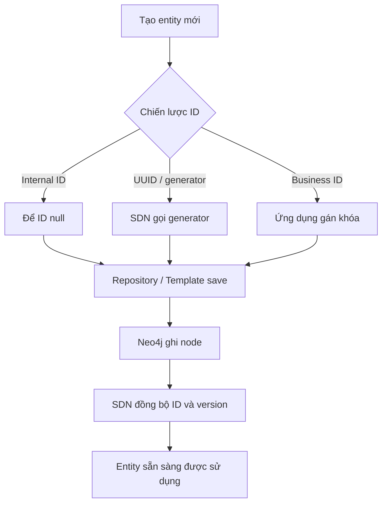

# @GeneratedValue và chiến lược sinh ID

## Mục tiêu bài học

Sau bài này, bạn có thể:

- Giải thích vai trò của `@Id` và `@GeneratedValue` trong Spring Data Neo4j.
- Phân biệt ID nội bộ do Neo4j cấp, ID bên ngoài do ứng dụng sinh và khóa nghiệp vụ do ứng dụng gán.
- Cấu hình bộ sinh UUID có sẵn hoặc bộ sinh ID tùy chỉnh.
- Nhận biết giới hạn của internal ID và cách bảo đảm tính duy nhất của khóa.
- Hiểu vì sao entity dùng business ID cần trường `@Version` để Spring Data Neo4j nhận diện trạng thái mới và đã lưu.

## 1. Vì sao entity cần ID?

Trong Neo4j, node có thể được nhận diện bằng label và các property. Tuy nhiên, tầng ánh xạ đối tượng cần một cách xác định ổn định node nào tương ứng với một instance Java cụ thể. Spring Data Neo4j (SDN) dùng trường định danh trong entity để theo dõi việc đọc, cập nhật và lưu dữ liệu.

Ví dụ, hai node cùng có label `Person` và cùng tên “An” vẫn có thể là hai người khác nhau. Tên không nhất thiết duy nhất và có thể thay đổi. Vì vậy, ứng dụng cần một thuộc tính định danh riêng, chẳng hạn mã khách hàng, UUID hoặc ID do Neo4j quản lý.

Hai annotation chính là:

- **`@Id`:** đánh dấu thuộc tính mà SDN dùng làm định danh của entity.
- **`@GeneratedValue`:** chỉ định rằng giá trị định danh được sinh tự động và lựa chọn cơ chế sinh.

`@GeneratedValue` phải đi cùng `@Id`. Nếu chỉ dùng `@Id`, ứng dụng có trách nhiệm gán giá trị định danh trước khi lưu entity.

```java
@Node("Person")
public class Person {

    @Id
    private String personCode;

    private String name;
}
```

Trong ví dụ này, `personCode` là định danh do ứng dụng cung cấp. Nếu muốn SDN sử dụng một cơ chế sinh ID, có thể bổ sung `@GeneratedValue` và chọn chiến lược phù hợp.

## 2. Sinh ID nội bộ bằng Neo4j

Cách đơn giản nhất là dùng `@Id` kết hợp `@GeneratedValue` mà không chỉ định generator:

```java
import org.springframework.data.neo4j.core.schema.GeneratedValue;
import org.springframework.data.neo4j.core.schema.Id;
import org.springframework.data.neo4j.core.schema.Node;

@Node("Person")
public class Person {

    @Id
    @GeneratedValue
    private Long id;

    private String name;

    protected Person() {
    }

    public Person(String name) {
        this.name = name;
    }

    public Long getId() {
        return id;
    }

    public String getName() {
        return name;
    }
}
```

Khi không cấu hình generator khác, SDN sử dụng cơ chế internal ID mặc định. Neo4j cấp ID khi node được tạo; SDN nhận giá trị đó và gán vào trường `id` của entity. Ứng dụng không cần tự tạo giá trị cho trường này.

Nên dùng kiểu bao bọc `Long` thay vì kiểu nguyên thủy `long`. Giá trị `null` thể hiện entity chưa có ID và giúp phân biệt trạng thái mới trước khi lưu. Với kiểu nguyên thủy, giá trị mặc định `0` có thể gây nhầm lẫn giữa trạng thái chưa được gán và một giá trị số hợp lệ.

### 2.1. Internal ID thực chất là gì?

Internal ID là định danh kỹ thuật do Neo4j quản lý. Nó không phải property thông thường được lưu trên node. Trong cách ánh xạ hiện hành, trường `Long` dùng với `@GeneratedValue` tương ứng với internal node ID; trường `String` dùng với generator nội bộ tương ứng với `elementId` của Neo4j 5 trở lên.

Vì đây là định danh nội bộ của cơ sở dữ liệu, không nên xem nó như mã nghiệp vụ lâu dài. ID nội bộ có thể được tái sử dụng sau khi node bị xóa và không phải khóa ổn định để trao đổi giữa nhiều hệ thống, lưu trong URL công khai hoặc dùng làm định danh trong sự kiện tích hợp.

Internal ID phù hợp khi:

- Ứng dụng chỉ cần một định danh kỹ thuật để SDN quản lý entity.
- ID không cần xuất hiện trong hợp đồng API hoặc được hệ thống khác lưu giữ lâu dài.
- Vòng đời của ID gắn chặt với dữ liệu trong một cơ sở dữ liệu Neo4j.

Không nên dùng internal ID làm mã khách hàng, mã đơn hàng hoặc khóa tham chiếu xuyên hệ thống. Nếu một hệ thống bên ngoài lưu ID này rồi tiếp tục tham chiếu sau khi dữ liệu được di chuyển, khôi phục hoặc tái tạo, mối liên kết có thể không còn đáng tin cậy.

### 2.2. Internal ID không phải property của node

Với internal ID, trường định danh trong Java phục vụ cho việc ánh xạ. Nó không xuất hiện như một property thông thường trên node và không thể đổi tên bằng `@Property`.

Ví dụ, khai báo sau không có nghĩa Neo4j sẽ lưu property `personId`:

```java
@Id
@GeneratedValue
@Property("personId")
private Long id;
```

Nếu cần một mã được lưu trực tiếp trên node để hệ thống khác có thể truy vấn, hãy sử dụng ID bên ngoài hoặc business ID. Không nên nhầm trường internal ID của entity với một property do ứng dụng quản lý.

## 3. Sinh ID bên ngoài bằng UUID

Khi ID cần ổn định và có thể được tạo ở nhiều instance ứng dụng, một lựa chọn phổ biến là UUID. SDN cung cấp sẵn `UUIDStringGenerator`, tạo giá trị UUID dạng chuỗi cho mỗi entity mới.

```java
import org.springframework.data.neo4j.core.schema.GeneratedValue;
import org.springframework.data.neo4j.core.schema.Id;
import org.springframework.data.neo4j.core.schema.Node;
import org.springframework.data.neo4j.core.support.UUIDStringGenerator;

@Node("Person")
public class Person {

    @Id
    @GeneratedValue(UUIDStringGenerator.class)
    private String id;

    private String name;

    protected Person() {
    }

    public Person(String name) {
        this.name = name;
    }

    public String getId() {
        return id;
    }
}
```

Ở đây, `UUIDStringGenerator.class` chỉ định generator mà SDN sử dụng. Giá trị được sinh ở phía ứng dụng và được lưu thành property trên node. Vì vậy, khác với internal ID, ID UUID có thể được đọc như một thuộc tính dữ liệu và có thể đổi tên bằng `@Property` nếu cần.

Ví dụ, node có thể chứa dữ liệu tương tự:

```cypher
(:Person {
    id: '7f4b8d7a-2c19-4f21-9c7a-6f9d8b2a1c30',
    name: 'An'
})
```

Chuỗi UUID trong ví dụ chỉ minh họa định dạng. Khi lưu thực tế, generator tạo một giá trị mới.

UUID phù hợp khi:

- ID cần được tạo trước khi gửi dữ liệu xuống Neo4j.
- Nhiều instance ứng dụng có thể tạo entity đồng thời.
- ID cần được dùng trong API, message hoặc trao đổi giữa các dịch vụ.
- Không muốn phụ thuộc vào bộ đếm tuần tự tập trung.

UUID có độ dài lớn hơn một số ID số nguyên và khó đọc bằng mắt. Xác suất trùng của UUID được thiết kế rất thấp, nhưng ứng dụng vẫn nên thiết lập unique constraint ở Neo4j để bảo vệ tính toàn vẹn dữ liệu.

## 4. Tự định nghĩa chiến lược sinh ID

Khi quy tắc sinh ID có yêu cầu riêng, chẳng hạn thêm tiền tố theo loại node, tạo mã theo tenant hoặc tích hợp với một hệ thống cấp mã, có thể triển khai `IdGenerator`.

SDN định nghĩa giao diện `IdGenerator<T>`. Generator nhận label chính của entity và instance cần lưu, sau đó trả về ID có kiểu tương ứng.

Ví dụ, generator tạo ID chuỗi có tiền tố là label và phần UUID:

```java
import java.util.Locale;
import java.util.UUID;

import org.springframework.data.neo4j.core.schema.IdGenerator;

public class PersonIdGenerator implements IdGenerator<String> {

    @Override
    public String generateId(String primaryLabel, Object entity) {
        return primaryLabel.toLowerCase(Locale.ROOT)
                + "-"
                + UUID.randomUUID();
    }
}
```

Entity khai báo generator bằng thuộc tính `generatorClass`:

```java
@Node("Person")
public class Person {

    @Id
    @GeneratedValue(generatorClass = PersonIdGenerator.class)
    private String id;

    private String name;
}
```

Generator trong ví dụ là lớp độc lập, có thể được SDN khởi tạo mà không cần truy cập các bean khác. Với generator cần phụ thuộc vào dịch vụ trong Spring, có thể đăng ký generator thành bean và tham chiếu bằng `generatorRef`:

```java
@Component("personIdGenerator")
public class PersonIdGenerator implements IdGenerator<String> {

    private final IdAllocationService allocationService;

    public PersonIdGenerator(IdAllocationService allocationService) {
        this.allocationService = allocationService;
    }

    @Override
    public String generateId(String primaryLabel, Object entity) {
        return allocationService.nextId(primaryLabel);
    }
}
```

Khai báo trên entity:

```java
@Id
@GeneratedValue(generatorRef = "personIdGenerator")
private String id;
```

Generator được tham chiếu bằng `generatorRef` phải là bean trong Spring ApplicationContext và triển khai `IdGenerator`. Cách này hữu ích khi việc cấp ID cần gọi một dịch vụ hoặc sử dụng logic đã được cấu hình trong ứng dụng.

### 4.1. Tránh bộ đếm cục bộ trong môi trường nhiều instance

Một ví dụ đơn giản thường gặp là dùng `AtomicInteger` để tăng số thứ tự. Cách đó có thể dùng trong minh họa hoặc phạm vi chạy đơn lẻ, nhưng không bảo đảm duy nhất khi ứng dụng chạy nhiều instance. Mỗi instance có bộ đếm riêng, vì vậy hai máy có thể cùng tạo ra mã `person-1`.

Với hệ thống phân tán, generator phải có cơ chế bảo đảm tính duy nhất giữa các tiến trình và lần khởi động. Có thể dùng UUID, dịch vụ cấp mã tập trung, sequence được quản lý an toàn hoặc một thuật toán có không gian ID được phân vùng. Nếu generator dựa vào Neo4j hoặc dịch vụ ngoài, cần thiết kế xử lý lỗi, tính đồng thời và khả năng thử lại.

Không nên giả định rằng việc triển khai `IdGenerator` tự động bảo đảm ID duy nhất. Trách nhiệm thiết kế thuật toán và kiểm soát xung đột vẫn thuộc về ứng dụng.

## 5. Sử dụng business ID do ứng dụng gán

Không phải mọi ID đều cần được sinh tự động. Nếu miền nghiệp vụ đã có một khóa ổn định và duy nhất, ứng dụng có thể gán giá trị đó rồi đánh dấu bằng `@Id` mà không dùng `@GeneratedValue`.

Ví dụ, mã khách hàng được cấp bởi hệ thống nghiệp vụ:

```java
import org.springframework.data.annotation.Version;
import org.springframework.data.neo4j.core.schema.Id;
import org.springframework.data.neo4j.core.schema.Node;
import org.springframework.data.neo4j.core.schema.Property;

@Node("Customer")
public class Customer {

    @Id
    @Property("customerCode")
    private String code;

    @Version
    private Long version;

    private String displayName;

    protected Customer() {
    }

    public Customer(String code, String displayName) {
        this.code = code;
        this.displayName = displayName;
    }

    public String getCode() {
        return code;
    }

    public String getDisplayName() {
        return displayName;
    }
}
```

Ở đây, `code` là business ID. Giá trị phải được cung cấp trước khi gọi repository hoặc template để lưu entity. `@Property("customerCode")` ánh xạ thuộc tính Java `code` thành property `customerCode` trên node.

### 5.1. Vì sao business ID cần @Version?

Khi ID đã có giá trị ngay lúc tạo object, SDN không thể chỉ dựa vào việc ID có null hay không để phân biệt entity mới với entity đã được lưu. Vì vậy, khi dùng business ID, SDN yêu cầu trường `@Version` để xác định trạng thái của entity.

Trường version cũng hỗ trợ optimistic locking. Khi entity được cập nhật, SDN kiểm tra version hiện tại và tăng version sau khi ghi thành công. Nếu một tiến trình khác đã cập nhật cùng entity trước đó, thao tác với version cũ có thể thất bại bằng `OptimisticLockingFailureException`. Ứng dụng cần tải lại dữ liệu mới nhất trước khi quyết định thử lại.

Không tự gán hoặc tăng trường version trong code nghiệp vụ. Hãy để SDN quản lý trường này.

### 5.2. Chọn business key cẩn thận

Business key có ý nghĩa trực tiếp trong miền nghiệp vụ, chẳng hạn mã khách hàng do hệ thống chính thức cấp. Ưu điểm là ID dễ hiểu và có thể được dùng trong trao đổi nghiệp vụ. Tuy nhiên, business key phải thực sự ổn định và duy nhất.

Tên người, email hoặc số điện thoại có thể thay đổi, được chia sẻ hoặc được tái sử dụng. Chúng thường không phải lựa chọn tốt cho primary ID nếu nghiệp vụ không bảo đảm tính duy nhất và vòng đời của chúng.

Nếu business key thay đổi, việc cập nhật định danh có thể ảnh hưởng đến tham chiếu và tích hợp. Khi chưa chắc chắn một thuộc tính có ổn định suốt vòng đời entity hay không, surrogate key như UUID thường là lựa chọn an toàn hơn.

## 6. Bảo đảm tính duy nhất trong Neo4j

Generator tạo giá trị ID ở phía ứng dụng không thay thế ràng buộc dữ liệu trong cơ sở dữ liệu. Để tránh hai node cùng label có cùng business ID hoặc UUID, hãy tạo unique constraint phù hợp.

Ví dụ với mã khách hàng:

```cypher
CREATE CONSTRAINT customer_code_unique IF NOT EXISTS
FOR (customer:Customer)
REQUIRE customer.customerCode IS UNIQUE
```

Constraint này bảo đảm các node mang label `Customer` không thể có cùng giá trị `customerCode` khi property đó được thiết lập. Ứng dụng vẫn phải kiểm tra đầu vào và xử lý lỗi vi phạm constraint khi lưu.

Có thể kiểm tra dữ liệu trùng trước khi tạo constraint:

```cypher
MATCH (customer:Customer)
WITH customer.customerCode AS code, count(*) AS total
WHERE code IS NOT NULL AND total > 1
RETURN code, total
ORDER BY total DESC
```

Nếu truy vấn trả về kết quả, cần xử lý các bản ghi trùng trước khi tạo unique constraint. Việc quản lý constraint nên được thực hiện qua migration hoặc quy trình quản lý schema của dự án để môi trường phát triển, kiểm thử và production có cấu trúc nhất quán.

## 7. So sánh các chiến lược ID

| Chiến lược | Cách khai báo | Ưu điểm | Điểm cần cân nhắc |
| --- | --- | --- | --- |
| Internal ID | `@Id @GeneratedValue Long id` | Cấu hình đơn giản, Neo4j cấp ID | Gắn với cơ sở dữ liệu; không dùng làm mã tham chiếu lâu dài |
| Internal element ID | `@Id @GeneratedValue String id` | Dùng dạng chuỗi do Neo4j quản lý | Vẫn là định danh nội bộ, không phải property nghiệp vụ |
| UUID bên ngoài | `@Id @GeneratedValue(UUIDStringGenerator.class) String id` | Sinh độc lập với internal ID, phù hợp tích hợp nhiều dịch vụ | Dài hơn, cần constraint và quản lý như property |
| Generator tùy chỉnh | `generatorClass` hoặc `generatorRef` | Linh hoạt theo quy tắc ứng dụng | Phải tự bảo đảm duy nhất, an toàn đồng thời và xử lý lỗi |
| Business ID | `@Id String code` | Mang ý nghĩa nghiệp vụ, dễ tra cứu | Phải ổn định, duy nhất; cần `@Version` |

Không có một chiến lược phù hợp với mọi hệ thống. Hãy chọn theo phạm vi sử dụng ID, cách triển khai ứng dụng, yêu cầu tích hợp và khả năng thay đổi của dữ liệu nghiệp vụ.

## 8. Vòng đời ID khi lưu entity

Với entity dùng internal ID, ID thường chưa có trước khi lưu. Sau khi repository lưu thành công, SDN nhận ID từ Neo4j và gán lại vào entity được lưu.

```java
Person person = new Person("An");

Person savedPerson = personRepository.save(person);

Long generatedId = savedPerson.getId();
```

Luồng khái quát:



Với entity bất biến có trường ID là `final`, ứng dụng cần cung cấp cơ chế tạo instance mới chứa ID sau khi lưu, thường gọi là *wither*. Với entity mutable, SDN có thể gán ID thông qua setter hoặc cơ chế ánh xạ phù hợp.

Khi dùng UUID generator, ID được tạo ở phía ứng dụng trong quá trình lưu. Với business ID, giá trị đã có từ trước. Vì vậy, cách khởi tạo và nhận biết entity mới phụ thuộc chiến lược đã chọn.

## 9. Những lỗi thường gặp

| Lỗi | Hệ quả hoặc cách xử lý |
| --- | --- |
| Dùng `@GeneratedValue` mà không có `@Id` | SDN không có trường định danh để áp dụng chiến lược |
| Tự gán giá trị vào trường internal ID | Làm sai giả định về ID do Neo4j quản lý; để trường này chưa có giá trị khi tạo entity mới |
| Dùng internal ID làm khóa API lâu dài | ID có thể không còn phù hợp sau xóa, khôi phục hoặc di chuyển dữ liệu |
| Dùng business ID nhưng không có `@Version` | SDN không có thông tin version cần thiết để phân biệt entity mới và đã lưu |
| Dùng tên hoặc email làm ID mà không bảo đảm tính ổn định | Có thể phát sinh xung đột hoặc phải thay đổi định danh |
| Tạo ID bằng bộ đếm trong bộ nhớ khi chạy nhiều instance | Các instance có thể sinh cùng một giá trị |
| Chỉ tin generator mà không có unique constraint | Dữ liệu trùng vẫn có thể lọt vào khi có lỗi đồng thời hoặc lỗi thuật toán |
| Tự cập nhật trường `@Version` | Có thể làm sai cơ chế optimistic locking; để SDN quản lý |

## 10. Câu hỏi tự kiểm tra

1. `@Id` và `@GeneratedValue` có vai trò khác nhau như thế nào?
2. Khi chỉ dùng `@Id @GeneratedValue`, SDN mặc định sử dụng cơ chế sinh ID nào?
3. Vì sao không nên dùng internal ID của Neo4j làm mã nghiệp vụ hoặc khóa tham chiếu công khai?
4. `UUIDStringGenerator` tạo loại ID nào và khác internal ID ở điểm nào?
5. Khi nào nên triển khai `IdGenerator` tùy chỉnh hoặc đăng ký generator bằng `generatorRef`?
6. Vì sao một generator dùng bộ đếm trong bộ nhớ có thể sinh ID trùng khi ứng dụng chạy nhiều instance?
7. Vì sao entity dùng business ID cần có trường `@Version`?
8. Unique constraint trong Neo4j bảo vệ dữ liệu như thế nào khi có hai thao tác lưu cùng một ID?

## Kết luận

`@Id` xác định trường nhận diện entity; `@GeneratedValue` chỉ định cách tạo giá trị đó. SDN hỗ trợ internal ID do Neo4j cấp, generator bên ngoài như UUID, generator tùy chỉnh qua `IdGenerator` hoặc bean, và business ID do ứng dụng gán.

Internal ID thuận tiện cho định danh kỹ thuật trong phạm vi cơ sở dữ liệu. UUID hoặc một generator có thiết kế phù hợp giúp ứng dụng tạo ID ổn định để tích hợp. Business ID phù hợp khi miền nghiệp vụ có khóa thật sự duy nhất và ít thay đổi; trường hợp này cần `@Version` để SDN quản lý trạng thái entity và optimistic locking.

Khi lựa chọn chiến lược, hãy xác định ID được dùng ở đâu, ai tạo nó, nó có thể thay đổi hay không và cơ chế nào bảo đảm tính duy nhất. Kết hợp generator phù hợp với unique constraint ở Neo4j sẽ giúp tầng dữ liệu quản lý định danh nhất quán hơn.
