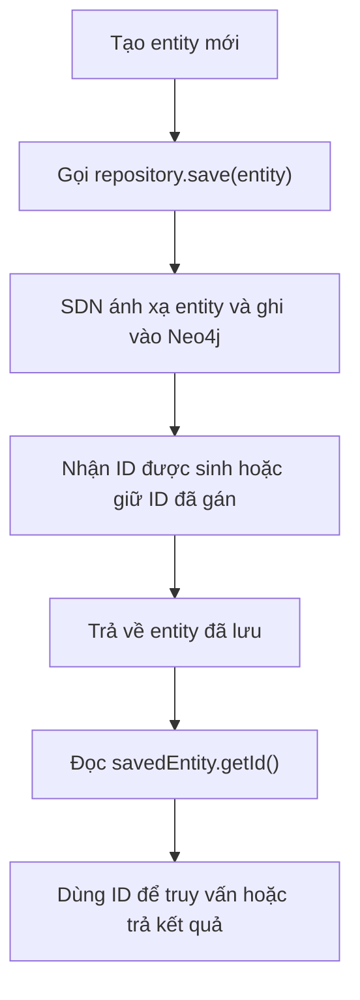

# Nhận lại ID trên đối tượng được trả về sau save

Khi lưu một entity bằng Spring Data Neo4j (SDN), phương thức `save` trả về entity đã được lưu. Nếu ID được sinh trong quá trình lưu, hãy đọc ID từ chính đối tượng trả về:

```java
Movie savedMovie = movieRepository.save(new Movie("The Graph Journey"));
Long movieId = savedMovie.getId();
```

Đây là cách làm quan trọng khi dùng entity bất biến: SDN có thể tạo một instance mới chứa ID thay vì sửa instance đầu vào. Vì vậy, đừng giả định biến truyền vào `save` luôn được cập nhật. Hãy giữ kết quả `save` và dùng kết quả đó cho các thao tác tiếp theo.

## 1. Điều gì xảy ra khi gọi save?

Một entity mới có thể chưa có ID. Khi `save` ghi entity vào Neo4j, SDN thực hiện việc ánh xạ entity, gửi thao tác ghi và nhận thông tin định danh cần thiết. Repository trả về đối tượng đại diện cho trạng thái đã lưu.



Với repository imperative, chữ ký tổng quát của `save` có dạng:

```java
<S extends T> S save(S entity);
```

Trong đó `T` là kiểu entity mà repository quản lý. Giá trị trả về vẫn là một entity cùng kiểu cụ thể `S`, không phải một giá trị ID riêng lẻ. Ứng dụng gọi getter hoặc accessor trên entity trả về để lấy ID.

## 2. Khai báo entity có ID được sinh

Ví dụ dưới đây dùng ID nội bộ Neo4j kiểu `Long`:

```java
@Node("Movie")
public class Movie {

    @Id
    @GeneratedValue
    private Long id;

    private String title;

    public Movie(String title) {
        this.title = title;
    }

    public Long getId() {
        return id;
    }

    public String getTitle() {
        return title;
    }
}
```

`@Id` đánh dấu thuộc tính định danh của entity. `@GeneratedValue` yêu cầu SDN sử dụng cơ chế sinh ID mặc định. Với kiểu `Long`, cơ chế mặc định sử dụng ID nội bộ của Neo4j. Dùng kiểu wrapper `Long` thay cho `long` để giá trị `null` biểu thị rõ entity chưa có ID.

Repository khai báo kiểu ID tương ứng:

```java
public interface MovieRepository extends Neo4jRepository<Movie, Long> {
}
```

Lưu entity mới và đọc ID từ kết quả:

```java
Movie newMovie = new Movie("The Graph Journey");

Movie savedMovie = movieRepository.save(newMovie);
Long generatedId = savedMovie.getId();

System.out.println("Movie ID: " + generatedId);
```

`generatedId` là ID mà SDN trả về cùng entity đã lưu. Có thể dùng ID đó để đọc lại entity:

```java
Optional<Movie> loadedMovie = movieRepository.findById(generatedId);
```

Không nên phụ thuộc vào việc `newMovie.getId()` có được cập nhật hay không. Với entity mutable, SDN có thể gán ID vào instance thông qua setter hoặc reflection. Với entity immutable, SDN cần tạo instance khác để mang ID mới. Cả hai trường hợp đều được xử lý nhất quán khi ứng dụng dùng `savedMovie`.

## 3. Mutable entity và immutable entity

### Entity mutable

Entity mutable cho phép giá trị ID được gán sau khi tạo object. Có thể cung cấp setter:

```java
@Node("Movie")
public class Movie {

    @Id
    @GeneratedValue
    private Long id;

    private String title;

    public Movie(String title) {
        this.title = title;
    }

    public Long getId() {
        return id;
    }

    public void setId(Long id) {
        this.id = id;
    }
}
```

SDN có thể dùng setter nếu có, hoặc reflection để gán giá trị vào field. Dù vậy, code gọi repository vẫn nên lấy ID từ kết quả `save` để không phụ thuộc chi tiết mapping.

### Entity immutable

Với entity bất biến, field ID có thể là `final`. Vì không thể sửa field sau khi object được tạo, cần cung cấp một phương thức *wither* tạo instance mới có ID được cập nhật:

```java
@Node("Movie")
public class Movie {

    @Id
    @GeneratedValue
    private final Long id;

    private final String title;

    public Movie(String title) {
        this(null, title);
    }

    @PersistenceCreator
    private Movie(Long id, String title) {
        this.id = id;
        this.title = title;
    }

    public Movie withId(Long id) {
        if (Objects.equals(this.id, id)) {
            return this;
        }
        return new Movie(id, this.title);
    }

    public Long getId() {
        return id;
    }

    public String getTitle() {
        return title;
    }
}
```

`withId` trả về `this` nếu ID không đổi, hoặc trả về một object mới nếu ID vừa được sinh. `@PersistenceCreator` đánh dấu constructor mà Spring Data dùng để tạo entity khi đọc dữ liệu. Ví dụ lược bỏ import; `Objects` thuộc `java.util`, còn `PersistenceCreator` thuộc Spring Data Commons.

Khi lưu entity immutable, luôn giữ instance trả về:

```java
Movie input = new Movie("The Graph Journey");
Movie saved = movieRepository.save(input);

Long id = saved.getId();
// input vẫn có thể giữ id == null
```

Nếu tiếp tục truyền `input` thay vì `saved` vào một thao tác khác, ứng dụng có thể mất ID vừa được sinh và khiến SDN xử lý object như một entity mới. Hãy truyền object đã lưu hoặc dùng ID đã lấy từ object đó.

## 4. Chọn loại ID phù hợp

SDN hỗ trợ nhiều chiến lược định danh. Cần chọn chiến lược theo mục đích sử dụng ID, vì ID nội bộ của Neo4j và ID ứng dụng có vòng đời khác nhau.

| Chiến lược | Khai báo điển hình | Đặc điểm |
|---|---|---|
| ID nội bộ Neo4j | `@Id @GeneratedValue private Long id;` | Dễ dùng để nhận diện entity trong database; không nên dùng làm mã công khai lâu dài |
| UUID do SDN sinh | `@Id @GeneratedValue(UUIDStringGenerator.class) private String id;` | Sinh mã String ở phía ứng dụng, phù hợp làm định danh ổn định hơn giữa các môi trường |
| Business key do ứng dụng cấp | `@Id private String id;` | Ứng dụng phải gán ID trước khi gọi `save`; cần bảo đảm duy nhất và ổn định |

### UUID được sinh bởi SDN

Nếu ID cần được dùng trong API, URL hoặc trao đổi giữa các hệ thống, có thể dùng `UUIDStringGenerator`:

```java
@Node("Movie")
public class Movie {

    @Id
    @GeneratedValue(UUIDStringGenerator.class)
    private String id;

    private String title;

    public Movie(String title) {
        this.title = title;
    }

    public String getId() {
        return id;
    }
}
```

Repository khi đó dùng kiểu ID `String`:

```java
public interface MovieRepository extends Neo4jRepository<Movie, String> {
}
```

Và cách nhận ID vẫn theo cùng nguyên tắc:

```java
Movie saved = movieRepository.save(new Movie("The Graph Journey"));
String publicId = saved.getId();
```

UUID được lưu như property định danh của node. Nên tạo unique constraint để Neo4j bảo vệ tính duy nhất ở tầng dữ liệu:

```cypher
CREATE CONSTRAINT movie_id IF NOT EXISTS
FOR (m:Movie)
REQUIRE m.id IS UNIQUE;
```

UUID có xác suất trùng rất thấp, nhưng constraint vẫn là lớp bảo vệ quan trọng khi ứng dụng chạy nhiều instance hoặc có nhiều nguồn ghi dữ liệu.

### Lưu ý về ID nội bộ và element ID

Trong các phiên bản SDN hiện đại dùng Neo4j 5, cơ chế mặc định ánh xạ `Long` tới ID nội bộ Neo4j và `String` tới `elementId`. Cả hai đều là định danh kỹ thuật, không phải property của node. Hãy kiểm tra tài liệu đúng phiên bản SDN của dự án nếu đang nâng cấp từ phiên bản cũ. Các định danh này phục vụ việc nhận diện node trong database; chúng không phải business key do ứng dụng kiểm soát và không nên được xem là mã ổn định để lưu vào hệ thống bên ngoài lâu dài.

Đặc biệt, không dựa vào ID nội bộ để tham chiếu entity qua các lần dump/restore, import hoặc di chuyển dữ liệu. Nếu cần định danh bền vững qua các môi trường, hãy dùng UUID hoặc business key ổn định. Khi dùng UUID hay business key được lưu thành property, tạo unique constraint cho property đó.

## 5. ID do ứng dụng cấp trước khi save

Một số miền nghiệp vụ đã có mã định danh tự nhiên hoặc mã do hệ thống cấp. Khi đó, chỉ cần `@Id` và gán giá trị trước khi lưu:

```java
@Node("Movie")
public class Movie {

    @Id
    private String id;

    private String title;

    public Movie(String id, String title) {
        this.id = id;
        this.title = title;
    }

    public String getId() {
        return id;
    }
}
```

```java
Movie movie = new Movie("movie-2026-0042", "The Graph Journey");
Movie saved = movieRepository.save(movie);

String id = saved.getId();
```

Trong trường hợp này, `save` trả về entity có ID đã được gán từ trước; ứng dụng không cần đợi Neo4j sinh ID. Business key phải duy nhất, ổn định và không thay đổi tùy tiện. Tên phim hoặc email người dùng thường không phải lựa chọn tốt nếu chúng có thể trùng hoặc thay đổi.

Khi dùng business ID, Spring Data Neo4j không thể chỉ dựa vào giá trị ID để phân biệt chắc chắn entity mới với entity đã tồn tại. Vì vậy, mô hình dùng business ID cần có trường `@Version`; SDN dùng trường này để xác định trạng thái entity và kiểm soát optimistic locking:

```java
@Node("Movie")
public class Movie {

    @Id
    private String id;

    @Version
    private Long version;

    private String title;
}
```

`version` do SDN quản lý, khởi tạo và tăng tự động; không tự tăng hoặc gán giá trị này trong code nghiệp vụ. Khi hai transaction cùng cập nhật một entity dựa trên cùng version, một cập nhật có thể thất bại với lỗi optimistic locking. Ứng dụng cần tải lại dữ liệu mới nhất rồi quyết định thử lại hoặc báo xung đột.

## 6. Dùng ID trả về trong service và API

Một service thường cần trả về ID để controller tạo response hoặc cung cấp liên kết đọc lại entity. Nên thực hiện việc này sau khi gọi `save`:

```java
@Service
public class MovieService {

    private final MovieRepository movieRepository;

    public MovieService(MovieRepository movieRepository) {
        this.movieRepository = movieRepository;
    }

    @Transactional
    public Long createMovie(String title) {
        Movie input = new Movie(title);
        Movie saved = movieRepository.save(input);
        return saved.getId();
    }
}
```

Ví dụ dùng ID kiểu `Long`. Nếu entity dùng UUID `String`, trả về `saved.getId()` trực tiếp và không cần chuyển đổi. Controller có thể dùng ID đó để tạo response:

```java
@PostMapping("/movies")
public ResponseEntity<MovieResponse> create(@RequestBody CreateMovieRequest request) {
    Long id = movieService.createMovie(request.title());
    return ResponseEntity.status(HttpStatus.CREATED)
            .body(new MovieResponse(id));
}
```

Đoạn controller minh họa DTO; kiểu trả về của service phải nhất quán với chiến lược ID của entity. Nếu entity dùng UUID `String`, đổi kiểu trả về của service và DTO sang `String`, rồi trả `saved.getId()` trực tiếp. Không nên chuyển ID sang chuỗi tùy tiện nếu hợp đồng API cần kiểu số. Hãy chọn `Long` hoặc `String` ngay từ hợp đồng service/DTO và giữ nhất quán.

Nếu phương thức service có `@Transactional`, Spring hoàn tất transaction trước khi kết quả được trả về cho caller bên ngoài proxy. Nếu commit thất bại, lời gọi không hoàn tất bình thường. Tuy vậy, một ID đã được gán trong bộ nhớ trước khi rollback không chứng minh rằng node đã được lưu bền vững. Chỉ coi thao tác tạo thành công khi toàn bộ transaction hoàn tất.

## 7. Trường hợp reactive repository

Với reactive SDN, `save` trả về publisher, thường là `Mono<T>`. ID chỉ được đọc từ entity được phát ra khi publisher được thực thi:

```java
public Mono<String> createMovie(String title) {
    Movie movie = new Movie(title);

    return reactiveMovieRepository.save(movie)
            .map(Movie::getId);
}
```

Publisher được trả về cho tầng gọi để framework reactive subscribe và điều phối. Không gọi `.block()` hoặc tự `subscribe()` bên trong service reactive thông thường chỉ để lấy ID, vì điều đó phá vỡ chuỗi non-blocking và có thể gây lỗi khi chạy trên event loop.

Nếu cần trả cả entity đã lưu và ID, có thể ánh xạ thành DTO trong cùng pipeline:

```java
public Mono<MovieResponse> createMovie(String title) {
    return reactiveMovieRepository.save(new Movie(title))
            .map(saved -> new MovieResponse(saved.getId(), saved.getTitle()));
}
```

Với reactive transaction, dùng `ReactiveNeo4jTransactionManager` và transaction context của Reactor. Không trộn imperative repository/transaction với reactive flow nếu chưa có chủ đích chuyển đổi rõ ràng.

## 8. Các lỗi thường gặp khi lấy ID sau save

| Cách làm | Vấn đề | Cách sửa |
|---|---|---|
| Gọi `save(movie)` nhưng bỏ qua giá trị trả về | Entity immutable có thể không nhận ID trong instance đầu vào | Gán `Movie saved = save(movie)` và đọc `saved.getId()` |
| Dùng `movie.getId()` ngay sau save | Có thể đang đọc instance cũ | Đọc ID trên entity trả về |
| Khai báo `@Id` nhưng không gán ID và không có `@GeneratedValue` | SDN không có giá trị định danh để lưu entity mới | Gán business ID hoặc cấu hình cơ chế sinh ID |
| Dùng `long` primitive cho ID được sinh | Giá trị mặc định `0` không biểu thị rõ trạng thái chưa có ID | Dùng `Long` wrapper |
| Dùng ID nội bộ làm ID công khai lâu dài | ID gắn với database và vòng đời lưu trữ | Dùng UUID hoặc business key |
| Gọi `save` rồi trả ID trước khi transaction hoàn tất | Có thể trả kết quả thành công dù commit cuối cùng thất bại nếu thiết kế xử lý sai | Để transaction hoàn tất trước khi phát response thành công |
| Trong reactive flow, gọi `.block()` để lấy ID | Chặn luồng xử lý reactive | Dùng `.map(saved -> saved.getId())` |

## 9. Kiểm tra ID sau khi lưu

Một integration test có thể xác nhận ID được sinh và entity có thể được tìm lại bằng ID đó:

```java
@Test
void saveReturnsEntityWithGeneratedId() {
    Movie input = new Movie("The Graph Journey");

    Movie saved = movieRepository.save(input);

    assertThat(saved.getId()).isNotNull();
    assertThat(movieRepository.findById(saved.getId()))
            .isPresent()
            .get()
            .extracting(Movie::getTitle)
            .isEqualTo("The Graph Journey");
}
```

Test này cần Neo4j test instance hoặc Testcontainers được cấu hình cho repository. Với entity dùng UUID, có thể kiểm tra `getId()` khác rỗng và xác nhận constraint duy nhất được áp dụng. Với entity immutable, nên có thêm kiểm tra cho thấy code sử dụng instance trả về và không dựa vào việc instance đầu vào bị thay đổi.

## 10. Tự kiểm tra

1. `save` trả về một ID hay trả về entity? Cách lấy ID từ kết quả đó là gì?
2. Vì sao nên dùng `savedMovie.getId()` thay vì mặc định dùng `newMovie.getId()`?
3. Khác biệt giữa ID nội bộ Neo4j, UUID và business key là gì?
4. Vì sao entity immutable cần wither để nhận ID được sinh?
5. Khi nào nên tạo unique constraint cho thuộc tính ID?
6. `@Version` hỗ trợ gì khi entity sử dụng business key?
7. Với reactive repository, vì sao cần dùng `map` để lấy ID từ entity được phát ra?
8. Vì sao có ID trong object sau khi ghi chưa đủ để khẳng định transaction đã commit thành công?

Khi hiểu cách `save` trả về entity, người học có thể lấy đúng ID trong cả mô hình mutable, immutable và reactive; đồng thời chọn được chiến lược định danh phù hợp với vòng đời dữ liệu và hợp đồng API của ứng dụng Spring Data Neo4j.

## Tài liệu tham khảo

- [Spring Data Neo4j: Handling and provisioning of unique IDs](https://docs.spring.io/spring-data/neo4j/reference/object-mapping/mapping-ids.html)
- [Spring Data Neo4j: Metadata-based mapping](https://docs.spring.io/spring-data/neo4j/reference/object-mapping/metadata-based-mapping.html)
