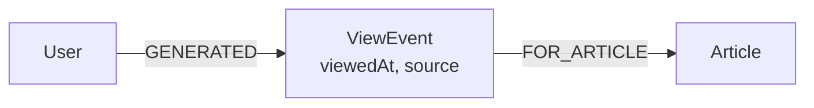

# Mảng và collection thuộc tính: kiểu phần tử và giới hạn lưu trữ

Trong Neo4j, property của node và relationship có thể chứa một giá trị đơn hoặc một mảng các giá trị cùng kiểu. Điều này cho phép lưu những tập giá trị nhỏ như danh sách tag, bí danh, mã phân loại hoặc điểm số ngay trên phần tử đồ thị. Tuy nhiên, collection property có quy tắc chặt hơn collection trong Java: phần tử phải thuộc kiểu dữ liệu được Neo4j hỗ trợ, không thể tùy ý lồng collection hoặc trộn nhiều kiểu dữ liệu.

Với `SPRING_DATA_NEO4J`, cần phân biệt một collection giá trị như `List<String>` với một collection entity như `Set<Author>`. Collection thứ nhất có thể được ánh xạ thành property của node; collection thứ hai biểu diễn các relationship nối node. Hiểu đúng sự khác biệt giúp chọn cấu trúc lưu trữ phù hợp, tránh lỗi chuyển đổi và tránh đưa một lượng dữ liệu lớn vào một property duy nhất.

## 1. Property đơn và property dạng mảng

Một node có thể lưu các property đơn như chuỗi, số, boolean, thời gian hoặc tọa độ. Khi cần nhiều giá trị cùng loại, có thể lưu chúng dưới dạng list/array:

```cypher
CREATE (a:Article {
    id: 'article-101',
    title: 'Graph modeling',
    tags: ['neo4j', 'spring-data', 'cypher'],
    scores: [5, 4, 5, 3],
    aliases: ['graph-modeling', 'neo4j-basics']
})
RETURN a;
```

Ở đây:

- `title` là property đơn kiểu chuỗi.
- `tags` và `aliases` là các list chuỗi.
- `scores` là list số nguyên.

Neo4j lưu list property như một giá trị thuộc tính của node. List không tạo thêm node và không tạo relationship cho từng phần tử. Nếu cần mỗi tag có thuộc tính riêng, được chia sẻ giữa nhiều bài viết hoặc nối đến những node khác, hãy cân nhắc mô hình tag thành node.

Relationship cũng có thể chứa property dạng mảng:

```cypher
MATCH (u:User {id: $userId})
MATCH (p:Product {id: $productId})
MERGE (u)-[r:RATED]->(p)
SET r.reasons = ['quality', 'delivery'],
    r.scoreHistory = [3, 4, 5]
RETURN r;
```

Các quy tắc về kiểu phần tử và cấu trúc list áp dụng cho property của cả node lẫn relationship.

## 2. Những kiểu phần tử có thể lưu

Neo4j hỗ trợ các nhóm property cơ bản sau. Một list property phải chứa các giá trị tương thích với cùng một kiểu dữ liệu được hỗ trợ.

| Nhóm | Ví dụ giá trị đơn | Ví dụ list/array |
|---|---|---|
| Chuỗi | `'neo4j'` | `['neo4j', 'cypher']` |
| Boolean | `true` | `[true, false, true]` |
| Số nguyên | `42` | `[1, 2, 3]` |
| Số thực | `4.5` | `[3.5, 4.0, 4.5]` |
| Ngày và thời gian | `date('2026-11-26')` | `[date('2026-11-26'), date('2026-11-27')]` |
| Thời gian có múi giờ hoặc không có múi giờ | `datetime()` / `localdatetime()` | List các giá trị cùng kiểu temporal |
| Thời lượng | `duration('P2D')` | List các giá trị duration |
| Điểm không gian | `point({longitude: 106.7, latitude: 10.8})` | List các point tương thích |
| Byte array | Giá trị nhị phân | `byte[]` trong Java là kiểu mảng nhị phân chuyên biệt |

Neo4j có kiểu số nguyên và số thực riêng trong mô hình property. Trong Java, các kiểu như `Integer`, `Long`, `Float` và `Double` được chuyển đổi qua mapping của driver và Spring Data Neo4j. Khi tạo list, hãy dùng một kiểu phần tử thống nhất; đừng dựa vào việc một biểu thức Cypher có thể tính toán hoặc ép kiểu một số giá trị để thiết kế property chứa nhiều kiểu Java khác nhau.

Ví dụ hợp lệ về mặt cấu trúc:

```cypher
CREATE (n:Metric {
    counts: [10, 20, 30],
    ratios: [0.25, 0.5, 0.75],
    enabledFlags: [true, false, true]
});
```

Ví dụ không phù hợp để lưu thành property list:

```cypher
// Trộn chuỗi và số trong cùng một list property
CREATE (n:Record {values: ['one', 2, 'three']});

// List lồng nhau
CREATE (n:Record {matrix: [[1, 2], [3, 4]]});
```

Cypher có thể tạo và xử lý list linh hoạt trong biểu thức, nhưng không phải mọi list hợp lệ trong bộ nhớ đều có thể lưu làm property. List property cần phần tử cùng kiểu được hỗ trợ; list lồng nhau và map lồng trong list không phải dạng property native.

## 3. Giới hạn cấu trúc: list không phải collection Java tùy ý

Một property list có các giới hạn quan trọng:

1. **Phần tử cùng kiểu:** không lưu list trộn chuỗi, số, node, map hoặc các kiểu không tương thích.
2. **Không chứa `null`:** Neo4j không lưu `null` như một property value. Nếu một phần tử collection là `null`, cần loại bỏ hoặc chuyển đổi nó trước khi ghi.
3. **Không lồng collection:** list of lists và cấu trúc nhiều tầng không phải property native.
4. **Không lưu trực tiếp object Java tùy ý:** một POJO, entity hoặc map không tự động trở thành một property đơn giản.
5. **Không có danh tính riêng cho từng phần tử:** một chuỗi trong `tags` không phải node; nó không thể có relationship hoặc property riêng.

`null` ở cấp property có ý nghĩa đặc biệt:

```cypher
MATCH (a:Article {id: $articleId})
SET a.summary = null
RETURN a;
```

Lệnh trên loại bỏ property `summary`; Neo4j không lưu một giá trị `null` cho property đó. Điều tương tự cần được lưu ý khi truyền collection từ Java: đừng dùng `null` như một phần tử đại diện cho “chưa có dữ liệu”. Hãy xác định rõ collection rỗng, property vắng mặt và phần tử không tồn tại có ý nghĩa nghiệp vụ như thế nào.

Một list trong Cypher có thể được dùng tạm thời để tính toán, lọc hoặc tạo kết quả mà không lưu nó vào node. Chẳng hạn, list có phần tử khác kiểu có thể hữu ích trong biểu thức trả kết quả; giới hạn xuất hiện khi cố gắng ghi list đó thành property.

## 4. Ánh xạ array và collection trong Spring Data Neo4j

Spring Data Neo4j dùng metadata và conversion để ánh xạ property Java sang property Neo4j. Với collection chứa giá trị đơn, kiểu phần tử phải có thể chuyển đổi thành kiểu property được Neo4j hỗ trợ.

Ví dụ entity bài viết:

```java
import org.springframework.data.neo4j.core.schema.Id;
import org.springframework.data.neo4j.core.schema.Node;
import org.springframework.data.neo4j.core.schema.Relationship;

import java.util.ArrayList;
import java.util.HashSet;
import java.util.List;
import java.util.Set;

@Node("Article")
public class Article {

    @Id
    private String id;

    private String title;

    // Collection giá trị đơn: được ánh xạ thành property list.
    private List<String> tags = new ArrayList<>();
    private List<Long> scores = new ArrayList<>();
    private String[] aliases;

    // Collection entity: được ánh xạ thành relationship.
    @Relationship(type = "AUTHORED_BY")
    private Set<Author> authors = new HashSet<>();
}
```

Đọc ví dụ theo hai nhóm:

- `tags`, `scores` và `aliases` là collection các giá trị đơn. Spring Data Neo4j chuyển chúng thành property list/array tương ứng.
- `authors` chứa entity `Author` và được đánh dấu `@Relationship`. Mỗi phần tử tương ứng với một node đích được nối bằng relationship `AUTHORED_BY`.

Collection Java không tự biến thành node hoặc relationship chỉ vì nó là `List` hay `Set`. Kiểu phần tử và annotation ánh xạ mới quyết định ý nghĩa. Một `List<String>` là danh sách giá trị; một `Set<Author>` với `@Relationship` là tập node liên quan.

### Chọn List, Set hay array?

Neo4j lưu collection property dưới dạng list/array có thứ tự, không có kiểu property `Set` riêng. Vì vậy:

- Dùng `List<T>` khi thứ tự phần tử có ý nghĩa hoặc cần giữ thứ tự hiển thị.
- Dùng array như `String[]` khi kích thước và kiểu dữ liệu đơn giản, cố định theo mô hình Java.
- Dùng `Set<T>` khi muốn loại trùng ở tầng Java; không coi đây là ràng buộc unique do Neo4j bảo đảm cho từng phần tử trong property.
- Nếu thứ tự của `Set` không được xác định, đừng dùng vị trí phần tử làm dữ liệu nghiệp vụ.

Một list property không thay thế được unique constraint trên node. Nếu mỗi phần tử cần được kiểm soát tính duy nhất toàn cục hoặc cần truy vấn độc lập, hãy cân nhắc mô hình hóa phần tử thành node và dùng constraint phù hợp.

## 5. Ghi, đọc và truy vấn list trong Cypher

### Ghi toàn bộ list

Truyền collection như parameter để cập nhật property:

```cypher
MATCH (a:Article {id: $articleId})
SET a.tags = $tags
RETURN a.tags AS tags;
```

Trong Spring Data Neo4j, parameter `$tags` được truyền từ phương thức repository. Ứng dụng nên kiểm tra kiểu phần tử và loại bỏ giá trị `null` trước khi gọi repository.

Ví dụ repository nhận một `List<String>` làm tham số:

```java
import org.springframework.data.neo4j.repository.Neo4jRepository;
import org.springframework.data.neo4j.repository.query.Query;
import org.springframework.data.repository.query.Param;

public interface ArticleRepository extends Neo4jRepository<Article, String> {

    @Query("""
        MATCH (a:Article {id: $articleId})
        SET a.tags = $tags
        RETURN a
        """)
    Article replaceTags(
        @Param("articleId") String articleId,
        @Param("tags") List<String> tags
    );
}
```

Ở đây, kiểu `List<String>` thể hiện hợp đồng dữ liệu ngay tại API repository. Nếu nghiệp vụ cần nhận collection tổng quát hơn, vẫn nên chuẩn hóa và xác thực phần tử trước khi gửi xuống Neo4j.

### Đọc phần tử theo vị trí

Cypher dùng chỉ số bắt đầu từ `0`:

```cypher
MATCH (a:Article {id: $articleId})
RETURN a.tags[0] AS firstTag,
       a.tags[-1] AS lastTag,
       size(a.tags) AS tagCount;
```

Chỉ số âm có thể được dùng để truy cập từ cuối list. Nếu property không tồn tại hoặc vị trí vượt phạm vi, kết quả có thể là `null`; xử lý trường hợp này ở tầng ứng dụng.

### Kiểm tra phần tử có trong list

```cypher
MATCH (a:Article)
WHERE $tag IN a.tags
RETURN a.id, a.title;
```

Điều kiện `IN` kiểm tra membership. Nếu truy vấn membership là đường truy cập nóng trên tập dữ liệu lớn, hãy đo kế hoạch thực thi bằng `EXPLAIN`/`PROFILE`. Không nên giả định index property hoạt động như một inverted index chuyên dụng cho mọi phần tử trong list.

### Mở list thành nhiều dòng với UNWIND

`UNWIND` biến mỗi phần tử trong list thành một dòng kết quả:

```cypher
MATCH (a:Article {id: $articleId})
UNWIND a.tags AS tag
RETURN a.id AS articleId, tag
ORDER BY tag;
```

Đây là cách hữu ích để xử lý từng giá trị, đếm hoặc tổng hợp dữ liệu. `UNWIND` không tạo node cho các phần tử và cũng không thay đổi cấu trúc lưu trữ của list property.

### Thêm hoặc loại bỏ giá trị

Thêm một tag vào list:

```cypher
MATCH (a:Article {id: $articleId})
SET a.tags = coalesce(a.tags, []) + $tag
RETURN a.tags;
```

Loại một giá trị khỏi list:

```cypher
MATCH (a:Article {id: $articleId})
SET a.tags = [tag IN a.tags WHERE tag <> $removedTag]
RETURN a.tags;
```

Các biểu thức trên tạo list mới rồi gán lại property. Chúng không thay đổi một phần tử như một node độc lập. Nếu cần ghi nhận ai thêm tag, thời điểm thêm hoặc lịch sử thay đổi, hãy dùng node/relationship hoặc một mô hình sự kiện thay vì chỉ cập nhật list.

## 6. Collection lớn và giới hạn lưu trữ thực tế

List property phù hợp với một tập giá trị nhỏ, có giới hạn và thường được đọc cùng node sở hữu nó. Không nên dùng nó làm kho lưu trữ cho một collection tăng vô hạn.

Các giới hạn cần cân nhắc:

- **Giới hạn kiểu và cấu trúc:** list property phải dùng phần tử tương thích; không hỗ trợ tùy ý list lồng, map hoặc object Java.
- **Dung lượng giá trị:** property lớn làm tăng dung lượng lưu trữ, dữ liệu truyền qua driver và bộ nhớ cần để đọc/ánh xạ. Giới hạn vật lý cụ thể phụ thuộc phiên bản Neo4j, driver và môi trường triển khai; không nên áp dụng một con số tối đa chung cho mọi hệ thống.
- **Chi phí cập nhật:** thay đổi list thường tạo giá trị property mới. Một thao tác thêm một phần tử vào list rất lớn vẫn có thể phải xử lý và ghi lại giá trị collection.
- **Chi phí truy vấn:** trả về node có list lớn sẽ kéo toàn bộ property vào kết quả nếu truy vấn trả node đó. Dùng projection hoặc trả các phần tử cần thiết khi không cần toàn bộ list.
- **Khả năng tìm kiếm:** truy vấn membership trong list cần được đo trên dữ liệu đại diện. Nếu cần lọc, phân trang hoặc nối theo từng phần tử thường xuyên, mô hình node/relationship thường linh hoạt hơn.

Không có một ngưỡng số phần tử phù hợp cho mọi ứng dụng. Hãy giới hạn theo nghiệp vụ và đo kích thước payload, thời gian ghi, thời gian đọc, transaction memory và số lượng kết quả thực tế. Một danh sách vài chục mã phân loại có thể phù hợp; một lịch sử sự kiện tích lũy liên tục thường không nên nằm trong một property duy nhất.

### Khi nào nên chuyển collection thành node?

Hãy cân nhắc node riêng khi phần tử trong collection:

1. Có ID, thuộc tính hoặc vòng đời riêng.
2. Cần liên kết đến node khác.
3. Cần được tìm kiếm, lọc hoặc phân trang độc lập.
4. Có số lượng lớn hoặc tăng liên tục.
5. Cần lưu lịch sử, người tạo, thời điểm hoặc trạng thái của từng phần tử.

Ví dụ, thay vì lưu tất cả lượt xem của bài viết vào `viewedAt: [datetime, ...]`, có thể mô hình hóa từng lượt xem thành node `ViewEvent` nối với `Article` và `User`. Khi đó, có thể truy vấn theo khoảng thời gian, người dùng, phân trang và tổng hợp mà không phải đọc toàn bộ lịch sử trong một property.



### So sánh hai cách lưu

| Tiêu chí | Collection property | Node và relationship |
|---|---|---|
| Phù hợp với | Giá trị nhỏ, đơn giản, gắn với một node | Phần tử có danh tính hoặc cần quản lý độc lập |
| Truy cập | Đọc cùng node sở hữu property | Có thể MATCH trực tiếp theo label/ID |
| Truy vấn từng phần tử | Dùng list expression, `IN`, `UNWIND` | Dùng pattern, filter, index và traversal |
| Mở rộng thuộc tính phần tử | Hạn chế | Dễ thêm property cho node |
| Liên kết với thực thể khác | Không | Có |
| Số lượng tăng không giới hạn | Không phù hợp | Dễ phân trang và quản lý theo từng node hơn |

## 7. Chuyển đổi kiểu dữ liệu tùy chỉnh

Neo4j chỉ lưu các kiểu property được hỗ trợ. Nếu ứng dụng có một value object như `Money`, `Coordinate`, `StatusDetail` hoặc kiểu miền riêng, không thể mặc định ghi nguyên object Java đó thành một property native.

Có ba hướng thiết kế phổ biến:

- **Chuyển thành kiểu đơn giản:** biểu diễn enum bằng chuỗi hoặc số, thời điểm bằng kiểu temporal, mã phức tạp bằng chuỗi ổn định.
- **Dùng custom converter:** cấu hình converter đọc/ghi để chuyển kiểu miền sang một kiểu Neo4j hỗ trợ và chuyển ngược lại. Converter phải nhất quán ở cả hai chiều.
- **Mô hình hóa thành node hoặc nhiều property:** chọn cách này khi dữ liệu có cấu trúc, cần truy vấn từng trường hoặc có quan hệ với thực thể khác.

Ví dụ, một giá trị tiền có thể được lưu thành hai property `amount` và `currency`, thay vì tuần tự hóa toàn bộ object thành một chuỗi khó truy vấn:

```cypher
CREATE (p:Product {
    id: $productId,
    priceAmount: $amount,
    priceCurrency: $currency
});
```

Nếu chọn JSON string để lưu một cấu trúc phức tạp, Neo4j xem đó là một chuỗi. Cypher không tự hiểu các trường bên trong JSON thành property độc lập; việc lọc hoặc cập nhật từng trường cần được thực hiện ở tầng ứng dụng hoặc bằng cách thay đổi mô hình lưu trữ.

## 8. Các lỗi thường gặp

| Biểu hiện | Nguyên nhân | Cách xử lý |
|---|---|---|
| Ghi list bị từ chối | Phần tử trộn nhiều kiểu hoặc chứa kiểu không hỗ trợ | Chuẩn hóa collection về một kiểu Neo4j hỗ trợ trước khi lưu |
| Lỗi khi collection có `null` | Neo4j không lưu `null` như phần tử property list | Lọc hoặc chuyển đổi giá trị `null` trước khi ghi |
| Muốn lưu list lồng nhau | Cấu trúc property của Neo4j không hỗ trợ list lồng tùy ý | Làm phẳng dữ liệu, dùng JSON string có chủ đích hoặc mô hình hóa thành node |
| `List<Author>` không được lưu như mong muốn | Collection entity chưa được ánh xạ thành relationship | Khai báo `@Relationship` và xác định node đích |
| `Set<String>` trả về thứ tự khác mong đợi | Neo4j property là list có thứ tự; Java Set không cam kết thứ tự | Dùng `List` nếu thứ tự quan trọng |
| Đọc một Article quá chậm | Property collection quá lớn hoặc truy vấn trả toàn bộ node | Dùng projection, giới hạn dữ liệu hoặc tách collection thành node |
| Truy vấn membership chậm | Dựa vào list property như một chỉ mục tra cứu phần tử | Đo kế hoạch thực thi; cân nhắc node/tag relationship và index phù hợp |
| Dữ liệu lịch sử khó phân trang | Toàn bộ lịch sử nằm trong một list property | Mô hình hóa từng sự kiện thành node riêng |

Khi điều tra lỗi, hãy kiểm tra kiểu phần tử Java, giá trị thực tế được truyền vào repository, kiểu property Neo4j và cấu trúc kết quả trả về. Nếu collection tăng theo thời gian, hãy xem lại mô hình dữ liệu trước khi chỉ tăng bộ nhớ hoặc giới hạn payload ở tầng ứng dụng.

## 9. Tự kiểm tra

1. Vì sao `List<String>` có thể lưu thành property nhưng `List<List<String>>` không phải property native phù hợp?
2. Điều kiện về kiểu phần tử của một list property trong Neo4j là gì?
3. Khi một collection Java chứa `null`, cần xử lý thế nào trước khi lưu?
4. Vì sao `Set<String>` không tạo ra một kiểu property Set riêng trong Neo4j?
5. Phân biệt `List<String> tags` với `Set<Author> authors` được đánh dấu `@Relationship` trong Spring Data Neo4j.
6. Khi nào nên chuyển list property lớn thành các node và relationship riêng?
7. Vì sao truy vấn `$tag IN a.tags` cần được đo trên dữ liệu thực tế thay vì giả định sẽ có hiệu năng như tra cứu bằng index?

Collection property là cách gọn để lưu một tập giá trị đơn giản, có kiểu thống nhất và kích thước được kiểm soát. Khi phần tử cần danh tính, quan hệ, lịch sử hoặc truy vấn độc lập, hãy chuyển sang node và relationship. Trong Spring Data Neo4j, quyết định này thể hiện trực tiếp qua kiểu phần tử Java và annotation ánh xạ, nên cần thiết kế cùng lúc cả mô hình đồ thị lẫn mô hình entity.
