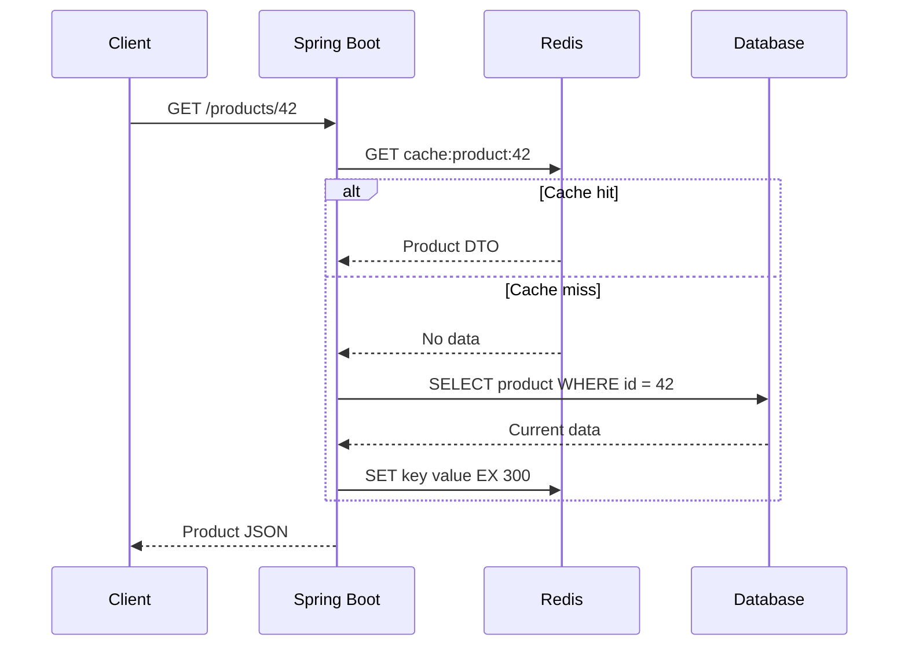
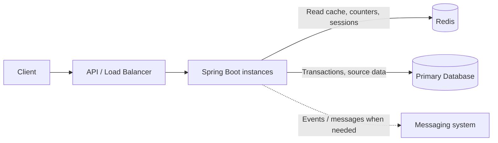

# What Is Redis and Its Role in Application Architecture?

Redis is a **structured data store that runs primarily in memory (in-memory data store)**. Applications communicate with Redis over the network, store data in **key → value** form, and use specialized commands for each data type. Redis is commonly used as a **cache**, but it also supports counters, login sessions, leaderboards, rate limiting, event delivery, and certain forms of coordination across multiple processes.

In the Java ecosystem, **Spring Data Redis** provides ways to access Redis from a Spring application through abstractions such as `RedisTemplate`, `StringRedisTemplate`, repositories, and reactive APIs. Spring Cache or Spring Session can use Redis as their underlying storage infrastructure for their respective needs. Understanding Redis before choosing Spring APIs helps you design the data lifecycle properly and troubleshoot incidents accurately.

## 1. Why Do Applications Need Redis?

Consider an e-commerce system where many users view product information concurrently. Product data resides in a relational database because the system requires transactions, constraints, and reliable updates. However, every page view queries the same product's name, price, and description:

1. A client sends a request for product `42`.
2. The backend calls the database, reads the record, and returns the result.
3. Thousands of similar requests repeat even though product data rarely changes.
4. The database must process many identical queries and compete for resources with other critical queries.

Placing Redis between the application layer and the database can reduce load:

```text
Without cache:
Client → Spring Boot → Database → Spring Boot → Client

With cache:
Client → Spring Boot → Redis (cache hit) → Client
                     └→ Database (cache miss) → write Redis → Client
```

Redis typically provides very low access times by keeping most of the working dataset in RAM and supporting direct data operations. Still, real-world results depend on network latency, payload size, serialization, system load, and configuration. **Redis does not make every operation "free" and does not automatically make an application fast if caching is used inappropriately.**

An important distinction:

- **The primary database** manages business data requiring durability and consistency according to system requirements.
- **Redis cache** holds a regenerable copy of data to serve requests faster; losing the cache typically only increases load or latency.
- **Using Redis as a primary data store** is also a real possibility, though it requires dedicated design for persistence, backups, recovery, replication, and consistency limits. Do not assume data in Redis is always disposable.

## 2. How Does Redis Work?

### 2.1. Typed Key–Value Model

Each key is an identifier, for example:

```text
cache:product:42
session:9fb2...
counter:article:42
leaderboard:weekly
```

The `:` character is only a **naming convention** for humans and tools to organize keys; Redis does not automatically create a directory structure from `:`. Values can be strings, hashes, lists, sets, sorted sets, streams, and other structures.

Example with Redis CLI:

```redis
SET cache:product:42 '{"id":42,"name":"Ballpoint pen"}' EX 120
GET cache:product:42
TTL cache:product:42
DEL cache:product:42
```

- `SET ... EX 120` stores a string with a 120-second expiration.
- `GET` retrieves the content if the key still exists.
- `TTL` checks the remaining time to live (or a special value if there is no TTL / the key does not exist).
- `DEL` deletes the key, commonly used when cache invalidation is needed.

In the example, JSON is a **string serialized by the application itself**. The `GET` command does not natively understand JSON fields simply because the text looks like JSON. Specialized JSON manipulation capabilities may come from RedisJSON/modules or corresponding products, depending on distribution and configuration; that is a different scope from plain Strings.

### 2.2. Data Types and Suitable Use Cases

| Data Type | Meaning | Example Commands | Use Case |
|---|---|---|---|
| **String** | String/bytes, integers that can be incremented/decremented with dedicated commands | `SET`, `GET`, `INCR` | JSON cache, tokens, counters |
| **Hash** | Collection of field–value pairs within one key | `HSET`, `HGET`, `HGETALL` | Profile info or small state |
| **List** | Ordered sequence of elements, manipulated at both ends | `LPUSH`, `RPOP`, `LRANGE` | Simple job lists |
| **Set** | Unique elements with no fixed display order | `SADD`, `SISMEMBER` | Group members, tags |
| **Sorted Set (ZSet)** | Unique members paired with scores for ordering | `ZADD`, `ZRANGE` | Leaderboards, top-N |
| **Stream** | Log of ID-bearing entries, supporting consumer groups | `XADD`, `XREADGROUP`, `XACK` | Event/job processing requiring tracking |
| **Bitmap, HyperLogLog, Geospatial** | Representations or commands for specialized needs | `SETBIT`, `PFADD`, `GEOADD` | Status flags, cardinality estimation, locations |

A few short examples:

```redis
INCR counter:article:42
HSET user:7 name "An" tier "premium"
HGETALL user:7
SADD tags:article:42 "java" "redis"
SISMEMBER tags:article:42 "redis"
ZADD leaderboard:weekly 120 user:7
ZREVRANGE leaderboard:weekly 0 9 WITHSCORES
```

Redis's strength does not lie in stuffing every object into one large string, but in **choosing the right data type and commands for the operation needed**. For example, incrementing a counter with `INCR` is usually much better than a `GET` → add in Java → `SET` flow, which easily suffers lost updates when multiple requests run concurrently.

### 2.3. Atomicity, TTL, and Eviction Are Three Different Concepts

**Command atomicity:** A single Redis command such as `INCR` executes as an individual operation, so two clients concurrently incrementing the same counter do not suffer the lost-update problem of an application-side read–modify–write flow. This **does not** automatically make an arbitrary sequence of multiple commands an atomic transaction. For multi-step logic, you need to consider capabilities such as Lua scripts, `MULTI`/`EXEC`, or redesigning the operation, while understanding the limits of each mechanism.

**TTL (time to live):** An expiration lifetime attached to a key. Upon expiration, the key is considered no longer valid and Redis has mechanisms to remove expired keys. TTL is especially useful for caches, sessions, and temporary data. TTL **is not** a strong enough consistency policy to guarantee that every read always reflects the latest database change.

**Eviction (memory reclamation):** When Redis reaches its configured memory limit (`maxmemory`), `maxmemory-policy` determines whether eligible keys are evicted to make room or commands requiring additional memory are rejected. Eviction can happen **before a key's TTL expires**; a key without a TTL can still be evicted if the policy applies to it.

## 3. Role of Redis in Application Architecture

### 3.1. Cache for Frequently Read Data

This is the most common role. Redis stores the results of expensive queries or computations: product details, shared configuration, catalogs, short-term statistics, and aggregated results.

A read flow following the **cache-aside (lazy loading)** pattern:



A **cache hit** means valid data was found; a **cache miss** means it was not found, so the application falls back to the origin data source. Caching is effective when data has a high re-read rate and reloading from the primary source has significant cost.

The cache does not automatically stay in sync with the database. If a product's price is updated, the application must decide when to delete or rewrite the cache. This is why designing **cache invalidation** is just as important as enabling caching.

### 3.2. Shared Session Storage Across Multiple Instances

When an application runs multiple Spring Boot instances behind a load balancer, sessions stored only in each instance's RAM cause trouble if the next request goes to a different instance.

```text
              ┌── Spring Boot A ──┐
Client → LB ──┤                   ├── Redis (shared session)
              └── Spring Boot B ──┘
```

If the system uses **server-side sessions**, sessions can be stored centrally in Redis so instances read the same state. In Spring, this is a use case for **Spring Session Data Redis**. Redis is not required for applications authenticating with stateless JWTs; the decision depends on the authentication model, session revocation requirements, and session lifecycle.

Sessions need an appropriate TTL, clear expiration handling, and stricter security policies than public caches.

### 3.3. Counters, Rate Limiting, and Abuse Prevention

Redis is useful for counting events by user, API key, network address, or time interval. Increment operations and TTL attachment enable building various rate-limiting algorithms.

Example idea of "no more than N requests per window":

```text
key = rate:user:7:window:<time-bucket>
each request:
  increment the key's counter
  ensure the key has a TTL
  reject if threshold is exceeded
```

This is only an **algorithmic description**. If you simply call `INCR` followed by `EXPIRE` as two independent commands, a failure between them can leave a counter with no TTL. Moreover, a fixed window can allow request bursts at the boundary between two windows. A real system should choose the algorithm based on requirements (fixed window, sliding window, token bucket, etc.) and combine steps that require atomicity, such as via a Lua script.

### 3.4. Leaderboards and Real-Time State

Sorted Sets hold **member → score** pairs. Updating scores and retrieving top users are usually direct operations, avoiding reading an entire table from the database to sort in application code.

Redis also fits presence/heartbeats, online user counts, or temporary state. However, the application must accept that presence signals can be delayed or lost during network failures; do not interpret them as absolute truth.

### 3.5. Messaging Between Services

Redis has two groups of capabilities that are easy to confuse:

| Aspect | Pub/Sub | Redis Streams |
|---|---|---|
| Model | Publisher emits, connected subscribers receive | Producer appends entries to a stream, consumers read |
| When consumer is offline | Broadcast messages are typically not retained for absent subscribers | Entries persist until trimmed/deleted by policy |
| Processing tracking | No durable ack/replay mechanism in basic Pub/Sub | Consumer groups support pending entries and `XACK` |
| Common uses | Instant notifications, signals not needing replay | Lightweight event processing, jobs needing progress tracking |

Streams **do not automatically provide exactly-once processing**. Applications still need duplicate handling, acks, retries, retention, dead-letter strategies, and recovery. For large-scale streaming requirements, partitioning, long-term retention, or complex delivery contracts, evaluate Kafka/RabbitMQ or a dedicated queueing service rather than assuming Redis is equivalent.

### 3.6. Coordinating State Across Nodes

Redis can be used for distributed locks, status flags, or idempotency keys. For example, recording that a payment request has been accepted helps reduce the risk of duplicate processing.

However, **`SET key value NX EX ...` alone is not enough to make every distributed lock problem safe**. You must account for timeouts, lock ownership, token-checked unlock, network failures, failover, and the risk of a stalled old task continuing to act after its lease expires. For financial updates or critical business invariants, uniqueness/idempotency checks in the database and primary data source transactions generally remain mandatory safeguards.

## 4. Where Does Redis Sit Relative to the Database?

A common architecture:



Redis and relational databases typically **complement** each other. The database handles constraints, join queries, and business transactions; Redis serves fast access or specialized data structures.

| Problem | Usually Sensible Choice | Reason |
|---|---|---|
| Product catalog read often, modified rarely | Database + Redis cache | Avoids repeated queries while keeping the canonical data source |
| Money transfers, balance updates | Transactional database as source of truth | Requires invariants, concurrency control, and recoverability |
| Server-side sessions for multiple instances | Redis + Spring Session (if needed) | Shared session state with expiration |
| Top 100 players | Redis Sorted Set; database if history is needed | Fast retrieval of ranks and scores |
| Business logs needing multi-year search | Suitable log/search/database store | Redis RAM is usually not optimal for long-term storage |
| Real-time notifications, acceptable to lose when offline | Redis Pub/Sub may fit | Lightweight, instant event broadcast |
| Jobs that must not be dropped or run arbitrarily twice | Durable queue + idempotency, technology chosen by SLA | Requires retries, monitoring, and clear recovery |

There is no single answer for every system. The decision must be based on **whether data can be lost, whether it can be regenerated, how strong consistency must be, how it scales, and operational cost**.

## 5. Caching Strategies and Trade-offs

### 5.1. Cache-Aside: The Application Controls Reading and Populating the Cache

On the first read, the application checks Redis; on a miss, it reads the database and writes the result to Redis with a TTL. When the origin data is modified, the application typically **deletes the related key** so the next read reloads fresh data.

Pros: simple, caches only data that is actually accessed, easy to add to an existing system.

Cons: the first read is still slow; the cache can be stale between the database update and key invalidation; multiple concurrent requests may load the same data on a cache miss.

Example:

```text
Read:
  Redis GET product:42
  ├── data present: return result
  └── absent: read database → Redis SET with TTL → return result

Update:
  database UPDATE product 42
  after update is confirmed: delete cache product:42
```

**Be careful with transactions:** if the cache is deleted before the database transaction commits, another request can read the old version and put it back into the cache. Even after commit, races between reads and writes can still occur. For data requiring high consistency, stronger solutions are needed such as versioned cache keys, synchronization on updates, post-commit event handling, or bypassing cache on sensitive flows.

### 5.2. Write-Through, Write-Behind, and Time-Based Caching

- **Write-through:** changes go through a layer responsible for writing both the cache and the data source. Requires clearly defining ordering and error handling; Redis and the database do not automatically form a distributed transaction.
- **Write-behind / write-back:** writes quickly to the cache, deferring persistence to the primary source. Can increase throughput but adds risks of data loss, out-of-order writes, and complex recovery.
- **TTL-only:** lets data expire naturally without proactive invalidation. Easy to implement, but accepts a stale-data window up to the TTL—and potentially longer from an observer's perspective if other cache layers exist.

For instance, list prices may tolerate short delays on certain screens, whereas available balance before a money transfer should not rely on a potentially stale cache.

### 5.3. Classic Cache Failure Scenarios

**Cache stampede / thundering herd:** a "hot" key expires and thousands of requests miss simultaneously and hit the database. You can use randomized TTL jitter, preloading, stale-while-revalidate per appropriate rules, or limit the number of threads reloading a key.

**Cache penetration:** continuous requests for non-existent IDs cause every request to query the database. Consider short-lived negative caching ("not found"), input validation, and rate limiting; avoid masking newly created data.

**Cache avalanche:** many keys expire at the same time or Redis suffers an outage, pushing a surge of load onto the backend/database. Use staggered TTLs, controlled warm-up, concurrency limits, circuit breakers/fallbacks, and database protection.

**Hot key:** one key receives the majority of traffic, bottlenecking a Redis node or network link. Consider application-level local caching for suitable data, workload distribution, smaller payloads, or key redesign. Adding nodes does not necessarily solve a single "hot" key.

## 6. Is Data in Redis Durable?

Redis keeps most working data in RAM, but provides persistence mechanisms to recover data:

| Mechanism | How It Works | Key Things to Understand |
|---|---|---|
| **RDB snapshot** | Writes point-in-time snapshots of data to disk per schedule/policy | Recovery is relatively compact; changes since the last snapshot can be lost on failure |
| **AOF (Append Only File)** | Logs data-modifying operations for replay on recovery | Can reduce the data-loss window depending on disk sync policy, in exchange for extra I/O and operational cost |
| **Combined persistence** | Uses mechanisms per configuration/version capabilities | Requires testing recovery, backups, and measuring real SLAs |

**Persistence, replication, and high availability are three different goals.**

- **Persistence:** having data to reinitialize after a process or machine failure.
- **Replication:** creating copies across nodes to support read scaling or role failover. Default replication is usually asynchronous; a write accepted by the primary may not yet have reached the replica before failover.
- **High availability:** improving the ability to continue serving when a node fails, for instance via Redis Sentinel (in an appropriate topology) or Redis Cluster. Failover does not mean strong consistency or zero data loss.

As key count, volume, and throughput grow, Redis Cluster can partition keys across hash slots. Certain multi-key operations are constrained by slot placement; therefore key naming, key grouping, and transactions need to be designed appropriately from the start.

Clearly define **RPO** (acceptable data loss) and **RTO** (target recovery time). Do not treat Redis as "as safe as a transactional database" solely because AOF or replicas are enabled.

## 7. Spring Data Redis Connects the Application Layer to Redis

Spring Data Redis helps Java code work with Redis in an idiomatic Spring style. Common components:

| Component | Role |
|---|---|
| `RedisConnectionFactory` | Creates/manages connections via the configured client (typically Lettuce) |
| `RedisTemplate<K,V>` | API for operating on multiple data types, supporting key/value serializer configuration |
| `StringRedisTemplate` | Convenient variant when both keys and values are strings |
| `ReactiveRedisTemplate<K,V>` | Reactive API for asynchronous pipelines on the reactive stack |
| Spring Data Redis Repositories | Maps certain object models to Redis via the repository mechanism, with its own query/mapping limits |
| Spring Cache + Redis | Uses `@Cacheable`, `@CacheEvict`, and `CacheManager` to manage caching |
| Spring Session Data Redis | Stores Spring sessions in Redis; a separate integration capability |

These abstractions **do not replace understanding TTL, serializers, consistency, and failure conditions**. They simply make implementation cleaner within the Spring ecosystem.

### 7.1. Spring Boot Configuration Example

Gradle Groovy DSL dependencies example:

```groovy
dependencies {
    implementation 'org.springframework.boot:spring-boot-starter-data-redis'
    implementation 'org.springframework.boot:spring-boot-starter-cache'
}
```

Illustrative configuration for a development machine (`application.yml`):

```yaml
spring:
  data:
    redis:
      host: localhost
      port: 6379
      timeout: 2s
  cache:
    type: redis
    redis:
      time-to-live: 5m
      cache-null-values: false
```

These properties follow common Spring Boot 3.x configuration conventions; when bringing them into a project, verify your exact version and override with environment variables/secrets for production. Redis connects from the backend; never put passwords in Java source code or public documentation.

Enable cache annotations:

```java
@Configuration
@EnableCaching
public class CacheConfiguration {
}
```

Example service with **the database as the source of truth**:

```java
@Service
public class ProductService {
    private final ProductRepository repository;

    public ProductService(ProductRepository repository) {
        this.repository = repository;
    }

    @Cacheable(cacheNames = "productById", key = "#id")
    public ProductDto getById(Long id) {
        // Only runs on a cache miss.
        Product product = repository.findById(id)
            .orElseThrow(() -> new ProductNotFoundException(id));
        return ProductDto.from(product);
    }

    @CacheEvict(cacheNames = "productById", key = "#id")
    public ProductDto update(Long id, ProductUpdate request) {
        Product product = repository.findById(id)
            .orElseThrow(() -> new ProductNotFoundException(id));
        product.setName(request.name());
        Product saved = repository.save(product);
        return ProductDto.from(saved);
    }
}
```

This is an **API usage illustration**; `Product`, `ProductRepository`, `ProductDto`, `ProductUpdate`, and the exception are hypothetical domain classes that must be defined in a real application.

- `@Cacheable` can skip the method body if the cache already holds a value, provided the call goes through Spring's cache proxy mechanism.
- `@CacheEvict` removes the entry after the call completes normally by default; this does not automatically ensure invalidation occurs after a transaction **commit**.
- Caching requires stable key conventions and an **appropriate serializer**. Redis Cache defaults to Java serialization in some Spring configurations; DTOs must be compatible or a JSON serializer must be explicitly configured. Do not switch serializers in an environment with existing data while ignoring compatibility.
- Calling one method from another **within the same bean** (self-invocation) can bypass the Spring proxy, causing cache annotations not to take effect as expected.

### 7.2. When to Use `StringRedisTemplate`?

For explicit commands such as incrementing a counter, accessing Redis directly can be clearer than using the cache abstraction:

```java
@Service
public class ViewCounterService {
    private final StringRedisTemplate redis;

    public ViewCounterService(StringRedisTemplate redis) {
        this.redis = redis;
    }

    public Long countView(long productId) {
        return redis.opsForValue()
            .increment("counter:product:view:" + productId);
    }
}
```

`INCR` in Redis handles updating the counter atomically per command. The example does not yet set a TTL: if counters only need to be kept per day/week, design keys by time window and add an appropriate expiry so counters do not grow without an expiration.

Choose the API according to the work pattern:

- **Caching method results:** prefer Spring Cache when caching rules match method invocation patterns.
- **Data structures, counters, rate limits, streams:** typically use `RedisTemplate`, `StringRedisTemplate`, or the corresponding specialized API.
- **Reactive applications:** consider `ReactiveRedisTemplate` and a reactive client to avoid introducing blocking calls onto the event loop.
- **Sessions:** use the Spring Session model if server-side sessions need to be shared.

## 8. Design Keys, TTLs, and Data Before Deployment

Redis is easy to experiment with using a few keys, yet hard to operate when keys grow into the millions. Some design principles:

### 8.1. Meaningful Key Conventions

```text
<application>:<environment>:<domain>:<entity>:<id>[:<version>]
shop:prod:product:detail:42:v3
shop:prod:rate:user:7:2026-11-12T10
shop:prod:session:<opaque-id>
```

Do not put passwords, raw access tokens, or unnecessary sensitive data into key names. Each key group should have an owner, TTL policy, deletion rule, and size limit. Prefixes like `prod` and `staging` help distinguish names, but **do not replace security isolation**, ACLs, or separate instances where needed.

### 8.2. Choose TTL Based on Stale-Data Tolerance

- Slowly changing catalog caches can use a longer TTL than price/promotion caches.
- Sessions need TTLs tied to login/logout policies.
- Rate-limiting keys need TTLs matching the algorithm.
- Historical counters may need long-term storage in a database or analytics system instead of sitting indefinitely in Redis RAM.

There is no "standard TTL" for every business case. Short TTLs reduce the stale-data window but increase cache misses and primary-source load; long TTLs improve hit rates but extend stale-data exposure if invalidation is mishandled.

### 8.3. Estimate Resources and Latency

Overall assessment covers **key count, key/value size, metadata, data structures, replication, persistence, traffic, connection count, and peak load**. Plain JSON size alone does not reflect actual Redis memory consumption.

Minimum observability:

- Cache hits/misses and hit ratio by cache group.
- Per-command latency, timeouts, connection errors, connection count.
- Memory in use, evicted keys, expired keys.
- Slow commands (`SLOWLOG`), hot keys, oversized payloads.
- Sudden load spikes on the database when Redis is slow or cache misses occur en masse.
- Replica status, failover, backup/restore if Redis holds critical data.

Avoid using `KEYS *` to scan all keys on a busy production instance; when you need to iterate keys, prefer batched `SCAN` and still bound the workload. Also limit commands that return huge datasets or operations whose complexity grows sharply with element count.

## 9. Safe Operations and Handling Redis Failures

### 9.1. Redis Can Be Slow or Unreachable

For **regenerable caches**, applications should design timeouts and bounded fallback mechanisms to the database or suitable default content. However, an uncontrolled flood of fallbacks can also overwhelm and crash the database; concurrency limits, backpressure/circuit breakers, or priority-based graceful degradation are needed.

For **sessions, rate limiters, or idempotency**, fallbacks must respect business and security requirements. For instance, when a rate limiter fails, choosing fail-open or fail-closed is a policy decision, not the same answer for every API.

### 9.2. Securing Redis

Redis is an internal infrastructure component:

- Only allow connections from authorized application networks; do not expose the Redis port to the public Internet.
- Configure authentication, ACLs, and TLS per environment.
- Keep connection credentials in a secret manager or platform secrets mechanism.
- Restrict application account permissions to the commands and keyspaces actually required.
- Maintain backup, restore, upgrade, and incident-response procedures when Redis stores important data.

### 9.3. Choose the Consistency Boundary

Do not confuse "a single Redis command is atomic" with "the whole system is consistent." A business flow may involve a database transaction, cache invalidation, a message queue, and multiple nodes. Those operations **are not automatically combined into a cross-system transaction** just by using Redis or Spring Data Redis.

For data where wrong updates have major consequences, keep final control at a data source with proper transactional guarantees and constraints; caching only assists read paths where trade-offs are acceptable.

## 10. Combined Scenario: An E-Commerce Application

Suppose a Spring Boot backend manages products, orders, and user traffic:

| Need | Recommended Component | Reason |
|---|---|---|
| Repeatedly viewing products | `@Cacheable` + Redis cache with TTL and invalidation | Reduces duplicate queries |
| Updating product prices | Database transaction + appropriate post-commit cache invalidation | Keeps the canonical data source and reduces stale values |
| Counting views | `StringRedisTemplate` with `INCR`, aggregated later if needed | Simple concurrent increments |
| Login with server-side sessions | Spring Session Data Redis | Multiple backend instances share session state |
| Rate-limiting OTP-sending API | Redis + atomic rate-limit algorithm and Redis-failure policy | Prevents abuse; ensures window correctness |
| Order creation and payment | Database as source of truth, idempotency enforced at the durable layer | Avoids impact from stale cache data or Redis loss |
| Sending order events | Choose a message broker matching delivery requirements; Streams is a candidate within scope | Requires retries, tracking, and duplicate handling |

For example, if `GET /products/42` is cached for 5 minutes, losing Redis causes the first request to re-query the database; the system can still serve traffic if the database can handle the load. Conversely, if payment completion status is stored only in a Redis key with a TTL, losing that key leaves the backend without sufficient evidence to decide whether to reprocess the transaction. These two kinds of data **cannot share the same failure policy**.

## 11. Common Misconceptions

**"Is Redis just a cache?"** No. Redis is a data store with many data types and commands, usable for caching, state storage, counters, messaging, and more.

**"Once you have Redis, can you drop the SQL database?"** Only if data, transactional, query, operational, and recovery requirements genuinely fit. For most relational business applications, Redis plays a supporting role.

**"Redis runs in RAM, so it has no persistence?"** Redis supports RDB/AOF; persistence and replica configuration determine recovery characteristics. Do not infer that every write is guaranteed to be absolutely durable.

**"Does `@Cacheable` automatically sync with database changes?"** No. Caching requires TTLs, invalidation strategies, and business-level consideration of race conditions.

**"Is `INCR` enough for every rate limiter?"** No. A counter is one piece; the limiting algorithm, atomic expiration, time windows, and failure policies also need to be defined.

**"Does moving to Redis Cluster make every operation scale automatically?"** No. Hot keys, multi-key commands, payload sizes, and hash-slot distribution remain limiting factors.

## Conclusion

Redis provides a low-latency data layer and specialized operations, helping Spring Boot applications reduce repeated queries, share state across instances, and handle many real-time needs. Redis's value comes from **putting the right kind of data in the right role**: what is disposable and regenerable cache, what needs persistence and recovery, and what must remain consistent with the database.

When working with **Spring Data Redis**, follow this sequence: define data requirements → choose Redis's role → choose key/value structures, TTL, and failure handling → pick the appropriate Spring abstraction → measure and observe actual behavior. That order prevents ending up with a working cache that introduces stale data, concurrency bugs, or operational risks later on.
