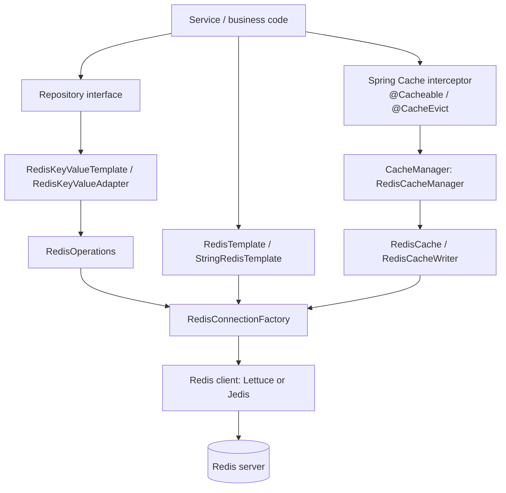
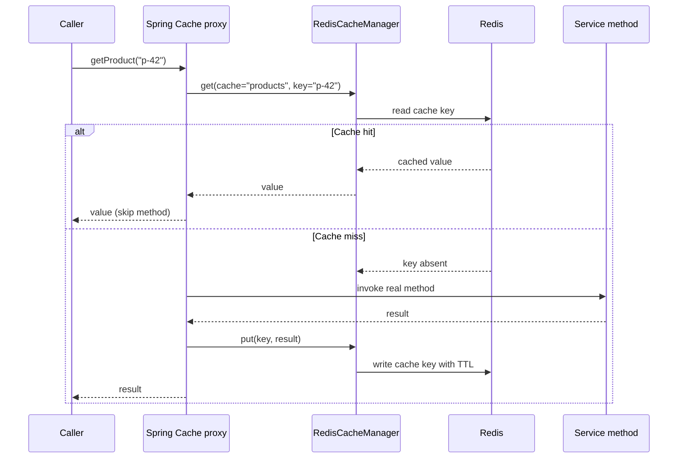
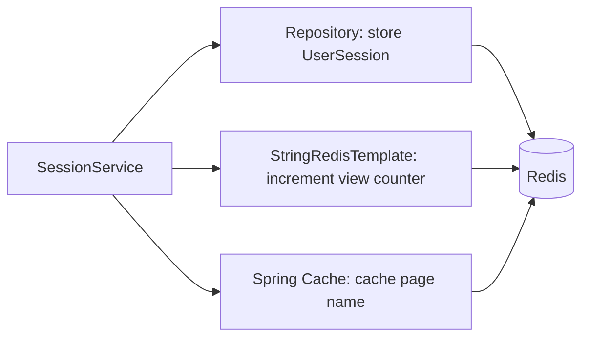

# Component Map: ConnectionFactory, Template, Repository, and Cache in Spring Data Redis

When integrating Redis into a Spring application, four names frequently appear together: `RedisConnectionFactory`, `RedisTemplate`, Redis Repository, and `RedisCacheManager`. They all communicate with a Redis server yet solve **different problems**: connectivity, direct data operations, object storage via the repository model, and storing computed results for reuse.

This guide maps the relationships among these components, explains the execution flow, and shows how to choose the right abstraction in each scenario. Examples use common Spring Boot 3.x / Spring Data Redis 3.x naming and APIs; configuration details may vary by project version.

## 1. Big Picture: Where Do the Four Components Sit?

Spring Data Redis is the integration layer between Java/Spring code and Redis. Redis remains an external storage system: Spring components **do not create four Redis servers** or four separate databases.



Read the diagram from bottom to top:

1. **Redis server** executes commands and stores data by key.
2. **Redis client** such as Lettuce/Jedis manages network communication.
3. **`RedisConnectionFactory`** supplies Redis connections to the layers above.
4. **`RedisTemplate`** and **Repository** are two ways to manipulate application data. Template works at the command/data-structure level; Repository works with objects and IDs.
5. **`RedisCacheManager`** implements the Spring Cache mechanism. `@Cacheable` calls go through the cache interceptor to look up or write results in Redis.

Important point: the **Cache branch does not necessarily go through the `RedisTemplate` you declare for business logic**. `RedisCacheManager` uses `RedisCacheWriter` and `RedisConnectionFactory`. The Repository branch has its own infrastructure and uses Redis operations underneath; that does not mean every Repository method is a single `opsForValue()` call.

| Component | Inputs You Typically Supply | Primary Responsibility | Question It Answers |
|---|---|---|---|
| `RedisConnectionFactory` | Host, port, authentication, SSL, topology configuration | Creates/supplies connections to Redis via the driver | "How does the application connect to Redis?" |
| `RedisTemplate<K, V>` | Key, value, Redis commands, serializers, TTL | Manipulates Redis data at the data-structure level | "How do I run `GET`, `SET`, `INCR`, or operate on Hash/Set/List?" |
| Redis Repository | Entity, ID, `save`/`findById` methods, indexed properties | Maps objects to Redis data and manages retrieval by ID/index | "How do I save and look up a Java aggregate?" |
| `RedisCacheManager` | Cache name, cache key, method result, TTL, serialization policy | Stores and retrieves results through Spring Cache | "Can we skip this expensive work when the data is already cached?" |

## 2. RedisConnectionFactory: The Connection Foundation

`RedisConnectionFactory` is a Spring Data Redis interface, and `LettuceConnectionFactory` is the common implementation when using Spring Boot's Redis starter. Depending on configuration and dependencies, the application can use a driver configured for standalone, Sentinel, or Redis Cluster.

Simplified execution flow:

```text
Service → RedisTemplate → RedisConnectionFactory
                              ↓
                         Lettuce/Jedis
                              ↓
                         Redis server
```

An example standalone Redis connection configuration on a development machine:

```yaml
spring:
  data:
    redis:
      host: localhost
      port: 6379
      timeout: 2s
```

With Spring Boot and `spring-boot-starter-data-redis`, auto-configuration normally provides a `RedisConnectionFactory` bean from the `spring.data.redis.*` properties. The application can inject this factory into beans that need it; you normally do not instantiate `LettuceConnectionFactory` manually.

**A factory is not identical to a single fixed TCP socket.** Connection sharing, allocation, and management depend on the driver and configuration. Templates manage the resource lifecycle for each operation; you should not manually open a `RedisConnection` for routine CRUD and forget to close or release it.

When do you need to use `RedisConnectionFactory` directly?

- Creating a `RedisTemplate` or `RedisCacheManager` with custom configuration.
- Building low-level functionality that genuinely needs `RedisConnection` or driver-specific APIs.
- Customizing connections by environment, TLS, authentication, timeouts, Sentinel, or Cluster.

The factory **does not decide** whether a value uses JSON or JDK serialization, how long an entity lives, or what a cache is named. Those decisions live in the layers above.

## 3. RedisTemplate: Explicit Redis Operations

`RedisTemplate<K, V>` executes Redis operations and converts Java objects to bytes using serializers. It handles acquiring connections, executing commands, and translating driver exceptions into Spring Data's exception hierarchy.

`RedisTemplate` exposes operation groups by data structure:

| API | Redis Type / Example Commands | Use Case |
|---|---|---|
| `opsForValue()` | String: `GET`, `SET`, `INCR` | OTP codes, counters, single values |
| `opsForHash()` | Hash: `HGET`, `HSET` | Field/value attributes |
| `opsForList()` | List: `LPUSH`, `LRANGE` | Ordered lists |
| `opsForSet()` | Set: `SADD`, `SISMEMBER` | Unique element collections |
| `opsForZSet()` | Sorted Set: `ZADD`, `ZRANGE` | Scores, rankings |
| `opsForStream()` | Stream: `XADD`, stream reading | Event streams in Redis |
| `expire(key, ...)` | `EXPIRE` / equivalent | Attaching a TTL to a key |

### 3.1. StringRedisTemplate: The Simplest Case

`StringRedisTemplate` is a specialization of `RedisTemplate<String, String>` using string serializers for keys and values. It fits when stored data is text, string-encoded numbers, or when you need to inspect keys with the Redis CLI.

```java
import java.time.Duration;
import org.springframework.data.redis.core.StringRedisTemplate;
import org.springframework.stereotype.Service;

@Service
public class VisitCounter {
    private final StringRedisTemplate redis;

    public VisitCounter(StringRedisTemplate redis) {
        this.redis = redis;
    }

    public Long recordVisit(String articleId) {
        String key = "metrics:article:" + articleId + ":views";
        return redis.opsForValue().increment(key);
    }

    public String currentVisits(String articleId) {
        String key = "metrics:article:" + articleId + ":views";
        String value = redis.opsForValue().get(key);
        return value == null ? "0" : value;
    }

    public void saveOneTimeCode(String userId, String code) {
        redis.opsForValue().set(
            "otp:user:" + userId,
            code,
            Duration.ofMinutes(5)
        );
    }
}
```

Here, `recordVisit()` uses Redis's numeric increment, so incrementing a single key is atomic at Redis. `set(key, value, Duration)` writes the value with a TTL. No entities or cache annotations are involved.

### 3.2. RedisTemplate with Java Objects

When values are Java objects, you must decide how to serialize them. For example, a dedicated template storing cart snapshots as JSON:

```java
import org.springframework.context.annotation.Bean;
import org.springframework.context.annotation.Configuration;
import org.springframework.data.redis.connection.RedisConnectionFactory;
import org.springframework.data.redis.core.RedisTemplate;
import org.springframework.data.redis.serializer.Jackson2JsonRedisSerializer;
import org.springframework.data.redis.serializer.StringRedisSerializer;

@Configuration
public class CartRedisConfig {
    @Bean
    RedisTemplate<String, CartSnapshot> cartRedisTemplate(
            RedisConnectionFactory connectionFactory) {

        RedisTemplate<String, CartSnapshot> template = new RedisTemplate<>();
        template.setConnectionFactory(connectionFactory);
        template.setKeySerializer(new StringRedisSerializer());
        template.setHashKeySerializer(new StringRedisSerializer());

        var json = new Jackson2JsonRedisSerializer<>(CartSnapshot.class);
        template.setValueSerializer(json);
        template.setHashValueSerializer(json);
        template.afterPropertiesSet();
        return template;
    }
}

record CartSnapshot(String cartId, int itemCount) {}
```

Usage:

```java
cartRedisTemplate.opsForValue().set(
    "cart:42",
    new CartSnapshot("42", 3),
    Duration.ofMinutes(15)
);

CartSnapshot snapshot = cartRedisTemplate.opsForValue().get("cart:42");
```

In a real application, inject the `RedisTemplate<String, CartSnapshot>` bean into the service that uses it. The snippet illustrates serializer configuration for a simple type; for complex models (such as dates/times, polymorphism, schema evolution), configure Jackson and an appropriate data compatibility strategy.

**Distinguish the four serializer slots:** key, value, hash key, and hash value. Changing the value serializer on the same Redis key can cause the application to misread previously stored bytes. Do not assume configuring serializers on one `RedisTemplate` automatically changes how Repositories or Spring Cache write data.

## 4. Redis Repository: Working with Entities and IDs

When viewing data as a business object with an identifier, Redis Repository provides the familiar Spring Data style: `save()`, `findById()`, `findAll()`, `deleteById()`, and certain supported property-based query methods.

A Redis entity is typically annotated with `@RedisHash`. Spring Data Redis maps its properties to a Redis Hash structure and manages the required keyspace and metadata/indexes; it is not an SQL table.

```java
import org.springframework.data.annotation.Id;
import org.springframework.data.redis.core.RedisHash;
import org.springframework.data.redis.core.index.Indexed;

@RedisHash(value = "sessions", timeToLive = 1800)
public class UserSession {
    @Id
    private String id;

    @Indexed
    private String userId;

    private String currentPage;

    public UserSession() {}

    public UserSession(String id, String userId, String currentPage) {
        this.id = id;
        this.userId = userId;
        this.currentPage = currentPage;
    }

    public String getId() { return id; }
    public String getUserId() { return userId; }
    public String getCurrentPage() { return currentPage; }
    public void setCurrentPage(String currentPage) {
        this.currentPage = currentPage;
    }
}
```

```java
import java.util.List;
import org.springframework.data.repository.CrudRepository;

public interface UserSessionRepository
        extends CrudRepository<UserSession, String> {

    List<UserSession> findByUserId(String userId);
}
```

```java
UserSession session =
    repository.save(new UserSession("s-101", "u-42", "/home"));

UserSession loaded = repository.findById("s-101").orElseThrow();
List<UserSession> sessions = repository.findByUserId("u-42");
```

Meaning of the annotations:

- `@RedisHash("sessions")` defines the keyspace for this entity type. Entity data is mapped primarily to a Redis Hash; Spring Data may also create keys to track ID sets or indexes.
- `@Id` identifies the key field used by the Repository to look up and store the entity.
- `@Indexed` tells Spring Data Redis to maintain a secondary index for the `userId` property, enabling queries like `findByUserId()`. Indexes consume extra memory and maintenance overhead.
- `timeToLive = 1800` sets a default TTL of **1,800 seconds (30 minutes)** for stored entities. Reading an entity does not automatically refresh its TTL like a sliding session.

In Spring Boot, Repositories can be detected through auto-configuration and component scanning. When you need to explicitly select packages, you can configure `@EnableRedisRepositories`. Ensure both entities and interfaces are within the corresponding scan scope.

### Repository Is Not JPA for Redis

Do not extrapolate SQL/JPA capabilities onto Redis Repository:

- Redis has no joins or SQL transactions in the relational database sense.
- Derived queries depend on Redis Repository support and the necessary indexes; `findByUserId()` in the example is built around the `@Indexed` property.
- Not every complex query expression, compound condition, or pagination feature works like Spring Data JPA.
- A Repository's Redis Hash is not automatically interchangeable with a JSON string written by `RedisTemplate.opsForValue()`. Mixing both write paths into the same keyspace can break data formats.

Choose Repository when your goal is managing the lifecycle of **identifiable objects**, straightforward CRUD operations, and a small set of query patterns suited to Redis indexing.

## 5. Cache: Using Redis to Avoid Repeating Work

Spring Cache is an abstraction at the **method-result** level. It answers the question: "Do we already have the result for this set of parameters?". When Redis is configured as the cache provider, `RedisCacheManager` manages caches backed by Redis.

Execution path of `@Cacheable`:



Example Redis Cache configuration for Spring Boot:

```gradle
dependencies {
    implementation 'org.springframework.boot:spring-boot-starter-data-redis'
    implementation 'org.springframework.boot:spring-boot-starter-cache'
}
```

```yaml
spring:
  data:
    redis:
      host: localhost
      port: 6379
  cache:
    type: redis
    redis:
      time-to-live: 10m
      cache-null-values: false
```

Enable Spring Cache:

```java
import org.springframework.boot.SpringApplication;
import org.springframework.boot.autoconfigure.SpringBootApplication;
import org.springframework.cache.annotation.EnableCaching;

@SpringBootApplication
@EnableCaching
public class RedisDemoApplication {
    public static void main(String[] args) {
        SpringApplication.run(RedisDemoApplication.class, args);
    }
}
```

A service using a primary data source and caching lookup results:

```java
import org.springframework.cache.annotation.CacheEvict;
import org.springframework.cache.annotation.Cacheable;
import org.springframework.stereotype.Service;

@Service
public class ProductService {
    private final ProductGateway sourceOfTruth;

    public ProductService(ProductGateway sourceOfTruth) {
        this.sourceOfTruth = sourceOfTruth;
    }

    @Cacheable(cacheNames = "product-name", key = "#id")
    public String getName(String id) {
        return sourceOfTruth.loadName(id);
    }

    @CacheEvict(cacheNames = "product-name", key = "#id")
    public void rename(String id, String newName) {
        sourceOfTruth.rename(id, newName);
    }
}
```

`ProductGateway` in the example represents the primary product data source (database/API), not a built-in Spring Data Redis API. The first call to `getName("p-42")` queries the source; subsequent calls can return the Redis result. `rename()` clears the corresponding cache after a successful update so the next read fetches the new data.

Commonly used annotations:

| Annotation | Meaning | Typical Case |
|---|---|---|
| `@Cacheable` | Returns from cache if present; on miss, invokes method and stores result | Repeatedly reading data |
| `@CachePut` | Always executes method and updates cache with the new result | Syncing cache when the new value is known |
| `@CacheEvict` | Removes one or more cache entries | Source data has changed |
| `@Caching` | Combines multiple cache operations | Updating multiple related cache regions |

In standard Spring AOP proxy mode, annotations only apply when calls **pass through the Spring proxy**. Calling one method from another within the same object (`this.getName(...)`) normally bypasses the cache interceptor. Methods must be Spring-managed and compatible with the proxy mechanism.

Beyond TTL, caching must have an **invalidation** policy: if source data changes before the cache expires and is not evicted/updated, users can receive stale data. Redis Cache does not automatically detect every change in the database.

### How Do CacheManager and RedisTemplate Differ?

The two snippets below can both put data into Redis, yet their semantics differ:

```java
// Explicitly managing key and TTL
stringRedisTemplate.opsForValue().set(
    "profile:42:name", "An", Duration.ofMinutes(10)
);

// Letting Spring Cache manage cache name, cache key, hit/miss, and TTL
@Cacheable(cacheNames = "profile-name", key = "#id")
public String loadProfileName(String id) {
    return profileGateway.loadName(id);
}
```

In the template branch, **the service itself decides** when to read/write the key. In the Cache branch, the Spring proxy decides whether the method needs to execute. Caches typically use keys prefixed with the cache name (e.g. `profile-name::42` under default configuration), though the exact format is customizable.

Cache value serializers also have their own configuration, such as via `RedisCacheConfiguration`. Default Spring Data Redis cache configuration may use JDK serialization for values; if you want JSON caching, configure serialization suited to your data types and versioning strategy. Do not assume `StringRedisTemplate` or a JSON template automatically changes `RedisCacheManager`'s serializer.

## 6. Three Data Flows Sharing One RedisConnectionFactory

The following example shows how a single Redis instance can serve three different needs at once.



Assume the application has declared `UserSessionRepository` and enabled Spring Cache as above:

```java
import org.springframework.cache.annotation.CacheEvict;
import org.springframework.cache.annotation.Cacheable;
import org.springframework.data.redis.core.StringRedisTemplate;
import org.springframework.stereotype.Service;

@Service
public class SessionService {
    private final UserSessionRepository sessions;
    private final StringRedisTemplate redis;

    public SessionService(
            UserSessionRepository sessions,
            StringRedisTemplate redis) {
        this.sessions = sessions;
        this.redis = redis;
    }

    public UserSession create(String id, String userId) {
        return sessions.save(new UserSession(id, userId, "/home"));
    }

    public Long countVisit(String sessionId) {
        return redis.opsForValue().increment(
            "metrics:session:" + sessionId + ":views"
        );
    }

    @Cacheable(cacheNames = "session-page", key = "#sessionId")
    public String currentPage(String sessionId) {
        return sessions.findById(sessionId)
            .map(UserSession::getCurrentPage)
            .orElse("session-not-found");
    }

    @CacheEvict(cacheNames = "session-page", key = "#sessionId")
    public void changePage(String sessionId, String newPage) {
        UserSession session = sessions.findById(sessionId).orElseThrow();
        session.setCurrentPage(newPage);
        sessions.save(session);
    }
}
```

A request passes through three abstractions:

1. `create("s-101", "u-42")` calls **Repository** to create a session entity with its own TTL.
2. `countVisit("s-101")` calls **StringRedisTemplate** to increment a counter on key `metrics:session:s-101:views`; the counter does not inherit the entity's TTL.
3. `currentPage("s-101")` goes through **Spring Cache**. On a cache hit, the Repository is not called; on a cache miss, the method reads the entity and caches the resulting string.
4. `changePage(...)` modifies the entity via the Repository and evicts the `session-page` cache for that session.

These are **three independent key groups in purpose and lifetime policy**:

| Logical Key Example | Who Owns It? | TTL |
|---|---|---|
| `sessions:s-101` along with related metadata/indexes | Redis Repository | `@RedisHash(timeToLive=1800)` |
| `metrics:session:s-101:views` | StringRedisTemplate / service | None unless code sets a TTL |
| `session-page::s-101` | RedisCacheManager | `spring.cache.redis.time-to-live=10m` |

Actual key names depend on keyspace, prefix, and key generator/serializer configuration. Do not treat this example as a contract for all internal keys generated by Repository.

**Data implication:** entity, counter, and cache TTLs do not stay in sync automatically. For instance, caching a "session found" result right before the entity expires can let that cached result persist until the cache TTL ends. If strict consistency is required, design TTLs and invalidation explicitly.

## 7. How to Choose an Abstraction for a Specific Requirement

| Need | Choose First | Explanation |
|---|---|---|
| Connecting to Redis using host, password, TLS, or Cluster | `RedisConnectionFactory` / Spring Boot configuration | The connection layer shared across other components |
| Counting views, incrementing numbers, working with Set, Sorted Set, List, Stream, or custom keys | `StringRedisTemplate` / `RedisTemplate` | Requires direct use of Redis commands and data structures |
| Saving an entity by ID, retrieving, and deleting by ID | Redis Repository | CRUD API tied to an aggregate's lifecycle |
| Querying a few entity properties through supported indexes | Repository with `@Indexed` | Spring Data manages indexes for those lookups |
| Speeding up methods calling a database or external API | Spring Cache + `RedisCacheManager` | Simplifies hit/miss handling, key generation, expiry, and eviction |
| Using Redis as a cache while also needing independent counters | Combine Cache and Template | Each path serves its own semantics |

A helpful selection rule of thumb:

- **Thinking in terms of Redis commands, data structures, and key names?** Start with Template.
- **Thinking in terms of aggregates, IDs, and CRUD?** Consider Repository, after checking query/index capabilities.
- **Thinking "is calling this method again expensive?"** Start with Spring Cache.
- **Only need to change connection details?** Configure `RedisConnectionFactory`, without rewriting services.

Not all data in Redis belongs in a Repository. For example, a leaderboard needing `ZINCRBY` and top-N from a Sorted Set usually fits Template better; a product price lookup method from PostgreSQL usually fits Cache better; a session object with an ID, TTL, and indexed properties can fit Repository.

## 8. Serializer, TTL, and Keyspace Are Three Boundaries to Remember

### 8.1. Serializer: Java Objects into Bytes

Redis works with bytes, whereas Spring sends/receives Java objects. Each branch has its own conversion mechanism:

- Template selects serializers for key, value, hash key, and hash value.
- Repository uses Spring Data's Redis Hash mapping mechanism, and does not automatically turn an entity into a JSON string from some template.
- Redis Cache uses `RedisCacheConfiguration` for key/value serialization and prefix configuration.

If you open the Redis CLI and see a value that looks like binary bytes, do not immediately conclude the key is corrupted. First identify **which component wrote the key** and its serializer. Changing a serializer in a new release is also a data format change; plan for compatibility, controlled cache clearing, or migration.

### 8.2. TTL: Expiration at Each Layer

TTL is a property of a **Redis key**. How it is set depends on the abstraction:

- Template: call `set(key, value, Duration)` or `expire(key, Duration)`.
- Repository: use `@RedisHash(timeToLive=...)` or a `@TimeToLive` property when TTL needs to be attached to an entity.
- Cache: configure global or per-cache-name TTLs via `RedisCacheConfiguration` / Spring Boot cache properties.

Redis deletes/invalidates keys when TTL hits 0, though expiration events, secondary indexes, and Repository listener behavior have their own configuration conditions. Do not rely on key-expiration events as a guarantee for executing business logic at an exact timestamp.

### 8.3. Keyspace: Avoiding Collisions and Understanding Ownership

Example of a readable convention:

```text
metrics:article:42:views      # Template / counter
otp:user:42                  # Template / short-lived code
sessions:s-101               # Repository / entity
session-page::s-101          # Spring Cache / cache entry
```

Choosing consistent prefixes improves observability and prevents components from overwriting each other's data. However, Redis does not enforce independent schemas per prefix: if two components share the same key name using different data types or serializers, Redis type errors or deserialization errors can occur.

## 9. Common Mistakes and Errors

| Symptom | Likely Cause to Check | Resolution |
|---|---|---|
| `@Cacheable` does not create cache entries | Missing `@EnableCaching`, missing cache manager, internal self-call within the same bean bypassing proxy | Check configuration and method invocation path |
| Key exists in Redis but reading throws deserialization errors | Template/Cache/Repository wrote using different formats, or serializer was recently changed | Identify the owner and align serializer configuration before reading |
| `findById()` works but `findByUserId()` does not behave as expected | Query depends on indexing or mapping mismatch | Check `@Indexed`, verify data was written via Repository, and check query support limits |
| Entity disappears after 30 minutes but counter remains | Repository TTL does not apply to Template keys | Set an explicit TTL on the counter if business logic requires it |
| Database updated yet `@Cacheable` still returns old data | Cache has not reached TTL or was not evicted | Use `@CacheEvict`/`@CachePut` at the update point, review TTL |
| A Redis operation times out | Connection, Redis infrastructure, slow command, pool/driver, or network | Inspect server, timeouts, monitoring, and exception logs |
| Assuming all Redis accesses share one transaction | Multiple commands from Repository, Template, and Cache do not form a cross-layer transaction | Design atomicity/idempotency around the operations that truly require it |

Do not rely on Redis Cache as a mechanism for perfect source-data synchronization, or treat every Repository `save()` method as equivalent to a single `SET` command. A Repository may need to update hashes and index structures; a cache may involve read + compute + write. Under concurrent requests or temporary Redis unavailability, behavior must be evaluated against the application's consistency requirements and error-handling strategy.

## 10. Inspecting Real Data in Redis

The Redis CLI is helpful when learning and debugging a development instance:

```bash
# List keys matching a prefix without using KEYS *
redis-cli --scan --pattern 'metrics:*'

# Inspect the data type and TTL of a key
redis-cli TYPE metrics:article:42:views
redis-cli TTL metrics:article:42:views

# Read a string written with StringRedisTemplate
redis-cli GET metrics:article:42:views

# Inspect fields of an entity hash (using the Repository's actual key)
redis-cli HGETALL sessions:s-101
```

`TYPE` distinguishes Redis String/Hash/List/Set/Sorted Set/Stream. `TTL` returns remaining seconds, `-1` if the key exists with no TTL, and `-2` if the key does not exist. For keys using binary serializers, `GET`/`HGETALL` may not display directly readable text.

When inspecting, cross-check three questions:

1. **Who wrote the key?** Template, Repository, or Cache?
2. **What type is Redis storing?** String, Hash, or another type; which serialization?
3. **Who decides when the key expires or gets deleted?** A template-set TTL, an entity TTL, or cache TTL/invalidation?

Avoid using `KEYS *` to scan the entire keyspace on production Redis because it can block the server when the keyset is large; use batched `SCAN` and monitor system load.

## 11. Distinguishing Synchronous and Reactive APIs

The examples above use the standard synchronous branch: `RedisConnectionFactory`, `RedisTemplate`, `StringRedisTemplate`, and synchronous Spring Cache. In reactive applications, Spring Data Redis provides `ReactiveRedisConnectionFactory`, `ReactiveRedisTemplate`, and `ReactiveStringRedisTemplate` returning `Mono`/`Flux`. This is a separate Redis access path; switching to WebFlux does not automatically make synchronous `RedisTemplate` calls non-blocking.

Likewise, do not assume the Redis Repository and Spring Cache annotations in the examples above automatically offer identical reactive semantics. Choose the API matching your execution model and library version.

## 12. Self-Check with Three Scenarios

**Scenario A — Article view counts.** Requires incrementing view counts atomically and reading a top-level counter by key. `StringRedisTemplate.opsForValue().increment()` is the direct choice; Repository adds no clear benefit.

**Scenario B — Temporary login sessions.** Each session has an ID, user ID, current page, and a 30-minute TTL; needs lookup by user ID. Redis Repository with `@RedisHash`, `@Id`, and `@Indexed` is a suitable model, provided query/index limits meet requirements.

**Scenario C — Displaying product names fetched from a database.** Reads are repeated heavily, the database is the primary source, and there is a rename operation. Use `@Cacheable` on the read path, `@CacheEvict` or `@CachePut` on the write path, and `RedisCacheManager` to manage cache entries.

When describing the architecture yourself, separate responsibilities cleanly: **ConnectionFactory connects; Template executes Redis operations; Repository maps entities; Cache manages method results.** All four components can work together in one application, sharing a Redis server while having different data formats, TTLs, and consistency rules.
