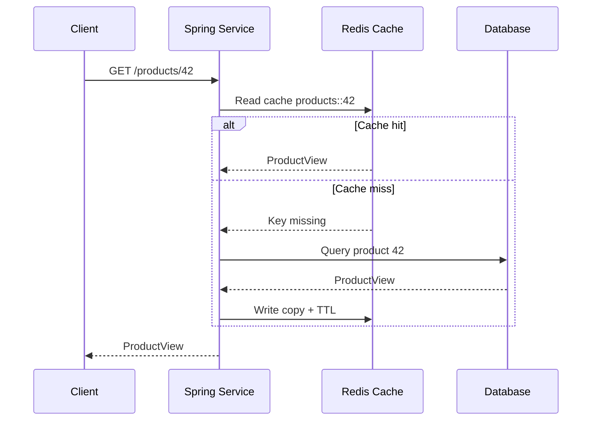
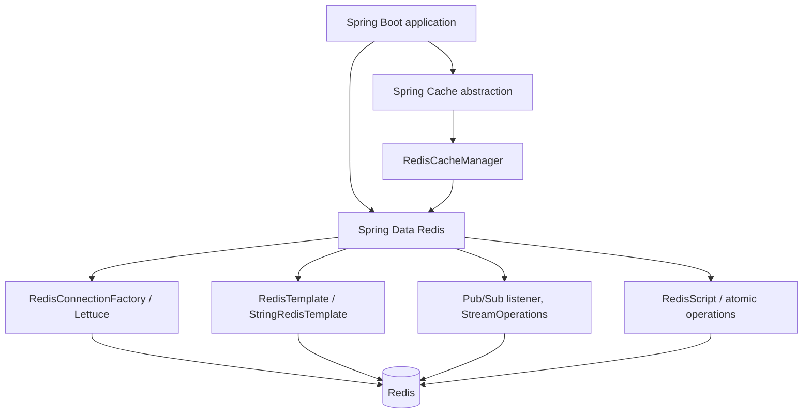
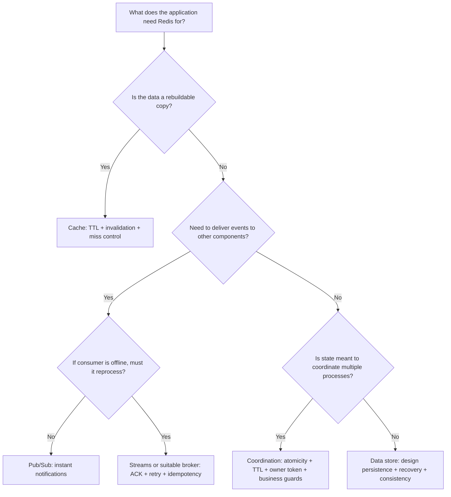

# Distinguishing Data Storage, Caching, Messaging, and Coordination with Redis

Redis is often introduced as an **in-memory key–value data store**, yet in a Spring Boot application, the same Redis instance can appear in four very different roles: **data storage**, **caching**, **messaging**, and **coordination across processes**. The crucial distinction does not lie in whether you use `String`, `Hash`, or `Stream`, but in **the meaning of the data, how it is created and recovered, its lifetime, and the guarantees required when failures occur**.

For example, in an e-commerce system:

- An active shopping cart may be stored directly in Redis.
- Product information belonging to the primary database may be copied to Redis to reduce read latency.
- A "product price changed" event may be published via Redis Pub/Sub or Redis Streams for other services.
- Multiple instances running a job may use Redis to limit concurrent executions.

These are four separate problems. Choosing the wrong role easily leads to lost data, stale reads, dropped notifications, or duplicate job runs, even when every Redis command executes successfully.

## 1. Big Picture: Same Redis, Four Usage Contracts

| Perspective | Data Store | Cache | Messaging | Coordination |
|---|---|---|---|---|
| Purpose | Holds business state or session state | Speeds up access with a regenerable copy | Delivers notifications/events between components | Synchronizes actions across multiple processes/instances |
| What does Redis hold? | The data record the application reads/writes directly | A copy of data whose source lives elsewhere | Broadcast messages or event log entries | Locks, tokens, counters, quotas, temporary state |
| Can Redis be the primary data source? | Yes, **if** the system accepts and designs for the necessary durability guarantees | Typically no | Not applicable for Pub/Sub; Streams can retain event history within retention bounds | Usually not the final business source of truth |
| TTL or retention limit | Depends on requirements: may or may not have one | Very common; requires refresh/eviction policy | Pub/Sub does not persist; Streams needs trim/retention policy | Almost always needs a TTL to prevent stuck state |
| When Redis loses data | May lose business state if there is no recovery source | Can be reloaded from the origin system, at the cost of higher load and latency | Pub/Sub loses missed messages; Streams depends on persistence, retention, and replay procedures | Lost locks/tokens can alter execution exclusivity; business invariants must be guarded at the appropriate layer |
| Common Spring APIs | `RedisTemplate`, `StringRedisTemplate`, Redis repositories | Spring Cache, `RedisCacheManager`, `@Cacheable` | `convertAndSend`, `RedisMessageListenerContainer`, Redis Streams APIs | `setIfAbsent`, `increment`, `RedisScript`, atomic operations |

**Identification rule:** Ask "Is this data the source of truth, a copy, a message, or a coordination signal?" before asking "Which Redis command should I use?". The very same `SET key value EX ...` might be storing a session, caching a query result, or creating a distributed lock; because the purposes differ, failure handling must differ too.

### How Durable Is Data in Redis?

Redis keeps its active working dataset mainly in RAM, while providing mechanisms to write data to disk such as **RDB snapshots** and **AOF (append-only file)**. These mechanisms support recovery after a process restart; they **do not automatically turn every write into an unlosable durable transaction**. The data-loss window also depends on AOF fsync configuration, snapshot timing, replication, and failover. Replication is normally asynchronous, so a write already acknowledged by Redis may still be absent on a replica promoted after an incident.

Similarly, TTL is a key's logical lifetime; `maxmemory`/eviction policies may evict keys earlier under memory pressure. **TTL, eviction, persistence, and replication are four separate mechanisms**. A key without a TTL does not mean it will survive forever under every configuration and failure scenario.

## 2. Redis as a Data Store: When Values in Redis Are the Needed State

In the **data store** role, the application writes state to Redis and subsequent reads rely directly on that state. Suitable examples include login sessions with expiration, temporary shopping carts, game scores, online presence, counters, and real-time leaderboards. Using Redis as the **single source of truth** for balances, orders, or inventory requires careful evaluation of data loss tolerance, recovery, consistency, and business constraints; Redis does not implicitly replace multi-table transactions or foreign-key constraints of a relational database.

Redis has many data types, not only strings:

| Type | Idea | Example |
|---|---|---|
| `String` | Single value, which can be text/numbers/bytes | Session token, view counter |
| `Hash` | Group of fields belonging to one object | `cart:42` holding `sku-1 → 2`, `sku-9 → 1` |
| `Set` | Collection of unique elements | Online users in a room |
| `Sorted Set` | Elements with scores, queried by rank | Leaderboard, priority-scored queue |
| `List` | Ordered sequence of elements | Simple task list |
| `Stream` | Log of ID-bearing entries with group reading capability | Order event history |

Example using `StringRedisTemplate` to hold a temporary shopping cart in Spring Data Redis:

```java
@Service
public class CartStore {
    private final StringRedisTemplate redis;

    public CartStore(StringRedisTemplate redis) {
        this.redis = redis;
    }

    public void changeQuantity(String userId, String sku, int quantity) {
        String key = "cart:" + userId;
        redis.opsForHash().put(key, sku, Integer.toString(quantity));
        redis.expire(key, Duration.ofDays(7));
    }

    public Map<Object, Object> getCart(String userId) {
        return redis.opsForHash().entries("cart:" + userId);
    }
}
```

This snippet illustrates storing a `Hash` and extending its lifetime whenever the cart changes. Two separate `put` and `expire` commands **do not form a combined atomic operation**; for state requiring strict TTL guarantees, wrap the steps in an appropriate atomic operation. A real system also needs user authentication, `quantity` validation, SKU removal rules, and a policy for when Redis is unavailable.

Before choosing Redis as a primary store, answer: is losing the last few seconds of writes acceptable, is audit/history needed, does the data need complex relational queries, and have backups/restores been tested? **High access speed does not equal strong durability guarantees.**

## 3. Redis as a Cache: Data in Redis Is a Regenerable Copy

A cache holds results already present at the origin so subsequent reads are faster. Suppose the `products` table lives in PostgreSQL; Redis holds only a short-lived copy of `ProductView`.



This is the **cache-aside** pattern: read the cache first; on a miss, read the data source and populate the cache. Read-through/write-through/write-behind patterns assign read/write responsibilities differently; Spring applications using `@Cacheable` typically implement the cache-aside idea at the method layer.

Example with Spring Cache:

```groovy
dependencies {
    implementation 'org.springframework.boot:spring-boot-starter-data-redis'
    implementation 'org.springframework.boot:spring-boot-starter-cache'
}
```

```yaml
spring:
  data:
    redis:
      host: localhost
      port: 6379
      timeout: 2s
  cache:
    type: redis
    redis:
      time-to-live: 10m
      cache-null-values: false
```

```java
@Configuration
@EnableCaching
class CacheConfiguration { }

@Service
public class ProductService {
    private final ProductRepository repository;

    public ProductService(ProductRepository repository) {
        this.repository = repository;
    }

    @Cacheable(cacheNames = "products", key = "#id")
    public ProductView findProduct(String id) {
        return repository.findViewById(id)
                .orElseThrow(() -> new NoSuchElementException(id));
    }

    @CacheEvict(cacheNames = "products", key = "#id")
    public void invalidateProduct(String id) {
        // Called once the source data change has completed.
    }
}
```

The example assumes `ProductRepository` and `ProductView` already exist in the project; `@EnableCaching` enables proxy-based caching. `@Cacheable` applies when a call goes through the Spring proxy; calling another method in the same bean directly usually bypasses the interceptor. The configuration above sets a default TTL for Redis caches; if different data types need different TTLs, configure per-cache TTLs via `RedisCacheManager`. Choose a serializer that stays stable across application versions and consider which data is permitted in the cache.

### The Hard Problems of Caching Are Freshness and Miss Load

- **Invalidation:** After updating the data source, delete or rewrite the relevant key. For updates inside a transaction, coordinate cache deletion with **successful commit timing**, avoiding reloading stale data due to a race between DB updates and queries.
- **TTL:** A TTL that is too long increases data staleness latency; too short increases misses and DB load. TTL does not replace invalidation if the business requires fresh data immediately.
- **Cache stampede:** Many concurrent requests missing a hot key can hit the DB at once. You can use scoped load synchronization, early refresh, jittered TTLs, or request coalescing strategies.
- **Cache penetration:** Queries for many non-existent IDs can pass straight through to the DB. Consider caching negative results with a short TTL, while understanding the semantics of `null` and cache-null configuration.
- **Cache outage:** The system should have a clear policy: query the origin with load protection, return an error, or serve fallback data depending on business criticality.

If Redis is wiped completely, a **true** cache can still rebuild its data from the origin, even though speed and system load are temporarily affected. If the data cannot be regenerated, it is no longer purely a cache.

## 4. Redis for Messaging: Pub/Sub Differs from Redis Streams

Messaging lets an event producer avoid synchronously calling every receiver. Redis has at least two mechanisms that must be clearly distinguished: **Pub/Sub** and **Streams**. They differ in whether messages are retained, can be replayed, and support processing acknowledgment.

### 4.1. Pub/Sub: Instant Notifications for Connected Subscribers

In Redis Pub/Sub, a publisher sends messages to a channel; subscribers currently subscribed to that channel receive messages over their active connection. The server **does not keep a history queue for late subscribers**, has no ACK at the Pub/Sub layer, and does not replay missed messages. Redis describes Pub/Sub delivery as **at-most-once**.

```text
Publisher ── PUBLISH "catalog.changed" ──> Redis
                                            ├──> Subscriber A (online)
                                            ├──> Subscriber B (online)
                                            └──> Subscriber C (offline: missed)
```

Publisher-side example in Spring Data Redis:

```java
@Service
public class CatalogNotifier {
    private final StringRedisTemplate redis;

    public CatalogNotifier(StringRedisTemplate redis) {
        this.redis = redis;
    }

    public void publishChangedSku(String sku) {
        redis.convertAndSend("catalog.changed", sku);
    }
}
```

The receiving side can use `RedisMessageListenerContainer`:

```java
@Bean
RedisMessageListenerContainer catalogListener(
        RedisConnectionFactory connectionFactory,
        CatalogChangeHandler handler) {
    RedisMessageListenerContainer container = new RedisMessageListenerContainer();
    container.setConnectionFactory(connectionFactory);
    container.addMessageListener(
            (message, pattern) -> handler.onChangedSku(
                    new String(message.getBody(), StandardCharsets.UTF_8)),
            new ChannelTopic("catalog.changed"));
    return container;
}
```

Here `CatalogChangeHandler` is an application-defined handler. Pub/Sub fits **near-real-time cache invalidation, UI updates, and signals where complete delivery is not mandatory**. If receivers can be offline and every event must be processed, Pub/Sub alone cannot be relied upon.

### 4.2. Redis Streams: ID-Bearing Event Logs, Consumer Groups, and ACK

Redis Streams appends entries to a stream, each with an ID. Consumers read by position; a **consumer group** lets multiple consumers split processing of entries within the **same group**. A single stream can also have multiple distinct groups, each tracking its own progress.

Trying it in `redis-cli` (one Redis command per line):

```redis
XGROUP CREATE orders.events billing 0 MKSTREAM
XADD orders.events * orderId 42 event OrderCreated
XREADGROUP GROUP billing billing-1 COUNT 10 BLOCK 2000 STREAMS orders.events >
XACK orders.events billing <message-id>
```

`XGROUP CREATE ... 0` creates a group starting from the beginning of the stream; `MKSTREAM` creates the stream if it does not yet exist. `XADD` appends an entry, `XREADGROUP ... >` fetches messages not yet delivered to the group, and `XACK` acknowledges successful processing. Replace `<message-id>` on the last line with the actual ID returned on read. If a consumer receives an entry and crashes before ACKing, the entry usually stays in the group's **Pending Entries List (PEL)**; consumers need a process to inspect pending entries and reclaim abandoned work (e.g. `XPENDING`, `XAUTOCLAIM`). Reading only with `>` will not automatically process old pending entries.

In Spring Data Redis, you can use `StreamOperations`, `StreamMessageListenerContainer`, or reactive `StreamReceiver` to build consumers. Proper logic usually follows this order:

1. Read an entry from the group.
2. Process the task; record business state and enforce **idempotency** by event ID or business key.
3. Only call `XACK` after processing succeeds.
4. Have mechanisms to reprocess pending entries, apply controlled retries, track persistently failing messages, and manage retention.

With proper ACK/recovery workflows, Streams can support **at-least-once** processing: an entry may be processed more than once, so the application must tolerate duplicates. Do not describe Redis Streams as automatically guaranteeing **exactly-once end-to-end**. Stream storage is also subject to persistence/replication settings and trimming of old entries.

| Criterion | Redis Pub/Sub | Redis Streams |
|---|---|---|
| Are messages stored? | No history retained for subscribers | Entries remain in the stream until trimmed/deleted or lost in a data incident |
| Offline receivers | Miss messages | Can read remaining persisted entries |
| ACK / pending | No | Yes, with consumer groups |
| Delivery | Every subscriber watching the channel can receive | Within a group, consumers share work; independent groups can each read events |
| Replay / retry | Must build a custom mechanism outside Pub/Sub | Has IDs, offsets, PEL, and recovery commands |
| Best suited for | Instant signals where dropping a message is acceptable | Events/jobs requiring processing progress tracking |

**Warning:** Keyspace Notifications are also based on Pub/Sub; do not turn key expiration events into the sole business notification source when reliable delivery is required. When cross-service transactions with high durability are needed, also consider patterns like **transactional outbox** and dedicated broker systems; choose the architecture from real requirements rather than defaulting every messaging need to Redis.

## 5. Redis for Coordination: Controlling Execution Rights and Shared Limits

An application running across multiple instances may need to answer questions such as: "Who gets to run this job?", "Has the user exceeded 100 requests/minute?", "Has this event already been accepted?". Coordination state is usually **small, short-lived, and contended by multiple processes**. Unlike caching, correctness depends on how operations are combined atomically.

For example, two instances both want to generate a report for the same `reportId`.

```text
Instance A ── tries to acquire lock:report:42 ──┐
                                                ├── Redis: only one SET NX succeeds
Instance B ── tries to acquire lock:report:42 ──┘
```

Redis supports acquiring a lock in one atomic command:

```redis
SET lock:report:42 unique-token-123 NX PX 15000
```

- `NX`: write only if the key does not already exist.
- `PX 15000`: set a 15,000 ms TTL in the same command, reducing the risk of a lock staying held forever if the process dies.
- `unique-token-123`: a unique owner token for **each** lock acquisition attempt, not shared across instances.

Never release a lock with an unconditional `DEL`. If A holds a lock past expiration, Redis deletes the lock and B acquires a new one; A finishing late and calling `DEL` would mistakenly delete B's lock. Releasing must **compare the token and delete in one atomic operation**, typically via a Lua script:

```lua
if redis.call('GET', KEYS[1]) == ARGV[1] then
    return redis.call('DEL', KEYS[1])
end
return 0
```

Corresponding Spring Data Redis code:

```java
private static final RedisScript<Long> UNLOCK_SCRIPT =
        new DefaultRedisScript<>("""
                if redis.call('GET', KEYS[1]) == ARGV[1] then
                    return redis.call('DEL', KEYS[1])
                end
                return 0
                """, Long.class);

public void runIfLockAcquired(String reportId, Runnable job) {
    String key = "lock:report:" + reportId;
    String token = UUID.randomUUID().toString();
    Boolean acquired = redis.opsForValue()
            .setIfAbsent(key, token, Duration.ofSeconds(15));
    if (!Boolean.TRUE.equals(acquired)) {
        return; // Another process holds the lock.
    }
    try {
        job.run();
    } finally {
        redis.execute(UNLOCK_SCRIPT, List.of(key), token);
    }
}
```

Here `redis` is an injected `StringRedisTemplate`. The example focuses on locking a **single key**; the timeout must be sized to the job. If the task runs longer than the TTL, the lock can expire **while the old task is still running**, allowing a new process to run concurrently. Lock renewal must verify the owner token, yet renewal alone does not completely solve an old worker pausing and then mutating an external resource.

For business operations requiring strict deduplication, such as money transfers or issuing an invoice once, protection is needed at the **final system of record**: unique constraints, transactions, idempotency keys, or **fencing tokens** checked in monotonic order by the target resource. A simple Redis lock does not automatically issue fencing tokens; failover can also affect lock safety. If you genuinely need strongly consistent coordination or leader election, consider a coordinator built on an appropriate consensus model.

### Coordination Is More Than Distributed Locks

| Need | Common Redis Tool | Must-Design Points |
|---|---|---|
| Shared counter | `INCR`, `DECR`, `HINCRBY` | Each command is atomic, though multiple consecutive steps may not be |
| Rate limiting | `INCR` + TTL, sorted sets, Lua | Combine counter increment and TTL atomically; choose fixed/sliding window or token bucket |
| Preventing duplicate request processing | `SET ... NX EX/PX`, idempotency state storage | Do not mark "completed" before side effects actually succeed |
| Limiting concurrent tasks | Key/counter-based semaphore or sorted set | Must support release/expiration and crashed-process handling |
| Leader election / single-worker task | Lock/lease with TTL | Accept safety limits or use a stronger coordinator for strict requirements |

For example, rate limiting using two separate `INCR` and `EXPIRE` commands can fail between steps, leaving a counter with no expiry. A Lua script or equivalent atomic operation keeps incrementing and setting TTL under the same policy. `MULTI/EXEC` can group commands under Redis semantics, but you must understand race conditions, retries, and error behavior; do not infer it equals a relational database ACID transaction.

## 6. Where Does Spring Data Redis Fit Across the Four Roles?

**Spring Data Redis** is the integration layer helping Java applications connect to and operate on Redis through Spring abstractions. It does not decide for itself whether a key is a cache, a data store, or a distributed lock; **semantics and guarantees are determined by application design**.



The diagram depicts **API groups and responsibilities**, not an exact class-dependency graph: `RedisTemplate`, listeners, and script operations all use the connection factory to talk to Redis. Spring Boot typically auto-configures `RedisConnectionFactory` from present dependencies/configuration; with `spring-boot-starter-data-redis`, the default client is usually Lettuce.

| When You Need To... | Starting Point in Spring |
|---|---|
| Write/read keys, hashes, sets, sorted sets, TTLs | `StringRedisTemplate` for string data; `RedisTemplate<K,V>` when custom serializers are needed |
| Cache method results | `@EnableCaching`, `@Cacheable`, `@CachePut`, `@CacheEvict`, `RedisCacheManager` |
| Publish/receive instant signals | `convertAndSend` and `RedisMessageListenerContainer` |
| Store/read event streams | `opsForStream()`, stream consumer container, or reactive stream receiver |
| Handle multi-step contention | `setIfAbsent` with TTL, atomic commands, `RedisScript`, and owner-token design |

`StringRedisTemplate` operates on string keys/values by default; for objects, define a clear serialization format (JSON, schema version, version-upgrade path) and preserve compatibility during rolling deployments. Avoid confusing `CacheManager` with `RedisTemplate`: the former manages application-level cache policies; the latter is a direct Redis API that does not apply business TTL/invalidation automatically.

## 7. A Business Flow Using All Four Roles Simultaneously

Consider a multi-instance e-commerce service:

1. When a customer updates item quantities in their cart, the service writes `cart:{userId}` as a hash with a 7-day TTL. This is active **session/cart state**; to guarantee orders are not lost, checkout data must be confirmed in an appropriate transactional system.
2. When a customer views a product, `@Cacheable("products")` reads Redis. On a cache miss, it queries the DB and populates Redis with a 10-minute TTL. This is a **copy**.
3. Once a seller updates a product and the DB transaction commits, the system deletes the cache key and publishes `catalog.changed`. Pub/Sub can help other instances refresh UI state quickly; ultimate correctness still depends on invalidation/TTL and the source of truth.
4. When creating an order, the system appends `OrderCreated` to a stream for the billing service to process. The consumer confirms with `XACK` after success and has a mechanism to reclaim pending entries. This is an **event requiring processing tracking**.
5. If multiple schedulers attempt to run a report-aggregation job, they contend for `lock:report:{day}` with a TTL and owner token. This is **coordination**, not caching the report.

A system can use the same Redis deployment for the examples above, though in real operations you should consider **separating instances/clusters by resource and reliability requirements**. A large stream write burst or a cache filling memory can increase latency and impact shared locks or rate limiters. Redis database numbers or key prefixes organize names; they do not provide resource and reliability isolation equivalent to separate deployments.

## 8. Choosing the Right Mechanism with Decision Questions



For a real requirement, check five additional criteria:

1. **Source status:** Does Redis hold truth that must be protected, or only derived data?
2. **Loss tolerance:** Is losing a key, a recent change, or a message acceptable?
3. **Lifetime:** Should keys expire, be evicted, or stay until explicitly acknowledged?
4. **Concurrency:** Will multiple instances operating simultaneously race, and is a single command atomic enough?
5. **Recovery:** When Redis restarts, fails over, a consumer dies, or the cache is completely empty, how does the system continue?

### Misconceptions to Avoid

| Common Misstatement | Correct Understanding |
|---|---|
| "Setting a TTL automatically makes it a cache." | Sessions and distributed locks also have TTLs; a cache is defined by being regenerable from another data source. |
| "Redis runs in RAM so it has no persistence." | Redis has RDB/AOF; actual durability depends on configuration and architecture. |
| "With Redis persistence, data loss is impossible." | Write-loss windows, failover risks, and backup/restore requirements still exist. |
| "Pub/Sub is a reliable message queue." | Pub/Sub does not store, ACK, or replay messages for offline subscribers. |
| "Using Streams guarantees exactly-once processing." | You need ACKs, pending recovery, deduplication, and attention to atomicity with external side effects. |
| "`SET NX PX` completely solves distributed locking." | Locks can expire while tasks still run; failover and target-resource protection must be considered. |
| "`INCR` is atomic, so `INCR` followed by `EXPIRE` is also atomic." | Single-command atomicity does not automatically extend across multiple commands. |
| "When Redis fails, caches and locks can be handled the same way." | Caches can usually be reloaded; coordination failures can cause concurrent business-logic errors. |

## 9. Observing and Operating by Role

Do not monitor only total key counts or RAM usage. Each role needs its own signals:

- **Data storage:** memory usage, large keys, eviction count, persistence status, replication lag, backup restore test results, and acceptable data-loss targets.
- **Cache:** hit/miss ratio, latency, DB fallback load on misses, stale reads, evictions, and concurrent requests reloading the same key.
- **Messaging:** active subscriber counts (Pub/Sub), stream processing lag, stream length, `XPENDING`, pending age, retries, and persistently failing events.
- **Coordination:** failed lock acquisitions, lock hold time versus TTL, expired locks, rate-limited requests, and duplicate side-effect attempts.

Baseline practices across all four roles include clear key namespacing (`cache:`, `session:`, `stream:`, `lock:`), bounding value/collection sizes, intentional TTL and retention choices, avoiding full-keyspace scans on hot request paths, protecting Redis with ACLs/TLS where appropriate, and planning responses when Redis slows down or disconnects. These settings do not replace properly defining the contract for each type of data.

## 10. Practical Conclusion

When using Spring Data Redis, first determine **the meaning of the data and the risk of failure**, and only then pick the API:

- **Data storage:** read/write state directly; decide clearly on persistence, recovery, and the source of truth.
- **Cache:** a copy for performance; focus on TTL, invalidation, and cache misses.
- **Messaging:** use Pub/Sub for instant signals that can tolerate drops; use Streams or an appropriate broker when tracking, retries, and ACKs are required.
- **Coordination:** use atomic commands, tokens/TTLs, and business-invariant safeguards when multiple processes contend for execution rights.

Redis provides very fast primitives; **Spring Data Redis provides the integration APIs**. Guarantees like "no data loss", "no duplicates", "always fresh data", or "only one process executes" must come from overall system design—they do not appear automatically just because the application connects to Redis.
