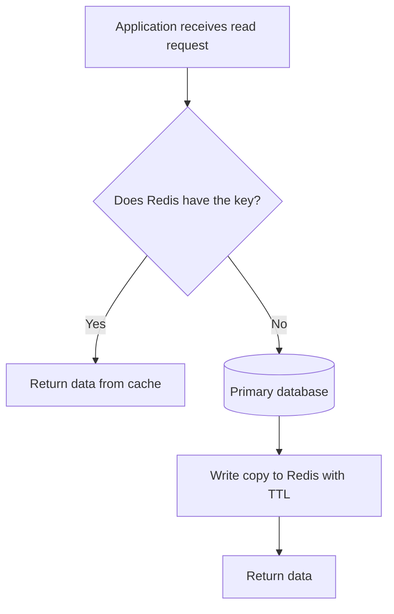

# When to Use Redis and When to Choose Another Storage System

## 1. What Problems Does Redis Solve?

In a Spring Boot application, not all data needs to be read, written, and retained in the same way. Orders need long-term retention and consistent updates; product details are read frequently yet change infrequently; rate-limit counters only need to live for seconds or minutes; and product images can occupy megabytes. Putting everything into a single storage system often makes some requirements hard or expensive to satisfy.

**Redis** is a key-based data store that operates primarily in RAM, supporting multiple data structures and commands that can execute atomically on the Redis server. Redis is especially useful when an application needs fast key-based access, shared state across multiple instances, automatic data expiration, or efficient updates to counters and collections.

Example in an e-commerce system:

- **PostgreSQL** stores products, inventory, orders, and payment transactions.
- **Redis** stores copies of frequently viewed product details, login sessions, and API rate-limit counters.
- **OpenSearch/Elasticsearch** powers product search by keywords, filters, and relevance.
- **Object storage** stores images, videos, and large files.
- **Message brokers/event streaming** distribute background jobs or maintain event streams per processing needs.

These roles can complement one another in one architecture; Redis does not necessarily replace the primary database.

In the Java ecosystem, **Spring Data Redis** provides `RedisTemplate`, `StringRedisTemplate`, caching support through Spring Cache, repositories, and integration with Redis data structures. The library makes using Redis more convenient for applications, yet **does not alter Redis's characteristics around durability, consistency, RAM capacity, or query capabilities**. The decision to use Redis must come from the nature of the data and business requirements.

## 2. Six Questions to Answer Before Choosing a Storage System

| Question | If the Answer Is… | Direction to Choose |
|---|---|---|
| Is the data the **source of truth**? | Losing data corrupts orders, balances, ownership, or audit trails | Prefer a durable database with appropriate transactions; Redis is only an auxiliary layer unless required guarantees are explicitly designed |
| How must the data be accessed? | Exact key is known, very frequent reads/writes, few complex queries | Redis fits; if JOINs, ad-hoc queries, reporting, or full-text search are needed, consider other systems |
| How long does the data live? | Seconds/minutes/hours, natural TTL, or regenerable | Redis is a strong candidate |
| Can it tolerate temporarily stale or missing data? | Cache misses can re-read the DB; losing a short-term stats counter is acceptable | Redis fits; control the staleness window and recovery |
| What are the size and growth rate? | Small/medium bounded dataset where fast access outweighs RAM cost | Redis is viable; massive multi-year datasets usually belong on an appropriate disk-based store |
| What consistency and transaction level is required? | An atomic operation on one or a few keys; keys can be co-located if needed | Redis can meet this; multi-table/multi-entity business transactions usually fit an RDBMS |

Do not decide based solely on Redis's low latency. Consider **end-to-end latency**, network bandwidth, serialization, recovery requirements, operational complexity, and the cost of holding data in RAM.

## 3. Cases Where Redis Is Usually a Good Choice

### 3.1. Cache for Read-Heavy, Infrequently Changing Data

Examples: product details, catalog info, display configuration, expensive aggregations. A request can check Redis first; on a cache miss, the application fetches data from PostgreSQL and stores a copy in Redis with a time to live (TTL).



This strategy is commonly called **cache-aside**. Its benefit is reducing repeated queries to the database and improving response times when the cache hit rate is high. However:

- **TTL alone does not guarantee the freshest data**: copies can remain stale until expired or explicitly deleted/updated.
- When source data changes, an appropriate **invalidation** strategy is needed. With DB transactions, invalidate the cache only after the source update succeeds; consider race conditions between read and write requests.
- Many requests hitting a cache miss for the same key simultaneously can cause a **cache stampede**, putting pressure on the DB. You can use randomized TTL jitter, request coalescing for duplicates, or preloading hot keys.
- Redis downtime can push a surge of queries onto the DB. Plan short timeouts, fallbacks, and load limits.

Caching works well when you can define the **source of truth** and **acceptable staleness**. Do not cache indefinitely when users must see exact updates immediately after writes unless a mechanism ensures consistency.

### 3.2. Shared Sessions and Ephemeral State Across Multiple Instances

When deploying multiple Spring Boot instances behind a load balancer, state stored only in one instance's memory disappears if the instance is replaced or a user's request is routed to another instance. Redis lets instances share access to login sessions, short-lived verification codes, temporary shopping cart state, or time-bounded workflows.

For example, key `session:v1:<opaque-id>` with a 30-minute TTL. The system must decide whether TTL extends on activity, how sessions are revoked, and what happens during Redis failover. Store only session information that is truly necessary; keys must not contain emails, phone numbers, tokens, or plaintext secrets. Sensitive data requires access control, secure transport, and appropriate protection policies.

**Distinction:** a shopping cart may live temporarily in Redis while a user browses, whereas a confirmed and paid order must be written to a durable transactional storage system. If the business requires recovering carts months later or syncing reliably across devices, you may need to store the primary cart in the DB and use Redis as a cache.

### 3.3. Counters, Quotas, and Rate Limiting

Redis provides commands such as `INCR`, `DECR`, `EXPIRE`, and server-side scripting, fitting view counters, login attempt limits, or request quotas over a time interval.

Example: limiting a user to at most 100 requests per 60-second window. With a *fixed window starting from the first request* algorithm, incrementing the counter and setting the TTL must happen in one atomic operation. Calling `INCR` and then `EXPIRE` as two independent commands risks a failure between them leaving a key that never expires.

A Redis script illustrating the idea:

```lua
-- KEYS[1]: counter key
-- ARGV[1]: TTL in milliseconds
local count = redis.call('INCR', KEYS[1])
if count == 1 then
    redis.call('PEXPIRE', KEYS[1], ARGV[1])
end
return count
```

The application compares `count` against the allowed quota. This algorithm is simple but can allow traffic bursts across window boundaries. When stricter limiting is needed, evaluate *sliding window* or *token bucket*, while accounting for network latency, Redis outages, and bypass vectors by identity/IP. If exceeding a quota causes financial loss or strict compliance issues, durable mechanisms and additional controls are needed.

### 3.4. Continuously Updated Data Structures

Redis is useful because beyond plain strings (`String`), it includes built-in data structures:

| Need | Redis Structure and Representative Commands | Example |
|---|---|---|
| Lookup by key, counters | String: `GET`, `SET`, `INCR` | JSON cache, visit counts |
| Updating simple attributes | Hash: `HGET`, `HSET` | Small state attributes of a session |
| Managing unique elements | Set: `SADD`, `SISMEMBER` | Short-lived set of processed IDs |
| Ranking by score | Sorted set: `ZADD`, `ZREVRANGE` | Score leaderboard |
| Ordered lists | List: `LPUSH`, `LRANGE` | Short, bounded action list |
| Event stream with consumer groups | Stream: `XADD`, `XREADGROUP`, `XACK` | Event or task processing at Redis-appropriate scale |
| Basic geolocation | Geo: `GEOADD`, `GEOSEARCH` | Finding locations near coordinates |

For instance, a leaderboard can use a sorted set to increment scores and fetch top N without loading all players into Java to sort. Still, bound the number of records, design cleanup policies for old data, and measure RAM usage; commands have varying time complexities—not every Redis operation is `O(1)`.

### 3.5. Short-Lived Synchronization or Coordination Across Instances

Operations like `SET key value NX PX <milliseconds>` can help mark a task as claimed or create a short-lived lease. However, **distributed locking** is harder than setting a key: applications need a unique ownership token, must delete the key only if still owned, handle lease expiration if a task runs long, and consider *fencing tokens* when external resources must reject actions from an expired lock holder.

Therefore, use Redis for short-term coordination when the consequences of duplicate processing can be contained. For financial tasks or critical data mutations, prefer unique constraints, transactions, idempotency, or coordinators with appropriate durability and guarantees. Do not treat a simple Redis key as an absolute guarantee that only one task will execute.

### 3.6. Pub/Sub and Streams When Delivery Requirements Match

- **Redis Pub/Sub** suits live signals where receivers only need messages while connected, such as triggering a UI data refresh. Messages are not retained for offline subscribers to catch up.
- **Redis Streams** persists entries in a stream and supports consumer groups, acknowledgments, and reading unacknowledged entries. It is a sensible choice for moderate task/event streams if the application designs retention, retries, pending entries, idempotency, and monitoring.

When long-term event retention, large-scale replay, multiple independent consumer groups, and a stream-processing ecosystem are needed, evaluate Kafka/Pulsar. For work queues with specialized routing, retries, and dead-letter semantics, RabbitMQ or a dedicated broker may fit better. Do not equate Pub/Sub with durable queues.

## 4. When Should You Choose Another Storage System?

### 4.1. Relational Databases: Business Data Requiring Transactions

**PostgreSQL and MySQL** usually fit orders, balances, payments, canonical inventory, contracts, user–role relationships, and data needing integrity constraints. They offer SQL, foreign keys, indexes, join queries, and ACID transactions according to the DBMS's capabilities.

For example, checkout must simultaneously record an invoice, update order status, and ensure inventory is not over-deducted. A few atomic Redis key commands do not replace an RDBMS's business constraint and transaction model. Redis can cache displayed stock counts, yet decisive inventory checks and deductions must happen at the source of truth with appropriate concurrency control.

### 4.2. Document Databases: Large, Long-Lived Documents Queried by Fields

**MongoDB** or document databases fit when data has flexible document structure, needs durable persistence, per-field indexing, and multi-document queries/aggregations. Redis Hashes or JSON (if your environment includes corresponding features) do not automatically become a full replacement for a document database regarding indexing, transactions, and querying.

For example, a system storing product profiles with many customizable attributes that need filtering. If the application always knows the product key and only needs fast reads of a copy, a Redis cache can complement MongoDB.

### 4.3. Search Engines: Full-Text Search and Relevance Ranking

**OpenSearch/Elasticsearch** is suited for text analysis, stemming/tokenization, fuzzy search, suggestions, and complex search filters. Redis can cache popular query results; advanced search capabilities in certain Redis editions/modules should be evaluated as distinct products/features rather than assuming core Redis includes full search-engine functionality.

### 4.4. Object Storage and Analytical Stores: Large, Long-Term Data

Images, videos, downloadable files, and backups usually belong in **S3-compatible object storage** rather than Redis RAM. For multi-year event data, analytics logs, or high-volume aggregate queries, consider **ClickHouse, a data warehouse, a lakehouse**, or a time-series store depending on data shape and query patterns. Redis can hold recent dashboard metrics or aggregated results with a TTL.

### 4.5. Other Caches: When You Do Not Yet Need a Redis Server

- **Caffeine / in-JVM memory cache**: fits small, purely local data where each instance can tolerate its own copy. No network latency, though caches are not shared and are lost on process restart.
- **Memcached**: can suffice if you only need simple distributed key–value caching without Redis's rich data structures or additional capabilities. The choice still depends on operations, integration, and real-world scale.

If data is only used within a single Java request, an in-memory application data structure is even simpler than a distributed cache.

## 5. Quick Decision Table by Problem

| Problem | Usually Sensible Primary Choice | What Role Does Redis Play? | Decision Notes |
|---|---|---|---|
| Product details read thousands of times/minute | RDBMS/document DB as source of truth | Cache with TTL and invalidation | How much update lag is acceptable? |
| Ordering, payments, balances | RDBMS with transactions/constraints | Can assist with caching/temporary state | Never settle transactions based on cache |
| Shared sessions across Spring Boot instances | Redis or equivalent session store | Session store with TTL | Decide recovery behavior if Redis is interrupted |
| Rate limit of 100 requests/minute | Redis | Atomic counter / limiting algorithm | Choose fixed/sliding window per accuracy needed |
| Near-real-time leaderboard | Redis sorted set | Fast rank maintenance | Is long-term history needed in a DB? |
| Product search by text and relevance | Search engine | Cache hot results | Requires indexing and source-sync strategy |
| Storing images and large files | Object storage | Can cache metadata short-term | Do not store large blobs en masse in RAM |
| Events retained for weeks with replay | Dedicated event log/broker | Can support some short-lived signals | Define retention, delivery, replay |
| Multi-year historical logs/metrics | Time-series/analytical DB | Dashboard cache | Historical data grows continuously |
| Configuration used inside a single JVM | Local memory/Caffeine | Usually not needed | Does it need to be shared across instances? |

This is a starting point, not a rigid rule. For instance, Redis has persistence mechanisms and can be designed as a primary store for certain applications, provided RPO/RTO, memory limits, replication, and failover behavior are explicitly verified; do not infer from "in-memory" that data is inevitably lost, nor from enabling persistence that data can never be lost.

## 6. Technical Trade-offs That Are Easy to Overlook

### 6.1. RAM, Eviction, and TTL Are Three Different Concerns

**TTL** defines when a key expires. **Eviction** is Redis proactively removing data when it reaches its memory limit according to configured policy. A key without a TTL can still be evicted under certain eviction policies; conversely, under `noeviction`, memory-increasing writes may be rejected once the threshold is reached. Therefore:

1. Define the lifetime and maximum footprint of each key group.
2. Evaluate `maxmemory` and eviction policy to fit the purpose: caches can tolerate early eviction, while business state may not.
3. Track key counts, value sizes, data-structure overhead, hot-key distribution, and growth rate.

Do not mix evictable cache entries with critical non-losable data in the same Redis deployment when their resource and durability policies conflict. When needed, separate instances/clusters or choose another storage system.

### 6.2. Persistence Does Not Mean Absolutely Durable Transactions

Redis supports persistence mechanisms such as **RDB snapshots** and **AOF** (append-only file), depending on configuration. RDB creates point-in-time snapshots; AOF logs operations with various disk sync modes. Potential data loss depends on sync policy, hardware failures, replication, failover, and specific settings.

Redis replicas are typically synchronized **asynchronously**, so failing over to a replica after an error can lose writes not yet replicated. Backups, restore testing, HA design, and **RPO** (acceptable data loss) / **RTO** (recovery time) targets are architectural requirements, not optional extras when Redis holds critical data.

Redis has `MULTI`/`EXEC` and scripts to group operations, yet they **do not share RDBMS rollback semantics or multi-entity transactions**. On Redis Cluster, multi-key operations are further constrained by hash-slot partitioning. Design around the exact guarantees of each command and deployment model.

### 6.3. Caching Introduces New Consistency Challenges

In **cache-aside**, operations usually span two systems: writing to the DB and deleting/updating Redis. By default, those two steps do not participate in a distributed transaction. Deleting the cache before the DB commits lets another request reload stale data; deleting after commit when the Redis call fails leaves stale cache data until TTL expires.

A practical strategy keeps the DB as the source of truth, sets bounded TTLs on the cache, invalidates after commit, monitors lag, and accepts a defined staleness window. Strict read-your-writes consistency may require reading directly from the DB or a stronger synchronization design.

### 6.4. Low Latency Does Not Replace Real Load Testing

Redis runs in RAM, yet every call still incurs connection, TLS, network, serialization, and command-queuing latency. Oversized values, full scans (`KEYS` on large keyspaces), iterating huge collections, or a hot key can spike latency. Use `SCAN` for controlled traversal; prefer targeted key designs and cap collection sizes. Measure **p95/p99** percentiles, not just averages.

## 7. Applying the Decision with Spring Data Redis

Suppose a Spring Boot application reads product descriptions from PostgreSQL. This data can be cached for five minutes to reduce read load; the DB remains the source of truth. Spring Cache with Spring Data Redis is one implementation:

```java
@Configuration
@EnableCaching
class RedisCachingConfig {

    @Bean
    RedisCacheManager cacheManager(RedisConnectionFactory connectionFactory) {
        RedisCacheConfiguration defaults = RedisCacheConfiguration
                .defaultCacheConfig()
                .entryTtl(Duration.ofMinutes(5))
                .disableCachingNullValues();

        return RedisCacheManager.builder(connectionFactory)
                .cacheDefaults(defaults)
                .build();
    }
}
```

```java
@Service
class ProductQueryService {
    private final ProductRepository repository;

    ProductQueryService(ProductRepository repository) {
        this.repository = repository;
    }

    @Cacheable(cacheNames = "productDetails", key = "#id", unless = "#result == null")
    public ProductDto findById(Long id) {
        return repository.findById(id)
                .map(product -> new ProductDto(product.getId(), product.getName()))
                .orElse(null);
    }

    @CacheEvict(cacheNames = "productDetails", key = "#id")
    public void evictAfterSuccessfulUpdate(Long id) {
        // Called after the DB update has committed successfully.
    }
}
```

*This is a simplified conceptual example, assuming the application already has a Redis connection factory, repository, and `ProductDto`.* In a real system, explicitly configure serializers (typically versioned JSON/schemas rather than relying on default Java native serialization), per-data-type TTLs, namespaced key/cache names, timeouts, and Redis error handling. `@Cacheable` applies through the Spring proxy: internal calls like `this.findById(...)` in the same bean may not trigger caching. Adding `@CacheEvict` does not by itself resolve all read/write races or failed invalidations; the write path must align with actual commit boundaries.

If you only need key-value operations or counters, use `StringRedisTemplate`. If you need hashes, sets, sorted sets, streams, or object serialization, use the matching operations on `RedisTemplate`/Spring Data Redis. **Pick the API after choosing the right place to store the data**; do not cache every method simply because Spring Data Redis provides convenient annotations.

### Designing Keys and TTLs

A manageable convention:

```text
shop:product:detail:v1:42       -> TTL 5 minutes
shop:session:v1:<random-id>     -> TTL per session policy
shop:rate:login:v1:<subject-id> -> TTL per rate-limit window
shop:ranking:weekly:2026-W46   -> Delete after leaderboard retention ends
```

Key names should include application namespace, purpose, structure version, and stable IDs; avoid embedding personal data or secret tokens directly in keys. Cache TTLs can add **jitter** to prevent masses of keys from expiring simultaneously. Changing value formats requires a compatibility/versioning plan, since old and new instances may read the same Redis during deployment.

### Metrics to Monitor

| Metric | Meaning and Suggested Action |
|---|---|
| Cache hit/miss, DB fallback | Is the cache actually reducing load or adding overhead? |
| Redis p95/p99 latency, timeouts | Detect network bottlenecks, slow commands, overload, or misconfigured timeouts |
| Used memory, key count, key/value size | Forecast RAM and catch uncleaned keys |
| Evicted/expired keys | Distinguish TTL expirations from memory-pressure evictions |
| Connection count, connection errors | Inspect connection pool/client health and availability |
| Replication lag, persistence, failover | Assess data risk when Redis plays a critical role |
| DB request rate during cache degradation | Ensure backend survives mass cache misses or has load shedding |

## 8. Three Real-World Decision Scenarios

**Scenario A — Product detail page:** 90% of requests are reads, and data can tolerate up to a few minutes of update lag. Use PostgreSQL as the source of truth and Redis cache with an appropriate TTL; after updating a product, trigger cache deletion post-commit. Here Redis delivers clear value.

**Scenario B — Payment confirmation:** Every transaction must be recorded exactly once, with reconciliation history and consistent updates across status, balances, and inventory. Anchor on an RDBMS with appropriate idempotency/transactions; Redis can help temporarily deduplicate submissions, but must never be treated as the final payment record.

**Scenario C — Weekly game leaderboard:** Players earn points frequently and need near-real-time top-100 and rank lookups. A Redis sorted set fits maintaining the active leaderboard. If multi-year results, anti-cheat, or score auditing are needed, sync validated snapshots/events to durable storage and configure cleanup for old weeks.

## 9. Decision Rules You Can Apply Immediately

Start by identifying **who is the source of truth**, **how long the data lives**, **whether access is by key or by query**, **what happens if data is lost or read stale**, and **operational cost as user counts grow**. Choose Redis when fast access, TTLs, atomic operations, or Redis data structures directly satisfy those needs. Choose an RDBMS, document DB, search engine, broker, object storage, or analytical DB when the problem demands those systems' strengths.

With Spring Data Redis, a solid design is usually: **a durable database manages business data; Redis accelerates hot read paths or manages temporary state; Spring Boot controls TTL, invalidation, timeouts, and fallbacks**. There are legitimate cases for using Redis as a primary store, but that must rest on explicit durability requirements and concrete recovery test results—not speed alone.
