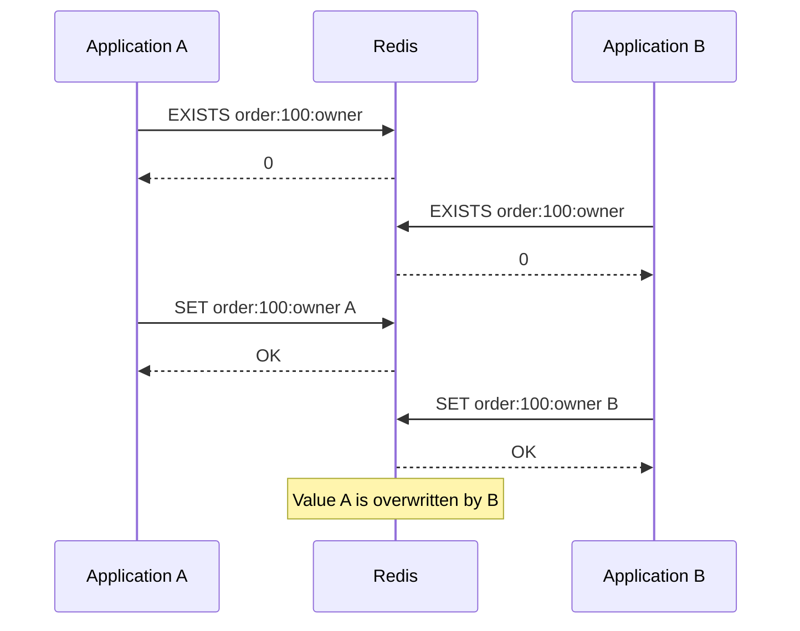
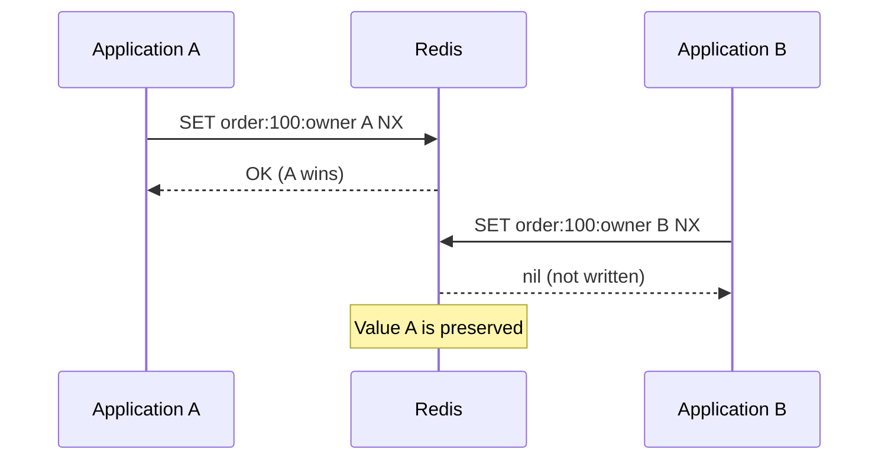

# Conditional Writes with setIfAbsent and setIfPresent

When multiple requests or multiple Spring application instances access Redis concurrently, data writes often need to be conditional: **create the value only if the key does not exist yet** or **update only when the key already exists**. Spring Data Redis provides two direct operations for this need via `ValueOperations`:

- `setIfAbsent(key, value)`: writes when the key **does not exist**.
- `setIfPresent(key, value)`: writes when the key **already exists**.

Both can be used with an expiration time (TTL) and rely on the conditional options of the Redis `SET` command. The decisive characteristic is that **checking existence and writing are executed in the same atomic command on Redis**. This fundamentally differs from calling `hasKey()` or `get()` and then `set()` from Java.

This lesson belongs to the **Strings and Counters** group in Spring Data Redis, focusing on Redis String write semantics, race condition handling, and key lifetimes. The examples use `StringRedisTemplate` to make the written data easy to observe.

## 1. Understanding Redis Strings and the SET Operation

### 1.1. A Normal Write Can Always Replace the Old Value

Basic Redis command:

```redis
SET account:42:status ACTIVE
```

If `account:42:status` does not exist yet, Redis creates a new key. If the key already exists, Redis overwrites the value.

In Spring Data Redis:

```java
stringRedisTemplate.opsForValue().set("account:42:status", "ACTIVE");
```

This is an **unconditional write**. Multiple requests concurrently calling `set()` can overwrite one another; the final value reflects the write processed last by Redis, not necessarily the request that started last on the Java side.

If a write operation needs to depend on the key's existence state, use Redis's `NX` or `XX` options.

### 1.2. What Are NX and XX?

Redis `SET` supports conditional options:

```redis
SET key value NX
SET key value XX
```

| Option | Meaning | When key does not exist | When key already exists |
|---|---|---|---|
| No option | Unconditional write | Create key and write | Overwrite |
| `NX` | Only if **Not eXists** | **Write succeeds** | Do not write |
| `XX` | Only if **eXists** | Do not write | **Write succeeds** |

`NX` and `XX` are mutually exclusive conditions for a single write operation. They **do not check whether the old value equals an expected value**; they only check whether the key exists when Redis executes the command.

Example:

```redis
DEL demo:status

SET demo:status NEW NX
GET demo:status

SET demo:status PAID NX
GET demo:status

SET demo:status PAID XX
GET demo:status
```

Sequential results in an environment without interfering clients:

1. `DEL` ensures the key does not exist before practicing.
2. `SET ... NEW NX` succeeds because no key exists yet.
3. `GET` returns `NEW`.
4. `SET ... PAID NX` does not write because the key already exists.
5. `GET` still returns `NEW`.
6. `SET ... PAID XX` succeeds because the key currently exists.
7. `GET` returns `PAID`.

At the Redis command level, `SET ... NX/XX` returns `OK` if the write succeeded and a nil/null reply if the condition was not met. Going through Spring Data Redis, `setIfAbsent` and `setIfPresent` provide a `Boolean` result according to the API contract, rather than forcing the application to interpret `OK` or nil manually.

### 1.3. A Decision Table for Applications

| Purpose | Spring Data Redis API | Redis Condition |
|---|---|---|
| Overwrite regardless of whether key exists | `opsForValue().set(key, value)` | Regular `SET` |
| Create value once if key is missing | `opsForValue().setIfAbsent(key, value)` | `SET ... NX` |
| Update only when key already exists | `opsForValue().setIfPresent(key, value)` | `SET ... XX` |
| Conditionally create with expiration | `setIfAbsent(key, value, duration)` | `SET ... NX` with expiry |
| Conditionally update with new expiration | `setIfPresent(key, value, duration)` | `SET ... XX` with expiry |

For cases creating a key with TTL, a conditional `SET` with expiry is a more direct and clearer choice than combining separate commands.

## 2. Important Overloads in Spring Data Redis

### 2.1. The `ValueOperations` API

Once you have a `StringRedisTemplate` or `RedisTemplate<K, V>` bean, use:

```java
ValueOperations<String, String> values = stringRedisTemplate.opsForValue();
```

Commonly used signatures:

```java
Boolean setIfAbsent(K key, V value);

Boolean setIfAbsent(K key, V value, Duration timeout);

Boolean setIfAbsent(K key, V value, long timeout, TimeUnit unit);

Boolean setIfPresent(K key, V value);

Boolean setIfPresent(K key, V value, Duration timeout);

Boolean setIfPresent(K key, V value, long timeout, TimeUnit unit);
```

These are conceptual signatures of the generic `ValueOperations<K, V>` interface; when using `StringRedisTemplate`, `K` and `V` are `String`.

**Meaning of Boolean in normal synchronous calls:**

- `Boolean.TRUE`: the condition was met and Redis performed the write.
- `Boolean.FALSE`: the condition was not met; Redis did not write the proposed value.
- `null`: may appear when the command is queued in a pipeline or transaction; this is not yet a conclusion about whether the key exists.

Do not write `if (values.setIfAbsent(key, value))` in code that might run inside a pipeline/transaction because auto-unboxing a null `Boolean` to `boolean` can throw a `NullPointerException`.

### 2.2. Simple Example with `StringRedisTemplate`

```java
import org.springframework.data.redis.core.StringRedisTemplate;
import org.springframework.stereotype.Service;

@Service
public class StatusWriter {

    private final StringRedisTemplate redis;

    public StatusWriter(StringRedisTemplate redis) {
        this.redis = redis;
    }

    public boolean createStatus(String accountId, String status) {
        String key = "account:status:" + accountId;

        Boolean written = redis.opsForValue().setIfAbsent(key, status);
        return Boolean.TRUE.equals(written);
    }

    public boolean updateStatus(String accountId, String status) {
        String key = "account:status:" + accountId;

        Boolean written = redis.opsForValue().setIfPresent(key, status);
        return Boolean.TRUE.equals(written);
    }
}
```

This snippet assumes direct calls in **normal synchronous mode**, outside any pipeline/transaction. `Boolean.TRUE.equals(...)` is null-safe, but it **lumps `null` together with `false`**. For business layers that need to distinguish "not written" from "result not yet available", check separately:

```java
private static boolean requireCompleted(Boolean result) {
    if (result == null) {
        throw new IllegalStateException(
                "Redis conditional write result is not available yet");
    }
    return result;
}
```

Returning `boolean` can make sense when the service guarantees it does not run inside a pipeline/transaction. If a pipeline is already in use, collect results when the pipeline completes instead of inferring them inside the callback.

### 2.3. What Happens If Keys or Values Use Different Serializers?

`StringRedisTemplate` uses string serializers for keys and values. With `RedisTemplate<String, MyObject>`, the system may use another serializer for values, while Redis still only receives serialized bytes.

For example, `setIfAbsent("user:1", object)` only checks **the existence of the serialized key bytes**. If one application uses a JDK key serializer while another uses UTF-8 strings, the two applications may be operating on **two different byte keys** even though the input Java string looks identical.

`NX/XX` has no awareness of JSON schemas, Java classes, or serializer versions. When multiple services operate on the same Redis, key namespaces, charsets, and serialization must be standardized.

## 3. Why Are Conditional Writes Atomic?

### 3.1. Error-Prone Approach: Read Then Decide to Write

Suppose two application instances both want to create the key `order:100:owner` if it does not exist yet:

```java
if (Boolean.FALSE.equals(redis.hasKey(key))) {
    redis.opsForValue().set(key, owner);
}
```

The snippet above has a **race condition**. The two operations `hasKey` and `set` are separate commands, so another client can write in between:



Both clients see the key as absent, and then both write. The condition is no longer true at the time of the write.

### 3.2. `SET NX` Combines Check and Write in One Command

If replaced with:

```java
Boolean result = redis.opsForValue().setIfAbsent(key, owner);
```

Redis processes the existence condition and the write **in a single command**:



If Redis processes B's command first, B can be the winner. **You cannot predict the winner solely from when a request starts in the application**; the result depends on the order in which the server executes the commands.

Atomicity here means: a conditional command cannot have another client interleave **between that command's existence check step and its write step**.

### 3.3. `SET XX` Is Also Atomic by the Same Principle

`setIfPresent` checks whether the key exists and writes in a single command:

```java
Boolean updated = redis.opsForValue().setIfPresent(key, "CONFIRMED");
```

If the key expired or was deleted **before Redis executes this command**, the result is false and the key is not recreated. If the key exists at the exact moment of processing, the write succeeds.

This is a useful option when you only want to refresh the state of an existing record and avoid having a deleted record recreated by a regular `SET`.

### 3.4. Single-Command Atomicity Is Not a Business Transaction

The following are **not** guaranteed solely by `NX` or `XX`:

- Does not guarantee a **sequence of multiple commands** runs atomically.
- Does not check "current value equals X".
- Does not guarantee persistence or replication has synced to all replicas before the client receives the result.
- Does not turn Redis into a durable exactly-once mechanism across network failures, restarts, eviction, or failover.
- Does not lock all other keys in a workflow.

For conditional updates based on the **old value** (compare-and-set), use an appropriate solution such as a Lua script, Redis Functions, or `WATCH` with a transaction, rather than `setIfPresent`.

## 4. Combining Conditions with TTL

TTL (time to live) determines a key's lifetime on Redis. This is the easiest part to get wrong when using `setIfAbsent` or `setIfPresent`.

### 4.1. Creating a Key with TTL in One Command

For example, suppose the application needs to keep an "event seen" marker for 15 minutes:

```java
import java.time.Duration;

Boolean created = redis.opsForValue().setIfAbsent(
        "event:seen:evt-100",
        "1",
        Duration.ofMinutes(15)
);
```

Redis semantic equivalent:

```redis
SET event:seen:evt-100 1 NX EX 900
```

Redis writes and sets the TTL only if the key does not exist yet. **The existence check, write, and expiration happen in the same command**.

When the NX condition is not met, Redis does not write a new value and **does not refresh the TTL of the existing key**.

This differs from two separate commands:

```java
// Avoid when "create key + attach TTL" must be an atomic operation.
Boolean created = redis.opsForValue().setIfAbsent(key, "1");

if (Boolean.TRUE.equals(created)) {
    redis.expire(key, Duration.ofMinutes(15));
}
```

If the application loses connection or the process stops **after SET NX succeeds but before EXPIRE**, the key can persist without a TTL. Therefore, prefer the `setIfAbsent(key, value, Duration)` overload.

### 4.2. `setIfPresent` with a New TTL

If a key may only be updated when it exists and each update should refresh the expiration:

```java
Boolean refreshed = redis.opsForValue().setIfPresent(
        "session:42",
        "ACTIVE",
        Duration.ofMinutes(30)
);
```

Redis concept:

```redis
SET session:42 ACTIVE XX EX 1800
```

If the key exists, the value is changed to `ACTIVE` and the TTL is set to the new duration. If the key is already absent, neither value nor TTL is modified.

### 4.3. A Successful Write Without Timeout Can Remove the Old TTL

Under Redis `SET` semantics, a successful `SET` command **without an expiration option/`KEEPTTL` removes the key's previous expiration time**.

Example:

```redis
SET demo:ttl A EX 60
TTL demo:ttl

SET demo:ttl B XX
TTL demo:ttl
```

If it has not expired and no other client interferes, `SET ... XX` succeeds. The final `TTL` command returns `-1`: the key now **has no expiration time**.

This situation is often surprising when code uses:

```java
redis.opsForValue().setIfPresent(key, newValue);
```

to refresh the content of a cached key with TTL. After updating, the key can become persistent. If you need to maintain a new expiration time, use the overload with `Duration`.

Redis also supports the `KEEPTTL` option in the `SET` command on supported versions, for example:

```redis
SET demo:ttl C XX KEEPTTL
```

This option keeps the current TTL if the write succeeds. **Do not assume `ValueOperations.setIfPresent(key, value)` automatically adds `KEEPTTL`**; if business logic requires preserving the exact old TTL, use an API/client or Redis command supporting `XX KEEPTTL`, after verifying the driver version and corresponding invocation.

### 4.4. TTL Behavior Table

| Operation | Key absent | Key exists with TTL | Key exists without TTL |
|---|---|---|---|
| `setIfAbsent(k,v)` | Writes; no new TTL | Does not write; TTL preserved | Does not write |
| `setIfAbsent(k,v,duration)` | Writes and sets TTL | Does not write; TTL preserved | Does not write |
| `setIfPresent(k,v)` | Does not write | Writes and **drops old TTL** | Writes; still no TTL |
| `setIfPresent(k,v,duration)` | Does not write | Writes, **resets TTL** | Writes, creates new TTL |
| `SET k v XX KEEPTTL` | Does not write | Writes and **keeps old TTL** | Writes, no TTL |

TTL is calculated by the server over time. A key may exist when the client decides to call the method yet expire before the command reaches Redis.

### 4.5. Checking TTL with Redis CLI

```bash
redis-cli DEL demo:conditional:ttl

redis-cli SET demo:conditional:ttl first NX EX 120
redis-cli TTL demo:conditional:ttl

redis-cli SET demo:conditional:ttl ignored NX EX 900
redis-cli TTL demo:conditional:ttl

redis-cli SET demo:conditional:ttl second XX EX 45
redis-cli TTL demo:conditional:ttl

redis-cli SET demo:conditional:ttl third XX
redis-cli TTL demo:conditional:ttl
```

Interpretation:

- The first NX command creates the key and sets a TTL of approximately 120 seconds.
- The second NX fails because the key already exists, without changing TTL to 900 seconds.
- XX with `EX 45` succeeds, refreshing the expiration to approximately 45 seconds.
- XX without expiry succeeds, **removing the TTL**, so the final `TTL` returns `-1`.

Redis `TTL` returns `-1` by convention when the key exists without expiration, and `-2` when the key does not exist. For millisecond resolution, use `PTTL`. Wall-clock time ticks down while commands run, so do not rely on exact second counts in tests with latency.

## 5. Practical Example: Creating Default State and Updating While Valid

Suppose there is a temporary verification workflow. The state should only be created initially when no key exists, and updated only while the key has not been deleted or expired.

### 5.1. Key Design and Outcomes

```text
Key:   verification:session:<session-id>
Value: PENDING | VERIFIED | REJECTED
TTL:   10 minutes from creation or new duration per policy
```

Requirements:

1. A session creation request succeeds only when the key is absent.
2. An update request succeeds only while the session key still exists.
3. Every session must have a TTL.
4. The application knows when a conditional write did not succeed.

### 5.2. Spring Data Redis Service

```java
import java.time.Duration;
import java.util.Objects;

import org.springframework.data.redis.core.StringRedisTemplate;
import org.springframework.stereotype.Service;

@Service
public class VerificationSessionStore {

    private static final Duration SESSION_TTL = Duration.ofMinutes(10);

    private final StringRedisTemplate redis;

    public VerificationSessionStore(StringRedisTemplate redis) {
        this.redis = redis;
    }

    public boolean createIfMissing(String sessionId) {
        String key = keyFor(sessionId);
        Boolean result = redis.opsForValue().setIfAbsent(
                key, "PENDING", SESSION_TTL);

        return completed(result);
    }

    public boolean updateIfExists(String sessionId, String newStatus) {
        Objects.requireNonNull(newStatus, "newStatus");

        if (!newStatus.equals("VERIFIED")
                && !newStatus.equals("REJECTED")) {
            throw new IllegalArgumentException("Unsupported status");
        }

        String key = keyFor(sessionId);
        Boolean result = redis.opsForValue().setIfPresent(
                key, newStatus, SESSION_TTL);

        return completed(result);
    }

    public String find(String sessionId) {
        return redis.opsForValue().get(keyFor(sessionId));
    }

    private String keyFor(String sessionId) {
        Objects.requireNonNull(sessionId, "sessionId");

        if (sessionId.isBlank()) {
            throw new IllegalArgumentException("sessionId is blank");
        }

        return "verification:session:" + sessionId;
    }

    private static boolean completed(Boolean result) {
        if (result == null) {
            throw new IllegalStateException(
                    "Conditional Redis write did not yield a result");
        }
        return result;
    }
}
```

Explanation:

- `createIfMissing` returns true when Redis creates the session, false when the session already exists.
- `updateIfExists` returns true when the session currently exists and is updated, false when the session is gone.
- Both attach TTL in the same successful write command.
- `completed` expects calls along the normal synchronous path; if the result is unavailable due to pipeline/transaction, it does not silently equate `null` with false.

**Business limitation:** `updateIfExists` only checks that the session **still exists**. It can change `VERIFIED` to `REJECTED` if called with that status. If the workflow requires valid state transitions—for example, allowing `PENDING → VERIFIED` only once—you need a mechanism comparing the old state, not just `XX`.

### 5.3. Why Not Call GET Then SET XX to Guard State?

The following example does not guarantee an atomic `PENDING → VERIFIED` state transition:

```java
String current = redis.opsForValue().get(key);

if ("PENDING".equals(current)) {
    redis.opsForValue().setIfPresent(key, "VERIFIED");
}
```

Between `GET` and `SET XX`, another client can change the value to `REJECTED`. `SET XX` still succeeds as long as the key exists, even though the current value is no longer `PENDING`.

For **comparing the old value then replacing the value**, an atomic Lua script can be used as shown next.

## 6. Comparing Existence vs. Value-Based Compare-and-Set

### 6.1. `NX` and `XX` Do Not Inspect Old Content

Conditions:

```text
NX: key does not exist
XX: key exists
```

Business conditions might require:

```text
Only change NEW → PROCESSING
Only change version 3 → version 4
Only change ownerId if currently the expected owner
```

These conditions cannot be expressed by `NX` or `XX`. Key existence says nothing about the right version, status, or owner.

### 6.2. Lua Script for Compare-and-Set

Example transitioning `PENDING` to `VERIFIED` only, while refreshing TTL on success:

```lua
-- KEYS[1]: Redis key
-- ARGV[1]: expected old value
-- ARGV[2]: new value
-- ARGV[3]: TTL milliseconds

if redis.call('GET', KEYS[1]) == ARGV[1] then
    redis.call('PSETEX', KEYS[1], tonumber(ARGV[3]), ARGV[2])
    return 1
end

return 0
```

Commands inside the script are executed by Redis as an atomic unit with respect to other operations. If the key is gone or the value is no longer `PENDING`, the script returns 0 without writing.

This is **one example** of extending logic when `NX/XX` is insufficient; if the system requires versioning, leases, or more complex state transition policies, the script and data must be designed around a dedicated contract.

Another strategy is `WATCH` + `MULTI/EXEC` with bounded retries on conflict. Choose the right tool for the case rather than treating `setIfPresent` as compare-and-set.

### 6.3. Avoid Mixing Key Existence Requirements with Business Order Control

If an order must only move through `CREATED → PAID → SHIPPED`, `setIfPresent` only ensures the key exists. It **does not prevent writing `SHIPPED` before `PAID`**. The data must store state/version and apply atomic transition checks or database writes with appropriate constraints.

## 7. Counters: When Is setIfAbsent Needed?

### 7.1. Initializing a Counter If Missing

For example, suppose you want to assign an initial value of `0` when first opening a counter:

```java
Boolean initialized = redis.opsForValue().setIfAbsent(
        "visits:homepage",
        "0"
);
```

If the counter already exists, the operation does not alter the current number. This is a practical use of `NX`.

### 7.2. `INCR` Already Handles Missing Keys

For the common need of "increment a counter by one on each request", Redis `INCR` already has matching semantics:

```java
Long count = redis.opsForValue().increment("visits:homepage");
```

When the key does not exist yet, Redis treats the starting value as 0 and increments it to 1. Therefore, **there is no need to call `setIfAbsent(key, "0")` before every `increment`** just to create the counter.

Important points:

- `INCR` is an atomic increment command.
- `SET key 0 NX` is a conditional initialization operation.
- If the key holds a string that does not represent a valid integer, `INCR` may report an error.
- `INCR` on a key with TTL typically preserves the existing TTL, whereas a successful `SET` without expiry can drop TTL.

### 7.3. Counters Needing TTL and Contention Cases

For instance, a one-minute request counting window may need to:

1. Create the counter with TTL if it does not exist yet.
2. Increment the value on each request.

If implemented as **multiple separate commands**, examine the semantics when two clients access concurrently, when TTL is set, and what happens if a process stops. If "increment and set TTL only on initial creation" must be a single atomic action, use a Lua script or dedicated mechanism.

Example Lua idea:

```lua
-- KEYS[1]: counter key
-- ARGV[1]: TTL milliseconds

local count = redis.call('INCR', KEYS[1])

if count == 1 then
    redis.call('PEXPIRE', KEYS[1], tonumber(ARGV[1]))
end

return count
```

With this model, the key must belong to an application-controlled namespace and the data must always be an integer. Cases where the key was modified externally or lacks a TTL beforehand must be addressed in the contract. This is a first-creation window pattern, **not** a complete sliding-window rate limiting algorithm.

## 8. Using setIfAbsent as an Exclusivity Marker or Temporary Lock

### 8.1. Claiming Exclusive Processing for a Job

An application with multiple workers may want only one worker to hold processing rights for a job during a period:

```java
String lockKey = "job:lock:123";
String token = UUID.randomUUID().toString();

Boolean acquired = redis.opsForValue().setIfAbsent(
        lockKey,
        token,
        Duration.ofSeconds(30)
);
```

When true, the worker wrote its token to the absent key. When false, the key already existed when the command ran. The TTL prevents the lock from persisting forever if the worker crashes unexpectedly.

**Do not use `setIfAbsent(lockKey, token)` without TTL for a temporary lock if the process might die without deleting the key.** The lock could hang indefinitely.

### 8.2. Why Must Locks Not Be Released with an Unconditional DEL?

Consider this sequence:

1. Worker A acquires the lock with a 30-second TTL.
2. Worker A pauses for 35 seconds; the lock expires.
3. Worker B acquires a new lock using a different token.
4. Worker A resumes and calls `DEL lockKey`.

If A calls `DEL` directly, it deletes B's lock. You must **release only if the current token still belongs to you**, via an atomic operation such as Lua:

```lua
-- KEYS[1]: lock key
-- ARGV[1]: token of the worker wanting to release the lock

if redis.call('GET', KEYS[1]) == ARGV[1] then
    return redis.call('DEL', KEYS[1])
end

return 0
```

If the value does not match the token, the script does not delete the key. This script prevents a non-atomic check-then-delete bug.

### 8.3. This Is Not Yet an Absolute Distributed Lock Guarantee

Even with TTL and a token:

- Worker A can continue processing work **after its lease has expired**, at the same time B has acquired the lock.
- Redis replication/failover can affect the safety properties of a lock-based mechanism if not carefully designed.
- For updates to resources outside Redis, consider **fencing tokens** or consistency constraints at the target write system.
- When strict duplicate-processing prevention is required, a simple Redis lock does not replace unique constraints or transactions where business state is stored.

`setIfAbsent` is a **conditional claim primitive**, useful in many problems, but not by itself a complete distributed lock library.

## 9. Behavior in Pipelines and Transactions

### 9.1. Why Can the Result Be null?

Spring Data Redis can send multiple commands in a pipeline and collect responses later. When a command does not yet have a response at the moment Java invokes the method, operations like `setIfAbsent` or `setIfPresent` may return `null` inside the pipeline callback.

```java
redisTemplate.executePipelined((RedisCallback<Object>) connection -> {
    // Command queued into pipeline.
    // Cannot branch business logic on the result right here.
    return null;
});
```

Pipeline command results are collected via the **return value of `executePipelined`**, in corresponding order. Do not call a `Boolean`-returning method inside the callback and treat `null` as "key absent" or "key already present".

### 9.2. `MULTI/EXEC` Transactions

In a transaction, Redis may reply `QUEUED` when a command is queued; execution results are returned when `EXEC` runs. Spring Data Redis may defer results until the transaction completes.

If you need to know whether a `SET ... NX` inside a transaction wrote a value, inspect the **results after EXEC**, not the immediate return value of the Java call while queuing.

### 9.3. Pipelines Do Not Turn Separate Commands into One Atomic Operation

Pipelining reduces request–response latency across multiple commands. If you pipeline `EXISTS key` and `SET key value` separately, there is still a risk of contention when another client interleaves operations. Use `setIfAbsent` or `setIfPresent` when you need the condition and write in a single command.

## 10. Special Conditions Affecting Outcomes

### 10.1. A Key Exists Even with an Empty Value

Redis does not evaluate whether a value is "truthy". All of the following keys are considered **existing**:

```redis
SET demo:empty ""
SET demo:zero 0
SET demo:false false
```

Therefore:

```redis
SET demo:empty new NX
```

does not write, because `demo:empty` exists even though its value is an empty string.

Conversely, an expired key is treated by Redis as non-existent when checking existence for an operation. `NX` can create a new key after the old key's TTL expires.

### 10.2. Existing Key Holding Another Data Type

Redis has several key types: string, hash, list, set, sorted set. `NX/XX` checks **key existence**, not whether the key currently holds a string type.

For example, if `demo:types` is currently a Hash:

```redis
HSET demo:types field value
SET demo:types replaced XX
TYPE demo:types
```

`SET ... XX` can succeed and replace the entire Hash value with a String. This is very dangerous if applications share overlapping key namespaces.

**Separate namespaces by data model** and avoid treating `setIfPresent` as an "update content while preserving Redis type" operation.

### 10.3. Null Values and Serializers

Redis has no native null value concept like a Java reference. Calling `setIfAbsent(key, null)` or `setIfPresent(key, null)` is not a universal way to store a null marker.

Depending on the serializer and API, null may throw an error or behave contrary to expectations. To represent "not found", use an absent key or an explicit sentinel (`"NOT_FOUND"`) with a business-appropriate TTL.

### 10.4. A False Result Is Not Necessarily an Error

When `setIfAbsent` returns false because the key already exists, that is usually **a valid business outcome**. Do not retry indefinitely; retries will continue seeing the existing key until it is deleted or expires.

When `setIfPresent` returns false because the key is gone, the application must decide whether to return `404 Not Found`, report an expired session, or ignore it. Do not turn false into a creation via `set()` when the original requirement was "update only if still present".

### 10.5. Connection Errors Differ from a False Condition

If the server returns a connection error, timeout, AUTH failure, or serializer error, the API may throw an exception instead of returning false. Do not catch every exception and convert it into false, as doing so loses the distinction between "attempted write and condition not met" and "write state unknown".

A timeout also **does not prove the command did not execute**: the server may have written the key while the response was lost in transit. This matters greatly for retry code.

## 11. Retries, Idempotency, and Lost Responses

### 11.1. Scenario of a Lost SET NX Response

```text
Client A                  Redis
   |---- SET key A NX ---->|
   |                       |  Write A succeeds
   |<---- OK lost ---------X
   |---- SET key A NX ---->|
   |<--- nil / false ------|
```

Client A sees the retry return false, yet **A itself may have created the key on the first attempt**. False only proves the key existed at the moment of the retry command; it does not prove another client won.

If business logic needs to distinguish "this request created it" from "another request created it", use a request identifier token or design an idempotency record with explicit state, checking the token/value consistently. Do not infer ownership solely from the Boolean returned by a retry.

### 11.2. SET XX Has a Similar Case

A `SET XX` may have updated successfully, only for its response to be lost. If the key is deleted or expires before the retry, the retry returns false. You cannot conclude the first attempt certainly made no change.

For simple operations writing the exact same value, retrying may be acceptable in some business cases, though you still need to consider TTL, side effects, and state changes between attempts. For workflows with external side effects outside Redis, workflow-level idempotency is required.

### 11.3. Evicted or Expired Keys

Redis can remove keys due to TTL or memory eviction policies. A key created with `NX` may disappear afterward. Thus `setIfAbsent` **does not guarantee "only once forever"** when data resides in a Redis cache subject to TTL/eviction.

If you need unique ID registration or permanent critical entity creation, enforce a unique constraint in the source-of-truth database or an equivalent durable mechanism.

## 12. Observing and Verifying Results

### 12.1. Useful CLI Commands

```bash
redis-cli GET demo:status
redis-cli EXISTS demo:status
redis-cli TYPE demo:status
redis-cli TTL demo:status
redis-cli PTTL demo:status
```

Meanings:

| Command | Observation |
|---|---|
| `GET` | Value if key is String; nil if absent, error if wrong type |
| `EXISTS` | Whether key currently exists at execution time |
| `TYPE` | Redis data type currently stored at the key |
| `TTL` | Remaining seconds, `-1` if no expiry, `-2` if key absent |
| `PTTL` | Remaining time in milliseconds and corresponding special values |

Note that `EXISTS` followed by `GET` is still **two separate commands**. The key's value may change between them; diagnostic commands are for inspection and do not create a transaction for the application.

### 12.2. CLI Practice: NX, XX, TTL

Start from a dedicated key in a test environment:

```bash
redis-cli DEL lab:nx:order

redis-cli SET lab:nx:order CREATED NX EX 120
redis-cli GET lab:nx:order
redis-cli TTL lab:nx:order

redis-cli SET lab:nx:order DUPLICATE NX EX 120
redis-cli GET lab:nx:order
redis-cli TTL lab:nx:order

redis-cli SET lab:nx:order CONFIRMED XX EX 60
redis-cli GET lab:nx:order
redis-cli TTL lab:nx:order

redis-cli DEL lab:nx:order
redis-cli SET lab:nx:order SHIPPED XX EX 60
redis-cli EXISTS lab:nx:order
```

Expected outcome interpretation when no other client modifies the key concurrently:

1. The first NX creates `CREATED` with a TTL around 120 seconds.
2. The second NX fails; value remains `CREATED` and TTL is not reset to 120.
3. XX changes value to `CONFIRMED` and sets a new TTL around 60 seconds.
4. Deleting the key and calling XX will not recreate it; `EXISTS` returns 0.

### 12.3. Java Practice: Verifying Conditional Truths

Example service in Spring Boot:

```java
import java.time.Duration;

import org.springframework.data.redis.core.StringRedisTemplate;
import org.springframework.stereotype.Component;

@Component
public class ConditionalWriteDemo {

    private final StringRedisTemplate redis;

    public ConditionalWriteDemo(StringRedisTemplate redis) {
        this.redis = redis;
    }

    public void runDemo() {
        String key = "lab:conditional:state";

        redis.delete(key);

        Boolean first = redis.opsForValue().setIfAbsent(
                key, "CREATED", Duration.ofSeconds(90));

        Boolean second = redis.opsForValue().setIfAbsent(
                key, "IGNORED", Duration.ofSeconds(90));

        Boolean third = redis.opsForValue().setIfPresent(
                key, "CONFIRMED", Duration.ofSeconds(45));

        String finalValue = redis.opsForValue().get(key);

        // With normal synchronous connection and no other clients:
        // first == true
        // second == false
        // third == true
        // finalValue == "CONFIRMED"
    }
}
```

The snippet illustrates API behavior, **not an executed test**. In a multi-client system, another operation may modify the key between calls, so do not assume the result sequence is always identical when running on a shared Redis.

## 13. Comparison with Other Concurrency Control Tools

| Need | Suitable Approach | Why? |
|---|---|---|
| Create key only if missing | `setIfAbsent` / `SET NX` | Checks existence and writes in one command. |
| Update key only while still present | `setIfPresent` / `SET XX` | Avoids recreating a deleted/expired key. |
| Increment counter atomically | `INCR`, `INCRBY` | Increments directly on server, no GET then SET. |
| Replace value if old value equals X | Lua script, Redis Functions, or `WATCH` + transaction | Must compare **value**, not just existence. |
| Update multiple keys consistently | Lua/transaction matching requirements | Single-key NX/XX does not guard multi-key sequences. |
| Keep old expiration on overwrite | `SET ... KEEPTTL` (with condition if needed) | Regular write can remove old TTL. |
| Claim processing right with TTL | `SET NX` with expiry and token, plus safe release | Primitive for leases; account for expiry and external resources. |
| Prevent permanent duplicate business records | Unique constraint at source-of-truth system | Redis cache can expire, evict, or fail over. |

## 14. Frequently Asked Questions

### "Is setIfAbsent the same as SETNX?"

Same **set only if not exists** idea. Redis has the historical `SETNX` command, but Redis recommends using `SET` with the `NX` option for modern scenarios, especially when combining expiry in one command. Spring Data Redis exposes `setIfAbsent` as a high-level API; do not rely on a specific wire command byte sequence emitted by every driver version.

### "Does setIfPresent guarantee nobody overwrites after me?"

No. It only guarantees the key existed at the moment **your command executed**, and your value was written then. Another client can still overwrite after your command finishes.

### "What if the key exists with a null value?"

Redis Strings do not have a native null value. If a key contains bytes for JSON `null` or the string `"null"`, the key still **exists**, so NX fails and XX can succeed. Verify what the serializer stored to understand value semantics.

### "Does calling setIfAbsent with TTL refresh the TTL when the key already exists?"

No. When the NX condition is not met, Redis does not write, so the current TTL is not refreshed. If the application needs to refresh an existing key's TTL, that is a different operation—such as `setIfPresent` with TTL or `EXPIRE` with appropriate options.

### "Why did I receive Boolean null?"

In Spring Data Redis, results can be deferred in a pipeline or transaction. If outside those contexts, inspect exceptions, driver, connection, and actual call path; do not treat null as false.

### "Should I call EXISTS first for code readability?"

Not needed when the goal is conditional writing based on existence. `EXISTS` before `SET` adds RTT and creates a race condition. Calling `setIfAbsent` or `setIfPresent` directly expresses intent better.

### "Does using XX protect the schema or data type inside the key?"

No. If a Redis key currently holds a Hash, `SET ... XX` can replace it with a String. Data structure protection must rely on namespaces, application contracts, or suitable atomic checks, not XX alone.

## 15. Practice Exercises

### Exercise 1: Creating a One-Time Activation Code

An API needs to write `activation:<code>` with a 5-minute TTL, without altering the value if the key already exists. Write the Spring Data Redis code.

**Hint:**

```java
Boolean created = stringRedisTemplate.opsForValue().setIfAbsent(
        "activation:" + code,
        userId,
        Duration.ofMinutes(5)
);
```

The first call can return true; subsequent calls while the code still exists return false. Use this result directly to decide the API response instead of calling `hasKey` first.

### Exercise 2: Refreshing a Session Only While Active

A 20-minute TTL session may be refreshed while the token still exists. If already expired, the API must not recreate the token.

**Hint:**

```java
Boolean renewed = stringRedisTemplate.opsForValue().setIfPresent(
        "session:" + tokenId,
        newValue,
        Duration.ofMinutes(20)
);
```

If the session is absent, `renewed` is false. If present, both value and TTL are refreshed.

### Exercise 3: Spotting a TTL Bug

Code currently uses:

```java
redis.opsForValue().setIfAbsent(key, "PENDING", Duration.ofMinutes(10));
redis.opsForValue().setIfPresent(key, "CONFIRMED");
```

**Question:** after the second line succeeds, does the key still have a TTL?

**Answer:** A successful Redis `SET` without expiry/`KEEPTTL` drops the existing TTL. If a new TTL is needed, use `setIfPresent(key, value, Duration)`. If the exact remaining TTL must be preserved, choose an approach supporting `KEEPTTL`.

### Exercise 4: Two Clients Creating a Key Concurrently

Clients A and B concurrently call `setIfAbsent("job:1", "...")` while the key does not exist. Can both receive true?

**Answer:** on the same Redis primary, with commands processed sequentially without deletion or expiration between them, only one NX command can write successfully. However, if the key is deleted/expires between executions, or if failover/connection issues occur, do not overgeneralize the result into a durable exactly-once guarantee.

### Exercise 5: Transitioning Status Conditionally Based on Old State

A workflow may only transition from `PENDING` to `DONE`, even if the key still exists in another state. Is `setIfPresent` enough?

**Answer:** no. You must check the old value and write in the same atomic operation, such as a Lua script or a `WATCH` transaction, along with conflict handling.

## 16. Summary

`setIfAbsent` and `setIfPresent` are the two most important APIs when writing Redis Strings **based on key existence**:

- `setIfAbsent` maps to `SET ... NX` semantics: write only when the key does not exist.
- `setIfPresent` maps to `SET ... XX` semantics: write only when the key exists.
- Both check the condition and write atomically in a single Redis command, avoiding the `EXISTS` then `SET` race condition.
- Overloads accepting `Duration` attach a TTL in the same successful write. Note especially that **overwriting with XX without expiry can drop the old TTL**.
- `Boolean.FALSE` indicates the condition was not met in synchronous calls; `null` may indicate a deferred result in a pipeline/transaction.
- NX/XX only check **existence**; they do not replace value-based compare-and-set, business transactions, full distributed locks, or durable unique constraints.

When choosing an API, ask precisely: "Do I need to create if missing, update if present, increment a counter, or transition state based on the old value?" Each problem has a matching Redis primitive, and choosing the right primitive keeps code concise, reduces network round-trips, and prevents race conditions.

### Official Documentation

- [Redis — SET](https://redis.io/docs/latest/commands/set/): `NX`, `XX`, `EX`, `PX`, and `KEEPTTL` options, and return behavior.
- [Redis — SETNX](https://redis.io/docs/latest/commands/setnx/): historical command and recommendation to use `SET` with `NX`.
- [Redis — TTL](https://redis.io/docs/latest/commands/ttl/) and [PTTL](https://redis.io/docs/latest/commands/pttl/): remaining TTL values, `-1` and `-2`.
- [Redis — INCR](https://redis.io/docs/latest/commands/incr/): atomic counter increment and behavior with non-existent keys.
- [Spring Data Redis — ValueOperations API](https://docs.spring.io/spring-data/redis/reference/api/java/org/springframework/data/redis/core/ValueOperations.html): `setIfAbsent`, `setIfPresent`, and TTL overloads.
- [Spring Data Redis — RedisTemplate](https://docs.spring.io/spring-data/redis/reference/redis/template.html): value operations, serializers, pipelining, and transactions.
- [Redis — Transactions](https://redis.io/docs/latest/develop/using-commands/transactions/): `WATCH`, `MULTI`, `EXEC`, and client contention.
- [Redis — Distributed Locks](https://redis.io/docs/latest/develop/clients/patterns/distributed-locks/): lock tokens, TTL, release patterns, and safety limits.
