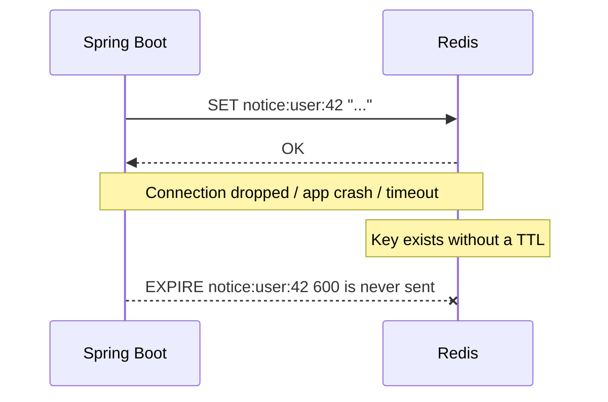
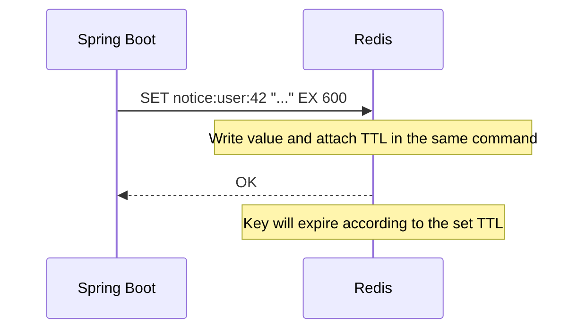

# Combining Value Writes with Expiration in One Operation

When using Redis to store caches, temporary verification codes, processing states, or time-window counters, you usually want to **write the data and set its Time To Live (TTL) at the same time**. If the application writes first and attaches the TTL in another command, a failure occurring between the two commands can leave data persisting longer than intended. Redis supports setting both the value and expiration time **inside the `SET` command itself**, and Spring Data Redis provides corresponding methods for Spring Boot applications to use directly.

This lesson belongs to the **Strings and Counters** topic. The first part focuses on Redis Strings with `SET ... EX/PX`; the subsequent sections explain conditional writes, renewing or preserving TTL, and why **incrementing a counter with `INCR` and then setting TTL** requires a dedicated approach.

## 1. The Problem with Separating `SET` and `EXPIRE`

Suppose an application needs to store a notice for 10 minutes:

```redis
SET notice:user:42 "Order has been received"
EXPIRE notice:user:42 600
```

Both commands are valid, yet between them there is a window where Redis has already stored the key **without a TTL**.



Possible consequences include:

- Temporary data persists **indefinitely**, consuming memory longer than expected.
- Temporary tokens/markers or business states stay alive too long if there is no other cleanup mechanism.
- Another request may read the key **right between** `SET` and `EXPIRE`, seeing the key as having no TTL at that moment.
- In flows with multiple writers, a late `EXPIRE` command may attach a TTL to a **different value** that another writer just updated.

A successful `EXPIRE` command returns integer `1` if it set the expiration on an existing key, or `0` if it could not be applied; that result still does not eliminate the atomicity gap between the two calls.

### Solution: A Single `SET` Command with TTL

```redis
SET notice:user:42 "Order has been received" EX 600
```

This command both updates the value and sets the expiration time **as one atomic Redis operation**. Other clients cannot observe an intermediate state of "new value present but TTL not yet attached" created by this command.



This is what "one operation" means: **one Redis command with combined semantics**, not merely an outer Java method that might secretly issue multiple commands.

## 2. TTL in Redis: Units, Meaning, and Inspection

**TTL (Time To Live)** is how long a key remains valid before Redis treats it as expired. Redis stores expiration timestamp metadata on the key, not a "countdown timer" inside the String value.

Commonly used commands:

| Command | Function | Example |
| --- | --- | --- |
| `SET key value EX seconds` | Write String and set TTL in **seconds** | `SET cache:x "ok" EX 60` |
| `SET key value PX milliseconds` | Write String and set TTL in **milliseconds** | `SET cache:x "ok" PX 1500` |
| `SET key value EXAT unixSeconds` | Write and expire at **Unix timestamp in seconds** | `SET cache:x "ok" EXAT 1900000000` |
| `SET key value PXAT unixMilliseconds` | Write and expire at **Unix timestamp in milliseconds** | `SET cache:x "ok" PXAT 1900000000000` |
| `TTL key` | Read remaining time in seconds | `TTL cache:x` |
| `PTTL key` | Read remaining time in milliseconds | `PTTL cache:x` |
| `PERSIST key` | Remove expiration, turning an existing key into one with no TTL | `PERSIST cache:x` |

For `TTL` / `PTTL`, special return values are:

- `-2`: the key does not exist at the time of inspection.
- `-1`: the key exists but **has no expiration**.
- Non-negative number: remaining time in the command's unit, rounded according to Redis's internal representation.

Hands-on example on a temporary key:

```redis
SET demo:ttl "hello" EX 30
# OK

GET demo:ttl
# "hello"

TTL demo:ttl
# May return 29 or 30 depending on call timing

PTTL demo:ttl
# Remaining milliseconds at the time of inspection
```

**Important limitation:** Redis removes expired keys via background active expiration or lazily upon access. Therefore, do not use the exact moment a key disappears from memory stats to assume a scheduler ran down to the exact millisecond. For read commands, Redis checks expiration state to avoid returning keys that are no longer valid under Redis semantics.

### Using `EX`, `PX`, or an Absolute Timestamp?

- Use `EX` for natural requirements like "5-minute cache", "30-second marker", or "10-minute notice".
- Use `PX` if short lifetimes or millisecond resolution are needed; still account for network latency, scheduler jitter, and server processing capacity.
- Use `EXAT` / `PXAT` when multiple writers need a shared **absolute expiration timestamp**, such as all keys for a processing session expiring at a fixed point in time. The timestamp must be computed in Unix epoch with the right unit.

Do not confuse `PX 1000` (lives for 1 second) with `PXAT 1000` (expires at a timestamp far in the past). For durations relative to write time, `EX`/`PX` are usually less error-prone.

Expiration values must be valid and positive according to command syntax. Do not use `EX 0` or negative values to express "delete immediately"; use an explicit delete command when that is the intended behavior.

## 3. `SET` Options Related to TTL and Write Conditions

Modern Redis `SET` can combine several options:

```text
SET key value [NX | XX] [GET] [EX seconds | PX milliseconds |
                        EXAT unix-seconds | PXAT unix-milliseconds | KEEPTTL]
```

Option groups cannot specify two conflicting expiration modes in the same command; for example, do not combine `EX` and `KEEPTTL`. Key semantics:

| Option | Meaning | When Combined with TTL |
| --- | --- | --- |
| Neither `NX` nor `XX` | Overwrite key whether missing or existing | `SET k v EX 60` always sets the new value and new TTL on success |
| `NX` | Write only if key **does not exist** | `SET k v NX EX 60` creates key **and** TTL if creation succeeds |
| `XX` | Write only if key **already exists** | `SET k v XX EX 60` updates value and TTL only while key still exists |
| `GET` | Return old value while performing `SET` | Can be used with TTL when pre-write value is needed; know how to read the response |
| `KEEPTTL` | Keep existing key's expiration time when writing new value | For cases where TTL should not be reset |

### Overwriting with `SET` Drops the Old TTL by Default

Suppose:

```redis
SET cart:42 "draft" EX 300
TTL cart:42
# Remaining seconds, up to roughly 300

SET cart:42 "submitted"
TTL cart:42
# -1: key still exists but no longer has a TTL
```

The successful `SET cart:42 "submitted"` command replaced the value and **removed the previous expiration**, because neither a new TTL nor `KEEPTTL` was supplied.

To set a new TTL:

```redis
SET cart:42 "submitted" EX 600
```

To preserve the old expiration time:

```redis
SET cart:42 "submitted" KEEPTTL
```

To update only if the key still exists while also changing the TTL:

```redis
SET cart:42 "submitted" XX EX 600
```

Choosing between **resetting TTL** and **keeping TTL** is a business decision. A refreshed cache typically needs its TTL reset; a session or access grant with a fixed deadline may need to keep the original deadline.

## 4. Spring Data Redis: `ValueOperations.set(key, value, Duration)`

In Spring Boot using `spring-boot-starter-data-redis`, `StringRedisTemplate` is a convenient API for reading and writing Redis Strings in UTF-8.

Dependency declaration (Gradle Groovy):

```groovy
dependencies {
    implementation 'org.springframework.boot:spring-boot-starter-data-redis'
}
```

Or Maven:

```xml
<dependency>
    <groupId>org.springframework.boot</groupId>
    <artifactId>spring-boot-starter-data-redis</artifactId>
</dependency>
```

In a Spring Boot application using Boot-managed dependency versions, you typically do not need to specify the starter version manually.

Example connection configuration for Spring Boot 3.x:

```yaml
spring:
  data:
    redis:
      host: localhost
      port: 6379
      timeout: 2s
```

`localhost` is valid only if the Redis server is reachable from the **application process's network namespace**. When Spring Boot runs inside a container, you typically must use the appropriate Redis service/hostname rather than `localhost`.

### Writing a Service That Saves Values with TTL

```java
import java.time.Duration;
import java.util.Objects;
import org.springframework.data.redis.core.StringRedisTemplate;
import org.springframework.stereotype.Service;

@Service
public class TemporaryNoticeService {

    private static final Duration NOTICE_TTL = Duration.ofMinutes(10);
    private final StringRedisTemplate redis;

    public TemporaryNoticeService(StringRedisTemplate redis) {
        this.redis = redis;
    }

    public void saveNotice(String userId, String message) {
        Objects.requireNonNull(userId, "userId");
        Objects.requireNonNull(message, "message");

        String key = "notice:user:" + userId;

        // Write value and TTL in one Redis operation.
        redis.opsForValue().set(key, message, NOTICE_TTL);
    }

    public String getNotice(String userId) {
        return redis.opsForValue().get("notice:user:" + userId);
    }
}
```

Usage:

```java
noticeService.saveNotice("42", "Order has been received");
String value = noticeService.getNotice("42");
```

The `set(key, value, Duration)` method expresses a String write with the corresponding expiration, **without requiring a manual `expire()` call afterward**. `getNotice` may return `null` when the key has not been written, was deleted, or has expired.

Equivalent method using a time unit:

```java
redis.opsForValue().set(
        "notice:user:42",
        "Processed",
        600,
        java.util.concurrent.TimeUnit.SECONDS
);
```

Both ways of specifying TTL serve the same purpose. `Duration` is usually easier to read when values come from `Duration.ofMinutes(10)` or application configuration.

### Verifying from Redis CLI

After calling `saveNotice("42", ...)`:

```redis
GET notice:user:42
# "Order has been received"

TTL notice:user:42
# A positive number of seconds less than or equal to around 600
```

If `TTL` returns `-1` immediately after a successful write, check whether another writer overwrote the key **without expiration**, or whether a `PERSIST` operation affected the key. If `TTL` returns `-2`, the key may not have been written to the expected Redis endpoint/database, may have been deleted, or may have already expired.

## 5. Conditional Writes and TTL in the Same Operation

Many use cases do not permit arbitrary overwrites. For example:

- Place a marker only if no other marker exists.
- Update status only while the key has not been deleted or expired.
- Create a processing flag with an expiration to avoid holding temporary state forever.

Separating the condition, write, and TTL into multiple commands can introduce a **race condition**.

### 5.1. Write Only When Key Does Not Exist: `SET ... NX EX`

Redis CLI:

```redis
SET job:dedup:task-42 "reserved" NX EX 300
# OK if the key does not exist yet

SET job:dedup:task-42 "reserved" NX EX 300
# nil if the key already exists
```

Only the first successful command creates both the value and the TTL. A failed `NX` command neither overwrites the value nor automatically extends the existing key's lifetime.

Spring Data Redis:

```java
import java.time.Duration;
import org.springframework.data.redis.core.StringRedisTemplate;
import org.springframework.stereotype.Service;

@Service
public class DedupMarkerService {
    private final StringRedisTemplate redis;

    public DedupMarkerService(StringRedisTemplate redis) {
        this.redis = redis;
    }

    public boolean tryReserve(String taskId) {
        Boolean created = redis.opsForValue().setIfAbsent(
                "job:dedup:" + taskId,
                "reserved",
                Duration.ofMinutes(5)
        );
        return Boolean.TRUE.equals(created);
    }
}
```

`setIfAbsent(key, value, Duration)` corresponds to **`SET key value NX EX/PX ...`**, executed atomically on Redis when the operation is sent directly. Typical return values:

- `true` when Redis creates the key successfully.
- `false` when the key already exists so the `NX` condition is not met.
- May be `null` in pipelining/transaction contexts per Spring Data Redis's API contract; the example above targets normal direct calls where the application does not interpret `null` as a definitive server result.

**Marker limitation:** a `reserved` key with TTL does not by itself guarantee "exactly-once processing". A worker may crash after creating the marker; a job may run longer than 5 minutes; or two retries at different times may re-run the work. Recovery mechanisms, completion state, business idempotency, and marker retention duration must be designed around the workload's characteristics.

### 5.2. Update Only If Key Still Exists: `SET ... XX EX`

Redis CLI:

```redis
SET workflow:42 "pending" EX 300
SET workflow:42 "running" XX EX 300
# OK if the key currently exists
```

Spring Data Redis:

```java
Boolean updated = redis.opsForValue().setIfPresent(
        "workflow:42",
        "running",
        Duration.ofMinutes(5)
);
```

This case **both updates the value and resets the TTL** when the key exists. If the key has expired, the `XX` condition is not met and the command does not recreate a new key.

**Common misconception to avoid:** `XX` only checks that the key exists; it **does not check whether the old value equals `"pending"`**. If you need conditional state transitions such as "change only from pending to running", use compare-and-set via Lua/Redis Functions or an appropriate transactional mechanism; `SET XX` alone provides no content-matching condition.

### 5.3. Creating a Marker Only If Missing and Using TTL as a Lease

The command `SET lock:resource token NX PX 10000` is often the foundation of a **simple lease/lock**. Yet a minimal example is not sufficient for a complete distributed locking system:

- The value should be a unique token per lock holder, not a fixed string `"locked"` if multiple processes can contend.
- TTL only bounds the lease duration. If work outlasts the TTL, another process can acquire the lock; consider renewal, fencing tokens, or designs that prevent stale writes.
- Do not delete the lock with just `DEL key` upon completion, because the lock may have expired and been acquired by another process. Compare the owner token and delete atomically using Lua/Redis Functions or a proven lock library.

Thus `SET NX PX` is an **atomic primitive**, not a complete distributed lock safety solution by itself.

## 6. Which Write Is TTL Measured From?

A successful `SET key value EX 600` sets a new lifetime measured from when the command executes. Every overwrite with `SET ... EX 600` typically **resets the TTL**, even if the key existed before.

```redis
SET cache:product:42 "v1" EX 600
# After about 120 seconds:
SET cache:product:42 "v2" EX 600
# TTL goes back to nearly 600 seconds
```

This suits caches that refresh whenever a new write arrives. However, fixed-deadline use cases require different rules:

| Need | Desired Behavior | Approach |
| --- | --- | --- |
| Cache refreshed on data change | Reset lifetime on each write | `SET key value EX/PX ...` |
| New value must keep old deadline | Do not extend lifetime on rewrite | `SET key value KEEPTTL`, where appropriate |
| Create key once only | Keep value/TTL from initial creation | `SET key value NX EX/PX ...` |
| Rewrite only if key hasn't expired | Do not recreate missing key | `SET key value XX EX/PX ...` |
| Read data and refresh TTL together | Retrieve old value then change TTL | `GETEX` command when supported by Redis and client |
| Expire at a shared wall-clock time | Independent of writer timing | `SET ... EXAT/PXAT ...` |

### `GETEX` Is a Closely Related Case

Redis provides the command:

```redis
GETEX session:42 EX 300
```

This command **reads the current value and extends the TTL in one operation**; it **does not write a new value**. Spring Data Redis exposes APIs such as `ValueOperations.getAndExpire(key, Duration)` in supported versions to express these semantics. It is useful for certain sliding-expiration patterns.

Do not confuse `GETEX` with doing `GET` then `EXPIRE`: two separate commands leave a gap between reading and updating the TTL.

### Renewal Patterns Can Cause Unintended Extension

If every request runs `SET` or `GETEX` to refresh TTL, a continuously accessed user key can stay alive for a very long time. That may fit a sliding-expiration session, but not an OTP or promo voucher with an **absolute deadline**. For absolute deadlines, consider `EXAT/PXAT`, storing an expiration timestamp inside the value verified at the business layer, and disallowing unbounded renewals.

## 7. Counters: Why Are `INCR` + `EXPIRE` Still Two Operations?

A common case is a counter within a 60-second window:

```redis
INCR counter:api:client-42:window-100
EXPIRE counter:api:client-42:window-100 60
```

`INCR` atomically increments an integer stored in a Redis String. However, it **does not accept `EX`/`PX` options** like `SET`. Combining `INCR` then `EXPIRE` as above remains **two commands**.

If `EXPIRE` runs on every increment, the TTL resets on every request; this turns the counter into "expires after 60 seconds of inactivity", rather than a fixed time window. If you set TTL only when `INCR` returns 1, a gap still exists:

```text
Worker A: INCR counter:...  → 1
Worker A: crashes before EXPIRE
Worker B: INCR counter:...  → 2
Worker B: sees result != 1, skips setting TTL

Outcome: the counter can persist without a TTL.
```

Key point: **`SET ... EX` cannot simply replace `INCR`** for multi-writer counters. If clients perform `GET`, add 1, and `SET` with TTL, two concurrent clients can read the same old value and overwrite each other, losing increments.

### 7.1. Lua Script for Atomic Increment and TTL Assignment

Redis executes commands inside a Lua script as an atomic unit with respect to commands from other clients. Therefore, you can increment the counter, check whether it was newly created, and attach the TTL inside the script:

```lua
local current = redis.call('INCR', KEYS[1])
if current == 1 then
    redis.call('EXPIRE', KEYS[1], tonumber(ARGV[1]))
end
return current
```

In a newly initialized counter model starting from a missing key:

1. `INCR` on a non-existent key creates the numeric value `1`.
2. The script sees `current == 1` and sets the TTL in the same execution.
3. Other clients observe the result only after the script finishes, never an intermediate state between the two commands.
4. Subsequent increments preserve the original TTL instead of resetting it each time.

**Assumption to keep in mind:** this script targets a counter namespace owned exclusively by this mechanism. If a key could already exist with a non-zero value and no TTL, `current == 1` will not fix that anomalous state. A separate initialization/migration policy or alternative rule is needed if recovering legacy data.

### 7.2. Calling a Lua Script from Spring Data Redis

```java
import java.util.List;
import java.util.Objects;
import org.springframework.data.redis.core.StringRedisTemplate;
import org.springframework.data.redis.core.script.RedisScript;
import org.springframework.stereotype.Service;

@Service
public class ExpiringCounterService {

    private static final RedisScript<Long> INCREMENT_WITH_TTL =
            RedisScript.of(
                    """
                    local current = redis.call('INCR', KEYS[1])
                    if current == 1 then
                        redis.call('EXPIRE', KEYS[1], tonumber(ARGV[1]))
                    end
                    return current
                    """,
                    Long.class
            );

    private final StringRedisTemplate redis;

    public ExpiringCounterService(StringRedisTemplate redis) {
        this.redis = redis;
    }

    public long increment(String counterKey, long ttlSeconds) {
        if (ttlSeconds <= 0) {
            throw new IllegalArgumentException("ttlSeconds must be positive");
        }

        Long result = redis.execute(
                INCREMENT_WITH_TTL,
                List.of(counterKey),
                Long.toString(ttlSeconds)
        );
        return Objects.requireNonNull(result, "Redis script returned null");
    }
}
```

Usage:

```java
long hits = counterService.increment(
        "counter:api:client-42:window-100",
        120
);
```

In this example, choosing a 120-second TTL is only illustrative; it does not by itself create a 60-second rate-limit window. Building a fixed-window rate limiter requires defining how **window IDs** are generated, window length, retention time, thresholds, and clock skew handling. The script above specifically solves atomic incrementing and setting expiration on initialization.

With Spring Data Redis, `RedisScript.of(...)` constructs a script with result type `Long`; `StringRedisTemplate.execute(...)` converts keys/arguments using the template's serializers and returns Redis's reply. In Redis Cluster, every key accessed by a script must follow same-slot routing rules; this example uses only one key, so there is no cross-slot issue.

**Important:** Lua scripts run on Redis's execution thread, so they should not perform large loops or unbounded data processing. The example script executes a fixed number of commands, fitting the goal of an atomic simple counter. If business logic requires correctness under failover/durability scenarios, also review replication, persistence, and idempotency on retries.

### 7.3. When to Use Lua vs. `SET`?

| Problem | Choice |
| --- | --- |
| Write a new String and TTL | `SET key value EX/PX ...` |
| Write String if missing, with TTL | `SET key value NX EX/PX ...` |
| Update String if existing, with TTL | `SET key value XX EX/PX ...` |
| Increment a counter whose TTL is managed elsewhere | `INCR` is atomic for incrementing; does not alter TTL |
| Increment counter and set TTL only on creation | Lua script/Redis Functions containing `INCR` and `EXPIRE` per policy |
| Increment counter and allow/deny by threshold | Usually needs atomic increment/check logic, such as a carefully designed Lua script |

Do not use `SET` to write a new number computed by client-side addition when there are concurrent writers, unless appropriate synchronization or matching mechanisms prevent lost updates.

## 8. Pipelines, Transactions, and Single Commands: Where Do They Differ?

Three concepts often confused when trying to "combine two commands":

**Pipelining** sends multiple commands back-to-back to reduce round trips:

```text
Client -> SET k v
Client -> EXPIRE k 60
Client <- [OK, 1]
```

Pipelining does not turn two commands into one atomic operation. Redis can execute another client's commands between pipelined commands depending on delivery and processing; the client can also fail before sending the whole sequence.

**MULTI/EXEC** groups commands into a Redis transaction:

```redis
MULTI
SET k v
EXPIRE k 60
EXEC
```

When `EXEC` runs, queued commands are executed sequentially by Redis as a block without interleaving from other clients. This can be useful when you must combine multiple commands that have no single-command equivalent. However, it requires multiple protocol steps, has specific error-handling traits, and does not provide RDBMS-style rollback. If you only need to write a String with TTL, **`SET k v EX 60` is simpler and more direct**.

**A single Redis `SET ... EX` command** expresses both required effects directly inside one command. With Spring Data Redis, use the built-in `ValueOperations.set(key, value, Duration)` method to convey that intent.

Do not replace the combined API with `redis.opsForValue().set(key, value)` followed by `redis.expire(key, ttl)` merely because both are called from the same Java method or wrapped in `@Transactional`. Spring's transactional annotation does not automatically merge two independently issued Redis commands into `SET EX`.

## 9. Limits of Atomicity to Understand Properly

An atomic Redis command guarantees no other client command observes an **intermediate state while that command executes**. It does not automatically guarantee every aspect of a distributed system:

### 9.1. A Client Timeout Does Not Prove Command Failure

Suppose a client sends:

```redis
SET job:dedup:task-42 reserved NX EX 300
```

but the response is lost over the network. The application cannot know for sure whether Redis wrote the key from a timeout alone. On retry, the second attempt may fail because the key was created by **the previous call itself**, or by another writer. Never infer "timeout = Redis did not execute the command".

For critical workflows, implement request identification, idempotency, and state recovery after uncertain outcomes.

### 9.2. Atomic Write Does Not Mean Absolute Durability

TTL and value are applied consistently within a single command on the Redis instance handling it, yet durability after crashes depends on persistence configuration (RDB/AOF), replication, failover, and Redis architecture. When using Redis for caches or temporary markers, a different durability model from a primary transactional database is usually accepted. Never treat atomic `SET EX` as proof that data is synchronously backed up and guaranteed to survive every failure.

### 9.3. TTL Does Not Replace Business Validation

If a key represents an access entitlement expiring at 10:00 UTC, the application may need to store the **business deadline** itself and validate it during processing, in addition to Redis TTL. TTL aids data cleanup; it does not automatically address auditing, entitlement extension, clock skew across services, or "cannot be used after 10:00" rules.

### 9.4. Default Serializer Choices Still Matter

`StringRedisTemplate` uses String serializers for keys and values, making them easy to inspect via Redis CLI and interoperate with other applications. If using `RedisTemplate<K, V>` with a custom serializer, values and keys are converted to bytes per that configuration; Redis still attaches TTL to the **corresponding byte key**. When another client reads the data, a consistent encoding/schema contract is required to avoid "key not found" caused by mismatched key serialization.

## 10. Practical Application Patterns

### 10.1. Storing a Temporary Cache Entry

```java
redis.opsForValue().set(
        "cache:product:42",
        productJson,
        Duration.ofMinutes(15)
);
```

On a cache miss, the application queries the primary data source and writes the cached copy with TTL in the same command. This is a simple cache-aside strategy. If many requests experience a cache miss simultaneously, a cache stampede can still occur; `SET EX` alone does not coordinate cache recomputation.

### 10.2. Creating a Temporary Processing Marker

```java
Boolean inserted = redis.opsForValue().setIfAbsent(
        "dedup:invoice:987",
        "in-progress",
        Duration.ofMinutes(2)
);

if (Boolean.TRUE.equals(inserted)) {
    // The process is allowed to proceed with the next step per application policy.
}
```

A marker with TTL prevents temporary state from lingering forever if a worker stops. Still, consider how work is finalized or recovered, because the TTL may expire before business processing finishes.

### 10.3. Replacing a Value and Extending Lifetime

```java
redis.opsForValue().set(
        "dashboard:refresh:42",
        newSnapshot,
        Duration.ofSeconds(45)
);
```

On a successful write, the TTL is recalculated from the current time. Designers should confirm whether the requirement is "45 seconds from the latest refresh" rather than "45 seconds from initial creation".

### 10.4. Writing Status Only If the Key Is Still Valid

```java
Boolean updated = redis.opsForValue().setIfPresent(
        "workflow:task-42",
        "processing",
        Duration.ofMinutes(3)
);
```

This checks key existence, **not** an old-value comparison condition. If there are multiple state transitions or concurrent updating processes, synchronization rules strong enough for the state machine are required.

## 11. Diagnosing Common Errors

| Symptom | Possible Cause | Resolution |
| --- | --- | --- |
| `TTL key` returns `-1` after saving | Written via `SET` without TTL, overwritten by another writer, or `PERSIST` | Write with TTL via `set(key, value, Duration)`; audit all writers of the key |
| `TTL key` returns `-2` | Key no longer exists, expired, wrong database/endpoint/key serializer | Verify key, Redis endpoint, namespace, TTL, and read timing |
| `setIfAbsent` marker repeatedly returns `false` | Key already exists and has not expired | Check TTL and retry/key-naming policy; do not delete arbitrarily |
| Marker persists forever | Separate `SETNX` and `EXPIRE` with failure before expire; old writer omitted TTL | Use `SET NX EX`; clean up legacy data per policy |
| Cache TTL keeps extending on every update | `SET ... EX` resets TTL on each write | Choose `KEEPTTL` or absolute deadline if required by business rules |
| Cache loses TTL when value is replaced | Plain `SET` command clears old TTL | Write with new TTL or intentionally keep TTL |
| Counter lives forever after worker crash | `INCR` ran but `EXPIRE` never executed | Use Lua/Redis Functions for atomic increment + expire |
| Counter never expires under traffic | `EXPIRE` runs after every `INCR` | Set TTL only on initialization or per appropriate window model |
| Timeout occurred yet key actually exists | Command may have executed before response was lost | Design for idempotency; inspect business state before retrying |
| Expiration duration is not as expected | Confused seconds/milliseconds, or used `EXAT` with wrong timestamp | Standardize on `Duration` and check epoch timestamps in the right unit |

### Separating TTL Issues from Redis Connection Errors

If Spring Boot throws `RedisConnectionFailureException`, connection timeouts, or authentication errors, you cannot conclude TTL is misconfigured. Verify connectivity and Redis reachability first. Once commands execute successfully, use `TTL`/`PTTL` and inspect other writers to investigate key lifecycles.

## 12. Hands-On Practice with Redis CLI and Spring

The following operations use dedicated keys with short TTLs suitable for test environments:

**Exercise A — Atomic Write and TTL Assignment**

```redis
SET lesson:atomic "hello" EX 20
GET lesson:atomic
TTL lesson:atomic
```

Expected: Redis returns `"hello"` while the key is valid, and `TTL` shows remaining seconds up to roughly 20.

**Exercise B — Difference Between `SET` With and Without TTL**

```redis
SET lesson:overwrite "v1" EX 20
SET lesson:overwrite "v2"
TTL lesson:overwrite
```

Expected: `TTL` returns `-1`. Continue:

```redis
SET lesson:overwrite "v3" EX 20
TTL lesson:overwrite
```

Expected: TTL is set again.

**Exercise C — `NX` with TTL**

```redis
SET lesson:nx "first" NX EX 30
SET lesson:nx "second" NX EX 30
GET lesson:nx
TTL lesson:nx
```

Expected: the value stays `"first"` while the key has not expired; the second `NX` command does not extend the TTL.

**Exercise D — Writing While Keeping TTL**

```redis
SET lesson:keep "before" EX 30
SET lesson:keep "after" KEEPTTL
GET lesson:keep
TTL lesson:keep
```

Expected: the value changes to `"after"`, and the key's old deadline is preserved.

**Exercise E — Simple Counter**

```redis
INCR lesson:count
TTL lesson:count
```

If the key did not exist and is incremented for the first time with `INCR`, `TTL` is `-1`. This demonstrates that `INCR` itself does not create an expiration. Afterward, you can delete the test key with `DEL lesson:count` or use the script introduced in the counter section to increment and attach TTL in the same atomic turn.

Never use production key names when practicing `SET`/`DEL` commands, as they modify or delete real data.

## 13. Self-Check Questions

**Question 1.** Why does the following Java method not guarantee writing with TTL as one atomic operation?

```java
redis.opsForValue().set("cache:42", payload);
redis.expire("cache:42", Duration.ofMinutes(5));
```

*Hint:* `set` and `expire` send two independent Redis commands; exceptions, timeouts, or concurrent writers can occur between them.

**Question 2.** Choose an appropriate Spring Data Redis call to store the string `"ready"` under key `task:42` with a 90-second expiration.

*Hint:* `opsForValue().set(key, value, Duration.ofSeconds(90))`.

**Question 3.** An application wants to create a marker only if absent while ensuring it never persists forever. Should it use `SETNX` then `EXPIRE`, or `SET NX EX`? Why?

*Hint:* the `NX` condition, value, and TTL must belong to the same command.

**Question 4.** A key has 200 seconds of TTL left. After calling `redis.opsForValue().set(key, newValue)`, `TTL` returns `-1`. Is this a Redis bug?

*Hint:* `SET` clears the old expiration by default when neither a TTL nor `KEEPTTL` is provided.

**Question 5.** When each counter should only set its TTL on the first increment, why is calling `INCR` and checking `n == 1` to call `EXPIRE` still risky?

*Hint:* the application can stop between the two commands; concurrent writers may continue incrementing a counter without a TTL.

**Question 6.** `SET session:42 active EX 600` succeeded, but the HTTP client timed out before receiving a response from the application. Can the client be certain Redis did not write?

*Hint:* a response timeout is not proof that the command did not execute.

**Question 7.** When access rights must expire at a shared fixed deadline, why might repeatedly refreshing with `SET ... EX 600` be unsuitable?

*Hint:* a relative TTL is recalculated from every write, which can extend past the business deadline.

## 14. Conclusion

For **Redis Strings**, using `SET key value EX/PX ...` is the direct way to **write a value and set its TTL in one atomic operation**. In Spring Data Redis, the corresponding implementation is `StringRedisTemplate.opsForValue().set(key, value, Duration)`. When conditional writes are needed, use `setIfAbsent(..., Duration)` for `NX` or `setIfPresent(..., Duration)` for `XX`; both the condition and expiration on success are part of the same operation.

Each `SET` write should explicitly decide whether to **reset TTL**, **keep TTL**, or **write only if the key exists/does not exist**. Specifically for **counters**, `INCR` is an atomic increment command but does not accept TTL directly; if you need "increment and attach TTL upon initialization" as an atomic unit, use Lua/Redis Functions or an equivalent design. Understanding the limits of atomicity, TTL, and retries helps Spring Boot applications avoid lingering keys, lost updates, or broken data lifecycles.
