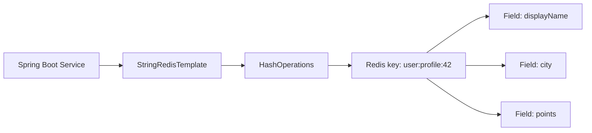
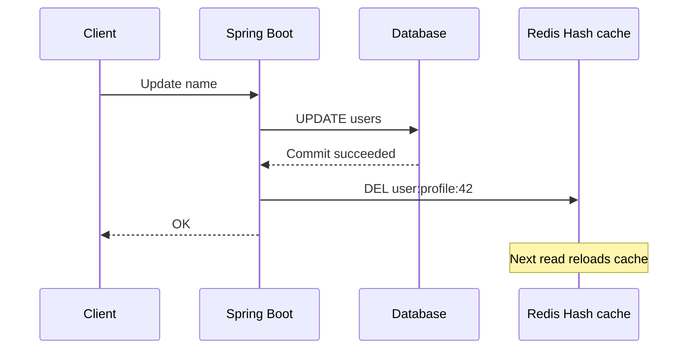

# Choosing a Hash to Represent Object Attributes

A Spring Boot application often manages objects with multiple attributes: a user profile has `displayName`, `city`, `tier`; a product has `title`, `price`, `stock`; a processing session has `status`, `updatedAt`, `retryCount`. When storing these objects in Redis, we need to decide whether to **store the entire object as a single value** or **store each attribute in a Redis Hash**.

A Redis Hash is a structure consisting of multiple **field → value** pairs under **a single Redis key**. Spring Data Redis provides `HashOperations` through `RedisTemplate.opsForHash()` or `StringRedisTemplate.opsForHash()` to update and read fields without having to fetch and rewrite the entire object.

Choosing a Hash is useful when the application frequently accesses or modifies **several individual attributes**, those attributes have a similar lifecycle, and they are accessed by object identifier. However, a Hash is not a miniature SQL table; nor does it automatically provide querying by attribute, cross-object transactions, schema validation, or nested update operations like a Java object graph.

This lesson explains how to make that decision, organize keys/fields, implement with Spring Data Redis, and handle trade-offs regarding TTL, serialization, concurrency, performance, and consistency.

## 1. The Redis Hash Model

A Redis Hash has a top-level key and multiple fields:

```text
Redis key: user:profile:42
    ├── displayName  → "Lan"
    ├── city         → "Da Nang"
    ├── tier         → "gold"
    ├── points       → "120"
    └── schemaVersion→ "1"
```

In Redis CLI:

```redis
HSET user:profile:42 displayName "Lan" city "Da Nang" tier "gold" points "120" schemaVersion "1"
HGET user:profile:42 displayName
HMGET user:profile:42 displayName tier
HGETALL user:profile:42
```

Distinctions:

- **Key:** `user:profile:42` identifies an entire Hash.
- **Field:** `displayName`, `city`, `points` are the attributes stored inside the Hash.
- **Field value:** the byte string Redis stores for each field, such as `"Lan"` or `"120"`.
- **Java object:** `UserProfile` or `ProfileDto` is only a structure in the JVM; reading from and writing to Redis requires choosing a mapping approach and serializer.

A Redis Hash does not create separate Redis keys like `user:profile:42:displayName`. You cannot use `GET user:profile:42:displayName` to retrieve the `displayName` field in a Hash; you must use `HGET user:profile:42 displayName`.



## 2. When Should You Choose a Hash?

Consider a Redis Hash when the following conditions are mostly true:

1. **There is a natural identifier** for the object: user ID, device ID, job ID, session ID.
2. **The object has relatively independent attributes**: updating only `city`, reading `tier`, or incrementing `points` without needing to rewrite every field.
3. **Atomic operations on a single field are needed**: `HSET`, `HSETNX`, `HINCRBY` execute on the Redis side.
4. **The fields have a close lifecycle**: a single key TTL can suit the entire object.
5. **The number of fields in an object is bounded**: each Hash does not grow indefinitely.
6. **Access is primarily by ID**, without frequent filtering, joining, or complex queries based on field contents.

Practical examples:

| Object | Key | Fields to store | Common access pattern |
|---|---|---|---|
| Compact user profile | `user:profile:42` | `displayName`, `city`, `tier` | `HGET` a single field, `HMGET` display fields |
| Temporary job state | `job:state:ab12` | `status`, `progress`, `updatedAt` | Update a single field, check status |
| Device configuration | `device:config:17` | `mode`, `threshold`, `enabled` | Read or adjust individual attributes |
| Small per-user statistics | `user:stats:42` | `views`, `likes`, `shares` | `HINCRBY` a counter |
| Cache of an object with few attributes | `product:summary:99` | `title`, `price`, `category` | Read a few fields for display |

These examples are only appropriate when the **update model and consistency requirements** also fit. For example, a product's `stock` attribute related to ordering and payment may require a transactional database as the source of truth, even though a Hash is very convenient to read/write.

### 2.1. When Should You Not Choose a Hash?

Do not default to a Hash if:

- The application **always reads and writes an entire JSON object**, and never updates individual fields.
- The data has **deeply nested structures**, arrays, or complex schemas that require synchronized document-level operations.
- Each attribute needs an **independent TTL**, but the environment does not support or does not want to manage field expiration.
- The object can grow to **hundreds of thousands of fields** with no bounding policy.
- You need to **query across many objects by a field**, full-text search, joins, or constraints between records.
- There are **business invariants spanning multiple objects** requiring transactions across Redis and a database.

In those cases, a Redis String containing JSON, multiple separate keys, a Sorted Set as an index, Redis Stack/appropriate JSON capabilities, or the primary database may be a better choice depending on requirements.

## 3. Comparing Hash with JSON String and Multiple Separate Keys

Suppose we have an object:

```json
{
  "id": 42,
  "displayName": "Lan",
  "city": "Da Nang",
  "tier": "gold",
  "points": 120
}
```

### 3.1. Approach A: A Single JSON String

Redis:

```redis
SET user:profile:42 "{\"id\":42,\"displayName\":\"Lan\",\"city\":\"Da Nang\",\"tier\":\"gold\",\"points\":120}" EX 600
GET user:profile:42
```

The application can serialize the DTO with Jackson and store it using `StringRedisTemplate.opsForValue()`.

Pros: one key, one payload; natural for Java objects and nested structures; well-suited when always reading all data to return from an API.

Cons: if you only want to change `city`, the client typically has to `GET` → deserialize → modify → serialize → `SET`. Two requests updating different fields can overwrite each other if there is no concurrency control mechanism.

### 3.2. Approach B: A Single Redis Hash

Redis:

```redis
HSET user:profile:42 displayName "Lan" city "Da Nang" tier "gold" points "120"
HSET user:profile:42 city "Hue"
HINCRBY user:profile:42 points 5
HGET user:profile:42 tier
```

Pros: update or read individual fields; no need to resend other fields; `HINCRBY` handles counters on Redis; keeps attributes grouped under one key.

Cons: requires a data type and field mapping strategy; field values are not automatically Java `int`, `boolean`, or objects; nested structures need separate representation; basic TTL applies to the entire key.

### 3.3. Approach C: One Redis Key per Attribute

Redis:

```redis
SET user:42:displayName "Lan"
SET user:42:city "Da Nang"
SET user:42:tier "gold"
SET user:42:points "120"
```

Pros: each key can have its own TTL and policy; independent components can be managed differently.

Cons: increases the number of keys and metadata; requires multiple operations to assemble an object; reading the whole object and managing lifecycle can be more complex.

| Criterion | Hash | JSON String | Multiple Separate Keys |
|---|---|---|---|
| Reading one field | `HGET`, whole object not needed | Usually read + parse entire JSON | `GET` field key |
| Updating one field | `HSET` | Usually rewrite entire JSON | `SET` field key |
| Incrementing a field counter | `HINCRBY` | Needs a separate mechanism | `INCR` on field key |
| Reading whole object | `HGETALL`/`HMGET` | Single `GET` | Multiple `GET`/`MGET` |
| Nested schema | Must flatten or serialize per field | More natural | Multiple keys/relationships |
| Typical TTL | On the entire Hash key | On the String key | Can differ per key |
| Metadata management | One key, many fields | One key, one value | Many keys |
| Risk of overwriting unrelated fields | Low with per-field `HSET` | High if read-modify-write whole JSON is uncontrolled | Low with separate keys |
| Querying by attribute across objects | No automatic index | No automatic index | No automatic index |
| Suitable size | Object with a bounded number of fields | Bounded whole-object payload | Truly independent attributes |

**Choose based on access patterns**: if the UI always needs the entire profile and the profile is small, a JSON String can be simple. If multiple services often only fetch `tier` or change `city` without wanting to reload the object, a Hash is worth considering.

## 4. Designing a Clear Hash Schema

Choose a stable primary key:

```text
<application>:<environment>:<domain>:<entity-id>
shop:dev:user:profile:42
```

Fields must have clear, agreed-upon semantics:

```text
displayName     UTF-8 String
city            UTF-8 String
tier            one of basic/silver/gold
points          decimal integer as a string
schemaVersion   integer as a string
updatedAt       ISO-8601 or epoch millis, using one consistent convention
```

Redis example:

```redis
HSET shop:dev:user:profile:42 \
  displayName "Lan" \
  city "Da Nang" \
  tier "gold" \
  points "120" \
  schemaVersion "1"
```

The snippet above is formatted across multiple lines for readability in shells that support line escaping with `\`; when running interactively in Redis CLI, use a single line:

```redis
HSET shop:dev:user:profile:42 displayName "Lan" city "Da Nang" tier "gold" points 120 schemaVersion 1
```

### 4.1. Do Not Depend on Field Order

A Redis Hash is a field–value mapping. `HGETALL` returns all fields, but **their order is not a business contract**. When mapping back to Java, look up by field name:

```text
displayName → displayName variable
points      → parse Long
```

Do not assume the first field is always `displayName` or the fourth field is always `points`.

### 4.2. Choosing Value Encoding

Redis stores bytes. When using `StringRedisTemplate`, every Hash field value can be treated as a string:

```text
"120"    → Java Long.parseLong(...)
"true"   → Boolean.parseBoolean(...)
"2026-11-12T10:15:00Z" → Instant.parse(...)
```

Keep representations consistent, especially for dates/times, decimals, enums, booleans, and empty values.

Do not store monetary amounts as floating-point numbers if the business logic requires exact precision. Choose an integer in the smallest currency unit or an appropriate numeric model at the primary data source.

### 4.3. Optional Fields and Null Values

A Redis Hash may omit a field, but it has no natural equivalent to Java `null`. For example:

```redis
HGET user:profile:42 nickname
```

If the field does not exist, Redis returns `(nil)`. Common representations:

- Field absent → attribute currently has no value.
- Field present with empty string value `""` → attribute exists and is currently an empty string.
- Field present with string `"null"` → just a literal string, easily misunderstood if there is no convention.

Choose one rule, document it in the schema, and keep it consistent across producers/consumers. When updating `nickname` to "none", `HDEL` can be the appropriate operation.

### 4.4. Avoid Putting Secrets into Fields

Do not put passwords, raw tokens, payment details, or sensitive personal data into a Hash just for convenient access. Redis is still a system that requires authorization, encrypted connections, network isolation, and retention controls. Key names are also observable metadata, so avoid placing sensitive data directly in key/field names.

## 5. Core Redis Hash Commands

This group of commands shows why a Redis Hash fits an object with individual attributes.

### 5.1. Creating or Updating Fields with `HSET`

```redis
HSET user:profile:42 displayName "Lan"
HSET user:profile:42 city "Da Nang" tier "gold"
```

`HSET` creates the Hash if the key does not exist; if the Hash already exists, the command adds or overwrites the specified fields.

A single `HSET` updating multiple fields is executed by Redis as **one command**, which is useful for setting a group of attributes together. However, calling two separate `HSET` commands does not automatically create a transaction.

If the key currently holds another type, such as a String created with `SET`, Redis returns a `WRONGTYPE` error.

### 5.2. Reading One or More Fields with `HGET`/`HMGET`

```redis
HGET user:profile:42 tier
HMGET user:profile:42 displayName city tier
```

`HGET` is the direct choice when only one field is needed. `HMGET` reduces round-trips when you know the list of fields to retrieve.

`HMGET` returns values in the order of the requested fields; a nonexistent field produces a null/nil result at the corresponding position. The application must check for missing fields before parsing.

### 5.3. Reading the Entire Object with `HGETALL`

```redis
HGETALL user:profile:42
```

For small Hashes, `HGETALL` is convenient for constructing a DTO. However, processing time and returned bytes grow with the number of fields and value sizes. If a Hash has hundreds of thousands of fields, `HGETALL` can produce an excessively large payload and increase latency/GC pressure. A Hash should have a **cardinality bound defined by the data model**.

### 5.4. Checking and Deleting Fields

```redis
HEXISTS user:profile:42 tier
HDEL user:profile:42 city
HLEN user:profile:42
EXISTS user:profile:42
```

- `HEXISTS`: whether a field exists.
- `HDEL`: deletes one or more fields.
- `HLEN`: number of fields in the Hash.
- `EXISTS`: whether the Redis key exists.

When the last field of a Hash is deleted, the key no longer retains an empty Hash structure in the standard way. Distinguish between "object does not exist" and "object exists with no fields yet" in your design.

### 5.5. Adding a Field Only If Absent: `HSETNX`

```redis
HSETNX user:profile:42 createdBy "signup-service"
```

`HSETNX` performs an atomic **field-level check-and-set**: if the field does not exist, it creates it; if it already exists, it does not overwrite it. It does not guarantee that the entire object did not exist, nor does it replace uniqueness constraints in a database.

### 5.6. Field Counters: `HINCRBY`

```redis
HINCRBY user:stats:42 views 1
HINCRBY user:stats:42 likes 5
HGET user:stats:42 views
```

Redis handles incrementing an integer field in a single command, avoiding lost updates from a read–add–write flow in Java. The field must be represented as a valid integer string; incrementing a field containing `"gold"` will error.

`HINCRBY` can also **create a new Hash/field** if it does not exist, and it does not automatically set a TTL. If the counter is part of an object with existence constraints, design carefully to avoid having counters create "ghost profiles" after the old profile has expired.

## 6. A Redis Hash Is Neither a Java Map Nor a Database Table

Three concepts are easy to confuse:

| Concept | Where does it live? | Contract |
|---|---|---|
| Java `Map<K,V>` | JVM memory | Java object; behavior determined by its implementation |
| Redis Hash | Redis server, under one key | Multiple fields/values, commands `HGET`, `HSET`, `HINCRBY` |
| Relational table | Relational database | Rows/columns, indexes, constraints, SQL and database transactions |

When Java code calls:

```java
Map<String, String> fields = Map.of(
        "displayName", "Lan",
        "tier", "gold"
);
```

The `Map` is just input data. Spring Data Redis can serialize the entries and send commands to create a Redis Hash, but **the Map in the JVM is not automatically synchronized** with the Redis Hash after the method finishes.

And a Redis Hash has no SQL query capability like:

```sql
SELECT * FROM users WHERE tier = 'gold';
```

To query all users with `tier = gold`, the application needs a purpose-built index, such as a Set containing user IDs per tier, or must query from a database/search engine with an appropriate index. If maintaining a manual secondary index, you must handle synchronization when `tier` changes, is deleted, or expires.

## 7. Spring Data Redis: Setting Up `StringRedisTemplate`

With Spring Boot 3.x and Gradle Groovy DSL:

```groovy
dependencies {
    implementation 'org.springframework.boot:spring-boot-starter-data-redis'
}
```

Example `application.yml` for Redis running on a development machine:

```yaml
spring:
  data:
    redis:
      host: ${REDIS_HOST:127.0.0.1}
      port: ${REDIS_PORT:6379}
      timeout: 2s
```

The Redis starter typically auto-configures a connection factory and a `StringRedisTemplate` bean when auto-configuration conditions are met.

For Hash contents that only need strings, `StringRedisTemplate` is a straightforward choice because the key, hash field, and field value all use string serializers. Java code can also be inspected directly with Redis CLI.

```java
import org.springframework.data.redis.core.HashOperations;
import org.springframework.data.redis.core.StringRedisTemplate;
import org.springframework.stereotype.Service;

@Service
public class UserHashReader {

    private final HashOperations<String, String, String> hashes;

    public UserHashReader(StringRedisTemplate redis) {
        this.hashes = redis.opsForHash();
    }

    public String tier(long userId) {
        return hashes.get("user:profile:" + userId, "tier");
    }
}
```

`HashOperations<String, String, String>` corresponds to:

- First `String`: the main Redis key (`user:profile:42`).
- Second `String`: the hash field (`tier`).
- Third `String`: the hash field value (`gold`).

With a `RedisTemplate<K,V>` configured for other data types, the generic types and Hash serializers must be configured appropriately. Do not mix a template using Java serialization and a template using String serialization on the same namespace without a clear mapping plan.

### 7.1. Why Not Grab a `RedisConnection` Manually for Every Field?

`RedisTemplate` handles connection lifecycle, serialization, and exception translation. A configured `StringRedisTemplate` can be injected into a singleton service and used across multiple requests. Do not hold a Spring Data Redis `RedisConnection` instance in a shared field across threads.

`opsForHash()` provides the proper Hash operations contract, so it is usually much easier to maintain than manually converting fields/values to `byte[]` and invoking low-level commands.

## 8. Complete Example: Storing `UserProfileSnapshot` as a Redis Hash

Suppose the database remains the source of truth; Redis holds a **cached summary** for the profile screen. Cached fields can be discarded and reloaded when needed.

```java
public record UserProfileSnapshot(
        long userId,
        String displayName,
        String city,
        String tier,
        long points
) {
}
```

We store `userId` in the key, and the remaining attributes in the Hash:

```text
user:profile:42
    displayName -> "Lan"
    city        -> "Da Nang"
    tier        -> "gold"
    points      -> "120"
    schemaVersion -> "1"
```

Service:

```java
import java.time.Duration;
import java.util.List;
import java.util.Map;
import java.util.Objects;
import java.util.Optional;

import org.springframework.data.redis.core.HashOperations;
import org.springframework.data.redis.core.StringRedisTemplate;
import org.springframework.stereotype.Service;

@Service
public class UserProfileHashCache {

    private static final Duration TTL = Duration.ofMinutes(15);

    private final StringRedisTemplate redis;
    private final HashOperations<String, String, String> hashes;

    public UserProfileHashCache(StringRedisTemplate redis) {
        this.redis = redis;
        this.hashes = redis.opsForHash();
    }

    public void put(UserProfileSnapshot profile) {
        String key = key(profile.userId());

        hashes.putAll(key, Map.of(
                "displayName", profile.displayName(),
                "city", profile.city(),
                "tier", profile.tier(),
                "points", Long.toString(profile.points()),
                "schemaVersion", "1"
        ));

        redis.expire(key, TTL);
    }

    public Optional<UserProfileSnapshot> find(long userId) {
        List<String> fields = hashes.multiGet(
                key(userId),
                List.of("displayName", "city", "tier", "points", "schemaVersion")
        );

        if (fields == null
                || fields.size() != 5
                || fields.stream().anyMatch(Objects::isNull)) {
            return Optional.empty();
        }

        if (!"1".equals(fields.get(4))) {
            return Optional.empty();
        }

        return Optional.of(new UserProfileSnapshot(
                userId,
                fields.get(0),
                fields.get(1),
                fields.get(2),
                Long.parseLong(fields.get(3))
        ));
    }

    public void invalidate(long userId) {
        redis.delete(key(userId));
    }

    private static String key(long userId) {
        return "user:profile:" + userId;
    }
}
```

The code above demonstrates the rule of **reading the required fields and mapping explicitly**. `Map.of(...)` does not allow nulls; the example assumes `displayName`, `city`, and `tier` all have values. If optional fields are allowed to be missing, normalize the data or only write fields with valid values, and adjust the `find()` contract accordingly.

### 8.1. Why Use `multiGet()`?

`HashOperations.multiGet(key, fieldNames)` corresponds semantically to `HMGET`. Instead of calling Redis five times:

```java
hashes.get(key, "displayName");
hashes.get(key, "city");
hashes.get(key, "tier");
hashes.get(key, "points");
hashes.get(key, "schemaVersion");
```

the application requests the fields in a single call. This typically reduces round-trips and makes DTO assembly easier to control.

### 8.2. Why Include `schemaVersion`?

A Hash is byte data governed by an agreement between application versions. If a new deployment renames `points` to `loyaltyPoints` or changes the numeric unit, old cached data may become incompatible.

The `schemaVersion` field helps the application:

- Recognize data in a known format.
- Reject or reload incompatible cache entries.
- Plan migrations when representations change.

Another strategy is putting the version in the key, such as `user:profile:v2:42`; versions can coexist until the old cache expires. Whichever approach you choose, avoid having multiple application versions read/write the same namespace with different interpretations.

### 8.3. Writing and Setting TTL in Two Commands Is Not Atomic

In `put()`:

```java
hashes.putAll(key, fields);
redis.expire(key, TTL);
```

these are **two separate Redis calls**. If the application stops or the connection fails after `putAll` succeeds but before `expire`, the key may be left without the intended TTL.

For a small cache, this may be acceptable when paired with monitoring/cleanup policies. If **every key must have a TTL upon creation** is a strict invariant, combine writing and setting the TTL using a Lua script, an appropriate transaction, or another storage structure that supports setting TTL in one command as required.

Additionally, `putAll` only overwrites the provided fields; old fields not present in the map can **remain**. If completely replacing a Hash schema, you must have a strategy for handling old fields, such as versioned keys or an atomic replacement operation, rather than assuming `putAll` deletes unused attributes.

### 8.4. Cache Can Become Stale Compared to the Database

If the database changes a user's `tier` from `silver` to `gold`, Redis does not automatically know about that change. The application needs a TTL, invalidation after the update is confirmed, or another cache synchronization mechanism.

For updates inside a database transaction, invalidation should be coordinated around the **commit point** to prevent another request from reloading the old value while the transaction is still in progress. Even then, races between readers and updaters still need to be evaluated according to the consistency level the system requires.

## 9. Updating a Single Field: The Major Benefit of Hash

Suppose a user changes their city. With a Hash, the update syntax is direct:

```java
hashes.put("user:profile:42", "city", "Hue");
```

Redis:

```redis
HSET user:profile:42 city "Hue"
```

There is no need to read `displayName`, `tier`, `points`, and re-serialize the entire object.

However, you must understand the following scenario:

```text
T1: Profile cache TTL expires, key is deleted.
T2: A thread updates city using HSET on the old key.
T3: Redis recreates the Hash with only the city field.
T4: A reading thread receives a profile missing fields.
```

**`HSET` creates the key if it does not exist.** If "only update the field when the object already exists" is required, checking `HEXISTS`/`EXISTS` on the client followed by `HSET` is not enough because the key can disappear between the two commands.

You can choose one of the following approaches:

- After updating the database, **delete the entire cache key** and let the next read reload the full snapshot.
- Design a Redis script that checks key existence and updates the field within the same execution.
- Use versioned caches and a rule for regenerating complete snapshots.
- Do not use a Hash as the sole place storing business state if business invariants require stronger transactions.

With standard **cache-aside**, invalidating the key after a database update is usually easier to reason about than trying to keep every Hash field synchronized across multiple threads.

## 10. Updating Multiple Fields Together

When you need to update multiple attributes consistently in **one Redis command**, you can use `putAll`:

```java
hashes.putAll(
        "job:state:abc",
        Map.of(
                "status", "RUNNING",
                "worker", "worker-3",
                "updatedAt", "2026-11-12T10:15:00Z"
        )
);
```

Redis supports `HSET` with multiple field/value pairs in a single command:

```redis
HSET job:state:abc status RUNNING worker worker-3 updatedAt 2026-11-12T10:15:00Z
```

Redis executes a single command according to that command's atomic semantics. However, two independent tasks can still write different fields or overwrite the same field in the order Redis receives the commands.

If logic requires a condition such as "only transition from `PENDING` to `RUNNING`", plain `HSET` **does not check the previous state**. You need a compare-and-set based on a Lua script or a `WATCH`/`MULTI`/`EXEC` transaction with an appropriate retry strategy.

## 11. Conditional Update Example with a Lua Script

Suppose a task is only allowed to modify the `city` field **if the Hash currently exists**. A short script lets you check and then write in a single Redis execution:

```lua
local key = KEYS[1]
local field = ARGV[1]
local value = ARGV[2]

if redis.call('EXISTS', key) == 0 then
    return 0
end

redis.call('HSET', key, field, value)
return 1
```

Integration in Spring Data Redis:

```java
import java.util.Collections;

import org.springframework.data.redis.core.StringRedisTemplate;
import org.springframework.data.redis.core.script.RedisScript;

public class ConditionalHashUpdater {

    private static final String SCRIPT = """
        if redis.call('EXISTS', KEYS[1]) == 0 then
            return 0
        end
        redis.call('HSET', KEYS[1], ARGV[1], ARGV[2])
        return 1
        """;

    private final StringRedisTemplate redis;

    public ConditionalHashUpdater(StringRedisTemplate redis) {
        this.redis = redis;
    }

    public boolean changeCityIfPresent(long userId, String city) {
        Long result = redis.execute(
                RedisScript.of(SCRIPT, Long.class),
                Collections.singletonList("user:profile:" + userId),
                "city",
                city
        );

        return Long.valueOf(1L).equals(result);
    }
}
```

In a real Spring Boot service, the class can be annotated with `@Service` or declared as a bean.

**Limitations of this example:** the script only checks **whether the key exists**, not whether the key is actually of type Hash. If a String key shares the same name, `HSET` will fail with `WRONGTYPE`. The script also does not verify a version or business state. If you need a conditional update based on an old field value, add an `HGET` check in the same script or use appropriate optimistic concurrency.

With Redis Cluster, keys are passed via `KEYS` and must follow slot rules for multi-key scripts. A single-key script like this example is simpler, but you still need to define retry/idempotency behavior on network errors.

### 11.1. Scripts Do Not Replace Primary Database Transactions

A Lua script groups Redis operations into a single atomic execution under Redis semantics. It does **not** automatically turn updates to Redis and a SQL database into a distributed transaction. If the canonical profile information lives in a database, the update flow must prioritize the source of truth and an appropriate cache invalidation strategy.

## 12. TTL: Lifetime of a Hash Object

In basic usage, TTL is set on the **Redis key**, meaning the entire Hash:

```redis
EXPIRE user:profile:42 600
TTL user:profile:42
```

Spring Data Redis:

```java
redis.expire("user:profile:42", Duration.ofMinutes(10));
Long ttlSeconds = redis.getExpire(
        "user:profile:42",
        TimeUnit.SECONDS
);
```

Here `redis` is a `StringRedisTemplate`, and you need to import `java.time.Duration` and `java.util.concurrent.TimeUnit`.

When the key's TTL expires, all fields of the Hash expire together. `HSET` on an existing field **does not automatically extend the key's TTL**; modifying the key via other commands such as deleting and recreating has its own TTL semantics.

### 12.1. When Individual Attributes Need Different TTLs

Suppose:

```text
displayName: lives until the profile cache expires
onlineStatus: needs to expire after 30 seconds
otpAttempts: needs to reset on a 10-minute window
```

Do not put all fields into one Hash with a 30-second TTL just because `onlineStatus` is transient. You can separate them:

```text
user:profile:42     -> Hash with 15-minute TTL
user:presence:42    -> String with 30-second TTL
user:otp-attempt:42 -> String/counter with algorithm-specific TTL
```

Some newer Redis versions feature **hash field expiration** (for example, commands added starting in Redis 7.4), but specific support and APIs depend on the server, client, and Spring Data Redis version. Do not assume this capability is available in every Spring Boot project. Separating keys by lifecycle remains an easy-to-understand modeling approach when requirements are clearly independent.

### 12.2. Distinguishing TTL and Eviction

- **TTL:** the key is designed to expire automatically over time.
- **Eviction:** Redis may remove keys when memory is low according to `maxmemory-policy`.
- **Invalidation:** the application actively deletes cache entries when source data changes.

A Hash with remaining TTL can still be evicted before expiration; code must handle cache misses and reload data. If a Hash stores unique, non-reconstructible business state, TTL/eviction policies must be designed much more carefully than for a standard cache.

## 13. Hash Fields Do Not Inherently Have Java Data Types

In Redis CLI:

```redis
HSET user:stats:42 views 10 premium true
```

Redis stores bytes for `"10"` and `"true"`. When reading with `StringRedisTemplate`:

```java
String viewsText = hashes.get("user:stats:42", "views");
String premiumText = hashes.get("user:stats:42", "premium");

long views = Long.parseLong(viewsText);
boolean premium = Boolean.parseBoolean(premiumText);
```

In production, you must handle missing fields (`null`), invalid strings, overflow, and validation rules.

Common serialization choices:

| Java field | Representation in Redis | On read |
|---|---|---|
| `String displayName` | UTF-8 string | Return string |
| `long points` | Decimal integer string | `Long.parseLong()` |
| `boolean enabled` | `"true"` or `"false"` by convention | Parse strictly per schema |
| `Instant updatedAt` | ISO-8601 or epoch millis | `Instant.parse()` or epoch parsing |
| `enum tier` | `"BASIC"`, `"GOLD"` by convention | Validate then map to enum |
| `List<String> tags` | JSON string in a field or separate key/Set | Parse JSON or read Set |
| `Money amount` | Integer in smallest unit/custom format | Follow financial contract |

When a schema requires special values such as decimals, timestamps, or enums, clearly define the format and version. Do not let multiple services each pick their own format.

### 13.1. Can a Field Contain Nested JSON?

Yes:

```redis
HSET user:profile:42 preferences "{\"theme\":\"dark\",\"locale\":\"vi\"}"
```

However, Redis still treats `preferences` as a field with a JSON string value. `HSET user:profile:42 preferences ...` updates **the entire value of the `preferences` field**; standard Redis Hash does not natively support editing the path `preferences.theme` inside JSON.

If you need to update many nested attributes individually, consider flattening field names, splitting the object into multiple keys, or using appropriate document capabilities (if supported by the environment). Each option has trade-offs in schema complexity and command count.

## 14. RedisTemplate Serializers Determine the Actual Data

A common mistake is thinking:

```java
RedisTemplate<String, Object> redis;
```

will automatically turn every object into a Redis Hash by field name. In reality, behavior depends on the method called and configured serializers:

- `redis.opsForValue().set(key, dto)` stores **one Redis String** with a serialized value.
- `redis.opsForHash().put(key, field, value)` operates on a Redis Hash.
- `redis.opsForHash().putAll(key, map)` operates on multiple fields of a Redis Hash.

If a template uses Java serialization for keys or fields, data in the CLI can look like binary bytes, and another `StringRedisTemplate` will not find the same key because its byte representation differs.

### 14.1. Configuring a Hash Template Using String Serializer

When not using the built-in `StringRedisTemplate`, you can declare one explicitly:

```java
import org.springframework.context.annotation.Bean;
import org.springframework.context.annotation.Configuration;
import org.springframework.data.redis.connection.RedisConnectionFactory;
import org.springframework.data.redis.core.RedisTemplate;
import org.springframework.data.redis.serializer.StringRedisSerializer;

@Configuration
public class UserHashRedisConfiguration {

    @Bean
    RedisTemplate<String, String> userHashRedisTemplate(
            RedisConnectionFactory factory) {

        StringRedisSerializer serializer = new StringRedisSerializer();

        RedisTemplate<String, String> template = new RedisTemplate<>();
        template.setConnectionFactory(factory);
        template.setKeySerializer(serializer);
        template.setValueSerializer(serializer);
        template.setHashKeySerializer(serializer);
        template.setHashValueSerializer(serializer);
        template.afterPropertiesSet();
        return template;
    }
}
```

This example uses String for all four serializer slots. When key/value/field are all Strings, **the built-in `StringRedisTemplate` is usually sufficient** and avoids creating unnecessary beans.

`RedisTemplate` is designed to be shared across threads **after configuration is complete**; do not swap serializers while requests are accessing it.

### 14.2. Spring Data Redis Repositories and `@RedisHash`

Spring Data Redis also has repository mapping capabilities, such as entities annotated with `@RedisHash`. This is a framework-managed way of mapping objects into Redis, which may involve metadata/indexes depending on configuration.

Do not assume the structure created by a Redis repository matches the manual Hash key schema `user:profile:42` in our example. Repositories have their own key conventions, mappings, and indexes. If a project already uses repositories, establish **a single source of ownership** and avoid letting template code and repositories modify keys under conflicting contracts.

## 15. Concurrency: Per-Field Updates and Multi-Field Invariants

One advantage of a Hash is being able to update one field without overwriting others:

```text
Thread A: HSET profile:42 city "Hue"
Thread B: HSET profile:42 tier "gold"
```

Each `HSET` is a Redis operation. If two commands update **two different fields**, both changes can coexist, unlike when both threads read and rewrite an entire JSON String and risk lost updates.

However, if two threads update the **same field**, the final value depends on the order Redis receives/executes the commands; Redis Hash does not automatically provide "last updated timestamp wins" or business-level optimistic locking.

### 15.1. One Multi-Field `HSET` vs. Multiple Separate Calls

```redis
HSET job:42 status RUNNING worker worker-1
```

is a single command updating two fields.

In Java:

```java
hashes.put("job:42", "status", "RUNNING");
hashes.put("job:42", "worker", "worker-1");
```

are two Redis calls. If another thread reads in between, it may see the new `status` with the old `worker`. When fields must belong to the same version, use `putAll` to send them in one command where appropriate, or use an atomic update/validation mechanism as needed.

### 15.2. Conditional State Transitions

Suppose:

```text
PENDING → RUNNING → SUCCEEDED/FAILED
```

Using only:

```java
hashes.put("job:42", "status", "RUNNING");
```

allows any writer to overwrite the status, even if the job is already `SUCCEEDED`. If you want "transition only when the current status is PENDING", you need compare-and-set.

An illustrative Lua script:

```lua
local key = KEYS[1]
local expected = ARGV[1]
local next = ARGV[2]

if redis.call('HGET', key, 'status') ~= expected then
    return 0
end

redis.call('HSET', key, 'status', next)
return 1
```

When the server processes the script, the conditional read and write occur within a single Redis execution. The application must add error handling, retries, and timeouts as appropriate; a Lua script does not create an automatic transaction with systems outside Redis.

### 15.3. Does `HINCRBY` Guarantee Absolute Correctness?

`HINCRBY` is atomic for **each successful increment**. However, a timeout can occur after Redis has incremented the value but before the client receives the response; if the client automatically retries, the value may be incremented **twice** for a single business event.

A view counter may tolerate separate handling; monetary balances or transaction quotas usually require idempotency keys and a data source with strong constraints. Do not assume an atomic command means end-to-end exactly-once semantics.

## 16. Redis Hash and Database Transactions

Suppose a `users` table in PostgreSQL holds the canonical profile, while Redis holds a Hash cache.



This approach is usually easier to manage than updating individual cache fields right before the DB transaction commits. If you delete the cache **before** commit, another request might read old data from the DB and repopulate the cache with stale data.

Even with post-commit invalidation, a race can still occur between a slow read request and an update operation. If the system requires strict consistency, add versioning, control cache population, or avoid caching in sensitive flows.

Do not apply `@Transactional` from a database and assume Redis and SQL become a single shared ACID transaction. Spring Data Redis and database transaction managers have separate contracts.

### 16.1. Can a Hash Be the Primary Data Source?

You can design an application that uses Redis as the primary data source within an appropriate scope, but then you must decide on persistence (RDB/AOF), replication, backup, restore, failover, consistency, and query limitations. Do not treat every Redis Hash as a disposable cache.

For critical user profiles, a SQL/document database is typically the canonical source of truth; a Hash helps reduce the cost of reading/updating certain temporary fields or cached snapshots.

## 17. Limit Field Counts to Avoid a Big Hash

A Hash with 5–30 attributes is usually easy to manage. A Hash with **millions of fields** can pose risks:

- Increased RAM for data and metadata.
- `HGETALL` produces a large response.
- Serializing everything into Java can cause GC pressure.
- Deleting/expiring a huge structure can increase latency.
- A large key belongs to **one slot** in Redis Cluster; adding shards does not automatically split a single Hash.
- A heavily accessed key can become a Hot Key.

There is no absolute "big" threshold: measure based on value size, field count, processing time, and real traffic.

Do not dump every user event into a Hash:

```text
user:42:all-events
    event:1 → ...
    event:2 → ...
    ...
    event:1000000 → ...
```

If data grows over time, consider daily/monthly keys, a Stream with retention, a trimmed List, a bounded Sorted Set, or a suitable database.

### 17.1. Reading Specific Fields Instead of `HGETALL`

For a screen that only needs name and tier:

```java
List<String> summary = hashes.multiGet(
        "user:profile:42",
        List.of("displayName", "tier")
);
```

`HMGET` returns only the requested fields. Do not call `entries()` to load the entire Hash if the endpoint only needs two attributes.

### 17.2. `HSCAN` for Batch Iteration Work

Redis supports `HSCAN` with a cursor:

```redis
HSCAN user:profile:42 0 COUNT 100
```

The command returns the next cursor and a batch of fields/values; keep passing the cursor until it returns `0`. `COUNT` is a **hint**, not a hard limit on the number of fields returned; concurrent modifications can cause duplicate results or differ from a point-in-time snapshot.

Spring Data Redis provides cursor-based `scan(...)` APIs for Hashes. They are suitable for administrative tasks or controlled migrations; scan should not be treated as stable business pagination ordered by field.

If an object frequently requires `HSCAN` over everything, reconsider whether representing it as a single Hash is still appropriate.

### 17.3. Measuring Actual Memory Usage

On a development Redis instance:

```redis
TYPE user:profile:42
HLEN user:profile:42
MEMORY USAGE user:profile:42
TTL user:profile:42
```

`HLEN` gives the field count; `MEMORY USAGE` estimates the key's memory footprint according to Redis's estimation mechanism; `TTL` verifies the lifecycle.

Do not conclude that a Hash always uses less RAM than a JSON String. Redis has different encodings and metadata overhead depending on field count/size, version, and configuration. To optimize memory, measure both models on a **representative dataset and workload**, including byte size, latency, and Java serialization cost.

## 18. Redis Cluster: One Hash Is One Key in One Slot

Redis Cluster distributes **keys** across hash slots. Even if a Hash has a thousand fields, it is still **one Redis key** and lives in a single slot.

```text
user:profile:42 → hash slot X → one shard
```

Redis Cluster does not split `displayName`, `city`, and `points` of the same Hash across three nodes to increase throughput. This is usually fine for moderately sized Hashes, but a very large or very hot Hash can concentrate load on a single shard.

When splitting a large object into multiple keys, consider:

- Partitioning by access pattern and lifecycle.
- More keys change read requirements and TTL management.
- Some multi-key commands in Cluster require keys to be in the same slot.
- Hash tags `{...}` can force keys into the same slot, but overly broad usage can create a hot slot.

Example:

```text
user:{42}:profile
user:{42}:preferences
```

Two keys sharing the `{42}` tag will be routed to the same slot, which is useful for certain multi-key operations. However, putting all data for a massive tenant under the same tag can concentrate load. Do not add hash tags just to "group" key names if the application does not need that slot semantics.

## 19. Data Lifecycle: Creating, Updating, Deleting, and Rebuilding Cache

A useful Hash cache needs clear rules:

```text
Cache miss:
    read database
    create Hash snapshot
    set TTL

Cache hit:
    HGET/HMGET required fields

Source data changes:
    commit database
    invalidate key or update cache in a controlled manner

TTL expires:
    next read reloads snapshot
```

A risk with partial update operations: `HSET` and `HINCRBY` can create a new key when the old key does not exist. Therefore, define **which writer is authorized to create a complete Hash**, and which writers are only allowed to modify fields of an existing Hash.

Example responsibility split:

| Component | Allowed actions | Reason |
|---|---|---|
| `ProfileCacheLoader` | Create full Hash snapshot, set TTL | Ensure required fields are present |
| `ProfileReader` | `HGET`/`HMGET` and DB fallback | Read only what is needed |
| `ProfileUpdateService` | Write database then invalidate cache | Keep database as source of truth |
| `AnalyticsCounterService` | `HINCRBY` on a separate counter Hash | Avoid creating partial fields in profile |
| `CacheMaintenanceJob` | Monitor size/TTL and delete keys in its namespace | Prevent keys from living forever |

Separating roles does not strictly require five different classes, but there must be an **ownership contract** so writers do not create partial Hashes that expose missing-field schemas to readers.

## 20. Testing Redis Hash with Redis CLI

A local practice session:

```redis
HSET demo:profile:1 displayName "Minh" city "HCM" tier "silver" points 10
TYPE demo:profile:1
HGET demo:profile:1 displayName
HMGET demo:profile:1 city tier
HLEN demo:profile:1
HEXISTS demo:profile:1 tier
HINCRBY demo:profile:1 points 5
HGET demo:profile:1 points
HSETNX demo:profile:1 createdBy "demo"
HSETNX demo:profile:1 createdBy "another"
HGET demo:profile:1 createdBy
EXPIRE demo:profile:1 120
TTL demo:profile:1
```

What to observe:

- `TYPE` returns `hash`.
- `HGET` returns the value of the named field.
- `HMGET` returns values in the requested field order.
- `HINCRBY` increases `points` from 10 to 15.
- The second `HSETNX` does not overwrite the existing `createdBy`.
- `TTL` shows the lifetime of the **entire key**.

After practicing, you can delete just the demo key:

```redis
DEL demo:profile:1
```

Do not run `FLUSHALL` on an instance containing other services' data just to clean up an exercise.

### 20.1. Checking Data Type Conflicts

In development Redis:

```redis
SET demo:wrongtype "plain string"
HGET demo:wrongtype name
```

The `HGET` command fails with `WRONGTYPE` because the key is currently a String. The proper fix is to standardize the key schema or migrate existing data; switching from `opsForValue` to `opsForHash` in Java **does not automatically convert an old String into a Hash**.

Delete the demo key after testing:

```redis
DEL demo:wrongtype
```

## 21. Common Mistakes When Representing Objects with Hashes

### "A Java object has many fields, so always use a Redis Hash"

No. If all operations read and write the entire JSON, a String can be simpler. Choose a Hash when **access patterns require field-level operations** and the schema/lifecycle fit.

### "A Redis Hash is equivalent to a row in a SQL table"

A Redis Hash has no SQL indexes, constraints, joins, or cross-row transactions in the database sense. It is a field–value structure under one key. To query many Hashes by attribute, you must design indexes or use a database/search engine.

### "`HSET` replaces the whole object"

`HSET` only writes the specified fields; unmentioned old fields can still remain. `putAll` in Spring Data Redis also does not automatically delete fields missing from the new map.

### "`HSET` updating a field automatically extends TTL"

Do not assume this. Key-level TTL must be managed explicitly according to cache rules. Calling `HSET` on an existing Hash usually preserves the key's existing expiration.

### "If a Hash has many fields, `HGETALL` is still always fast"

No. Response size depends on the entire Hash. Read only the necessary fields using `HGET`/`HMGET`, and bound the field count in your data model.

### "Incrementing `points` with Java GET then HSET is safe enough"

That two-command workflow can lose updates under concurrency. `HINCRBY` is the appropriate atomic command when the field represents an integer and business semantics allow it.

### "`HSETNX` creates the whole object if absent"

`HSETNX` checks **one field**, not whether the full object schema exists. It can create a Hash with a single field if the key did not previously exist.

### "Just turning on Redis persistence means a Hash can never be lost"

Redis has persistence/replication mechanisms, but data-loss/recovery characteristics depend on configuration and actual failure modes. Caches need fallbacks; critical data needs RPO/RTO, backup/restore, and appropriate architecture.

### "Multiple services can freely share a Hash key"

If services use different serializers, schemas, or TTL rules, the same key can suffer data corruption. Ownership, namespace, and mapping versions must be aligned.

## 22. Quick Decision Framework Before Creating a New Hash

Ask the following questions:

| Question | If answered "Yes" | Design implication |
|---|---|---|
| Does the object have an ID and bounded field count? | Yes | Hash is a strong candidate |
| Do you often read/update only a few fields? | Yes | `HGET`/`HMGET`/`HSET` are useful |
| Are there individual counters in the object? | Yes | Can use `HINCRBY` as required |
| Can all fields expire together? | Yes | Key-level TTL is simple |
| Does the object have complex nested JSON? | Yes | Consider JSON String, flattening, or another data model |
| Do you need to query all objects by field? | Yes | Need extra indexes or a suitable query source |
| Do you need transactions across multiple objects or a database? | Yes | A Hash alone will not solve this |
| Is there a risk of unbounded field growth? | Yes | Must bound, partition, or choose another structure |
| Do multiple applications write to it? | Yes | Need schema/version, concurrency, and ownership rules |
| Is the data reconstructible cache? | Yes | Design TTL, misses, and invalidation upfront |

For `user:profile:42`: it is typically a small Hash where `displayName`/`tier` can be read separately, making it a good fit for `HashOperations`. For logging all user activities over many years, consider another structure with appropriate retention/indexing. For account balances, prioritize constraints and transactions at the chosen system of record.

## Conclusion

A Redis Hash is well suited for representing **an object with a clear ID, a bounded number of attributes, and per-field read/update needs**. `HGET`, `HMGET`, `HSET`, `HSETNX`, and `HINCRBY` allow direct attribute access without re-serializing an entire JSON payload. In Spring Data Redis, `StringRedisTemplate.opsForHash()` provides the corresponding operations with encoding that is easy to inspect via Redis CLI.

An effective Hash model must be paired with **a field schema, serializer choice, key-level TTL, cache expiration/update rules, size limits, and a consistency strategy with the primary data source**. Choose a Hash for your application's access characteristics; if the primary need is reading whole documents, querying by attributes across objects, or complex transactions, another structure may serve you better.
