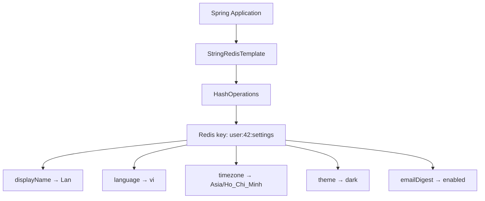
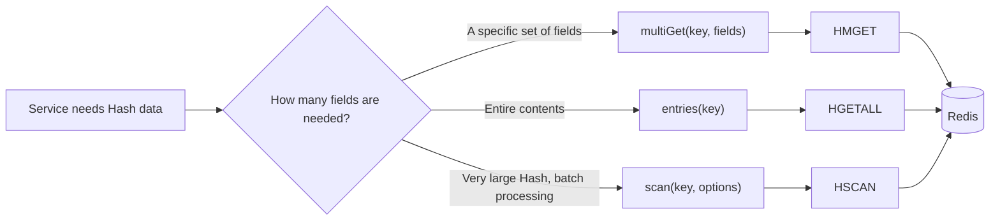

# Reading Multiple Fields and Full Hash Contents in Spring Data Redis

A **Redis Hash** stores multiple **field → value** pairs inside **a single Redis key**. When using Spring Data Redis, we often need two different ways to read: **reading a known subset of fields** with `HashOperations.multiGet()` (corresponding to the Redis `HMGET` command), or **reading all fields and values** with `HashOperations.entries()` (corresponding to `HGETALL`). There are also APIs to fetch only field names, only values, count fields, and incrementally scan a large Hash.

This is a practical guide to **reading Hashes with RedisTemplate** within the Spring Data Redis Hash topic. The goal is to understand when to use `HMGET`, when to use `HGETALL`, how to interpret missing data, how to choose serializers, and how to read large Hashes without unexpected overhead. The examples use the common synchronous APIs of Spring Boot 3.x / Spring Data Redis 3.x with `StringRedisTemplate`; exact behavior may vary across library and Redis server versions.

## 1. A Redis Hash Consists of One Key and Many Fields

Suppose an application stores user settings:

```text
Redis key: user:42:settings
Redis TYPE: hash

field            value
-------------------------------
displayName      Lan
language         vi
timezone         Asia/Ho_Chi_Minh
theme            dark
emailDigest      enabled
```

In Redis, `user:42:settings` is **a single key**. The strings `displayName`, `language`, etc. are **fields** belonging to that key. Redis does not automatically treat them as independent keys like `user:42:settings:language`.

Model:



Three concepts must be distinguished:

- **Redis key**: identifier of the entire Hash, e.g., `user:42:settings`.
- **Hash field**: name of an attribute inside the Hash, e.g., `language`.
- **Hash value**: corresponding value of the field, e.g., `vi`. Redis stores fields/values as bytes; Spring uses serializers to convert them into Java types.

A Hash typically fits when multiple attributes belong to the same logical entity and need to be read or written individually or in batches. A Redis Hash differs from a Redis String containing JSON: `HGET`, `HMGET`, and `HGETALL` only apply to keys whose Redis TYPE is `hash`.

## 2. Map of Hash Read Commands and Spring APIs

| Need | Redis command | `HashOperations<K, HK, HV>` | Typical return type |
|---|---|---|---|
| Read one field | `HGET key field` | `get(key, field)` | `HV` or `null` |
| Read a group of fields | `HMGET key f1 f2 ...` | `multiGet(key, fields)` | `List<HV>`, preserving input order |
| Read all fields and values | `HGETALL key` | `entries(key)` | `Map<HK, HV>` |
| Get only all field names | `HKEYS key` | `keys(key)` | `Set<HK>` |
| Get only all field values | `HVALS key` | `values(key)` | `List<HV>` |
| Count fields | `HLEN key` | `size(key)` | `Long` |
| Check a field | `HEXISTS key field` | `hasKey(key, field)` | `Boolean` |
| Incrementally read fields/values | `HSCAN key cursor ...` | `scan(key, scanOptions)` | `Cursor<Map.Entry<HK, HV>>` |

In the generic type parameters:

- `K`: type of the **Redis key**.
- `HK`: type of the **Hash field**.
- `HV`: type of the **Hash value**.

For example, `HashOperations<String, String, String>` indicates that the Redis key, field, and value are all handled as Strings. This is common with `StringRedisTemplate`. If an application stores Java objects as values, `HK` and `HV` can be other types and must be serialized compatibly.

**The two most important read paths:**



## 3. Preparing `StringRedisTemplate` and Sample Data

With Gradle Groovy, declare:

```groovy
dependencies {
    implementation 'org.springframework.boot:spring-boot-starter-data-redis'
}
```

Example for standalone Redis running on a development machine:

```yaml
spring:
  data:
    redis:
      host: localhost
      port: 6379
      connect-timeout: 2s
      timeout: 3s
```

Spring Boot typically provides `StringRedisTemplate` automatically when the Redis starter and matching configuration are present. For illustration, let's populate a Hash using Spring Data Redis:

```java
import java.util.LinkedHashMap;
import java.util.Map;
import org.springframework.data.redis.core.HashOperations;
import org.springframework.data.redis.core.StringRedisTemplate;
import org.springframework.stereotype.Service;

@Service
public class UserSettingsWriter {
    private final HashOperations<String, String, String> hashes;

    public UserSettingsWriter(StringRedisTemplate redis) {
        this.hashes = redis.opsForHash();
    }

    public void seedUser42() {
        Map<String, String> fields = new LinkedHashMap<>();
        fields.put("displayName", "Lan");
        fields.put("language", "vi");
        fields.put("timezone", "Asia/Ho_Chi_Minh");
        fields.put("theme", "dark");
        fields.put("emailDigest", "enabled");

        hashes.putAll("user:42:settings", fields);
    }
}
```

`putAll()` writes multiple fields into **the same Hash**. It is not equivalent to `ValueOperations.multiSet()`, which writes multiple Redis String keys. There is also no automatic TTL in the example above; if business rules require key expiration, configure expiry separately.

Equivalent data can be created in Redis CLI:

```bash
redis-cli HSET user:42:settings \
  displayName "Lan" \
  language "vi" \
  timezone "Asia/Ho_Chi_Minh" \
  theme "dark" \
  emailDigest "enabled"

redis-cli TYPE user:42:settings
# hash

redis-cli HLEN user:42:settings
# 5
```

Subsequent examples assume this Hash already exists. Do not treat the Redis CLI commands below as Java APIs; they help directly verify Redis behavior.

## 4. Reading a Single Field with `get()` and `HGET`

Before reading multiple fields, understand the semantics of reading a single field:

```java
HashOperations<String, String, String> hashes =
    stringRedisTemplate.opsForHash();

String language = hashes.get(
    "user:42:settings",
    "language"
);
// "vi"
```

Corresponding Redis command:

```bash
redis-cli HGET user:42:settings language
# "vi"
```

Key outcomes:

1. If the Hash exists and contains the `language` field, Redis returns that field's value.
2. If the Hash exists but **does not contain** the requested field, Redis returns nil; `StringRedisTemplate` normally maps this to Java `null`.
3. If **the Hash key itself does not exist**, `HGET` also returns nil.
4. If the key currently holds another type, such as a Redis String, `HGET` encounters a `WRONGTYPE` error. This is an operation error, not a valid `null` value.

Therefore, a single `get(key, field) == null` is not enough to tell whether "the key does not exist" or "the key exists but the field is missing". If the application needs to distinguish these two states, it must define a data convention or perform additional checks, while keeping in mind that data can change between commands.

## 5. Reading Multiple Known Fields with `multiGet()`

When the UI only needs `displayName`, `language`, and `theme`, loading the entire Hash can be wasteful if the Hash contains many other fields. Use:

```java
import java.util.List;
import org.springframework.data.redis.core.HashOperations;
import org.springframework.data.redis.core.StringRedisTemplate;

HashOperations<String, String, String> hashes =
    stringRedisTemplate.opsForHash();

String key = "user:42:settings";
List<String> requested = List.of(
    "displayName",
    "language",
    "theme"
);

List<String> values = hashes.multiGet(key, requested);
// ["Lan", "vi", "dark"] if the sample data has not changed.
```

Redis CLI:

```bash
redis-cli HMGET user:42:settings displayName language theme
# 1) "Lan"
# 2) "vi"
# 3) "dark"
```

Redis uses **`HMGET`**, a command that accepts one Hash key and a list of fields. It returns results in **the order of the requested fields**.

### 5.1. Result Positions Matter More Than Storage Order

If you change the input order:

```java
List<String> requested = List.of("theme", "displayName");
List<String> values = hashes.multiGet(
    "user:42:settings",
    requested
);
// ["dark", "Lan"]
```

The positional correspondence is:

```text
requested[0] = "theme"       --> values[0] = "dark"
requested[1] = "displayName" --> values[1] = "Lan"
```

Do not rely on the internal storage order of fields in the Hash or the order of `HGETALL`. The order of `HMGET` is tied to the **input field list**, not a default order of a Redis Hash.

### 5.2. When One or More Fields Are Missing

```java
List<String> requested = List.of(
    "displayName",
    "nickname",
    "timezone"
);

List<String> values = hashes.multiGet(
    "user:42:settings",
    requested
);
// ["Lan", null, "Asia/Ho_Chi_Minh"]
```

In normal synchronous reads with `StringRedisTemplate`, a missing value is represented by a `null` element at that index. Do not do this:

```java
// Wrong: assumes every field has a value and invokes a method on null
String nicknameUpper = values.get(1).toUpperCase();
```

Instead, handle each field according to its nature: required, optional, or having a safe default.

**Distinguish empty value from absent field:**

- Field with empty string value `""` → Java result is `""`.
- Field does not exist → Java result is `null`.
- Field storing the literal text `"null"` → Java result is the **four-character string** `"null"`, not Java `null`.
- Redis connection/command failure → throws an exception; do not interpret it as a missing field.

In a Spring Data Redis pipeline or transaction context, some operations can **return `null` at command-queuing time** even though the final result only arrives after the pipeline/transaction completes. The examples in this lesson use standard synchronous calls outside those two contexts.

### 5.3. Combining Results into a DTO While Preserving Order

If the UI needs an object containing three fields, code should clearly specify names and positions:

```java
public record UserSettingsSummary(
    String displayName,
    String language,
    String theme
) {}

public UserSettingsSummary readSummary(String userId) {
    String key = "user:" + userId + ":settings";
    List<String> fields = List.of(
        "displayName",
        "language",
        "theme"
    );

    List<String> values = hashes.multiGet(key, fields);
    if (values == null) {
        throw new IllegalStateException(
            "Unexpected missing result outside pipeline/transaction"
        );
    }

    String name = values.get(0);
    String language = values.get(1);
    String theme = values.get(2);

    if (name == null || language == null) {
        throw new IllegalStateException("Required settings are missing");
    }

    return new UserSettingsSummary(
        name,
        language,
        theme == null ? "light" : theme
    );
}
```

This snippet belongs to a service with a `hashes` field of type `HashOperations<String, String, String>` as shown earlier. `theme` is treated as optional with an explicit default; `displayName` and `language` are required by **this example's** convention. In a real system, determine defaults from business requirements rather than choosing arbitrarily when data is missing.

For a dynamic field list, you can pair names and values into a `LinkedHashMap`:

```java
import java.util.LinkedHashMap;
import java.util.List;
import java.util.Map;

public Map<String, String> readSelected(
        String key, List<String> fieldNames) {

    List<String> values = hashes.multiGet(key, fieldNames);
    if (values == null) {
        throw new IllegalStateException("No immediate Redis result");
    }

    Map<String, String> result = new LinkedHashMap<>();
    for (int i = 0; i < fieldNames.size(); i++) {
        result.put(fieldNames.get(i), values.get(i));
    }
    return result;
}
```

`LinkedHashMap` preserves the input field order when iterating over the map. It also allows `null` values to indicate missing fields; `Map.of(...)` **does not allow null values**. If the input list contains duplicate field names, the map only retains one entry per name; use the positional result list if duplicates must be preserved.

## 6. Reading the Whole Hash with `entries()` and `HGETALL`

When you need all fields and values of a Hash, use `HashOperations.entries(key)`:

```java
import java.util.Map;
import org.springframework.data.redis.core.HashOperations;

HashOperations<String, String, String> hashes =
    stringRedisTemplate.opsForHash();

Map<String, String> settings =
    hashes.entries("user:42:settings");

String displayName = settings.get("displayName");
String timezone = settings.get("timezone");
// All existing field/value pairs are in the same Map.
```

Corresponding Redis command:

```bash
redis-cli HGETALL user:42:settings
# Displays each field and value; order is not guaranteed.
```

`HGETALL` returns all field-value pairs of the Hash. `StringRedisTemplate` decodes them and provides a `Map<String, String>`.

### 6.1. No Guaranteed Order

A Redis Hash **is not an ordered list**. Redis does not guarantee that `HGETALL` returns fields in creation order, alphabetical order, or the order in which code called `putAll()`. The returned `Map` should likewise not be treated as a stable ordering of Redis data.

If display ordering is needed:

```java
import java.util.List;

List<String> displayOrder = List.of(
    "displayName",
    "language",
    "timezone",
    "theme"
);

for (String field : displayOrder) {
    String value = settings.get(field);
    if (value != null) {
        System.out.println(field + " = " + value);
    }
}
```

Here the order is **explicitly declared by the application**, not derived from the Redis Hash. If you need ordered queries by score or timestamp, you can use another Redis structure such as a Sorted Set alongside the Hash, though synchronization between keys must be designed.

### 6.2. What If the Hash Does Not Exist?

In standard synchronous calls, `entries(key)` returns an empty map when the Hash key does not exist. Redis `HGETALL` on an absent key returns an empty collection of field-value pairs.

```java
Map<String, String> missing =
    hashes.entries("user:does-not-exist:settings");

boolean noFields = missing.isEmpty();
// true
```

Redis does not store an empty Hash as a key with content: deleting the last field typically removes the Hash key. Therefore, an empty result in normal usage means there are no fields to read. If business logic must distinguish "user has not been created" from "user exists with no settings yet", an empty Hash alone is **not a sufficient state model**; you need a marker key, a primary data source, or a clearer convention.

### 6.3. HGETALL Provides a View at Command Execution Time

On a Redis server, `HGETALL` is **a single command**. While the server is processing that command, commands from other clients do not interleave while building the reply. The result reflects the state of the Hash at the moment the command executes.

However, this **does not mean** the Hash data always represents a business object updated atomically. If a writer updates:

```java
hashes.put(key, "language", "en");
hashes.put(key, "timezone", "Europe/London");
```

those are **two commands**. An `HGETALL` running between them could read `language = en` while `timezone` still holds the old value.

If multiple fields must be consistent together, consider:

- `putAll(key, map)` to update those fields in **one suitable Hash command**.
- A Lua script or Redis transaction when conditional checks, multi-step updates, and conflict control are required.
- Storing an additional `revision` and applying a controlled read/write protocol if high consistency is needed.

`HGETALL` gives a snapshot of **one read command**, not a transaction wrapping an entire business workflow.

## 7. When to Use `HMGET` vs. `HGETALL`?

| Aspect | `HMGET` / `multiGet` | `HGETALL` / `entries` |
|---|---|---|
| Fields retrieved | Only specified fields | All existing fields |
| Result | List of values in request order | Map of fields/values |
| Nonexistent field | `null` at corresponding position | Field does not appear in the map |
| When Hash is small | Suitable if only a few fields are needed | Convenient if all are needed |
| When Hash is very large | Usually transfers less data if few fields selected | Can create huge replies and high memory usage |
| Is it a single Redis key? | Yes | Yes |
| Single-command atomicity | Reads during one command execution on the node | Reads during one command execution on the node |
| Field/value order | Follows caller's field list | No guaranteed order |
| Schema coupling | Caller knows needed field names upfront | Caller can inspect all fields without knowing names upfront |

**Example for choosing `HMGET`:** an endpoint needs a user's name, language, and theme from a Hash containing 100 settings.

**Example for choosing `HGETALL`:** an admin page needs to display all settings of a user whose Hash only has around 15 fields; or a migration script needs to read every field to convert the structure.

If a Hash has hundreds of thousands of fields, **do not default to `HGETALL`** just because you want to process everything; switch to `HSCAN`, process in batches, or redesign data organization if wide reads happen frequently.

## 8. Reading Only Field Names, Values, or Field Count

You do not always need the entire field-value map. Spring Data Redis provides specialized operations.

### 8.1. `keys(key)` Corresponding to `HKEYS`

```java
import java.util.Set;

Set<String> fieldNames = hashes.keys("user:42:settings");
// For example: displayName, language, timezone, theme, emailDigest.
```

Redis CLI:

```bash
redis-cli HKEYS user:42:settings
```

`HKEYS` returns all field names. The result has no guaranteed order and **contains no values**. Useful when you need to know what attributes a Hash currently has, though it can consume significant memory if the Hash is very large.

### 8.2. `values(key)` Corresponding to `HVALS`

```java
import java.util.List;

List<String> fieldValues =
    hashes.values("user:42:settings");
```

Redis CLI:

```bash
redis-cli HVALS user:42:settings
```

`HVALS` returns all values **without field names**. Never call `keys()` and `values()` separately and pair elements by index to reconstruct pairs: the two commands can observe different states, and there is no guaranteed stable ordering.

If you need field → value associations, use **`entries()`**, **`multiGet()` with an explicit field list**, or `scan()`.

### 8.3. `size(key)` Corresponding to `HLEN`

```java
Long count = hashes.size("user:42:settings");
// 5 according to the sample data.
```

Redis CLI:

```bash
redis-cli HLEN user:42:settings
# 5
```

`HLEN` returns the number of fields in the Hash, and returns `0` if the key does not exist. This is the direct way to determine size by **field count**, not byte count. Do not call `hashes.entries(key).size()` just to count: that pulls all data back to the application.

### 8.4. `hasKey(key, field)` Corresponding to `HEXISTS`

```java
Boolean exists = hashes.hasKey(
    "user:42:settings",
    "timezone"
);
// true with the sample data.
```

Redis CLI:

```bash
redis-cli HEXISTS user:42:settings timezone
# 1
```

`HEXISTS` is useful when you only need to know whether a field exists without reading its value. However, if you follow it with `HGET`, the field can still be modified or deleted **between the two commands**. If the goal is just to read the value, a single `HGET` is usually enough and cheaper than `HEXISTS` followed by `HGET`.

## 9. Reading Large Hashes Incrementally with `HSCAN`

`HGETALL`, `HKEYS`, and `HVALS` can all produce large responses proportional to the number of fields in the Hash. When a Hash is large or needs streaming processing, Redis supports `HSCAN` to iterate incrementally over fields/values.

A very important distinction:

- `SCAN`: scans **Redis keys** across the keyspace.
- `HSCAN`: scans **fields and values of a single Redis Hash key**.

Example:

```text
SCAN ... MATCH user:*             → finds Redis keys such as user:42:settings
HSCAN user:42:settings 0 ...     → finds fields/values inside one specific Hash
```

### 9.1. Redis CLI: HSCAN with a Cursor

```bash
redis-cli HSCAN user:42:settings 0 COUNT 2
```

The reply contains **two parts**:

1. **The next cursor** to continue scanning.
2. **The fields/values** returned in the current iteration.

Keep calling `HSCAN key <cursor>` until the returned cursor is `0`. `COUNT 2` is only a **hint for how many elements to examine per step**, not a strict limit of two fields; Redis may return fewer, more, or zero fields in a single iteration.

Example of viewing only fields prefixed with `feature:`:

```bash
redis-cli HSCAN user:42:settings 0 MATCH 'feature:*' COUNT 100
```

`MATCH` filters by **field name inside the Hash**. It does not filter Redis keys like `SCAN` and does not create an index for fields. Redis still has to traverse the data as scan does; a pattern does not turn this command into an indexed prefix query.

### 9.2. Spring Data Redis: `HashOperations.scan()`

`HashOperations.scan(key, ScanOptions)` returns a `Cursor`. You can iterate and process each field/value pair:

```java
import java.util.Map;
import org.springframework.data.redis.core.Cursor;
import org.springframework.data.redis.core.HashOperations;
import org.springframework.data.redis.core.ScanOptions;
import org.springframework.data.redis.core.StringRedisTemplate;
import org.springframework.stereotype.Service;

@Service
public class UserSettingsScanner {
    private final HashOperations<String, String, String> hashes;

    public UserSettingsScanner(StringRedisTemplate redis) {
        this.hashes = redis.opsForHash();
    }

    public void scanFeatures(String userId) {
        String key = "user:" + userId + ":settings";
        ScanOptions options = ScanOptions.scanOptions()
            .match("feature:*")
            .count(100)
            .build();

        try (Cursor<Map.Entry<String, String>> cursor =
                hashes.scan(key, options)) {
            while (cursor.hasNext()) {
                Map.Entry<String, String> entry = cursor.next();
                processFeature(entry.getKey(), entry.getValue());
            }
        }
    }

    private void processFeature(String field, String value) {
        // Replace with actual business processing.
        System.out.println(field + " = " + value);
    }
}
```

In this example, `processFeature()` is purely illustrative. In production, avoid printing raw user data to logs or the console; process each item and aggregate appropriate metrics. `try-with-resources` closes the cursor to release resources/connections used by the scan.

**HSCAN is not a point-in-time consistent snapshot.** During a scan:

- A field may be added, modified, or deleted.
- A field may appear multiple times across scan iterations.
- Fields that exist for only part of the scan duration may be seen or missed.
- A cursor iteration may return zero fields while not yet finished.

Therefore, if performing aggregations or migrations via HSCAN, make processing **idempotent**, tolerant of duplicate items, and governed by writer coordination rules during the scan window. Use `HSCAN` to iterate with lower memory pressure, **not to guarantee reading an immutable version of a Hash**.

### 9.3. Limits of HSCAN and Design Decisions

`HSCAN` is often useful for traversing large Hashes, though it still has to inspect fields, and some small Hashes or special encodings may return many elements in a single call. `COUNT` is only a hint, so you still need to bound processing and monitor load.

If an application frequently asks to "get the next 100 items by creation time" or "read the top 20 items by highest score", Redis Hashes and HSCAN **do not provide pagination or sorting with those semantics**. When business ordering is needed, consider adding a Sorted Set or an appropriate data structure/secondary index.

## 10. Complete Hash Reading Service Pattern

The following example brings common needs together into a Spring service. The API returns String data because it uses `StringRedisTemplate`.

```java
import java.util.List;
import java.util.Map;
import java.util.Set;
import org.springframework.data.redis.core.HashOperations;
import org.springframework.data.redis.core.StringRedisTemplate;
import org.springframework.stereotype.Service;

@Service
public class UserSettingsReadService {
    private final HashOperations<String, String, String> hashes;

    public UserSettingsReadService(StringRedisTemplate redis) {
        this.hashes = redis.opsForHash();
    }

    private String key(String userId) {
        if (userId == null || !userId.matches("[A-Za-z0-9_-]{1,80}")) {
            throw new IllegalArgumentException("Invalid user id");
        }
        return "user:" + userId + ":settings";
    }

    // One field.
    public String readField(String userId, String field) {
        return hashes.get(key(userId), field);
    }

    // Multiple fields, returned in the order of fieldNames.
    public List<String> readFields(
            String userId, List<String> fieldNames) {
        if (fieldNames == null || fieldNames.isEmpty()) {
            throw new IllegalArgumentException("Fields are required");
        }
        List<String> values =
            hashes.multiGet(key(userId), fieldNames);
        if (values == null) {
            throw new IllegalStateException("Unexpected deferred result");
        }
        return values;
    }

    // All field-value pairs.
    public Map<String, String> readAll(String userId) {
        return hashes.entries(key(userId));
    }

    public Set<String> fieldNames(String userId) {
        return hashes.keys(key(userId));
    }

    public Long fieldCount(String userId) {
        return hashes.size(key(userId));
    }

    public Boolean containsField(String userId, String field) {
        return hashes.hasKey(key(userId), field);
    }
}
```

This class can be injected into a controller or another business service. `key()` illustrates key construction rules and ID validation to avoid accessing keys outside the intended namespace. In a real application, define an allowlist of field names that a public API is permitted to read; **do not allow callers to arbitrarily access all fields** if the Hash also holds internal or sensitive data.

Example invocations:

```java
String language = service.readField("42", "language");

List<String> values = service.readFields(
    "42",
    List.of("displayName", "theme", "timezone")
);

Map<String, String> allFields = service.readAll("42");

Long totalFields = service.fieldCount("42");
```

When `HashOperations` is used outside a pipeline/transaction, normal methods wait for the Redis response or throw an exception. If Redis loses connection, a command times out, or a serializer fails, code should not return an empty map to mask the error.

## 11. Reading Multiple Hash Keys Differs from Reading Multiple Fields of One Hash

This is an important distinction when using APIs named `multiGet`:

### Case A — One Redis Hash with Many Fields

```text
user:42:settings (HASH)
    language → vi
    theme    → dark
```

API:

```java
hashes.multiGet(
    "user:42:settings",
    List.of("language", "theme")
);
```

Typically **`HMGET`**: one Redis key, multiple Hash fields.

### Case B — Two Independent Redis String Keys

```text
user:42:language (STRING) → vi
user:42:theme    (STRING) → dark
```

API:

```java
stringRedisTemplate.opsForValue().multiGet(
    List.of("user:42:language", "user:42:theme")
);
```

Typically **`MGET`**: multiple String-typed Redis keys.

You cannot replace `HashOperations.multiGet(hashKey, fields)` with `ValueOperations.multiGet(...)` simply by passing field names in place of keys. Field names are not Redis keys. Similarly, `HGETALL user:42:settings` does not read all keys matching `user:42:*`.

### What If You Need the Same Field from Many Hashes?

For example, needing `language` across 1,000 Hashes:

```text
user:1:settings → HGET language
user:2:settings → HGET language
...
user:1000:settings → HGET language
```

There is no single `HMGET` that reads one field from 1,000 different Hash keys. You can issue multiple `HGET` commands via **pipelining** to reduce round-trips, or reconsider the storage model if this query pattern is dominant. Pipelining **does not turn commands into an atomic snapshot**.

## 12. Consistency Boundaries to Keep in Mind

### 12.1. One Hash Command vs. a Sequence of Commands

`HMGET` and `HGETALL` are single Redis commands on a single key. If another request modifies the Hash, it executes before or after that read command on the respective server. However, calling two `HMGET` commands back-to-back does not create a transaction over both reads.

```text
t0: Hash language=vi, theme=dark
t1: Service A: HMGET language              → vi
t2: Service B: HSET language=en theme=light
t3: Service A: HMGET theme                 → light

Service A combines (vi, light) from two points in time.
```

If both values must come from the same point in time, read both in **one `HMGET`**, or use `HGETALL` if you need everything.

### 12.2. HSCAN Does Not Replace a Consistent Read

A large Hash can make `HGETALL` expensive; switching to `HSCAN` enables incremental iteration while accepting that data may change during the scan. If a problem strictly requires an exact snapshot of a large dataset, design an explicit protocol:

- Pause writers during a controlled read/migration window.
- Use a revision and verify the revision before/after processing, accompanied by a rule where writers update the revision atomically.
- Copy or maintain data in a snapshot/versioned namespace structure and read the immutable version.

Checking a revision outside a transaction still has concurrency edge cases; you must analyze how writers update the revision and when the snapshot is taken. Do not claim "HSCAN + revision check" guarantees a snapshot without the corresponding invariant.

### 12.3. A Redis Error Is Not Empty Data

Example:

```java
import org.springframework.dao.DataAccessException;

public Map<String, String> readAllOrFail(String userId) {
    try {
        return hashes.entries("user:" + userId + ":settings");
    } catch (DataAccessException ex) {
        throw new IllegalStateException(
            "Redis settings are unavailable", ex
        );
    }
}
```

This error path helps the system distinguish absent data from an unavailable Redis instance. Some applications may choose to fall back to a database when the Hash is purely a cache; however, that is a business-layer decision, not the default behavior of `entries()`.

## 13. Performance and Complexity

Reading a Hash always incurs processing costs on Redis, the network, and Java. Commands returning all data can cause significant latency if the Hash is too large.

| Command | Cost by field count | Data returned | Usage guideline |
|---|---|---|---|
| `HGET` | Typically O(1) | One value | Only one field needed |
| `HMGET` | O(N), where N is requested fields | Up to N values | Known group of fields needed |
| `HGETALL` | O(N), where N is total fields | All field-value pairs | Small/medium Hash, all fields needed |
| `HKEYS` | O(N), where N is total fields | All field names | Only list of field names needed |
| `HVALS` | O(N), where N is total fields | All values | Only values needed |
| `HLEN` | O(1) | A count | Only count needed |
| `HEXISTS` | Typically O(1) | 0/1 | Check one field |
| `HSCAN` | Incremental; expected O(N) full pass | Multiple batches of fields/values | Traverse large Hash in batches |

Actual cost also depends on **the size of each field/value, Redis Hash encoding, serializers, network latency, and Redis server load**. A Hash with only 100 fields where each value is several MB can still produce a huge reply.

### 13.1. Why Can HGETALL Be Dangerous on Large Hashes?

With `HGETALL`:

1. Redis must prepare all fields/values for the reply.
2. The data is transmitted over the network.
3. The driver receives and deserializes the elements.
4. Spring creates a map containing the entries.
5. The service may further build DTO/JSON responses, creating additional copies in memory.

Under high concurrency, these steps increase latency, memory footprint, and GC pressure. If only three fields are needed, `HMGET` usually has a much more controllable footprint.

### 13.2. Incremental Reading Does Not Always Mean Bounded Processing

`HSCAN` reduces the need to load all results into one large map, yet you still must:

- Close the cursor.
- Limit processing rate and concurrency.
- Handle duplicate items when needed.
- Never assume `COUNT` is a hard cap on item count.
- Ensure business logic tolerates data changing during the scan.

If you collect everything into a `List` at the end anyway, you can still consume as much memory as `HGETALL`. The primary benefit of a cursor is achieved when processing in a streaming/batched manner without retaining every item.

## 14. Serializers Determine How Fields and Values Are Read

Redis stores bytes, and Spring Data Redis uses serializers to convert bytes into Java values. With `StringRedisTemplate`, fields and values are normally serialized as UTF-8 Strings.

```text
Java field "language"      → UTF-8 bytes → Redis Hash field
Java value "vi"           → UTF-8 bytes → Redis Hash value
```

If a Hash was written using a custom `RedisTemplate`:

```java
RedisTemplate<String, Object> template = new RedisTemplate<>();
template.setConnectionFactory(connectionFactory);
template.setKeySerializer(new StringRedisSerializer());
template.setHashKeySerializer(new StringRedisSerializer());
template.setHashValueSerializer(
    new GenericJackson2JsonRedisSerializer()
);
template.afterPropertiesSet();
```

then field names can still be read as Strings, while **each hash value** is stored as JSON bytes. Reading with `StringRedisTemplate` in this case will yield JSON strings rather than the desired Java objects, or display garbled output if another/binary serializer was used.

The serializers of `RedisTemplate` must be distinguished:

| Serializer | Responsible for |
|---|---|
| `keySerializer` | Redis key `user:42:settings` |
| `valueSerializer` | Redis String values, e.g., `GET/SET` |
| `hashKeySerializer` | Hash field, e.g., `language` |
| `hashValueSerializer` | Field value, e.g., `vi` or a JSON object |

**Changing `valueSerializer` does not automatically change `hashValueSerializer`.** When debugging `entries()` returning wrong data, check both how the Hash was created and the serializers used for fields and values.

Example configuring an explicit Hash template with String keys and JSON hash values:

```java
import org.springframework.context.annotation.Bean;
import org.springframework.context.annotation.Configuration;
import org.springframework.data.redis.connection.RedisConnectionFactory;
import org.springframework.data.redis.core.RedisTemplate;
import org.springframework.data.redis.serializer.GenericJackson2JsonRedisSerializer;
import org.springframework.data.redis.serializer.StringRedisSerializer;

@Configuration
public class HashJsonConfiguration {
    @Bean
    RedisTemplate<String, Object> hashJsonTemplate(
            RedisConnectionFactory factory) {
        RedisTemplate<String, Object> template = new RedisTemplate<>();
        template.setConnectionFactory(factory);
        template.setKeySerializer(new StringRedisSerializer());
        template.setHashKeySerializer(new StringRedisSerializer());
        template.setHashValueSerializer(
            new GenericJackson2JsonRedisSerializer()
        );
        template.afterPropertiesSet();
        return template;
    }
}
```

With this type of template, results from `opsForHash().entries(key)` can contain Java objects reconstructed by the JSON serializer. When storing data via a polymorphic serializer, manage type metadata configuration and consider deserialization safety. This code illustrates serializer responsibilities; specific value contracts should be defined for your application and kept compatible across upgrades.

## 15. Redis Hash via Template vs. Redis Repository Hash

Redis Repositories typically use `@RedisHash` and `MappingRedisConverter` to map Java entities into fields, adding metadata or indexes when needed. Example:

```java
import org.springframework.data.annotation.Id;
import org.springframework.data.redis.core.RedisHash;
import org.springframework.data.redis.core.index.Indexed;

@RedisHash("profiles")
public class ProfileEntity {
    @Id
    private String id;

    @Indexed
    private String language;

    private String displayName;

    // Constructors, getters, setters as required by mapping.
}
```

If a Spring Data Redis Repository saves an entity into the `profiles` keyspace, the Hash key might be named `profiles:42` and contain fields chosen by the converter. Reading raw entries via `StringRedisTemplate.opsForHash().entries("profiles:42")` **does not guarantee** the result corresponds to a clean Java DTO:

- The Hash may contain metadata such as `_class`.
- Nested properties have their own mapping rules.
- Fields/values might not be serialized as UTF-8 Strings as expected.
- Redis Repositories may maintain secondary indexes, ID sets, or TTL metadata outside the main Hash.

If you need to load an entity under the Repository contract, use `repository.findById(id)`. If you only need to inspect raw fields for debugging, you can use `HGETALL` with a clear understanding of the representation.

Do not manually run `HSET` on a Hash owned by a Repository to update an `@Indexed` property: changing the raw Hash field **does not automatically update secondary indexes** managed by the Repository. This can cause `findById` to see the new data while index-based queries still return stale results.

## 16. TTL, Redis Cluster, and Data Access Control

### 16.1. TTL Belongs to the Redis Key

`EXPIRE user:42:settings 600` attaches a lifetime to **the entire Hash key**:

```java
import java.time.Duration;

stringRedisTemplate.expire(
    "user:42:settings",
    Duration.ofMinutes(10)
);
```

Calling `HMGET` or `HGETALL` does not automatically extend the TTL as sliding expiration. If the application wants every session read to refresh the timeout, it must implement an explicit policy and recognize that calling `expire` adds another command.

Newer Redis versions may provide commands for hash-field expiration, though that is a **capability dependent on Redis/server version and Spring Data Redis APIs**. Do not assume every Hash field automatically has an independent TTL; the examples here use key-level TTL.

### 16.2. Redis Cluster and HMGET/HGETALL

`HMGET`, `HGETALL`, and `HSCAN` operate on **one Redis key**, so the client routes to the node owning that key's hash slot. They do not encounter "multiple keys in different slots" issues just because there are multiple fields.

Conversely, `ValueOperations.multiGet()` / Redis `MGET` reads multiple **Redis String keys**, which can be restricted by hash slots when Redis runs in Cluster mode. Remember that the `language` field and `theme` field reside in the same Hash, not two Redis keys distributed across two nodes.

An extremely large Hash concentrates all its data in **one slot / one node**; that can create a hotspot, even though accessing multiple fields only hits one key. Redis Cluster does not automatically split individual fields of the same Hash across different nodes.

### 16.3. Data Access Control

`HGETALL` can accidentally read unnecessary fields such as tokens, internal states, or sensitive settings. Redis ACLs primarily control commands/key patterns and should not be assumed to provide complete field-level authorization for every endpoint.

If an API should only return `displayName` and `theme`, use `HMGET` with a field allowlist or map to a controlled DTO. Do not automatically expose all `entries()` of a Hash in an HTTP response to users.

## 17. Common Errors and How to Handle Them

| Symptom | Possible cause | Resolution |
|---|---|---|
| `multiGet()` returns `null` at a position | Field or Hash does not exist | Define required/optional fields; check `HEXISTS` if needed |
| `entries()` returns an empty map | Hash key does not exist or has no fields | Check key convention, TTL, and data source |
| `HGETALL` reports `WRONGTYPE` | Key is currently String/List/Set instead of Hash | Run `TYPE key`, identify owner and key namespace |
| Reading field produces garbled string | Hash field/value serializer mismatch | Compare `hashKeySerializer`, `hashValueSerializer`, and writer |
| `HGETALL` is slow, service memory spikes | Hash too large, high concurrent requests | Read only needed fields with `HMGET` or process via `HSCAN` |
| Duplicate data during `HSCAN` | Data changed or scan properties | Process idempotently, do not treat cursor as a snapshot |
| Pairing `keys()` and `values()` produces mismatches | Two separate commands, order not guaranteed | Use `entries()` or `multiGet()` |
| Calling `entries().size()` just to count | Unnecessarily loads every field/value | Use `size()` / `HLEN` |
| Field reads correctly but Repository index query is wrong | Repository-managed Hash modified directly | Update via Repository and maintain indexes properly |
| `HGET` returns nil, mistaken for Redis timeout | Confused missing value with access error | Distinguish valid `null` from `DataAccessException` |
| Hash disappears after a while | Key TTL expired or was deleted | Check `TTL key`, writers/invalidation, and expiry rules |

### Quick Debugging Workflow with Redis CLI

```bash
# Check whether the key exists and its type
redis-cli EXISTS user:42:settings
redis-cli TYPE user:42:settings

# Check field count, specific field, and a group of fields
redis-cli HLEN user:42:settings
redis-cli HEXISTS user:42:settings language
redis-cli HMGET user:42:settings language theme timezone

# Inspect all fields/values (only appropriate for bounded-size Hashes)
redis-cli HGETALL user:42:settings

# For large Hashes, switch to incremental scanning
redis-cli HSCAN user:42:settings 0 COUNT 100

# Check TTL of the entire Hash key
redis-cli TTL user:42:settings
```

Redis `TTL` returns remaining seconds, `-1` if the key exists without a TTL, and `-2` if the key does not exist. To scan **Redis key names** by pattern, use `SCAN`, for example:

```bash
redis-cli --scan --pattern 'user:*:settings'
```

`SCAN` only returns key names; it does not replace `HSCAN` inside each Hash. Avoid `KEYS *` on large production Redis instances because it can block the server while scanning the keyspace.

## 18. Practical Scenarios

### Scenario A: Endpoint Needs Only Three Fields

An endpoint fetches `displayName`, `language`, and `theme`. The user's Hash has 60 other fields.

**Choice:** `multiGet(key, List.of(...))`. Use one `HMGET` to retrieve only the three values and map them into a DTO. If a field may be missing, define a default or return an error per business rules.

### Scenario B: Admin Page Needs to View All Settings

The Hash has only about 20 fields and the admin page must display all of them.

**Choice:** `entries(key)` / `HGETALL`. Enforce access control and filter out sensitive fields before returning the response; do not rely on map order for display.

### Scenario C: Hash Has 200,000 Fields, Needs Export

`entries()` can produce a massive reply and retain the entire map in memory.

**Choice:** `scan(key, options)`, then process each batch/item, throttle load, and close the cursor. If a consistent export is required, add a snapshot/version/writer-coordination mechanism; `HSCAN` alone does not guarantee consistency.

### Scenario D: Check Whether a Field Exists

Business logic only needs to know whether the `twoFactorEnabled` field has been configured.

**Choice:** `hasKey(key, "twoFactorEnabled")` / `HEXISTS`. If you also have to read the value to distinguish `true` from `false`, a single `get()` may suffice; field existence does not imply its value means "enabled".

### Scenario E: Read Language for 500 Users

Each user has their own Hash: `user:1:settings`, `user:2:settings`...

**Choice:** Do not use one shared `HMGET`, because the command accepts **only one key**. You can pipeline multiple `HGET` commands or consider a different data model if bulk reads occur frequently. In Redis Cluster, these Hash keys may live on multiple nodes.

### Scenario F: Modify One Field on a Repository-Managed Hash

The application uses a Redis Repository with `@Indexed` on the `language` property. A developer wants to call `opsForHash().put()` to edit the field directly.

**Choice:** Update the entity via the Repository or use an adapter capable of maintaining all corresponding mappings/indexes. Manually modifying a Hash field does not update indexes and can cause attribute queries to return wrong results.

## 19. Principles for Choosing a Hash Read API

Before reading data, answer these questions:

1. **Are you reading one Redis Hash key or multiple Redis keys?** If one Hash has many fields, use `HashOperations`.
2. **Do you already know the exact fields needed?** Use `multiGet()` to avoid loading unnecessary data.
3. **Do you need all field/value pairs and is the Hash small enough?** Use `entries()`.
4. **Do you only need field names, values, or the count?** Use `keys()`, `values()`, or `size()` respectively, rather than loading everything with `entries()`.
5. **Is the Hash very large?** Consider `scan()`, bound batch sizes, and handle changing/duplicate data.
6. **Does the data use custom serializers or mappings?** Verify how the writer stores the Hash before choosing the reader.
7. **Are there specific consistency, TTL, authorization, or performance requirements?** Build them into the API design rather than inferring them from command names.

**`HashOperations.multiGet()` reads a group of fields from a single Hash, while `HashOperations.entries()` reads all field/value pairs of that Hash.** Both are synchronous Redis operations in the examples above; the difference lies in how much data is fetched, how results are returned, and operational cost. Understanding `HMGET`, `HGETALL`, `HSCAN`, and serializer boundaries helps a Spring Data Redis application read Hashes accurately, fast, and cleanly.
