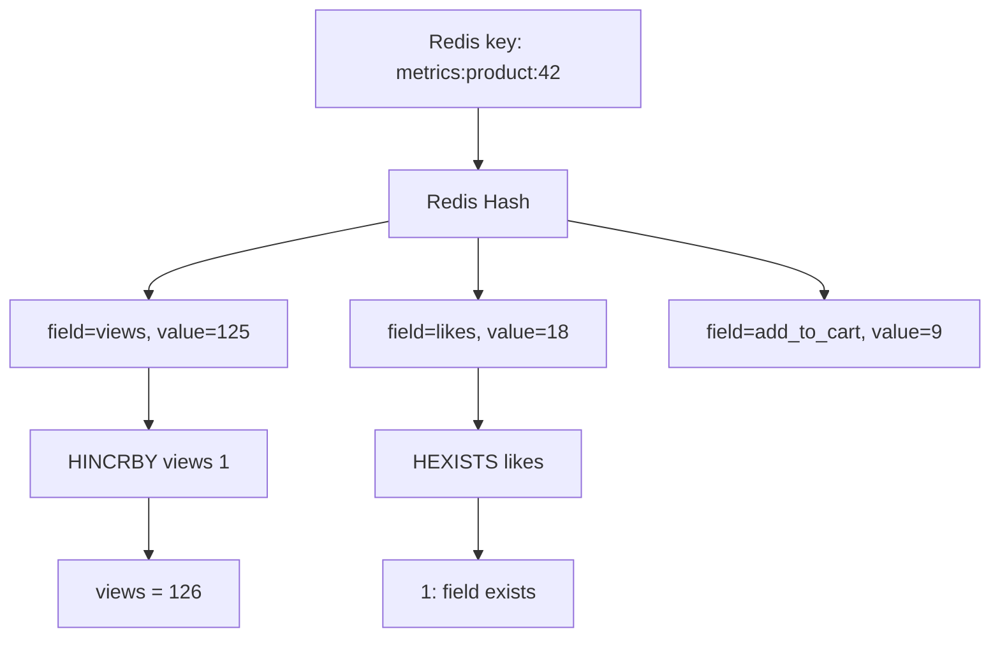

# Incrementing Numeric Values and Checking Field Existence

## 1. The Problem: Working with a Single Field in a Redis Hash

A Redis **Hash** stores a collection of **field–value** pairs under the same Redis key. A Hash is commonly used when an object has multiple small attributes or when you need to update individual counters, states, or attributes independently without rewriting the entire object.

For example, an application wants to store view counts, likes, and add-to-cart counts for a product:

```text
Redis key: metrics:product:42
Redis type: hash

Field           Value
-------------   -----
views           125
likes           18
add_to_cart     9
```

When a customer views the product, the application wants to increment `views` from `125` to `126`. When displaying information, the application may check whether the `likes` field already exists in the Hash. These are two operations that Redis supports directly, without loading the entire Hash into Java:

- **`HINCRBY`:** increments or decrements an integer-valued field.
- **`HINCRBYFLOAT`:** increments or decrements a floating-point field.
- **`HEXISTS`:** checks whether a field exists in a Hash.

In **Spring Data Redis**, these commands are exposed through `HashOperations`:

```java
hashOperations.increment(redisKey, field, 1L);
hashOperations.increment(redisKey, field, 0.5d);
hashOperations.hasKey(redisKey, field);
```

These commands have rules that must be clearly understood: a missing field can be created automatically when incremented, checking existence does not check the value, incrementing a single field is atomic, and combining `HEXISTS` with `HINCRBY` in two separate calls does not automatically become an atomic operation.

## 2. Distinguishing Redis Key, Hash Field, and Hash Value

A Hash structure consists of three concepts:

| Component | Example | Role |
|---|---|---|
| **Redis key** | `metrics:product:42` | Name of the entire Hash in the Redis keyspace |
| **Hash field** | `views` | Field name inside the Hash |
| **Hash value** | `125` | Value stored for that field |

One Redis key can hold multiple fields, each with its own value:



**Key existence** differs from **field existence**:

- `EXISTS metrics:product:42` checks the top-level key.
- `HEXISTS metrics:product:42 views` checks the `views` field inside that Hash.
- `HGET metrics:product:42 views` reads the value of the field.
- `HLEN metrics:product:42` reports the number of fields in the Hash.

In Java, the corresponding difference is:

```java
Boolean wholeHashExists = redis.hasKey("metrics:product:42");

Boolean viewsFieldExists =
        redis.opsForHash().hasKey("metrics:product:42", "views");
```

Both methods are named `hasKey`, but they check at **two different levels**. If the Hash has the `likes` field but not `views`, `redis.hasKey(...)` can return `true` while `redis.opsForHash().hasKey(..., "views")` returns `false`.

## 3. Redis CLI Operations: HINCRBY, HINCRBYFLOAT, HEXISTS

Before using Spring Data Redis, understand the semantics of the native Redis commands.

### 3.1. HINCRBY: Incrementing or Decrementing Integers

Syntax:

```redis
HINCRBY key field increment
```

Example:

```redis
HSET metrics:product:42 views 125
HINCRBY metrics:product:42 views 1
HINCRBY metrics:product:42 views 5
HINCRBY metrics:product:42 views -3
HGET metrics:product:42 views
```

Sequential results of the increments:

| Command | Value before | Delta | Value after |
|---|---:|---:|---:|
| `HINCRBY ... views 1` | 125 | +1 | 126 |
| `HINCRBY ... views 5` | 126 | +5 | 131 |
| `HINCRBY ... views -3` | 131 | −3 | 128 |

`HINCRBY` returns the **new value after incrementing**, not the old value and not just a success/failure signal.

The field value must be interpretable by Redis as a **64-bit signed integer** when using `HINCRBY`. If the field currently holds a non-integer string such as `"active"` or `"12.5"`, the command returns an error. If the addition exceeds the 64-bit integer range, Redis also returns an error rather than silently overflowing as an application might assume.

A negative delta decrements the value:

```redis
HINCRBY inventory:warehouse-1 sku-123 -2
```

However, **decrementing does not automatically check whether the value becomes negative**. For rules like "stock cannot be negative", you need a conditional atomic operation in Redis or the canonical system of record.

### 3.2. HINCRBY When the Field Does Not Yet Exist

If the Redis key is a valid Hash or does not yet exist, and the `views` field is absent, `HINCRBY` treats the initial value of the field as `0`. The command creates the field and stores the sum:

```redis
HINCRBY metrics:product:100 views 1
HGET metrics:product:100 views
HEXISTS metrics:product:100 views
```

Expected output:

```text
HINCRBY ... views 1  -> 1
HGET ... views       -> "1"
HEXISTS ... views    -> 1
```

This also applies when the Hash key itself does not yet exist: Redis can create a new Hash containing the field with the incremented value.

An easy-to-miss detail: even when delta is `0`, `HINCRBY` on an absent field can **create the field with value `0`**. Therefore, if you only want to check whether a field has been initialized, use `HEXISTS`—do not use `HINCRBY ... 0` as a non-mutating read.

### 3.3. HINCRBYFLOAT: Incrementing or Decrementing Floating-Point Numbers

Syntax:

```redis
HINCRBYFLOAT key field increment
```

Example:

```redis
HSET metrics:product:42 rating_sum 4.5
HINCRBYFLOAT metrics:product:42 rating_sum 3.25
HINCRBYFLOAT metrics:product:42 rating_sum -0.5
HGET metrics:product:42 rating_sum
```

After the two increments, the final computed value is `7.25`. If the field does not exist yet, Redis also treats the initial value as `0` and creates the field.

Be careful with floating-point numbers:

- Floating-point values can suffer from **decimal representation precision issues**, especially when converted via Java `double`.
- Do not use floating-point numbers for monetary calculations that require precision down to the smallest unit. For money, usually store integers in the smallest currency unit (e.g., cents/dong according to business conventions) and use `HINCRBY`, or use an appropriate transactional system.
- Once a field holds a non-integer decimal value, calling `HINCRBY` on that same field will normally error because Redis no longer considers the value a valid integer.
- For statistical scores/counters, clearly define rounding, aggregation, and value bounds.

### 3.4. HEXISTS: Checking Exactly One Field

Syntax:

```redis
HEXISTS key field
```

Example:

```redis
HSET metrics:product:42 views 0
HEXISTS metrics:product:42 views
HEXISTS metrics:product:42 shares
```

Redis returns:

```text
HEXISTS ... views   -> 1
HEXISTS ... shares  -> 0
```

`HEXISTS` checks **existence**, not whether the value differs from `0` or from an empty string:

```redis
HSET demo:flags enabled ""
HEXISTS demo:flags enabled
```

Even though the value is an empty string, the `enabled` field still exists. If the entire Hash key does not exist, `HEXISTS` returns `0`. However, if the top-level key holds a different Redis type, such as String instead of Hash, the command can return `WRONGTYPE`; that is not "field does not exist".

### 3.5. Important Differences Between HEXISTS and HGET

For numeric data:

| Scenario | `HEXISTS` | `HGET` | Meaning |
|---|---|---|---|
| Field not yet present | 0 | nil | Value not initialized |
| Field has value `0` | 1 | `"0"` | Initialized and equals 0 |
| Field has value `-5` | 1 | `"-5"` | Initialized and negative |
| Field has value `"abc"` | 1 | `"abc"` | Field exists but cannot be incremented with `HINCRBY` |
| Hash key absent | 0 | nil | No Hash/field |
| Key holds another Redis type | Type error | Type error | Keyspace contract violation |

Therefore, never implement `hasKey` by parsing the value and comparing it against 0. A value of 0 is still an existing field.

## 4. How Does Spring Data Redis Map These Commands?

Spring Data Redis provides `HashOperations<H, HK, HV>` to read/write Hashes using the chosen Java types. Core methods:

```java
Long increment(H key, HK hashKey, long delta);
Double increment(H key, HK hashKey, double delta);
Boolean hasKey(H key, Object hashKey);
```

Where:

- `key`: name of the top-level Redis key containing the Hash.
- `hashKey`: field inside the Hash, e.g., `views`.
- `delta`: amount to add, which can be negative to decrement.
- `Long` or `Double`: value **after incrementing**, depending on the overload.
- `Boolean`: whether the field exists.

The return types are wrapper types to fit the Spring Data Redis contract. In contexts like pipelines or transactions, the direct return value of a method may be `null` because responses are processed later. In regular synchronous calls, do not confuse a pipeline `null` with `false` from `HEXISTS`.

### 4.1. Initializing Spring Boot

With Gradle Groovy DSL:

```groovy
dependencies {
    implementation 'org.springframework.boot:spring-boot-starter-data-redis'
}
```

Illustrative local configuration:

```yaml
spring:
  data:
    redis:
      host: localhost
      port: 6379
      connect-timeout: 2s
      timeout: 2s
```

Spring Boot typically auto-configures `StringRedisTemplate` when the Redis starter and a matching connection factory are present. For numeric data in a Hash, `StringRedisTemplate` is an intuitive choice: keys, fields, and values use string representations, and Redis can read the value as an integer or floating-point number when executing `HINCRBY`/`HINCRBYFLOAT`.

You do not need `@EnableCaching` for direct Hash operations. `@EnableCaching` is for the Spring Cache abstraction and does not govern whether `opsForHash()` works.

### 4.2. Using HashOperations to Increment Integer Values

```java
import org.springframework.data.redis.core.HashOperations;
import org.springframework.data.redis.core.StringRedisTemplate;
import org.springframework.stereotype.Service;

@Service
public class ProductMetricStore {

    private final HashOperations<String, String, String> hash;

    public ProductMetricStore(StringRedisTemplate redis) {
        this.hash = redis.opsForHash();
    }

    public long recordView(String productId) {
        Long updated = hash.increment(
                "metrics:product:" + productId,
                "views",
                1L);

        if (updated == null) {
            throw new IllegalStateException(
                    "No Redis counter increment result");
        }
        return updated;
    }

    public long addLikes(String productId, long delta) {
        Long updated = hash.increment(
                "metrics:product:" + productId,
                "likes",
                delta);

        if (updated == null) {
            throw new IllegalStateException(
                    "No Redis update result");
        }
        return updated;
    }

    public boolean hasViewCounter(String productId) {
        return Boolean.TRUE.equals(
                hash.hasKey("metrics:product:" + productId, "views"));
    }
}
```

Meaning:

1. The service receives a Spring-managed `StringRedisTemplate`.
2. `redis.opsForHash()` provides a `HashOperations` reusing the template's serializers and connection configuration.
3. `increment(..., 1L)` maps to Redis's integer increment operation, not `HGET` followed by `HSET`.
4. `increment(..., delta)` returns the new number, so it can be returned straight to the caller or used for business logic at the appropriate layer.
5. `hasKey(key, field)` checks the field and returns a Boolean; writing `Boolean.TRUE.equals(...)` avoids unboxing if the API returns `null` in special contexts.

Example of multiple invocations:

```java
productMetricStore.recordView("42"); // 1 if the field did not exist.
productMetricStore.recordView("42"); // 2.
productMetricStore.addLikes("42", 10L); // 10 if the field did not exist.
productMetricStore.addLikes("42", -3L); // 7.
productMetricStore.hasViewCounter("42"); // true when the views field exists.
```

The results in the comments assume the namespace initially had no related data and no other concurrent operations. In practice, multiple instances may increment counters simultaneously, so the result after each call depends on the order in which Redis processes the commands.

### 4.3. Using the double Overload for Floating-Point Numbers

Example system calculating a weighted interaction score:

```java
import org.springframework.data.redis.core.HashOperations;
import org.springframework.data.redis.core.StringRedisTemplate;
import org.springframework.stereotype.Service;

@Service
public class WeightedMetricStore {

    private final HashOperations<String, String, String> hash;

    public WeightedMetricStore(StringRedisTemplate redis) {
        this.hash = redis.opsForHash();
    }

    public double addWeight(String productId, double delta) {
        if (!Double.isFinite(delta)) {
            throw new IllegalArgumentException(
                    "delta must be finite");
        }

        Double updated = hash.increment(
                "metrics:weights:" + productId,
                "engagement_score",
                delta);

        if (updated == null) {
            throw new IllegalStateException(
                    "No floating-point increment result");
        }
        return updated;
    }
}
```

The argument type determines the overload: `1L` calls the integer version, `1.0d` calls the floating-point version. This affects how Redis formats and subsequently interprets the field value. For a field designated as an integer, do not randomly switch between overloads just because a caller passed a `1.0` literal.

Checking `Double.isFinite` filters out `NaN` and infinite numbers from Java input before sending the command. This is only input validation; for large values, continuous updates, or strict precision requirements, design a numeric format more appropriate than `double`.

### 4.4. Reading a Counter After Incrementing

You can use `hash.get(key, field)` to read the value, though with `StringRedisTemplate` it returns a string:

```java
String raw = hash.get("metrics:product:42", "views");
Long count = raw == null ? null : Long.parseLong(raw);
```

Distinguish three situations:

- `raw == null`: the field does not exist yet or disappeared before reading.
- `raw.equals("0")`: the field exists with value 0.
- `Long.parseLong(raw)` throws: the field contains data that is not a valid integer per contract.

If your goal is to get **the new value after an increment**, do not follow up with `HGET`: `increment(...)` already returns the new value. Calling `HGET` wastes a round-trip and may observe a newer value because another request incremented in between.

## 5. End-to-End Practical Example: Product Activity Counters

We want to provide three actions:

- On each product view, increment `views` by one.
- On each favorite/like, increment `likes` by one.
- An API endpoint can report whether the `views` counter has ever been initialized.

Redis design:

```text
Key:   shop:product:42:metrics
Type:  HASH

Fields:
  views -> integer
  likes -> integer
```

A Spring service:

```java
import org.springframework.data.redis.core.HashOperations;
import org.springframework.data.redis.core.StringRedisTemplate;
import org.springframework.stereotype.Service;

@Service
public class ProductActivityService {

    private final HashOperations<String, String, String> metrics;

    public ProductActivityService(StringRedisTemplate redis) {
        this.metrics = redis.opsForHash();
    }

    public long trackView(String productId) {
        return required(metrics.increment(
                key(productId), "views", 1L));
    }

    public long trackLike(String productId) {
        return required(metrics.increment(
                key(productId), "likes", 1L));
    }

    public boolean hasTrackedViews(String productId) {
        return Boolean.TRUE.equals(
                metrics.hasKey(key(productId), "views"));
    }

    public String currentViewCount(String productId) {
        return metrics.get(key(productId), "views");
    }

    private static long required(Long count) {
        if (count == null) {
            throw new IllegalStateException(
                    "Redis did not return counter result");
        }
        return count;
    }

    private static String key(String productId) {
        return "shop:product:" + productId + ":metrics";
    }
}
```

Illustrative controller:

```java
import java.util.Map;
import org.springframework.web.bind.annotation.GetMapping;
import org.springframework.web.bind.annotation.PathVariable;
import org.springframework.web.bind.annotation.PostMapping;
import org.springframework.web.bind.annotation.RequestMapping;
import org.springframework.web.bind.annotation.RestController;

@RestController
@RequestMapping("/products")
public class ProductActivityController {

    private final ProductActivityService service;

    public ProductActivityController(ProductActivityService service) {
        this.service = service;
    }

    @PostMapping("/{id}/views")
    public Map<String, Long> recordView(@PathVariable String id) {
        return Map.of("views", service.trackView(id));
    }

    @PostMapping("/{id}/likes")
    public Map<String, Long> recordLike(@PathVariable String id) {
        return Map.of("likes", service.trackLike(id));
    }

    @GetMapping("/{id}/views/initialized")
    public Map<String, Boolean> isInitialized(@PathVariable String id) {
        return Map.of("initialized", service.hasTrackedViews(id));
    }
}
```

This example is for technical learning; a real API needs access control, rate limiting, duplicate-write protection, and a definition of a valid view. **Every `POST` request arriving here increments the counter**, even if the client retries after a timeout; if "one unique view" is needed, add an idempotency or deduplication model.

After invoking:

```text
POST /products/42/views -> {"views":1}
POST /products/42/views -> {"views":2}
POST /products/42/likes -> {"likes":1}
GET  /products/42/views/initialized -> {"initialized":true}
```

You can inspect:

```redis
TYPE shop:product:42:metrics
HGET shop:product:42:metrics views
HGET shop:product:42:metrics likes
HEXISTS shop:product:42:metrics views
HGETALL shop:product:42:metrics
```

Note: this example does not set a TTL automatically. If this Hash holds metrics that need long-term retention, design appropriate retention and backup policies. If they are temporary stats, configure expiration.

## 6. Why Is HINCRBY Safer Than HGET Followed by HSET Under Concurrent Requests?

Suppose two instances simultaneously record views into a field currently holding `100`.

### 6.1. Read-Then-Write Easily Loses Updates

```text
Instance A                 Redis                  Instance B
    |                        |                         |
    |------ HGET views ----->|                         |
    |<------ "100" ----------|                         |
    |                        |<----- HGET views --------|
    |                        |------ "100" ------------>|
    | computes 100 + 1       |          computes 100 + 1
    |------ HSET 101 ------->|                         |
    |                        |<----- HSET 101 ----------|
    |                        |                         |
 Result: 101, even though two increment operations occurred.
```

This is a **lost update**: both requests read the same stale value and overwrite it with the same result.

Problematic code:

```java
String raw = metrics.get(key, "views");
long current = raw == null ? 0L : Long.parseLong(raw);
metrics.put(key, "views", Long.toString(current + 1));
```

Each individual method call may be valid, but the sequence `HGET` → compute in Java → `HSET` is not atomic. Redis can interleave commands from other clients.

### 6.2. HINCRBY Updates in a Single Atomic Command

```text
Instance A                 Redis                  Instance B
    |                        |                         |
    |----- HINCRBY +1 ------>|                         |
    |<------ 101 ------------|                         |
    |                        |<----- HINCRBY +1 --------|
    |                        |------ 102 -------------->|
    |                        |                         |
 Result: 102 after two successful increment operations.
```

`HINCRBY` is an atomic Redis command for that field. Multiple instances can send commands concurrently and Redis processes each command with atomic semantics. Therefore, when the goal is simply adding or subtracting a number, `HashOperations.increment` is usually the cleanest and most accurate solution.

**Limitations to remember:** the atomicity of `HINCRBY` does not automatically guarantee requirements like "increment only if the user hasn't viewed yet", "never go negative", "increment two fields together and return an immutable snapshot", or "increment exactly once on network timeouts". Those requirements need additional rules and techniques.

## 7. HEXISTS Does Not Create an Atomic Check-Then-Increment Operation

Many people write:

```java
if (Boolean.TRUE.equals(metrics.hasKey(key, "available"))) {
    metrics.increment(key, "available", -1L);
}
```

The intent may be "only decrement an existing field". However, there is a gap between `HEXISTS` and `HINCRBY`:

```text
Worker A                        Worker B
--------                        --------
HEXISTS available -> true
                                HDEL available
HINCRBY available -1 -> -1
```

`HINCRBY` creates a new field if it does not exist at execution time. Thus, after Worker B deletes the field, Worker A can still create a negative field. Checking `HEXISTS` beforehand does not hold a lock or snapshot for subsequent commands.

### 7.1. When Is a Separate Existence Check Appropriate?

`HEXISTS` is appropriate when you only need to answer:

- Has the field been initialized yet?
- Is an optional attribute stored in the Hash?
- Is the data in the state "not yet present" vs. "present and equal to 0"?
- Should we display an option to update a field, accepting that the result is point-in-time?

In those cases, `HEXISTS` is a fast, semantically clear read command.

### 7.2. When Is HEXISTS Alone Not Enough?

If the requirement is:

- Increment only if the field exists **at the exact time of increment**.
- Decrement only if the value is large enough.
- Check multiple conditions and then update multiple fields.
- Perform a conditional versioned read and update.
- Combine initialization, TTL, and increment in a single operation.

then you need an atomic server-side operation such as a Lua script, or a transaction with `WATCH` and retry handling, depending on the business contract.

## 8. Incrementing a Field Only If It Exists: Lua Script

When you want to prevent `HINCRBY` from auto-creating the field, you can combine `HEXISTS` and `HINCRBY` inside the same Lua script:

```lua
-- KEYS[1]: top-level Hash key
-- ARGV[1]: field to increment
-- ARGV[2]: increment amount as an integer string

if redis.call('HEXISTS', KEYS[1], ARGV[1]) == 0 then
    return nil
end

return redis.call('HINCRBY', KEYS[1], ARGV[1], ARGV[2])
```

Redis executes the script on the server atomically; other clients cannot interleave commands between `HEXISTS` and `HINCRBY` while the script runs. Note that the script only checks **existence**, not whether the value after decrementing becomes negative.

Spring Data Redis integration with `StringRedisTemplate`:

```java
import java.util.List;
import org.springframework.data.redis.core.StringRedisTemplate;
import org.springframework.data.redis.core.script.DefaultRedisScript;
import org.springframework.data.redis.core.script.RedisScript;
import org.springframework.stereotype.Service;

@Service
public class ExistingHashCounter {

    private static final RedisScript<Long> INCREMENT_IF_EXISTS =
            new DefaultRedisScript<>(
                    """
                    if redis.call('HEXISTS', KEYS[1], ARGV[1]) == 0 then
                        return nil
                    end
                    return redis.call('HINCRBY', KEYS[1], ARGV[1], ARGV[2])
                    """,
                    Long.class);

    private final StringRedisTemplate redis;

    public ExistingHashCounter(StringRedisTemplate redis) {
        this.redis = redis;
    }

    public Long incrementExisting(
            String key, String field, long delta) {

        return redis.execute(
                INCREMENT_IF_EXISTS,
                List.of(key),
                field,
                Long.toString(delta));
    }
}
```

In a normal synchronous call:

- If the field exists and contains a valid integer, the script returns the new value.
- If the field does not exist, Lua returns `nil` and Java normally receives `null`.
- If the field contains non-integer data, Redis returns an error.
- If a network error or timeout occurs, the outcome may still be indeterminate; do not equate an error with "field does not exist".

A long script with heavy loops or scanning many keys can block Redis during execution; keep scripts small and focused on the invariant being protected.

## 9. Decrementing Inventory Without Letting It Go Negative

An e-commerce application cannot simply run:

```java
metrics.increment("inventory:warehouse-1", "sku-123", -2L);
```

and assume inventory always stays valid. If only 1 item remained beforehand, the command drops the value to `-1`. Redis does not inherently understand the constraint "inventory must not be negative".

A script can check the value and then decrement atomically:

```lua
-- KEYS[1] : Redis Hash holding inventory
-- ARGV[1] : SKU
-- ARGV[2] : Quantity to subtract, a positive integer

local raw = redis.call('HGET', KEYS[1], ARGV[1])
if not raw then
    return -1  -- SKU has not been initialized in the Hash
end

local quantity = tonumber(ARGV[2])
local available = tonumber(raw)

if not quantity or quantity <= 0 or quantity % 1 ~= 0 then
    return redis.error_reply('INVALID_REQUESTED_QUANTITY')
end

if not available or available % 1 ~= 0 then
    return redis.error_reply('INVALID_STOCK_VALUE')
end

if available < quantity then
    return -2  -- Insufficient stock
end

return redis.call('HINCRBY', KEYS[1], ARGV[1], -quantity)
```

The script illustrates putting the read–check–write sequence on the Redis side in a single operation. The results `-1` and `-2` are status codes defined by this example, while non-negative numbers are the new stock level. For production data, also handle integer bounds and other business constraints.

**Important architectural note:** Redis only protects data inside Redis. If the system also writes orders to a relational database, emits events, or calls payment APIs, a Redis script does not automatically create a distributed transaction across multiple systems. To prevent overselling and ensure long-term correctness, carefully choose where the inventory source of truth lives, along with reservation mechanisms, transactions/outbox, and idempotency handling.

## 10. Atomicity Does Not Mean the Operation Is Retry-Safe

Suppose a client calls:

```java
Long count = metrics.increment("metrics:product:42", "views", 1L);
```

Redis may have already executed the command while the response is lost due to a network timeout:

```text
Client                Redis
  |                     |
  |-- HINCRBY +1 ------>|
  |                     |  value 100 -> 101
  |<-- lost response ---X
  |
  +-- timeout
```

If the client retries immediately, `views` may increment to `102`. Both commands are atomic, yet the business request was recorded twice.

That leads to two distinct concepts:

- **Atomic increment:** a single successful execution of `HINCRBY` does not suffer lost updates from competing commands incrementing the same field.
- **Exactly-once business effect:** a business action is counted once even across retries, timeouts, message redeliveries, or failovers.

`HINCRBY` provides the first within the scope of the command; the second requires an idempotency key or a business-state confirmation mechanism.

For example, "every time a client clicks to view a product" may tolerate duplicate counts as rough statistics. However, "every time a card is charged, increment the paid amount" must never treat plain `HINCRBY` as an accounting transaction.

### 10.1. Duplicate Detection Requires Additional Data Design

One approach for operations carrying a request ID:

```text
requestId = "view-request-abc123"

If requestId has not been recorded yet:
    record requestId
    increment counter
If requestId has already been recorded:
    do not increment again
```

If the two steps "record ID" and "increment counter" are executed as independent commands, there is still a risk of contention or partial failure. Put them inside a suitable atomic operation, and also address TTL/capacity of the processed-ID set.

## 11. How Does TTL Apply to a Hash Key?

With basic commands, TTL normally applies to the **top-level Redis key containing the entire Hash**. In our example:

```text
Key: metrics:product:42
Fields: views, likes, add_to_cart
```

When calling:

```redis
EXPIRE metrics:product:42 3600
```

the entire Hash `metrics:product:42` has a 3,600-second lifetime. `HINCRBY` and `HEXISTS` do not automatically set a key TTL. Incrementing a field on a Hash that already has a TTL does not automatically refresh the TTL under standard expiration behavior.

Newer Redis versions include APIs for hash-field-level expiration, but that is a **feature dependent on Redis and Spring Data Redis versions**, and should not be conflated with template `expire(key, duration)`. In the basic examples of this lesson, we work with the top-level Hash key's TTL.

### 11.1. Risk When a Field Is Auto-Created Without a Key TTL

Suppose a counter is only meaningful for one hour:

```java
Long value = hash.increment("metric:hour:2026-11-12T10", "views", 1L);
```

If this is the first write, Redis creates the Hash key without attaching a TTL automatically. Calling `increment(...)` alone is not enough to guarantee data will expire.

Simple approach:

```java
Long value = hash.increment(key, "views", 1L);
redis.expire(key, Duration.ofHours(1));
```

However, these are two separate commands. If the application fails after incrementing but before setting TTL, the key can live indefinitely. Moreover, calling `expire` on every request will **refresh the TTL**; for a "one-hour window starting from initialization" requirement, that behavior is wrong.

### 11.2. Script to Increment a Field and Set TTL Only If the Key Has No TTL

Suppose you want each metric Hash to start its TTL on initial creation/first write while still allowing multiple fields to increment:

```lua
-- KEYS[1]: Hash key
-- ARGV[1]: field
-- ARGV[2]: integer delta
-- ARGV[3]: TTL seconds, must be > 0

local count = redis.call('HINCRBY', KEYS[1], ARGV[1], ARGV[2])

if redis.call('TTL', KEYS[1]) == -1 then
    redis.call('EXPIRE', KEYS[1], ARGV[3])
end

return count
```

Behavior:

1. Atomically increment or create the field via `HINCRBY`.
2. If the Hash key has no TTL yet, attach the TTL.
3. If the Hash key already has a TTL, keep the remaining expiration time.
4. Return the field's new value.

Incrementing and setting TTL run inside a single Lua script so no other client can interleave commands in between. However, when multiple metric types share the same key, **all fields share that Hash's expiration time**. Choose key granularity according to window organization (hourly/daily/per-user/per-product) if metrics have different retention needs.

Integration with Spring Data Redis:

```java
import java.time.Duration;
import java.util.List;
import org.springframework.data.redis.core.StringRedisTemplate;
import org.springframework.data.redis.core.script.DefaultRedisScript;
import org.springframework.data.redis.core.script.RedisScript;
import org.springframework.stereotype.Service;

@Service
public class ExpiringHashCounter {

    private static final RedisScript<Long> ADD_WITH_INITIAL_TTL =
            new DefaultRedisScript<>(
                    """
                    local count = redis.call('HINCRBY', KEYS[1], ARGV[1], ARGV[2])
                    if redis.call('TTL', KEYS[1]) == -1 then
                        redis.call('EXPIRE', KEYS[1], ARGV[3])
                    end
                    return count
                    """,
                    Long.class);

    private final StringRedisTemplate redis;

    public ExpiringHashCounter(StringRedisTemplate redis) {
        this.redis = redis;
    }

    public long increment(
            String redisKey,
            String field,
            long delta,
            Duration ttl) {

        long ttlSeconds = ttl.getSeconds();
        if (ttlSeconds <= 0) {
            throw new IllegalArgumentException(
                    "ttl must be at least one second");
        }

        Long result = redis.execute(
                ADD_WITH_INITIAL_TTL,
                List.of(redisKey),
                field,
                Long.toString(delta),
                Long.toString(ttlSeconds));

        if (result == null) {
            throw new IllegalStateException(
                    "Redis did not return script result");
        }

        return result;
    }
}
```

Because `StringRedisTemplate` uses a string serializer for keys and arguments, `ARGV[1]`/`ARGV[2]`/`ARGV[3]` are passed properly as the field and text-encoded numbers expected by the script. With templates using other serializers, verify how `RedisScript` serializes arguments, keys, and results.

Do not use this script on a Hash intended to live permanently, as it will attach a TTL to keys without one. Keep namespaces like `metrics:expiring:*` separate from keys storing long-lived data.

## 12. HashOperations.hasKey and Related Operations

`HashOperations` has many APIs, and each answers a different question:

| API | Question | Notable behavior |
|---|---|---|
| `hasKey(key, field)` | Has the field been stored? | Does not read the value |
| `get(key, field)` | What value does the field hold? | `null` when field is absent |
| `entries(key)` | What are all fields and values of the Hash? | Returns the whole Hash; can be heavy if large |
| `size(key)` | How many fields does the Hash have? | Does not tell which specific fields exist |
| `put(key, field, value)` | Write/overwrite a field | Not an atomic addition |
| `putIfAbsent(key, field, value)` | Write field only if absent | Matches `HSETNX` semantics |
| `increment(key, field, delta)` | Increment/decrement and return new value | Auto-creates field if missing |
| `delete(key, field...)` | Delete selected fields | Deleted fields are no longer found by `hasKey` |

### 12.1. HSETNX vs. HINCRBY

`putIfAbsent` normally maps to `HSETNX`:

```java
Boolean initialized = hash.putIfAbsent(
        "metrics:product:42",
        "views",
        "0");
```

If the field does not exist yet, Redis writes `0`; if it already exists, Redis keeps the existing value. This is useful when you need a **specific initial value** without overwriting existing data.

However, when the goal is simply incrementing a counter, you do not need to call `putIfAbsent(..., "0")` first. `HINCRBY` automatically starts from `0` if the field is missing, avoiding an extra round-trip and a raceable step.

### 12.2. Is a Field Value of 0 the Same as a Nonexistent Field?

No. Example:

```redis
HSET metrics:product:42 views 0
HEXISTS metrics:product:42 views
HGET metrics:product:42 views
```

`HEXISTS` returns 1 even when the value is 0. If you want to reset a counter to 0 and keep the field, use `HSET` per your contract. If you want to completely erase the initialized state, use `HDEL`; afterward `HEXISTS` returns 0 and the next `HINCRBY` will start from 0.

This distinction is critical in systems that differentiate "never recorded" from "recorded and currently equal to 0".

## 13. Serializers Determine Whether Redis Interprets a Field as a Number

A Redis Hash stores field values as bytes. For `HINCRBY` to work, Redis must be able to parse those value bytes as a valid integer.

### 13.1. StringRedisTemplate Is Convenient for Numeric Hashes

`StringRedisTemplate` configures a string serializer for keys, hash keys, and hash values. When creating a field:

```java
redis.opsForHash().put(
        "metrics:product:42",
        "views",
        "125");
```

Redis can then execute:

```java
Long value = redis.opsForHash().increment(
        "metrics:product:42",
        "views",
        1L);
```

Because `"125"` is stored as a numeric string, Redis understands the field value and increments it.

### 13.2. Do Not Mix JSON Objects or JDK Serialization into Numeric Fields

Suppose another writer stores the value of `views` as a Java-serialized `Long` or a JSON object like `{"count":125}`. When `HINCRBY` reads the raw value, Redis does not see a valid integer string, so the command fails.

This is a data-contract bug, not something `HashOperations.increment` automatically works around.

Rules:

- Fields incremented by `HINCRBY` must have **integer values Redis can parse**, not serialized Java object formats.
- Fields incremented by `HINCRBYFLOAT` must have values in a floating-point format Redis accepts.
- If a field stores a JSON object, update it via object handling or a custom script; `HINCRBY` cannot increment a property nested inside a JSON blob.
- Keep serializers consistent across all services accessing the same Hash.
- Do not mutate serializers on a singleton `RedisTemplate` per request; create separate templates/adapters when schemas differ.

### 13.3. Key Serializer and Hash Key Serializer Must Also Match

In Java, two services might both pass `"metrics:product:42"` and `"views"`, yet if one service uses `StringRedisSerializer` and the other uses `JdkSerializationRedisSerializer` for keys or hash keys, they operate on **different bytes**. Then `hasKey` can report the field does not exist even though the CLI shows a text field with the same name.

For convenient numeric operations, usually choose a string serializer for both **top-level keys** and **hash fields**. If binary keys/fields are required, explicitly define the exact same byte format across all writers and readers.

## 14. Integers, Floating-Point Numbers, and Data Precision

### 14.1. When to Use long?

Use `increment(..., long delta)` when values represent:

- View counts, clicks, interactions.
- Product quantities (integer units).
- Operation or event counters.
- Monetary totals in the smallest unit if the range fits and business rules allow storing this state in Redis.
- Statistics that do not require fractional parts.

Redis bounds `HINCRBY` to 64-bit signed integers. If values can grow very large, manage overflow, partition metrics, or adjust the data model.

### 14.2. When to Use double?

Use `increment(..., double delta)` when business logic explicitly accepts approximate results, such as adding statistical weights or metrics that do not demand exact decimal arithmetic.

Do not use `double` to represent exact monetary values. `0.1 + 0.2` in binary floating-point may lack the precision required by accounting systems. Nor is `HINCRBYFLOAT` a business decimal arithmetic system with currency rounding guarantees.

For exact monetary values, encode in smallest integer units and use `HINCRBY`, or use `BigDecimal` with an appropriate storage/transactional system. Using `BigDecimal` in Java over Redis strings does not make Redis `HINCRBYFLOAT` behave like Java `BigDecimal` arithmetic.

### 14.3. Negative Values

`HINCRBY` accepts negative deltas. There is no default "lower bound = 0".

Example:

```redis
HSET quota:user-7 remaining 1
HINCRBY quota:user-7 remaining -2
```

The result can be `-1`. If negative values are invalid, enforce the check with an appropriate atomic mechanism. Reading with `HGET` and then decrementing will not prevent races across multiple instances.

### 14.4. Floating-Point Updates Can Change the Field's String Format

A field previously holding `"10"` might be updated with `HINCRBYFLOAT`, turning it into a decimal representation. Afterwards, calling the `long` overload on that field can fail if the bytes can no longer be parsed as an integer.

Define clear per-field types:

```text
views            -> integer only
likes            -> integer only
rating_sum       -> floating point
engagement_score -> floating point
```

Do not pick an overload based on whatever arbitrary number type a caller happens to pass.

## 15. Using BoundHashOperations for Repeated Operations on One Hash

`HashOperations` requires passing the top-level Redis key on every call:

```java
hash.increment("metrics:product:42", "views", 1L);
hash.hasKey("metrics:product:42", "likes");
```

`BoundHashOperations` fixes the Redis key for cleaner code:

```java
import org.springframework.data.redis.core.BoundHashOperations;
import org.springframework.data.redis.core.StringRedisTemplate;

public class ProductMetricReader {

    private final StringRedisTemplate redis;

    public ProductMetricReader(StringRedisTemplate redis) {
        this.redis = redis;
    }

    public boolean hasLikes(String productId) {
        BoundHashOperations<String, String, String> bound =
                redis.boundHashOps("metrics:product:" + productId);

        return Boolean.TRUE.equals(bound.hasKey("likes"));
    }

    public long addViews(String productId, long delta) {
        BoundHashOperations<String, String, String> bound =
                redis.boundHashOps("metrics:product:" + productId);

        Long count = bound.increment("views", delta);
        if (count == null) {
            throw new IllegalStateException("No Redis result");
        }
        return count;
    }
}
```

Bound operations only fix the key at the API level. They **do not create transactions**, **do not hold locks**, and **do not guarantee subsequent commands read a consistent snapshot**. `hasKey` and `increment` remain two independent Redis operations unless the application uses a dedicated atomic mechanism.

## 16. Guide to Observing and Debugging with redis-cli

For a Hash:

```redis
HSET metrics:product:42 views 100
HSET metrics:product:42 likes 0

TYPE metrics:product:42
HLEN metrics:product:42

HEXISTS metrics:product:42 views
HGET metrics:product:42 views

HINCRBY metrics:product:42 views 1
HINCRBY metrics:product:42 likes -1

HGETALL metrics:product:42
TTL metrics:product:42
```

What these commands answer:

| Command | Checks |
|---|---|
| `TYPE` | Does the key hold a Hash or another Redis type? |
| `HLEN` | How many fields are currently in the Hash? |
| `HEXISTS` | Does a specific field exist yet? |
| `HGET` | What is the actual stored value? |
| `HINCRBY` | Is the value a valid integer that can be incremented? |
| `HINCRBYFLOAT` | Is the value valid for floating-point incrementing? |
| `HGETALL` | What fields and values are currently present? |
| `TTL` | Does the Hash key have an expiration time? |

For very large Hashes, `HGETALL` returns all fields and values and can consume excessive memory/bandwidth. Consider `HSCAN` to iterate incrementally with a cursor, keeping in mind that `SCAN`/`HSCAN` can return duplicates and results may change during concurrent updates. On normal request paths, read only needed fields with `HGET`/`HMGET` or run `HEXISTS` directly.

### 16.1. Querying to Distinguish Two Common Errors

Suppose `hash.increment(key, "views", 1L)` throws an error.

**Case A: top-level key is a String.**

```redis
TYPE metrics:product:42
```

If it returns `string`, Redis cannot run `HINCRBY` on that key. This is a `WRONGTYPE` error caused by keyspace ownership issues or collisions.

**Case B: top-level key is a Hash, but the value is not a number.**

```redis
TYPE metrics:product:42
HGET metrics:product:42 views
```

If the value is `"many"` or serialized bytes that are not an integer, `HINCRBY` reports a numeric data error. Fix the writer/serializer or run a migration instead of merely retrying.

## 17. Handling Errors and Redis Unavailability

The two APIs `increment` and `hasKey` behave differently under normal conditions:

- Field absent: `hasKey` returns `false`, whereas `increment` can create the field and return the new value.
- Field has invalid value: `hasKey` can still return `true`; `increment` throws an error because it cannot parse the number.
- Key has another Redis type: both can report a type error.
- Redis disconnected or timed out: Spring Data Redis can throw a data-access exception; do not treat this as an absent field.

An easy-to-get-wrong pattern:

```java
try {
    return hash.increment(key, field, 1L);
} catch (Exception error) {
    return 0L; // Wrong if 0 is interpreted as the real counter.
}
```

If Redis is failing, returning 0 can cause dashboards, quotas, or business limits to draw wrong conclusions. Error-handling policy depends on the role of the data: pure metrics may tolerate dropping a measurement (with logging/metrics), whereas balances or strict quotas must never silently assume 0.

### 17.1. Pipelines/Transactions and Null Values

In a Spring Data Redis pipeline or transaction context, the immediate return value of operations can be `null`, with actual results collected when the pipeline/transaction finishes. Thus:

```java
Boolean exists = hash.hasKey(key, field);
if (Boolean.TRUE.equals(exists)) {
    // ...
}
```

only makes sense for regular synchronous results; if called inside a pipeline, do not interpret `null` as `false`. Read results from the final pipeline/transaction response list per the Spring Data Redis contract.

Similarly, the `Long`/`Double` returned by `increment` may not be immediately available inside a pipelined callback. If code needs the new value to decide the next command, pipelining is not a natural fit for passing results between two commands; use a server-side script when atomic conditional logic is required.

### 17.2. Do Not Retry Indefinitely

When Redis is slow or disconnected, continuously retrying `HINCRBY` can both double-count increments and overload Redis further when it recovers. Set deadlines, bound retries, monitor errors, and decide whether a measurement can be dropped or must fail back to the caller. If business rules require once-only processing, attach idempotency to the event or request ID according to your designed contract.

## 18. Performance and Keyspace Design

`HINCRBY` and `HEXISTS` focus on a single field; they are usually much cheaper than reading and rewriting the entire Hash. However, actual performance still depends on field count, internal encoding, memory, network, and concurrent load.

### 18.1. One Large Hash or Many Small Hashes?

Consider two strategies:

```text
A. One Hash for all metrics:
   metrics:all-products
       product:42:views -> 125
       product:43:views -> 80
       ...

B. One Hash per product:
   metrics:product:42
       views -> 125
       likes -> 18

   metrics:product:43
       views -> 80
       likes -> 5
```

Approach A can create a very large Hash and a hot key, making it hard to set different retention per product. Approach B creates more top-level keys, but makes it easy to set TTLs, bound Hash size, and distribute keys by product in Redis Cluster.

There is no absolute rule; choose based on real queries, cardinality, access patterns, memory size, and operability. Avoid using unbounded user input as field keys, which leads to uncontrolled cardinality growth.

### 18.2. Redis Cluster and Hash Slots

`HINCRBY key field delta` and `HEXISTS key field` touch only **one top-level Redis key**, so routing in Redis Cluster is based on that key's hash slot. Fields within the same Hash are not spread individually across multiple nodes; an overly hot Hash can concentrate load on a single slot/node.

If you need to update multiple Hash keys inside a Lua script or multi-key command, account for the same-slot requirement on Redis Cluster. Purposeful key hash tags can help group keys, though they can also cause load imbalance. Do not treat one giant Hash as a "group everything together to go fast" shortcut without evaluating hot keys and data scale.

### 18.3. Memory, Eviction, and Data Durability

Counters stored in Redis can be lost due to expiration, eviction, deletion, or failures depending on persistence/replication configuration. If metrics can be reconstructed, losing keys may be acceptable. If counters represent critical business data that cannot be lost, design durable storage and reconciliation mechanisms.

Do not treat `HINCRBY` as an absolutely durable write just because Redis returned the new value. Command atomicity and durability across restarts/failovers are two different properties.

## 19. Choosing the Right API for a Real Requirement

| Requirement | Spring Data Redis API | Additional design needed |
|---|---|---|
| Increment 1 view | `hash.increment(key, "views", 1L)` | Dedup if counting unique views |
| Decrement a counter | `hash.increment(key, field, -1L)` | Check for negative values if constrained |
| Add 0.25 weight | `hash.increment(key, field, 0.25d)` | Floating-point precision considerations |
| Check if a field was created | `hash.hasKey(key, field)` | Do not treat value 0 as absent |
| Increment only if field still exists | Lua `HEXISTS` + `HINCRBY` | Preserve check-and-act atomicity |
| Deduct inventory if sufficient | Suitable Lua/transaction | Protect invariants and canonical data source |
| Create counter and TTL together | Conditional `HINCRBY` + `EXPIRE` script | Choose proper TTL scope and timing |
| Reset field to 0 | `hash.put(key, field, "0")` | Overwrite can race concurrently |
| Clear initialized state | `hash.delete(key, field)` | Field will be recreated on next increment |
| Read value after increment | Use return value of `increment(...)` | Avoid unnecessary extra network hop |

Design thought process:

1. Identify which Redis key holds the Hash and which field represents each metric.
2. Specify whether each field is integer-only or floating-point, and choose the matching overload.
3. If a field is missing, decide whether auto-creation is permitted. If not, standalone `HINCRBY` is insufficient.
4. Decide whether negative values or overflow are valid; if not, add atomic business rules.
5. Define TTL at the Hash key level and overall data retention.
6. Plan handling for timeouts/retries, idempotency, and durability requirements.
7. Choose consistent serializers and verify with `TYPE`, `HEXISTS`, and `HGET` when debugging.

## 20. Misconceptions to Avoid

| Misconception | Accurate understanding |
|---|---|
| "`increment` only increments existing fields." | `HINCRBY` can auto-create the field starting at 0 and add delta. |
| "`hasKey` returns false if the value is 0." | `HEXISTS` checks field presence, not value comparison. |
| "`redis.hasKey(key)` and `hash.hasKey(key, field)` are the same." | The first checks the top-level key; the second checks a field in the Hash. |
| "Using `HGET` + `HSET` is just as safe as `HINCRBY`." | Two commands can interleave, causing lost updates. |
| "`HEXISTS` followed by `HINCRBY` is an atomic check-and-act." | A race exists between the two calls; use a script or suitable transaction. |
| "A negative delta automatically stops at 0." | `HINCRBY` allows negative results. |
| "`HINCRBYFLOAT` provides exact currency math." | Floating-point has representation error; money needs proper formatting/source of truth. |
| "Any `RedisSerializer` supports incrementing." | Values must be bytes Redis can parse as numbers for the respective command. |
| "`HINCRBY` automatically sets a TTL." | Increment commands do not attach TTL by default. |
| "Redis atomicity prevents duplicate writes on retries." | Network timeouts can still cause clients to retry an already-executed command. |
| "Using a Hash means every field has an independent TTL." | Key-level TTL and hash-field expiration are different mechanisms depending on version/API. |

## 21. Summary

In a Redis Hash, **`HINCRBY`** and **`HINCRBYFLOAT`** directly modify numeric fields, while **`HEXISTS`** checks whether a field already exists. Spring Data Redis exposes the corresponding operations through `HashOperations.increment(...)` and `HashOperations.hasKey(...)`.

Three core principles:

- **Use a single atomic increment command** to prevent lost updates when multiple requests update counters concurrently. The return value of `increment` is the new value.
- **Distinguish existence from value:** a field with value 0 still exists; a missing field can be created on increment; top-level Hash keys and Hash fields are two separate levels of checks.
- **Design business conditions beyond basic commands:** check-then-increment, value bounds, initial TTLs, and idempotency require appropriate primitives, scripts, or transactions.

When combining string serializers for numeric fields, well-structured keys, and a clear grasp of atomicity boundaries, you can implement counters and numeric state in Spring Data Redis cleanly and safely under concurrency—while knowing when to step up to stronger conditional mechanisms.
